# CU-01 — Iniciar sesión

Administrador, Recepcionista, Médico y Paciente acceden con correo electrónico y contraseña. El servidor comprueba la cuenta y sus vínculos, controla los intentos y establece una sesión normal o, exclusivamente para el personal con credencial temporal, una sesión restringida al cambio obligatorio.

## P01 — Iniciar y comprobar la sesión

### Validar credenciales y establecer la sesión

`LoginPage.submit()` entrega `correo_acceso` y `password` a `AuthProvider.login()` y `iniciarSesion()`. Tres contraseñas incorrectas consecutivas bloquean la cuenta durante diez minutos, sin prolongar el bloqueo por intentar durante él. La credencial temporal no permite entrar al portal ordinario. El control de frecuencia de `ControlIntentos` es distinto del contador de contraseñas de `Usuario`. Al iniciar sesión se puede revocar la autorización push de otra cuenta en la misma instalación y descartar sus envíos pendientes; el ingreso restringido también revoca sesiones anteriores. Los datos de sesión y CSRF los administra Laravel, no son campos del formulario.

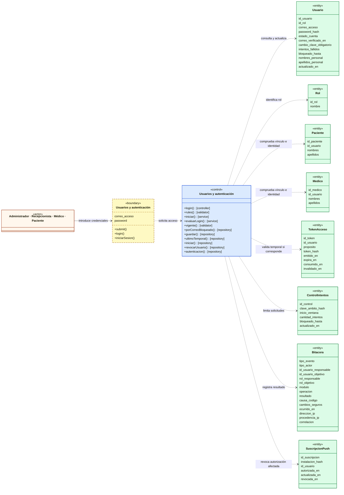

### Restaurar o comprobar el contexto autenticado

`AuthProvider.refreshSession()` utiliza `consultarSesion()` sin reenviar credenciales. El middleware `VerificarCuentaHabilitada` valida la sesión, su huella y sus vínculos; si es restringida, comprueba además la credencial temporal. `AutenticacionController.me()` devuelve `$request->user()` mediante `UsuarioAutenticadoResource`: no llama directamente a `AutenticacionService`. El nombre público se obtiene de la identidad del personal o del vínculo correspondiente; una ficha o un Médico inactivos no impiden por sí solos el login.

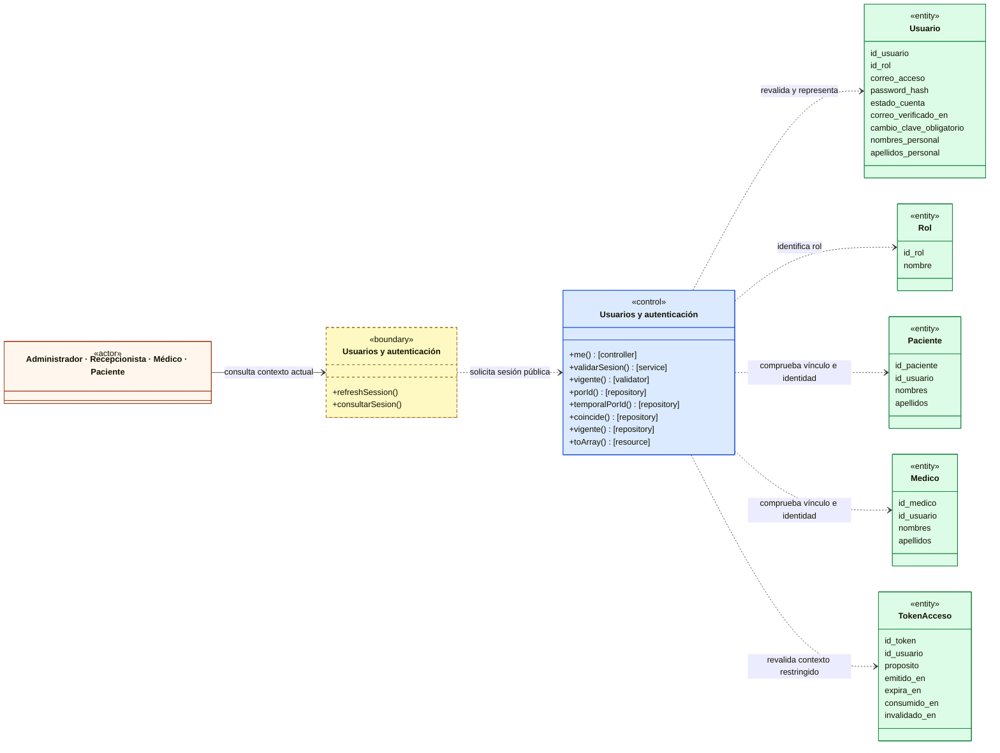

# CU-02 — Cerrar sesión

Los cuatro roles pueden finalizar su propia sesión. El cierre se confirma en el servidor y elimina el contexto autenticado de la interfaz; un fallo de comunicación no se presenta como cierre confirmado.

## P02 — Invalidar la sesión actual

`LogoutButton` llama a `AuthProvider.logout()` y `cerrarSesion()`, sin campos de formulario ni FormRequest propio. El cierre normal invalida la sesión del dispositivo actual y su autorización push. Si se abandona una sesión restringida válida, también se invalidan las credenciales temporales y se revocan las sesiones del usuario, sin restaurar la contraseña anterior. La ruta permite limpiar una sesión inexistente u obsoleta; registra el cierre cuando identifica al usuario y regenera CSRF.

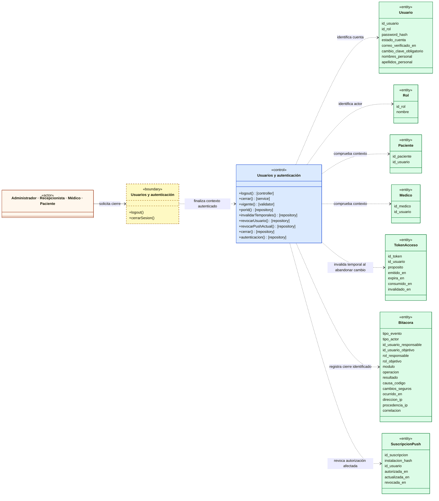

# CU-03 — Administrar cuentas de usuario y su acceso

El Administrador crea e invita personal, consulta cuentas, modifica acceso y roles autorizados y emite credenciales temporales excepcionales. El titular del personal acepta su invitación o completa el cambio obligatorio por separado. Las cuentas de Pacientes solo admiten consulta administrativa mínima y desactivación/reactivación de acceso previamente verificado: no alta, credenciales, cambio de rol ni vinculación por este CU. Las operaciones administrativas exigen sesión normal: la comprobación previa también puede examinar un temporal antes de rechazar una sesión restringida. Cuando se revocan autorizaciones push, se descartan sus envíos pendientes; esto no inicia un flujo de recordatorios ni consulta datos clínicos.

## P03 — Crear personal y emitir o reenviar su invitación

### Crear la cuenta pendiente y emitir la invitación inicial

`NewStaffPage` presenta `StaffForm`; `crearPersonal()` envía rol y correo. Para Administrador/Recepcionista envía `nombres_personal` y `apellidos_personal`; para Médico, únicamente `id_medico` como identidad profesional. El servidor crea una cuenta pendiente y vincula al Médico existente cuando corresponde. Persiste una invitación de 24 horas mediante resumen HMAC y solicita el envío después del commit; un fallo de envío no deshace la cuenta ni demuestra entrega al buzón. La sesión normal del Administrador se revalida sin convertir sus cookies en entradas del formulario. `InvitacionPersonalMail.build()` prepara el mensaje y `BrevoHttpTransport.doSend()` participa solo cuando se utiliza el transporte Brevo, no en un envío simulado.

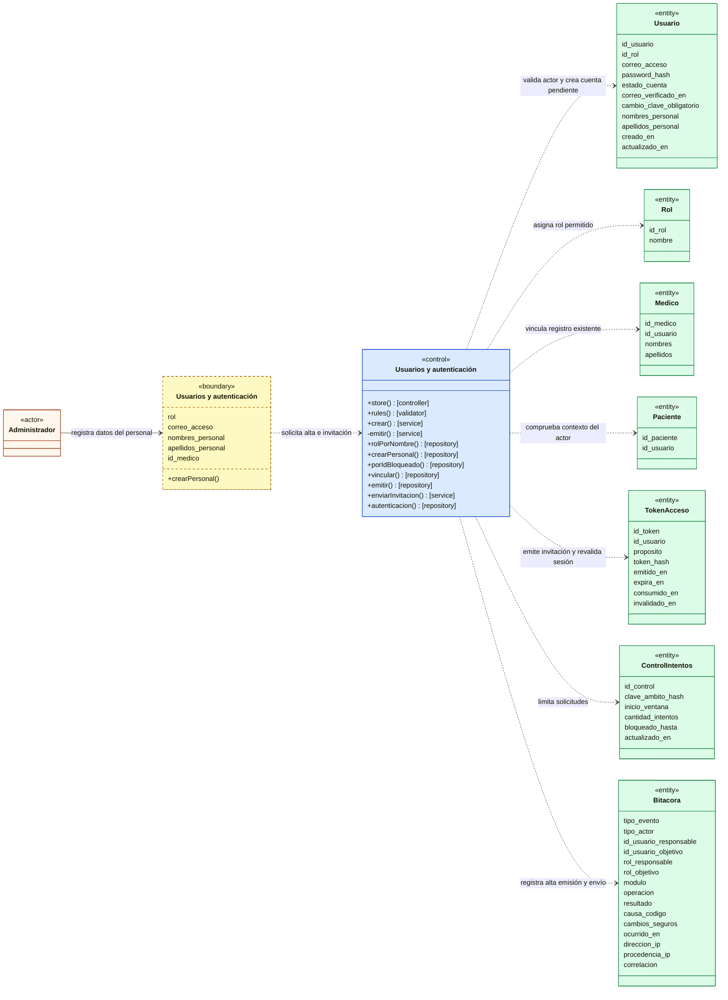

### Reenviar sobre la misma cuenta pendiente

`AccountDetailPage` obtiene el `id` de ruta y solicita `reenviarInvitacion()` tras confirmación. Se comprueba que la cuenta aún admite invitación inicial, se respeta la espera de 60 segundos y el máximo de cinco emisiones por hora, se invalida el enlace anterior y se emite otro sin duplicar la cuenta. La aceptación del envío y su eventual fallo se registran separadamente de la emisión.

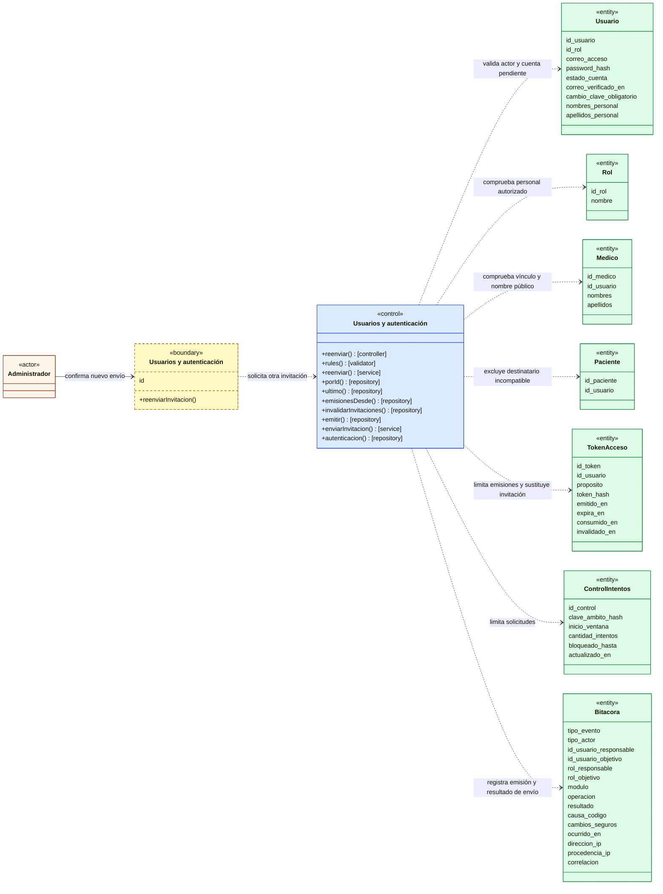

## P04 — Aceptar la invitación y establecer la primera contraseña

El titular invitado —Administrador, Recepcionista o Médico— abre el enlace y envía `token`, `password` y `password_confirmation` mediante `AcceptInvitationPage.submit()` y `aceptarInvitacion()`. El token procede del fragmento del enlace, retirado del historial por `capturarEnlaceRecuperacion()` antes del Router. `AceptarInvitacionRequest.rules()` incorpora las reglas de contraseña de `ClaveRequest.rules()` y `PoliticaClave.reglas()`. La aceptación verifica vigencia y cuenta pendiente, establece el hash, verifica el correo, activa la cuenta y consume la invitación. Invalida solicitudes de cambio de correo y sesiones/autorizaciones push anteriores. No inicia sesión automáticamente ni acepta una invitación con otra sesión abierta.

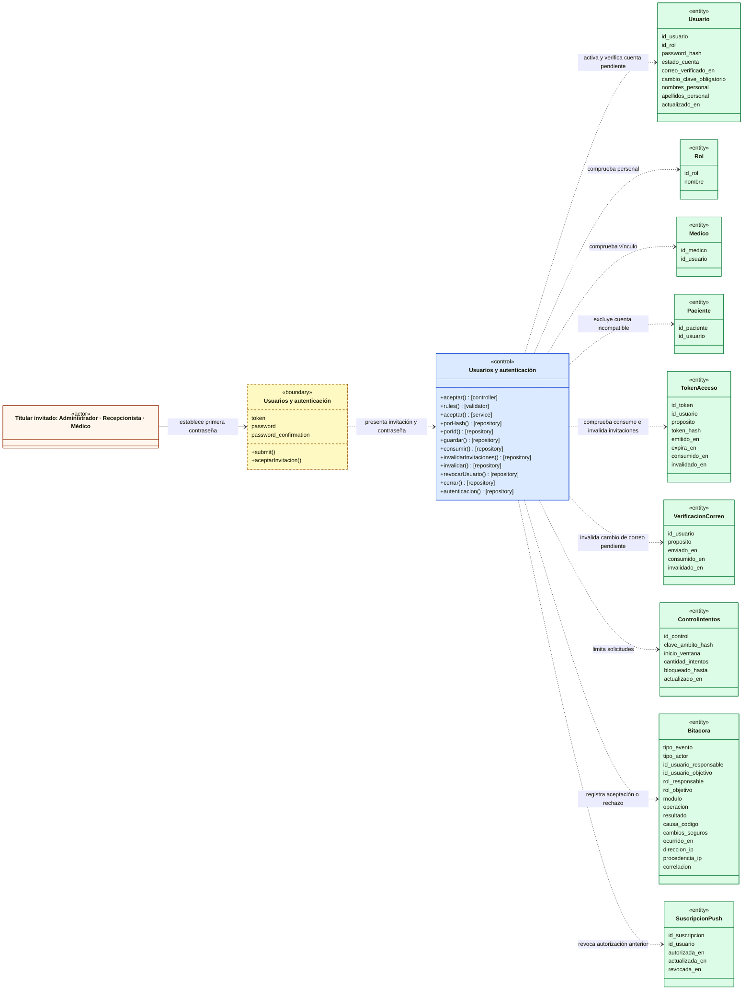

## P05 — Consultar cuentas y su detalle administrativo

`AccountsPage` consulta con `rol`, `estado_cuenta`, `correo_acceso` exacto y paginación; `AccountDetailPage` consulta por `id` de ruta. `useAccountQuery()` coordina ambas lecturas mediante `listarCuentas()` y `consultarCuenta()`. El listado incluye personal y Pacientes verificados con ficha vinculada; para estos últimos no expone identidad de ficha ni información clínica. El nombre del personal procede de sus datos o del Médico vinculado. Estas lecturas no escriben eventos ordinarios de bitácora. `CuentaRequest.rules()` y `withValidator()` validan el detalle; no se atribuye al listado el rechazo explícito de campos extra que solo contiene `CuentaRequest`.

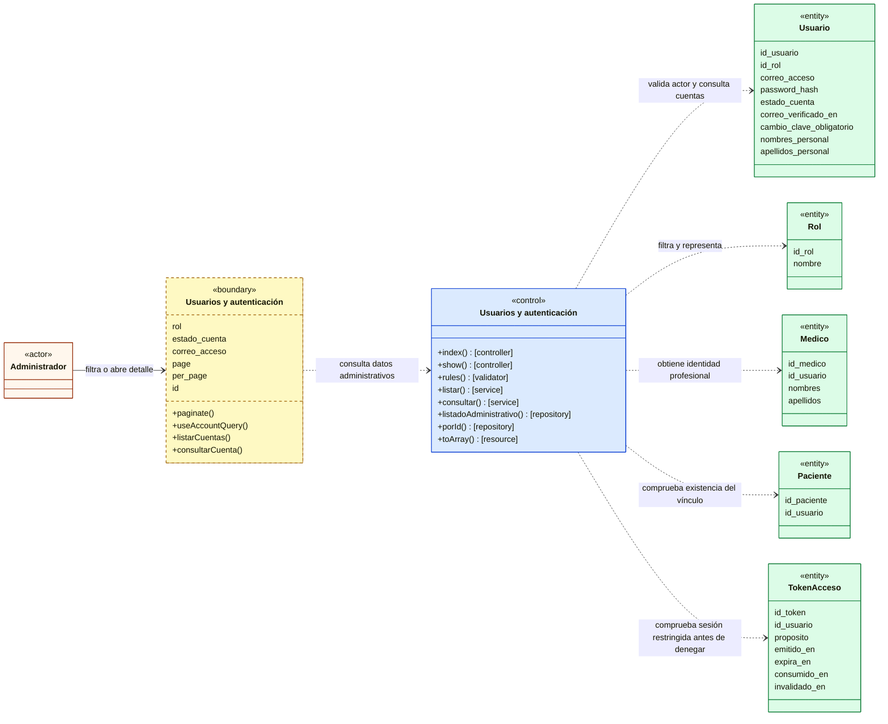

## P06 — Modificar el estado de acceso o el rol

### Desactivar o reactivar el acceso

`AccountActions.submit()` solicita `cambiarEstadoCuenta()` con `id` y `estado_cuenta`, tras confirmación. El servidor admite únicamente el paso entre Activa y Desactivada sobre una cuenta ya verificada y legítimamente vinculada. No activa pendientes, no cambia la ficha del Paciente ni levanta bloqueos temporales. La coordinación y comprobación del último Administrador, la actualización, las invalidaciones y la auditoría se realizan transaccionalmente. Revoca sesiones y autorizaciones push incluso al reactivar; si se modifica la propia cuenta, cierra además el contexto actual. `AuthProvider.mutateAccount()` reconsulta la sesión después del éxito.

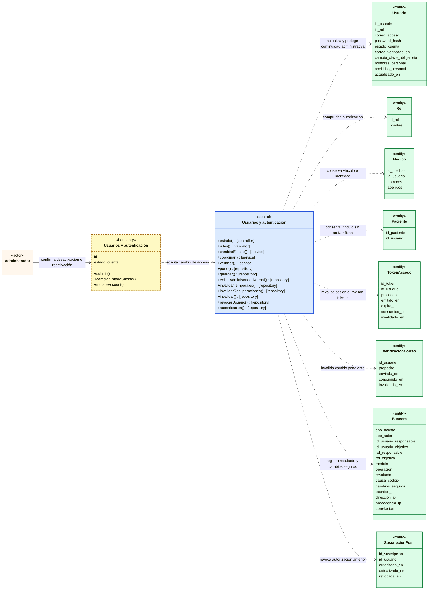

### Cambiar el rol del personal conservando su identidad

`AccountActions.submit()` llama a `cambiarRolCuenta()`. Solo al seleccionar Médico se envía `id_medico`; cuando se crea el vínculo se exige `identidad_verificada`. No se permite convertir Paciente/personal ni reasignar una cuenta a otro Médico. Se conserva el vínculo profesional histórico y se protege al último Administrador. Para retirar Médico, el software exige inactividad profesional y usa `tieneAtencionesSinCierreComprobable()`: rechaza citas distintas de Cancelada/Inasistencia o con consulta asociada, incluso si una cita está Atendida. No consulta versiones clínicas ni solicitudes de laboratorio para presumir un cierre documental inexistente. La operación no cancela ni reasigna atenciones.

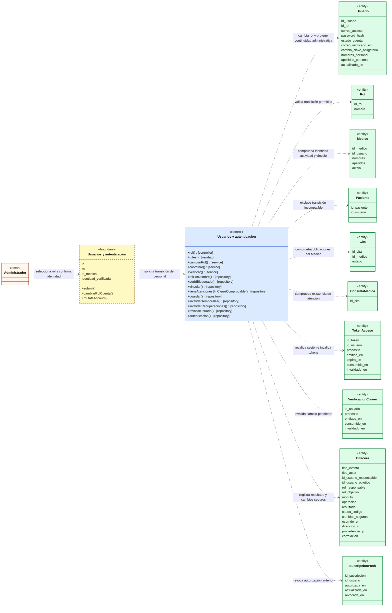

## P07 — Emitir una credencial temporal excepcional

Tras comprobar presencialmente la identidad, el Administrador utiliza `AccountActions.submit()` y `emitirCredencialTemporal()`. El servidor exige personal activo y verificado, protege la continuidad administrativa, marca cambio obligatorio e invalida temporales, recuperaciones, solicitudes de cambio de correo y sesiones anteriores. Genera 20 caracteres con vigencia de 30 minutos y guarda solo su resumen HMAC. `CredentialReceiptHost.show()` presenta el secreto una vez para entrega presencial, fuera de `AuthContext` y sin persistencia del navegador. No cambia todavía el hash anterior ni reinicia bloqueos. Respeta 60 segundos entre emisiones y un máximo de cinco por hora; emitir sobre la propia cuenta termina su sesión normal.

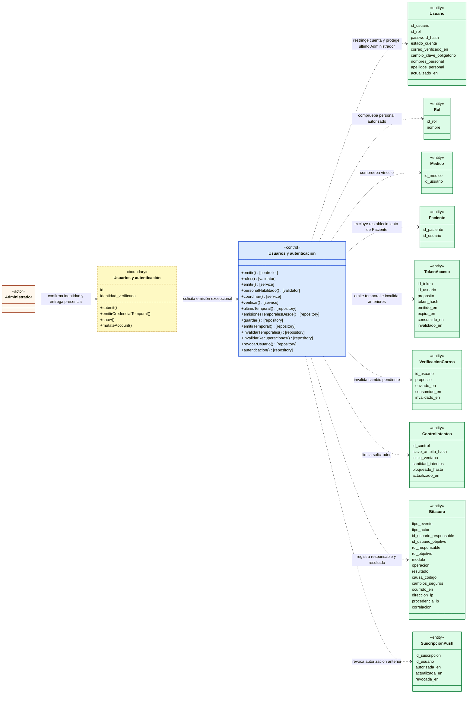

## P08 — Completar el cambio obligatorio del personal

El titular —Administrador, Recepcionista o Médico— ingresa previamente con la credencial temporal por P01 y accede a `RestrictedAccessPage`. `submit()` entrega la nueva contraseña y su confirmación a `AuthProvider.completeTemporaryPassword()` y `completarClaveTemporal()`, sin pedir contraseña anterior ni reenviar el secreto temporal. `CompletarClaveTemporalRequest` hereda `ClaveRequest.rules()`; no declara un método propio. Se exige sesión restringida y temporal vigente antes de guardar el nuevo hash, desmarcar el cambio obligatorio, consumir/inutilizar tokens y revocar sesiones y autorizaciones push. Se invalidan también cambios de correo pendientes. El éxito finaliza la sesión y exige un nuevo login normal, nunca promueve la restringida.

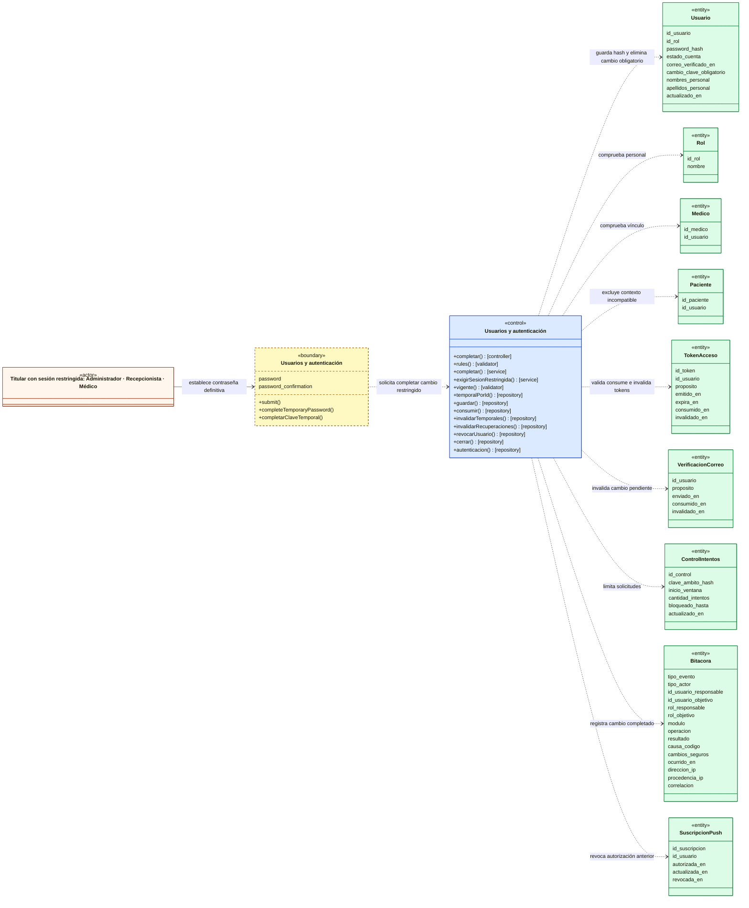

# CU-04 — Registrar cuenta del Paciente y vincular su registro

El Paciente crea su cuenta por uno de dos caminos: registrar una ficha nueva con CI obligatorio o vincular una ficha existente mediante la autorización presencial recibida. Ambos requieren verificar el correo antes de activar la cuenta; no inician sesión automáticamente ni permiten consultar información ajena por conocer un CI o correo.

## P09 — Iniciar el registro de Paciente nuevo y solicitar el código de correo

### Iniciar el registro pendiente

`RegistrationForm.submit()` envía los datos mediante `registrarPaciente()`, sin código de Recepción. El servidor valida las entradas, comprueba CI y correo y reserva un registro pendiente por 24 horas, con la contraseña resumida y los datos necesarios para crear la ficha después. El contexto se conserva en una cookie protegida, no como entrada del formulario. El procesamiento diferido emite, si corresponde, un código de seis dígitos y solicita su envío después del commit. La respuesta genérica de solicitud recibida no confirma emisión ni entrega; el transporte de seguridad distingue envío simulado, aceptado o fallido.

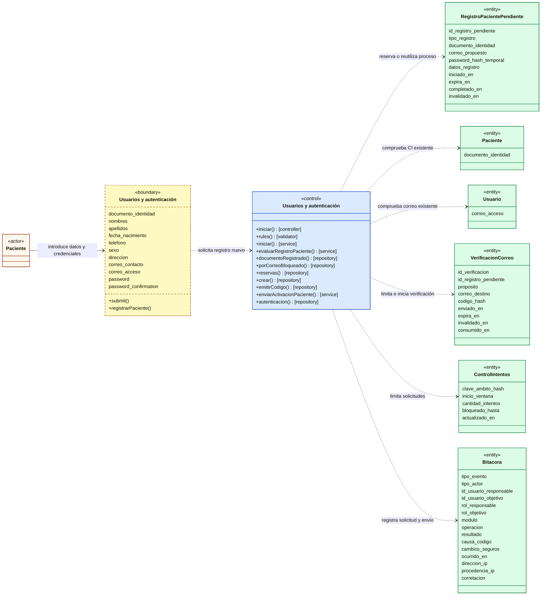

### Solicitar otro código para el registro nuevo

`VerificationForm.run()` ejecuta `reenviarCodigoRegistro()` sin enviar CI, correo ni contraseña: el servidor localiza el proceso por la cookie protegida. Solo emite otro código si el registro nuevo sigue vigente, han pasado 60 segundos y no se alcanzaron cinco emisiones por hora por proceso o correo. Invalida el código anterior sin ampliar las 24 horas. La interfaz sigue mostrando una solicitud recibida, no una entrega confirmada.

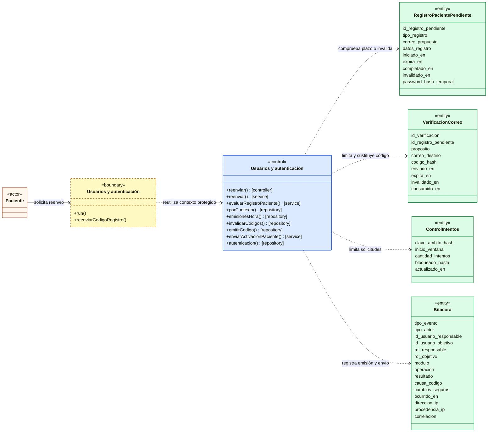

## P10 — Verificar el correo y crear la ficha y la cuenta nuevas

`VerificationForm.run()` entrega `codigo` a `verificarRegistro()`. El servidor comprueba contexto, vigencia y cinco errores máximos, revalida CI y correo y crea atómicamente `Usuario` con rol Paciente y una ficha nueva. Los dos `crearPaciente()` representados pertenecen a repositorios distintos: uno crea la cuenta y otro la ficha. Consume la verificación, completa el proceso y elimina sus datos y hash temporales. Al terminar cierra el contexto de sesión, retira la cookie de registro y permite iniciar sesión, sin autenticar automáticamente.

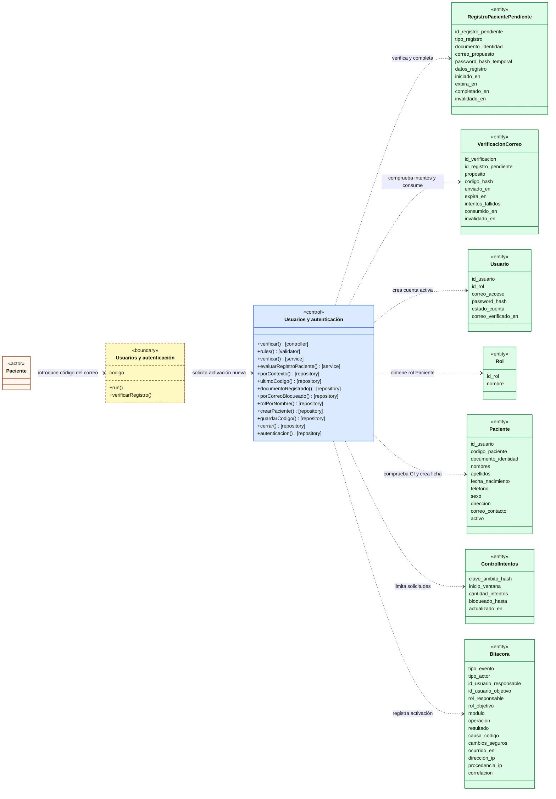

## P12 — Reservar la vinculación de una ficha existente y verificar su correo

### Presentar la autorización de vinculación

`RegistrationForm.submit()` usa `vincularPaciente()` con CI, código presencial, correo y contraseña. El servidor comprueba la ficha sin cuenta, la correspondencia y vigencia del código y la exclusividad del proceso protegido; un error de código incrementa sus intentos y puede invalidarlo. Reserva la vinculación hasta el vencimiento de la autorización original y solicita el segundo código por correo después del commit. No crea todavía una cuenta ni consume definitivamente el código presencial; tampoco muestra datos de la ficha. La respuesta genérica no confirma envío ni entrega.

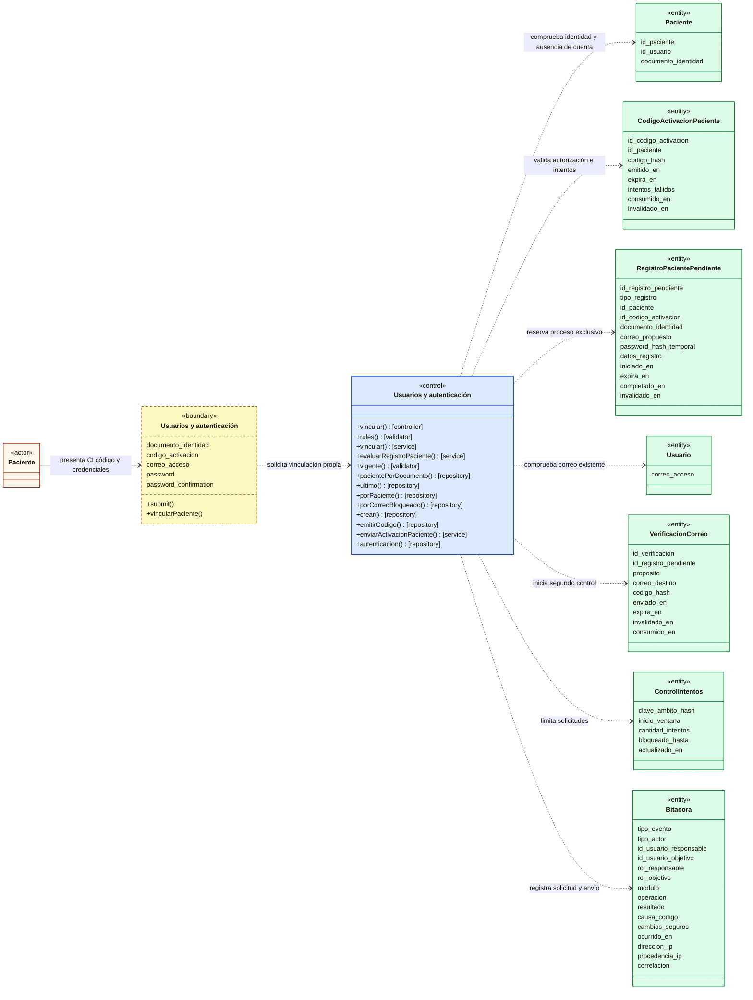

### Solicitar otro código de correo para la vinculación

La misma interfaz de verificación ejecuta `run()` y `reenviarCodigoRegistro()` sin volver a transmitir los secretos iniciales. Para este contexto de vinculación el servidor revalida también que la ficha siga sin cuenta, conserve el CI y que el código presencial permanezca vigente. El reenvío sustituye únicamente el código de correo, respeta los 60 segundos y cinco emisiones por hora y no amplía el plazo de la autorización presencial. No vuelve a emitir esa autorización ni confirma entrega del correo.

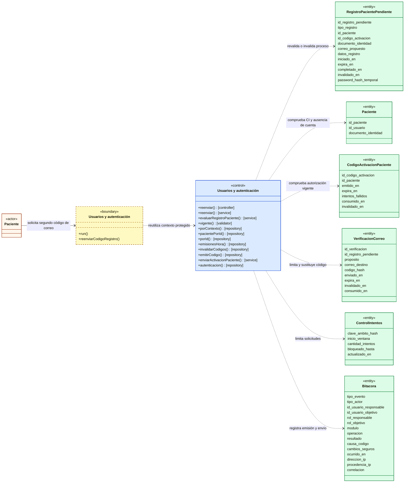

## P13 — Confirmar el correo y vincular la cuenta a la ficha original

`VerificationForm.run()` llama a `verificarRegistro()` con el segundo código. El servidor revalida el proceso, la verificación de correo, la ficha y la autorización presencial; comprueba nuevamente el correo único y crea la cuenta de rol Paciente. Vincula esa cuenta a la misma ficha y consume ambos códigos dentro de la transacción, sin crear otra ficha ni modificar su historial. Completa y limpia el registro pendiente, cierra el contexto de sesión y retira la cookie de registro. La interfaz ofrece iniciar sesión después del éxito, no acceso automático.

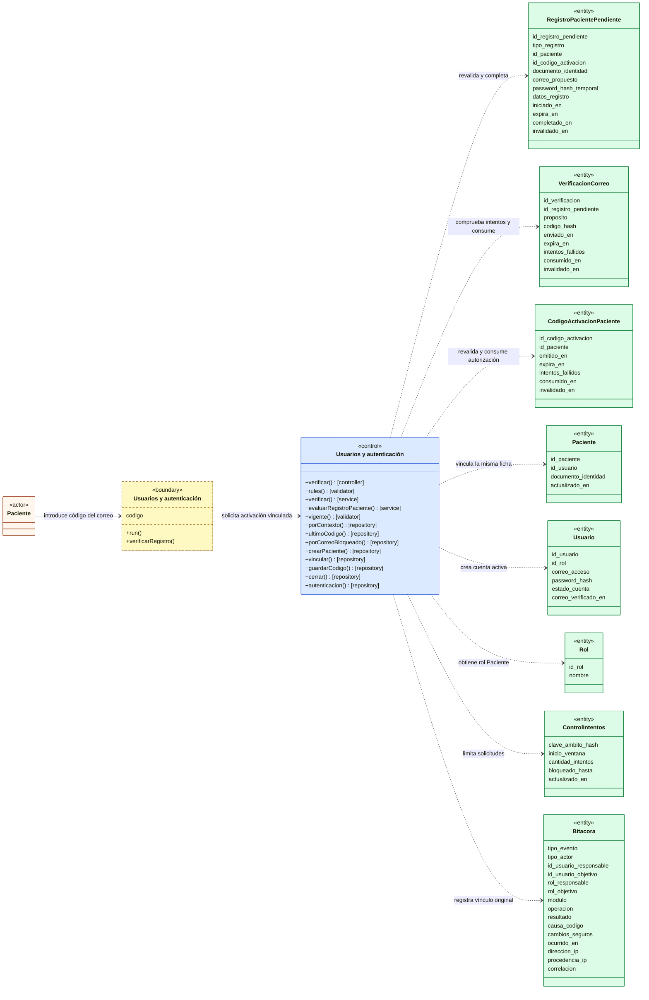

# CU-05 — Cambiar contraseña propia

Los cuatro roles cambian su contraseña desde una sesión normal, acreditando la contraseña actual y confirmando una nueva que cumpla la política vigente. No cambia la identidad ni los permisos de la cuenta; este flujo es distinto del cambio obligatorio del personal.

## P14 — Actualizar la contraseña propia y renovar la sesión actual

`ChangePasswordPage.submit()` pasa las entradas a `AuthProvider.updatePassword()` y `cambiarClave()`. El servidor revalida la sesión bajo bloqueo y comprueba la contraseña actual antes de guardar el nuevo hash. Invalida recuperaciones y cambios de correo pendientes, revoca las sesiones previas y renueva de forma segura la actual. La revocación también retira autorizaciones push y descarta envíos pendientes, sin representar sus tablas técnicas. `TokenAcceso` interviene además al comprobar una eventual sesión restringida, que no autoriza este cambio ordinario. El frontend vuelve a consultar la sesión después del éxito.

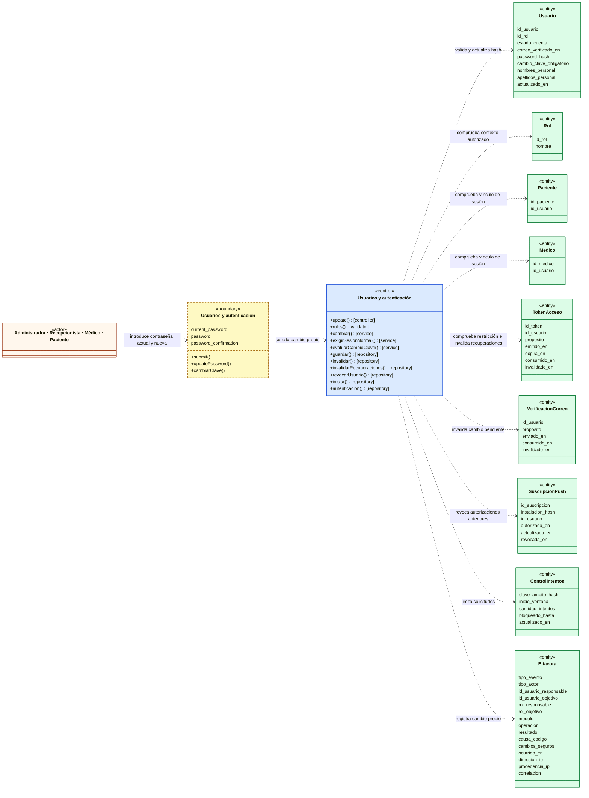

# CU-06 — Recuperar contraseña mediante correo electrónico

Los cuatro roles solicitan un enlace temporal al correo de acceso previamente verificado, sin revelar públicamente si existe una cuenta. El enlace es de un solo uso y dura 60 minutos; restablecer no reactiva cuentas ni inicia sesión automáticamente.

## P15 — Solicitar el enlace de recuperación

`ForgotPasswordPage` llama a `solicitarRecuperacion()` desde su manejador de envío. El servidor aplica límites por correo y origen y devuelve siempre una respuesta general para el correo validado. En el procesamiento diferido comprueba cuenta activa, correo verificado, rol y vínculos coherentes, sin cambio obligatorio de contraseña. Si corresponde, invalida recuperaciones anteriores, guarda el resumen de un token nuevo y solicita el envío del enlace después del commit. La respuesta recibida no acredita entrega; un envío simulado tampoco equivale a correo real.

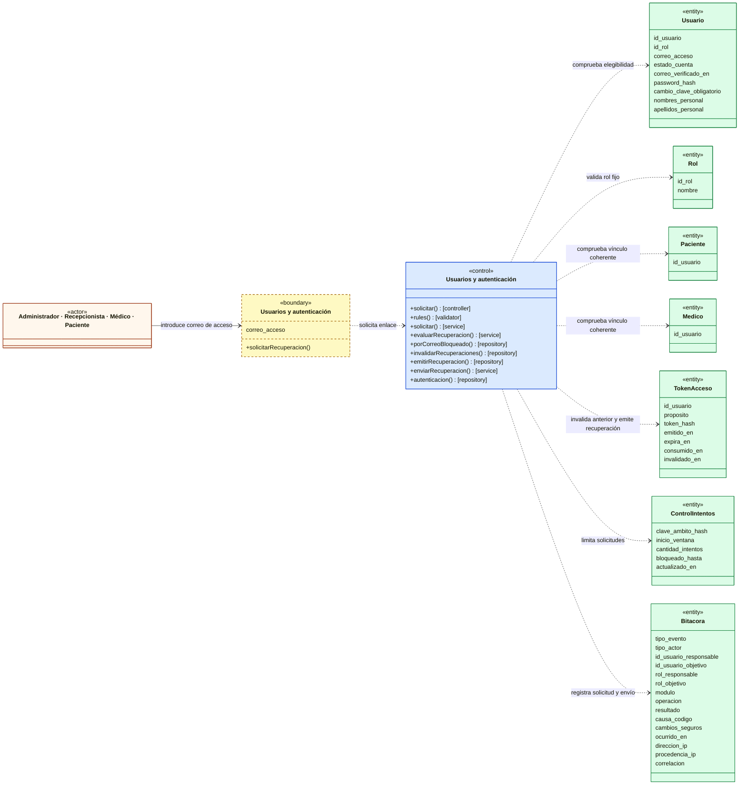

## P16 — Restablecer la contraseña con el enlace recibido

`capturarEnlaceRecuperacion()` recoge el token del fragmento del enlace y lo retira de la URL antes del Router. `ResetPasswordPage.submit()` utiliza `updatePassword()` y `restablecerClave()` con el token y la nueva contraseña confirmada. El servidor bloquea primero la cuenta y después el token, revalida elegibilidad, vigencia y uso y guarda el nuevo hash; consume el token, invalida las recuperaciones restantes y los cambios de correo pendientes y revoca sesiones y autorizaciones push, descartando sus envíos pendientes. No autentica ni elimina bloqueos temporales de login. Cierra la sesión del navegador si está vacía o corresponde a la cuenta recuperada, pero conserva una sesión de otra cuenta. Después del éxito el frontend consulta la sesión vigente y ofrece volver a iniciar sesión.

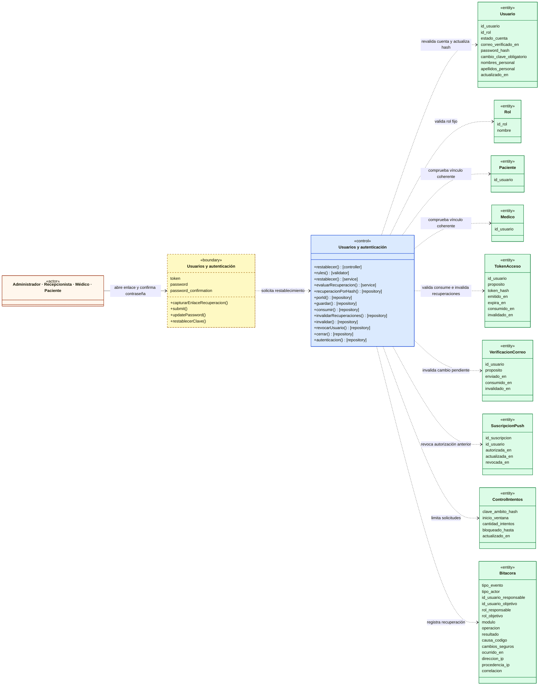

# CU-07 — Gestionar el registro administrativo de pacientes

Administrador y Recepcionista mantienen la ficha administrativa y entregan la autorización presencial para vincularla por CU-04. La ficha y su estado son independientes de la cuenta web: estas operaciones no crean cuentas, no administran credenciales ni editan contenido clínico. Las vistas parten de una sesión normal habilitada, comprobada mediante el mecanismo de CU-01.

## P11 — Emitir el código de activación presencial

La interfaz entrega el identificador interno y `identidad_verificada`; no usa el CI como prueba automática de identidad. `emitir()` exige comprobación presencial, CI válido y ausencia de cuenta vinculada. Invalida códigos anteriores y procesos de vinculación pendientes, incluidas sus verificaciones de correo, y genera doce caracteres alfanuméricos, vigentes 24 horas y con cinco intentos. Solo conserva su resumen protegido y registra al emisor real en `id_recepcionista`, también si es Administrador. El secreto se muestra una vez para entrega presencial: no activa ficha ni cuenta. El envío posterior al correo pertenece a CU-04, no a esta emisión.

```mermaid
classDiagram
    direction LR
    class Actores["Administrador · Recepcionista"] {
        <<actor>>
    }
    class InterfazP11["Pacientes y perfil personal"] {
        <<boundary>>
        id_paciente
        identidad_verificada
        +emitirCodigoActivacion()
    }
    class ControlP11["Pacientes y perfil personal"] {
        <<control>>
        +emitir() [controller]
        +rules() [validator]
        +emitir() [service]
        +documentoValido() [validator]
        +exigirSesionNormal() [service]
        +evaluarRegistroPaciente() [service]
        +coordinar() [repository]
        +pacientePorId() [repository]
        +porPaciente() [repository]
        +invalidar() [repository]
        +invalidarAnteriores() [repository]
        +crear() [repository]
        +autenticacion() [repository]
    }
    class Usuario {
        <<entity>>
        id_usuario
        id_rol
        estado_cuenta
        correo_verificado_en
        password_hash
        cambio_clave_obligatorio
        nombres_personal
        apellidos_personal
    }
    class Rol {
        <<entity>>
        id_rol
        nombre
    }
    class Paciente {
        <<entity>>
        id_paciente
        id_usuario
        documento_identidad
    }
    class CodigoActivacionPaciente {
        <<entity>>
        id_codigo_activacion
        id_paciente
        id_recepcionista
        codigo_hash
        emitido_en
        expira_en
        intentos_fallidos
        consumido_en
        invalidado_en
    }
    class RegistroPacientePendiente {
        <<entity>>
        id_registro_pendiente
        id_paciente
        completado_en
        invalidado_en
        password_hash_temporal
        datos_registro
    }
    class VerificacionCorreo {
        <<entity>>
        id_registro_pendiente
        proposito
        consumido_en
        invalidado_en
    }
    class ControlIntentos {
        <<entity>>
        clave_ambito_hash
        inicio_ventana
        cantidad_intentos
        bloqueado_hasta
        actualizado_en
    }
    class Bitacora {
        <<entity>>
        tipo_evento
        tipo_actor
        id_usuario_responsable
        id_usuario_objetivo
        rol_responsable
        rol_objetivo
        modulo
        operacion
        resultado
        causa_codigo
        cambios_seguros
        ocurrido_en
        direccion_ip
        procedencia_ip
        correlacion
    }
    Actores --> InterfazP11 : comprueban identidad y solicitan emisión
    InterfazP11 ..> ControlP11 : entrega autorización presencial
    ControlP11 ..> Usuario : verifica cuenta del emisor
    ControlP11 ..> Rol : autoriza gestión administrativa
    ControlP11 ..> Paciente : comprueba CI y ausencia de vínculo
    ControlP11 ..> CodigoActivacionPaciente : sustituye autorización
    ControlP11 ..> RegistroPacientePendiente : invalida procesos anteriores
    ControlP11 ..> VerificacionCorreo : invalida códigos de esos procesos
    ControlP11 ..> ControlIntentos : limita solicitudes
    ControlP11 ..> Bitacora : registra emisión sin secreto
    style Actores fill:#fff7ed,stroke:#9a3412
    style InterfazP11 fill:#fef9c3,stroke:#a16207,stroke-dasharray:5 5
    style ControlP11 fill:#dbeafe,stroke:#1d4ed8
    style Usuario fill:#dcfce7,stroke:#15803d
    style Rol fill:#dcfce7,stroke:#15803d
    style Paciente fill:#dcfce7,stroke:#15803d
    style CodigoActivacionPaciente fill:#dcfce7,stroke:#15803d
    style RegistroPacientePendiente fill:#dcfce7,stroke:#15803d
    style VerificacionCorreo fill:#dcfce7,stroke:#15803d
    style ControlIntentos fill:#dcfce7,stroke:#15803d
    style Bitacora fill:#dcfce7,stroke:#15803d
```

## P17 — Consultar y dar de alta la ficha administrativa

### Buscar fichas y consultar el detalle

`listarPacientes()` filtra por CI exacto, nombres, apellidos y estado, con paginación. `consultarPaciente()` recupera la ficha seleccionada, su contacto de emergencia y preferencia de recordatorios, sin información clínica ni credenciales de la cuenta vinculada. La consulta permite revisar fichas previas, incluidas inactivas o sin CI; la semejanza de nombres no autoriza fusionarlas. El listado y el detalle no generan eventos de lectura en bitácora. El historial de citas se consulta por CU-21, no por este procedimiento.

```mermaid
classDiagram
    direction LR
    class Actores["Administrador · Recepcionista"] {
        <<actor>>
    }
    class InterfazP17Consulta["Pacientes y perfil personal"] {
        <<boundary>>
        documento_identidad
        nombres
        apellidos
        activo
        page
        per_page
        id
        +listarPacientes()
        +consultarPaciente()
    }
    class ControlP17Consulta["Pacientes y perfil personal"] {
        <<control>>
        +index() [controller]
        +show() [controller]
        +rules() [validator]
        +listar() [service]
        +consultar() [service]
        +exigirSesionNormal() [service]
        +listar() [repository]
        +consultar() [repository]
    }
    class Usuario {
        <<entity>>
        id_usuario
        id_rol
        estado_cuenta
        correo_verificado_en
        password_hash
        cambio_clave_obligatorio
        nombres_personal
        apellidos_personal
    }
    class Rol {
        <<entity>>
        id_rol
        nombre
    }
    class Paciente {
        <<entity>>
        id_paciente
        codigo_paciente
        id_usuario
        documento_identidad
        nombres
        apellidos
        fecha_nacimiento
        sexo
        telefono
        correo_contacto
        direccion
        activo
        actualizado_en
    }
    class ContactoEmergencia {
        <<entity>>
        id_paciente
        nombre
        parentesco
        telefono
    }
    class PreferenciaPaciente {
        <<entity>>
        id_paciente
        recordatorios_habilitados
    }
    Actores --> InterfazP17Consulta : buscan y seleccionan ficha
    InterfazP17Consulta ..> ControlP17Consulta : solicita listado o detalle
    ControlP17Consulta ..> Usuario : verifica cuenta del actor
    ControlP17Consulta ..> Rol : autoriza consulta administrativa
    ControlP17Consulta ..> Paciente : filtra y recupera datos administrativos
    ControlP17Consulta ..> ContactoEmergencia : consulta contacto
    ControlP17Consulta ..> PreferenciaPaciente : consulta preferencia sin modificarla
    style Actores fill:#fff7ed,stroke:#9a3412
    style InterfazP17Consulta fill:#fef9c3,stroke:#a16207,stroke-dasharray:5 5
    style ControlP17Consulta fill:#dbeafe,stroke:#1d4ed8
    style Usuario fill:#dcfce7,stroke:#15803d
    style Rol fill:#dcfce7,stroke:#15803d
    style Paciente fill:#dcfce7,stroke:#15803d
    style ContactoEmergencia fill:#dcfce7,stroke:#15803d
    style PreferenciaPaciente fill:#dcfce7,stroke:#15803d
```

### Registrar la ficha, excepcionalmente sin CI

`NewPatientPage.search()` permite revisar fichas anteriores y `submit()` envía el alta mediante `crearPaciente()`. Sin CI exige `posibles_duplicados_revisados` y conserva el documento ausente; con CI verifica unicidad y reservas de registro pendientes, rechazando las vigentes e invalidando las vencidas y sus códigos. Genera el código interno de la nueva ficha y guarda el contacto de emergencia si se aportó. No crea cuenta web ni autorización de activación; la preferencia solo se recupera para la respuesta, no se establece desde el alta administrativa.

```mermaid
classDiagram
    direction LR
    class Actores["Administrador · Recepcionista"] {
        <<actor>>
    }
    class InterfazP17Alta["Pacientes y perfil personal"] {
        <<boundary>>
        documento_identidad
        nombres
        apellidos
        fecha_nacimiento
        sexo
        telefono
        correo_contacto
        direccion
        contacto_emergencia.nombre
        contacto_emergencia.parentesco
        contacto_emergencia.telefono
        posibles_duplicados_revisados
        +search()
        +submit()
        +crearPaciente()
    }
    class ControlP17Alta["Pacientes y perfil personal"] {
        <<control>>
        +store() [controller]
        +rules() [validator]
        +crear() [service]
        +exigirSesionNormal() [service]
        +coordinar() [repository]
        +documentoRegistrado() [repository]
        +reservasPorDocumento() [repository]
        +invalidar() [repository]
        +crear() [repository]
        +pacienteCreado() [repository]
    }
    class Usuario {
        <<entity>>
        id_usuario
        id_rol
        estado_cuenta
        correo_verificado_en
        password_hash
        cambio_clave_obligatorio
        nombres_personal
        apellidos_personal
    }
    class Rol {
        <<entity>>
        id_rol
        nombre
    }
    class Paciente {
        <<entity>>
        id_paciente
        codigo_paciente
        id_usuario
        documento_identidad
        nombres
        apellidos
        fecha_nacimiento
        sexo
        telefono
        correo_contacto
        direccion
        activo
        creado_en
        actualizado_en
    }
    class ContactoEmergencia {
        <<entity>>
        id_paciente
        nombre
        parentesco
        telefono
    }
    class PreferenciaPaciente {
        <<entity>>
        id_paciente
        recordatorios_habilitados
    }
    class RegistroPacientePendiente {
        <<entity>>
        id_registro_pendiente
        documento_identidad
        expira_en
        completado_en
        invalidado_en
        password_hash_temporal
        datos_registro
    }
    class VerificacionCorreo {
        <<entity>>
        id_registro_pendiente
        proposito
        consumido_en
        invalidado_en
    }
    class Bitacora {
        <<entity>>
        tipo_evento
        tipo_actor
        id_usuario_responsable
        rol_responsable
        modulo
        operacion
        resultado
        referencias
        cambios_seguros
        ocurrido_en
        direccion_ip
        procedencia_ip
        correlacion
    }
    Actores --> InterfazP17Alta : revisan fichas y aportan datos
    InterfazP17Alta ..> ControlP17Alta : solicita alta administrativa
    ControlP17Alta ..> Usuario : verifica cuenta del actor
    ControlP17Alta ..> Rol : autoriza alta
    ControlP17Alta ..> Paciente : comprueba CI y crea ficha
    ControlP17Alta ..> ContactoEmergencia : crea contacto opcional
    ControlP17Alta ..> PreferenciaPaciente : consulta relación para la respuesta
    ControlP17Alta ..> RegistroPacientePendiente : comprueba reservas e invalida vencidas
    ControlP17Alta ..> VerificacionCorreo : invalida códigos de reservas vencidas
    ControlP17Alta ..> Bitacora : registra alta sin contenido clínico
    style Actores fill:#fff7ed,stroke:#9a3412
    style InterfazP17Alta fill:#fef9c3,stroke:#a16207,stroke-dasharray:5 5
    style ControlP17Alta fill:#dbeafe,stroke:#1d4ed8
    style Usuario fill:#dcfce7,stroke:#15803d
    style Rol fill:#dcfce7,stroke:#15803d
    style Paciente fill:#dcfce7,stroke:#15803d
    style ContactoEmergencia fill:#dcfce7,stroke:#15803d
    style PreferenciaPaciente fill:#dcfce7,stroke:#15803d
    style RegistroPacientePendiente fill:#dcfce7,stroke:#15803d
    style VerificacionCorreo fill:#dcfce7,stroke:#15803d
    style Bitacora fill:#dcfce7,stroke:#15803d
```

## P18 — Actualizar la ficha, incorporar CI y gestionar su estado

### Actualizar datos administrativos e incorporar o corregir el CI

`PatientEditor.submit()` envía únicamente los cambios mediante `actualizarPaciente()`. El servidor compara `actualizado_en_original` con la ficha bloqueada y rechaza ediciones obsoletas. Corregir identidad, incluido incorporar CI, exige comprobación presencial y motivo; un CI informado no se retira. Un cambio efectivo de CI comprueba unicidad y reservas, invalida atómicamente los códigos presenciales y procesos pendientes de la ficha con sus verificaciones, conservando ID, código, cuenta e historial. Contacto y emergencia se actualizan sin editar preferencias del titular ni contenido clínico.

```mermaid
classDiagram
    direction LR
    class Actores["Administrador · Recepcionista"] {
        <<actor>>
    }
    class InterfazP18Edicion["Pacientes y perfil personal"] {
        <<boundary>>
        id
        documento_identidad
        nombres
        apellidos
        fecha_nacimiento
        sexo
        telefono
        correo_contacto
        direccion
        contacto_emergencia.nombre
        contacto_emergencia.parentesco
        contacto_emergencia.telefono
        actualizado_en_original
        identidad_verificada
        motivo
        +submit()
        +actualizarPaciente()
    }
    class ControlP18Edicion["Pacientes y perfil personal"] {
        <<control>>
        +update() [controller]
        +rules() [validator]
        +actualizar() [service]
        +exigirSesionNormal() [service]
        +coordinar() [repository]
        +consultar() [repository]
        +documentoRegistrado() [repository]
        +reservasPorDocumento() [repository]
        +porPaciente() [repository]
        +invalidar() [repository]
        +invalidarAnteriores() [repository]
        +guardarEmergencia() [repository]
        +guardar() [repository]
        +pacienteModificado() [repository]
    }
    class Usuario {
        <<entity>>
        id_usuario
        id_rol
        estado_cuenta
        correo_verificado_en
        password_hash
        cambio_clave_obligatorio
        nombres_personal
        apellidos_personal
    }
    class Rol {
        <<entity>>
        id_rol
        nombre
    }
    class Paciente {
        <<entity>>
        id_paciente
        codigo_paciente
        id_usuario
        documento_identidad
        nombres
        apellidos
        fecha_nacimiento
        sexo
        telefono
        correo_contacto
        direccion
        activo
        actualizado_en
    }
    class ContactoEmergencia {
        <<entity>>
        id_paciente
        nombre
        parentesco
        telefono
    }
    class PreferenciaPaciente {
        <<entity>>
        id_paciente
        recordatorios_habilitados
    }
    class CodigoActivacionPaciente {
        <<entity>>
        id_paciente
        consumido_en
        invalidado_en
    }
    class RegistroPacientePendiente {
        <<entity>>
        id_registro_pendiente
        id_paciente
        documento_identidad
        expira_en
        completado_en
        invalidado_en
        password_hash_temporal
        datos_registro
    }
    class VerificacionCorreo {
        <<entity>>
        id_registro_pendiente
        proposito
        consumido_en
        invalidado_en
    }
    class Bitacora {
        <<entity>>
        tipo_evento
        tipo_actor
        id_usuario_responsable
        rol_responsable
        modulo
        operacion
        resultado
        referencias
        cambios_seguros
        metadatos_seguros
        ocurrido_en
        direccion_ip
        procedencia_ip
        correlacion
    }
    Actores --> InterfazP18Edicion : revisan y confirman cambios
    InterfazP18Edicion ..> ControlP18Edicion : solicita actualización versionada
    ControlP18Edicion ..> Usuario : verifica cuenta del actor
    ControlP18Edicion ..> Rol : autoriza edición administrativa
    ControlP18Edicion ..> Paciente : revalida versión y conserva identidad de ficha
    ControlP18Edicion ..> ContactoEmergencia : guarda o retira contacto
    ControlP18Edicion ..> PreferenciaPaciente : consulta sin modificar
    ControlP18Edicion ..> CodigoActivacionPaciente : invalida por cambio efectivo de CI
    ControlP18Edicion ..> RegistroPacientePendiente : comprueba reservas e invalida procesos
    ControlP18Edicion ..> VerificacionCorreo : invalida códigos de esos procesos
    ControlP18Edicion ..> Bitacora : registra campos y motivo administrativo
    style Actores fill:#fff7ed,stroke:#9a3412
    style InterfazP18Edicion fill:#fef9c3,stroke:#a16207,stroke-dasharray:5 5
    style ControlP18Edicion fill:#dbeafe,stroke:#1d4ed8
    style Usuario fill:#dcfce7,stroke:#15803d
    style Rol fill:#dcfce7,stroke:#15803d
    style Paciente fill:#dcfce7,stroke:#15803d
    style ContactoEmergencia fill:#dcfce7,stroke:#15803d
    style PreferenciaPaciente fill:#dcfce7,stroke:#15803d
    style CodigoActivacionPaciente fill:#dcfce7,stroke:#15803d
    style RegistroPacientePendiente fill:#dcfce7,stroke:#15803d
    style VerificacionCorreo fill:#dcfce7,stroke:#15803d
    style Bitacora fill:#dcfce7,stroke:#15803d
```

### Desactivar o reactivar la ficha

`cambiarEstadoPaciente()` envía el estado solicitado, motivo obligatorio y versión original tras confirmación visual. `cambiarEstado()` bloquea y revalida la misma ficha, guarda y audita solo un cambio efectivo. Desactivar impide nuevas reservas sin cancelar citas ni cerrar la cuenta; reactivar restablece únicamente la elegibilidad administrativa, sin quitar bloqueos de acceso ni restaurar citas. Las relaciones de emergencia y preferencia se consultan para devolver el detalle, no se modifican.

```mermaid
classDiagram
    direction LR
    class Actores["Administrador · Recepcionista"] {
        <<actor>>
    }
    class InterfazP18Estado["Pacientes y perfil personal"] {
        <<boundary>>
        id
        activo
        motivo
        actualizado_en_original
        +cambiarEstadoPaciente()
    }
    class ControlP18Estado["Pacientes y perfil personal"] {
        <<control>>
        +estado() [controller]
        +rules() [validator]
        +cambiarEstado() [service]
        +exigirSesionNormal() [service]
        +coordinar() [repository]
        +consultar() [repository]
        +guardar() [repository]
        +pacienteModificado() [repository]
    }
    class Usuario {
        <<entity>>
        id_usuario
        id_rol
        estado_cuenta
        correo_verificado_en
        password_hash
        cambio_clave_obligatorio
        nombres_personal
        apellidos_personal
    }
    class Rol {
        <<entity>>
        id_rol
        nombre
    }
    class Paciente {
        <<entity>>
        id_paciente
        codigo_paciente
        id_usuario
        documento_identidad
        nombres
        apellidos
        fecha_nacimiento
        sexo
        telefono
        correo_contacto
        direccion
        activo
        actualizado_en
    }
    class ContactoEmergencia {
        <<entity>>
        id_paciente
        nombre
        parentesco
        telefono
    }
    class PreferenciaPaciente {
        <<entity>>
        id_paciente
        recordatorios_habilitados
    }
    class Bitacora {
        <<entity>>
        tipo_evento
        tipo_actor
        id_usuario_responsable
        rol_responsable
        modulo
        operacion
        resultado
        referencias
        cambios_seguros
        metadatos_seguros
        ocurrido_en
        direccion_ip
        procedencia_ip
        correlacion
    }
    Actores --> InterfazP18Estado : confirman estado y motivo
    InterfazP18Estado ..> ControlP18Estado : solicita cambio versionado
    ControlP18Estado ..> Usuario : verifica cuenta del actor sin modificarla
    ControlP18Estado ..> Rol : autoriza gestión de ficha
    ControlP18Estado ..> Paciente : cambia únicamente estado y fecha de actualización
    ControlP18Estado ..> ContactoEmergencia : consulta para la respuesta
    ControlP18Estado ..> PreferenciaPaciente : consulta para la respuesta
    ControlP18Estado ..> Bitacora : registra cambio y motivo
    style Actores fill:#fff7ed,stroke:#9a3412
    style InterfazP18Estado fill:#fef9c3,stroke:#a16207,stroke-dasharray:5 5
    style ControlP18Estado fill:#dbeafe,stroke:#1d4ed8
    style Usuario fill:#dcfce7,stroke:#15803d
    style Rol fill:#dcfce7,stroke:#15803d
    style Paciente fill:#dcfce7,stroke:#15803d
    style ContactoEmergencia fill:#dcfce7,stroke:#15803d
    style PreferenciaPaciente fill:#dcfce7,stroke:#15803d
    style Bitacora fill:#dcfce7,stroke:#15803d
```

# CU-08 — Actualizar el perfil personal

Exclusivamente el Paciente autenticado consulta y actualiza su propio contacto, emergencia y preferencia de recordatorios, y gestiona el cambio verificado de su correo de acceso. No edita identidad, estado de ficha, vínculo, credenciales ajenas ni contenido clínico. Una ficha inactiva conserva estos permisos si la cuenta continúa habilitada.

## P19 — Consultar y actualizar el perfil propio

`consultarMiPerfil()` obtiene la ficha vinculada a la sesión, sin aceptar un identificador de otro Paciente. `ProfileEditor.submit()` envía solo contacto, emergencia y preferencia modificados a `actualizarMiPerfil()`, con `actualizado_en_original`. El servidor rechaza una versión obsoleta y registra cambios efectivos. La identidad y el estado se muestran solo para consulta; el correo de contacto no modifica el correo de acceso. Guardar la preferencia no genera recordatorios. Al crear una preferencia antes ausente, el repositorio inicializa `preferencias_privacidad` vacío; no es un campo editable del perfil.

```mermaid
classDiagram
    direction LR
    class Actor["Paciente"] {
        <<actor>>
    }
    class InterfazP19["Pacientes y perfil personal"] {
        <<boundary>>
        telefono
        correo_contacto
        direccion
        contacto_emergencia.nombre
        contacto_emergencia.parentesco
        contacto_emergencia.telefono
        recordatorios_habilitados
        actualizado_en_original
        +consultarMiPerfil()
        +submit()
        +actualizarMiPerfil()
    }
    class ControlP19["Pacientes y perfil personal"] {
        <<control>>
        +show() [controller]
        +update() [controller]
        +rules() [validator]
        +consultar() [service]
        +actualizar() [service]
        +exigirSesionNormal() [service]
        +porUsuario() [repository]
        +guardarEmergencia() [repository]
        +guardarRecordatorios() [repository]
        +guardar() [repository]
        +pacienteModificado() [repository]
    }
    class Usuario {
        <<entity>>
        id_usuario
        id_rol
        correo_acceso
        estado_cuenta
        correo_verificado_en
        password_hash
        cambio_clave_obligatorio
    }
    class Rol {
        <<entity>>
        id_rol
        nombre
    }
    class Paciente {
        <<entity>>
        id_paciente
        codigo_paciente
        id_usuario
        documento_identidad
        nombres
        apellidos
        fecha_nacimiento
        sexo
        telefono
        correo_contacto
        direccion
        activo
        actualizado_en
    }
    class ContactoEmergencia {
        <<entity>>
        id_paciente
        nombre
        parentesco
        telefono
    }
    class PreferenciaPaciente {
        <<entity>>
        id_paciente
        recordatorios_habilitados
        preferencias_privacidad
        actualizado_en
    }
    class Bitacora {
        <<entity>>
        tipo_evento
        tipo_actor
        id_usuario_responsable
        rol_responsable
        modulo
        operacion
        resultado
        referencias
        cambios_seguros
        metadatos_seguros
        ocurrido_en
        direccion_ip
        procedencia_ip
        correlacion
    }
    Actor --> InterfazP19 : consulta y modifica su perfil
    InterfazP19 ..> ControlP19 : solicita lectura o actualización propia
    ControlP19 ..> Usuario : verifica sesión y obtiene correo propio
    ControlP19 ..> Rol : exige Paciente
    ControlP19 ..> Paciente : consulta propia ficha y guarda contacto
    ControlP19 ..> ContactoEmergencia : consulta y actualiza o retira
    ControlP19 ..> PreferenciaPaciente : consulta y guarda elección del titular
    ControlP19 ..> Bitacora : registra campos modificados sin clínica
    style Actor fill:#fff7ed,stroke:#9a3412
    style InterfazP19 fill:#fef9c3,stroke:#a16207,stroke-dasharray:5 5
    style ControlP19 fill:#dbeafe,stroke:#1d4ed8
    style Usuario fill:#dcfce7,stroke:#15803d
    style Rol fill:#dcfce7,stroke:#15803d
    style Paciente fill:#dcfce7,stroke:#15803d
    style ContactoEmergencia fill:#dcfce7,stroke:#15803d
    style PreferenciaPaciente fill:#dcfce7,stroke:#15803d
    style Bitacora fill:#dcfce7,stroke:#15803d
```

## P20 — Cambiar verificadamente el correo de acceso propio

### Solicitar el cambio y enviar la verificación

`ChangeEmailPage.submitRequest()` confirma el destino y entrega `correo_acceso` y `current_password` a `solicitarCambioCorreo()`. El servidor exige Paciente titular, contraseña actual correcta y destino distinto, único y no reservado por un registro vigente. Sustituye la solicitud anterior, limita emisiones y crea una verificación de propósito `CambioCorreo`, con seis dígitos protegidos, diez minutos y cinco errores. Tras el commit envía por `enviarCambioCorreo()` y revalida cuenta y solicitud antes de habilitar el código; fallo o sustitución impiden usarlo. El transporte puede ser simulado localmente o aceptado por Brevo: aceptación no acredita entrega. No cambia todavía ningún correo de la cuenta o ficha.

```mermaid
classDiagram
    direction LR
    class Actor["Paciente"] {
        <<actor>>
    }
    class InterfazP20Solicitud["Pacientes y perfil personal"] {
        <<boundary>>
        correo_acceso
        current_password
        +submitRequest()
        +solicitarCambioCorreo()
    }
    class ControlP20Solicitud["Pacientes y perfil personal"] {
        <<control>>
        +solicitar() [controller]
        +rules() [validator]
        +solicitar() [service]
        +exigirSesionNormal() [service]
        +evaluarCambioCorreo() [service]
        +enviarCambioCorreo() [service]
        +coordinar() [repository]
        +existeCorreo() [repository]
        +correoReservado() [repository]
        +emisionesHora() [repository]
        +invalidar() [repository]
        +crear() [repository]
        +guardar() [repository]
        +autenticacion() [repository]
    }
    class Usuario {
        <<entity>>
        id_usuario
        id_rol
        correo_acceso
        password_hash
        estado_cuenta
        correo_verificado_en
        cambio_clave_obligatorio
    }
    class Rol {
        <<entity>>
        id_rol
        nombre
    }
    class Paciente {
        <<entity>>
        id_paciente
        id_usuario
    }
    class RegistroPacientePendiente {
        <<entity>>
        correo_propuesto
        expira_en
        completado_en
        invalidado_en
    }
    class VerificacionCorreo {
        <<entity>>
        id_verificacion
        id_usuario
        proposito
        correo_destino
        codigo_hash
        enviado_en
        expira_en
        intentos_fallidos
        consumido_en
        invalidado_en
    }
    class ControlIntentos {
        <<entity>>
        clave_ambito_hash
        inicio_ventana
        cantidad_intentos
        bloqueado_hasta
        actualizado_en
    }
    class Bitacora {
        <<entity>>
        tipo_evento
        tipo_actor
        id_usuario_responsable
        id_usuario_objetivo
        rol_responsable
        rol_objetivo
        modulo
        operacion
        resultado
        causa_codigo
        cambios_seguros
        ocurrido_en
        direccion_ip
        procedencia_ip
        correlacion
    }
    Actor --> InterfazP20Solicitud : confirma contraseña y nuevo destino
    InterfazP20Solicitud ..> ControlP20Solicitud : solicita cambio propio
    ControlP20Solicitud ..> Usuario : comprueba contraseña y disponibilidad
    ControlP20Solicitud ..> Rol : exige Paciente
    ControlP20Solicitud ..> Paciente : comprueba vínculo propio
    ControlP20Solicitud ..> RegistroPacientePendiente : comprueba reserva del correo
    ControlP20Solicitud ..> VerificacionCorreo : sustituye solicitud y confirma transporte
    ControlP20Solicitud ..> ControlIntentos : limita solicitudes
    ControlP20Solicitud ..> Bitacora : registra solicitud y resultado de envío
    style Actor fill:#fff7ed,stroke:#9a3412
    style InterfazP20Solicitud fill:#fef9c3,stroke:#a16207,stroke-dasharray:5 5
    style ControlP20Solicitud fill:#dbeafe,stroke:#1d4ed8
    style Usuario fill:#dcfce7,stroke:#15803d
    style Rol fill:#dcfce7,stroke:#15803d
    style Paciente fill:#dcfce7,stroke:#15803d
    style RegistroPacientePendiente fill:#dcfce7,stroke:#15803d
    style VerificacionCorreo fill:#dcfce7,stroke:#15803d
    style ControlIntentos fill:#dcfce7,stroke:#15803d
    style Bitacora fill:#dcfce7,stroke:#15803d
```

### Reenviar el código de la solicitud propia

`reenviarCambioCorreo()` no envía un correo ni identificador aportado por el formulario: el servidor recupera la última solicitud de la cuenta autenticada y su destino. Verifica que no esté consumida o invalidada fuera de transporte, revalida disponibilidad y emite un nuevo código, invalidando el anterior. Respeta 60 segundos entre emisiones y máximo cinco por hora por cuenta y destino, además del límite técnico por origen/acción. Puede reintentar un envío no confirmado; no habilita el código nuevo hasta confirmar el transporte y la vigencia de cuenta y solicitud. No prolonga el código anterior ni cambia aún el correo de acceso.

```mermaid
classDiagram
    direction LR
    class Actor["Paciente"] {
        <<actor>>
    }
    class InterfazP20Reenvio["Pacientes y perfil personal"] {
        <<boundary>>
        +reenviarCambioCorreo()
    }
    class ControlP20Reenvio["Pacientes y perfil personal"] {
        <<control>>
        +reenviar() [controller]
        +rules() [validator]
        +reenviar() [service]
        +exigirSesionNormal() [service]
        +evaluarCambioCorreo() [service]
        +enviarCambioCorreo() [service]
        +ultimo() [repository]
        +existeCorreo() [repository]
        +correoReservado() [repository]
        +emisionesHora() [repository]
        +invalidar() [repository]
        +crear() [repository]
        +guardar() [repository]
        +autenticacion() [repository]
    }
    class Usuario {
        <<entity>>
        id_usuario
        id_rol
        correo_acceso
        password_hash
        estado_cuenta
        correo_verificado_en
        cambio_clave_obligatorio
    }
    class Rol {
        <<entity>>
        id_rol
        nombre
    }
    class Paciente {
        <<entity>>
        id_paciente
        id_usuario
    }
    class RegistroPacientePendiente {
        <<entity>>
        correo_propuesto
        expira_en
        completado_en
        invalidado_en
    }
    class VerificacionCorreo {
        <<entity>>
        id_verificacion
        id_usuario
        proposito
        correo_destino
        codigo_hash
        enviado_en
        expira_en
        intentos_fallidos
        consumido_en
        invalidado_en
    }
    class ControlIntentos {
        <<entity>>
        clave_ambito_hash
        inicio_ventana
        cantidad_intentos
        bloqueado_hasta
        actualizado_en
    }
    class Bitacora {
        <<entity>>
        tipo_evento
        tipo_actor
        id_usuario_responsable
        id_usuario_objetivo
        rol_responsable
        rol_objetivo
        modulo
        operacion
        resultado
        causa_codigo
        cambios_seguros
        ocurrido_en
        direccion_ip
        procedencia_ip
        correlacion
    }
    Actor --> InterfazP20Reenvio : solicita otro código
    InterfazP20Reenvio ..> ControlP20Reenvio : solicita reenvío sin campos
    ControlP20Reenvio ..> Usuario : revalida cuenta y disponibilidad
    ControlP20Reenvio ..> Rol : exige Paciente
    ControlP20Reenvio ..> Paciente : comprueba vínculo propio
    ControlP20Reenvio ..> RegistroPacientePendiente : comprueba reserva del destino
    ControlP20Reenvio ..> VerificacionCorreo : recupera destino y sustituye código
    ControlP20Reenvio ..> ControlIntentos : limita solicitudes
    ControlP20Reenvio ..> Bitacora : registra nueva emisión y transporte
    style Actor fill:#fff7ed,stroke:#9a3412
    style InterfazP20Reenvio fill:#fef9c3,stroke:#a16207,stroke-dasharray:5 5
    style ControlP20Reenvio fill:#dbeafe,stroke:#1d4ed8
    style Usuario fill:#dcfce7,stroke:#15803d
    style Rol fill:#dcfce7,stroke:#15803d
    style Paciente fill:#dcfce7,stroke:#15803d
    style RegistroPacientePendiente fill:#dcfce7,stroke:#15803d
    style VerificacionCorreo fill:#dcfce7,stroke:#15803d
    style ControlIntentos fill:#dcfce7,stroke:#15803d
    style Bitacora fill:#dcfce7,stroke:#15803d
```

### Verificar el código y completar el cambio

`verificarCambioCorreo()` entrega solo `codigo`; `completeEmailChange()` coordina la limpieza del estado de sesión de la interfaz tras confirmación. El servidor exige la misma cuenta titular, verifica propósito, resumen, transporte confirmado, vigencia e intentos y vuelve a comprobar disponibilidad. Actualiza únicamente `Usuario.correo_acceso` y su verificación, consume la solicitud e invalida recuperaciones pendientes. Revoca todas las sesiones y sus autorizaciones push, descarta despachos pendientes afectados y cierra la sesión actual; estos efectos no cambian preferencias ni generan avisos. Se exige nuevo login, sin cambiar contraseña, ficha o correo de contacto. Un código incorrecto incrementa sus propios intentos, no los de login. La cuenta anterior conserva su correo hasta que la transacción se completa.

```mermaid
classDiagram
    direction LR
    class Actor["Paciente"] {
        <<actor>>
    }
    class InterfazP20Verificacion["Pacientes y perfil personal"] {
        <<boundary>>
        codigo
        +verificarCambioCorreo()
        +completeEmailChange()
    }
    class ControlP20Verificacion["Pacientes y perfil personal"] {
        <<control>>
        +verificar() [controller]
        +rules() [validator]
        +verificar() [service]
        +exigirSesionNormal() [service]
        +evaluarCambioCorreo() [service]
        +coordinar() [repository]
        +ultimo() [repository]
        +existeCorreo() [repository]
        +correoReservado() [repository]
        +guardar() [repository]
        +invalidar() [repository]
        +invalidarRecuperaciones() [repository]
        +revocarUsuario() [repository]
        +cerrar() [repository]
        +autenticacion() [repository]
    }
    class Usuario {
        <<entity>>
        id_usuario
        id_rol
        correo_acceso
        password_hash
        estado_cuenta
        correo_verificado_en
        cambio_clave_obligatorio
        actualizado_en
    }
    class Rol {
        <<entity>>
        id_rol
        nombre
    }
    class Paciente {
        <<entity>>
        id_paciente
        id_usuario
    }
    class RegistroPacientePendiente {
        <<entity>>
        correo_propuesto
        expira_en
        completado_en
        invalidado_en
    }
    class VerificacionCorreo {
        <<entity>>
        id_verificacion
        id_usuario
        proposito
        correo_destino
        codigo_hash
        enviado_en
        expira_en
        intentos_fallidos
        consumido_en
        invalidado_en
    }
    class TokenAcceso {
        <<entity>>
        id_usuario
        proposito
        consumido_en
        invalidado_en
    }
    class SuscripcionPush {
        <<entity>>
        id_suscripcion
        id_usuario
        autorizada_en
        actualizada_en
        revocada_en
    }
    class ControlIntentos {
        <<entity>>
        clave_ambito_hash
        inicio_ventana
        cantidad_intentos
        bloqueado_hasta
        actualizado_en
    }
    class Bitacora {
        <<entity>>
        tipo_evento
        tipo_actor
        id_usuario_responsable
        id_usuario_objetivo
        rol_responsable
        rol_objetivo
        modulo
        operacion
        resultado
        causa_codigo
        cambios_seguros
        ocurrido_en
        direccion_ip
        procedencia_ip
        correlacion
    }
    Actor --> InterfazP20Verificacion : introduce código del nuevo correo
    InterfazP20Verificacion ..> ControlP20Verificacion : solicita verificación propia
    ControlP20Verificacion ..> Usuario : revalida y cambia correo de acceso
    ControlP20Verificacion ..> Rol : exige Paciente
    ControlP20Verificacion ..> Paciente : comprueba vínculo sin modificar ficha
    ControlP20Verificacion ..> RegistroPacientePendiente : revalida reserva del correo
    ControlP20Verificacion ..> VerificacionCorreo : cuenta errores o consume solicitud
    ControlP20Verificacion ..> TokenAcceso : invalida recuperaciones pendientes
    ControlP20Verificacion ..> SuscripcionPush : revoca autorizaciones de la cuenta
    ControlP20Verificacion ..> ControlIntentos : limita verificaciones
    ControlP20Verificacion ..> Bitacora : registra resultado sin secretos
    style Actor fill:#fff7ed,stroke:#9a3412
    style InterfazP20Verificacion fill:#fef9c3,stroke:#a16207,stroke-dasharray:5 5
    style ControlP20Verificacion fill:#dbeafe,stroke:#1d4ed8
    style Usuario fill:#dcfce7,stroke:#15803d
    style Rol fill:#dcfce7,stroke:#15803d
    style Paciente fill:#dcfce7,stroke:#15803d
    style RegistroPacientePendiente fill:#dcfce7,stroke:#15803d
    style VerificacionCorreo fill:#dcfce7,stroke:#15803d
    style TokenAcceso fill:#dcfce7,stroke:#15803d
    style SuscripcionPush fill:#dcfce7,stroke:#15803d
    style ControlIntentos fill:#dcfce7,stroke:#15803d
    style Bitacora fill:#dcfce7,stroke:#15803d
```

# CU-09 — Gestionar especialidades médicas

Solo el Administrador mantiene el catálogo de especialidades. Su actividad no equivale a habilitación profesional ni a disponibilidad; inactivarlo conserva asociaciones y citas. Las vistas administrativas de CU-09–CU-12 parten de la sesión normal comprobada en CU-01 y revalidan el rol en el servidor, sin repetir el flujo común de autenticación.

## P21 — Consultar y mantener especialidades

La interfaz permite listar, consultar, crear, editar y cambiar la actividad. El identificador se recibe del servidor y se usa en la ruta, no se introduce al crear. El alta queda activa; edición y estado exigen la versión original. La unicidad del nombre normalizado está protegida por el índice sobre `lower(btrim(nombre))`, no por un atributo ficticio. El guardado y la bitácora son atómicos; un no-op no duplica evento. Ninguna operación cancela citas ni genera turnos por sí sola.

```mermaid
classDiagram
    direction LR
    class Actor["Administrador"] {
        <<actor>>
    }
    class InterfazP21["Médicos y especialidades"] {
        <<boundary>>
        id
        nombre
        descripcion
        activa
        actualizado_en_original
        page
        per_page
        +listarEspecialidades()
        +consultarEspecialidad()
        +crearEspecialidad()
        +actualizarEspecialidad()
        +cambiarEstadoEspecialidad()
    }
    class ControlP21["Médicos y especialidades"] {
        <<control>>
        +index() [controller]
        +show() [controller]
        +store() [controller]
        +update() [controller]
        +estado() [controller]
        +rules() [validator]
        +listar() [service]
        +consultar() [service]
        +crear() [service]
        +actualizar() [service]
        +exigirSesionNormal() [service]
        +porIdBloqueado() [repository]
        +crear() [repository]
        +guardar() [repository]
        +especialidadModificada() [repository]
    }
    class Especialidad {
        <<entity>>
        id_especialidad
        nombre
        descripcion
        activa
        actualizado_en
    }
    class Usuario {
        <<entity>>
        id_usuario
        id_rol
    }
    class Rol {
        <<entity>>
        id_rol
        nombre
    }
    class Bitacora {
        <<entity>>
        tipo_evento
        tipo_actor
        id_usuario_responsable
        rol_responsable
        modulo
        operacion
        resultado
        ocurrido_en
        direccion_ip
        procedencia_ip
        correlacion
        referencias
        cambios_seguros
    }
    Actor --> InterfazP21 : mantiene catálogo
    InterfazP21 ..> ControlP21 : consulta o envía cambios
    ControlP21 ..> Usuario : identifica ejecutor
    ControlP21 ..> Rol : exige Administrador
    ControlP21 ..> Especialidad : consulta y guarda con versión
    ControlP21 ..> Bitacora : registra cambios efectivos
    style Actor fill:#fff7ed,stroke:#9a3412
    style InterfazP21 fill:#fef9c3,stroke:#a16207,stroke-dasharray:5 5
    style ControlP21 fill:#dbeafe,stroke:#1d4ed8
    style Especialidad fill:#dcfce7,stroke:#15803d
    style Usuario fill:#dcfce7,stroke:#15803d
    style Rol fill:#dcfce7,stroke:#15803d
    style Bitacora fill:#dcfce7,stroke:#15803d
```

# CU-10 — Gestionar médicos y sus especialidades

Solo el Administrador consulta y mantiene profesionales y habilitaciones. La ficha profesional y su actividad son independientes de la cuenta de acceso; CU-10 no crea cuentas, cambia roles ni revoca sesiones.

## P22 — Consultar y mantener datos profesionales

La consulta filtra por nombre, actividad y especialidad habilitada. El listado muestra pares habilitados; el detalle incluye también los retirados y solo indica si existe cuenta vinculada, sin deducir su estado. El alta y la edición se separan de la actividad y sustitución de habilitaciones de P23.

### Consulta de profesionales y detalle

El identificador del Médico viaja en la ruta. La respuesta administrativa combina sus datos profesionales y las especialidades con la marca real `habilitada`; no carga información clínica.

```mermaid
classDiagram
    direction LR
    class Actor["Administrador"] {
        <<actor>>
    }
    class InterfazP22Consulta["Médicos y especialidades"] {
        <<boundary>>
        id
        nombre
        activo
        id_especialidad
        page
        per_page
        +listarMedicos()
        +consultarMedico()
    }
    class ControlP22Consulta["Médicos y especialidades"] {
        <<control>>
        +index() [controller]
        +show() [controller]
        +rules() [validator]
        +listar() [service]
        +consultar() [service]
        +exigirSesionNormal() [service]
        +listar() [repository]
        +porIdBloqueado() [repository]
        +cargarEspecialidades() [repository]
    }
    class Medico {
        <<entity>>
        id_medico
        id_usuario
        codigo_medico
        registro_profesional
        nombres
        apellidos
        telefono
        correo_contacto
        activo
        actualizado_en
    }
    class Especialidad {
        <<entity>>
        id_especialidad
        nombre
        activa
    }
    class MedicoEspecialidad {
        <<entity>>
        id_medico
        id_especialidad
        habilitada
    }
    class Usuario {
        <<entity>>
        id_usuario
        id_rol
    }
    class Rol {
        <<entity>>
        id_rol
        nombre
    }
    Actor --> InterfazP22Consulta : busca y consulta
    InterfazP22Consulta ..> ControlP22Consulta : solicita datos administrativos
    ControlP22Consulta ..> Usuario : identifica ejecutor
    ControlP22Consulta ..> Rol : exige Administrador
    ControlP22Consulta ..> Medico : lista y consulta
    ControlP22Consulta ..> Especialidad : presenta catálogo asociado
    ControlP22Consulta ..> MedicoEspecialidad : distingue habilitados y retirados
    style Actor fill:#fff7ed,stroke:#9a3412
    style InterfazP22Consulta fill:#fef9c3,stroke:#a16207,stroke-dasharray:5 5
    style ControlP22Consulta fill:#dbeafe,stroke:#1d4ed8
    style Medico fill:#dcfce7,stroke:#15803d
    style Especialidad fill:#dcfce7,stroke:#15803d
    style MedicoEspecialidad fill:#dcfce7,stroke:#15803d
    style Usuario fill:#dcfce7,stroke:#15803d
    style Rol fill:#dcfce7,stroke:#15803d
```

### Alta y edición de datos profesionales

Crear exige al menos una especialidad existente y genera `codigo_medico` en el servidor. Puede asociarse catálogo inactivo sin activarlo ni ofrecer turnos. La edición parcial modifica solo datos profesionales con versión original, no especialidades ni actividad. No se impone unicidad inexistente sobre registro profesional o correo de contacto. Alta, pares iniciales y auditoría son atómicos; no crean cuenta, consultorio ni horarios.

```mermaid
classDiagram
    direction LR
    class Actor["Administrador"] {
        <<actor>>
    }
    class InterfazP22Guardado["Médicos y especialidades"] {
        <<boundary>>
        id
        registro_profesional
        nombres
        apellidos
        telefono
        correo_contacto
        especialidades
        actualizado_en_original
        +crearMedico()
        +actualizarMedico()
    }
    class ControlP22Guardado["Médicos y especialidades"] {
        <<control>>
        +store() [controller]
        +update() [controller]
        +rules() [validator]
        +crear() [service]
        +actualizar() [service]
        +exigirSesionNormal() [service]
        +porIdBloqueado() [repository]
        +crear() [repository]
        +guardar() [repository]
        +cargarEspecialidades() [repository]
        +medicoModificado() [repository]
    }
    class Medico {
        <<entity>>
        id_medico
        id_usuario
        codigo_medico
        registro_profesional
        nombres
        apellidos
        telefono
        correo_contacto
        activo
        actualizado_en
    }
    class Especialidad {
        <<entity>>
        id_especialidad
        nombre
        activa
    }
    class MedicoEspecialidad {
        <<entity>>
        id_medico
        id_especialidad
        habilitada
    }
    class Usuario {
        <<entity>>
        id_usuario
        id_rol
    }
    class Rol {
        <<entity>>
        id_rol
        nombre
    }
    class Bitacora {
        <<entity>>
        tipo_evento
        tipo_actor
        id_usuario_responsable
        rol_responsable
        modulo
        operacion
        resultado
        ocurrido_en
        direccion_ip
        procedencia_ip
        correlacion
        referencias
        cambios_seguros
    }
    Actor --> InterfazP22Guardado : registra o edita datos
    InterfazP22Guardado ..> ControlP22Guardado : envía campos permitidos
    ControlP22Guardado ..> Usuario : identifica ejecutor
    ControlP22Guardado ..> Rol : exige Administrador
    ControlP22Guardado ..> Medico : crea o guarda con versión
    ControlP22Guardado ..> Especialidad : valida existencia y presenta asociación
    ControlP22Guardado ..> MedicoEspecialidad : crea pares solo en el alta
    ControlP22Guardado ..> Bitacora : registra cambio profesional
    style Actor fill:#fff7ed,stroke:#9a3412
    style InterfazP22Guardado fill:#fef9c3,stroke:#a16207,stroke-dasharray:5 5
    style ControlP22Guardado fill:#dbeafe,stroke:#1d4ed8
    style Medico fill:#dcfce7,stroke:#15803d
    style Especialidad fill:#dcfce7,stroke:#15803d
    style MedicoEspecialidad fill:#dcfce7,stroke:#15803d
    style Usuario fill:#dcfce7,stroke:#15803d
    style Rol fill:#dcfce7,stroke:#15803d
    style Bitacora fill:#dcfce7,stroke:#15803d
```

## P23 — Cambiar actividad profesional y habilitaciones

Son dos operaciones independientes con versión del Médico. La inactividad profesional no cancela citas ni inactiva horarios o cuentas. Retirar un par conserva su identidad e historial, sin conceder disponibilidad por el mero hecho de rehabilitarlo.

### Actividad profesional

La reactivación con cuenta vinculada exige rol Médico, vínculo recíproco y ausencia de ficha de Paciente para esa cuenta. No cambia su estado, credenciales, bloqueos o rol. El detalle devuelto conserva las especialidades históricas. La comprobación de compatibilidad lee la cuenta vinculada además de identificar al Administrador ejecutor; no atribuye a este la identidad profesional.

```mermaid
classDiagram
    direction LR
    class Actor["Administrador"] {
        <<actor>>
    }
    class InterfazP23Actividad["Médicos y especialidades"] {
        <<boundary>>
        id
        activo
        actualizado_en_original
        +cambiarEstadoMedico()
    }
    class ControlP23Actividad["Médicos y especialidades"] {
        <<control>>
        +estado() [controller]
        +rules() [validator]
        +cambiarEstado() [service]
        +exigirSesionNormal() [service]
        +coordinar() [service]
        +porIdBloqueado() [repository]
        +porId() [repository]
        +guardar() [repository]
        +cargarEspecialidades() [repository]
        +medicoModificado() [repository]
    }
    class Medico {
        <<entity>>
        id_medico
        id_usuario
        codigo_medico
        registro_profesional
        nombres
        apellidos
        telefono
        correo_contacto
        activo
        actualizado_en
    }
    class Usuario {
        <<entity>>
        id_usuario
        id_rol
    }
    class Rol {
        <<entity>>
        id_rol
        nombre
    }
    class Paciente {
        <<entity>>
        id_usuario
    }
    class Especialidad {
        <<entity>>
        id_especialidad
        nombre
        activa
    }
    class MedicoEspecialidad {
        <<entity>>
        id_medico
        id_especialidad
        habilitada
    }
    class Bitacora {
        <<entity>>
        tipo_evento
        tipo_actor
        id_usuario_responsable
        rol_responsable
        modulo
        operacion
        resultado
        ocurrido_en
        direccion_ip
        procedencia_ip
        correlacion
        referencias
        cambios_seguros
    }
    Actor --> InterfazP23Actividad : confirma actividad profesional
    InterfazP23Actividad ..> ControlP23Actividad : envía estado y versión
    ControlP23Actividad ..> Medico : actualiza actividad y comprueba vínculo
    ControlP23Actividad ..> Usuario : identifica actor y consulta cuenta vinculada
    ControlP23Actividad ..> Rol : verifica roles distintos de actor y profesional
    ControlP23Actividad ..> Paciente : descarta vínculo incompatible
    ControlP23Actividad ..> Especialidad : devuelve catálogo asociado
    ControlP23Actividad ..> MedicoEspecialidad : conserva habilitaciones
    ControlP23Actividad ..> Bitacora : registra cambio efectivo
    style Actor fill:#fff7ed,stroke:#9a3412
    style InterfazP23Actividad fill:#fef9c3,stroke:#a16207,stroke-dasharray:5 5
    style ControlP23Actividad fill:#dbeafe,stroke:#1d4ed8
    style Medico fill:#dcfce7,stroke:#15803d
    style Usuario fill:#dcfce7,stroke:#15803d
    style Rol fill:#dcfce7,stroke:#15803d
    style Paciente fill:#dcfce7,stroke:#15803d
    style Especialidad fill:#dcfce7,stroke:#15803d
    style MedicoEspecialidad fill:#dcfce7,stroke:#15803d
    style Bitacora fill:#dcfce7,stroke:#15803d
```

### Sustitución de habilitaciones

Se envía el conjunto completo deseado. El Service exige al menos una habilitación, comprueba especialidades existentes y rechaza íntegramente retirar pares con citas Programadas/Confirmadas cuyo inicio sea mayor o igual al instante actual del servidor. Guarda las marcas sin borrar asociaciones, incrementa la versión y audita en la misma transacción. No cancela, reprograma ni cambia la especialidad de citas previas; actividad del catálogo, profesional y cuenta siguen independientes.

```mermaid
classDiagram
    direction LR
    class Actor["Administrador"] {
        <<actor>>
    }
    class InterfazP23Habilitaciones["Médicos y especialidades"] {
        <<boundary>>
        id
        especialidades
        actualizado_en_original
        +cambiarEspecialidadesMedico()
    }
    class ControlP23Habilitaciones["Médicos y especialidades"] {
        <<control>>
        +especialidades() [controller]
        +rules() [validator]
        +cambiarEspecialidades() [service]
        +exigirSesionNormal() [service]
        +porIdBloqueado() [repository]
        +pares() [repository]
        +tieneCitasFuturas() [repository]
        +guardarHabilitaciones() [repository]
        +guardar() [repository]
        +cargarEspecialidades() [repository]
        +medicoModificado() [repository]
    }
    class Medico {
        <<entity>>
        id_medico
        id_usuario
        codigo_medico
        registro_profesional
        nombres
        apellidos
        telefono
        correo_contacto
        activo
        actualizado_en
    }
    class Especialidad {
        <<entity>>
        id_especialidad
        nombre
        activa
    }
    class MedicoEspecialidad {
        <<entity>>
        id_medico
        id_especialidad
        habilitada
    }
    class Cita {
        <<entity>>
        id_medico
        id_especialidad
        estado
        inicio_at
    }
    class Usuario {
        <<entity>>
        id_usuario
        id_rol
    }
    class Rol {
        <<entity>>
        id_rol
        nombre
    }
    class Bitacora {
        <<entity>>
        tipo_evento
        tipo_actor
        id_usuario_responsable
        rol_responsable
        modulo
        operacion
        resultado
        ocurrido_en
        direccion_ip
        procedencia_ip
        correlacion
        referencias
        cambios_seguros
    }
    Actor --> InterfazP23Habilitaciones : revisa adiciones y retiros
    InterfazP23Habilitaciones ..> ControlP23Habilitaciones : envía conjunto y versión
    ControlP23Habilitaciones ..> Usuario : identifica ejecutor
    ControlP23Habilitaciones ..> Rol : exige Administrador
    ControlP23Habilitaciones ..> Medico : bloquea y versiona
    ControlP23Habilitaciones ..> Especialidad : valida y devuelve catálogo asociado
    ControlP23Habilitaciones ..> MedicoEspecialidad : conserva pares y cambia habilitación
    ControlP23Habilitaciones ..> Cita : comprueba impedimentos sin modificar
    ControlP23Habilitaciones ..> Bitacora : registra habilitaciones y retiros
    style Actor fill:#fff7ed,stroke:#9a3412
    style InterfazP23Habilitaciones fill:#fef9c3,stroke:#a16207,stroke-dasharray:5 5
    style ControlP23Habilitaciones fill:#dbeafe,stroke:#1d4ed8
    style Medico fill:#dcfce7,stroke:#15803d
    style Especialidad fill:#dcfce7,stroke:#15803d
    style MedicoEspecialidad fill:#dcfce7,stroke:#15803d
    style Cita fill:#dcfce7,stroke:#15803d
    style Usuario fill:#dcfce7,stroke:#15803d
    style Rol fill:#dcfce7,stroke:#15803d
    style Bitacora fill:#dcfce7,stroke:#15803d
```

# CU-11 — Gestionar consultorios y su asignación fija

Solo el Administrador mantiene el catálogo y la asignación fija de consultorios de la sede. Compartir sala exige compatibilidad de horarios y ocupación real; los cambios de ubicación de citas requieren revisión y confirmación expresas.

## P24 — Consultar y mantener consultorios

El catálogo permite consulta, alta, edición y actividad. El código es único exacto; alta queda activa y edición/estado exigen versión original. El detalle cuenta Médicos asignados, también inactivos, y citas Programadas/Confirmadas con `fin_at` posterior al instante actual, incluidas en curso. Cualquiera de esas obligaciones impide desactivar. Los conteos son proyecciones, no columnas. Editar código/nombre no reescribe la ubicación almacenada de citas ni sus avisos; tampoco desasigna profesionales o cancela reservas.

```mermaid
classDiagram
    direction LR
    class Actor["Administrador"] {
        <<actor>>
    }
    class InterfazP24["Consultorios y horarios"] {
        <<boundary>>
        id
        q
        codigo_consultorio
        nombre
        activo
        actualizado_en_original
        page
        per_page
        +listarConsultorios()
        +consultarConsultorio()
        +crearConsultorio()
        +actualizarConsultorio()
        +cambiarEstadoConsultorio()
    }
    class ControlP24["Consultorios y horarios"] {
        <<control>>
        +index() [controller]
        +show() [controller]
        +store() [controller]
        +update() [controller]
        +estado() [controller]
        +rules() [validator]
        +listar() [service]
        +consultar() [service]
        +crear() [service]
        +actualizar() [service]
        +exigirSesionNormal() [service]
        +resumen() [repository]
        +crear() [repository]
        +guardar() [repository]
        +consultorioModificado() [repository]
    }
    class Consultorio {
        <<entity>>
        id_consultorio
        codigo_consultorio
        nombre
        activo
        actualizado_en
    }
    class Medico {
        <<entity>>
        id_consultorio
    }
    class Cita {
        <<entity>>
        id_consultorio
        estado
        fin_at
    }
    class Usuario {
        <<entity>>
        id_usuario
        id_rol
    }
    class Rol {
        <<entity>>
        id_rol
        nombre
    }
    class Bitacora {
        <<entity>>
        tipo_evento
        tipo_actor
        id_usuario_responsable
        rol_responsable
        modulo
        operacion
        resultado
        ocurrido_en
        direccion_ip
        procedencia_ip
        correlacion
        referencias
        cambios_seguros
    }
    Actor --> InterfazP24 : mantiene catálogo y actividad
    InterfazP24 ..> ControlP24 : consulta o envía cambios
    ControlP24 ..> Usuario : identifica ejecutor
    ControlP24 ..> Rol : exige Administrador
    ControlP24 ..> Consultorio : consulta y guarda con versión
    ControlP24 ..> Medico : cuenta asignaciones sin modificarlas
    ControlP24 ..> Cita : cuenta obligaciones sin modificarlas
    ControlP24 ..> Bitacora : registra cambios efectivos
    style Actor fill:#fff7ed,stroke:#9a3412
    style InterfazP24 fill:#fef9c3,stroke:#a16207,stroke-dasharray:5 5
    style ControlP24 fill:#dbeafe,stroke:#1d4ed8
    style Consultorio fill:#dcfce7,stroke:#15803d
    style Medico fill:#dcfce7,stroke:#15803d
    style Cita fill:#dcfce7,stroke:#15803d
    style Usuario fill:#dcfce7,stroke:#15803d
    style Rol fill:#dcfce7,stroke:#15803d
    style Bitacora fill:#dcfce7,stroke:#15803d
```

## P25 — Revisar impacto y confirmar asignación fija

La asignación se consulta y modifica bajo el identificador de Médico en la ruta. Se reutilizan su búsqueda de P22 y el catálogo de P24 para elegir destino activo. No se ofrece desasignación ni se admite destino nulo. El impacto es una proyección, no una entidad persistente.

### Consulta de asignación y vista previa del impacto

El servidor recupera versión del Médico y consultorio actual; al proponer destino examina horarios activos propios y compartidos, aunque sus Médicos estén inactivos, y ocupación real de ambos recursos. Identifica traslados elegibles y conflictos de cobertura/superposición. Una cita ya comenzada o con consulta existente impide el traslado aunque `iniciada_en` sea nulo: se comprueba existencia de `ConsultaMedica`, no su contenido. La huella completa depende del actor y de todos los elementos, no de la página mostrada. Consultar el impacto no guarda cambios ni genera auditoría de modificación.

```mermaid
classDiagram
    direction LR
    class Actor["Administrador"] {
        <<actor>>
    }
    class InterfazP25Impacto["Consultorios y horarios"] {
        <<boundary>>
        id
        id_consultorio
        actualizado_en_original
        page
        per_page
        +consultarAsignacion()
        +consultarImpactoAsignacion()
    }
    class ControlP25Impacto["Consultorios y horarios"] {
        <<control>>
        +show() [controller]
        +impacto() [controller]
        +rules() [validator]
        +consultar() [service]
        +impacto() [service]
        +exigirSesionNormal() [service]
        +porIdBloqueado() [repository]
        +horarios() [repository]
        +compartidos() [repository]
        +citas() [repository]
        +superpuestos() [validator]
        +cubierto() [validator]
        +ocupaFranja() [validator]
    }
    class Medico {
        <<entity>>
        id_medico
        id_consultorio
        actualizado_en
    }
    class Consultorio {
        <<entity>>
        id_consultorio
        codigo_consultorio
        nombre
        activo
        actualizado_en
    }
    class HorarioAtencion {
        <<entity>>
        id_horario
        id_medico
        dia_semana
        hora_inicio
        hora_fin
        activo
    }
    class Cita {
        <<entity>>
        id_cita
        id_medico
        id_consultorio
        estado
        inicio_at
        fin_at
        duracion_minutos
        consultorio_atencion
        version_programacion
        actualizada_en
    }
    class ConsultaMedica {
        <<entity>>
        id_cita
    }
    class Usuario {
        <<entity>>
        id_usuario
        id_rol
    }
    class Rol {
        <<entity>>
        id_rol
        nombre
    }
    Actor --> InterfazP25Impacto : propone destino y revisa todas las páginas
    InterfazP25Impacto ..> ControlP25Impacto : consulta contexto e impacto
    ControlP25Impacto ..> Usuario : vincula impacto al ejecutor
    ControlP25Impacto ..> Rol : exige Administrador
    ControlP25Impacto ..> Medico : consulta asignación y versión
    ControlP25Impacto ..> Consultorio : comprueba destino y versiones de salas
    ControlP25Impacto ..> HorarioAtencion : verifica compatibilidad semanal
    ControlP25Impacto ..> Cita : proyecta traslados y conflictos
    ControlP25Impacto ..> ConsultaMedica : detecta atención documentada
    style Actor fill:#fff7ed,stroke:#9a3412
    style InterfazP25Impacto fill:#fef9c3,stroke:#a16207,stroke-dasharray:5 5
    style ControlP25Impacto fill:#dbeafe,stroke:#1d4ed8
    style Medico fill:#dcfce7,stroke:#15803d
    style Consultorio fill:#dcfce7,stroke:#15803d
    style HorarioAtencion fill:#dcfce7,stroke:#15803d
    style Cita fill:#dcfce7,stroke:#15803d
    style ConsultaMedica fill:#dcfce7,stroke:#15803d
    style Usuario fill:#dcfce7,stroke:#15803d
    style Rol fill:#dcfce7,stroke:#15803d
```

### Confirmación de asignación y traslados expresos

Confirmar reevalúa el impacto bajo coordinación y bloqueos, compara la huella y exige consentimiento si hay traslados. Rechaza íntegramente conflictos u obsolescencia. Solo si cambia la asignación guarda el Médico y las ubicaciones autorizadas de citas futuras Programadas/Confirmadas sin atención iniciada o documentada. `trasladar()` cambia únicamente `id_consultorio`, `consultorio_atencion` y `actualizada_en`, y crea `CambioCita`; conserva fecha, intervalo, duración, estado, identidad y `version_programacion`. Los avisos existentes obtienen la ubicación desde la cita referenciada: no se reescriben avisos ni se genera una programación nueva. Citas pasadas/finales y snapshots de un no-op permanecen intactos. Si hace falta cambiar fecha/hora se resuelve fuera de este procedimiento mediante CU-15, no automáticamente.

```mermaid
classDiagram
    direction LR
    class Actor["Administrador"] {
        <<actor>>
    }
    class InterfazP25Confirmacion["Consultorios y horarios"] {
        <<boundary>>
        id
        id_consultorio
        actualizado_en_original
        huella_impacto
        confirmar_traslados
        +confirmarAsignacion()
    }
    class ControlP25Confirmacion["Consultorios y horarios"] {
        <<control>>
        +update() [controller]
        +rules() [validator]
        +confirmar() [service]
        +exigirSesionNormal() [service]
        +coordinar() [repository]
        +porIdBloqueado() [repository]
        +horarios() [repository]
        +compartidos() [repository]
        +citas() [repository]
        +cubierto() [validator]
        +guardar() [repository]
        +trasladar() [repository]
        +asignacionConsultorio() [repository]
    }
    class Medico {
        <<entity>>
        id_medico
        id_consultorio
        actualizado_en
    }
    class Consultorio {
        <<entity>>
        id_consultorio
        codigo_consultorio
        nombre
        activo
        actualizado_en
    }
    class HorarioAtencion {
        <<entity>>
        id_horario
        id_medico
        dia_semana
        hora_inicio
        hora_fin
        activo
    }
    class Cita {
        <<entity>>
        id_cita
        id_medico
        id_consultorio
        estado
        inicio_at
        fin_at
        duracion_minutos
        consultorio_atencion
        version_programacion
        actualizada_en
    }
    class ConsultaMedica {
        <<entity>>
        id_cita
    }
    class CambioCita {
        <<entity>>
        id_cita
        id_actor
        operacion
        realizado_en
        estado_anterior
        estado_nuevo
        datos_anteriores
        datos_nuevos
    }
    class Usuario {
        <<entity>>
        id_usuario
        id_rol
    }
    class Rol {
        <<entity>>
        id_rol
        nombre
    }
    class Bitacora {
        <<entity>>
        tipo_evento
        tipo_actor
        id_usuario_responsable
        rol_responsable
        modulo
        operacion
        resultado
        ocurrido_en
        direccion_ip
        procedencia_ip
        correlacion
        referencias
        cambios_seguros
    }
    Actor --> InterfazP25Confirmacion : consiente todos los traslados
    InterfazP25Confirmacion ..> ControlP25Confirmacion : envía versión y huella revisadas
    ControlP25Confirmacion ..> Usuario : conserva ejecutor auténtico
    ControlP25Confirmacion ..> Rol : exige Administrador
    ControlP25Confirmacion ..> Medico : revalida y guarda asignación
    ControlP25Confirmacion ..> Consultorio : bloquea y comprueba destino
    ControlP25Confirmacion ..> HorarioAtencion : revalida compatibilidad
    ControlP25Confirmacion ..> Cita : traslada solo ubicación elegible
    ControlP25Confirmacion ..> ConsultaMedica : impide traslado de atención documentada
    ControlP25Confirmacion ..> CambioCita : registra antes y después de ubicación
    ControlP25Confirmacion ..> Bitacora : audita asignación y cantidad trasladada
    style Actor fill:#fff7ed,stroke:#9a3412
    style InterfazP25Confirmacion fill:#fef9c3,stroke:#a16207,stroke-dasharray:5 5
    style ControlP25Confirmacion fill:#dbeafe,stroke:#1d4ed8
    style Medico fill:#dcfce7,stroke:#15803d
    style Consultorio fill:#dcfce7,stroke:#15803d
    style HorarioAtencion fill:#dcfce7,stroke:#15803d
    style Cita fill:#dcfce7,stroke:#15803d
    style ConsultaMedica fill:#dcfce7,stroke:#15803d
    style CambioCita fill:#dcfce7,stroke:#15803d
    style Usuario fill:#dcfce7,stroke:#15803d
    style Rol fill:#dcfce7,stroke:#15803d
    style Bitacora fill:#dcfce7,stroke:#15803d
```

# CU-12 — Configurar horarios y duración de citas

Solo el Administrador mantiene horarios y duración global. Las propuestas se revisan antes de guardar y se revalidan en el servidor; ninguna cambia automáticamente citas existentes. Los intervalos semanales usan días ISO y horas locales de la sede, sin cruce de medianoche.

## P26 — Consultar y mantener horarios

Se reutiliza P22 para seleccionar Médico, incluidos inactivos. La versión de los horarios es la del Médico, compartida con sus otras modificaciones; no se inventa una versión propia de `HorarioAtencion`. Inactivar al profesional conserva sus horarios: los activos siguen reservando franja administrativa, y desactivarlos no libera la ocupación propia de citas existentes.

### Listado y diagnóstico de una propuesta

El listado devuelve horarios, versión y capacidad calculada por el servidor con la duración vigente. El impacto recibe `accion` CREAR/EDITAR/ESTADO y los campos aplicables; `id_horario` va en el cuerpo solo para impacto de edición/estado. Un intervalo activo requiere consultorio fijo activo, al menos un turno completo, compatibilidad semanal y respeto de la ocupación real. La propuesta debe conservar cobertura completa de citas propias Programadas/Confirmadas con fin futuro, incluidas en curso. El impacto paginado no guarda cambios ni escribe bitácora.

```mermaid
classDiagram
    direction LR
    class Actor["Administrador"] {
        <<actor>>
    }
    class InterfazP26Impacto["Consultorios y horarios"] {
        <<boundary>>
        id
        activo
        accion
        id_horario
        dia_semana
        hora_inicio
        hora_fin
        actualizado_en_original
        page
        per_page
        +listarHorarios()
        +consultarImpactoHorario()
    }
    class ControlP26Impacto["Consultorios y horarios"] {
        <<control>>
        +index() [controller]
        +impacto() [controller]
        +rules() [validator]
        +ejecutar() [service]
        +exigirSesionNormal() [service]
        +bloqueada() [repository]
        +propios() [repository]
        +compartidos() [repository]
        +ocupacion() [repository]
        +turnos() [validator]
        +superpuestos() [validator]
        +cubierto() [validator]
        +ocupaFranja() [validator]
    }
    class Medico {
        <<entity>>
        id_medico
        id_consultorio
        actualizado_en
    }
    class Consultorio {
        <<entity>>
        id_consultorio
        activo
    }
    class ConfiguracionClinica {
        <<entity>>
        id_configuracion
        duracion_turno_minutos
    }
    class HorarioAtencion {
        <<entity>>
        id_horario
        id_medico
        dia_semana
        hora_inicio
        hora_fin
        activo
    }
    class Cita {
        <<entity>>
        id_cita
        id_medico
        id_consultorio
        estado
        inicio_at
        fin_at
    }
    class Usuario {
        <<entity>>
        id_usuario
        id_rol
    }
    class Rol {
        <<entity>>
        id_rol
        nombre
    }
    Actor --> InterfazP26Impacto : consulta y propone intervalo o actividad
    InterfazP26Impacto ..> ControlP26Impacto : solicita listado o diagnóstico
    ControlP26Impacto ..> Usuario : identifica ejecutor
    ControlP26Impacto ..> Rol : exige Administrador
    ControlP26Impacto ..> Medico : consulta sala y versión compartida
    ControlP26Impacto ..> Consultorio : exige sala activa para intervalo activo
    ControlP26Impacto ..> ConfiguracionClinica : obtiene duración vigente
    ControlP26Impacto ..> HorarioAtencion : compara propios y compartidos
    ControlP26Impacto ..> Cita : comprueba cobertura y ocupación sin modificar
    style Actor fill:#fff7ed,stroke:#9a3412
    style InterfazP26Impacto fill:#fef9c3,stroke:#a16207,stroke-dasharray:5 5
    style ControlP26Impacto fill:#dbeafe,stroke:#1d4ed8
    style Medico fill:#dcfce7,stroke:#15803d
    style Consultorio fill:#dcfce7,stroke:#15803d
    style ConfiguracionClinica fill:#dcfce7,stroke:#15803d
    style HorarioAtencion fill:#dcfce7,stroke:#15803d
    style Cita fill:#dcfce7,stroke:#15803d
    style Usuario fill:#dcfce7,stroke:#15803d
    style Rol fill:#dcfce7,stroke:#15803d
```

### Alta, edición o actividad con revalidación

La interfaz confirma una propuesta revisada; el servidor vuelve a evaluarla con `ejecutar()` en modo guardado, sin recibir huella de impacto. `id` identifica al Médico y `horario` al intervalo en la ruta de edición/estado; no se duplica `id_horario` en esos cuerpos. Crear/editar envía campos de intervalo, y estado envía `activo`. Conflictos u obsolescencia rechazan el conjunto; cambios efectivos guardan horario, versión monotónica del Médico y auditoría atómicamente. No se modifican citas, sus duraciones, ubicaciones o avisos. Ante resultado de escritura incierto se consulta el estado antes de otro envío, sin reintento automático.

```mermaid
classDiagram
    direction LR
    class Actor["Administrador"] {
        <<actor>>
    }
    class InterfazP26Guardado["Consultorios y horarios"] {
        <<boundary>>
        id
        horario
        dia_semana
        hora_inicio
        hora_fin
        activo
        actualizado_en_original
        +crearHorario()
        +actualizarHorario()
        +cambiarEstadoHorario()
    }
    class ControlP26Guardado["Consultorios y horarios"] {
        <<control>>
        +store() [controller]
        +update() [controller]
        +estado() [controller]
        +rules() [validator]
        +ejecutar() [service]
        +exigirSesionNormal() [service]
        +coordinar() [repository]
        +propios() [repository]
        +compartidos() [repository]
        +ocupacion() [repository]
        +turnos() [validator]
        +cubierto() [validator]
        +guardar() [repository]
        +planificacionModificada() [repository]
    }
    class Medico {
        <<entity>>
        id_medico
        id_consultorio
        actualizado_en
    }
    class Consultorio {
        <<entity>>
        id_consultorio
        activo
    }
    class ConfiguracionClinica {
        <<entity>>
        id_configuracion
        duracion_turno_minutos
    }
    class HorarioAtencion {
        <<entity>>
        id_horario
        id_medico
        dia_semana
        hora_inicio
        hora_fin
        activo
    }
    class Cita {
        <<entity>>
        id_cita
        id_medico
        id_consultorio
        estado
        inicio_at
        fin_at
    }
    class Usuario {
        <<entity>>
        id_usuario
        id_rol
    }
    class Rol {
        <<entity>>
        id_rol
        nombre
    }
    class Bitacora {
        <<entity>>
        tipo_evento
        tipo_actor
        id_usuario_responsable
        rol_responsable
        modulo
        operacion
        resultado
        ocurrido_en
        direccion_ip
        procedencia_ip
        correlacion
        referencias
        cambios_seguros
    }
    Actor --> InterfazP26Guardado : confirma propuesta revisada
    InterfazP26Guardado ..> ControlP26Guardado : solicita alta o cambio con versión
    ControlP26Guardado ..> Usuario : identifica ejecutor
    ControlP26Guardado ..> Rol : exige Administrador
    ControlP26Guardado ..> Medico : bloquea y actualiza versión compartida
    ControlP26Guardado ..> Consultorio : revalida sala fija
    ControlP26Guardado ..> ConfiguracionClinica : revalida capacidad con duración vigente
    ControlP26Guardado ..> HorarioAtencion : reevalúa y guarda intervalo o actividad
    ControlP26Guardado ..> Cita : conserva cobertura y ocupación
    ControlP26Guardado ..> Bitacora : registra modificación efectiva
    style Actor fill:#fff7ed,stroke:#9a3412
    style InterfazP26Guardado fill:#fef9c3,stroke:#a16207,stroke-dasharray:5 5
    style ControlP26Guardado fill:#dbeafe,stroke:#1d4ed8
    style Medico fill:#dcfce7,stroke:#15803d
    style Consultorio fill:#dcfce7,stroke:#15803d
    style ConfiguracionClinica fill:#dcfce7,stroke:#15803d
    style HorarioAtencion fill:#dcfce7,stroke:#15803d
    style Cita fill:#dcfce7,stroke:#15803d
    style Usuario fill:#dcfce7,stroke:#15803d
    style Rol fill:#dcfce7,stroke:#15803d
    style Bitacora fill:#dcfce7,stroke:#15803d
```

## P27 — Consultar, evaluar y cambiar la duración global

La duración inicial de 15 minutos es configurable para toda la sede. La lectura no recibe campos ni identificador; el impacto y cambio reciben duración y versión original de `ConfiguracionClinica`, con paginación solo en impacto. La interfaz solicita confirmación del alcance global, pero no envía una huella o consentimiento HTTP ficticios. `ejecutar()` distingue consulta, diagnóstico sin escritura y guardado revalidado. La duración entera positiva debe caber en todos los horarios activos, también de Médicos inactivos; no exige división exacta y descarta el sobrante. Si algún intervalo es incompatible se rechaza íntegramente. Un cambio efectivo guarda configuración y auditoría atómicas; un no-op no produce evento. No consulta ni reescribe citas para recalcular duraciones históricas, ni cambia horarios, ubicación o estados; la configuración vigente se aplica a los nuevos intervalos por los flujos correspondientes.

```mermaid
classDiagram
    direction LR
    class Actor["Administrador"] {
        <<actor>>
    }
    class InterfazP27["Consultorios y horarios"] {
        <<boundary>>
        duracion_turno_minutos
        actualizado_en_original
        page
        per_page
        +consultarConfiguracionCitas()
        +consultarImpactoDuracion()
        +actualizarDuracion()
    }
    class ControlP27["Consultorios y horarios"] {
        <<control>>
        +show() [controller]
        +impacto() [controller]
        +update() [controller]
        +rules() [validator]
        +ejecutar() [service]
        +exigirSesionNormal() [service]
        +coordinar() [repository]
        +bloqueada() [repository]
        +horariosActivos() [repository]
        +turnos() [validator]
        +guardar() [repository]
        +planificacionModificada() [repository]
    }
    class ConfiguracionClinica {
        <<entity>>
        id_configuracion
        duracion_turno_minutos
        zona_horaria
        actualizado_en
    }
    class HorarioAtencion {
        <<entity>>
        id_horario
        id_medico
        dia_semana
        hora_inicio
        hora_fin
        activo
    }
    class Usuario {
        <<entity>>
        id_usuario
        id_rol
    }
    class Rol {
        <<entity>>
        id_rol
        nombre
    }
    class Bitacora {
        <<entity>>
        tipo_evento
        tipo_actor
        id_usuario_responsable
        rol_responsable
        modulo
        operacion
        resultado
        ocurrido_en
        direccion_ip
        procedencia_ip
        correlacion
        referencias
        cambios_seguros
    }
    Actor --> InterfazP27 : revisa impacto y confirma alcance global
    InterfazP27 ..> ControlP27 : consulta o propone duración con versión
    ControlP27 ..> Usuario : identifica ejecutor
    ControlP27 ..> Rol : exige Administrador
    ControlP27 ..> ConfiguracionClinica : consulta y guarda duración versionada
    ControlP27 ..> HorarioAtencion : valida todos los intervalos activos
    ControlP27 ..> Bitacora : registra valores anterior y nuevo
    style Actor fill:#fff7ed,stroke:#9a3412
    style InterfazP27 fill:#fef9c3,stroke:#a16207,stroke-dasharray:5 5
    style ControlP27 fill:#dbeafe,stroke:#1d4ed8
    style ConfiguracionClinica fill:#dcfce7,stroke:#15803d
    style HorarioAtencion fill:#dcfce7,stroke:#15803d
    style Usuario fill:#dcfce7,stroke:#15803d
    style Rol fill:#dcfce7,stroke:#15803d
    style Bitacora fill:#dcfce7,stroke:#15803d
```

# CU-13 — Buscar médicos y consultar disponibilidad

Administrador y Recepcionista buscan para un Paciente seleccionado; el Paciente consulta para su propia ficha, determinada por la sesión. El Médico no es actor autorizado. Los catálogos y turnos son orientativos: no crean citas ni retienen intervalos. La comprobación común de sesión normal y cuenta habilitada corresponde a CU-01.

## P28 — Consultar catálogos específicos de reserva

`ReservarCitaPage` reutiliza la consulta administrativa de pacientes de P17 solo para los operadores; no exige CI ni cuenta web para seleccionar una ficha presencial. Los catálogos específicos consultan especialidades activas y Médicos activos con especialidad habilitada, horario activo y consultorio activo. Los filtros y la paginación proceden de la interfaz; cambiar una selección descarta las dependientes. La selección administrativa de ficha no se ofrece al Paciente.

```mermaid
classDiagram
    direction LR
    class Actor["Administrador · Recepcionista · Paciente"] {
        <<actor>>
    }
    class InterfazP28["Búsqueda y reserva de citas"] {
        <<boundary>>
        nombre
        consultorio
        id_especialidad
        page
        per_page
        +listarEspecialidadesReserva()
        +listarMedicosReserva()
    }
    class ControlP28["Búsqueda y reserva de citas"] {
        <<control>>
        +especialidades() [controller]
        +medicos() [controller]
        +rules() [validator]
        +especialidades() [service]
        +medicos() [service]
        +exigirSesionNormal() [service]
        +especialidades() [repository]
        +medicos() [repository]
    }
    class Usuario {
        <<entity>>
        id_usuario
        id_rol
    }
    class Rol {
        <<entity>>
        id_rol
        nombre
    }
    class Especialidad {
        <<entity>>
        id_especialidad
        nombre
        activa
    }
    class Medico {
        <<entity>>
        id_medico
        id_consultorio
        codigo_medico
        nombres
        apellidos
        activo
    }
    class MedicoEspecialidad {
        <<entity>>
        id_medico
        id_especialidad
        habilitada
    }
    class HorarioAtencion {
        <<entity>>
        id_medico
        activo
    }
    class Consultorio {
        <<entity>>
        id_consultorio
        codigo_consultorio
        nombre
        activo
    }
    Actor --> InterfazP28 : filtra y selecciona
    InterfazP28 ..> ControlP28 : consulta catálogos paginados
    ControlP28 ..> Usuario : identifica ejecutor de sesión normal
    ControlP28 ..> Rol : limita actores autorizados
    ControlP28 ..> Especialidad : ofrece activas
    ControlP28 ..> Medico : ofrece profesionales disponibles para búsqueda
    ControlP28 ..> MedicoEspecialidad : exige habilitación
    ControlP28 ..> HorarioAtencion : exige horario activo
    ControlP28 ..> Consultorio : filtra y muestra ubicación activa
    style Actor fill:#fff7ed,stroke:#9a3412
    style InterfazP28 fill:#fef9c3,stroke:#a16207,stroke-dasharray:5 5
    style ControlP28 fill:#dbeafe,stroke:#1d4ed8
    style Usuario fill:#dcfce7,stroke:#15803d
    style Rol fill:#dcfce7,stroke:#15803d
    style Especialidad fill:#dcfce7,stroke:#15803d
    style Medico fill:#dcfce7,stroke:#15803d
    style MedicoEspecialidad fill:#dcfce7,stroke:#15803d
    style HorarioAtencion fill:#dcfce7,stroke:#15803d
    style Consultorio fill:#dcfce7,stroke:#15803d
```

## P29 — Consultar disponibilidad orientativa por fecha

`consultarDisponibilidad()` envía selección, fecha civil y paginación; `id_paciente` se envía únicamente en programación administrativa. El servidor coordina planificación, bloquea recursos y ficha, calcula intervalos completos con duración vigente y descarta inicios no futuros, ocupación de Médico/consultorio, citas Programada/Confirmada del Paciente y franjas compartidas. Los intervalos usan la zona America/La_Paz y el anclaje de cada horario; no se persisten turnos. La revisión HMAC liga actor, ficha y condiciones mostradas, pero no reserva. Una ficha inactiva permite consultar con `paciente_reservable=false`, sin habilitar una nueva reserva.

```mermaid
classDiagram
    direction LR
    class Actor["Administrador · Recepcionista · Paciente"] {
        <<actor>>
    }
    class InterfazP29["Búsqueda y reserva de citas"] {
        <<boundary>>
        id_especialidad
        id_medico
        id_paciente
        fecha
        page
        per_page
        +consultarDisponibilidad()
    }
    class ControlP29["Búsqueda y reserva de citas"] {
        <<control>>
        +turnos() [controller]
        +rules() [validator]
        +turnos() [service]
        +exigirSesionNormal() [service]
        +coordinar() [repository]
        +bloqueada() [repository]
        +habilitado() [repository]
        +horarios() [repository]
        +paciente() [repository]
        +ocupacion() [repository]
        +candidatos() [validator]
        +ocupaFranja() [validator]
        +revision() [util]
    }
    class Usuario {
        <<entity>>
        id_usuario
        id_rol
    }
    class Rol {
        <<entity>>
        id_rol
        nombre
    }
    class Paciente {
        <<entity>>
        id_paciente
        id_usuario
        activo
    }
    class Medico {
        <<entity>>
        id_medico
        id_consultorio
        codigo_medico
        nombres
        apellidos
        activo
        actualizado_en
    }
    class Especialidad {
        <<entity>>
        id_especialidad
        nombre
        activa
        actualizado_en
    }
    class MedicoEspecialidad {
        <<entity>>
        id_medico
        id_especialidad
        habilitada
    }
    class Consultorio {
        <<entity>>
        id_consultorio
        codigo_consultorio
        nombre
        activo
        actualizado_en
    }
    class HorarioAtencion {
        <<entity>>
        id_horario
        id_medico
        dia_semana
        hora_inicio
        hora_fin
        activo
    }
    class ConfiguracionClinica {
        <<entity>>
        duracion_turno_minutos
        nombre_sede
        direccion_sede
        actualizado_en
    }
    class Cita {
        <<entity>>
        id_cita
        id_paciente
        id_medico
        id_consultorio
        inicio_at
        fin_at
        estado
    }
    Actor --> InterfazP29 : selecciona fecha y consulta
    InterfazP29 ..> ControlP29 : pide turnos sin retención
    ControlP29 ..> Usuario : revalida sesión tras esperas
    ControlP29 ..> Rol : determina ámbito propio o administrativo
    ControlP29 ..> Paciente : resuelve ficha autorizada y actividad
    ControlP29 ..> Medico : comprueba actividad y consultorio fijo
    ControlP29 ..> Especialidad : comprueba actividad
    ControlP29 ..> MedicoEspecialidad : comprueba habilitación
    ControlP29 ..> Consultorio : comprueba sala activa
    ControlP29 ..> HorarioAtencion : calcula grilla y franjas compartidas
    ControlP29 ..> ConfiguracionClinica : toma duración y revisión vigente
    ControlP29 ..> Cita : descarta solapamientos sin revelar ocupantes
    style Actor fill:#fff7ed,stroke:#9a3412
    style InterfazP29 fill:#fef9c3,stroke:#a16207,stroke-dasharray:5 5
    style ControlP29 fill:#dbeafe,stroke:#1d4ed8
    style Usuario fill:#dcfce7,stroke:#15803d
    style Rol fill:#dcfce7,stroke:#15803d
    style Paciente fill:#dcfce7,stroke:#15803d
    style Medico fill:#dcfce7,stroke:#15803d
    style Especialidad fill:#dcfce7,stroke:#15803d
    style MedicoEspecialidad fill:#dcfce7,stroke:#15803d
    style Consultorio fill:#dcfce7,stroke:#15803d
    style HorarioAtencion fill:#dcfce7,stroke:#15803d
    style ConfiguracionClinica fill:#dcfce7,stroke:#15803d
    style Cita fill:#dcfce7,stroke:#15803d
```

# CU-14 — Programar o reservar una cita presencial

Administrador y Recepcionista programan para una ficha seleccionada activa; el Paciente reserva exclusivamente para sí mismo. La propuesta es una revisión sin retención. Solo la confirmación efectiva crea una Cita Programada; Confirmada significa llegada presencial verificada, no reserva guardada correctamente. El Médico no participa como actor autorizado.

## P30 — Preparar propuesta y resumen para revisión

`proponerReserva()` entrega selección, revisión del turno y motivo opcional. El servidor vuelve a calcular disponibilidad, exige ficha activa y coincidencia de revisión, y devuelve resumen y propuesta cifrada autenticada vinculada al actor, ficha, selección y motivo. No crea Cita, CambioCita ni aviso; las citas existentes solo participan como ocupación. `inicioEsperado` es comprobación local, no un campo HTTP. La propuesta permanece en memoria de la ruta y cambiar criterios o motivo exige nueva revisión.

La ampliación aprobada de Pagos añade `monto_bob` a la propuesta administrativa cuando la incorporación financiera está habilitada: Bs 7,00–7.000,00, máximo dos decimales. `ImportePago.desdeBob()` calcula en enteros USD a tasa histórica 7:1 con HALF_UP; precio e incorporación quedan ligados a la propuesta revisada. El Paciente no fija monto: su reserva incorporada queda pendiente de asignación, sin obligación ni deuda de importe cero. Cambiar el monto administrativo exige otra propuesta; React muestra el precio devuelto, no calcula el importe autoritativo.

```mermaid
classDiagram
    direction LR
    class Actor["Administrador · Recepcionista · Paciente"] {
        <<actor>>
    }
    class InterfazP30["Búsqueda y reserva de citas"] {
        <<boundary>>
        id_especialidad
        id_medico
        id_paciente
        fecha
        hora_inicio
        revision_turno
        motivo_breve
        monto_bob
        +proponerReserva()
    }
    class ControlP30["Búsqueda y reserva de citas"] {
        <<control>>
        +propuesta() [controller]
        +rules() [validator]
        +proponer() [service]
        +turnos() [service]
        +exigirSesionNormal() [service]
        +coordinar() [repository]
        +bloqueada() [repository]
        +habilitado() [repository]
        +paciente() [repository]
        +ocupacion() [repository]
        +candidatos() [validator]
        +emitir() [util]
        +motivo() [util]
        +desdeBob() [util]
    }
    class Usuario {
        <<entity>>
        id_usuario
        id_rol
    }
    class Rol {
        <<entity>>
        id_rol
        nombre
    }
    class Paciente {
        <<entity>>
        id_paciente
        id_usuario
        codigo_paciente
        nombres
        apellidos
        activo
    }
    class Medico {
        <<entity>>
        id_medico
        id_consultorio
        codigo_medico
        nombres
        apellidos
        activo
        actualizado_en
    }
    class Especialidad {
        <<entity>>
        id_especialidad
        nombre
        activa
        actualizado_en
    }
    class MedicoEspecialidad {
        <<entity>>
        id_medico
        id_especialidad
        habilitada
    }
    class Consultorio {
        <<entity>>
        id_consultorio
        codigo_consultorio
        nombre
        activo
        actualizado_en
    }
    class HorarioAtencion {
        <<entity>>
        id_horario
        id_medico
        dia_semana
        hora_inicio
        hora_fin
        activo
    }
    class ConfiguracionClinica {
        <<entity>>
        duracion_turno_minutos
        nombre_sede
        direccion_sede
        actualizado_en
    }
    class Cita {
        <<entity>>
        id_cita
        id_paciente
        id_medico
        id_consultorio
        inicio_at
        fin_at
        estado
    }
    Actor --> InterfazP30 : solicita resumen antes de guardar
    InterfazP30 ..> ControlP30 : entrega selección y revisión recibidas
    ControlP30 ..> Usuario : vincula propuesta al ejecutor
    ControlP30 ..> Rol : restringe ámbito de reserva
    ControlP30 ..> Paciente : exige ficha propia o seleccionada activa
    ControlP30 ..> Medico : revalida profesional y versión
    ControlP30 ..> Especialidad : revalida actividad y versión
    ControlP30 ..> MedicoEspecialidad : revalida habilitación
    ControlP30 ..> Consultorio : incorpora ubicación revisada
    ControlP30 ..> HorarioAtencion : recalcula turno y franjas compartidas
    ControlP30 ..> ConfiguracionClinica : compone duración y sede del resumen
    ControlP30 ..> Cita : consulta ocupación sin crear reserva
    style Actor fill:#fff7ed,stroke:#9a3412
    style InterfazP30 fill:#fef9c3,stroke:#a16207,stroke-dasharray:5 5
    style ControlP30 fill:#dbeafe,stroke:#1d4ed8
    style Usuario fill:#dcfce7,stroke:#15803d
    style Rol fill:#dcfce7,stroke:#15803d
    style Paciente fill:#dcfce7,stroke:#15803d
    style Medico fill:#dcfce7,stroke:#15803d
    style Especialidad fill:#dcfce7,stroke:#15803d
    style MedicoEspecialidad fill:#dcfce7,stroke:#15803d
    style Consultorio fill:#dcfce7,stroke:#15803d
    style HorarioAtencion fill:#dcfce7,stroke:#15803d
    style ConfiguracionClinica fill:#dcfce7,stroke:#15803d
    style Cita fill:#dcfce7,stroke:#15803d
```

## P31 — Confirmar creación o reconciliar repetición de reserva

### Confirmar una propuesta todavía no registrada

`confirmarReserva()` envía exclusivamente propuesta y motivo revisados, después de preparar CSRF; `pacienteEsperado` no viaja al servidor. Sin cita previa para el UUID, el servidor revalida sesión, ficha activa, revisión, resumen, recursos, habilitación, horario, duración, inicio futuro y ocupación de Médico, consultorio y Paciente. Crea Cita Programada/Presencial y bitácora en una transacción, con duración y ubicación efectivas, ejecutor auténtico y Médico responsable separados. Los locks y exclusiones PostgreSQL impiden solapamientos concurrentes; un conflicto conserva lo anterior y exige revisar información vigente. Esta operación no genera avisos ni registra llegada. Un fallo de red posterior al envío no demuestra rollback: la interfaz requiere P32, sin reenvío automático.

Si la propuesta incorpora finanzas, la reserva administrativa llama a `PrecioCitaService.emitir()` y confirma Cita, ObligacionPago y auditoría en la misma transacción. El precio procede de la propuesta autenticada, no de un nuevo monto enviado al confirmar. La obligación es única por cita y vence en `inicio_at`; conserva BOB, USD, tasa y ejecutor históricos. La reserva propia incorporada guarda `incorporada_finanzas=true` sin obligación hasta la asignación del personal. Las citas anteriores no incorporadas permanecen excluidas; reconciliar una propuesta ya registrada no emite otra obligación ni modifica el precio existente.

```mermaid
classDiagram
    direction LR
    class Actor["Administrador · Recepcionista · Paciente"] {
        <<actor>>
    }
    class InterfazP31Alta["Búsqueda y reserva de citas"] {
        <<boundary>>
        propuesta
        motivo_breve
        +confirmarReserva()
    }
    class ControlP31Alta["Búsqueda y reserva de citas"] {
        <<control>>
        +store() [controller]
        +rules() [validator]
        +confirmar() [service]
        +turnos() [service]
        +exigirSesionNormal() [service]
        +abrir() [util]
        +coordinar() [repository]
        +bloqueada() [repository]
        +porPropuesta() [repository]
        +pacienteSolapado() [repository]
        +ocupacion() [repository]
        +crear() [repository]
        +citaProgramada() [repository]
        +emitir() [service]
        +obligacionEmitida() [repository]
    }
    class Usuario {
        <<entity>>
        id_usuario
        id_rol
    }
    class Rol {
        <<entity>>
        id_rol
        nombre
    }
    class Paciente {
        <<entity>>
        id_paciente
        id_usuario
        codigo_paciente
        nombres
        apellidos
        activo
    }
    class Medico {
        <<entity>>
        id_medico
        id_consultorio
        codigo_medico
        nombres
        apellidos
        activo
        actualizado_en
    }
    class Especialidad {
        <<entity>>
        id_especialidad
        nombre
        activa
        actualizado_en
    }
    class MedicoEspecialidad {
        <<entity>>
        id_medico
        id_especialidad
        habilitada
    }
    class Consultorio {
        <<entity>>
        id_consultorio
        codigo_consultorio
        nombre
        activo
        actualizado_en
    }
    class HorarioAtencion {
        <<entity>>
        id_horario
        id_medico
        dia_semana
        hora_inicio
        hora_fin
        activo
    }
    class ConfiguracionClinica {
        <<entity>>
        duracion_turno_minutos
        nombre_sede
        direccion_sede
        actualizado_en
    }
    class Cita {
        <<entity>>
        id_cita
        codigo_cita
        id_propuesta_reserva
        id_paciente
        id_medico
        id_especialidad
        id_consultorio
        creada_por
        incorporada_finanzas
        inicio_at
        fin_at
        duracion_minutos
        estado
        modalidad
        version_programacion
        motivo_breve
        sede_atencion
        consultorio_atencion
        creada_en
        actualizada_en
    }
    class Bitacora {
        <<entity>>
        tipo_evento
        tipo_actor
        id_usuario_responsable
        rol_responsable
        modulo
        operacion
        resultado
        entidad_referida
        registro_referido
        ocurrido_en
        direccion_ip
        procedencia_ip
        correlacion
        referencias
        cambios_seguros
    }
    class ObligacionPago {
        <<entity>>
        id_obligacion
        id_cita
        centavos_bob
        centavos_usd
        tasa_numerador
        tasa_denominador
        moneda_original
        moneda_cobro
        emitida_por
        emitida_en
        vencimiento_at
        exigible
    }
    Actor --> InterfazP31Alta : confirma expresamente resumen revisado
    InterfazP31Alta ..> ControlP31Alta : solicita registro sin reintento automático
    ControlP31Alta ..> Usuario : revalida ejecutor y sesión
    ControlP31Alta ..> Rol : comprueba ámbito autorizado
    ControlP31Alta ..> Paciente : exige ficha autorizada activa
    ControlP31Alta ..> Medico : revalida profesional y consultorio
    ControlP31Alta ..> Especialidad : exige actividad vigente
    ControlP31Alta ..> MedicoEspecialidad : exige habilitación vigente
    ControlP31Alta ..> Consultorio : revalida sala y ubicación
    ControlP31Alta ..> HorarioAtencion : revalida intervalo y franjas compartidas
    ControlP31Alta ..> ConfiguracionClinica : compara duración y sede revisadas
    ControlP31Alta ..> Cita : comprueba ocupación y crea una sola cita
    ControlP31Alta ..> Bitacora : registra origen y referencias sin motivo privado
    ControlP31Alta ..> ObligacionPago : emite precio único solo en reserva administrativa incorporada
    style Actor fill:#fff7ed,stroke:#9a3412
    style InterfazP31Alta fill:#fef9c3,stroke:#a16207,stroke-dasharray:5 5
    style ControlP31Alta fill:#dbeafe,stroke:#1d4ed8
    style ObligacionPago fill:#dcfce7,stroke:#15803d
    style Usuario fill:#dcfce7,stroke:#15803d
    style Rol fill:#dcfce7,stroke:#15803d
    style Paciente fill:#dcfce7,stroke:#15803d
    style Medico fill:#dcfce7,stroke:#15803d
    style Especialidad fill:#dcfce7,stroke:#15803d
    style MedicoEspecialidad fill:#dcfce7,stroke:#15803d
    style Consultorio fill:#dcfce7,stroke:#15803d
    style HorarioAtencion fill:#dcfce7,stroke:#15803d
    style ConfiguracionClinica fill:#dcfce7,stroke:#15803d
    style Cita fill:#dcfce7,stroke:#15803d
    style Bitacora fill:#dcfce7,stroke:#15803d
```

### Reconciliar una propuesta ya registrada

El mismo `confirmar()` devuelve la cita vigente cuando encuentra su UUID, previa comprobación de propuesta, motivo, actor, rol, ficha y autor de creación. No recalcula disponibilidad, no exige que la ficha siga activa, no crea otro registro/evento ni restaura Programada si la cita cambió. La respuesta es 200 con `repetida=true`, frente a 201 de creación. Si concurre una violación de unicidad del UUID, consulta fuera de la transacción abortada: no repite ciegamente el INSERT. El respaldo interno por colisión del código aleatorio no es un reenvío HTTP ni una repetición automática de la reserva desde React.

```mermaid
classDiagram
    direction LR
    class Actor["Administrador · Recepcionista · Paciente"] {
        <<actor>>
    }
    class InterfazP31Repeticion["Búsqueda y reserva de citas"] {
        <<boundary>>
        propuesta
        motivo_breve
        +confirmarReserva()
    }
    class ControlP31Repeticion["Búsqueda y reserva de citas"] {
        <<control>>
        +store() [controller]
        +rules() [validator]
        +confirmar() [service]
        +exigirSesionNormal() [service]
        +abrir() [util]
        +motivo() [util]
        +coordinar() [repository]
        +paciente() [repository]
        +porPropuesta() [repository]
    }
    class Usuario {
        <<entity>>
        id_usuario
        id_rol
    }
    class Rol {
        <<entity>>
        id_rol
        nombre
    }
    class Paciente {
        <<entity>>
        id_paciente
        id_usuario
    }
    class Cita {
        <<entity>>
        id_cita
        codigo_cita
        id_propuesta_reserva
        creada_por
        id_paciente
        id_medico
        id_especialidad
        id_consultorio
        inicio_at
        fin_at
        duracion_minutos
        estado
        modalidad
        motivo_breve
        version_programacion
        sede_atencion
        consultorio_atencion
        creada_en
        actualizada_en
    }
    Actor --> InterfazP31Repeticion : solicita confirmación de la misma propuesta
    InterfazP31Repeticion ..> ControlP31Repeticion : entrega propuesta y motivo originales
    ControlP31Repeticion ..> Usuario : exige mismo actor actualmente autorizado
    ControlP31Repeticion ..> Rol : comprueba rol ligado a propuesta
    ControlP31Repeticion ..> Paciente : verifica ficha autorizada sin exigir actividad
    ControlP31Repeticion ..> Cita : recupera estado vigente sin duplicar ni restaurar
    style Actor fill:#fff7ed,stroke:#9a3412
    style InterfazP31Repeticion fill:#fef9c3,stroke:#a16207,stroke-dasharray:5 5
    style ControlP31Repeticion fill:#dbeafe,stroke:#1d4ed8
    style Usuario fill:#dcfce7,stroke:#15803d
    style Rol fill:#dcfce7,stroke:#15803d
    style Paciente fill:#dcfce7,stroke:#15803d
    style Cita fill:#dcfce7,stroke:#15803d
```

## P32 — Consultar el resultado persistido de una propuesta

Ante un resultado incierto, `consultarResultadoReserva()` envía solo la propuesta mediante la operación de consulta. El servidor abre su contenido, revalida permisos actuales, ficha y autoría, y busca la cita por UUID; no valida motivo ni disponibilidad, no crea reserva y no audita otra creación. Devuelve `registrada=true` con la cita vigente o `false` si no la encuentra en esa consulta. La ausencia no dispara otra escritura: la interfaz permite una nueva decisión explícita sobre la misma propuesta o volver a buscar. Un fallo al consultar conserva la incertidumbre. La comprobación no se conserva al salir, recargar o cambiar de sesión.

```mermaid
classDiagram
    direction LR
    class Actor["Administrador · Recepcionista · Paciente"] {
        <<actor>>
    }
    class InterfazP32["Búsqueda y reserva de citas"] {
        <<boundary>>
        propuesta
        +consultarResultadoReserva()
    }
    class ControlP32["Búsqueda y reserva de citas"] {
        <<control>>
        +resultado() [controller]
        +rules() [validator]
        +resultado() [service]
        +exigirSesionNormal() [service]
        +abrir() [util]
        +coordinar() [repository]
        +paciente() [repository]
        +porPropuesta() [repository]
    }
    class Usuario {
        <<entity>>
        id_usuario
        id_rol
    }
    class Rol {
        <<entity>>
        id_rol
        nombre
    }
    class Paciente {
        <<entity>>
        id_paciente
        id_usuario
    }
    class Cita {
        <<entity>>
        id_cita
        codigo_cita
        id_propuesta_reserva
        creada_por
        id_paciente
        id_medico
        id_especialidad
        id_consultorio
        inicio_at
        fin_at
        duracion_minutos
        estado
        modalidad
        motivo_breve
        version_programacion
        sede_atencion
        consultorio_atencion
        creada_en
        actualizada_en
    }
    Actor --> InterfazP32 : consulta explícitamente antes de decidir otro envío
    InterfazP32 ..> ControlP32 : consulta sin confirmar reserva
    ControlP32 ..> Usuario : revalida ejecutor autorizado
    ControlP32 ..> Rol : comprueba ámbito actual
    ControlP32 ..> Paciente : comprueba ficha vinculada a propuesta
    ControlP32 ..> Cita : busca por UUID y devuelve estado persistido
    style Actor fill:#fff7ed,stroke:#9a3412
    style InterfazP32 fill:#fef9c3,stroke:#a16207,stroke-dasharray:5 5
    style ControlP32 fill:#dbeafe,stroke:#1d4ed8
    style Usuario fill:#dcfce7,stroke:#15803d
    style Rol fill:#dcfce7,stroke:#15803d
    style Paciente fill:#dcfce7,stroke:#15803d
    style Cita fill:#dcfce7,stroke:#15803d
```

## Asignar una sola vez el monto de una cita incorporada

Es ampliación de CU-14, no otro CU. `FinanzasCita` ofrece `AsignarMonto` exclusivamente con la capacidad autorizada de Administrador/Recepcionista. `proponerMonto()` envía `monto_bob`; `PrecioCitaService.proponer()` bloquea la cita, exige incorporación y ausencia de precio, rechaza Cancelada y devuelve precio y propuesta autenticada ligada al ejecutor, rol, cita y revisión. No emite obligación al revisar. `confirmarMonto()` envía únicamente la propuesta; `confirmar()` revalida y `emitir()` persiste obligación y auditoría atómicamente. Admite asignación después del inicio si no está cancelada, sin bloqueo asistencial ni recargos. La misma propuesta ya aplicada recupera el resultado; otra asignación entra en conflicto. No hay edición posterior ni incorporación retroactiva de citas antiguas. Ante incertidumbre se conserva la propuesta original en memoria, sin preparar otra ni reenviar automáticamente.

```mermaid
classDiagram
    direction LR
    class Actor["Administrador · Recepcionista"] {
        <<actor>>
    }
    class InterfazMonto["Búsqueda y reserva de citas · monto individual"] {
        <<boundary>>
        id
        monto_bob
        propuesta
        +proponerMonto()
        +confirmarMonto()
    }
    class ControlMonto["Pagos académicos · asignación de precio"] {
        <<control>>
        +proponer() [controller]
        +confirmar() [controller]
        +rules() [validator]
        +proponer() [service]
        +confirmar() [service]
        +emitir() [service]
        +exigirHabilitacion() [service]
        +exigirSesionNormal() [service]
        +porId() [repository]
        +porCitaBloqueada() [repository]
        +crear() [repository]
        +paraRespuesta() [repository]
        +obligacionEmitida() [repository]
        +desdeBob() [util]
        +emitir() [util]
        +abrir() [util]
    }
    class Usuario {
        <<entity>>
        id_usuario
        id_rol
    }
    class Rol {
        <<entity>>
        nombre
    }
    class Cita {
        <<entity>>
        id_cita
        id_paciente
        incorporada_finanzas
        estado
        inicio_at
        version_programacion
        actualizada_en
    }
    class ObligacionPago {
        <<entity>>
        id_obligacion
        id_cita
        centavos_bob
        centavos_usd
        tasa_numerador
        tasa_denominador
        moneda_original
        moneda_cobro
        emitida_por
        emitida_en
        vencimiento_at
        exigible
    }
    class Bitacora {
        <<entity>>
        tipo_evento
        id_usuario_responsable
        rol_responsable
        referencias
        cambios_seguros
        ocurrido_en
    }
    Actor --> InterfazMonto : revisa importe y confirma propuesta
    InterfazMonto ..> ControlMonto : propone o confirma sin fijar estados
    ControlMonto ..> Usuario : revalida ejecutor real
    ControlMonto ..> Rol : exige Administrador o Recepcionista
    ControlMonto ..> Cita : bloquea y verifica incorporación y revisión
    ControlMonto ..> ObligacionPago : comprueba unicidad y emite precio histórico
    ControlMonto ..> Bitacora : registra emisión en la misma transacción
    style Actor fill:#fff7ed,stroke:#9a3412
    style InterfazMonto fill:#fef9c3,stroke:#a16207,stroke-dasharray:5 5
    style ControlMonto fill:#dbeafe,stroke:#1d4ed8
    style Usuario fill:#dcfce7,stroke:#15803d
    style Rol fill:#dcfce7,stroke:#15803d
    style Cita fill:#dcfce7,stroke:#15803d
    style ObligacionPago fill:#dcfce7,stroke:#15803d
    style Bitacora fill:#dcfce7,stroke:#15803d
```

# CU-15 — Reprogramar una cita

Solo Administrador y Recepcionista gestionan una cita Programada o Confirmada antes de su inicio original y sin ninguna ConsultaMedica asociada, incluso si `iniciada_en` es nulo. Reprogramar conserva cita, código, Paciente, Médico y especialidad; admite la misma ficha inactiva, aplica duración vigente y puede devolver Confirmada a Programada. Paciente y Médico no tienen estas acciones. Los identificadores P41–P43 se conservan sin renumeración.

## P41 — Consultar alternativas de la misma cita

`consultarDisponibilidadReprogramacion()` envía ID de ruta, fecha y paginación, no recursos ni exclusiones elegidos por el cliente. El servidor deriva Paciente, Médico y especialidad de la cita, comprueba elegibilidad y destino habilitado, y calcula alternativas excluyendo solo su ocupación y el mismo inicio. Relee la cita bloqueada y revalida sesión, plazo y consulta tras esperas. La revisión HMAC incluye operación, actor, cita original y condiciones vigentes; no es una propuesta cifrada de reserva ni retiene turno. El contexto `original` se contrasta localmente y no se envía como cuerpo del GET.

```mermaid
classDiagram
    direction LR
    class Actor["Administrador · Recepcionista"] {
        <<actor>>
    }
    class InterfazP41["Reprogramación y cancelación"] {
        <<boundary>>
        id
        fecha
        page
        per_page
        +consultarDisponibilidadReprogramacion()
    }
    class ControlP41["Reprogramación y cancelación"] {
        <<control>>
        +reprogramacion() [controller]
        +rules() [validator]
        +turnosReprogramacion() [service]
        +exigirSesionNormal() [service]
        +coordinar() [repository]
        +porId() [repository]
        +tieneConsulta() [repository]
        +bloqueada() [repository]
        +habilitado() [repository]
        +ocupacion() [repository]
        +candidatos() [validator]
        +ocupaFranja() [validator]
        +revision() [util]
    }
    class Usuario {
        <<entity>>
        id_usuario
        id_rol
    }
    class Rol {
        <<entity>>
        id_rol
        nombre
    }
    class Cita {
        <<entity>>
        id_cita
        codigo_cita
        id_paciente
        id_medico
        id_especialidad
        id_consultorio
        inicio_at
        fin_at
        duracion_minutos
        estado
        sede_atencion
        consultorio_atencion
        version_programacion
        actualizada_en
    }
    class ConsultaMedica {
        <<entity>>
        id_cita
    }
    class Paciente {
        <<entity>>
        id_paciente
        id_usuario
        codigo_paciente
        nombres
        apellidos
        activo
    }
    class Medico {
        <<entity>>
        id_medico
        id_consultorio
        codigo_medico
        nombres
        apellidos
        activo
        actualizado_en
    }
    class Especialidad {
        <<entity>>
        id_especialidad
        nombre
        activa
        actualizado_en
    }
    class MedicoEspecialidad {
        <<entity>>
        id_medico
        id_especialidad
        habilitada
    }
    class Consultorio {
        <<entity>>
        id_consultorio
        codigo_consultorio
        nombre
        activo
        actualizado_en
    }
    class HorarioAtencion {
        <<entity>>
        id_horario
        id_medico
        dia_semana
        hora_inicio
        hora_fin
        activo
    }
    class ConfiguracionClinica {
        <<entity>>
        duracion_turno_minutos
        nombre_sede
        direccion_sede
        actualizado_en
    }
    Actor --> InterfazP41 : busca nueva fecha para la misma cita
    InterfazP41 ..> ControlP41 : consulta alternativas sin modificar programación
    ControlP41 ..> Usuario : revalida sesión normal
    ControlP41 ..> Rol : exige operador autorizado
    ControlP41 ..> Cita : deriva recursos y excluye solo ocupación propia
    ControlP41 ..> ConsultaMedica : comprueba existencia como impedimento
    ControlP41 ..> Paciente : conserva ficha aunque esté inactiva
    ControlP41 ..> Medico : exige destino profesional activo
    ControlP41 ..> Especialidad : exige actividad vigente
    ControlP41 ..> MedicoEspecialidad : exige habilitación
    ControlP41 ..> Consultorio : valida destino fijo activo
    ControlP41 ..> HorarioAtencion : calcula alternativas y franjas compartidas
    ControlP41 ..> ConfiguracionClinica : toma duración y sede vigentes
    style Actor fill:#fff7ed,stroke:#9a3412
    style InterfazP41 fill:#fef9c3,stroke:#a16207,stroke-dasharray:5 5
    style ControlP41 fill:#dbeafe,stroke:#1d4ed8
    style Usuario fill:#dcfce7,stroke:#15803d
    style Rol fill:#dcfce7,stroke:#15803d
    style Cita fill:#dcfce7,stroke:#15803d
    style ConsultaMedica fill:#dcfce7,stroke:#15803d
    style Paciente fill:#dcfce7,stroke:#15803d
    style Medico fill:#dcfce7,stroke:#15803d
    style Especialidad fill:#dcfce7,stroke:#15803d
    style MedicoEspecialidad fill:#dcfce7,stroke:#15803d
    style Consultorio fill:#dcfce7,stroke:#15803d
    style HorarioAtencion fill:#dcfce7,stroke:#15803d
    style ConfiguracionClinica fill:#dcfce7,stroke:#15803d
```

## P42 — Consultar gestión y estado persistido

La consulta de gestión devuelve programación, versiones, impedimentos, acciones básicas y metadatos del último cambio, incluso para citas finales o pasadas sin habilitar escrituras. Al abrir la pantalla, `consultarContextoGestion()` consulta en paralelo gestión y detalle compartido: conserva del detalle solo nombres y especialidad tras cotejar IDs/código; no adopta su programación ni retiene CI, teléfono o motivo. El diagrama incluye esa lectura colaboradora, sin extender aquí los demás usos del detalle.

Después de un PATCH incierto, `consultarGestionCita()` permite consultar explícitamente el estado actual sin repetir la escritura; no usa propuesta/UUID de reserva ni demuestra causalidad inequívoca de la petición perdida. Consultar gestión no comprueba disponibilidad de destino ni crea una reserva. Un conflicto exige reconsulta y revisión nuevas; un guardado ya verificado no pierde su confirmación por fallar el refresco posterior.

```mermaid
classDiagram
    direction LR
    class Actor["Administrador · Recepcionista"] {
        <<actor>>
    }
    class InterfazP42["Reprogramación y cancelación"] {
        <<boundary>>
        id
        +consultarContextoGestion()
        +consultarGestionCita()
        +consultarCita()
    }
    class ControlP42["Reprogramación y cancelación"] {
        <<control>>
        +consultar() [controller]
        +show() [controller]
        +rules() [validator]
        +consultar() [service]
        +exigirSesionNormal() [service]
        +coordinar() [repository]
        +porId() [repository]
        +tieneConsulta() [repository]
        +ultimoCambio() [repository]
        +detalle() [repository]
    }
    class Usuario {
        <<entity>>
        id_usuario
        id_rol
    }
    class Rol {
        <<entity>>
        id_rol
        nombre
    }
    class Cita {
        <<entity>>
        id_cita
        codigo_cita
        id_paciente
        id_medico
        id_especialidad
        id_consultorio
        inicio_at
        fin_at
        duracion_minutos
        estado
        modalidad
        sede_atencion
        consultorio_atencion
        version_programacion
        actualizada_en
        creada_en
        motivo_breve
    }
    class ConsultaMedica {
        <<entity>>
        id_cita
    }
    class CambioCita {
        <<entity>>
        id_cambio_cita
        id_cita
        id_actor
        operacion
        realizado_en
    }
    class Paciente {
        <<entity>>
        id_paciente
        codigo_paciente
        nombres
        apellidos
        documento_identidad
        telefono
    }
    class Medico {
        <<entity>>
        id_medico
        codigo_medico
        nombres
        apellidos
    }
    class Especialidad {
        <<entity>>
        id_especialidad
        nombre
    }
    Actor --> InterfazP42 : consulta gestión o recupera estado incierto
    InterfazP42 ..> ControlP42 : consulta estado y etiquetas sin reenviar PATCH
    ControlP42 ..> Usuario : verifica ejecutor actual
    ControlP42 ..> Rol : exige Administrador o Recepcionista
    ControlP42 ..> Cita : proyecta programación y originales vigentes
    ControlP42 ..> ConsultaMedica : comprueba impedimento sin contenido clínico
    ControlP42 ..> CambioCita : proyecta solo metadatos del último cambio
    ControlP42 ..> Paciente : obtiene identidad del detalle y descarta extras
    ControlP42 ..> Medico : obtiene nombre del responsable
    ControlP42 ..> Especialidad : obtiene etiqueta contrastada por ID
    style Actor fill:#fff7ed,stroke:#9a3412
    style InterfazP42 fill:#fef9c3,stroke:#a16207,stroke-dasharray:5 5
    style ControlP42 fill:#dbeafe,stroke:#1d4ed8
    style Usuario fill:#dcfce7,stroke:#15803d
    style Rol fill:#dcfce7,stroke:#15803d
    style Cita fill:#dcfce7,stroke:#15803d
    style ConsultaMedica fill:#dcfce7,stroke:#15803d
    style CambioCita fill:#dcfce7,stroke:#15803d
    style Paciente fill:#dcfce7,stroke:#15803d
    style Medico fill:#dcfce7,stroke:#15803d
    style Especialidad fill:#dcfce7,stroke:#15803d
```

## P43 — Guardar reprogramación atómica

### Revalidar originales y alternativa revisada

Tras revisar programación anterior/nueva, `reprogramarCita()` transforma `vista` y `turno` locales en cinco campos HTTP y el ID de ruta; no envía otros recursos, estado, motivo ni propuesta de reserva. El servidor compara versión/timestamp originales, rechaza el mismo inicio y recalcula alternativas bajo la transacción de gestión. Después de releer la cita bloqueada compara originales y HMAC y revalida actor, consulta y ambos plazos antes de guardar. La disponibilidad orientativa no basta: recursos, estados, habilitación, horario y ocupación concurrente deben seguir siendo válidos. Esta vista y la siguiente representan partes del mismo PATCH, no dos envíos.

```mermaid
classDiagram
    direction LR
    class Actor["Administrador · Recepcionista"] {
        <<actor>>
    }
    class InterfazP43Revision["Reprogramación y cancelación"] {
        <<boundary>>
        id
        fecha
        hora_inicio
        revision_turno
        version_programacion_original
        actualizada_en_original
        +reprogramarCita()
    }
    class ControlP43Revision["Reprogramación y cancelación"] {
        <<control>>
        +reprogramar() [controller]
        +rules() [validator]
        +reprogramar() [service]
        +turnosReprogramacion() [service]
        +exigirSesionNormal() [service]
        +coordinar() [repository]
        +porId() [repository]
        +tieneConsulta() [repository]
        +bloqueada() [repository]
        +habilitado() [repository]
        +ocupacion() [repository]
        +candidatos() [validator]
        +revision() [util]
    }
    class Usuario {
        <<entity>>
        id_usuario
        id_rol
    }
    class Rol {
        <<entity>>
        id_rol
        nombre
    }
    class Cita {
        <<entity>>
        id_cita
        codigo_cita
        id_paciente
        id_medico
        id_especialidad
        id_consultorio
        inicio_at
        fin_at
        duracion_minutos
        estado
        sede_atencion
        consultorio_atencion
        version_programacion
        actualizada_en
    }
    class ConsultaMedica {
        <<entity>>
        id_cita
    }
    class Paciente {
        <<entity>>
        id_paciente
        id_usuario
        codigo_paciente
        nombres
        apellidos
        activo
    }
    class Medico {
        <<entity>>
        id_medico
        id_consultorio
        codigo_medico
        nombres
        apellidos
        activo
        actualizado_en
    }
    class Especialidad {
        <<entity>>
        id_especialidad
        nombre
        activa
        actualizado_en
    }
    class MedicoEspecialidad {
        <<entity>>
        id_medico
        id_especialidad
        habilitada
    }
    class Consultorio {
        <<entity>>
        id_consultorio
        codigo_consultorio
        nombre
        activo
        actualizado_en
    }
    class HorarioAtencion {
        <<entity>>
        id_horario
        id_medico
        dia_semana
        hora_inicio
        hora_fin
        activo
    }
    class ConfiguracionClinica {
        <<entity>>
        duracion_turno_minutos
        nombre_sede
        direccion_sede
        actualizado_en
    }
    Actor --> InterfazP43Revision : confirma cambio de fecha y hora revisado
    InterfazP43Revision ..> ControlP43Revision : entrega originales y revisión sin sustituirlos
    ControlP43Revision ..> Usuario : revalida ejecutor tras esperas
    ControlP43Revision ..> Rol : limita escritura a operadores
    ControlP43Revision ..> Cita : compara originales y corte temporal
    ControlP43Revision ..> ConsultaMedica : impide gestión si existe consulta
    ControlP43Revision ..> Paciente : conserva ficha incluso inactiva
    ControlP43Revision ..> Medico : mantiene profesional y exige actividad
    ControlP43Revision ..> Especialidad : mantiene especialidad y exige actividad
    ControlP43Revision ..> MedicoEspecialidad : revalida habilitación
    ControlP43Revision ..> Consultorio : revalida destino revisado
    ControlP43Revision ..> HorarioAtencion : comprueba cobertura y franjas compartidas
    ControlP43Revision ..> ConfiguracionClinica : exige duración y sede revisadas
    style Actor fill:#fff7ed,stroke:#9a3412
    style InterfazP43Revision fill:#fef9c3,stroke:#a16207,stroke-dasharray:5 5
    style ControlP43Revision fill:#dbeafe,stroke:#1d4ed8
    style Usuario fill:#dcfce7,stroke:#15803d
    style Rol fill:#dcfce7,stroke:#15803d
    style Cita fill:#dcfce7,stroke:#15803d
    style ConsultaMedica fill:#dcfce7,stroke:#15803d
    style Paciente fill:#dcfce7,stroke:#15803d
    style Medico fill:#dcfce7,stroke:#15803d
    style Especialidad fill:#dcfce7,stroke:#15803d
    style MedicoEspecialidad fill:#dcfce7,stroke:#15803d
    style Consultorio fill:#dcfce7,stroke:#15803d
    style HorarioAtencion fill:#dcfce7,stroke:#15803d
    style ConfiguracionClinica fill:#dcfce7,stroke:#15803d
```

### Persistir la misma cita, historial y efectos

Superadas las comprobaciones de la vista anterior, `reprogramar()` actualiza la misma fila con intervalo, duración y ubicación revisados, estado Programada, versión de programación incrementada y timestamp creciente. Conserva identidad, Médico, especialidad, creación, UUID y motivo original. Guarda CambioCita con ejecutor real, invalida avisos previos y registra bitácora segura en la misma transacción; no genera ni envía avisos desde esta escritura. Las exclusiones PostgreSQL protegen los intervalos de Médico, consultorio y Paciente; un fallo revierte también historial y efectos. Una repetición con originales obsoletos recibe conflicto, no replay. Un resultado incierto requiere la consulta P42, sin reintentar el PATCH automáticamente.

En citas incorporadas, `CoordinacionFinancieraCitaService.coordinar()` obtiene la obligación bajo bloqueo después de la cita. Conserva identidad, precio histórico e intentos/cobros; solo ajusta `vencimiento_at` al nuevo inicio cuando sigue exigible y sin liquidación. Si no hay obligación o la cita es anterior a la incorporación, no la crea. No devuelve ni vuelve a cobrar por reprogramar; la situación financiera no altera las precondiciones asistenciales de P43.

```mermaid
classDiagram
    direction LR
    class Actor["Administrador · Recepcionista"] {
        <<actor>>
    }
    class InterfazP43Guardar["Reprogramación y cancelación"] {
        <<boundary>>
        id
        fecha
        hora_inicio
        revision_turno
        version_programacion_original
        actualizada_en_original
        +reprogramarCita()
    }
    class ControlP43Guardar["Reprogramación y cancelación"] {
        <<control>>
        +reprogramar() [controller]
        +rules() [validator]
        +reprogramar() [service]
        +invalidarPorCita() [service]
        +guardar() [repository]
        +agregarCambio() [repository]
        +invalidarPorCita() [repository]
        +citaReprogramada() [repository]
        +ultimoCambio() [repository]
        +coordinar() [service]
        +porCitaBloqueada() [repository]
        +tieneLiquidacion() [repository]
    }
    class Usuario {
        <<entity>>
        id_usuario
        id_rol
    }
    class Rol {
        <<entity>>
        id_rol
        nombre
    }
    class Cita {
        <<entity>>
        id_cita
        codigo_cita
        id_paciente
        id_medico
        id_especialidad
        id_consultorio
        inicio_at
        fin_at
        duracion_minutos
        estado
        modalidad
        sede_atencion
        consultorio_atencion
        version_programacion
        actualizada_en
    }
    class CambioCita {
        <<entity>>
        id_cambio_cita
        id_cita
        id_actor
        operacion
        motivo
        realizado_en
        estado_anterior
        estado_nuevo
        datos_anteriores
        datos_nuevos
    }
    class Recordatorio {
        <<entity>>
        id_cita
        invalidado_en
    }
    class Bitacora {
        <<entity>>
        tipo_evento
        tipo_actor
        id_usuario_responsable
        rol_responsable
        modulo
        operacion
        resultado
        entidad_referida
        registro_referido
        ocurrido_en
        direccion_ip
        procedencia_ip
        correlacion
        referencias
        cambios_seguros
    }
    class ObligacionPago {
        <<entity>>
        id_obligacion
        id_cita
        centavos_bob
        centavos_usd
        vencimiento_at
        exigible
    }
    Actor --> InterfazP43Guardar : espera resultado del cambio confirmado
    InterfazP43Guardar ..> ControlP43Guardar : mismo PATCH de la revisión anterior
    ControlP43Guardar ..> Usuario : conserva ejecutor auténtico
    ControlP43Guardar ..> Rol : registra rol ejecutor
    ControlP43Guardar ..> Cita : actualiza misma identidad y aumenta versión
    ControlP43Guardar ..> CambioCita : registra instantáneas anterior y nueva
    ControlP43Guardar ..> Recordatorio : invalida avisos sin generar otros
    ControlP43Guardar ..> Bitacora : registra referencias y estados sin clínica
    ControlP43Guardar ..> ObligacionPago : conserva precio y pago y ajusta vencimiento si impagada exigible
    style Actor fill:#fff7ed,stroke:#9a3412
    style InterfazP43Guardar fill:#fef9c3,stroke:#a16207,stroke-dasharray:5 5
    style ControlP43Guardar fill:#dbeafe,stroke:#1d4ed8
    style ObligacionPago fill:#dcfce7,stroke:#15803d
    style Usuario fill:#dcfce7,stroke:#15803d
    style Rol fill:#dcfce7,stroke:#15803d
    style Cita fill:#dcfce7,stroke:#15803d
    style CambioCita fill:#dcfce7,stroke:#15803d
    style Recordatorio fill:#dcfce7,stroke:#15803d
    style Bitacora fill:#dcfce7,stroke:#15803d
```

# CU-16 — Cancelar una cita

Solo Administrador y Recepcionista cancelan una cita Programada o Confirmada cuyo inicio original siga siendo futuro y sin ninguna ConsultaMedica asociada. No se exige actividad de ficha, Médico, especialidad o recursos para liberar una cita elegible. El Paciente y el Médico no disponen de cancelación. La operación conserva historial y programación, sin borrar ni reabrir citas.

## P44 — Cancelar la misma cita atómicamente

`CancelacionCita` permite revisar motivo privado opcional y confirmar expresamente; editarlo invalida la revisión. `cancelarCita()` envía ID de ruta, versión/timestamp originales y motivo, sin disponibilidad, propuesta ni revisión de turno. El servidor bloquea cita, compara originales y revalida sesión, estado, plazo y ausencia de consulta, comprobando de nuevo el reloj antes del UPDATE. Cambia a Cancelada con timestamp creciente, conserva versión de programación, intervalo, duración, ubicación y demás identidad histórica; registra CambioCita, invalida avisos y audita atómicamente. El intervalo se libera al commit, no antes; rollback conserva la ocupación anterior. El motivo solo se guarda privadamente en CambioCita, no en el resultado administrativo ni en bitácora. Una repetición rechaza sin nuevos efectos. Red incierta exige GET de gestión P42, no replay, éxito supuesto ni afirmación de rollback.

```mermaid
classDiagram
    direction LR
    class Actor["Administrador · Recepcionista"] {
        <<actor>>
    }
    class InterfazP44["Reprogramación y cancelación"] {
        <<boundary>>
        id
        version_programacion_original
        actualizada_en_original
        motivo
        +cancelarCita()
    }
    class ControlP44["Reprogramación y cancelación"] {
        <<control>>
        +cancelar() [controller]
        +rules() [validator]
        +cancelar() [service]
        +exigirSesionNormal() [service]
        +coordinar() [repository]
        +porId() [repository]
        +tieneConsulta() [repository]
        +guardar() [repository]
        +agregarCambio() [repository]
        +invalidarPorCita() [service]
        +invalidarPorCita() [repository]
        +citaCancelada() [repository]
        +ultimoCambio() [repository]
    }
    class Usuario {
        <<entity>>
        id_usuario
        id_rol
    }
    class Rol {
        <<entity>>
        id_rol
        nombre
    }
    class Cita {
        <<entity>>
        id_cita
        codigo_cita
        id_paciente
        id_medico
        id_especialidad
        id_consultorio
        inicio_at
        fin_at
        duracion_minutos
        estado
        modalidad
        sede_atencion
        consultorio_atencion
        version_programacion
        actualizada_en
    }
    class ConsultaMedica {
        <<entity>>
        id_cita
    }
    class CambioCita {
        <<entity>>
        id_cambio_cita
        id_cita
        id_actor
        operacion
        motivo
        realizado_en
        estado_anterior
        estado_nuevo
        datos_anteriores
        datos_nuevos
    }
    class Recordatorio {
        <<entity>>
        id_cita
        invalidado_en
    }
    class Bitacora {
        <<entity>>
        tipo_evento
        tipo_actor
        id_usuario_responsable
        rol_responsable
        modulo
        operacion
        resultado
        entidad_referida
        registro_referido
        ocurrido_en
        direccion_ip
        procedencia_ip
        correlacion
        referencias
        cambios_seguros
    }
    Actor --> InterfazP44 : revisa motivo opcional y confirma cancelación
    InterfazP44 ..> ControlP44 : envía originales sin reintento automático
    ControlP44 ..> Usuario : revalida ejecutor real
    ControlP44 ..> Rol : exige operador autorizado
    ControlP44 ..> Cita : cambia estado y timestamp sin alterar programación
    ControlP44 ..> ConsultaMedica : impide cancelar si existe consulta
    ControlP44 ..> CambioCita : conserva historial y motivo privado
    ControlP44 ..> Recordatorio : invalida avisos previos
    ControlP44 ..> Bitacora : registra cancelación sin motivo libre
    style Actor fill:#fff7ed,stroke:#9a3412
    style InterfazP44 fill:#fef9c3,stroke:#a16207,stroke-dasharray:5 5
    style ControlP44 fill:#dbeafe,stroke:#1d4ed8
    style Usuario fill:#dcfce7,stroke:#15803d
    style Rol fill:#dcfce7,stroke:#15803d
    style Cita fill:#dcfce7,stroke:#15803d
    style ConsultaMedica fill:#dcfce7,stroke:#15803d
    style CambioCita fill:#dcfce7,stroke:#15803d
    style Recordatorio fill:#dcfce7,stroke:#15803d
    style Bitacora fill:#dcfce7,stroke:#15803d
```

## Coordinar anulación financiera y devolución por cancelación

Es efecto de la cancelación real de P44, no una acción de pago del personal. Dentro de su transacción y con bloqueo Cita → ObligacionPago, `CoordinacionFinancieraCitaService.coordinar()` retira exigibilidad y vincula `anulada_en`/`id_cambio_anulacion` al CambioCita auténtico. No borra precio, intentos ni cobros, no incorpora citas antiguas ni crea obligaciones ausentes. Delega `coordinarCancelacion()` en los servicios Stripe, PayPal y simulación para impedir nuevos pagos y coordinar cierre o verificación de operaciones previas.

`DevolucionCancelacionService.preparar()` conserva una devolución total única del cobro aplicado, incluso si se confirma después de cancelar. La simulación la completa localmente con origen académico; la externa se despacha fuera de SQL y solo resulta Exitosa con evidencia verificada del proveedor, según el apoyo automático de CU-32. Fallida/Incierta no deshacen la cancelación ni autorizan éxito manual. Un segundo cobro excepcional se conserva como incidencia, sin devolución adicional automática. Inasistencia no utiliza este circuito; reprogramar conserva precio y pago.

```mermaid
classDiagram
    direction LR
    class Actor["Administrador · Recepcionista"] {
        <<actor>>
    }
    class InterfazAnulacion["Reprogramación y cancelación"] {
        <<boundary>>
        id
        version_programacion_original
        actualizada_en_original
        motivo
        +cancelarCita()
    }
    class ControlAnulacion["Pagos académicos · efectos de cancelación"] {
        <<control>>
        +cancelar() [controller]
        +cancelar() [service]
        +coordinar() [service]
        +coordinarCancelacion() [service]
        +preparar() [service]
        +porCitaBloqueada() [repository]
        +activo() [repository]
        +cobro() [repository]
        +devolucion() [repository]
        +guardar() [repository]
        +pago() [repository]
    }
    class Cita {
        <<entity>>
        id_cita
        incorporada_finanzas
        estado
    }
    class CambioCita {
        <<entity>>
        id_cambio_cita
        id_cita
        id_actor
        operacion
        realizado_en
        estado_nuevo
    }
    class ObligacionPago {
        <<entity>>
        id_obligacion
        id_cita
        exigible
        anulada_en
        id_cambio_anulacion
    }
    class IntentoPago {
        <<entity>>
        id_intento
        id_obligacion
        proveedor
        origen
        estado
        captura_permitida
    }
    class CobroPago {
        <<entity>>
        id_cobro
        id_intento
        id_obligacion
        proveedor
        centavos_usd
        aplicado
    }
    class DevolucionPago {
        <<entity>>
        id_devolucion
        id_cobro
        centavos_usd
        id_cambio_cancelacion
        estado
        creada_en
        actualizada_en
    }
    class Bitacora {
        <<entity>>
        tipo_evento
        tipo_actor
        id_usuario_responsable
        referencias
        ocurrido_en
    }
    Actor --> InterfazAnulacion : confirma la cancelación asistencial autorizada
    InterfazAnulacion ..> ControlAnulacion : mismo proceso de P44 sin devolución manual
    ControlAnulacion ..> Cita : conserva Cancelada e historial
    ControlAnulacion ..> CambioCita : vincula anulación con cambio auténtico
    ControlAnulacion ..> ObligacionPago : retira exigibilidad bajo bloqueo
    ControlAnulacion ..> IntentoPago : coordina cierre o verificación según origen
    ControlAnulacion ..> CobroPago : identifica solo liquidación aplicada
    ControlAnulacion ..> DevolucionPago : prepara total único o completa simulación local
    ControlAnulacion ..> Bitacora : registra efectos sin fingir éxito externo
    style Actor fill:#fff7ed,stroke:#9a3412
    style InterfazAnulacion fill:#fef9c3,stroke:#a16207,stroke-dasharray:5 5
    style ControlAnulacion fill:#dbeafe,stroke:#1d4ed8
    style Cita fill:#dcfce7,stroke:#15803d
    style CambioCita fill:#dcfce7,stroke:#15803d
    style ObligacionPago fill:#dcfce7,stroke:#15803d
    style IntentoPago fill:#dcfce7,stroke:#15803d
    style CobroPago fill:#dcfce7,stroke:#15803d
    style DevolucionPago fill:#dcfce7,stroke:#15803d
    style Bitacora fill:#dcfce7,stroke:#15803d
```

# CU-17 — Confirmar la llegada del Paciente

Administrador y Recepcionista registran presencia e identidad verificadas presencialmente. Confirmada significa llegada efectiva, no reserva guardada ni confirmación por correo. La consulta compartida también admite al Médico únicamente sobre sus propias citas; ese permiso de lectura no le concede llegada ni inasistencia. El Paciente no accede a asistencia.

## P45 — Consultar asistencia y recuperar estado persistido

### Apertura del contexto y consulta de elegibilidad

`consultarContextoAsistencia()` obtiene asistencia y detalle autorizado en paralelo. Coteja IDs/código y conserva del detalle solo nombres y especialidad: no adopta su programación ni retiene CI, contacto, nacimiento o motivo. Son dos lecturas, no una instantánea atómica común. El diagrama incluye únicamente esta colaboración del detalle, sin desarrollar los demás procedimientos de agenda o historial.

GET asistencia devuelve programación persistida, versión/timestamp, acciones, impedimentos y metadatos mínimos del último cambio; no ejecuta transiciones ni acredita hechos presenciales. El servidor revalida sesión normal, rol y vínculo, coordina planificación, bloquea primero al Médico responsable y después relee/bloquea la cita. Para el Médico acota ambas lecturas SQL a su profesional vinculado y rechaza vínculo incompatible; no inventa una relación profesional para el Administrador. Consulta existencia de ConsultaMedica para llegada/inasistencia solo en el ámbito administrativo. La elegibilidad es orientativa y se recalcula al escribir; no depende del reloj del navegador. Se reutiliza la selección existente de cita, sin desarrollar aquí CU-20 en adelante.

```mermaid
classDiagram
    direction LR
    class Actor["Administrador · Recepcionista · Médico propio"] {
        <<actor>>
    }
    class InterfazP45Contexto["Asistencia y estados"] {
        <<boundary>>
        id
        +consultarContextoAsistencia()
        +consultarAsistenciaCita()
        +consultarCita()
    }
    class ControlP45Contexto["Asistencia y estados"] {
        <<control>>
        +consultar() [controller]
        +show() [controller]
        +rules() [validator]
        +consultar() [service]
        +exigirSesionNormal() [service]
        +coordinar() [repository]
        +porIdBloqueado() [repository]
        +porIdParaAsistencia() [repository]
        +tieneConsulta() [repository]
        +ultimoCambio() [repository]
        +detalle() [repository]
    }
    class Usuario {
        <<entity>>
        id_usuario
        id_rol
    }
    class Rol {
        <<entity>>
        id_rol
        nombre
    }
    class Cita {
        <<entity>>
        id_cita
        codigo_cita
        id_paciente
        id_medico
        id_especialidad
        id_consultorio
        inicio_at
        fin_at
        duracion_minutos
        estado
        modalidad
        sede_atencion
        consultorio_atencion
        version_programacion
        actualizada_en
        creada_en
        motivo_breve
    }
    class Medico {
        <<entity>>
        id_medico
        id_usuario
        codigo_medico
        nombres
        apellidos
    }
    class Paciente {
        <<entity>>
        id_paciente
        id_usuario
        codigo_paciente
        nombres
        apellidos
        documento_identidad
        telefono
        fecha_nacimiento
    }
    class Especialidad {
        <<entity>>
        id_especialidad
        nombre
    }
    class ConsultaMedica {
        <<entity>>
        id_cita
    }
    class CambioCita {
        <<entity>>
        id_cambio_cita
        id_cita
        id_actor
        operacion
        realizado_en
    }
    Actor --> InterfazP45Contexto : abre la misma cita autorizada
    InterfazP45Contexto ..> ControlP45Contexto : consulta contexto sin transición
    ControlP45Contexto ..> Usuario : revalida identidad del actor
    ControlP45Contexto ..> Rol : distingue lectura y escrituras permitidas
    ControlP45Contexto ..> Cita : consulta programación y elegibilidad actuales
    ControlP45Contexto ..> Medico : bloquea responsable y acota Médico propio
    ControlP45Contexto ..> Paciente : coteja ficha y descarta vínculo incompatible
    ControlP45Contexto ..> Especialidad : obtiene etiqueta del detalle
    ControlP45Contexto ..> ConsultaMedica : comprueba existencia para operadores administrativos
    ControlP45Contexto ..> CambioCita : lee metadatos del último cambio
    style Actor fill:#fff7ed,stroke:#9a3412
    style InterfazP45Contexto fill:#fef9c3,stroke:#a16207,stroke-dasharray:5 5
    style ControlP45Contexto fill:#dbeafe,stroke:#1d4ed8
    style Usuario fill:#dcfce7,stroke:#15803d
    style Rol fill:#dcfce7,stroke:#15803d
    style Cita fill:#dcfce7,stroke:#15803d
    style Medico fill:#dcfce7,stroke:#15803d
    style Paciente fill:#dcfce7,stroke:#15803d
    style Especialidad fill:#dcfce7,stroke:#15803d
    style ConsultaMedica fill:#dcfce7,stroke:#15803d
    style CambioCita fill:#dcfce7,stroke:#15803d
```

### Consulta explícita tras un resultado incierto

Ante una respuesta perdida o no verificable después del envío, la interfaz bloquea nuevas escrituras y ofrece `consultarAsistenciaCita()` por GET, sin repetir el PATCH. Recupera estado y último cambio con autorización vigente; no demuestra qué petición concreta produjo el cambio ni convierte una coincidencia de estado en éxito de aquella petición. Si esta lectura falla, mantiene la incertidumbre. Después exige nueva consulta/revisión antes de otra operación. Un guardado ya verificado no se declara fallido si falla únicamente el refresco del contexto; salir o abortar tras el envío tampoco demuestra rollback. Esta lectura no crea historial, auditoría ni avisos de negocio; la validación común de sesión se conserva como en CU-01.

```mermaid
classDiagram
    direction LR
    class Actor["Administrador · Recepcionista · Médico propio"] {
        <<actor>>
    }
    class InterfazP45Estado["Asistencia y estados"] {
        <<boundary>>
        id
        +consultarAsistenciaCita()
    }
    class ControlP45Estado["Asistencia y estados"] {
        <<control>>
        +consultar() [controller]
        +rules() [validator]
        +consultar() [service]
        +exigirSesionNormal() [service]
        +coordinar() [repository]
        +porIdBloqueado() [repository]
        +porIdParaAsistencia() [repository]
        +tieneConsulta() [repository]
        +ultimoCambio() [repository]
    }
    class Usuario {
        <<entity>>
        id_usuario
        id_rol
    }
    class Rol {
        <<entity>>
        id_rol
        nombre
    }
    class Cita {
        <<entity>>
        id_cita
        codigo_cita
        id_paciente
        id_medico
        id_especialidad
        id_consultorio
        inicio_at
        fin_at
        duracion_minutos
        estado
        modalidad
        sede_atencion
        consultorio_atencion
        version_programacion
        actualizada_en
    }
    class Medico {
        <<entity>>
        id_medico
        id_usuario
    }
    class Paciente {
        <<entity>>
        id_usuario
    }
    class ConsultaMedica {
        <<entity>>
        id_cita
    }
    class CambioCita {
        <<entity>>
        id_cambio_cita
        id_cita
        id_actor
        operacion
        realizado_en
    }
    Actor --> InterfazP45Estado : solicita consultar estado actual
    InterfazP45Estado ..> ControlP45Estado : GET explícito sin replay
    ControlP45Estado ..> Usuario : exige sesión vigente
    ControlP45Estado ..> Rol : mantiene permisos actuales
    ControlP45Estado ..> Cita : lee estado sin atribuir causalidad
    ControlP45Estado ..> Medico : bloquea responsable y reaplica ámbito propio
    ControlP45Estado ..> Paciente : rechaza vínculo incompatible del Médico
    ControlP45Estado ..> ConsultaMedica : evalúa impedimentos administrativos
    ControlP45Estado ..> CambioCita : consulta último cambio sin crear otro
    style Actor fill:#fff7ed,stroke:#9a3412
    style InterfazP45Estado fill:#fef9c3,stroke:#a16207,stroke-dasharray:5 5
    style ControlP45Estado fill:#dbeafe,stroke:#1d4ed8
    style Usuario fill:#dcfce7,stroke:#15803d
    style Rol fill:#dcfce7,stroke:#15803d
    style Cita fill:#dcfce7,stroke:#15803d
    style Medico fill:#dcfce7,stroke:#15803d
    style Paciente fill:#dcfce7,stroke:#15803d
    style ConsultaMedica fill:#dcfce7,stroke:#15803d
    style CambioCita fill:#dcfce7,stroke:#15803d
```

## P46 — Confirmar llegada de la misma cita

Administrador o Recepcionista declara presencia e identidad verificadas, revisa la cita y confirma expresamente. `confirmarLlegada()` prepara CSRF y envía solo originales exactos y `presencia_verificada=true` al ID de ruta; el actor procede de la sesión, no del cuerpo. Laravel relee/bloquea la cita después del Médico, revalida sesión/rol y compara versión y timestamp canónico con microsegundos. Exige Programada, mismo día en America/La_Paz y ahora < fin_at; permite anticipación dentro de ese día. Cualquier ConsultaMedica asociada impide llegada, incluso con iniciada_en NULL: solo se consulta su existencia, no documentación ni versiones clínicas.

Con reloj fresco antes de escribir, guarda Confirmada y timestamp estrictamente creciente, CambioCita LLEGADA con instantáneas anterior/nueva y declaración, más auditoría segura del ejecutor, en una transacción. Conserva identidad, programación, duración, ubicación y version_programacion, así como todos los avisos existentes; no crea consulta ni marca Atendida. Conflictos de originales/estado/plazo/consulta exigen reconsulta y revisión nuevas; una repetición no vuelve a confirmar ni agrega eventos. La declaración no prueba automáticamente el hecho físico. No hay reintento automático: resultado incierto se consulta por P45 sin inferir éxito o rollback.

```mermaid
classDiagram
    direction LR
    class Actor["Administrador · Recepcionista"] {
        <<actor>>
    }
    class InterfazP46["Asistencia y estados"] {
        <<boundary>>
        id
        version_programacion_original
        actualizada_en_original
        presencia_verificada
        +confirmarLlegada()
    }
    class ControlP46["Asistencia y estados"] {
        <<control>>
        +confirmarLlegada() [controller]
        +rules() [validator]
        +confirmarLlegada() [service]
        +exigirSesionNormal() [service]
        +coordinar() [repository]
        +porIdBloqueado() [repository]
        +porIdParaAsistencia() [repository]
        +tieneConsulta() [repository]
        +guardar() [repository]
        +agregarCambio() [repository]
        +citaLlegadaConfirmada() [repository]
        +ultimoCambio() [repository]
    }
    class Usuario {
        <<entity>>
        id_usuario
        id_rol
    }
    class Rol {
        <<entity>>
        id_rol
        nombre
    }
    class Medico {
        <<entity>>
        id_medico
    }
    class Cita {
        <<entity>>
        id_cita
        codigo_cita
        id_paciente
        id_medico
        id_especialidad
        id_consultorio
        inicio_at
        fin_at
        duracion_minutos
        estado
        modalidad
        sede_atencion
        consultorio_atencion
        version_programacion
        actualizada_en
    }
    class ConsultaMedica {
        <<entity>>
        id_cita
    }
    class CambioCita {
        <<entity>>
        id_cambio_cita
        id_cita
        id_actor
        operacion
        motivo
        realizado_en
        estado_anterior
        estado_nuevo
        datos_anteriores
        datos_nuevos
    }
    class Bitacora {
        <<entity>>
        tipo_evento
        tipo_actor
        id_usuario_responsable
        rol_responsable
        modulo
        operacion
        resultado
        entidad_referida
        registro_referido
        ocurrido_en
        direccion_ip
        procedencia_ip
        correlacion
        referencias
        cambios_seguros
    }
    Actor --> InterfazP46 : declara presencia e identidad y revisa
    InterfazP46 ..> ControlP46 : confirma llegada con originales exactos
    ControlP46 ..> Usuario : revalida ejecutor auténtico
    ControlP46 ..> Rol : exige Administrador o Recepcionista
    ControlP46 ..> Medico : bloquea responsable sin atribuirle ejecución
    ControlP46 ..> Cita : Programada a Confirmada sin cambiar programación
    ControlP46 ..> ConsultaMedica : rechaza cualquier consulta asociada
    ControlP46 ..> CambioCita : conserva instantáneas y declaración de llegada
    ControlP46 ..> Bitacora : audita estado y versión sin contenido clínico
    style Actor fill:#fff7ed,stroke:#9a3412
    style InterfazP46 fill:#fef9c3,stroke:#a16207,stroke-dasharray:5 5
    style ControlP46 fill:#dbeafe,stroke:#1d4ed8
    style Usuario fill:#dcfce7,stroke:#15803d
    style Rol fill:#dcfce7,stroke:#15803d
    style Medico fill:#dcfce7,stroke:#15803d
    style Cita fill:#dcfce7,stroke:#15803d
    style ConsultaMedica fill:#dcfce7,stroke:#15803d
    style CambioCita fill:#dcfce7,stroke:#15803d
    style Bitacora fill:#dcfce7,stroke:#15803d
```

# CU-18 — Registrar la inasistencia del Paciente

Administrador o Recepcionista registra ausencia comprobada de una cita Programada cuyo intervalo ya terminó. El paso del tiempo no demuestra ausencia ni provoca una transición automática. Médico y Paciente no ejecutan esta escritura; Confirmada y estados finales no admiten inasistencia ordinaria.

## P47 — Registrar inasistencia de la misma cita

Desde la asistencia consultada en P45, el operador prepara inasistencia, declara ausencia con casilla inicialmente desmarcada, revisa identidades/programación/efecto final y confirma. `registrarInasistencia()` prepara CSRF y envía originales exactos más `ausencia_verificada=true`. El servidor revalida sesión/rol, bloquea Médico y cita, compara versión/timestamp y comprueba Programada, ahora >= fin_at y ausencia de cualquier ConsultaMedica, incluso con iniciada_en NULL. La igualdad al fin permite registrar; no exige mismo día ni añade tolerancia. El reloj se renueva tras las comprobaciones que pudieron esperar.

En una transacción guarda Inasistencia y timestamp creciente, CambioCita INASISTENCIA con instantáneas/declaración, invalidación de los Recordatorio propios aún no invalidados y evento seguro del ejecutor. Conserva identidad, intervalo, duración, ubicación y version_programacion; no borra historia ni crea consulta o versiones clínicas. La invalidación interna no genera/envía avisos ni modifica aquí despachos push; no se garantiza retirar notificaciones ya entregadas. Un conflicto exige reconsulta/revisión; repetir sobre estado final rechaza sin nuevos efectos. Comparte el bloqueo de escrituras y recuperación explícita P45 ante resultado incierto, sin replay ni éxito/rollback supuesto.

```mermaid
classDiagram
    direction LR
    class Actor["Administrador · Recepcionista"] {
        <<actor>>
    }
    class InterfazP47["Asistencia y estados"] {
        <<boundary>>
        id
        version_programacion_original
        actualizada_en_original
        ausencia_verificada
        +registrarInasistencia()
    }
    class ControlP47["Asistencia y estados"] {
        <<control>>
        +registrarInasistencia() [controller]
        +rules() [validator]
        +registrarInasistencia() [service]
        +exigirSesionNormal() [service]
        +coordinar() [repository]
        +porIdBloqueado() [repository]
        +porIdParaAsistencia() [repository]
        +tieneConsulta() [repository]
        +guardar() [repository]
        +agregarCambio() [repository]
        +invalidarPorCita() [service]
        +invalidarPorCita() [repository]
        +citaInasistenciaRegistrada() [repository]
        +ultimoCambio() [repository]
    }
    class Usuario {
        <<entity>>
        id_usuario
        id_rol
    }
    class Rol {
        <<entity>>
        id_rol
        nombre
    }
    class Medico {
        <<entity>>
        id_medico
    }
    class Cita {
        <<entity>>
        id_cita
        codigo_cita
        id_paciente
        id_medico
        id_especialidad
        id_consultorio
        inicio_at
        fin_at
        duracion_minutos
        estado
        modalidad
        sede_atencion
        consultorio_atencion
        version_programacion
        actualizada_en
    }
    class ConsultaMedica {
        <<entity>>
        id_cita
    }
    class CambioCita {
        <<entity>>
        id_cambio_cita
        id_cita
        id_actor
        operacion
        motivo
        realizado_en
        estado_anterior
        estado_nuevo
        datos_anteriores
        datos_nuevos
    }
    class Recordatorio {
        <<entity>>
        id_cita
        invalidado_en
    }
    class Bitacora {
        <<entity>>
        tipo_evento
        tipo_actor
        id_usuario_responsable
        rol_responsable
        modulo
        operacion
        resultado
        entidad_referida
        registro_referido
        ocurrido_en
        direccion_ip
        procedencia_ip
        correlacion
        referencias
        cambios_seguros
    }
    Actor --> InterfazP47 : declara ausencia comprobada y revisa
    InterfazP47 ..> ControlP47 : confirma inasistencia con originales
    ControlP47 ..> Usuario : revalida ejecutor auténtico
    ControlP47 ..> Rol : exige Administrador o Recepcionista
    ControlP47 ..> Medico : bloquea responsable sin sustituir al actor
    ControlP47 ..> Cita : Programada a Inasistencia desde el fin
    ControlP47 ..> ConsultaMedica : rechaza cualquier consulta asociada
    ControlP47 ..> CambioCita : conserva instantáneas y declaración de ausencia
    ControlP47 ..> Recordatorio : invalida avisos propios existentes
    ControlP47 ..> Bitacora : audita transición con ejecutor real
    style Actor fill:#fff7ed,stroke:#9a3412
    style InterfazP47 fill:#fef9c3,stroke:#a16207,stroke-dasharray:5 5
    style ControlP47 fill:#dbeafe,stroke:#1d4ed8
    style Usuario fill:#dcfce7,stroke:#15803d
    style Rol fill:#dcfce7,stroke:#15803d
    style Medico fill:#dcfce7,stroke:#15803d
    style Cita fill:#dcfce7,stroke:#15803d
    style ConsultaMedica fill:#dcfce7,stroke:#15803d
    style CambioCita fill:#dcfce7,stroke:#15803d
    style Recordatorio fill:#dcfce7,stroke:#15803d
    style Bitacora fill:#dcfce7,stroke:#15803d
```

# CU-19 — Marcar una cita como Atendida

Administrador o Médico responsable registra atención efectivamente realizada desde Programada o Confirmada. El Médico solo actúa sobre sus citas; profesional inactivo con cuenta activa puede completar las previamente asignadas. Administrador conserva su identidad ejecutora sin adquirir vínculo profesional ni reemplazar al responsable. Recepcionista y Paciente no ejecutan esta acción.

## P48 — Marcar Atendida la misma cita

Desde P45 se prepara atención, se declara el hecho, se revisa la cita y se confirma expresamente. `marcarAtendida()` obtiene CSRF y envía únicamente originales exactos y `atencion_realizada=true` al ID de ruta. El servidor revalida sesión/rol/vínculo, acota lectura inicial y bloqueada al Médico propio cuando corresponde, bloquea responsable y cita, compara versión/timestamp y vuelve a comprobar con reloj fresco Programada o Confirmada y ahora >= inicio_at. No exige llegada previa, esperar al fin, mismo día ni ConsultaMedica. Una consulta existente no acredita atención completada ni impide por sí sola esta operación; guardar una consulta tampoco marca automáticamente Atendida.

La transacción guarda Atendida y timestamp creciente, CambioCita ATENCION con instantáneas y declaración, invalidación de avisos propios aún no invalidados y auditoría segura del usuario ejecutor. Mantiene Paciente, Médico responsable, programación, duración, ubicación y version_programacion. No crea/modifica consulta, antecedentes, resultados o versiones clínicas; no reabre finales ni genera/envía avisos o modifica aquí despachos push. La declaración no demuestra automáticamente el hecho clínico. Conflictos exigen reconsulta/revisión, y repetir sobre Atendida rechaza sin duplicados. La recuperación incierta usa exclusivamente la lectura P45, sin reintentos automáticos ni atribuir causalidad, éxito o rollback a una respuesta perdida.

```mermaid
classDiagram
    direction LR
    class Actor["Administrador · Médico responsable"] {
        <<actor>>
    }
    class InterfazP48["Asistencia y estados"] {
        <<boundary>>
        id
        version_programacion_original
        actualizada_en_original
        atencion_realizada
        +marcarAtendida()
    }
    class ControlP48["Asistencia y estados"] {
        <<control>>
        +marcarAtendida() [controller]
        +rules() [validator]
        +marcarAtendida() [service]
        +exigirSesionNormal() [service]
        +coordinar() [repository]
        +porIdBloqueado() [repository]
        +porIdParaAsistencia() [repository]
        +guardar() [repository]
        +agregarCambio() [repository]
        +invalidarPorCita() [service]
        +invalidarPorCita() [repository]
        +citaAtendida() [repository]
        +ultimoCambio() [repository]
    }
    class Usuario {
        <<entity>>
        id_usuario
        id_rol
    }
    class Rol {
        <<entity>>
        id_rol
        nombre
    }
    class Medico {
        <<entity>>
        id_medico
        id_usuario
    }
    class Paciente {
        <<entity>>
        id_usuario
    }
    class Cita {
        <<entity>>
        id_cita
        codigo_cita
        id_paciente
        id_medico
        id_especialidad
        id_consultorio
        inicio_at
        fin_at
        duracion_minutos
        estado
        modalidad
        sede_atencion
        consultorio_atencion
        version_programacion
        actualizada_en
    }
    class CambioCita {
        <<entity>>
        id_cambio_cita
        id_cita
        id_actor
        operacion
        motivo
        realizado_en
        estado_anterior
        estado_nuevo
        datos_anteriores
        datos_nuevos
    }
    class Recordatorio {
        <<entity>>
        id_cita
        invalidado_en
    }
    class Bitacora {
        <<entity>>
        tipo_evento
        tipo_actor
        id_usuario_responsable
        rol_responsable
        modulo
        operacion
        resultado
        entidad_referida
        registro_referido
        ocurrido_en
        direccion_ip
        procedencia_ip
        correlacion
        referencias
        cambios_seguros
    }
    Actor --> InterfazP48 : declara atención real y revisa
    InterfazP48 ..> ControlP48 : confirma atención con originales
    ControlP48 ..> Usuario : conserva ejecutor auténtico
    ControlP48 ..> Rol : exige Administrador o Médico propio
    ControlP48 ..> Medico : bloquea responsable y verifica vínculo del Médico actor
    ControlP48 ..> Paciente : descarta vínculo incompatible del Médico actor
    ControlP48 ..> Cita : Programada o Confirmada a Atendida desde el inicio
    ControlP48 ..> CambioCita : conserva instantáneas y declaración de atención
    ControlP48 ..> Recordatorio : invalida avisos propios existentes
    ControlP48 ..> Bitacora : registra ejecutor distinto del responsable si administra
    style Actor fill:#fff7ed,stroke:#9a3412
    style InterfazP48 fill:#fef9c3,stroke:#a16207,stroke-dasharray:5 5
    style ControlP48 fill:#dbeafe,stroke:#1d4ed8
    style Usuario fill:#dcfce7,stroke:#15803d
    style Rol fill:#dcfce7,stroke:#15803d
    style Medico fill:#dcfce7,stroke:#15803d
    style Paciente fill:#dcfce7,stroke:#15803d
    style Cita fill:#dcfce7,stroke:#15803d
    style CambioCita fill:#dcfce7,stroke:#15803d
    style Recordatorio fill:#dcfce7,stroke:#15803d
    style Bitacora fill:#dcfce7,stroke:#15803d
```

# CU-20 — Consultar la agenda médica

Administrador y Recepción seleccionan profesional; el Médico consulta únicamente su agenda. La lectura diaria conserva ubicación y estados históricos, sin exigir actividad profesional, habilitaciones u horarios actuales ni modificar citas. El detalle compartido se desarrolla una sola vez en P38, también utilizado por CU-21.

## P33 — Selector mínimo de Médico para agenda

Implementado para Administrador y Recepción. Busca por nombre, apellidos o código y pagina profesionales, incluidos inactivos; seleccionar uno no reserva un turno ni concede relación clínica.

```mermaid
classDiagram
    direction LR
    class Actor["Administrador / Recepcionista"] {
        <<actor>>
    }
    class InterfazP33["Agenda e historial"] {
        <<boundary>>
        nombre
        page
        per_page
        +listarMedicosAgenda()
    }
    class ControlP33["Agenda e historial"] {
        <<control>>
        +medicos() [controller]
        +rules() [validator]
        +medicos() [service]
        +exigirSesionNormal() [service]
        +medicos() [repository]
    }
    class Usuario {
        <<entity>>
        id_usuario
        id_rol
    }
    class Rol {
        <<entity>>
        id_rol
        nombre
    }
    class Medico {
        <<entity>>
        id_medico
        codigo_medico
        nombres
        apellidos
        activo
    }
    Actor --> InterfazP33 : busca y selecciona
    InterfazP33 ..> ControlP33 : solicita página mínima
    ControlP33 ..> Usuario : revalida ejecutor
    ControlP33 ..> Rol : exige ámbito administrativo
    ControlP33 ..> Medico : proyecta identidad y actividad
    style Actor fill:#fff7ed,stroke:#9a3412
    style InterfazP33 fill:#fef9c3,stroke:#a16207,stroke-dasharray:5 5
    style ControlP33 fill:#dbeafe,stroke:#1d4ed8
    style Usuario fill:#dcfce7,stroke:#15803d
    style Rol fill:#dcfce7,stroke:#15803d
    style Medico fill:#dcfce7,stroke:#15803d
```

## P34 — Agenda diaria del Médico seleccionado

Implementado: Administrador/Recepción aportan id_medico explícito, fecha, estado y paginación. Sin fecha se usa el día de America/La_Paz; SQL incluye citas cuyo intervalo intersecta ese día y ordena por inicio ascendente. Filas y total comparten una sentencia; vacío no significa disponibilidad. No devuelve motivo, CI, contacto, nacimiento ni contenido clínico.

```mermaid
classDiagram
    direction LR
    class Actor["Administrador / Recepcionista"] {
        <<actor>>
    }
    class InterfazP34["Agenda e historial"] {
        <<boundary>>
        id_medico
        fecha
        estado
        page
        per_page
        +consultarAgenda()
    }
    class ControlP34["Agenda e historial"] {
        <<control>>
        +index() [controller]
        +rules() [validator]
        +consultar() [service]
        +exigirSesionNormal() [service]
        +medico() [repository]
        +citas() [repository]
    }
    class Usuario {
        <<entity>>
        id_usuario
        id_rol
    }
    class Rol {
        <<entity>>
        id_rol
        nombre
    }
    class Medico {
        <<entity>>
        id_medico
        codigo_medico
        nombres
        apellidos
    }
    class Paciente {
        <<entity>>
        id_paciente
        codigo_paciente
        nombres
        apellidos
    }
    class Especialidad {
        <<entity>>
        id_especialidad
        nombre
    }
    class Cita {
        <<entity>>
        id_cita
        codigo_cita
        id_medico
        id_paciente
        id_especialidad
        inicio_at
        fin_at
        duracion_minutos
        estado
        modalidad
        sede_atencion
        consultorio_atencion
        creada_en
    }
    Actor --> InterfazP34 : filtra agenda seleccionada
    InterfazP34 ..> ControlP34 : consulta día y página
    ControlP34 ..> Usuario : revalida ejecutor
    ControlP34 ..> Rol : autoriza selección administrativa
    ControlP34 ..> Medico : identifica profesional
    ControlP34 ..> Paciente : proyecta identidad mínima
    ControlP34 ..> Especialidad : obtiene denominación
    ControlP34 ..> Cita : lee intervalo y ubicación conservados
    style Actor fill:#fff7ed,stroke:#9a3412
    style InterfazP34 fill:#fef9c3,stroke:#a16207,stroke-dasharray:5 5
    style ControlP34 fill:#dbeafe,stroke:#1d4ed8
    style Usuario fill:#dcfce7,stroke:#15803d
    style Rol fill:#dcfce7,stroke:#15803d
    style Medico fill:#dcfce7,stroke:#15803d
    style Paciente fill:#dcfce7,stroke:#15803d
    style Especialidad fill:#dcfce7,stroke:#15803d
    style Cita fill:#dcfce7,stroke:#15803d
```

## P35 — Agenda profesional propia

Implementado en la misma página y GET de P34. El Médico no envía id_medico: Laravel lo deriva de la cuenta, verifica vínculo recíproco y ausencia de identidad Paciente incompatible, y rechaza el selector ajeno. Conserva filtros, orden y proyección mínima de P34, incluso con actividad profesional deshabilitada y cuenta válida.

```mermaid
classDiagram
    direction LR
    class Actor["Médico"] {
        <<actor>>
    }
    class InterfazP35["Agenda e historial"] {
        <<boundary>>
        fecha
        estado
        page
        per_page
        +consultarAgenda()
    }
    class ControlP35["Agenda e historial"] {
        <<control>>
        +index() [controller]
        +rules() [validator]
        +consultar() [service]
        +exigirSesionNormal() [service]
        +medico() [repository]
        +citas() [repository]
    }
    class Usuario {
        <<entity>>
        id_usuario
        id_rol
    }
    class Rol {
        <<entity>>
        id_rol
        nombre
    }
    class Medico {
        <<entity>>
        id_medico
        id_usuario
        codigo_medico
        nombres
        apellidos
    }
    class Paciente {
        <<entity>>
        id_paciente
        id_usuario
        codigo_paciente
        nombres
        apellidos
    }
    class Especialidad {
        <<entity>>
        id_especialidad
        nombre
    }
    class Cita {
        <<entity>>
        id_cita
        codigo_cita
        id_medico
        id_paciente
        id_especialidad
        inicio_at
        fin_at
        duracion_minutos
        estado
        modalidad
        sede_atencion
        consultorio_atencion
        creada_en
    }
    Actor --> InterfazP35 : consulta su agenda
    InterfazP35 ..> ControlP35 : envía filtros sin profesional
    ControlP35 ..> Usuario : revalida cuenta y sesión
    ControlP35 ..> Rol : exige Médico
    ControlP35 ..> Medico : deriva vínculo propio
    ControlP35 ..> Paciente : descarta dualidad y proyecta pacientes de las citas
    ControlP35 ..> Especialidad : obtiene denominación
    ControlP35 ..> Cita : filtra exclusivamente profesional propio
    style Actor fill:#fff7ed,stroke:#9a3412
    style InterfazP35 fill:#fef9c3,stroke:#a16207,stroke-dasharray:5 5
    style ControlP35 fill:#dbeafe,stroke:#1d4ed8
    style Usuario fill:#dcfce7,stroke:#15803d
    style Rol fill:#dcfce7,stroke:#15803d
    style Medico fill:#dcfce7,stroke:#15803d
    style Paciente fill:#dcfce7,stroke:#15803d
    style Especialidad fill:#dcfce7,stroke:#15803d
    style Cita fill:#dcfce7,stroke:#15803d
```

# CU-21 — Consultar el historial y seguimiento de citas

Administrador/Recepción consultan la ficha seleccionada; el Paciente solo su ficha vinculada. Historial administrativo y Mis citas comparten consulta mínima, filtros y paginación, sin convertirse en historia clínica ni conceder cambios de estado. El detalle P38 también corresponde a CU-20; conserva su identificador y no se duplica.

## P36 — Historial administrativo por ficha seleccionada

Implementado para Administrador/Recepción desde la selección/ficha existente de CU-07. id es parámetro de ruta, no filtro id_paciente/id_objetivo libre. Inicia en Todas; Próximas incluye Programada/Confirmada con fin_at mayor al instante del servidor, Anteriores usa fin_at menor o igual cualquiera sea el estado. Próximas ordena ascendente y los demás períodos descendente. Todas conserva también canceladas futuras; período y estado son independientes. No exige CI, cuenta web ni ficha activa y no expone motivo o clínica en las filas.

```mermaid
classDiagram
    direction LR
    class Actor["Administrador / Recepcionista"] {
        <<actor>>
    }
    class InterfazP36["Agenda e historial"] {
        <<boundary>>
        id
        periodo
        estado
        page
        per_page
        +consultarHistorialPaciente()
    }
    class ControlP36["Agenda e historial"] {
        <<control>>
        +paciente() [controller]
        +rules() [validator]
        +consultar() [service]
        +exigirSesionNormal() [service]
        +paciente() [repository]
        +historial() [repository]
    }
    class Usuario {
        <<entity>>
        id_usuario
        id_rol
    }
    class Rol {
        <<entity>>
        id_rol
        nombre
    }
    class Paciente {
        <<entity>>
        id_paciente
        codigo_paciente
        nombres
        apellidos
    }
    class Medico {
        <<entity>>
        id_medico
        codigo_medico
        nombres
        apellidos
    }
    class Especialidad {
        <<entity>>
        id_especialidad
        nombre
    }
    class Cita {
        <<entity>>
        id_cita
        codigo_cita
        id_paciente
        id_medico
        id_especialidad
        inicio_at
        fin_at
        duracion_minutos
        estado
        modalidad
        sede_atencion
        consultorio_atencion
        creada_en
    }
    Actor --> InterfazP36 : abre ficha y filtra
    InterfazP36 ..> ControlP36 : consulta historial por ruta
    ControlP36 ..> Usuario : revalida ejecutor
    ControlP36 ..> Rol : exige ámbito administrativo
    ControlP36 ..> Paciente : verifica ficha seleccionada
    ControlP36 ..> Medico : proyecta identidad profesional
    ControlP36 ..> Especialidad : obtiene denominación
    ControlP36 ..> Cita : pagina historial sin mutar estados
    style Actor fill:#fff7ed,stroke:#9a3412
    style InterfazP36 fill:#fef9c3,stroke:#a16207,stroke-dasharray:5 5
    style ControlP36 fill:#dbeafe,stroke:#1d4ed8
    style Usuario fill:#dcfce7,stroke:#15803d
    style Rol fill:#dcfce7,stroke:#15803d
    style Paciente fill:#dcfce7,stroke:#15803d
    style Medico fill:#dcfce7,stroke:#15803d
    style Especialidad fill:#dcfce7,stroke:#15803d
    style Cita fill:#dcfce7,stroke:#15803d
```

## P37 — Mis citas de la ficha vinculada

Implementado para Paciente, sin ID de ficha en la entrada. Laravel resuelve su vínculo legítimo y rechaza identidad médica incompatible; inicia en Próximas y reutiliza los períodos, estados, orden y paginación de P36. Ficha inactiva con cuenta válida conserva lectura. Pasar de período por el reloj no cambia Programada a Inasistencia o Atendida; la interfaz no permite cancelar ni reprogramar.

```mermaid
classDiagram
    direction LR
    class Actor["Paciente"] {
        <<actor>>
    }
    class InterfazP37["Agenda e historial"] {
        <<boundary>>
        periodo
        estado
        page
        per_page
        +consultarMisCitas()
    }
    class ControlP37["Agenda e historial"] {
        <<control>>
        +propias() [controller]
        +rules() [validator]
        +consultar() [service]
        +exigirSesionNormal() [service]
        +paciente() [repository]
        +historial() [repository]
    }
    class Usuario {
        <<entity>>
        id_usuario
        id_rol
    }
    class Rol {
        <<entity>>
        id_rol
        nombre
    }
    class Paciente {
        <<entity>>
        id_paciente
        id_usuario
        codigo_paciente
        nombres
        apellidos
    }
    class Medico {
        <<entity>>
        id_medico
        id_usuario
        codigo_medico
        nombres
        apellidos
    }
    class Especialidad {
        <<entity>>
        id_especialidad
        nombre
    }
    class Cita {
        <<entity>>
        id_cita
        codigo_cita
        id_paciente
        id_medico
        id_especialidad
        inicio_at
        fin_at
        duracion_minutos
        estado
        modalidad
        sede_atencion
        consultorio_atencion
        creada_en
    }
    Actor --> InterfazP37 : consulta sus citas
    InterfazP37 ..> ControlP37 : envía filtros sin ficha
    ControlP37 ..> Usuario : revalida titular
    ControlP37 ..> Rol : exige Paciente
    ControlP37 ..> Paciente : deriva ficha propia
    ControlP37 ..> Medico : descarta dualidad y proyecta profesionales de las citas
    ControlP37 ..> Especialidad : obtiene denominación
    ControlP37 ..> Cita : filtra ficha vinculada
    style Actor fill:#fff7ed,stroke:#9a3412
    style InterfazP37 fill:#fef9c3,stroke:#a16207,stroke-dasharray:5 5
    style ControlP37 fill:#dbeafe,stroke:#1d4ed8
    style Usuario fill:#dcfce7,stroke:#15803d
    style Rol fill:#dcfce7,stroke:#15803d
    style Paciente fill:#dcfce7,stroke:#15803d
    style Medico fill:#dcfce7,stroke:#15803d
    style Especialidad fill:#dcfce7,stroke:#15803d
    style Cita fill:#dcfce7,stroke:#15803d
```

## P38 — Detalle compartido de cita y matriz por rol

Implementado y compartido por CU-20/CU-21, además de las aperturas administrativas ya descritas. Médico solo citas asignadas; Paciente solo propias; Administrador/Recepción según ámbito administrativo. El Service filtra antes de materializar y produce el mismo 404 para ajena/inexistente. Todos reciben motivo breve autorizado; Administrador/Recepción añaden CI y teléfono, Médico nacimiento para identificación y Paciente no recibe esos extras. Los atributos adicionales del diagrama son alternativas por rol, no una respuesta común. No hay diagnósticos, antecedentes, resultados ni contacto personal del profesional; los enlaces clínicos requieren autorización independiente de CU-22. rol solo limita presentación local, no es autoridad enviada al servidor.

```mermaid
classDiagram
    direction LR
    class Actor["Administrador / Recepcionista / Médico / Paciente"] {
        <<actor>>
    }
    class InterfazP38["Agenda e historial"] {
        <<boundary>>
        id
        +consultarCita()
    }
    class ControlP38["Agenda e historial"] {
        <<control>>
        +show() [controller]
        +rules() [validator]
        +consultar() [service]
        +exigirSesionNormal() [service]
        +detalle() [repository]
        +toArray() [resource]
    }
    class Usuario {
        <<entity>>
        id_usuario
        id_rol
    }
    class Rol {
        <<entity>>
        id_rol
        nombre
    }
    class Paciente {
        <<entity>>
        id_paciente
        id_usuario
        codigo_paciente
        nombres
        apellidos
        documento_identidad
        telefono
        fecha_nacimiento
    }
    class Medico {
        <<entity>>
        id_medico
        id_usuario
        codigo_medico
        nombres
        apellidos
    }
    class Especialidad {
        <<entity>>
        id_especialidad
        nombre
    }
    class Cita {
        <<entity>>
        id_cita
        codigo_cita
        id_paciente
        id_medico
        id_especialidad
        inicio_at
        fin_at
        duracion_minutos
        estado
        modalidad
        sede_atencion
        consultorio_atencion
        creada_en
        motivo_breve
    }
    Actor --> InterfazP38 : abre detalle permitido
    InterfazP38 ..> ControlP38 : consulta ID de cita
    ControlP38 ..> Usuario : revalida sesión e identidad
    ControlP38 ..> Rol : decide ámbito y proyección
    ControlP38 ..> Paciente : comprueba titularidad y mínimos por rol
    ControlP38 ..> Medico : comprueba asignación propia y proyecta identidad
    ControlP38 ..> Especialidad : obtiene denominación
    ControlP38 ..> Cita : lee solo recurso autorizado
    style Actor fill:#fff7ed,stroke:#9a3412
    style InterfazP38 fill:#fef9c3,stroke:#a16207,stroke-dasharray:5 5
    style ControlP38 fill:#dbeafe,stroke:#1d4ed8
    style Usuario fill:#dcfce7,stroke:#15803d
    style Rol fill:#dcfce7,stroke:#15803d
    style Paciente fill:#dcfce7,stroke:#15803d
    style Medico fill:#dcfce7,stroke:#15803d
    style Especialidad fill:#dcfce7,stroke:#15803d
    style Cita fill:#dcfce7,stroke:#15803d
```

# CU-22 — Consultar la historia clínica autorizada

Consulta implementada para Administrador por autorización expresa, Médico con relación asistencial real y Paciente titular. Recepción queda excluida. Una cita propia Programada/Confirmada/Atendida habilita al Médico a leer la historia del Paciente incluso antes del inicio y sin caducidad adicional; Cancelada/Inasistencia por sí solas no habilitan. Puede leer consultas de otro profesional del mismo Paciente, pero no modificarlas. No se exige actividad profesional/ficha actual para conservar lectura autorizada con cuenta válida. CU-22 no escribe clínica, citas, avisos ni bitácora.

## P49 — Historia, detalle y versiones autorizadas

Las siguientes vistas están implementadas; sustituyen como descripción actual a las previsiones iniciales sin convertirlas en procedimientos nuevos. Comparten coordinación, ámbito por Paciente y revalidación de identidad/relación después de leer. No existe una entidad persistente HistoriaClinica. Paciente recibe solo vigentes, incluso consultas incompletas, sin autor, motivo de corrección, origen interno ni versiones históricas; NULL significa desconocido, no ausencia clínica.

### Historia por Paciente y antecedentes vigentes

Administrador reutiliza selección administrativa; Médico entra desde su agenda y el Paciente resuelve la ficha mediante su perfil propio, sin elegir otra. La historia pagina consultas por fecha programada descendente y muestra antecedentes separadamente, aunque no haya una consulta en la cita que motivó la lectura. Consultar antecedentes no crea consulta ni versión. Autor/motivo/origen de VersionAntecedente solo se seleccionan para usuarios internos autorizados; la comprobación de coherencia del origen también protege la proyección del titular. Si el origen de la mayor versión es incoherente no se presenta una anterior como vigente.

```mermaid
classDiagram
    direction LR
    class Actor["Administrador / Médico / Paciente"] {
        <<actor>>
    }
    class InterfazP49Historia["Historia clínica y consultas"] {
        <<boundary>>
        id
        page
        per_page
        +consultarHistoria()
    }
    class ControlP49Historia["Historia clínica y consultas"] {
        <<control>>
        +historia() [controller]
        +rules() [validator]
        +consultar() [service]
        +exigirSesionNormal() [service]
        +paciente() [repository]
        +relacionMedica() [repository]
        +antecedentes() [repository]
        +consultas() [repository]
        +toArray() [resource]
    }
    class Usuario {
        <<entity>>
        id_usuario
        id_rol
    }
    class Rol {
        <<entity>>
        id_rol
        nombre
    }
    class Paciente {
        <<entity>>
        id_paciente
        id_usuario
        codigo_paciente
        nombres
        apellidos
    }
    class Medico {
        <<entity>>
        id_medico
        id_usuario
        codigo_medico
        nombres
        apellidos
    }
    class Cita {
        <<entity>>
        id_cita
        id_paciente
        id_medico
        inicio_at
        estado
    }
    class ConsultaMedica {
        <<entity>>
        id_consulta
        codigo_consulta
        id_cita
    }
    class VersionConsulta {
        <<entity>>
        id_consulta
        numero_version
        tipo_consulta
    }
    class VersionAntecedente {
        <<entity>>
        id_version_antecedente
        id_paciente
        id_consulta_origen
        numero_version
        registrada_en
        tipo_sangre
        alergias
        enfermedades_cronicas
        medicamentos
        enfermedades_familiares
        antecedentes_relevantes
        id_autor
        motivo_cambio
    }
    Actor --> InterfazP49Historia : consulta historia permitida
    InterfazP49Historia ..> ControlP49Historia : solicita antecedentes y página
    ControlP49Historia ..> Usuario : revalida ejecutor antes y después
    ControlP49Historia ..> Rol : distingue interno y titular
    ControlP49Historia ..> Paciente : verifica ámbito y bloquea padre
    ControlP49Historia ..> Medico : verifica vínculo profesional legítimo
    ControlP49Historia ..> Cita : comprueba relación y fecha de atenciones
    ControlP49Historia ..> ConsultaMedica : pagina registros y verifica origen
    ControlP49Historia ..> VersionConsulta : toma tipo de última versión
    ControlP49Historia ..> VersionAntecedente : lee mayor versión coherente sin crearla
    style Actor fill:#fff7ed,stroke:#9a3412
    style InterfazP49Historia fill:#fef9c3,stroke:#a16207,stroke-dasharray:5 5
    style ControlP49Historia fill:#dbeafe,stroke:#1d4ed8
    style Usuario fill:#dcfce7,stroke:#15803d
    style Rol fill:#dcfce7,stroke:#15803d
    style Paciente fill:#dcfce7,stroke:#15803d
    style Medico fill:#dcfce7,stroke:#15803d
    style Cita fill:#dcfce7,stroke:#15803d
    style ConsultaMedica fill:#dcfce7,stroke:#15803d
    style VersionConsulta fill:#dcfce7,stroke:#15803d
    style VersionAntecedente fill:#dcfce7,stroke:#15803d
```

### Detalle vigente por cita

El GET devuelve cita, consulta si existe, versión vigente y antecedentes actuales del Paciente; estos no son necesariamente los vigentes en la fecha de esa cita. La ausencia devuelve consulta NULL, sin alta implícita. La lectura de otra atención del mismo Paciente exige el ámbito clínico anterior, no que el lector sea su responsable. Autor/motivo/origen permanecen solo en la proyección interna; el titular no recibe originales ni contexto editable. El contexto operativo del mismo GET se separa en P50 y sus metadatos de estudios en la vista siguiente: son partes de la misma respuesta, no nuevos endpoints.

```mermaid
classDiagram
    direction LR
    class Actor["Administrador / Médico / Paciente"] {
        <<actor>>
    }
    class InterfazP49Detalle["Historia clínica y consultas"] {
        <<boundary>>
        id
        page
        per_page
        +consultarConsulta()
    }
    class ControlP49Detalle["Historia clínica y consultas"] {
        <<control>>
        +consulta() [controller]
        +rules() [validator]
        +consulta() [service]
        +exigirSesionNormal() [service]
        +relacionMedica() [repository]
        +referenciaCita() [repository]
        +cita() [repository]
        +consulta() [repository]
        +versionConsulta() [repository]
        +antecedentes() [repository]
        +toArray() [resource]
    }
    class Usuario {
        <<entity>>
        id_usuario
        id_rol
    }
    class Rol {
        <<entity>>
        id_rol
        nombre
    }
    class Paciente {
        <<entity>>
        id_paciente
        id_usuario
        codigo_paciente
        nombres
        apellidos
    }
    class Medico {
        <<entity>>
        id_medico
        id_usuario
        codigo_medico
        nombres
        apellidos
    }
    class Cita {
        <<entity>>
        id_cita
        codigo_cita
        id_paciente
        id_medico
        id_especialidad
        id_consultorio
        inicio_at
        fin_at
        estado
        modalidad
        duracion_minutos
        version_programacion
        actualizada_en
        sede_atencion
        consultorio_atencion
    }
    class ConsultaMedica {
        <<entity>>
        id_consulta
        id_cita
        codigo_consulta
        iniciada_en
        creada_en
    }
    class VersionConsulta {
        <<entity>>
        id_version_consulta
        id_consulta
        numero_version
        registrada_en
        tipo_consulta
        motivo_consulta
        sintomas
        observaciones
        diagnostico
        indicaciones_tratamiento
        id_autor
        motivo_cambio
    }
    class VersionAntecedente {
        <<entity>>
        id_version_antecedente
        id_paciente
        id_consulta_origen
        numero_version
        registrada_en
        tipo_sangre
        alergias
        enfermedades_cronicas
        medicamentos
        enfermedades_familiares
        antecedentes_relevantes
        id_autor
        motivo_cambio
    }
    Actor --> InterfazP49Detalle : abre consulta autorizada
    InterfazP49Detalle ..> ControlP49Detalle : solicita vigente por cita
    ControlP49Detalle ..> Usuario : revalida ejecutor
    ControlP49Detalle ..> Rol : limita proyección
    ControlP49Detalle ..> Paciente : comprueba titularidad o ámbito clínico
    ControlP49Detalle ..> Medico : distingue lector relacionado y responsable
    ControlP49Detalle ..> Cita : verifica referencia y conserva programación
    ControlP49Detalle ..> ConsultaMedica : obtiene existente o NULL
    ControlP49Detalle ..> VersionConsulta : lee última versión autorizada
    ControlP49Detalle ..> VersionAntecedente : lee antecedentes actuales coherentes
    style Actor fill:#fff7ed,stroke:#9a3412
    style InterfazP49Detalle fill:#fef9c3,stroke:#a16207,stroke-dasharray:5 5
    style ControlP49Detalle fill:#dbeafe,stroke:#1d4ed8
    style Usuario fill:#dcfce7,stroke:#15803d
    style Rol fill:#dcfce7,stroke:#15803d
    style Paciente fill:#dcfce7,stroke:#15803d
    style Medico fill:#dcfce7,stroke:#15803d
    style Cita fill:#dcfce7,stroke:#15803d
    style ConsultaMedica fill:#dcfce7,stroke:#15803d
    style VersionConsulta fill:#dcfce7,stroke:#15803d
    style VersionAntecedente fill:#dcfce7,stroke:#15803d
```

### Proyección de estudios en el mismo detalle

Esta vista complementa el detalle anterior y las respuestas compartidas de P50–P52, sin desarrollar CU-24 ni los posteriores. Solo consulta metadatos paginados de estudios de esa consulta y Paciente; sin consulta existente devuelve página vacía. Disponible requiere estado interno Disponible, decisión Autorizar, versión referenciada coherente y mayor, y revisor igual al Médico responsable. Si no se cumple, Paciente ve Pendiente y no recibe resultado; internos conservan estado interno sin metadatos de publicación incoherentes. No entrega bytes, rutas, nombres de archivo ni identificadores documentales/revisiones. La autorización del archivo corresponde a su propio CU.

```mermaid
classDiagram
    direction LR
    class Actor["Administrador / Médico / Paciente"] {
        <<actor>>
    }
    class InterfazP49Estudios["Historia clínica y consultas"] {
        <<boundary>>
        id
        page
        per_page
        +consultarConsulta()
    }
    class ControlP49Estudios["Historia clínica y consultas"] {
        <<control>>
        +consulta() [controller]
        +rules() [validator]
        +consulta() [service]
        +relacionMedica() [repository]
        +consulta() [repository]
        +estudios() [repository]
        +toArray() [resource]
    }
    class Usuario {
        <<entity>>
        id_usuario
        id_rol
    }
    class Rol {
        <<entity>>
        id_rol
        nombre
    }
    class Paciente {
        <<entity>>
        id_paciente
        id_usuario
    }
    class Medico {
        <<entity>>
        id_medico
        id_usuario
    }
    class Cita {
        <<entity>>
        id_cita
        id_paciente
        id_medico
        estado
    }
    class ConsultaMedica {
        <<entity>>
        id_consulta
        id_cita
    }
    class SolicitudLaboratorio {
        <<entity>>
        id_solicitud
        id_consulta
        estudio_solicitado
        solicitada_en
        estado_interno
        id_version_actual
        id_revision_publicada
    }
    class VersionResultado {
        <<entity>>
        id_version_resultado
        id_solicitud
        numero_version
    }
    class RevisionResultado {
        <<entity>>
        id_revision
        id_version_resultado
        id_medico
        decision
        revisada_en
    }
    Actor --> InterfazP49Estudios : pagina estudios asociados
    InterfazP49Estudios ..> ControlP49Estudios : reutiliza GET de detalle clínico
    ControlP49Estudios ..> Usuario : revalida identidad común
    ControlP49Estudios ..> Rol : decide proyección permitida
    ControlP49Estudios ..> Paciente : conserva ámbito clínico
    ControlP49Estudios ..> Medico : identifica vínculo y responsable
    ControlP49Estudios ..> Cita : acota Paciente y responsable
    ControlP49Estudios ..> ConsultaMedica : acota estudios de la consulta
    ControlP49Estudios ..> SolicitudLaboratorio : lee metadatos sin archivos
    ControlP49Estudios ..> VersionResultado : comprueba referencia y mayor versión
    ControlP49Estudios ..> RevisionResultado : comprueba publicación coherente
    style Actor fill:#fff7ed,stroke:#9a3412
    style InterfazP49Estudios fill:#fef9c3,stroke:#a16207,stroke-dasharray:5 5
    style ControlP49Estudios fill:#dbeafe,stroke:#1d4ed8
    style Usuario fill:#dcfce7,stroke:#15803d
    style Rol fill:#dcfce7,stroke:#15803d
    style Paciente fill:#dcfce7,stroke:#15803d
    style Medico fill:#dcfce7,stroke:#15803d
    style Cita fill:#dcfce7,stroke:#15803d
    style ConsultaMedica fill:#dcfce7,stroke:#15803d
    style SolicitudLaboratorio fill:#dcfce7,stroke:#15803d
    style VersionResultado fill:#dcfce7,stroke:#15803d
    style RevisionResultado fill:#dcfce7,stroke:#15803d
```

### Versiones internas de consulta y antecedentes

Dos GET implementados, agrupados por su misma finalidad de lectura histórica: tipo consulta usa id de cita; tipo antecedentes usa id de Paciente. tipo selecciona la ruta en la interfaz, no es un filtro HTTP. Solo Administrador/Médico con ámbito clínico, nunca Paciente/Recepción; Médico relacionado puede leer histórico de otra atención pertinente sin editarla. Cada GET pagina únicamente su bloque por número de versión descendente; consulta inexistente o histórico vacío no crea registros. Se muestran ejecutor real, fecha, motivo y origen de antecedentes desde almacenamiento clínico, no desde bitácora. Las entidades de ambas alternativas se reúnen aquí sin afirmar que cada GET consulte ambos históricos.

```mermaid
classDiagram
    direction LR
    class Actor["Administrador / Médico"] {
        <<actor>>
    }
    class InterfazP49Versiones["Historia clínica y consultas"] {
        <<boundary>>
        id
        tipo
        page
        per_page
        +consultarVersiones()
    }
    class ControlP49Versiones["Historia clínica y consultas"] {
        <<control>>
        +versionesConsulta() [controller]
        +versionesAntecedentes() [controller]
        +rules() [validator]
        +versionesConsulta() [service]
        +versionesAntecedentes() [service]
        +relacionMedica() [repository]
        +consulta() [repository]
        +historialConsulta() [repository]
        +historialAntecedentes() [repository]
        +toArray() [resource]
    }
    class Usuario {
        <<entity>>
        id_usuario
        id_rol
    }
    class Rol {
        <<entity>>
        id_rol
        nombre
    }
    class Paciente {
        <<entity>>
        id_paciente
        id_usuario
    }
    class Medico {
        <<entity>>
        id_medico
        id_usuario
    }
    class Cita {
        <<entity>>
        id_cita
        id_paciente
        id_medico
        estado
    }
    class ConsultaMedica {
        <<entity>>
        id_consulta
        id_cita
    }
    class VersionConsulta {
        <<entity>>
        id_version_consulta
        id_consulta
        numero_version
        registrada_en
        tipo_consulta
        motivo_consulta
        sintomas
        observaciones
        diagnostico
        indicaciones_tratamiento
        id_autor
        motivo_cambio
    }
    class VersionAntecedente {
        <<entity>>
        id_version_antecedente
        id_paciente
        id_consulta_origen
        numero_version
        registrada_en
        tipo_sangre
        alergias
        enfermedades_cronicas
        medicamentos
        enfermedades_familiares
        antecedentes_relevantes
        id_autor
        motivo_cambio
    }
    Actor --> InterfazP49Versiones : elige histórico y página
    InterfazP49Versiones ..> ControlP49Versiones : consulta GET correspondiente
    ControlP49Versiones ..> Usuario : revalida ejecutor sin cargar autores ajenos
    ControlP49Versiones ..> Rol : excluye Paciente y Recepción
    ControlP49Versiones ..> Paciente : comprueba ámbito
    ControlP49Versiones ..> Medico : verifica relación legítima del lector
    ControlP49Versiones ..> Cita : comprueba relación y origen por Paciente
    ControlP49Versiones ..> ConsultaMedica : resuelve consulta u origen
    ControlP49Versiones ..> VersionConsulta : pagina snapshots de consulta
    ControlP49Versiones ..> VersionAntecedente : pagina snapshots de antecedentes
    style Actor fill:#fff7ed,stroke:#9a3412
    style InterfazP49Versiones fill:#fef9c3,stroke:#a16207,stroke-dasharray:5 5
    style ControlP49Versiones fill:#dbeafe,stroke:#1d4ed8
    style Usuario fill:#dcfce7,stroke:#15803d
    style Rol fill:#dcfce7,stroke:#15803d
    style Paciente fill:#dcfce7,stroke:#15803d
    style Medico fill:#dcfce7,stroke:#15803d
    style Cita fill:#dcfce7,stroke:#15803d
    style ConsultaMedica fill:#dcfce7,stroke:#15803d
    style VersionConsulta fill:#dcfce7,stroke:#15803d
    style VersionAntecedente fill:#dcfce7,stroke:#15803d
```

# CU-23 — Registrar o actualizar una consulta médica

Escritura implementada para Administrador o Médico responsable de la cita, con usuario ejecutor auténtico separado del Paciente afectado y del profesional responsable. Recepción/Paciente no escriben y una mera relación clínica con el Paciente no habilita corregir la cita de otro Médico. No se exige actividad profesional actual del responsable para conservar atención asignada con cuenta válida. Contexto de lectura, alta y corrección son operaciones distintas; no hay mantenimiento autónomo de antecedentes ni citas/consultas ficticias para justificarlo. Guardar no marca Atendida, no modifica programación, avisos ni cambios de cita; CU-19 es independiente.

## P50 — Contexto de registro por cita

Implementado mediante el mismo GET consulta de P49, no un endpoint de alta. Administrador o Médico de la cita reciben originales actuales y elegibilidad registrar/actualizar: versión y timestamp de Cita, ID de Consulta y de sus versiones vigentes, con NULL explícitos cuando corresponde. Paciente y Médico meramente relacionado no reciben contexto editable; Administrador no necesita ni adquiere vínculo profesional. Se comprueba estado Programada/Confirmada/Atendida e inicio ya alcanzado; registrar además exige consulta ausente y actualizar consulta/versión existente. Origen incoherente de antecedentes impide editar. Acciones/impedimentos son datos de respuesta, no entidades persistentes ni autorización definitiva.

El editor consulta antecedentes y documentación vigentes antes de ofrecer conservar/modificar/quitar; esta lectura puede realizarse sin crear consulta. Los bloques clínicos y estudios del mismo GET son los de P49, separados allí para no confundir elegibilidad con contenido. id es ruta, paraRegistro es opción local de proyección y los originales no son campos elegidos libremente por el usuario.

```mermaid
classDiagram
    direction LR
    class Actor["Administrador / Médico responsable"] {
        <<actor>>
    }
    class InterfazP50["Historia clínica y consultas"] {
        <<boundary>>
        id
        +consultarConsulta()
    }
    class ControlP50["Historia clínica y consultas"] {
        <<control>>
        +consulta() [controller]
        +rules() [validator]
        +consulta() [service]
        +exigirSesionNormal() [service]
        +relacionMedica() [repository]
        +referenciaCita() [repository]
        +cita() [repository]
        +consulta() [repository]
        +versionConsulta() [repository]
        +antecedentes() [repository]
        +referenciaAntecedente() [repository]
    }
    class Usuario {
        <<entity>>
        id_usuario
        id_rol
    }
    class Rol {
        <<entity>>
        id_rol
        nombre
    }
    class Paciente {
        <<entity>>
        id_paciente
        id_usuario
    }
    class Medico {
        <<entity>>
        id_medico
        id_usuario
    }
    class Cita {
        <<entity>>
        id_cita
        id_paciente
        id_medico
        estado
        inicio_at
        version_programacion
        actualizada_en
    }
    class ConsultaMedica {
        <<entity>>
        id_consulta
        id_cita
    }
    class VersionConsulta {
        <<entity>>
        id_version_consulta
        id_consulta
        numero_version
    }
    class VersionAntecedente {
        <<entity>>
        id_version_antecedente
        id_paciente
        id_consulta_origen
        numero_version
    }
    Actor --> InterfazP50 : abre editor con contexto fresco
    InterfazP50 ..> ControlP50 : lee sin registrar
    ControlP50 ..> Usuario : revalida ejecutor
    ControlP50 ..> Rol : restringe contexto a operadores
    ControlP50 ..> Paciente : coordina antecedentes compartidos
    ControlP50 ..> Medico : comprueba responsabilidad propia
    ControlP50 ..> Cita : obtiene originales y precondiciones
    ControlP50 ..> ConsultaMedica : distingue alta y corrección
    ControlP50 ..> VersionConsulta : identifica vigente para originales
    ControlP50 ..> VersionAntecedente : verifica referencia y origen vigente
    style Actor fill:#fff7ed,stroke:#9a3412
    style InterfazP50 fill:#fef9c3,stroke:#a16207,stroke-dasharray:5 5
    style ControlP50 fill:#dbeafe,stroke:#1d4ed8
    style Usuario fill:#dcfce7,stroke:#15803d
    style Rol fill:#dcfce7,stroke:#15803d
    style Paciente fill:#dcfce7,stroke:#15803d
    style Medico fill:#dcfce7,stroke:#15803d
    style Cita fill:#dcfce7,stroke:#15803d
    style ConsultaMedica fill:#dcfce7,stroke:#15803d
    style VersionConsulta fill:#dcfce7,stroke:#15803d
    style VersionAntecedente fill:#dcfce7,stroke:#15803d
```

## P51 — Alta transaccional de consulta y antecedentes aportados

Implementado: revisión y declaración explícita JSON true de atención real iniciada/realizada, POST único con originales completos, consulta tipo Control/Enfermedad y motivo obligatorios; restantes campos clínicos y cambios de antecedentes son opcionales. El servidor coordina continuidad, planificación, Médico, Paciente y Cita; bloquea/revalida recurso, identidad, cinco originales y consulta ausente. Usa reloj fresco: ahora >= inicio_at y estado Programada/Confirmada/Atendida, sin exigir llegada Confirmada, fin, mismo día o atención terminada. La declaración no acredita por sí sola un hecho físico.

Crea una sola ConsultaMedica por cita, código y fecha de registro; iniciada_en queda NULL, no se infiere del reloj ni del horario. Anexa VersionConsulta 1 con autor Usuario real y motivo_cambio NULL. Solo si los antecedentes aportados cambian efectivamente crea snapshot completo siguiente de VersionAntecedente con id_consulta_origen real, autor y fecha; omitidos conservan vigente y NULL explícito permite quitar. Igualdad o todo desconocido sin cambio no crean versión de antecedentes. La lectura materializada de respuesta de P49, clínica y auditoría pertenecen a la misma transacción; unicidad y coordinación impiden segunda consulta/versiones concurrentes. No se cargan entidades por meras relaciones: la nueva consulta no tiene estudios y devuelve página vacía.

Bitácora conserva únicamente referencias, números de versión y metadatos seguros; nunca textos clínicos ni motivo. Conflicto obliga a consultar contexto nuevo, sin rebase/replay automático. 201 verificado acredita el alta; ante fallo de transporte o respuesta no verificable puede haber persistencia y se usa la lectura explícita compartida descrita tras P52, sin afirmar éxito o rollback.

```mermaid
classDiagram
    direction LR
    class Actor["Administrador / Médico responsable"] {
        <<actor>>
    }
    class InterfazP51["Historia clínica y consultas"] {
        <<boundary>>
        id
        originales
        atencion_real_verificada
        consulta
        antecedentes
        +prepararAlta()
        +registrarConsulta()
    }
    class ControlP51["Historia clínica y consultas"] {
        <<control>>
        +registrar() [controller]
        +rules() [validator]
        +registrar() [service]
        +exigirSesionNormal() [service]
        +coordinar() [repository]
        +porIdParaAsistencia() [repository]
        +porCitaBloqueada() [repository]
        +referenciaAntecedente() [repository]
        +antecedentes() [repository]
        +crear() [repository]
        +agregarVersion() [repository]
        +agregarAntecedentes() [repository]
        +consultaRegistrada() [repository]
        +antecedentesActualizados() [repository]
        +consulta() [service]
    }
    class Usuario {
        <<entity>>
        id_usuario
        id_rol
    }
    class Rol {
        <<entity>>
        id_rol
        nombre
    }
    class Medico {
        <<entity>>
        id_medico
        id_usuario
        codigo_medico
        nombres
        apellidos
    }
    class Paciente {
        <<entity>>
        id_paciente
        id_usuario
        codigo_paciente
        nombres
        apellidos
    }
    class Cita {
        <<entity>>
        id_cita
        codigo_cita
        id_paciente
        id_medico
        id_especialidad
        id_consultorio
        inicio_at
        fin_at
        estado
        modalidad
        duracion_minutos
        version_programacion
        actualizada_en
        sede_atencion
        consultorio_atencion
    }
    class ConsultaMedica {
        <<entity>>
        id_consulta
        id_cita
        codigo_consulta
        iniciada_en
        creada_en
    }
    class VersionConsulta {
        <<entity>>
        id_version_consulta
        id_consulta
        numero_version
        registrada_en
        id_autor
        motivo_cambio
        tipo_consulta
        motivo_consulta
        sintomas
        observaciones
        diagnostico
        indicaciones_tratamiento
    }
    class VersionAntecedente {
        <<entity>>
        id_version_antecedente
        id_paciente
        id_consulta_origen
        numero_version
        registrada_en
        id_autor
        motivo_cambio
        tipo_sangre
        alergias
        enfermedades_cronicas
        medicamentos
        enfermedades_familiares
        antecedentes_relevantes
    }
    class Bitacora {
        <<entity>>
        tipo_evento
        tipo_actor
        id_usuario_responsable
        rol_responsable
        modulo
        operacion
        resultado
        entidad_referida
        registro_referido
        ocurrido_en
        direccion_ip
        procedencia_ip
        correlacion
        referencias
        cambios_seguros
    }
    Actor --> InterfazP51 : revisa y declara atención real
    InterfazP51 ..> ControlP51 : envía alta una vez con originales
    ControlP51 ..> Usuario : conserva ejecutor real
    ControlP51 ..> Rol : exige Administrador o Médico responsable
    ControlP51 ..> Medico : bloquea responsable sin sustituir autor
    ControlP51 ..> Paciente : coordina antecedentes de ficha afectada
    ControlP51 ..> Cita : revalida originales estado e inicio sin modificar
    ControlP51 ..> ConsultaMedica : crea única consulta con inicio real desconocido
    ControlP51 ..> VersionConsulta : agrega primera versión
    ControlP51 ..> VersionAntecedente : agrega solo cambio efectivo con origen real
    ControlP51 ..> Bitacora : registra metadatos sin clínica
    style Actor fill:#fff7ed,stroke:#9a3412
    style InterfazP51 fill:#fef9c3,stroke:#a16207,stroke-dasharray:5 5
    style ControlP51 fill:#dbeafe,stroke:#1d4ed8
    style Usuario fill:#dcfce7,stroke:#15803d
    style Rol fill:#dcfce7,stroke:#15803d
    style Medico fill:#dcfce7,stroke:#15803d
    style Paciente fill:#dcfce7,stroke:#15803d
    style Cita fill:#dcfce7,stroke:#15803d
    style ConsultaMedica fill:#dcfce7,stroke:#15803d
    style VersionConsulta fill:#dcfce7,stroke:#15803d
    style VersionAntecedente fill:#dcfce7,stroke:#15803d
    style Bitacora fill:#dcfce7,stroke:#15803d
```

## P52 — Corrección parcial, versiones por bloque y no-op autorizado

Implementado con el mismo editor, contexto GET fresco y PATCH de la misma cita/consulta. Tras autorización, documentación existente, identidad, cinco originales exactos, declaración true y precondiciones de estado/inicio iguales a P51, compara contenido. No exige fin ni mismo día ni Confirmada; permite documentar/corregir posteriormente una Atendida sin reabrirla. No admite Cancelada/Inasistencia o Médico de otra cita aunque pueda leer su historia. Original obsoleto siempre rechaza, incluso si el contenido coincide; versiones compartidas de antecedentes modificadas desde otra cita requieren contexto y revisión nuevos.

Cada bloque admite cambios parciales: omitido conserva, NULL explícito quita donde se permite. Cambio efectivo requiere motivo y agrega snapshot completo únicamente de consulta y/o antecedentes modificados, sin sobrescribir anteriores; conserva ConsultaMedica, iniciada_en, creada_en, Cita, Paciente y Médico. Antecedentes conserva número sucesivo por Paciente y enlaza la consulta real desde la que se corrigió. Se controla límite de numeración y coherencia del origen. Autor/fecha/motivo pertenecen a versiones clínicas; Bitácora solo referencias/versiones y metadatos seguros. La respuesta se materializa mediante la lectura P49, incluidos los estudios que existan, sin escribirlos.

Un no-op válido devuelve modificado false sin nuevas versiones ni eventos solo después de todos los controles, no como replay idempotente. La UI acepta guardado/corrección o no-op únicamente tras verificar la respuesta. No cambia Atendida ni genera citas, consultas adicionales o recordatorios.

```mermaid
classDiagram
    direction LR
    class Actor["Administrador / Médico responsable"] {
        <<actor>>
    }
    class InterfazP52["Historia clínica y consultas"] {
        <<boundary>>
        id
        originales
        atencion_real_verificada
        consulta
        antecedentes
        motivo_cambio
        +prepararCorreccion()
        +actualizarConsulta()
    }
    class ControlP52["Historia clínica y consultas"] {
        <<control>>
        +actualizar() [controller]
        +rules() [validator]
        +actualizar() [service]
        +exigirSesionNormal() [service]
        +coordinar() [repository]
        +porIdParaAsistencia() [repository]
        +porCitaBloqueada() [repository]
        +versionConsulta() [repository]
        +referenciaAntecedente() [repository]
        +antecedentes() [repository]
        +agregarVersion() [repository]
        +agregarAntecedentes() [repository]
        +consultaActualizada() [repository]
        +antecedentesActualizados() [repository]
        +consulta() [service]
    }
    class Usuario {
        <<entity>>
        id_usuario
        id_rol
    }
    class Rol {
        <<entity>>
        id_rol
        nombre
    }
    class Medico {
        <<entity>>
        id_medico
        id_usuario
        codigo_medico
        nombres
        apellidos
    }
    class Paciente {
        <<entity>>
        id_paciente
        id_usuario
        codigo_paciente
        nombres
        apellidos
    }
    class Cita {
        <<entity>>
        id_cita
        codigo_cita
        id_paciente
        id_medico
        id_especialidad
        id_consultorio
        inicio_at
        fin_at
        estado
        modalidad
        duracion_minutos
        version_programacion
        actualizada_en
        sede_atencion
        consultorio_atencion
    }
    class ConsultaMedica {
        <<entity>>
        id_consulta
        id_cita
        codigo_consulta
        iniciada_en
        creada_en
    }
    class VersionConsulta {
        <<entity>>
        id_version_consulta
        id_consulta
        numero_version
        registrada_en
        id_autor
        motivo_cambio
        tipo_consulta
        motivo_consulta
        sintomas
        observaciones
        diagnostico
        indicaciones_tratamiento
    }
    class VersionAntecedente {
        <<entity>>
        id_version_antecedente
        id_paciente
        id_consulta_origen
        numero_version
        registrada_en
        id_autor
        motivo_cambio
        tipo_sangre
        alergias
        enfermedades_cronicas
        medicamentos
        enfermedades_familiares
        antecedentes_relevantes
    }
    class Bitacora {
        <<entity>>
        tipo_evento
        tipo_actor
        id_usuario_responsable
        rol_responsable
        modulo
        operacion
        resultado
        entidad_referida
        registro_referido
        ocurrido_en
        direccion_ip
        procedencia_ip
        correlacion
        referencias
        cambios_seguros
    }
    Actor --> InterfazP52 : revisa cambios y declara atención real
    InterfazP52 ..> ControlP52 : envía PATCH único con originales y motivo
    ControlP52 ..> Usuario : revalida y conserva autor auténtico
    ControlP52 ..> Rol : exige operador autorizado
    ControlP52 ..> Medico : distingue responsable de ejecutor
    ControlP52 ..> Paciente : coordina antecedentes entre distintas citas
    ControlP52 ..> Cita : verifica originales estado e inicio sin cambiarla
    ControlP52 ..> ConsultaMedica : bloquea y conserva mismo registro
    ControlP52 ..> VersionConsulta : compara vigente y anexa solo cambio efectivo
    ControlP52 ..> VersionAntecedente : verifica origen y anexa solo cambio efectivo
    ControlP52 ..> Bitacora : audita bloques cambiados sin contenido ni motivo
    style Actor fill:#fff7ed,stroke:#9a3412
    style InterfazP52 fill:#fef9c3,stroke:#a16207,stroke-dasharray:5 5
    style ControlP52 fill:#dbeafe,stroke:#1d4ed8
    style Usuario fill:#dcfce7,stroke:#15803d
    style Rol fill:#dcfce7,stroke:#15803d
    style Medico fill:#dcfce7,stroke:#15803d
    style Paciente fill:#dcfce7,stroke:#15803d
    style Cita fill:#dcfce7,stroke:#15803d
    style ConsultaMedica fill:#dcfce7,stroke:#15803d
    style VersionConsulta fill:#dcfce7,stroke:#15803d
    style VersionAntecedente fill:#dcfce7,stroke:#15803d
    style Bitacora fill:#dcfce7,stroke:#15803d
```

### Consulta explícita del estado persistido tras resultado incierto — compartida con P51

Implementada mediante consultarConsulta(), el GET de P49, no mediante repetir POST/PATCH ni crear una operación clínica nueva. La UI distingue envío no realizado, error conocido corregible/conflicto y resultado incierto tras envío o respuesta no verificable. Solo una acción explícita consulta estado actual; usa proyección ordinaria sin originales de edición. Una lectura puede mostrar la consulta o una versión vigente, pero no prueba qué petición causó el cambio ni que un envío anterior haya terminado; ausencia visible tampoco demuestra fallo o rollback. Si GET falla permanece incertidumbre. Para otra escritura se exige contexto fresco y nueva revisión, sin rebase/replay automáticos. La vista separa recuperación de la escritura aunque utilice las mismas entidades/lectura de P49; los textos clínicos y estudios del GET se mantienen en aquellas vistas compartidas.

```mermaid
classDiagram
    direction LR
    class Actor["Administrador / Médico responsable"] {
        <<actor>>
    }
    class InterfazP52Recuperacion["Historia clínica y consultas"] {
        <<boundary>>
        id
        +consultarConsulta()
    }
    class ControlP52Recuperacion["Historia clínica y consultas"] {
        <<control>>
        +consulta() [controller]
        +rules() [validator]
        +consulta() [service]
        +exigirSesionNormal() [service]
        +relacionMedica() [repository]
        +consulta() [repository]
        +versionConsulta() [repository]
        +antecedentes() [repository]
    }
    class Usuario {
        <<entity>>
        id_usuario
        id_rol
    }
    class Rol {
        <<entity>>
        id_rol
        nombre
    }
    class Paciente {
        <<entity>>
        id_paciente
        id_usuario
    }
    class Medico {
        <<entity>>
        id_medico
        id_usuario
    }
    class Cita {
        <<entity>>
        id_cita
        id_paciente
        id_medico
        estado
    }
    class ConsultaMedica {
        <<entity>>
        id_consulta
        id_cita
        codigo_consulta
        iniciada_en
        creada_en
    }
    class VersionConsulta {
        <<entity>>
        id_version_consulta
        id_consulta
        numero_version
        registrada_en
        id_autor
        motivo_cambio
    }
    class VersionAntecedente {
        <<entity>>
        id_version_antecedente
        id_paciente
        id_consulta_origen
        numero_version
        registrada_en
        id_autor
        motivo_cambio
    }
    Actor --> InterfazP52Recuperacion : solicita estado actual sin reenviar
    InterfazP52Recuperacion ..> ControlP52Recuperacion : GET explícito compartido con P51
    ControlP52Recuperacion ..> Usuario : revalida sesión vigente
    ControlP52Recuperacion ..> Rol : aplica permiso clínico actual
    ControlP52Recuperacion ..> Paciente : mantiene ámbito autorizado
    ControlP52Recuperacion ..> Medico : verifica vínculo del lector
    ControlP52Recuperacion ..> Cita : identifica atención sin mutarla
    ControlP52Recuperacion ..> ConsultaMedica : lee existente o NULL sin atribuir causalidad
    ControlP52Recuperacion ..> VersionConsulta : lee vigente sin demostrar autoría de petición
    ControlP52Recuperacion ..> VersionAntecedente : lee vigente compartida entre atenciones
    style Actor fill:#fff7ed,stroke:#9a3412
    style InterfazP52Recuperacion fill:#fef9c3,stroke:#a16207,stroke-dasharray:5 5
    style ControlP52Recuperacion fill:#dbeafe,stroke:#1d4ed8
    style Usuario fill:#dcfce7,stroke:#15803d
    style Rol fill:#dcfce7,stroke:#15803d
    style Paciente fill:#dcfce7,stroke:#15803d
    style Medico fill:#dcfce7,stroke:#15803d
    style Cita fill:#dcfce7,stroke:#15803d
    style ConsultaMedica fill:#dcfce7,stroke:#15803d
    style VersionConsulta fill:#dcfce7,stroke:#15803d
    style VersionAntecedente fill:#dcfce7,stroke:#15803d
```

# CU-24 — Solicitar estudios de laboratorio

Administrador o Médico responsable solicitan estudios desde una consulta existente de atención real iniciada o realizada. El ejecutor es Usuario; el Paciente y el Médico responsable se derivan de la cita de esa consulta, no de identidades elegidas para el envío. Recepción y Paciente no solicitan estudios.

## P53 — Solicitud de estudios

### Lectura del contexto de solicitud

Implementada: consultarContextoSolicitud() recibe el id de la cita, consulta el detalle clínico de P49 y después las solicitudes por id de consulta mediante P54. Conserva solo identificación de la atención, personas, solicitudes y original de versión; no retiene síntomas ni antecedentes. La vista siguiente representa el contexto adicional del GET por consulta: leer originales, acciones e impedimentos no crea solicitudes ni autoriza una escritura futura. La proyección de metadatos de estudios de P49 ya documentada sigue siendo la misma, no otro procedimiento.

```mermaid
classDiagram
    direction LR
    class Actor["Administrador / Médico responsable"] {
        <<actor>>
    }
    class InterfazP53Contexto["Laboratorio digital"] {
        <<boundary>>
        id
        +consultarContextoSolicitud()
    }
    class ControlP53Contexto["Laboratorio digital"] {
        <<control>>
        +porConsulta() [controller]
        +rules() [validator]
        +porConsulta() [service]
        +exigirSesionNormal() [service]
        +identidad() [service]
        +referenciaConsulta() [repository]
        +cita() [repository]
        +versionConsulta() [repository]
        +listar() [repository]
    }
    class Usuario {
        <<entity>>
        id_usuario
        id_rol
    }
    class Rol {
        <<entity>>
        id_rol
        nombre
    }
    class Medico {
        <<entity>>
        id_medico
        id_usuario
    }
    class Paciente {
        <<entity>>
        id_paciente
        id_usuario
    }
    class Cita {
        <<entity>>
        id_cita
        id_paciente
        id_medico
        estado
        inicio_at
    }
    class ConsultaMedica {
        <<entity>>
        id_consulta
        id_cita
    }
    class VersionConsulta {
        <<entity>>
        id_version_consulta
        id_consulta
        numero_version
    }
    Actor --> InterfazP53Contexto : abre atención ya registrada
    InterfazP53Contexto ..> ControlP53Contexto : GET por consulta después del detalle P49
    ControlP53Contexto ..> Usuario : comprueba sesión normal actual
    ControlP53Contexto ..> Rol : distingue ámbito interno del titular
    ControlP53Contexto ..> Medico : restringe al responsable salvo Administrador
    ControlP53Contexto ..> Paciente : verifica ficha relacionada sin exigir actividad
    ControlP53Contexto ..> Cita : comprueba estado e inicio para solicitar
    ControlP53Contexto ..> ConsultaMedica : identifica consulta existente
    ControlP53Contexto ..> VersionConsulta : entrega original vigente sin modificarlo
    style Actor fill:#fff7ed,stroke:#9a3412
    style InterfazP53Contexto fill:#fef9c3,stroke:#a16207,stroke-dasharray:5 5
    style ControlP53Contexto fill:#dbeafe,stroke:#1d4ed8
    style Usuario fill:#dcfce7,stroke:#15803d
    style Rol fill:#dcfce7,stroke:#15803d
    style Medico fill:#dcfce7,stroke:#15803d
    style Paciente fill:#dcfce7,stroke:#15803d
    style Cita fill:#dcfce7,stroke:#15803d
    style ConsultaMedica fill:#dcfce7,stroke:#15803d
    style VersionConsulta fill:#dcfce7,stroke:#15803d
```

### Registro efectivo de la solicitud

Implementado mediante POST por id_consulta: exige estudio no vacío de hasta 255 caracteres, originales.id_version_consulta vigente y atencion_real_verificada estrictamente true. Bajo coordinación/bloqueos revalida actor, consulta, Paciente, responsable, versión y reloj: ahora debe ser igual o posterior a inicio_at y la cita Programada, Confirmada o Atendida. No exige fin, mismo día, Confirmada ni actividad actual de ficha/profesional; una cuenta no habilitada sigue excluida. Crea Pendiente con creada_por del ejecutor y auditoría atómica solo de referencias/metadatos, sin estudio ni clínica. No cambia cita, consulta, antecedentes o avisos. La respuesta 201 se materializa con la lectura compartida P54; sus proyecciones se representan allí. Se admiten estudios del mismo texto, sin deduplicación ni replay. Ante incertidumbre se consulta explícitamente el contexto/P54; nombre, fecha o ausencia en una página no acreditan causalidad, terminación ni rollback.

```mermaid
classDiagram
    direction LR
    class Actor["Administrador / Médico responsable"] {
        <<actor>>
    }
    class InterfazP53["Laboratorio digital"] {
        <<boundary>>
        id
        estudio_solicitado
        originales
        atencion_real_verificada
        +revisar()
        +prepararSolicitud()
        +solicitarEstudio()
    }
    class ControlP53["Laboratorio digital"] {
        <<control>>
        +crear() [controller]
        +rules() [validator]
        +crear() [service]
        +exigirSesionNormal() [service]
        +coordinar() [repository]
        +porCitaBloqueada() [repository]
        +versionConsulta() [repository]
        +crear() [repository]
        +estudioSolicitado() [repository]
        +consultar() [service]
    }
    class Usuario {
        <<entity>>
        id_usuario
        id_rol
    }
    class Rol {
        <<entity>>
        id_rol
        nombre
    }
    class Medico {
        <<entity>>
        id_medico
        id_usuario
    }
    class Paciente {
        <<entity>>
        id_paciente
        id_usuario
    }
    class Cita {
        <<entity>>
        id_cita
        id_paciente
        id_medico
        estado
        inicio_at
    }
    class ConsultaMedica {
        <<entity>>
        id_consulta
        id_cita
    }
    class VersionConsulta {
        <<entity>>
        id_version_consulta
        id_consulta
        numero_version
    }
    class SolicitudLaboratorio {
        <<entity>>
        id_solicitud
        id_consulta
        creada_por
        estudio_solicitado
        solicitada_en
        estado_interno
        id_version_actual
        id_revision_publicada
    }
    class Bitacora {
        <<entity>>
        tipo_evento
        tipo_actor
        id_usuario_responsable
        rol_responsable
        modulo
        operacion
        resultado
        entidad_referida
        registro_referido
        ocurrido_en
        direccion_ip
        procedencia_ip
        correlacion
        referencias
    }
    Actor --> InterfazP53 : comprueba atención y confirma estudio
    InterfazP53 ..> ControlP53 : POST con versión y declaración reales
    ControlP53 ..> Usuario : conserva ejecutor auténtico
    ControlP53 ..> Rol : exige Administrador o Médico
    ControlP53 ..> Medico : distingue responsable de ejecutor
    ControlP53 ..> Paciente : deriva afectado de la atención
    ControlP53 ..> Cita : revalida estado e inicio sin cambiarla
    ControlP53 ..> ConsultaMedica : bloquea consulta existente
    ControlP53 ..> VersionConsulta : rechaza original obsoleto
    ControlP53 ..> SolicitudLaboratorio : crea Pendiente sin documento ni publicación
    ControlP53 ..> Bitacora : registra referencias sin contenido clínico
    style Actor fill:#fff7ed,stroke:#9a3412
    style InterfazP53 fill:#fef9c3,stroke:#a16207,stroke-dasharray:5 5
    style ControlP53 fill:#dbeafe,stroke:#1d4ed8
    style Usuario fill:#dcfce7,stroke:#15803d
    style Rol fill:#dcfce7,stroke:#15803d
    style Medico fill:#dcfce7,stroke:#15803d
    style Paciente fill:#dcfce7,stroke:#15803d
    style Cita fill:#dcfce7,stroke:#15803d
    style ConsultaMedica fill:#dcfce7,stroke:#15803d
    style VersionConsulta fill:#dcfce7,stroke:#15803d
    style SolicitudLaboratorio fill:#dcfce7,stroke:#15803d
    style Bitacora fill:#dcfce7,stroke:#15803d
```

# CU-25 — Cargar o corregir documentos de laboratorio

Solo Administrador incorpora documentos externos y corrige versiones devueltas. El contexto y la selección de destino reutilizan P54; el selector de Pacientes reutiliza P17, sin otro procedimiento. Las escrituras revalidan originales de estado, vigente, última revisión y número de última versión; acciones/contextos de lectura no son entidades persistentes ni permisos concedidos por React. Cita, consulta y Paciente permanecen asociados como estaban: la corrección mueve la asociación documental, no la atención.

## P55 — Carga documental

Implementada para Pendiente sin vigente, versiones ni publicación; también permite nueva carga en origen En revisión sin vigente tras reasociación comprobada de su última versión devuelta por el responsable. Requiere asociación explícita, originales frescos y un archivo; esta recarga exige motivo y continúa max(numero_version)+1 con id_version_origen de la última versión. La primera carga usa versión 1 sin origen ni motivo obligatorio. Crea DocumentoLaboratorio y VersionResultado, asigna vigente y deja En revisión con publicación nula; no publica ni interpreta contenido.

El Request valida carga y campos; validar() comprueba contenido/tamaño real, nombre y concordancia de extensión con Fileinfo, PDF no cifrado/estructura/páginas mediante qpdf y JPEG/PNG decodificables con GD y límites de recursos. Un archivo no vacío, PDF/JPEG/PNG, hasta 10 MiB por versión; esto no certifica identidad, legibilidad humana ni ausencia de malware. guardar() almacena bytes privados antes de la transacción SQL y verificar() comprueba integridad. La compensación solo retira un archivo nuevo no referenciado cuando puede descartar transacción pendiente y confirmación incierta; no promete atomicidad disco/SQL ni borra documentos anteriores. Respuesta P54 y auditoría de referencias son parte del flujo, sin rutas, nombres, hashes o contenido documental en API/bitácora. Recuperación de red incierta: P54, sin reenvío automático.

```mermaid
classDiagram
    direction LR
    class Actor["Administrador"] {
        <<actor>>
    }
    class InterfazP55["Laboratorio digital"] {
        <<boundary>>
        id
        archivo
        originales
        asociacion_verificada
        motivo_cambio
        +revisar()
        +prepararDocumento()
        +guardarDocumento()
    }
    class ControlP55["Laboratorio digital"] {
        <<control>>
        +cargar() [controller]
        +rules() [validator]
        +validar() [validator]
        +cargar() [service]
        +contextoDocumental() [service]
        +bloquearOrdenadas() [repository]
        +crear() [repository]
        +agregarVersion() [repository]
        +asignarVersion() [repository]
        +guardar() [util]
        +verificar() [util]
        +documentoLaboratorioRegistrado() [repository]
    }
    class Usuario {
        <<entity>>
        id_usuario
        id_rol
    }
    class Rol {
        <<entity>>
        id_rol
        nombre
    }
    class Medico {
        <<entity>>
        id_medico
        id_usuario
    }
    class Paciente {
        <<entity>>
        id_paciente
        id_usuario
    }
    class Cita {
        <<entity>>
        id_cita
        id_paciente
        id_medico
    }
    class ConsultaMedica {
        <<entity>>
        id_consulta
        id_cita
    }
    class SolicitudLaboratorio {
        <<entity>>
        id_solicitud
        id_consulta
        estado_interno
        id_version_actual
        id_revision_publicada
    }
    class DocumentoLaboratorio {
        <<entity>>
        id_documento
        nombre_original
        ruta_privada
        tipo_mime
        tamano_bytes
        sha256
        cargado_por
        cargado_en
    }
    class VersionResultado {
        <<entity>>
        id_version_resultado
        id_solicitud
        id_documento
        numero_version
        id_version_origen
        id_autor
        motivo_cambio
        registrada_en
    }
    class RevisionResultado {
        <<entity>>
        id_revision
        id_version_resultado
        id_medico
        decision
        revisada_en
    }
    class Bitacora {
        <<entity>>
        tipo_evento
        tipo_actor
        id_usuario_responsable
        rol_responsable
        modulo
        operacion
        resultado
        entidad_referida
        registro_referido
        ocurrido_en
        direccion_ip
        procedencia_ip
        correlacion
        referencias
    }
    Actor --> InterfazP55 : comprueba paciente estudio y archivo
    InterfazP55 ..> ControlP55 : POST documentos con originales
    ControlP55 ..> Usuario : revalida ejecutor y registra autor real
    ControlP55 ..> Rol : exige Administrador
    ControlP55 ..> Medico : bloquea responsable sin atribuirle la carga
    ControlP55 ..> Paciente : coordina ficha afectada
    ControlP55 ..> Cita : comprueba asociación sin cambiar estado
    ControlP55 ..> ConsultaMedica : bloquea atención de origen
    ControlP55 ..> SolicitudLaboratorio : asigna vigente En revisión
    ControlP55 ..> DocumentoLaboratorio : crea metadatos y referencia privada
    ControlP55 ..> VersionResultado : verifica historia y anexa siguiente versión
    ControlP55 ..> RevisionResultado : comprueba devolución de recarga tras traslado
    ControlP55 ..> Bitacora : audita referencias sin contenido documental
    style Actor fill:#fff7ed,stroke:#9a3412
    style InterfazP55 fill:#fef9c3,stroke:#a16207,stroke-dasharray:5 5
    style ControlP55 fill:#dbeafe,stroke:#1d4ed8
    style Usuario fill:#dcfce7,stroke:#15803d
    style Rol fill:#dcfce7,stroke:#15803d
    style Medico fill:#dcfce7,stroke:#15803d
    style Paciente fill:#dcfce7,stroke:#15803d
    style Cita fill:#dcfce7,stroke:#15803d
    style ConsultaMedica fill:#dcfce7,stroke:#15803d
    style SolicitudLaboratorio fill:#dcfce7,stroke:#15803d
    style DocumentoLaboratorio fill:#dcfce7,stroke:#15803d
    style VersionResultado fill:#dcfce7,stroke:#15803d
    style RevisionResultado fill:#dcfce7,stroke:#15803d
    style Bitacora fill:#dcfce7,stroke:#15803d
```

## P56 — Corrección documental

### Sustitución de archivo devuelto

Implementada mediante tipo sustituir. Exige En revisión sin publicación, vigente perteneciente a la solicitud y última por número, con última revisión Devolver del responsable. Originales deben coincidir, incluso id_ultima_revision; motivo no vacío de hasta 2000 caracteres, asociación explícita y archivo nuevo con las comprobaciones de P55. Anexa DocumentoLaboratorio y versión nueva con origen en la sustituida, conservando bytes/versiones/revisiones anteriores. Asigna la nueva vigente En revisión, sin revisión propia y sin publicación; CU-26 debe decidir sobre ella, nunca autorizar la devuelta. Disponible no se modifica. Coordinación, almacenamiento/compensación, lectura P54 y recuperación se comparten con P55, no se duplican como procedimientos.

```mermaid
classDiagram
    direction LR
    class Actor["Administrador"] {
        <<actor>>
    }
    class InterfazP56Sustituir["Laboratorio digital"] {
        <<boundary>>
        id
        tipo
        archivo
        originales
        asociacion_verificada
        motivo_cambio
        +revisar()
        +prepararDocumento()
        +guardarDocumento()
    }
    class ControlP56Sustituir["Laboratorio digital"] {
        <<control>>
        +corregir() [controller]
        +rules() [validator]
        +validar() [validator]
        +corregir() [service]
        +contextoDocumental() [service]
        +bloquearOrdenadas() [repository]
        +crear() [repository]
        +agregarVersion() [repository]
        +asignarVersion() [repository]
        +guardar() [util]
        +verificar() [util]
        +documentoLaboratorioRegistrado() [repository]
    }
    class Usuario {
        <<entity>>
        id_usuario
        id_rol
    }
    class Rol {
        <<entity>>
        id_rol
        nombre
    }
    class Medico {
        <<entity>>
        id_medico
        id_usuario
    }
    class Paciente {
        <<entity>>
        id_paciente
        id_usuario
    }
    class Cita {
        <<entity>>
        id_cita
        id_paciente
        id_medico
    }
    class ConsultaMedica {
        <<entity>>
        id_consulta
        id_cita
    }
    class SolicitudLaboratorio {
        <<entity>>
        id_solicitud
        id_consulta
        estado_interno
        id_version_actual
        id_revision_publicada
    }
    class DocumentoLaboratorio {
        <<entity>>
        id_documento
        nombre_original
        ruta_privada
        tipo_mime
        tamano_bytes
        sha256
        cargado_por
        cargado_en
    }
    class VersionResultado {
        <<entity>>
        id_version_resultado
        id_solicitud
        id_documento
        numero_version
        id_version_origen
        id_autor
        motivo_cambio
        registrada_en
    }
    class RevisionResultado {
        <<entity>>
        id_revision
        id_version_resultado
        id_medico
        decision
        revisada_en
    }
    class Bitacora {
        <<entity>>
        tipo_evento
        tipo_actor
        id_usuario_responsable
        rol_responsable
        modulo
        operacion
        resultado
        entidad_referida
        registro_referido
        ocurrido_en
        direccion_ip
        procedencia_ip
        correlacion
        referencias
    }
    Actor --> InterfazP56Sustituir : verifica devolución y documento corregido
    InterfazP56Sustituir ..> ControlP56Sustituir : POST correcciones tipo sustituir
    ControlP56Sustituir ..> Usuario : conserva autor administrativo real
    ControlP56Sustituir ..> Rol : exige Administrador
    ControlP56Sustituir ..> Medico : verifica responsable de la devolución
    ControlP56Sustituir ..> Paciente : mantiene misma ficha afectada
    ControlP56Sustituir ..> Cita : revalida asociación sin modificarla
    ControlP56Sustituir ..> ConsultaMedica : bloquea consulta existente
    ControlP56Sustituir ..> SolicitudLaboratorio : cambia vigente sin publicar
    ControlP56Sustituir ..> DocumentoLaboratorio : agrega archivo privado sin borrar anterior
    ControlP56Sustituir ..> VersionResultado : anexa versión y origen de sustitución
    ControlP56Sustituir ..> RevisionResultado : exige última devolución sin reescribirla
    ControlP56Sustituir ..> Bitacora : audita referencias sin motivo clínico
    style Actor fill:#fff7ed,stroke:#9a3412
    style InterfazP56Sustituir fill:#fef9c3,stroke:#a16207,stroke-dasharray:5 5
    style ControlP56Sustituir fill:#dbeafe,stroke:#1d4ed8
    style Usuario fill:#dcfce7,stroke:#15803d
    style Rol fill:#dcfce7,stroke:#15803d
    style Medico fill:#dcfce7,stroke:#15803d
    style Paciente fill:#dcfce7,stroke:#15803d
    style Cita fill:#dcfce7,stroke:#15803d
    style ConsultaMedica fill:#dcfce7,stroke:#15803d
    style SolicitudLaboratorio fill:#dcfce7,stroke:#15803d
    style DocumentoLaboratorio fill:#dcfce7,stroke:#15803d
    style VersionResultado fill:#dcfce7,stroke:#15803d
    style RevisionResultado fill:#dcfce7,stroke:#15803d
    style Bitacora fill:#dcfce7,stroke:#15803d
```

### Reasociación del documento devuelto

Implementada mediante tipo reasociar, sin archivo nuevo. P54 permite seleccionar y comprobar otra solicitud Pendiente sin versiones, vigente ni publicación, incluso de otro Paciente/Médico; la UI exige verificar ambas identidades/estudios por separado. POST exige los dos juegos de originales, ambas asociaciones declaradas y motivo. Bloquea ordenadamente recursos de ambos extremos, revalida la devolución vigente/última del origen y el destino vacío, y verifica integridad del documento existente. Crea versión 1 en destino reutilizando id_documento y enlazando id_version_origen; anota el Usuario autor real. No traslada ni reescribe versiones/revisiones originales. Ambos quedan En revisión: destino con vigente y sin revisión, origen sin vigente y con historia íntegra, habilitado para recarga P55. Ninguno puede ser Disponible. Destino exige revisión nueva de su propio responsable o Administrador; la referencia de origen no concede acceso cruzado. Consulta y respuesta de ambos extremos se comparten con P54.

```mermaid
classDiagram
    direction LR
    class Actor["Administrador"] {
        <<actor>>
    }
    class InterfazP56Reasociar["Laboratorio digital"] {
        <<boundary>>
        id
        tipo
        originales
        originales_destino
        id_solicitud_destino
        asociacion_verificada
        asociacion_destino_verificada
        motivo_cambio
        +listarSolicitudes()
        +consultarSolicitud()
        +prepararDocumento()
        +guardarDocumento()
    }
    class ControlP56Reasociar["Laboratorio digital"] {
        <<control>>
        +corregir() [controller]
        +rules() [validator]
        +corregir() [service]
        +contextoDocumental() [service]
        +contextos() [repository]
        +bloquearOrdenadas() [repository]
        +porId() [repository]
        +agregarVersion() [repository]
        +asignarVersion() [repository]
        +verificar() [util]
        +documentoLaboratorioRegistrado() [repository]
        +consultar() [service]
    }
    class Usuario {
        <<entity>>
        id_usuario
        id_rol
    }
    class Rol {
        <<entity>>
        id_rol
        nombre
    }
    class Medico {
        <<entity>>
        id_medico
        id_usuario
    }
    class Paciente {
        <<entity>>
        id_paciente
        id_usuario
    }
    class Cita {
        <<entity>>
        id_cita
        id_paciente
        id_medico
    }
    class ConsultaMedica {
        <<entity>>
        id_consulta
        id_cita
    }
    class SolicitudLaboratorio {
        <<entity>>
        id_solicitud
        id_consulta
        estado_interno
        id_version_actual
        id_revision_publicada
    }
    class DocumentoLaboratorio {
        <<entity>>
        id_documento
        ruta_privada
        tipo_mime
        tamano_bytes
        sha256
    }
    class VersionResultado {
        <<entity>>
        id_version_resultado
        id_solicitud
        id_documento
        numero_version
        id_version_origen
        id_autor
        motivo_cambio
        registrada_en
    }
    class RevisionResultado {
        <<entity>>
        id_revision
        id_version_resultado
        id_medico
        decision
        revisada_en
    }
    class Bitacora {
        <<entity>>
        tipo_evento
        tipo_actor
        id_usuario_responsable
        rol_responsable
        modulo
        operacion
        resultado
        entidad_referida
        registro_referido
        ocurrido_en
        direccion_ip
        procedencia_ip
        correlacion
        referencias
    }
    Actor --> InterfazP56Reasociar : comprueba origen y destino independientemente
    InterfazP56Reasociar ..> ControlP56Reasociar : POST correcciones sin archivo nuevo
    ControlP56Reasociar ..> Usuario : conserva ejecutor real de la corrección
    ControlP56Reasociar ..> Rol : exige Administrador
    ControlP56Reasociar ..> Medico : coordina responsables de ambos extremos
    ControlP56Reasociar ..> Paciente : coordina fichas de ambos extremos
    ControlP56Reasociar ..> Cita : conserva ambas asociaciones asistenciales
    ControlP56Reasociar ..> ConsultaMedica : bloquea consultas sin trasladarlas
    ControlP56Reasociar ..> SolicitudLaboratorio : asigna destino y vacía vigente del origen
    ControlP56Reasociar ..> DocumentoLaboratorio : verifica y reutiliza bytes privados
    ControlP56Reasociar ..> VersionResultado : anexa destino con referencia al origen
    ControlP56Reasociar ..> RevisionResultado : comprueba devolución sin transferir autorización
    ControlP56Reasociar ..> Bitacora : registra referencias de la reasociación
    style Actor fill:#fff7ed,stroke:#9a3412
    style InterfazP56Reasociar fill:#fef9c3,stroke:#a16207,stroke-dasharray:5 5
    style ControlP56Reasociar fill:#dbeafe,stroke:#1d4ed8
    style Usuario fill:#dcfce7,stroke:#15803d
    style Rol fill:#dcfce7,stroke:#15803d
    style Medico fill:#dcfce7,stroke:#15803d
    style Paciente fill:#dcfce7,stroke:#15803d
    style Cita fill:#dcfce7,stroke:#15803d
    style ConsultaMedica fill:#dcfce7,stroke:#15803d
    style SolicitudLaboratorio fill:#dcfce7,stroke:#15803d
    style DocumentoLaboratorio fill:#dcfce7,stroke:#15803d
    style VersionResultado fill:#dcfce7,stroke:#15803d
    style RevisionResultado fill:#dcfce7,stroke:#15803d
    style Bitacora fill:#dcfce7,stroke:#15803d
```

## P57 — Versiones internas del resultado — lectura compartida con CU-26

Implementada mediante GET de versiones paginado, previa autorización actual de solicitud/consulta de P54. Solo Administrador o Médico responsable de esa atención; no basta la relación asistencial genérica que permite otras lecturas de CU-22. Devuelve metadatos de VersionResultado de esa solicitud, descendentes por número, no archivos, revisiones completas ni historia clínica. Administrador recibe motivo y referencia de origen; Médico no recibe id_version_origen y se omite motivo_cambio si el origen pertenece a otra solicitud. La subconsulta comprueba esa pertenencia sin conceder acceso al origen. Paciente y Recepción excluidos. La proyección de autorización P54 se reutiliza, sin otro procedimiento ni auditoría de lectura inventada; la vista acota el histórico adicional, no una nueva lectura binaria.

```mermaid
classDiagram
    direction LR
    class Actor["Administrador / Médico responsable"] {
        <<actor>>
    }
    class InterfazP57["Laboratorio digital"] {
        <<boundary>>
        id
        page
        per_page
        +consultarVersionesResultado()
    }
    class ControlP57["Laboratorio digital"] {
        <<control>>
        +versiones() [controller]
        +rules() [validator]
        +versiones() [service]
        +exigirSesionNormal() [service]
        +identidad() [service]
        +referenciaSolicitud() [repository]
        +referenciaConsulta() [repository]
        +versiones() [repository]
        +toArray() [resource]
    }
    class Usuario {
        <<entity>>
        id_usuario
        id_rol
    }
    class Rol {
        <<entity>>
        id_rol
        nombre
    }
    class Medico {
        <<entity>>
        id_medico
        id_usuario
    }
    class Paciente {
        <<entity>>
        id_paciente
        id_usuario
    }
    class Cita {
        <<entity>>
        id_cita
        id_paciente
        id_medico
    }
    class ConsultaMedica {
        <<entity>>
        id_consulta
        id_cita
    }
    class SolicitudLaboratorio {
        <<entity>>
        id_solicitud
        id_consulta
    }
    class VersionResultado {
        <<entity>>
        id_version_resultado
        id_solicitud
        numero_version
        id_version_origen
        id_autor
        registrada_en
        motivo_cambio
    }
    Actor --> InterfazP57 : consulta histórico interno sin archivos
    InterfazP57 ..> ControlP57 : GET versiones con paginación
    ControlP57 ..> Usuario : revalida sesión actual
    ControlP57 ..> Rol : rechaza Paciente y Recepción
    ControlP57 ..> Medico : restringe al responsable salvo Administrador
    ControlP57 ..> Paciente : verifica ficha de la solicitud
    ControlP57 ..> Cita : deriva ámbito asistencial concreto
    ControlP57 ..> ConsultaMedica : verifica atención de pertenencia
    ControlP57 ..> SolicitudLaboratorio : mantiene ámbito de una solicitud
    ControlP57 ..> VersionResultado : pagina y minimiza origen y motivo según rol
    style Actor fill:#fff7ed,stroke:#9a3412
    style InterfazP57 fill:#fef9c3,stroke:#a16207,stroke-dasharray:5 5
    style ControlP57 fill:#dbeafe,stroke:#1d4ed8
    style Usuario fill:#dcfce7,stroke:#15803d
    style Rol fill:#dcfce7,stroke:#15803d
    style Medico fill:#dcfce7,stroke:#15803d
    style Paciente fill:#dcfce7,stroke:#15803d
    style Cita fill:#dcfce7,stroke:#15803d
    style ConsultaMedica fill:#dcfce7,stroke:#15803d
    style SolicitudLaboratorio fill:#dcfce7,stroke:#15803d
    style VersionResultado fill:#dcfce7,stroke:#15803d
```

# CU-26 — Revisar y autorizar la publicación de resultados

Administrador o Médico responsable revisan con identidad propia; id_medico conserva responsable clínico y revisada_por al Usuario ejecutor. El contexto se lee por P54, el histórico interno por P57 y el documento vigente por P59. Descargar no acredita revisión humana ni concede permisos de carga. No existe visor incrustado implementado: se descarga para abrir fuera del portal; una vista previa interna sigue prevista, no se le asignan métodos ficticios.

## P58 — Revisión, devolución y publicación

Implementado mediante una decisión Autorizar o Devolver sobre la vigente exacta/última, perteneciente a la solicitud En revisión, sin publicación y sin revisión previa de esa versión. Bajo coordinación/bloqueos exige originales iguales, correspondencia_verificada estrictamente true, actor/ámbito actuales y archivo privado íntegro; no impone actividad actual de ficha/profesional ni nuevo requisito temporal de cita. Autorizar prohíbe motivo y publica directamente: agrega revisión y enlaza id_revision_publicada, conservando id_version_actual. Devolver exige motivo no vacío de hasta 2000 caracteres, agrega revisión y conserva En revisión sin publicación. No hay cuarto estado ni autorización posterior de esa misma versión devuelta: debe pasar por P56 y revisión nueva. Disponible queda fuera de este flujo. Guarda decisión y evento seguro en la misma transacción, con responsable y ejecutor separados; motivo/documento nunca se copian a bitácora. Revalida sesión antes de la respuesta P54; red incierta usa la lectura explícita P54, no replay ni publicación inferida.

```mermaid
classDiagram
    direction LR
    class Actor["Administrador / Médico responsable"] {
        <<actor>>
    }
    class InterfazP58["Laboratorio digital"] {
        <<boundary>>
        id
        originales
        decision
        correspondencia_verificada
        motivo
        +revisar()
        +prepararRevision()
        +revisarResultado()
    }
    class ControlP58["Laboratorio digital"] {
        <<control>>
        +crear() [controller]
        +rules() [validator]
        +revisar() [service]
        +exigirSesionNormal() [service]
        +contextoDocumental() [service]
        +bloquearOrdenadas() [repository]
        +porCitaBloqueada() [repository]
        +porId() [repository]
        +verificar() [util]
        +agregarRevision() [repository]
        +publicar() [repository]
        +resultadoLaboratorioRevisado() [repository]
    }
    class Usuario {
        <<entity>>
        id_usuario
        id_rol
    }
    class Rol {
        <<entity>>
        id_rol
        nombre
    }
    class Medico {
        <<entity>>
        id_medico
        id_usuario
    }
    class Paciente {
        <<entity>>
        id_paciente
        id_usuario
    }
    class Cita {
        <<entity>>
        id_cita
        id_paciente
        id_medico
    }
    class ConsultaMedica {
        <<entity>>
        id_consulta
        id_cita
    }
    class SolicitudLaboratorio {
        <<entity>>
        id_solicitud
        id_consulta
        estado_interno
        id_version_actual
        id_revision_publicada
    }
    class DocumentoLaboratorio {
        <<entity>>
        id_documento
        ruta_privada
        tipo_mime
        tamano_bytes
        sha256
    }
    class VersionResultado {
        <<entity>>
        id_version_resultado
        id_solicitud
        id_documento
        numero_version
        id_version_origen
    }
    class RevisionResultado {
        <<entity>>
        id_revision
        id_version_resultado
        id_medico
        revisada_por
        decision
        motivo
        revisada_en
    }
    class Bitacora {
        <<entity>>
        tipo_evento
        tipo_actor
        id_usuario_responsable
        rol_responsable
        modulo
        operacion
        resultado
        entidad_referida
        registro_referido
        ocurrido_en
        direccion_ip
        procedencia_ip
        correlacion
        referencias
    }
    Actor --> InterfazP58 : examina documento y confirma decisión
    InterfazP58 ..> ControlP58 : POST revisiones con originales exactos
    ControlP58 ..> Usuario : conserva revisor real incluso Administrador
    ControlP58 ..> Rol : aplica autorización interna
    ControlP58 ..> Medico : conserva responsable clínico de esa atención
    ControlP58 ..> Paciente : verifica afectado sin cambiar ficha
    ControlP58 ..> Cita : comprueba pertenencia sin cambiar estado
    ControlP58 ..> ConsultaMedica : bloquea atención existente
    ControlP58 ..> SolicitudLaboratorio : publica solo al autorizar vigente exacta
    ControlP58 ..> DocumentoLaboratorio : verifica integridad privada
    ControlP58 ..> VersionResultado : exige vigente propia y última
    ControlP58 ..> RevisionResultado : exige ausencia previa y anexa decisión
    ControlP58 ..> Bitacora : registra decisión y referencias sin motivo
    style Actor fill:#fff7ed,stroke:#9a3412
    style InterfazP58 fill:#fef9c3,stroke:#a16207,stroke-dasharray:5 5
    style ControlP58 fill:#dbeafe,stroke:#1d4ed8
    style Usuario fill:#dcfce7,stroke:#15803d
    style Rol fill:#dcfce7,stroke:#15803d
    style Medico fill:#dcfce7,stroke:#15803d
    style Paciente fill:#dcfce7,stroke:#15803d
    style Cita fill:#dcfce7,stroke:#15803d
    style ConsultaMedica fill:#dcfce7,stroke:#15803d
    style SolicitudLaboratorio fill:#dcfce7,stroke:#15803d
    style DocumentoLaboratorio fill:#dcfce7,stroke:#15803d
    style VersionResultado fill:#dcfce7,stroke:#15803d
    style RevisionResultado fill:#dcfce7,stroke:#15803d
    style Bitacora fill:#dcfce7,stroke:#15803d
```

# CU-27 — Consultar solicitudes y descargar resultados autorizados

Administrador consulta por Paciente/consulta seleccionados o solicitud concreta; Médico únicamente solicitudes de sus propias atenciones, no las de otro responsable aunque pueda leer su contexto clínico por CU-22; Paciente solo las propias. Recepción sin acceso clínico. Sesión/cuenta habilitadas y ámbito se comprueban en servidor en cada lectura; ficha o profesional inactivos no eliminan la lectura autorizada. No se heredan permisos desde versiones de origen.

## P54 — Lectura de solicitudes por ámbito

### Listado y proyección de seguimiento

Implementados GET general y por consulta con filtros, fechas civiles de America/La_Paz y paginación del servidor. Administrador debe seleccionar Paciente o consulta para listar; el selector reutiliza P17. Médico puede listar todas sus solicitudes, y un filtro por Paciente no amplía su ámbito. Paciente vinculado no obtiene solicitudes ajenas ni puede filtrar En revisión. Se unen consulta/cita/personas y metadatos de resultado; Disponible visible exige vigente de esa solicitud, última por número y revisión publicada Autorizar sobre ella, con Médico responsable coincidente. Paciente ve Pendiente para todo resultado no publicado coherentemente y no recibe autor interno, originales, motivo ni documento En revisión. El GET por consulta agrega contexto de solicitud P53 solo al ámbito interno; el listado no entrega bytes. Esta proyección comparte la correspondencia de estudios de P49 sin sustituir ni modificar aquel contenido aprobado.

```mermaid
classDiagram
    direction LR
    class Actor["Administrador / Médico responsable / Paciente titular"] {
        <<actor>>
    }
    class InterfazP54Lista["Laboratorio digital"] {
        <<boundary>>
        paciente
        consulta
        estado
        fecha_desde
        fecha_hasta
        page
        per_page
        +submit()
        +listarSolicitudes()
    }
    class ControlP54Lista["Laboratorio digital"] {
        <<control>>
        +listar() [controller]
        +porConsulta() [controller]
        +rules() [validator]
        +listar() [service]
        +porConsulta() [service]
        +exigirSesionNormal() [service]
        +identidad() [service]
        +relacionMedica() [repository]
        +listar() [repository]
        +toArray() [resource]
    }
    class Usuario {
        <<entity>>
        id_usuario
        id_rol
    }
    class Rol {
        <<entity>>
        id_rol
        nombre
    }
    class Paciente {
        <<entity>>
        id_paciente
        id_usuario
        codigo_paciente
        nombres
        apellidos
    }
    class Medico {
        <<entity>>
        id_medico
        id_usuario
        codigo_medico
        nombres
        apellidos
    }
    class Cita {
        <<entity>>
        id_cita
        id_paciente
        id_medico
        estado
    }
    class ConsultaMedica {
        <<entity>>
        id_consulta
        id_cita
    }
    class SolicitudLaboratorio {
        <<entity>>
        id_solicitud
        id_consulta
        creada_por
        estudio_solicitado
        solicitada_en
        estado_interno
        id_version_actual
        id_revision_publicada
    }
    class VersionResultado {
        <<entity>>
        id_version_resultado
        id_solicitud
        id_documento
        numero_version
    }
    class RevisionResultado {
        <<entity>>
        id_revision
        id_version_resultado
        id_medico
        decision
        revisada_en
    }
    class DocumentoLaboratorio {
        <<entity>>
        id_documento
        tipo_mime
        tamano_bytes
    }
    Actor --> InterfazP54Lista : elige ámbito y filtros permitidos
    InterfazP54Lista ..> ControlP54Lista : GET general o por consulta
    ControlP54Lista ..> Usuario : revalida identidad actual
    ControlP54Lista ..> Rol : minimiza proyección por ámbito
    ControlP54Lista ..> Paciente : restringe al titular o ficha autorizada
    ControlP54Lista ..> Medico : filtra por responsable real
    ControlP54Lista ..> Cita : deriva relaciones y verifica ámbito
    ControlP54Lista ..> ConsultaMedica : limita solicitudes de atención seleccionada
    ControlP54Lista ..> SolicitudLaboratorio : pagina y proyecta estado permitido
    ControlP54Lista ..> VersionResultado : comprueba vigente propia y última
    ControlP54Lista ..> RevisionResultado : comprueba publicación exacta y responsable
    ControlP54Lista ..> DocumentoLaboratorio : proyecta MIME y tamaño sin ruta ni bytes
    style Actor fill:#fff7ed,stroke:#9a3412
    style InterfazP54Lista fill:#fef9c3,stroke:#a16207,stroke-dasharray:5 5
    style ControlP54Lista fill:#dbeafe,stroke:#1d4ed8
    style Usuario fill:#dcfce7,stroke:#15803d
    style Rol fill:#dcfce7,stroke:#15803d
    style Paciente fill:#dcfce7,stroke:#15803d
    style Medico fill:#dcfce7,stroke:#15803d
    style Cita fill:#dcfce7,stroke:#15803d
    style ConsultaMedica fill:#dcfce7,stroke:#15803d
    style SolicitudLaboratorio fill:#dcfce7,stroke:#15803d
    style VersionResultado fill:#dcfce7,stroke:#15803d
    style RevisionResultado fill:#dcfce7,stroke:#15803d
    style DocumentoLaboratorio fill:#dcfce7,stroke:#15803d
```

### Detalle y contextos de documentación/revisión

Implementados en el mismo GET de solicitud, no endpoints nuevos. Reutiliza la proyección anterior; esta vista añade exclusivamente el contexto documental interno. Bajo bloqueo obtiene vigente, última versión, última revisión y originales; comprueba coherencia de pertenencia/número y devolución del responsable, incluida reasociación para habilitar recarga. Administrador recibe acciones cargar/corregir/reasociar/revisar; Médico responsable solo revisar. La UI solicita paraDocumentar/paraRevisar como opciones locales de proyección, no como concesión HTTP. Los originales son estado_interno, id_version_actual, id_ultima_revision y ultima_version; no son columnas nuevas de SolicitudLaboratorio. Permiten preparar P55/P56/P58, que vuelven a comprobarlos al escribir. Paciente solo recibe el detalle mínimo anterior, nunca este contexto ni las versiones P57. Autorías legadas NULL no se atribuyen al profesional.

```mermaid
classDiagram
    direction LR
    class Actor["Administrador / Médico responsable"] {
        <<actor>>
    }
    class InterfazP54Detalle["Laboratorio digital"] {
        <<boundary>>
        id
        +consultarSolicitud()
    }
    class ControlP54Detalle["Laboratorio digital"] {
        <<control>>
        +consultar() [controller]
        +rules() [validator]
        +consultar() [service]
        +contextoDocumental() [service]
        +exigirSesionNormal() [service]
        +bloquearOrdenadas() [repository]
        +contexto() [repository]
        +ultimaRevision() [repository]
        +fueReasociada() [repository]
        +toArray() [resource]
    }
    class Usuario {
        <<entity>>
        id_usuario
        id_rol
    }
    class Rol {
        <<entity>>
        id_rol
        nombre
    }
    class Medico {
        <<entity>>
        id_medico
        id_usuario
    }
    class Paciente {
        <<entity>>
        id_paciente
        id_usuario
    }
    class Cita {
        <<entity>>
        id_cita
        id_paciente
        id_medico
    }
    class ConsultaMedica {
        <<entity>>
        id_consulta
        id_cita
    }
    class SolicitudLaboratorio {
        <<entity>>
        id_solicitud
        id_consulta
        estado_interno
        id_version_actual
        id_revision_publicada
    }
    class VersionResultado {
        <<entity>>
        id_version_resultado
        id_solicitud
        numero_version
        id_version_origen
    }
    class RevisionResultado {
        <<entity>>
        id_revision
        id_version_resultado
        id_medico
        revisada_por
        decision
        motivo
        revisada_en
    }
    Actor --> InterfazP54Detalle : consulta contexto sin ejecutar cambios
    InterfazP54Detalle ..> ControlP54Detalle : mismo GET con proyección interna local
    ControlP54Detalle ..> Usuario : revalida lector actual
    ControlP54Detalle ..> Rol : separa documentación administrativa y revisión
    ControlP54Detalle ..> Medico : exige responsable salvo Administrador
    ControlP54Detalle ..> Paciente : verifica ficha asociada
    ControlP54Detalle ..> Cita : deriva ámbito de la solicitud
    ControlP54Detalle ..> ConsultaMedica : identifica atención existente
    ControlP54Detalle ..> SolicitudLaboratorio : lee punteros y estado bajo bloqueo
    ControlP54Detalle ..> VersionResultado : comprueba vigente última y origen reasociado
    ControlP54Detalle ..> RevisionResultado : lee última decisión y revisor real
    style Actor fill:#fff7ed,stroke:#9a3412
    style InterfazP54Detalle fill:#fef9c3,stroke:#a16207,stroke-dasharray:5 5
    style ControlP54Detalle fill:#dbeafe,stroke:#1d4ed8
    style Usuario fill:#dcfce7,stroke:#15803d
    style Rol fill:#dcfce7,stroke:#15803d
    style Medico fill:#dcfce7,stroke:#15803d
    style Paciente fill:#dcfce7,stroke:#15803d
    style Cita fill:#dcfce7,stroke:#15803d
    style ConsultaMedica fill:#dcfce7,stroke:#15803d
    style SolicitudLaboratorio fill:#dcfce7,stroke:#15803d
    style VersionResultado fill:#dcfce7,stroke:#15803d
    style RevisionResultado fill:#dcfce7,stroke:#15803d
```

### Consulta explícita del estado persistido — compartida con P53/P55/P56/P58

Implementada mediante GET ordinarios, nunca reenviando escrituras. Para P53 se vuelve a consultar contexto y primera página por consulta; para documentos se consultan origen y, si hubo reasociación, destino; para revisión, la solicitud actual con contexto de revisión. Son lecturas del mismo P54, con contextos de P53 cuando corresponde. Las proyecciones completas y la autorización están en las vistas anteriores; aquí se acota la comprobación de estado/punteros/revisión. Una lectura no acredita causalidad, terminación del envío anterior, éxito ni rollback; una página vacía tampoco. Si GET falla persiste incertidumbre. No hay replay, rebase, deduplicación por nombre ni reintentos automáticos; otra operación exige contexto fresco, comprobación humana y decisión explícita. Salir de la UI no revierte cambios del servidor.

```mermaid
classDiagram
    direction LR
    class Actor["Administrador / Médico responsable"] {
        <<actor>>
    }
    class InterfazP54Recuperacion["Laboratorio digital"] {
        <<boundary>>
        id
        destino
        +consultarContextoSolicitud()
        +consultarEstadoDocumento()
        +consultarEstadoRevision()
    }
    class ControlP54Recuperacion["Laboratorio digital"] {
        <<control>>
        +consultar() [controller]
        +porConsulta() [controller]
        +rules() [validator]
        +consultar() [service]
        +porConsulta() [service]
        +exigirSesionNormal() [service]
        +listar() [repository]
        +consultar() [repository]
        +contexto() [repository]
    }
    class Usuario {
        <<entity>>
        id_usuario
        id_rol
    }
    class Rol {
        <<entity>>
        id_rol
        nombre
    }
    class Medico {
        <<entity>>
        id_medico
        id_usuario
    }
    class Paciente {
        <<entity>>
        id_paciente
        id_usuario
    }
    class Cita {
        <<entity>>
        id_cita
        id_paciente
        id_medico
    }
    class ConsultaMedica {
        <<entity>>
        id_consulta
        id_cita
    }
    class SolicitudLaboratorio {
        <<entity>>
        id_solicitud
        id_consulta
        estado_interno
        id_version_actual
        id_revision_publicada
    }
    class VersionResultado {
        <<entity>>
        id_version_resultado
        id_solicitud
        numero_version
    }
    class RevisionResultado {
        <<entity>>
        id_revision
        id_version_resultado
        id_medico
        revisada_por
        decision
        revisada_en
    }
    Actor --> InterfazP54Recuperacion : pide estado actual tras resultado incierto
    InterfazP54Recuperacion ..> ControlP54Recuperacion : GET explícitos sin repetir POST
    ControlP54Recuperacion ..> Usuario : revalida sesión vigente
    ControlP54Recuperacion ..> Rol : mantiene ámbito actual
    ControlP54Recuperacion ..> Medico : comprueba responsable sin suplantarlo
    ControlP54Recuperacion ..> Paciente : verifica afectado de cada extremo
    ControlP54Recuperacion ..> Cita : deriva atención de cada consulta
    ControlP54Recuperacion ..> ConsultaMedica : conserva ámbito de la solicitud
    ControlP54Recuperacion ..> SolicitudLaboratorio : lee estado sin atribuir causalidad
    ControlP54Recuperacion ..> VersionResultado : observa vigente sin probar qué envío la creó
    ControlP54Recuperacion ..> RevisionResultado : observa decisión sin confirmar petición perdida
    style Actor fill:#fff7ed,stroke:#9a3412
    style InterfazP54Recuperacion fill:#fef9c3,stroke:#a16207,stroke-dasharray:5 5
    style ControlP54Recuperacion fill:#dbeafe,stroke:#1d4ed8
    style Usuario fill:#dcfce7,stroke:#15803d
    style Rol fill:#dcfce7,stroke:#15803d
    style Medico fill:#dcfce7,stroke:#15803d
    style Paciente fill:#dcfce7,stroke:#15803d
    style Cita fill:#dcfce7,stroke:#15803d
    style ConsultaMedica fill:#dcfce7,stroke:#15803d
    style SolicitudLaboratorio fill:#dcfce7,stroke:#15803d
    style VersionResultado fill:#dcfce7,stroke:#15803d
    style RevisionResultado fill:#dcfce7,stroke:#15803d
```

## P59 — Entrega del archivo protegido

Implementada mediante GET/HEAD con id de solicitud e id_version_resultado exacto. Revalida sesión/cuenta/rol y ámbito, bloquea solicitud y exige versión vigente propia y última; nunca historia, versión sustituida, origen ajeno ni origen sin vigente después de traslado. Administrador/Médico responsable acceden a vigente En revisión sin publicación, incluso devuelta para examinarla; Paciente solo propia Disponible con revisión Autorizar exacta de la vigente y responsable coincidente, coherente además con id_revision_publicada y la última revisión. Un Disponible incoherente se rechaza. No basta un enlace de frontend.

abrir() comprueba almacenamiento privado, formato/tamaño/hash y entrega el mismo descriptor verificado, sin reabrir otra ruta. Controller responde attachment con nombre sintético, no-store/private, nosniff y sin rangos; HEAD aplica iguales permisos y cierra sin bytes. No URL pública, inline, caché persistente ni auditoría ficticia de descarga completada; una revocación posterior no retira bytes ya entregados. Axios recibe blob, verifica respuesta/tamaño/MIME y solo interpreta código seguro de errores JSON binarios. iniciarDescarga() crea URL temporal para enlace de descarga y la libera al retirar contexto, al fallar o por plazo; la UI solo afirma «Descarga iniciada», no recepción/guardado completos. La vista previa dentro del portal permanece prevista, sin métodos ni pantalla implementados: la revisión humana usa descarga protegida y apertura externa, sin que ello sustituya P58.

```mermaid
classDiagram
    direction LR
    class Actor["Administrador / Médico responsable / Paciente titular"] {
        <<actor>>
    }
    class InterfazP59["Laboratorio digital"] {
        <<boundary>>
        solicitud
        version
        +download()
        +obtenerArchivo()
        +iniciarDescarga()
    }
    class ControlP59["Laboratorio digital"] {
        <<control>>
        +archivo() [controller]
        +rules() [validator]
        +archivo() [service]
        +exigirSesionNormal() [service]
        +identidad() [service]
        +contextoDocumental() [service]
        +consultar() [repository]
        +bloquearOrdenadas() [repository]
        +contexto() [repository]
        +porId() [repository]
        +abrir() [util]
    }
    class Usuario {
        <<entity>>
        id_usuario
        id_rol
    }
    class Rol {
        <<entity>>
        id_rol
        nombre
    }
    class Paciente {
        <<entity>>
        id_paciente
        id_usuario
    }
    class Medico {
        <<entity>>
        id_medico
        id_usuario
    }
    class Cita {
        <<entity>>
        id_cita
        id_paciente
        id_medico
    }
    class ConsultaMedica {
        <<entity>>
        id_consulta
        id_cita
    }
    class SolicitudLaboratorio {
        <<entity>>
        id_solicitud
        id_consulta
        estado_interno
        id_version_actual
        id_revision_publicada
    }
    class VersionResultado {
        <<entity>>
        id_version_resultado
        id_solicitud
        id_documento
        numero_version
        id_version_origen
    }
    class RevisionResultado {
        <<entity>>
        id_revision
        id_version_resultado
        id_medico
        decision
        revisada_en
    }
    class DocumentoLaboratorio {
        <<entity>>
        id_documento
        ruta_privada
        tipo_mime
        tamano_bytes
        sha256
    }
    Actor --> InterfazP59 : solicita documento vigente autorizado
    InterfazP59 ..> ControlP59 : GET archivo con versión exacta
    ControlP59 ..> Usuario : revalida sesión antes de entregar flujo
    ControlP59 ..> Rol : diferencia revisión interna y publicación al titular
    ControlP59 ..> Paciente : exige titularidad o ámbito interno autorizado
    ControlP59 ..> Medico : exige responsable salvo Administrador o titular
    ControlP59 ..> Cita : deriva paciente y responsable reales
    ControlP59 ..> ConsultaMedica : verifica atención de pertenencia
    ControlP59 ..> SolicitudLaboratorio : bloquea estado y punteros actuales
    ControlP59 ..> VersionResultado : exige vigente propia y última sin heredar origen
    ControlP59 ..> RevisionResultado : comprueba publicación exacta para Paciente
    ControlP59 ..> DocumentoLaboratorio : abre bytes privados íntegros sin exponer ruta
    style Actor fill:#fff7ed,stroke:#9a3412
    style InterfazP59 fill:#fef9c3,stroke:#a16207,stroke-dasharray:5 5
    style ControlP59 fill:#dbeafe,stroke:#1d4ed8
    style Usuario fill:#dcfce7,stroke:#15803d
    style Rol fill:#dcfce7,stroke:#15803d
    style Paciente fill:#dcfce7,stroke:#15803d
    style Medico fill:#dcfce7,stroke:#15803d
    style Cita fill:#dcfce7,stroke:#15803d
    style ConsultaMedica fill:#dcfce7,stroke:#15803d
    style SolicitudLaboratorio fill:#dcfce7,stroke:#15803d
    style VersionResultado fill:#dcfce7,stroke:#15803d
    style RevisionResultado fill:#dcfce7,stroke:#15803d
    style DocumentoLaboratorio fill:#dcfce7,stroke:#15803d
```

# CU-28 — Consultar recordatorios de próximas citas y recibir Web Push opcional

El Paciente consulta sus avisos internos y decide sobre sus dispositivos; el Administrador consulta los del Paciente seleccionado, sin modificar preferencias ni suscripciones. Generación, consulta, suscripciones, despacho, transporte y Service Worker tienen implementación actual; no son meras vistas previstas. Su existencia no acredita scheduler desplegado, configuración privada válida, HTTPS del destino ni recepción real en teléfonos. Web Push es opcional y no utiliza Brevo, correo, SMS ni WhatsApp.

## Generar avisos internos y preparar despachos

### Generación persistente y retiro de avisos obsoletos

El comando `recordatorios:generar` llama a `generar()` y está programado cada minuto, sin sesión ni pestaña del Paciente. Revalida bajo coordinación y bloqueos: `inicio_at − 24 h ≤ ahora < fin_at`, estado Programada/Confirmada y preferencia habilitada; ausencia de preferencia equivale a habilitada, sin crearla. Una reserva guardada con menos de 24 horas entra en el siguiente barrido elegible, incluso iniciada si no terminó; no hay generación desde el navegador ni éxito de reserva supuesto. No exige cuenta web, ficha o Médico activos. La unicidad cita/programación impide duplicados; un aviso invalidado no resucita. Reprogramaciones, estados finales y fin del intervalo retiran avisos; una preferencia false los oculta e impide nuevas generaciones, sin borrar el histórico. La invalidación desde gestión/asistencia ya pertenece a sus procedimientos aprobados.

```mermaid
classDiagram
    direction LR
    class Actor["Sistema · programador de tareas"] {
        <<actor>>
    }
    class InterfazGeneracion["Recordatorios internos y Web Push"] {
        <<boundary>>
        lote
    }
    class ControlGeneracion["Recordatorios internos y Web Push"] {
        <<control>>
        +generar() [service]
        +coordinar() [repository]
        +candidatas() [repository]
        +consultar() [repository]
        +porId() [repository]
        +retirarObsoletos() [repository]
        +porProgramacion() [repository]
        +crear() [repository]
        +recordatorioGenerado() [repository]
    }
    class Paciente {
        <<entity>>
        id_paciente
        id_usuario
    }
    class PreferenciaPaciente {
        <<entity>>
        id_paciente
        recordatorios_habilitados
    }
    class Cita {
        <<entity>>
        id_cita
        id_paciente
        inicio_at
        fin_at
        estado
        version_programacion
    }
    class Recordatorio {
        <<entity>>
        id_recordatorio
        id_cita
        version_programacion
        generado_en
        invalidado_en
    }
    class Bitacora {
        <<entity>>
        tipo_evento
        tipo_actor
        modulo
        operacion
        resultado
        entidad_referida
        registro_referido
        ocurrido_en
        correlacion
        referencias
        cambios_seguros
    }
    Actor --> InterfazGeneracion : ejecución automática
    InterfazGeneracion ..> ControlGeneracion : invoca comando
    ControlGeneracion ..> Paciente : localiza destinatario
    ControlGeneracion ..> PreferenciaPaciente : consulta sin crear
    ControlGeneracion ..> Cita : revalida sin modificar
    ControlGeneracion ..> Recordatorio : crea o invalida
    ControlGeneracion ..> Bitacora : registra generación como SISTEMA
    style Actor fill:#fff7ed,stroke:#9a3412
    style InterfazGeneracion fill:#fef9c3,stroke:#a16207,stroke-dasharray:5 5
    style ControlGeneracion fill:#dbeafe,stroke:#1d4ed8
    style Paciente fill:#dcfce7,stroke:#15803d
    style PreferenciaPaciente fill:#dcfce7,stroke:#15803d
    style Cita fill:#dcfce7,stroke:#15803d
    style Recordatorio fill:#dcfce7,stroke:#15803d
    style Bitacora fill:#dcfce7,stroke:#15803d
```

### Preparación de despachos por dispositivo, sin transporte

Es otra vista del mismo `generar()`, no un endpoint ni otro aviso. En la misma transacción por cita se confirman aviso, auditoría y preparación inicial. La cuenta activa/verificada y vinculada, credencial definitiva, rol Paciente, huella y autorización/versiones vigentes son adicionales al aviso interno; no equivalen a ficha activa ni a sesión abierta. Solo se prepara push con canal habilitado, clave pública válida y `ahora < inicio_at`. El almacenamiento técnico de despachos mantiene unicidad aviso/suscripción, destinatario y versión capturados, recupera huecos de avisos ya persistidos y descarta Pendientes obsoletos sin reabrir terminales. No se dibuja esa tabla técnica ni se sustituye por una entidad ficticia. Un cambio autorizado de consultorio se obtiene de la cita vigente, sin duplicar el aviso ni transportar ubicación en el payload genérico; el código no compara una ubicación capturada ni descarta por ese solo cambio, a diferencia de la formulación general de invalidación por ubicación de la ficha funcional.

```mermaid
classDiagram
    direction LR
    class Actor["Sistema · programador de tareas"] {
        <<actor>>
    }
    class InterfazPreparacion["Recordatorios internos y Web Push"] {
        <<boundary>>
        lote
    }
    class ControlPreparacion["Recordatorios internos y Web Push"] {
        <<control>>
        +generar() [service]
        +cuentaHabilitada() [validator]
        +huella() [validator]
        +clavePublicaValida() [validator]
        +paraPaciente() [repository]
        +pendientesPorCita() [repository]
        +preparar() [repository]
        +descartar() [repository]
    }
    class Usuario {
        <<entity>>
        id_usuario
        id_rol
        estado_cuenta
        password_hash
        correo_verificado_en
        cambio_clave_obligatorio
    }
    class Rol {
        <<entity>>
        nombre
    }
    class Paciente {
        <<entity>>
        id_paciente
        id_usuario
    }
    class PreferenciaPaciente {
        <<entity>>
        id_paciente
        recordatorios_habilitados
    }
    class Cita {
        <<entity>>
        id_cita
        id_paciente
        inicio_at
        fin_at
        estado
        version_programacion
    }
    class Recordatorio {
        <<entity>>
        id_recordatorio
        id_cita
        version_programacion
        invalidado_en
    }
    class SuscripcionPush {
        <<entity>>
        id_suscripcion
        id_usuario
        id_paciente
        huella_cuenta
        version_autorizacion
        revocada_en
        expira_en
    }
    Actor --> InterfazPreparacion : ejecución automática
    InterfazPreparacion ..> ControlPreparacion : continúa generación
    ControlPreparacion ..> Usuario : comprueba cuenta destinataria
    ControlPreparacion ..> Rol : exige Paciente
    ControlPreparacion ..> Paciente : comprueba vínculo actual
    ControlPreparacion ..> PreferenciaPaciente : respeta preferencia interna
    ControlPreparacion ..> Cita : comprueba ventana vigente
    ControlPreparacion ..> Recordatorio : exige aviso persistido vigente
    ControlPreparacion ..> SuscripcionPush : selecciona autorizaciones actuales
    style Actor fill:#fff7ed,stroke:#9a3412
    style InterfazPreparacion fill:#fef9c3,stroke:#a16207,stroke-dasharray:5 5
    style ControlPreparacion fill:#dbeafe,stroke:#1d4ed8
    style Usuario fill:#dcfce7,stroke:#15803d
    style Rol fill:#dcfce7,stroke:#15803d
    style Paciente fill:#dcfce7,stroke:#15803d
    style PreferenciaPaciente fill:#dcfce7,stroke:#15803d
    style Cita fill:#dcfce7,stroke:#15803d
    style Recordatorio fill:#dcfce7,stroke:#15803d
    style SuscripcionPush fill:#dcfce7,stroke:#15803d
```

## Despachar Web Push y clasificar el resultado externo

### Reclamo, revalidación y persistencia del resultado

`recordatorios:despachar`, también programado cada minuto, llama a `despachar()` fuera de cualquier transacción externa. Reclama cada pendiente con token y lease de 60 segundos, confirma y revalida de nuevo antes del transporte. Comprueba cuenta/vínculo/preferencia, aviso/programación/estado, suscripción/versiones y ventana `inicio_at − 24 h ≤ ahora < inicio_at`. HTTP ocurre fuera de transacción; el resultado se guarda solo si el reclamo aún coincide y no venció. No hay atomicidad SQL/red ni garantía de detener un envío ya en vuelo. Lease vencido, resultado perdido o posible envío sin respuesta quedan Inciertos, sin replay automático. Rechazos Reintentable o NoEnviado admiten hasta tres intentos, esperas de 60/300 segundos o Retry-After mayor, siempre antes del inicio y con nueva autorización; terminales no se reabren. Obsoleta revoca solo la autorización original aún coincidente y audita referencias seguras, nunca una renovación posterior. Estos son estados técnicos de despacho, no estados nuevos de Cita.

```mermaid
classDiagram
    direction LR
    class Actor["Sistema · programador de tareas"] {
        <<actor>>
    }
    class InterfazDespacho["Recordatorios internos y Web Push"] {
        <<boundary>>
        lote
    }
    class ControlDespacho["Recordatorios internos y Web Push"] {
        <<control>>
        +despachar() [service]
        +cuentaHabilitada() [validator]
        +huella() [validator]
        +candidatos() [repository]
        +bloquear() [repository]
        +guardar() [repository]
        +enviar() [util]
        +revocar() [repository]
        +suscripcionPushObsoleta() [repository]
    }
    class Usuario {
        <<entity>>
        id_usuario
        id_rol
        estado_cuenta
        password_hash
        correo_verificado_en
        cambio_clave_obligatorio
    }
    class Rol {
        <<entity>>
        nombre
    }
    class Paciente {
        <<entity>>
        id_paciente
        id_usuario
    }
    class PreferenciaPaciente {
        <<entity>>
        recordatorios_habilitados
    }
    class Cita {
        <<entity>>
        id_cita
        id_paciente
        inicio_at
        estado
        version_programacion
    }
    class Recordatorio {
        <<entity>>
        id_recordatorio
        version_programacion
        generado_en
        invalidado_en
    }
    class SuscripcionPush {
        <<entity>>
        id_suscripcion
        id_usuario
        id_paciente
        version_autorizacion
        huella_cuenta
        autorizada_en
        expira_en
        revocada_en
        actualizada_en
        datos_cifrados
    }
    class Bitacora {
        <<entity>>
        tipo_evento
        tipo_actor
        modulo
        operacion
        resultado
        entidad_referida
        registro_referido
        ocurrido_en
        correlacion
        cambios_seguros
    }
    Actor --> InterfazDespacho : ejecuta despacho automático
    InterfazDespacho ..> ControlDespacho : invoca comando
    ControlDespacho ..> Usuario : revalida cuenta capturada
    ControlDespacho ..> Rol : comprueba rol
    ControlDespacho ..> Paciente : revalida titular
    ControlDespacho ..> PreferenciaPaciente : comprueba permiso interno
    ControlDespacho ..> Cita : revalida sin alterar
    ControlDespacho ..> Recordatorio : exige aviso vigente
    ControlDespacho ..> SuscripcionPush : revalida o revoca original obsoleta
    ControlDespacho ..> Bitacora : registra revocación segura
    style Actor fill:#fff7ed,stroke:#9a3412
    style InterfazDespacho fill:#fef9c3,stroke:#a16207,stroke-dasharray:5 5
    style ControlDespacho fill:#dbeafe,stroke:#1d4ed8
    style Usuario fill:#dcfce7,stroke:#15803d
    style Rol fill:#dcfce7,stroke:#15803d
    style Paciente fill:#dcfce7,stroke:#15803d
    style PreferenciaPaciente fill:#dcfce7,stroke:#15803d
    style Cita fill:#dcfce7,stroke:#15803d
    style Recordatorio fill:#dcfce7,stroke:#15803d
    style SuscripcionPush fill:#dcfce7,stroke:#15803d
    style Bitacora fill:#dcfce7,stroke:#15803d
```

### Transporte protegido y presentación genérica

`TransportePush.enviar()` recibe la proyección de suscripción autorizada y el inicio vigente del despacho anterior; esta vista no vuelve a consultar entidades ni persiste resultados. Usa minishlink/web-push, cifrado aes128gcm y VAPID; valida configuración y correspondencia del par de claves. El cliente exige HTTPS/443, hosts exactos permitidos, IP públicas verificadas y fijadas, TLS, sin proxy ni redirects; vuelve a cortar antes del POST y limita timeout/TTL al inicio. El canal está apagado por defecto; no se presupone configuración privada ni conectividad reales. Solo HTTP 201 significa Aceptado, no entrega o lectura; 404/410 Obsoleta, 400/413 Fallido, 401/403 Configuracion, 429/503 Reintentable y otros resultados conservadores Incierto/NoEnviado. No devuelve cuerpos ni secretos externos.

El Service Worker implementado muestra únicamente título y mensaje fijos, aun con payload ausente o malformado, sin caché ni interceptación HTTP. `abrirRecordatorios()` navega a `/recordatorios` del mismo origen y fuerza consulta con autenticación/autorización actuales mediante el procedimiento de consulta siguiente, sin duplicarlo. No usa IDs, clínica, credenciales o destinos del payload en URL. No se garantiza entrega, sonido, encendido ni retirada de notificaciones ya transmitidas; una mostrada puede estar obsoleta.

```mermaid
classDiagram
    direction LR
    class Actor["Sistema · proceso de despacho"] {
        <<actor>>
    }
    class InterfazTransporte["Recordatorios internos y Web Push"] {
        <<boundary>>
        suscripcion
        inicio
    }
    class ControlTransporte["Recordatorios internos y Web Push"] {
        <<control>>
        +enviar() [util]
        +validar() [validator]
        +sendRequest() [util]
        +resolver() [util]
        +publica() [util]
        +clasificar() [util]
    }
    class SuscripcionPush {
        <<entity>>
        datos_cifrados
    }
    class Cita {
        <<entity>>
        inicio_at
    }
    Actor --> InterfazTransporte : entrega contexto ya autorizado
    InterfazTransporte ..> ControlTransporte : invoca transporte fuera de SQL
    ControlTransporte ..> SuscripcionPush : utiliza proyección protegida
    ControlTransporte ..> Cita : utiliza límite temporal recibido
    style Actor fill:#fff7ed,stroke:#9a3412
    style InterfazTransporte fill:#fef9c3,stroke:#a16207,stroke-dasharray:5 5
    style ControlTransporte fill:#dbeafe,stroke:#1d4ed8
    style SuscripcionPush fill:#dcfce7,stroke:#15803d
    style Cita fill:#dcfce7,stroke:#15803d
```

## Consultar avisos internos vigentes

`RecordatoriosPage` consume `GET /api/recordatorios`: Paciente sin ID ajeno; Administrador con `id_paciente` obligatorio, reutilizando P17 para seleccionar ficha, incluso inactiva o sin cuenta. Médico/Recepción están excluidos. Sesión normal y ámbito se revalidan en Service antes y después de la consulta. `fecha_desde`/`fecha_hasta` filtran días inclusivos de America/La_Paz por inicio de cita; página y tamaño se validan, el orden es inicio/ID de aviso ascendente. Solo se listan avisos ya persistidos, no invalidados, de programación actual, generados hasta ahora, Programada/Confirmada, dentro de 24 horas y antes de fin, con preferencia true o ausente. La implementación conserva el aviso interno hasta fin, no aplica el corte adicional de push al inicio. La ubicación se lee de Cita, no del consultorio actual. GET no genera, invalida, envía ni marca leído; no modifica preferencias. Se entregan datos administrativos mínimos, sin CI/contacto/clínica ni claves; React descarta respuestas de sesión anterior y mantiene datos solo en memoria.

```mermaid
classDiagram
    direction LR
    class Actor["Paciente titular · Administrador"] {
        <<actor>>
    }
    class InterfazAvisos["Recordatorios internos y Web Push"] {
        <<boundary>>
        id_paciente
        fecha_desde
        fecha_hasta
        page
        per_page
        +submit()
        +listarRecordatorios()
    }
    class ControlAvisos["Recordatorios internos y Web Push"] {
        <<control>>
        +listar() [controller]
        +rules() [validator]
        +listar() [service]
        +exigirSesionNormal() [service]
        +pacienteParaConsulta() [repository]
        +listarVigentes() [repository]
        +toArray() [resource]
    }
    class Usuario {
        <<entity>>
        id_usuario
        id_rol
        estado_cuenta
        cambio_clave_obligatorio
    }
    class Rol {
        <<entity>>
        nombre
    }
    class Paciente {
        <<entity>>
        id_paciente
        id_usuario
        codigo_paciente
        nombres
        apellidos
    }
    class PreferenciaPaciente {
        <<entity>>
        id_preferencia
        id_paciente
        recordatorios_habilitados
    }
    class Recordatorio {
        <<entity>>
        id_recordatorio
        id_cita
        version_programacion
        generado_en
        invalidado_en
    }
    class Cita {
        <<entity>>
        id_cita
        id_paciente
        codigo_cita
        inicio_at
        fin_at
        estado
        version_programacion
        modalidad
        sede_atencion
        id_consultorio
        consultorio_atencion
        id_medico
        id_especialidad
    }
    class Medico {
        <<entity>>
        id_medico
        codigo_medico
        nombres
        apellidos
    }
    class Especialidad {
        <<entity>>
        id_especialidad
        nombre
    }
    Actor --> InterfazAvisos : consulta ámbito autorizado
    InterfazAvisos ..> ControlAvisos : solicita avisos persistidos
    ControlAvisos ..> Usuario : revalida lector
    ControlAvisos ..> Rol : comprueba permiso
    ControlAvisos ..> Paciente : delimita destinatario
    ControlAvisos ..> PreferenciaPaciente : aplica habilitación interna
    ControlAvisos ..> Recordatorio : lee vigencia y programación
    ControlAvisos ..> Cita : proyecta programación y ubicación
    ControlAvisos ..> Medico : proyecta responsable
    ControlAvisos ..> Especialidad : proyecta nombre
    style Actor fill:#fff7ed,stroke:#9a3412
    style InterfazAvisos fill:#fef9c3,stroke:#a16207,stroke-dasharray:5 5
    style ControlAvisos fill:#dbeafe,stroke:#1d4ed8
    style Usuario fill:#dcfce7,stroke:#15803d
    style Rol fill:#dcfce7,stroke:#15803d
    style Paciente fill:#dcfce7,stroke:#15803d
    style PreferenciaPaciente fill:#dcfce7,stroke:#15803d
    style Recordatorio fill:#dcfce7,stroke:#15803d
    style Cita fill:#dcfce7,stroke:#15803d
    style Medico fill:#dcfce7,stroke:#15803d
    style Especialidad fill:#dcfce7,stroke:#15803d
```

## Consultar configuración y dispositivos propios

Solo el Paciente autenticado consulta `GET /api/push/configuracion` y `GET /api/push/suscripciones`. Configuración pública informa canal/clave pública válida, no comprueba clave privada ni entrega. Listado paginado por Usuario/Paciente devuelve ID, actual, activa, versión y fechas de autorización/revocación; no nombres de equipos, endpoint, claves ni huella. La cookie HttpOnly de instalación permite identificar el navegador actual, no autentica ni se sustituye por IP/User-Agent. Administrador no usa estas rutas para el paciente seleccionado. La preferencia interna se gestiona únicamente en P19/CU-08, no aquí. El estado activo de una autorización no acredita permiso actual del navegador ni recepción; expiración natural de sesión/cierre de pestaña no equivalen a logout explícito.

```mermaid
classDiagram
    direction LR
    class Actor["Paciente titular"] {
        <<actor>>
    }
    class InterfazDispositivos["Recordatorios internos y Web Push"] {
        <<boundary>>
        page
        +consultarConfiguracionPush()
        +listarSuscripcionesPush()
    }
    class ControlDispositivos["Recordatorios internos y Web Push"] {
        <<control>>
        +configuracion() [controller]
        +listar() [controller]
        +rules() [validator]
        +configuracion() [service]
        +listar() [service]
        +exigirSesionNormal() [service]
        +clavePublicaValida() [validator]
        +listar() [repository]
    }
    class Usuario {
        <<entity>>
        id_usuario
        id_rol
        estado_cuenta
        password_hash
        correo_verificado_en
        cambio_clave_obligatorio
    }
    class Rol {
        <<entity>>
        nombre
    }
    class Paciente {
        <<entity>>
        id_paciente
        id_usuario
    }
    class SuscripcionPush {
        <<entity>>
        id_suscripcion
        id_usuario
        id_paciente
        instalacion_hash
        huella_cuenta
        version_autorizacion
        autorizada_en
        expira_en
        revocada_en
    }
    Actor --> InterfazDispositivos : consulta sin autorizar
    InterfazDispositivos ..> ControlDispositivos : solicita configuración y lista
    ControlDispositivos ..> Usuario : comprueba cuenta y huella
    ControlDispositivos ..> Rol : exige titular Paciente
    ControlDispositivos ..> Paciente : determina ámbito propio
    ControlDispositivos ..> SuscripcionPush : proyecta estado mínimo
    style Actor fill:#fff7ed,stroke:#9a3412
    style InterfazDispositivos fill:#fef9c3,stroke:#a16207,stroke-dasharray:5 5
    style ControlDispositivos fill:#dbeafe,stroke:#1d4ed8
    style Usuario fill:#dcfce7,stroke:#15803d
    style Rol fill:#dcfce7,stroke:#15803d
    style Paciente fill:#dcfce7,stroke:#15803d
    style SuscripcionPush fill:#dcfce7,stroke:#15803d
```

## Autorizar o renovar este dispositivo

`AltaPush.activar()` exige acción explícita del Paciente, contexto seguro HTTPS/localhost, Notification, PushManager y Service Worker. Solicita permiso del navegador sin petición previa que pierda la activación móvil; si se concede registra `/push/sw.js` con scope `/push/`, espera activación y obtiene/crea suscripción con clave VAPID coincidente. Compatibilidad/instalación según plataforma solo se orientan, no se certifican. `PUT /api/push/suscripcion` envía `permiso_otorgado: true` y estructura cerrada de suscripción, sin IDs de titular. El Service valida destino/claves, instalación y unicidad; cifra los datos y fija autorización/versiones/caducidad. Renovar descarta Pendientes anteriores; una autorización equivalente responde sin nueva versión ni auditoría. Solo tras confirmación se encola cookie de instalación y se anuncia alta. Permiso concedido no prueba persistencia: ante red incierta no se afirma éxito/rollback ni se reenvía automáticamente; la lista anterior permite consultar estado, no atribuir causalidad al intento. El alta no genera avisos ni despacha y no modifica preferencias internas.

```mermaid
classDiagram
    direction LR
    class Actor["Paciente titular"] {
        <<actor>>
    }
    class InterfazAltaPush["Recordatorios internos y Web Push"] {
        <<boundary>>
        permiso_otorgado
        suscripcion
        +activar()
        +soportePush()
        +suscribirNavegador()
        +autorizarPush()
    }
    class ControlAltaPush["Recordatorios internos y Web Push"] {
        <<control>>
        +autorizar() [controller]
        +rules() [validator]
        +autorizar() [service]
        +exigirSesionNormal() [service]
        +validar() [validator]
        +paraAlta() [util]
        +confirmar() [util]
        +porInstalacion() [repository]
        +porEndpoint() [repository]
        +descartarPendientes() [repository]
        +guardar() [repository]
        +suscripcionPushModificada() [repository]
    }
    class Usuario {
        <<entity>>
        id_usuario
        id_rol
        estado_cuenta
        password_hash
        correo_verificado_en
        cambio_clave_obligatorio
    }
    class Rol {
        <<entity>>
        nombre
    }
    class Paciente {
        <<entity>>
        id_paciente
        id_usuario
    }
    class SuscripcionPush {
        <<entity>>
        id_suscripcion
        instalacion_hash
        endpoint_hash
        datos_cifrados
        id_usuario
        id_paciente
        version_autorizacion
        huella_cuenta
        autorizada_en
        actualizada_en
        revocada_en
        expira_en
    }
    class Bitacora {
        <<entity>>
        tipo_evento
        tipo_actor
        id_usuario_responsable
        rol_responsable
        modulo
        operacion
        resultado
        entidad_referida
        registro_referido
        ocurrido_en
        direccion_ip
        procedencia_ip
        correlacion
        cambios_seguros
    }
    Actor --> InterfazAltaPush : consiente en este navegador
    InterfazAltaPush ..> ControlAltaPush : solicita persistir autorización
    ControlAltaPush ..> Usuario : determina ejecutor auténtico
    ControlAltaPush ..> Rol : exige Paciente
    ControlAltaPush ..> Paciente : determina titular afectado
    ControlAltaPush ..> SuscripcionPush : guarda autorización protegida
    ControlAltaPush ..> Bitacora : registra referencia y versión
    style Actor fill:#fff7ed,stroke:#9a3412
    style InterfazAltaPush fill:#fef9c3,stroke:#a16207,stroke-dasharray:5 5
    style ControlAltaPush fill:#dbeafe,stroke:#1d4ed8
    style Usuario fill:#dcfce7,stroke:#15803d
    style Rol fill:#dcfce7,stroke:#15803d
    style Paciente fill:#dcfce7,stroke:#15803d
    style SuscripcionPush fill:#dcfce7,stroke:#15803d
    style Bitacora fill:#dcfce7,stroke:#15803d
```

## Revocar autorización propia y distinguir baja local

`DispositivosPush.confirmar()`/`revocar()` piden confirmación y ejecutan DELETE actual por cookie o DELETE de un ID propio; jamás baja de otro titular. El servidor revoca autorización y descarta Pendientes, con auditoría segura solo si era nueva revocación. Después de 204, únicamente para este navegador, React intenta `desuscribirNavegador()`; éxito del servidor y baja local se informan separados. No cambia el permiso del navegador ni la suscripción local del otro dispositivo. Ante resultado HTTP incierto no intenta baja local ni reintenta automáticamente: permite actualizar la lista, sin atribuir éxito o rollback al intento. Logout explícito/cambio de titular y revocación de acceso ya integrados en CU-01–CU-06 retiran autorizaciones según su alcance; nuevo login/reactivación no sustituyen nuevo consentimiento. Borrar datos/permisos fuera del portal no siempre se detecta inmediatamente. No se retira con garantía lo ya transmitido ni se deshabilitan avisos internos.

```mermaid
classDiagram
    direction LR
    class Actor["Paciente titular"] {
        <<actor>>
    }
    class InterfazBajaPush["Recordatorios internos y Web Push"] {
        <<boundary>>
        id
        +confirmar()
        +revocar()
        +revocarSuscripcionPush()
        +desuscribirNavegador()
    }
    class ControlBajaPush["Recordatorios internos y Web Push"] {
        <<control>>
        +revocar() [controller]
        +rules() [validator]
        +revocar() [service]
        +exigirSesionNormal() [service]
        +propia() [repository]
        +porInstalacion() [repository]
        +revocar() [repository]
        +descartarPendientes() [repository]
        +suscripcionPushModificada() [repository]
    }
    class Usuario {
        <<entity>>
        id_usuario
        id_rol
        estado_cuenta
        cambio_clave_obligatorio
    }
    class Rol {
        <<entity>>
        nombre
    }
    class Paciente {
        <<entity>>
        id_paciente
        id_usuario
    }
    class SuscripcionPush {
        <<entity>>
        id_suscripcion
        instalacion_hash
        id_usuario
        id_paciente
        version_autorizacion
        autorizada_en
        actualizada_en
        revocada_en
    }
    class Bitacora {
        <<entity>>
        tipo_evento
        tipo_actor
        id_usuario_responsable
        rol_responsable
        modulo
        operacion
        resultado
        entidad_referida
        registro_referido
        ocurrido_en
        direccion_ip
        procedencia_ip
        correlacion
        cambios_seguros
    }
    Actor --> InterfazBajaPush : confirma retiro propio
    InterfazBajaPush ..> ControlBajaPush : solicita revocar
    ControlBajaPush ..> Usuario : comprueba ejecutor
    ControlBajaPush ..> Rol : exige Paciente
    ControlBajaPush ..> Paciente : comprueba vínculo propio
    ControlBajaPush ..> SuscripcionPush : revoca autorización propia
    ControlBajaPush ..> Bitacora : registra retiro nuevo
    style Actor fill:#fff7ed,stroke:#9a3412
    style InterfazBajaPush fill:#fef9c3,stroke:#a16207,stroke-dasharray:5 5
    style ControlBajaPush fill:#dbeafe,stroke:#1d4ed8
    style Usuario fill:#dcfce7,stroke:#15803d
    style Rol fill:#dcfce7,stroke:#15803d
    style Paciente fill:#dcfce7,stroke:#15803d
    style SuscripcionPush fill:#dcfce7,stroke:#15803d
    style Bitacora fill:#dcfce7,stroke:#15803d
```

# CU-29 — Generar reportes administrativos

Solo Administrador con sesión normal obtiene los siete reportes RF13, sin modificar dominio ni generar eventos de modificación. Las vistas de `ReportesPage` y sus siete llamadas HTTP están implementadas; la ausencia de frontend registrada en el contrato histórico no describe el código actual. El contrato `cu29-contratos-api.md` corresponde a las rutas, validación, consultas y proyecciones siguientes; sus cierres locales no certifican funcionamiento actual React→Laravel en navegador ni producción. CSV/PDF sigue opcional, sin implementación ni métodos de exportación.

Todas las consultas reciben exclusivamente filtros aplicables, sin cuerpo GET. Fecha única o rango completo, nunca mezclados, hasta 366 días civiles inclusivos en America/La_Paz, convertidos a intervalo UTC semiabierto. Se rechazan campos extra y selecciones inexistentes; IDs permanecen textuales. Se incluyen entidades históricas inactivas, sin exigir habilitación actual para reserva. Los selectores existentes de Médico (P33) y especialidad (P21) se reutilizan sin duplicar procedimientos ni usar catálogos de reserva solo activos. Totales/orden/paginación vienen del servidor; páginas distintas pueden reflejar cambios concurrentes. `consultado_en` no es snapshot histórico. Sin clínica, CI/contacto, archivos ni persistencia del reporte en navegador.

## Consultar reportes administrativos de citas

Un procedimiento común sirve a cuatro vistas de listado: `GET /api/reportes/citas/programadas` exige fecha y fija estado exactamente Programada, no Confirmada; `por-medico` exige Médico; `por-especialidad` exige especialidad guardada en Cita; `por-estado` exige uno de los cinco estados. Los últimos tres admiten fecha/rango; Médico/especialidad y estado son filtros combinables donde corresponden, sin imponer asociación profesional actual. `submit()` aplica los filtros de la vista elegida, sin consultar por cada cambio del borrador. Se filtra por inicio programado vigente, no fecha de creación, transición o atención real. Orden inicio/ID ascendente o descendente, página hasta 1000000 y tamaño hasta 100 (defecto 20). Página y total se calculan en una sentencia, incluso página vacía fuera de rango; cero coincidencias es respuesta válida. Se proyecta ubicación/duración de Cita, no configuración actual, y nombres actuales de entidades conservadas. Las cuatro vistas comparten validación, cálculo y presentación: no son cuatro procedimientos duplicados.

```mermaid
classDiagram
    direction LR
    class Actor["Administrador"] {
        <<actor>>
    }
    class InterfazReporteCitas["Reportes administrativos"] {
        <<boundary>>
        fecha
        desde
        hasta
        id_medico
        id_especialidad
        estado
        orden
        page
        per_page
        +submit()
        +consultarCitasProgramadas()
        +consultarCitasPorMedico()
        +consultarCitasPorEspecialidad()
        +consultarCitasPorEstado()
    }
    class ControlReporteCitas["Reportes administrativos"] {
        <<control>>
        +citas() [controller]
        +rules() [validator]
        +withValidator() [validator]
        +citas() [service]
        +exigirSesionNormal() [service]
        +existeMedico() [repository]
        +existeEspecialidad() [repository]
        +citas() [repository]
        +toArray() [resource]
    }
    class Usuario {
        <<entity>>
        id_usuario
        id_rol
        estado_cuenta
        cambio_clave_obligatorio
    }
    class Rol {
        <<entity>>
        nombre
    }
    class Cita {
        <<entity>>
        id_cita
        codigo_cita
        id_medico
        id_paciente
        id_especialidad
        inicio_at
        fin_at
        duracion_minutos
        estado
        modalidad
        sede_atencion
        consultorio_atencion
        creada_en
    }
    class Medico {
        <<entity>>
        id_medico
        codigo_medico
        nombres
        apellidos
    }
    class Especialidad {
        <<entity>>
        id_especialidad
        nombre
    }
    class Paciente {
        <<entity>>
        id_paciente
        codigo_paciente
        nombres
        apellidos
    }
    Actor --> InterfazReporteCitas : elige vista y filtros
    InterfazReporteCitas ..> ControlReporteCitas : consulta listado autorizado
    ControlReporteCitas ..> Usuario : revalida lector
    ControlReporteCitas ..> Rol : exige Administrador
    ControlReporteCitas ..> Cita : filtra y pagina con total
    ControlReporteCitas ..> Medico : verifica selección y proyecta
    ControlReporteCitas ..> Especialidad : verifica selección y proyecta
    ControlReporteCitas ..> Paciente : proyecta identidad mínima
    style Actor fill:#fff7ed,stroke:#9a3412
    style InterfazReporteCitas fill:#fef9c3,stroke:#a16207,stroke-dasharray:5 5
    style ControlReporteCitas fill:#dbeafe,stroke:#1d4ed8
    style Usuario fill:#dcfce7,stroke:#15803d
    style Rol fill:#dcfce7,stroke:#15803d
    style Cita fill:#dcfce7,stroke:#15803d
    style Medico fill:#dcfce7,stroke:#15803d
    style Especialidad fill:#dcfce7,stroke:#15803d
    style Paciente fill:#dcfce7,stroke:#15803d
```

## Consultar pacientes registrados por período

`GET /api/reportes/pacientes/registrados` usa `pacientes.creado_en`: fecha persistida de creación de ficha, no alta/activación/vinculación de cuenta, incorporación de CI o edición. Incluye fichas sin CI/cuenta e inactivas, una fila por ficha, sin joins a citas/usuarios; procesos pendientes sin ficha no cuentan. `activo=0|1` opcional representa actividad actual. Orden registro ascendente/descendente o apellidos/nombres/ID ascendente; paginación y total coherentes del servidor. Solo seis atributos administrativos salen de `PacienteRegistradoResource`; no se reutiliza la respuesta ampliada de gestión de pacientes.

```mermaid
classDiagram
    direction LR
    class Actor["Administrador"] {
        <<actor>>
    }
    class InterfazReportePacientes["Reportes administrativos"] {
        <<boundary>>
        fecha
        desde
        hasta
        activo
        orden
        page
        per_page
        +submit()
        +consultarPacientesRegistrados()
    }
    class ControlReportePacientes["Reportes administrativos"] {
        <<control>>
        +pacientes() [controller]
        +rules() [validator]
        +withValidator() [validator]
        +pacientesRegistrados() [service]
        +exigirSesionNormal() [service]
        +pacientesRegistrados() [repository]
        +toArray() [resource]
    }
    class Usuario {
        <<entity>>
        id_usuario
        id_rol
        estado_cuenta
        cambio_clave_obligatorio
    }
    class Rol {
        <<entity>>
        nombre
    }
    class Paciente {
        <<entity>>
        id_paciente
        codigo_paciente
        nombres
        apellidos
        activo
        creado_en
    }
    Actor --> InterfazReportePacientes : elige período y actividad
    InterfazReportePacientes ..> ControlReportePacientes : solicita fichas registradas
    ControlReportePacientes ..> Usuario : revalida lector
    ControlReportePacientes ..> Rol : exige Administrador
    ControlReportePacientes ..> Paciente : filtra creación y pagina con total
    style Actor fill:#fff7ed,stroke:#9a3412
    style InterfazReportePacientes fill:#fef9c3,stroke:#a16207,stroke-dasharray:5 5
    style ControlReportePacientes fill:#dbeafe,stroke:#1d4ed8
    style Usuario fill:#dcfce7,stroke:#15803d
    style Rol fill:#dcfce7,stroke:#15803d
    style Paciente fill:#dcfce7,stroke:#15803d
```

## Consultar cantidades de citas por período

`GET /api/reportes/citas/cantidades` admite fecha/rango y Médico/especialidad opcionales, sin estado, orden, agrupación temporal ni paginación. Una agregación SQL cuenta Atendida, Cancelada e Inasistencia y su total; sin datos devuelve cuatro ceros. La referencia es `inicio_at` vigente y estado actual, no fecha real de transición ni eventos de bitácora: reprogramar o cambiar estado cambia resultados posteriores. Programada/Confirmada se excluyen. React presenta los números recibidos, no los recalcula ni crea una entidad Reporte o Resultado persistente. Médico/especialidad solo comprueban selección cuando se informan; no se consultan Pacientes ni contenido clínico para contar.

```mermaid
classDiagram
    direction LR
    class Actor["Administrador"] {
        <<actor>>
    }
    class InterfazCantidades["Reportes administrativos"] {
        <<boundary>>
        fecha
        desde
        hasta
        id_medico
        id_especialidad
        +submit()
        +consultarCantidadesCitas()
    }
    class ControlCantidades["Reportes administrativos"] {
        <<control>>
        +cantidades() [controller]
        +rules() [validator]
        +withValidator() [validator]
        +cantidades() [service]
        +exigirSesionNormal() [service]
        +existeMedico() [repository]
        +existeEspecialidad() [repository]
        +cantidades() [repository]
        +toArray() [resource]
    }
    class Usuario {
        <<entity>>
        id_usuario
        id_rol
        estado_cuenta
        cambio_clave_obligatorio
    }
    class Rol {
        <<entity>>
        nombre
    }
    class Cita {
        <<entity>>
        inicio_at
        estado
        id_medico
        id_especialidad
    }
    class Medico {
        <<entity>>
        id_medico
    }
    class Especialidad {
        <<entity>>
        id_especialidad
    }
    Actor --> InterfazCantidades : define período y selecciones
    InterfazCantidades ..> ControlCantidades : solicita cantidades
    ControlCantidades ..> Usuario : revalida lector
    ControlCantidades ..> Rol : exige Administrador
    ControlCantidades ..> Cita : agrega estados actuales por inicio
    ControlCantidades ..> Medico : verifica selección si existe
    ControlCantidades ..> Especialidad : verifica selección si existe
    style Actor fill:#fff7ed,stroke:#9a3412
    style InterfazCantidades fill:#fef9c3,stroke:#a16207,stroke-dasharray:5 5
    style ControlCantidades fill:#dbeafe,stroke:#1d4ed8
    style Usuario fill:#dcfce7,stroke:#15803d
    style Rol fill:#dcfce7,stroke:#15803d
    style Cita fill:#dcfce7,stroke:#15803d
    style Medico fill:#dcfce7,stroke:#15803d
    style Especialidad fill:#dcfce7,stroke:#15803d
```

## Consultar agenda diaria como reporte administrativo

`GET /api/reportes/agenda-diaria` exige Médico y fecha explícitos, con estado y paginación opcionales, sin rango/especialidad/orden elegible. `ReporteService.agendaDiaria()` exige Administrador antes de delegar en la consulta compartida P34/CU-20 (`AgendaService.consultar()`/`AgendaRepository.citas()`), sin llamar otro Controller ni duplicar consultas. Esta vista muestra la adaptación administrativa, no un nuevo procedimiento de agenda operativa. Se mantiene intersección `inicio_at < fin_del_día` y `fin_at > inicio_del_día`, orden fijo inicio/ID ascendente, proyección mínima y total del servidor, Médico incluso inactivo y contexto aun vacío. Una cita que cruza medianoche puede aparecer en dos días: no sumar agendas para obtener cantidades. Solo se añaden metadatos de reporte/período y enlaces a su ruta administrativa; no se amplían permisos operativos de otros roles.

```mermaid
classDiagram
    direction LR
    class Actor["Administrador"] {
        <<actor>>
    }
    class InterfazReporteAgenda["Reportes administrativos"] {
        <<boundary>>
        id_medico
        fecha
        estado
        page
        per_page
        +submit()
        +consultarAgendaDiaria()
    }
    class ControlReporteAgenda["Reportes administrativos"] {
        <<control>>
        +agendaDiaria() [controller]
        +rules() [validator]
        +withValidator() [validator]
        +agendaDiaria() [service]
        +exigirSesionNormal() [service]
        +consultar() [service]
        +medico() [repository]
        +citas() [repository]
        +toArray() [resource]
    }
    class Usuario {
        <<entity>>
        id_usuario
        id_rol
        estado_cuenta
        cambio_clave_obligatorio
    }
    class Rol {
        <<entity>>
        nombre
    }
    class Cita {
        <<entity>>
        id_cita
        codigo_cita
        id_medico
        id_paciente
        id_especialidad
        inicio_at
        fin_at
        duracion_minutos
        estado
        modalidad
        sede_atencion
        consultorio_atencion
        creada_en
    }
    class Medico {
        <<entity>>
        id_medico
        codigo_medico
        nombres
        apellidos
    }
    class Paciente {
        <<entity>>
        id_paciente
        codigo_paciente
        nombres
        apellidos
    }
    class Especialidad {
        <<entity>>
        id_especialidad
        nombre
    }
    Actor --> InterfazReporteAgenda : selecciona Médico y día
    InterfazReporteAgenda ..> ControlReporteAgenda : solicita reporte de agenda
    ControlReporteAgenda ..> Usuario : revalida lector administrativo
    ControlReporteAgenda ..> Rol : exige Administrador antes de delegar
    ControlReporteAgenda ..> Cita : reutiliza intersección y total P34
    ControlReporteAgenda ..> Medico : conserva selección y contexto
    ControlReporteAgenda ..> Paciente : proyecta identidad mínima
    ControlReporteAgenda ..> Especialidad : proyecta nombre
    style Actor fill:#fff7ed,stroke:#9a3412
    style InterfazReporteAgenda fill:#fef9c3,stroke:#a16207,stroke-dasharray:5 5
    style ControlReporteAgenda fill:#dbeafe,stroke:#1d4ed8
    style Usuario fill:#dcfce7,stroke:#15803d
    style Rol fill:#dcfce7,stroke:#15803d
    style Cita fill:#dcfce7,stroke:#15803d
    style Medico fill:#dcfce7,stroke:#15803d
    style Paciente fill:#dcfce7,stroke:#15803d
    style Especialidad fill:#dcfce7,stroke:#15803d
```

# CU-30 — Consultar bitácora del sistema

Solo Administrador con sesión normal consulta eventos en lectura; frontend de listado/detalle y backend están implementados. No hay edición/eliminación ni se concede permiso para ejecutar operaciones o abrir recursos por leer sus referencias. Responsable histórico, cuenta objetivo, Paciente afectado y Médico responsable no son intercambiables. Origen SISTEMA/ANONIMO no acredita usuario ejecutor; correlación, referencia o evento relacionado no prueban por sí solos causalidad, recepción de una respuesta o autoría clínica. No se reconstruye contenido clínico desde la auditoría.

## P39 — Listado, filtros, paginación y orden

`BitacoraPage` consume `GET /api/bitacora` con filtros de fecha de ocurrencia (días inclusivos America/La_Paz), responsable, objetivo, tipo de actor, módulo, operación, tipo de evento, resultado, IP y recurso. `registro_referido` requiere entidad y referencia válidas; filtros de recurso buscan referencias físicas, cuenta objetivo o referencias JSON aplicables, no cargan las entidades clínicas mencionadas. El servidor rechaza filtros extra, valida página/tamaño y devuelve orden fijo `registrado_en DESC, id_evento DESC`, distinto de la fecha usada por el filtro. Listado mínimo con roles históricos e IDs, fechas UTC, causa permitida o null y referencias saneadas; no consulta nombres actuales de los responsables. La sesión/rol se vuelven a comprobar en Service. La lectura no crea eventos ni cambia registros.

```mermaid
classDiagram
    direction LR
    class Actor["Administrador"] {
        <<actor>>
    }
    class InterfazP39["Bitácora del Sistema"] {
        <<boundary>>
        fecha_desde
        fecha_hasta
        id_usuario_responsable
        id_usuario_objetivo
        tipo_actor
        modulo
        operacion
        tipo_evento
        resultado
        direccion_ip
        entidad_referida
        registro_referido
        page
        per_page
        +listarBitacora()
    }
    class ControlP39["Bitácora del Sistema"] {
        <<control>>
        +index() [controller]
        +rules() [validator]
        +listar() [service]
        +exigirSesionNormal() [service]
        +listar() [repository]
        +toArray() [resource]
        +registro() [util]
        +adicionales() [util]
    }
    class Usuario {
        <<entity>>
        id_usuario
        id_rol
        estado_cuenta
        cambio_clave_obligatorio
    }
    class Rol {
        <<entity>>
        nombre
    }
    class Bitacora {
        <<entity>>
        id_evento
        tipo_evento
        tipo_actor
        id_usuario_responsable
        rol_responsable
        id_usuario_objetivo
        rol_objetivo
        modulo
        operacion
        resultado
        causa_codigo
        ocurrido_en
        registrado_en
        direccion_ip
        entidad_referida
        registro_referido
        referencias
        version_formato
        cambios_seguros
    }
    Actor --> InterfazP39 : consulta y filtra eventos
    InterfazP39 ..> ControlP39 : solicita página
    ControlP39 ..> Usuario : comprueba lector actual
    ControlP39 ..> Rol : exige Administrador
    ControlP39 ..> Bitacora : filtra y proyecta sin alterar
    style Actor fill:#fff7ed,stroke:#9a3412
    style InterfazP39 fill:#fef9c3,stroke:#a16207,stroke-dasharray:5 5
    style ControlP39 fill:#dbeafe,stroke:#1d4ed8
    style Usuario fill:#dcfce7,stroke:#15803d
    style Rol fill:#dcfce7,stroke:#15803d
    style Bitacora fill:#dcfce7,stroke:#15803d
```

## P40 — Detalle seguro de un evento

`BitacoraDetailPage` verifica ID y consume `GET /api/bitacora/{id}`; no basta haber visto P39, pues se revalida acceso actual. `CuentaRequest` recibe el ID de ruta como `id_objetivo`, no como campo editable. Ausente devuelve 404; no se consultan cuentas objetivo, citas o clínica para expandir referencias. `BitacoraDetalleResource` conserva la proyección segura de P39 y añade procedencia IP, correlación, evento relacionado, versión de formato, cambios/metadatos filtrados por formato y tipo. La API solo expone listas de campos, referencias, estados/versiones o cantidades permitidas, no valores personales ni textos clínicos; metadatos solo admiten marcas previstas de instalación/pruebas. React presenta un subconjunto aún menor: no tiene presentación específica de todas las versiones clínicas, transiciones/traslados o referencias de laboratorio que la API permite. Referencias no permitidas, incluidas las físicas de Recordatorio/SuscripcionPush, se omiten/null según la proyección vigente; no se promete exponer todo lo almacenado. Sin secretos, códigos, hashes, tokens, rutas internas, documentos o cuerpos técnicos. Una lectura posterior tras red incierta solo describe el evento persistido consultado, no prueba qué petición lo causó ni autoriza reintentos de la operación registrada.

```mermaid
classDiagram
    direction LR
    class Actor["Administrador"] {
        <<actor>>
    }
    class InterfazP40["Bitácora del Sistema"] {
        <<boundary>>
        id
        +consultarEvento()
    }
    class ControlP40["Bitácora del Sistema"] {
        <<control>>
        +show() [controller]
        +rules() [validator]
        +consultar() [service]
        +exigirSesionNormal() [service]
        +porId() [repository]
        +toArray() [resource]
        +registro() [util]
        +adicionales() [util]
    }
    class Usuario {
        <<entity>>
        id_usuario
        id_rol
        estado_cuenta
        cambio_clave_obligatorio
    }
    class Rol {
        <<entity>>
        nombre
    }
    class Bitacora {
        <<entity>>
        id_evento
        tipo_evento
        tipo_actor
        id_usuario_responsable
        rol_responsable
        id_usuario_objetivo
        rol_objetivo
        modulo
        operacion
        resultado
        causa_codigo
        ocurrido_en
        registrado_en
        direccion_ip
        entidad_referida
        registro_referido
        referencias
        procedencia_ip
        correlacion
        id_evento_relacionado
        version_formato
        cambios_seguros
        metadatos_seguros
    }
    Actor --> InterfazP40 : abre evento seleccionado
    InterfazP40 ..> ControlP40 : solicita detalle seguro
    ControlP40 ..> Usuario : revalida lector actual
    ControlP40 ..> Rol : exige Administrador
    ControlP40 ..> Bitacora : lee y minimiza por formato y tipo
    style Actor fill:#fff7ed,stroke:#9a3412
    style InterfazP40 fill:#fef9c3,stroke:#a16207,stroke-dasharray:5 5
    style ControlP40 fill:#dbeafe,stroke:#1d4ed8
    style Usuario fill:#dcfce7,stroke:#15803d
    style Rol fill:#dcfce7,stroke:#15803d
    style Bitacora fill:#dcfce7,stroke:#15803d
```

# CU-31 — Consultar obligaciones de pago propias

Ampliación académica aprobada, separada de los treinta CU originales del examen. El Paciente con sesión normal consulta exclusivamente obligaciones de su ficha vinculada. La implementación incluye consultas, simulación persistente, integración externa y recibo académico; describir sus clases no acredita configuración privada vigente, aceptación integrada ni pagos externos verificados en esta actualización documental. No hay dinero real ni nuevos roles. Las referencias históricas a fases pendientes no sustituyen el código actual descrito aquí.

## Consultar y filtrar las obligaciones propias

`PagosPage` utiliza `usePagoQuery` y `consultarPagos()` con `tipo='obligaciones'` para `GET /api/pagos/obligaciones`. `ConsultaPagosRequest` valida fechas civiles, indicadores y paginación, rechaza campos extra y cuerpo GET. `ConsultaPagosService.consultar()` exige sesión normal y deriva la ficha del vínculo del usuario; el Paciente no envía `id_paciente`. `ObligacionPagoRepository.listar()` restringe por esa ficha y devuelve precio histórico, cita, liquidación y operación en verificación. Fechas civiles se convierten desde America/La_Paz; `calculado_at` describe el cálculo actual, no un snapshot histórico.

`exigible`, `liquidada`, `vencida` y `operacion_en_verificacion` no son nuevos estados de Cita: vencida se calcula al inicio si sigue exigible e impagada, sin impedir regularización ni atención. `PrecioPago` muestra BOB, USD y tasa del servidor. El listado no crea obligaciones para citas sin precio ni antiguas excluidas; `PendienteAsignacion`/`NoIncorporada` se distinguen en el resumen financiero de la cita. Vacío no es deuda cero. Solo se ofrecen acciones de CU-32 cuando las capacidades autoritativas las permiten.

```mermaid
classDiagram
    direction LR
    class Actor["Paciente"] {
        <<actor>>
    }
    class InterfazObligaciones["Pagos académicos · obligaciones propias"] {
        <<boundary>>
        fecha_desde
        fecha_hasta
        exigible
        liquidada
        vencida
        operacion_en_verificacion
        page
        per_page
        +consultarPagos()
    }
    class ControlObligaciones["Pagos académicos · consulta"] {
        <<control>>
        +obligaciones() [controller]
        +rules() [validator]
        +withValidator() [validator]
        +consultar() [service]
        +exigirSesionNormal() [service]
        +disponible() [repository]
        +listar() [repository]
        +toArray() [resource]
    }
    class Usuario {
        <<entity>>
        id_usuario
        id_rol
    }
    class Rol {
        <<entity>>
        nombre
    }
    class Paciente {
        <<entity>>
        id_paciente
        id_usuario
    }
    class Cita {
        <<entity>>
        id_cita
        id_paciente
        codigo_cita
        inicio_at
        estado
        incorporada_finanzas
    }
    class ObligacionPago {
        <<entity>>
        id_obligacion
        id_cita
        centavos_bob
        centavos_usd
        tasa_numerador
        tasa_denominador
        moneda_original
        moneda_cobro
        emitida_en
        vencimiento_at
        exigible
    }
    class IntentoPago {
        <<entity>>
        id_intento
        id_obligacion
        proveedor
        estado
    }
    class OperacionPago {
        <<entity>>
        id_operacion
        id_intento
        estado
    }
    class CobroPago {
        <<entity>>
        id_cobro
        id_obligacion
        proveedor
        aplicado
    }
    Actor --> InterfazObligaciones : aplica filtros y abre una obligación
    InterfazObligaciones ..> ControlObligaciones : consulta sin seleccionar otra ficha
    ControlObligaciones ..> Usuario : revalida sesión actual
    ControlObligaciones ..> Rol : exige Paciente en este recorrido
    ControlObligaciones ..> Paciente : deriva titularidad del vínculo real
    ControlObligaciones ..> Cita : delimita ficha y proyecta cita mínima
    ControlObligaciones ..> ObligacionPago : filtra y pagina precio histórico
    ControlObligaciones ..> IntentoPago : identifica intento activo
    ControlObligaciones ..> OperacionPago : detecta verificación pendiente
    ControlObligaciones ..> CobroPago : calcula liquidación sin modificar registros
    style Actor fill:#fff7ed,stroke:#9a3412
    style InterfazObligaciones fill:#fef9c3,stroke:#a16207,stroke-dasharray:5 5
    style ControlObligaciones fill:#dbeafe,stroke:#1d4ed8
    style Usuario fill:#dcfce7,stroke:#15803d
    style Rol fill:#dcfce7,stroke:#15803d
    style Paciente fill:#dcfce7,stroke:#15803d
    style Cita fill:#dcfce7,stroke:#15803d
    style ObligacionPago fill:#dcfce7,stroke:#15803d
    style IntentoPago fill:#dcfce7,stroke:#15803d
    style OperacionPago fill:#dcfce7,stroke:#15803d
    style CobroPago fill:#dcfce7,stroke:#15803d
```

## Abrir el detalle y consultar intentos y devoluciones

`consultarPagos()` con `tipo='detalle'` consume `GET /api/pagos/obligaciones/{obligacion}` con páginas independientes `intentos_page` y `devoluciones_page`. El UUID procede de la ruta; se revalida titularidad en cada lectura y se devuelve 404 si no pertenece al ámbito autorizado. `detalle()` utiliza `ConsultaPagosService.consultar()` y `detalle()`, `historial()` y `devoluciones()` del repositorio. La respuesta separa precio, situación financiera, capacidades, intento actual, cobros e incidencias; no expone claves idempotentes, credenciales, evidencia cifrada ni clínica. `HistorialPagos`, `DevolucionPago` y `DescargarRecibo` presentan las proyecciones autorizadas; la descarga compartida se detalla en CU-33.

Devolución Pendiente/Procesando/Fallida/Incierta no es devolución completada; intento Exitoso no prueba por sí solo cobro aplicado. Capacidad ausente no permite inventar su causa. Carga, vacío parcial, error, espera e incertidumbre conservan esas diferencias. El GET no ejecuta recuperación externa ni fuerza resultados.

```mermaid
classDiagram
    direction LR
    class Actor["Paciente"] {
        <<actor>>
    }
    class InterfazDetallePago["Pagos académicos · detalle de obligación"] {
        <<boundary>>
        id
        intentos_page
        devoluciones_page
        +consultarPagos()
    }
    class ControlDetallePago["Pagos académicos · detalle autorizado"] {
        <<control>>
        +detalle() [controller]
        +rules() [validator]
        +consultar() [service]
        +exigirSesionNormal() [service]
        +detalle() [repository]
        +historial() [repository]
        +devoluciones() [repository]
        +toArray() [resource]
    }
    class Usuario {
        <<entity>>
        id_usuario
        id_rol
    }
    class Rol {
        <<entity>>
        nombre
    }
    class Paciente {
        <<entity>>
        id_paciente
        id_usuario
    }
    class Cita {
        <<entity>>
        id_cita
        id_paciente
        codigo_cita
        inicio_at
        estado
    }
    class ObligacionPago {
        <<entity>>
        id_obligacion
        id_cita
        centavos_bob
        centavos_usd
        tasa_numerador
        tasa_denominador
        emitida_en
        vencimiento_at
        exigible
    }
    class IntentoPago {
        <<entity>>
        id_intento
        id_obligacion
        proveedor
        origen
        modalidad
        estado
        creado_en
        actualizado_en
    }
    class CobroPago {
        <<entity>>
        id_cobro
        id_intento
        id_obligacion
        referencia_cobro
        centavos_usd
        aplicado
        incidencia_codigo
        confirmado_en
    }
    class DevolucionPago {
        <<entity>>
        id_devolucion
        id_cobro
        centavos_usd
        estado
    }
    Actor --> InterfazDetallePago : abre referencia y pagina su historia
    InterfazDetallePago ..> ControlDetallePago : solicita obligación dentro del ámbito propio
    ControlDetallePago ..> Usuario : revalida lector actual
    ControlDetallePago ..> Rol : comprueba permiso de consulta
    ControlDetallePago ..> Paciente : verifica vínculo titular
    ControlDetallePago ..> Cita : comprueba pertenencia de la obligación
    ControlDetallePago ..> ObligacionPago : lee precio y situación sin cambios
    ControlDetallePago ..> IntentoPago : pagina intentos autorizados
    ControlDetallePago ..> CobroPago : distingue aplicado e incidencia
    ControlDetallePago ..> DevolucionPago : pagina resultados separados del cobro original
    style Actor fill:#fff7ed,stroke:#9a3412
    style InterfazDetallePago fill:#fef9c3,stroke:#a16207,stroke-dasharray:5 5
    style ControlDetallePago fill:#dbeafe,stroke:#1d4ed8
    style Usuario fill:#dcfce7,stroke:#15803d
    style Rol fill:#dcfce7,stroke:#15803d
    style Paciente fill:#dcfce7,stroke:#15803d
    style Cita fill:#dcfce7,stroke:#15803d
    style ObligacionPago fill:#dcfce7,stroke:#15803d
    style IntentoPago fill:#dcfce7,stroke:#15803d
    style CobroPago fill:#dcfce7,stroke:#15803d
    style DevolucionPago fill:#dcfce7,stroke:#15803d
```

# CU-32 — Pagar una cita

Solo el Paciente titular inicia y continúa pagos de sus obligaciones, sin precio editable ni pago delegado. Debe existir obligación exigible, sin liquidación ni otra operación cobrable o incierta; estar vencida no impide regularizar. Autorización, revisiones, idempotencia y bloqueos del servidor prevalecen sobre botones y parámetros del navegador. Pagar no cambia el estado asistencial de Cita. Administrador, Recepcionista y Médico no ejecutan este CU.

## Revisar y ejecutar el pago académico persistente

`PagarPage` consulta el detalle y revisa precio histórico, modalidad representativa `stripe`/`paypal` y escenario `completado`/`pendiente`. `FormularioPagoDemo` valida datos ficticios solo en la interfaz: tarjeta, clave y demás campos representativos no se envían a la API ni al libro financiero. `operarSimulacion()` envía modalidad, escenario y revisión al iniciar; después acciones explícitas con `Idempotency-Key`. `SimulacionPagoController.iniciar()/actuar()` delega a `SimulacionPagoService`, que exige habilitación académica, titularidad, revisión vigente, exigibilidad y exclusión entre canales bajo transacción. Usa primitivas comunes de `StripePagoRepository` y `SimulacionPagoRepository.solicitud()` para reconocer acciones registradas; el nombre del repositorio no implica llamar a Stripe.

Iniciar crea IntentoPago de proveedor `simulado`/origen `Simulado`, no CobroPago. La modalidad Stripe requiere `confirmar`; PayPal requiere `aprobar`, revisar y `capturar`, y aprobar no liquida. Solo escenario completado confirmado/capturado registra cobro aplicado, marca intento Exitoso y emite ReciboAcademicoPago en la misma transacción. Pendiente conserva intento sin cobro, sin polling ni éxito supuesto. `cerrar` cierra intento sin cancelar Cita. Repeticiones con la misma clave y datos recuperan la operación; reutilizar clave con otra acción da conflicto. Ante respuesta perdida se preservan solicitud y clave en memoria para recuperación humana, nunca en web storage ni con reenvío automático. Cancelar utiliza el circuito de CU-16.

`DemostracionPagosPage` es distinta: reutiliza formulario y precio ficticios solo en memoria, sin API financiera, obligación, cobro ni proveedor. No acredita este CU ni genera recibo persistente. La simulación no opera en producción ni representa dinero real.

```mermaid
classDiagram
    direction LR
    class Actor["Paciente"] {
        <<actor>>
    }
    class InterfazSimulacion["Pagos académicos · Pagar"] {
        <<boundary>>
        id
        modalidad
        escenario
        revision
        clave
        tipo
        +operarSimulacion()
        +consultarPagos()
    }
    class ControlSimulacion["Pagos académicos · simulación persistente"] {
        <<control>>
        +iniciar() [controller]
        +actuar() [controller]
        +rules() [validator]
        +iniciar() [service]
        +actuar() [service]
        +exigirSesionNormal() [service]
        +disponible() [service]
        +emitir() [service]
        +obligacion() [repository]
        +bloquear() [repository]
        +replay() [repository]
        +solicitud() [repository]
        +guardar() [repository]
        +crear() [repository]
        +pago() [repository]
    }
    class Usuario {
        <<entity>>
        id_usuario
        id_rol
    }
    class Rol {
        <<entity>>
        nombre
    }
    class Paciente {
        <<entity>>
        id_paciente
        id_usuario
    }
    class Cita {
        <<entity>>
        id_cita
        id_paciente
        estado
    }
    class ObligacionPago {
        <<entity>>
        id_obligacion
        id_cita
        centavos_bob
        centavos_usd
        exigible
    }
    class IntentoPago {
        <<entity>>
        id_intento
        id_obligacion
        iniciado_por
        origen
        proveedor
        entorno
        modalidad
        escenario
        estado
        aprobada_en
        creado_en
        actualizado_en
    }
    class OperacionPago {
        <<entity>>
        id_operacion
        id_intento
        id_obligacion
        tipo
        solicitada_por
        clave_solicitud
        huella_solicitud
        estado
        resultado_codigo
    }
    class CobroPago {
        <<entity>>
        id_cobro
        id_intento
        id_obligacion
        proveedor
        referencia_cobro
        centavos_usd
        aplicado
        confirmado_en
    }
    class ReciboAcademicoPago {
        <<entity>>
        id_cobro
        numero
        id_obligacion
        nombre_titular
        codigo_cita
        centavos_bob
        centavos_usd
        modalidad
        pagado_en
        emitido_en
    }
    class Bitacora {
        <<entity>>
        tipo_evento
        id_usuario_responsable
        referencias
        ocurrido_en
    }
    Actor --> InterfazSimulacion : revisa y actúa explícitamente
    InterfazSimulacion ..> ControlSimulacion : entrega operación sin campos ficticios del formulario
    ControlSimulacion ..> Usuario : identifica ejecutor real
    ControlSimulacion ..> Rol : exige Paciente
    ControlSimulacion ..> Paciente : deriva ficha propia
    ControlSimulacion ..> Cita : valida titularidad sin cambiar asistencia
    ControlSimulacion ..> ObligacionPago : bloquea y comprueba elegibilidad y precio
    ControlSimulacion ..> IntentoPago : crea y avanza recorrido simulado
    ControlSimulacion ..> OperacionPago : conserva idempotencia y trazabilidad
    ControlSimulacion ..> CobroPago : aplica uno tras confirmación o captura completada
    ControlSimulacion ..> ReciboAcademicoPago : emite snapshot junto al cobro aplicado
    ControlSimulacion ..> Bitacora : registra origen académico y ejecutor
    style Actor fill:#fff7ed,stroke:#9a3412
    style InterfazSimulacion fill:#fef9c3,stroke:#a16207,stroke-dasharray:5 5
    style ControlSimulacion fill:#dbeafe,stroke:#1d4ed8
    style Usuario fill:#dcfce7,stroke:#15803d
    style Rol fill:#dcfce7,stroke:#15803d
    style Paciente fill:#dcfce7,stroke:#15803d
    style Cita fill:#dcfce7,stroke:#15803d
    style ObligacionPago fill:#dcfce7,stroke:#15803d
    style IntentoPago fill:#dcfce7,stroke:#15803d
    style OperacionPago fill:#dcfce7,stroke:#15803d
    style CobroPago fill:#dcfce7,stroke:#15803d
    style ReciboAcademicoPago fill:#dcfce7,stroke:#15803d
    style Bitacora fill:#dcfce7,stroke:#15803d
```

## Iniciar y continuar Stripe Checkout test o PayPal Sandbox

`OperacionPago`, `RetornoPagoPage` y `useOperacionPago` usan `operarPago()` para inicio, resultado, captura PayPal o cierre. Revisión y proveedor se envían al crear; las acciones siguientes usan intento y clave idempotente, no precio ni ficha libre. CSRF y sesión preceden cada POST. `PagoController.operar()` delega a `OperacionPagoService.operar()`, que obtiene el proveedor real del intento y despacha a `StripePagoService` o `PayPalPagoService`, sin cambiarlo ni tratar simulados como externos. Los servicios reservan operación bajo bloqueos y autorización del titular; `RecuperacionStripeService.ejecutar()` o `RecuperacionPayPalService.ejecutar()` transporta fuera de SQL mediante el gateway específico.

Stripe crea Checkout test y verifica resultado; PayPal crea orden Sandbox y separa aprobación de captura explícita. Retornar, abrir URL, `cancel_url` o aprobar no prueban liquidación. Consultar resultado solicita verificación; 202 es pendiente, no éxito. Solo evidencia validada de importe, moneda, contexto y referencias permite aplicar cobro. Cerrar exige verificar ausencia de cobro y no cancela Cita. Incertidumbre bloquea nuevos intentos cobrables; cambiar proveedor exige cierre seguro previo. Claves y solicitudes quedan en memoria, sin polling ni reintentos automáticos; un error no prueba rollback. Capacidad ausente no permite deducir una causa no informada. La existencia del código no certifica activación externa actual.

```mermaid
classDiagram
    direction LR
    class Actor["Paciente"] {
        <<actor>>
    }
    class Proveedores["Stripe Checkout test · PayPal Sandbox"] {
        <<actor>>
    }
    class InterfazOperacion["Pagos académicos · operación externa y retorno"] {
        <<boundary>>
        id
        proveedor
        revision_pago
        clave
        tipo
        +operarPago()
    }
    class ControlOperacion["Pagos académicos · integración externa"] {
        <<control>>
        +operar() [controller]
        +rules() [validator]
        +operar() [service]
        +iniciar() [service]
        +solicitar() [service]
        +ejecutar() [service]
        +respuesta() [service]
        +exigirSesionNormal() [service]
        +obligacion() [repository]
        +bloquear() [repository]
        +intento() [repository]
        +replay() [repository]
        +guardar() [repository]
        +crear() [gateway]
        +sesion() [gateway]
        +orden() [gateway]
        +capturar() [gateway]
        +cerrar() [gateway]
    }
    class Usuario {
        <<entity>>
        id_usuario
        id_rol
    }
    class Rol {
        <<entity>>
        nombre
    }
    class Paciente {
        <<entity>>
        id_paciente
        id_usuario
    }
    class Cita {
        <<entity>>
        id_cita
        id_paciente
        estado
    }
    class ObligacionPago {
        <<entity>>
        id_obligacion
        id_cita
        centavos_usd
        moneda_cobro
        exigible
    }
    class IntentoPago {
        <<entity>>
        id_intento
        id_obligacion
        iniciado_por
        proveedor
        entorno
        cuenta_contexto
        estado
        captura_permitida
        referencia_inicio
        referencia_pago
    }
    class OperacionPago {
        <<entity>>
        id_operacion
        id_intento
        id_obligacion
        tipo
        solicitada_por
        clave_solicitud
        huella_solicitud
        clave_externa
        estado
        proxima_ejecucion_en
    }
    class CobroPago {
        <<entity>>
        id_cobro
        id_intento
        id_obligacion
        referencia_cobro
        aplicado
        incidencia_codigo
    }
    Actor --> InterfazOperacion : revisa y solicita inicio o continuación
    InterfazOperacion ..> ControlOperacion : envía acción idempotente autorizada
    ControlOperacion ..> Usuario : revalida ejecutor actual
    ControlOperacion ..> Rol : exige Paciente sin pago delegado
    ControlOperacion ..> Paciente : deriva titularidad
    ControlOperacion ..> Cita : comprueba ficha sin modificar asistencia
    ControlOperacion ..> ObligacionPago : bloquea importe y exigibilidad
    ControlOperacion ..> IntentoPago : mantiene proveedor y exclusión de cobro
    ControlOperacion ..> OperacionPago : prepara y recupera operación durable
    ControlOperacion ..> CobroPago : consulta o aplica resultado verificado
    ControlOperacion ..> Proveedores : transporta fuera de SQL mediante gateway específico
    style Actor fill:#fff7ed,stroke:#9a3412
    style Proveedores fill:#fff7ed,stroke:#9a3412
    style InterfazOperacion fill:#fef9c3,stroke:#a16207,stroke-dasharray:5 5
    style ControlOperacion fill:#dbeafe,stroke:#1d4ed8
    style Usuario fill:#dcfce7,stroke:#15803d
    style Rol fill:#dcfce7,stroke:#15803d
    style Paciente fill:#dcfce7,stroke:#15803d
    style Cita fill:#dcfce7,stroke:#15803d
    style ObligacionPago fill:#dcfce7,stroke:#15803d
    style IntentoPago fill:#dcfce7,stroke:#15803d
    style OperacionPago fill:#dcfce7,stroke:#15803d
    style CobroPago fill:#dcfce7,stroke:#15803d
```

## Verificar eventos, recuperar operaciones y coordinar devoluciones externas

Es apoyo automático de CU-32 y del efecto financiero de CU-16, no un CU humano ni un rol nuevo. `WebhookStripeController.recibir()` y `WebhookPayPalController.recibir()` delegan a `EventoStripeService`/`EventoPayPalService`: verifican firma y contexto mediante gateway, conservan EventoPago durable y deduplican por proveedor, entorno, cuenta e ID externo. Repetición con contenido distinto no es éxito. Sus métodos `lote()` y los recuperadores específicos procesan pendientes sin depender de pestaña ni sesión del Paciente. Existencia del código no acredita scheduler desplegado.

`EvidenciaStripeService.sesion()/devolucion()` y `EvidenciaPayPalService.orden()/devolucion()` validan evidencia autoritativa. Bajo bloqueo Cita/obligación se conserva cada cobro único y se aplica como máximo una liquidación; otro cobro confirmado queda no aplicado con incidencia, sin devolución adicional automática. Cancelación no se revierte por cobro tardío ni fallo de devolución: el aplicado cancelado utiliza `DevolucionCancelacionService.preparar()` y coordinación específica prepara `Devolver`. El gateway devuelve al medio original de pruebas fuera de SQL; solo evidencia válida completa la devolución. Incertidumbre conserva estados recuperables, no admite éxito manual. Bitácora registra referencias y metadatos seguros, nunca firmas, claves, cuerpos externos ni clínica. El recibo académico de CU-33 pertenece al cobro simulado, no se emite por recibir cualquier webhook.

```mermaid
classDiagram
    direction LR
    class Actor["Stripe test · PayPal Sandbox · Sistema programador"] {
        <<actor>>
    }
    class InterfazEventos["Pagos académicos · webhooks y recuperación"] {
        <<boundary>>
        lote
    }
    class ControlEventos["Pagos académicos · evidencia y recuperación"] {
        <<control>>
        +recibir() [controller]
        +recibir() [service]
        +lote() [service]
        +ejecutar() [service]
        +sesion() [service]
        +orden() [service]
        +devolucion() [service]
        +coordinar() [service]
        +coordinarCancelacion() [service]
        +preparar() [service]
        +reclamar() [service]
        +finalizar() [service]
        +bloquear() [repository]
        +guardar() [repository]
        +pago() [repository]
        +firma() [gateway]
        +devolver() [gateway]
    }
    class Cita {
        <<entity>>
        id_cita
        estado
    }
    class ObligacionPago {
        <<entity>>
        id_obligacion
        id_cita
        centavos_usd
        moneda_cobro
        exigible
        id_cambio_anulacion
    }
    class IntentoPago {
        <<entity>>
        id_intento
        id_obligacion
        proveedor
        entorno
        cuenta_contexto
        estado
        referencia_inicio
        referencia_pago
    }
    class EventoPago {
        <<entity>>
        id_evento
        proveedor
        entorno
        cuenta_contexto
        id_externo
        tipo
        huella_contenido
        referencias
        id_intento
        estado
        incidencia_codigo
        recepcion_en
        procesado_en
    }
    class OperacionPago {
        <<entity>>
        id_operacion
        id_intento
        id_obligacion
        id_devolucion
        id_cobro
        tipo
        clave_externa
        estado
        ejecuciones
        proxima_ejecucion_en
    }
    class CobroPago {
        <<entity>>
        id_cobro
        id_intento
        id_obligacion
        referencia_cobro
        centavos_usd
        moneda
        aplicado
        incidencia_codigo
        confirmado_en
    }
    class DevolucionPago {
        <<entity>>
        id_devolucion
        id_cobro
        centavos_usd
        id_cambio_cancelacion
        estado
    }
    class Bitacora {
        <<entity>>
        tipo_evento
        tipo_actor
        referencias
        ocurrido_en
    }
    Actor --> InterfazEventos : entrega evento o ejecuta lote
    InterfazEventos ..> ControlEventos : recibe o recupera sin atribuir sesión humana
    ControlEventos ..> Cita : preserva cancelación y estado asistencial
    ControlEventos ..> ObligacionPago : bloquea y verifica precio y exigibilidad
    ControlEventos ..> IntentoPago : vincula contexto y actualiza con evidencia
    ControlEventos ..> EventoPago : deduplica y procesa recepción durable
    ControlEventos ..> OperacionPago : recupera consultas y devoluciones sin duplicarlas
    ControlEventos ..> CobroPago : registra todos y aplica uno como máximo
    ControlEventos ..> DevolucionPago : verifica total del aplicado cancelado
    ControlEventos ..> Bitacora : registra resultados seguros como SISTEMA
    style Actor fill:#fff7ed,stroke:#9a3412
    style InterfazEventos fill:#fef9c3,stroke:#a16207,stroke-dasharray:5 5
    style ControlEventos fill:#dbeafe,stroke:#1d4ed8
    style Cita fill:#dcfce7,stroke:#15803d
    style ObligacionPago fill:#dcfce7,stroke:#15803d
    style IntentoPago fill:#dcfce7,stroke:#15803d
    style EventoPago fill:#dcfce7,stroke:#15803d
    style OperacionPago fill:#dcfce7,stroke:#15803d
    style CobroPago fill:#dcfce7,stroke:#15803d
    style DevolucionPago fill:#dcfce7,stroke:#15803d
    style Bitacora fill:#dcfce7,stroke:#15803d
```

# CU-33 — Consultar historial de pagos propio

El Paciente consulta intentos, cobros, incidencias y devoluciones de su ficha, sin modificar resultados ni eliminar historia. Comparte `PagosPage`, `HistorialPagos`, servicios y detalle con CU-31; no crea otra ficha financiera ni concede pago de citas ajenas.

## Filtrar y paginar el historial propio

`consultarPagos()` con `tipo='historial'` consume `GET /api/pagos/historial`. Admite `fecha_desde`, `fecha_hasta`, `proveedor`, `resultado`, `page` y `per_page`; proveedor incluye `stripe`, `paypal` y `simulado`; resultado filtra estado de IntentoPago, no asistencial. Fechas filtran creación del intento, no fecha de cita ni devolución. `ConsultaPagosService.consultar()` resuelve el ámbito propio y `ObligacionPagoRepository.historial()` pagina intentos con obligación y cobros/devoluciones relacionados, por creación/ID descendentes. Se muestran fechas, referencia, importe histórico, aplicado/no aplicado e incidencia. Aprobación o intento Exitoso no sustituyen liquidación aplicada. La historia conserva el cobro aunque se devuelva; error de lectura no prueba pérdida del pago ni inicia otro cobro. Vacío es válido.

```mermaid
classDiagram
    direction LR
    class Actor["Paciente"] {
        <<actor>>
    }
    class InterfazHistorialPago["Pagos académicos · historial propio"] {
        <<boundary>>
        fecha_desde
        fecha_hasta
        proveedor
        resultado
        page
        per_page
        +consultarPagos()
    }
    class ControlHistorialPago["Pagos académicos · historial autorizado"] {
        <<control>>
        +historial() [controller]
        +rules() [validator]
        +withValidator() [validator]
        +consultar() [service]
        +exigirSesionNormal() [service]
        +historial() [repository]
        +toArray() [resource]
    }
    class Usuario {
        <<entity>>
        id_usuario
        id_rol
    }
    class Rol {
        <<entity>>
        nombre
    }
    class Paciente {
        <<entity>>
        id_paciente
        id_usuario
    }
    class Cita {
        <<entity>>
        id_cita
        id_paciente
    }
    class ObligacionPago {
        <<entity>>
        id_obligacion
        id_cita
        centavos_usd
        moneda_cobro
    }
    class IntentoPago {
        <<entity>>
        id_intento
        id_obligacion
        proveedor
        origen
        modalidad
        estado
        creado_en
        actualizado_en
    }
    class CobroPago {
        <<entity>>
        id_cobro
        id_intento
        referencia_cobro
        centavos_usd
        aplicado
        incidencia_codigo
        confirmado_en
    }
    class DevolucionPago {
        <<entity>>
        id_devolucion
        id_cobro
        centavos_usd
        estado
    }
    Actor --> InterfazHistorialPago : aplica período y filtros o abre obligación
    InterfazHistorialPago ..> ControlHistorialPago : consulta páginas sin cuerpo ni otra ficha
    ControlHistorialPago ..> Usuario : revalida lector actual
    ControlHistorialPago ..> Rol : exige Paciente en consulta propia
    ControlHistorialPago ..> Paciente : deriva ámbito del vínculo real
    ControlHistorialPago ..> Cita : restringe pertenencia de obligaciones
    ControlHistorialPago ..> ObligacionPago : referencia obligación del intento
    ControlHistorialPago ..> IntentoPago : filtra y pagina historia
    ControlHistorialPago ..> CobroPago : distingue liquidación e incidencia
    ControlHistorialPago ..> DevolucionPago : presenta devolución sin borrar cobro original
    style Actor fill:#fff7ed,stroke:#9a3412
    style InterfazHistorialPago fill:#fef9c3,stroke:#a16207,stroke-dasharray:5 5
    style ControlHistorialPago fill:#dbeafe,stroke:#1d4ed8
    style Usuario fill:#dcfce7,stroke:#15803d
    style Rol fill:#dcfce7,stroke:#15803d
    style Paciente fill:#dcfce7,stroke:#15803d
    style Cita fill:#dcfce7,stroke:#15803d
    style ObligacionPago fill:#dcfce7,stroke:#15803d
    style IntentoPago fill:#dcfce7,stroke:#15803d
    style CobroPago fill:#dcfce7,stroke:#15803d
    style DevolucionPago fill:#dcfce7,stroke:#15803d
```

## Descargar el recibo académico disponible — lectura compartida con CU-31 y CU-34

`DescargarRecibo.descargar()` llama a `descargarRecibo()` cuando la API informa número disponible. `GET /api/pagos/obligaciones/{obligacion}/recibo` revalida sesión, rol y recurso también al entregar bytes: `ReciboAcademicoService.consultar()` reutiliza el detalle autorizado de `ConsultaPagosService` y `ReciboAcademicoRepository.porObligacion()` obtiene la instantánea. Paciente no selecciona otra ficha; Administrador accede mediante ámbito explícito de CU-34. Recepción y Médico no descargan el recibo financiero.

`ReciboAcademicoPdf.generar()` presenta número `REC-ACA-{id_cobro}`, titular, cita, precio/tasa y modalidad históricos. Solo existe por cobro simulado aplicado emitido transaccionalmente en CU-32; GET no crea registros ni hace backfill, no acredita cobro externo ni es comprobante fiscal. Devolución posterior no reescribe el original. Respuesta privada/no-store sin ruta pública; el cliente valida MIME, tamaño y firma PDF, descarta sesión obsoleta y revoca URL temporal. La acción solicita guardar al navegador, no garantiza que el usuario guarde el archivo. Ausencia no se convierte en recibo ficticio ni éxito de descarga.

```mermaid
classDiagram
    direction LR
    class Actor["Paciente · Administrador"] {
        <<actor>>
    }
    class InterfazRecibo["Pagos académicos · recibo disponible"] {
        <<boundary>>
        id
        id_paciente
        numero
        +descargar()
        +descargarRecibo()
    }
    class ControlRecibo["Pagos académicos · entrega protegida del recibo"] {
        <<control>>
        +descargar() [controller]
        +rules() [validator]
        +consultar() [service]
        +exigirSesionNormal() [service]
        +detalle() [repository]
        +porObligacion() [repository]
        +generar() [util]
    }
    class Usuario {
        <<entity>>
        id_usuario
        id_rol
    }
    class Rol {
        <<entity>>
        nombre
    }
    class Paciente {
        <<entity>>
        id_paciente
        id_usuario
    }
    class Cita {
        <<entity>>
        id_cita
        id_paciente
    }
    class ObligacionPago {
        <<entity>>
        id_obligacion
        id_cita
    }
    class ReciboAcademicoPago {
        <<entity>>
        id_cobro
        numero
        id_obligacion
        id_paciente
        codigo_paciente
        nombre_titular
        codigo_cita
        centavos_bob
        centavos_usd
        tasa_numerador
        tasa_denominador
        modalidad
        pagado_en
        emitido_en
    }
    Actor --> InterfazRecibo : solicita descarga del recibo existente
    InterfazRecibo ..> ControlRecibo : envía ficha solo en ámbito administrativo
    ControlRecibo ..> Usuario : revalida sesión antes de entregar bytes
    ControlRecibo ..> Rol : exige Paciente titular o Administrador
    ControlRecibo ..> Paciente : deriva o verifica ficha autorizada
    ControlRecibo ..> Cita : delimita pertenencia de la obligación
    ControlRecibo ..> ObligacionPago : autoriza detalle del recurso concreto
    ControlRecibo ..> ReciboAcademicoPago : lee snapshot y genera PDF sin mutarlo
    style Actor fill:#fff7ed,stroke:#9a3412
    style InterfazRecibo fill:#fef9c3,stroke:#a16207,stroke-dasharray:5 5
    style ControlRecibo fill:#dbeafe,stroke:#1d4ed8
    style Usuario fill:#dcfce7,stroke:#15803d
    style Rol fill:#dcfce7,stroke:#15803d
    style Paciente fill:#dcfce7,stroke:#15803d
    style Cita fill:#dcfce7,stroke:#15803d
    style ObligacionPago fill:#dcfce7,stroke:#15803d
    style ReciboAcademicoPago fill:#dcfce7,stroke:#15803d
```

# CU-34 — Consultar historial financiero de un Paciente

Solo Administrador con sesión normal consulta finanzas de una ficha seleccionada, incluso sin cuenta web. Es lectura administrativa, no pago delegado ni ampliación de permisos clínicos. Recepcionista y Médico no acceden a este CU: poder asignar monto por CU-14 no concede historial financiero completo.

## Consultar obligaciones, detalle e historial por ficha seleccionada

`PagosPage` reutiliza el selector administrativo existente de `PatientsPage` y componentes de CU-31/CU-33. `consultarPagos()` añade `id_paciente` obligatorio a obligaciones, detalle e historial; cambiar ficha invalida el contexto anterior. `ConsultaPagosController.obligaciones()/detalle()/historial()` y `ConsultaPagosService.consultar()` son los mismos, sin endpoints duplicados por rol. El servicio exige Administrador, comprueba existencia con `AgendaRepository.paciente()` y restringe consultas a esa ficha; seleccionarla no hace accesible una obligación ajena. No exige cuenta web ni crea vínculos.

Filtros/paginación y fechas son los de CU-31/CU-33; detalle mantiene páginas separadas de intentos y devoluciones. Administrador ve precio histórico, liquidación, origen, aplicado/no aplicado e incidencias, y descarga recibo existente mediante el procedimiento compartido de CU-33. No inicia simulación ni proveedor externo, no captura, cierra o regulariza por el titular, no edita precio emitido ni marca pagos/devoluciones exitosos. Referencia o capacidad visual no sustituyen autorización del servidor. La consulta no modifica libro financiero ni carga clínica; vacío, ficha inexistente, recurso ajeno y error utilizan respuestas seguras existentes.

```mermaid
classDiagram
    direction LR
    class Actor["Administrador"] {
        <<actor>>
    }
    class InterfazFinanzasPaciente["Pagos académicos · consulta por Paciente"] {
        <<boundary>>
        id_paciente
        id
        fecha_desde
        fecha_hasta
        exigible
        liquidada
        vencida
        operacion_en_verificacion
        proveedor
        resultado
        page
        per_page
        intentos_page
        devoluciones_page
        +consultarPagos()
    }
    class ControlFinanzasPaciente["Pagos académicos · lectura administrativa"] {
        <<control>>
        +obligaciones() [controller]
        +detalle() [controller]
        +historial() [controller]
        +rules() [validator]
        +withValidator() [validator]
        +consultar() [service]
        +exigirSesionNormal() [service]
        +paciente() [repository]
        +listar() [repository]
        +detalle() [repository]
        +historial() [repository]
        +devoluciones() [repository]
        +toArray() [resource]
    }
    class Usuario {
        <<entity>>
        id_usuario
        id_rol
    }
    class Rol {
        <<entity>>
        nombre
    }
    class Paciente {
        <<entity>>
        id_paciente
        id_usuario
    }
    class Cita {
        <<entity>>
        id_cita
        id_paciente
        codigo_cita
        inicio_at
        estado
    }
    class ObligacionPago {
        <<entity>>
        id_obligacion
        id_cita
        centavos_bob
        centavos_usd
        tasa_numerador
        tasa_denominador
        emitida_en
        vencimiento_at
        exigible
    }
    class IntentoPago {
        <<entity>>
        id_intento
        id_obligacion
        proveedor
        origen
        modalidad
        estado
        creado_en
        actualizado_en
    }
    class CobroPago {
        <<entity>>
        id_cobro
        id_intento
        id_obligacion
        centavos_usd
        aplicado
        incidencia_codigo
        referencia_cobro
        confirmado_en
    }
    class DevolucionPago {
        <<entity>>
        id_devolucion
        id_cobro
        centavos_usd
        estado
    }
    Actor --> InterfazFinanzasPaciente : selecciona ficha y consulta sin pagar
    InterfazFinanzasPaciente ..> ControlFinanzasPaciente : envía filtros aplicables y ficha explícita
    ControlFinanzasPaciente ..> Usuario : revalida ejecutor de lectura
    ControlFinanzasPaciente ..> Rol : exige Administrador
    ControlFinanzasPaciente ..> Paciente : comprueba ficha aun sin cuenta
    ControlFinanzasPaciente ..> Cita : restringe ámbito sin lectura clínica
    ControlFinanzasPaciente ..> ObligacionPago : lista o detalla precios históricos
    ControlFinanzasPaciente ..> IntentoPago : filtra y pagina resultados
    ControlFinanzasPaciente ..> CobroPago : consulta liquidación e incidencias
    ControlFinanzasPaciente ..> DevolucionPago : consulta resultado sin resolverlo manualmente
    style Actor fill:#fff7ed,stroke:#9a3412
    style InterfazFinanzasPaciente fill:#fef9c3,stroke:#a16207,stroke-dasharray:5 5
    style ControlFinanzasPaciente fill:#dbeafe,stroke:#1d4ed8
    style Usuario fill:#dcfce7,stroke:#15803d
    style Rol fill:#dcfce7,stroke:#15803d
    style Paciente fill:#dcfce7,stroke:#15803d
    style Cita fill:#dcfce7,stroke:#15803d
    style ObligacionPago fill:#dcfce7,stroke:#15803d
    style IntentoPago fill:#dcfce7,stroke:#15803d
    style CobroPago fill:#dcfce7,stroke:#15803d
    style DevolucionPago fill:#dcfce7,stroke:#15803d
```
