# Análisis de clases — Clínica Vida Salud

## CU-29 — EST-5, aceptación integrada local (2026-11-07)

Sin nuevas clases ni cambios funcionales. Verificada la colaboración real `ReportesPage → services/Axios → Laravel HTTP → ReporteService/AgendaService → Repositories/PostgreSQL → ReporteExportacionService → ReportePdf/Dompdf → Blob/descarga Chrome`. Siete variantes/vacíos, estadísticas completas independientes de página/borrador, nueva lectura posterior y Actualizar,500/501,separación de roles/sesión y muestras visuales1440/390/PDF. La autorización final original deniega401 tras Dompdf real y revocación SQL independiente mediante sincronización externa identificada; no introducir esa instrumentación en clases productivas.

Regresión75 PHP/4517 aserciones y13 grupos Chrome cubiertos entre ejecuciones con fallos/revalidaciones del arnés conservados,26 PDFs descargados/qpdf/WinRT/texto/muestras; positivos sin mocks, fallos inyectados/dobles/estructura diferenciados en matriz y relevo. Aceptación solo local; no carrera de snapshot,accesibilidad certificada ni carga productiva. Esquema propio conservado,servidores detenidos. Contrato/DER/UML/RF/RN/CU oficiales intactos; no cambio de responsabilidades/diseño que integrar. [Criterios y evidencia](cu29-aceptacion-estadisticas.md#evidencia-est-5--aceptación-integrada-local-2026-11-07). Apartados inferiores históricos.

## CU-29 — EST-4, estadísticas PDF implementadas (2026-11-07)

Ampliación opcional autorizada exclusivamente. `ReporteExportacionService` conserva su flujo: una lectura interna con página/total/contexto estadístico, límites de filas, `ReportePdf::generar(documento)` y autorización final antes de devolver bytes; solo se precisa el comentario de lectura. `ReportePdf` representa ese mismo `contexto.estadisticas` mediante privados `estadisticas(array): string` y `serie(array,string,bool): string`, sin repositorio, consultas ni agregación del detalle. Resumen → barras útiles/tabla completa por serie → detalle original. Geometría con máximo del servidor, pista fija240pt/tabla anidada, cero sin relleno y valores fuera; porcentajes string con coma/No aplica/advertencia, intervalos completos/parciales, homónimos con código, minutos históricos y aviso de agendas no sumables. `renderizar(string): string` protegido aísla Dompdf para probar los umbrales con dobles explícitos; no cambia API ni añade clases productivas.

A4 horizontal, fuente local, encabezados y pie conservados; defecto visual de encabezado huérfano corregido con `thead tr{page-break-after:avoid}`, sin bloquear continuidad entre filas. HTML estático escapado, red/PHP/JS deshabilitados y límites500/2MiB/8MiB intactos incluyendo estadísticas. Único cambio funcional React: sustituir el aviso de PDF aún sin estadísticas, sin tocar el aviso de nueva lectura. Sin dominio/persistencia/DER/contrato/dependencias nuevos ni Pagos.

Verificación **sin SQL por decisión expresa**:69 PHP/715 aserciones iniciales correctos (58 nuevos,11 precisión de regresión); tras hallazgo visual se revalidan solo17 casos de render/446 aserciones correctos.24 Vitest/jsdom y build correcto/aviso conocido.19 PDFs de Dompdf real sobre documentos internos sintéticos, qpdf/WinRT/texto y muestras visuales; no exportación integrada ni sesiones reales. Criterios, incidentes/evidencias/límites en `estado-fase.md` y matriz EST; EST-5 no iniciada. Las entradas inferiores conservan el historial.

## CU-29 — EST-3, representación estadística React (2026-11-07)

Ampliación opcional autorizada, no exigencia nueva del examen. Fronteras frontend, no clases PHP: `reporte.service.js → validarEstadisticasReporte(meta,data)` conserva y comprueba las siete variantes cerradas de `meta.estadisticas` y su período aplicado. Valida tipos/identidades bigint string, órdenes, estados efectivos, ceros/nulls, conciliación completa (BigInt solo para comprobar sumas), intervalos diarios/mensuales/parciales y metadatos gráficos. No agrega desde filas, no genera indicadores de reemplazo ni recalcula porcentajes para mostrarlos; respuesta inconsistente rechazada con error seguro.

`ReportesPage → EstadisticasReporte → SerieEstadistica` recibe exclusivamente el resultado vigente del hook existente, con resumen, barras útiles desde cero/escala común y tabla completa antes del detalle. Conserva cinco estados, actividad actual, períodos vacíos, códigos de homónimos y nombres largos; porcentajes strings con coma/No aplica/advertencia, minutos históricos solo Médico/agenda y aviso de agendas no sumables. Tabla semántica con caption/encabezados/unidades y contenedor enfocable solo al desbordar; gráfico duplicado oculto al árbol accesible. CSS local adaptable, sin dependencia gráfica ni indicadores nuevos. Página fuera de rango conserva estadísticas positivas y mensaje específico. Filtros, detalle, totales, sesión/obsolescencia y descarga PDF existentes se mantienen; aviso explícito de PDF aún sin estadísticas, EST-4 no iniciada.

Evidencia nueva: Vitest dirigido 15 archivos/400 casos correctos (90 nuevos, 310 de regresión adaptada), Axios adapter/servicios mock y jsdom identificados; build correcto con aviso chunk>500kB. Detalle, criterios y limitaciones en `estado-fase.md`/matriz EST. Sin navegador visual, integración Laravel/PostgreSQL, certificación accesible ni render UML; backend, contrato aprobado, RF/RN/CU oficiales, persistencia/DER e historia PDF intactos. Las entradas inferiores conservan los estados históricos de cada fase.

## CU-29 — EST-2, estadísticas Laravel implementadas (2026-11-07)

Ampliación opcional autorizada, independiente del examen. `ReporteRepository::{citas,pacientesRegistrados}` retorna `{pagina,agregados}`: CTE filtrada/materializada y sobre SQL de una fila con página JSON ordenada, total y grupos completos. IDs casteados a texto antes de JSON; COUNT/SUM internos como texto, validación sin floats ni truncamientos hasta 9007199254740991. `cantidades()` conserva su única agregación. `ReporteService` construye `contexto.estadisticas` v1 según contrato EST-1: siete variantes, intervalos locales diarios/mensuales con ceros/parciales, identidades/órdenes, duración histórica solo Médico/agenda, porcentajes racionales enteros HALF_UP string y utilidad gráfica. Controllers/Resources permanecen intactos; no agregar desde la página.

Agenda implementa `consultarParaReporte(array): array`, exclusiva Administrador, y núcleo privado `consultarNucleo(array,bool): array` compartido con la operación actual. `AgendaRepository::citasDelDia(...): Builder` comparte selección/intersección/estado entre `citas()` y nueva `citasConEstadisticas(...): array`. Solo esta última calcula grupos; ni permisos ni respuesta/costo agregado operativos se amplían. Historial/finanzas no se modifican. Garantía acotada a la sentencia de datos, no a selectores/autorización/otras peticiones bajo READ COMMITTED.

`ReporteExportacionService` ya transporta el contexto nuevo sin cambios/reconsulta; comparación de estadísticas JSON/documento interno añadida a sus siete pruebas. Renderer sin representación estadística hasta EST-4; límites500/2MiB/8MiB y autorización final conservados. Pruebas nuevas `ReportesEstadisticasTest`/`ReportePrecisionEstadisticaTest` y fixture de aislamiento para regresión reportes/agenda/PDF. Batería282:279 correctos/3 fallos de expectativas, corregidos y revalidados solo3/205 aserciones; no pase único verde. Evidencia/criterios/límites en `estado-fase.md` y matriz EST. Sin nuevas clases de dominio/persistencia/DER, React, dependencias o Pagos; EST-3–EST-5 no iniciadas. El apartado EST-1 siguiente conserva el diseño histórico.

## CU-29 — EST-1, contrato estadístico previsto (2026-11-07)

**Solo análisis/diseño documental autorizado, no implementación.** Ampliación opcional independiente RF13/CU-29/alcance C aprobado; PDF Fases1–3 cerrado e historia inferior conservada. [Contrato §§11–14](cu29-contratos-api.md#11-est-1--contrato-estadístico-previsto-2026-11-07), [matriz EST-A01–EST-A16](cu29-aceptacion-estadisticas.md). `ReporteRepository` ampliaría builders/CTE actuales para página/total/grupos en una sentencia; `ReporteService` normalizaría `contexto.estadisticas`, completaría ceros/intervalos y calcularía porcentajes/metadatos gráficos. `ReporteController`/Resources conservarían data/contexto aditivo, sin cálculos en presentación. DB::transaction predeterminada no basta para agregados en consultas separadas.

Agenda prevista: `ReporteService::agendaDiaria → AgendaService::consultarParaReporte` (entrada interna nueva/exclusiva Administrador) comparte núcleo de autorización/resolución/contexto con `consultar()`; `AgendaRepository::citasConEstadisticas` comparte builder de intersección/proyección con `citas()`, sin duplicar agenda en reportes ni alterar firma/resultado operativo. Por Médico/agenda suman duración histórica completa, no recortada al día ni tiempo efectivamente atendido. Sin tocar historial/finanzas. Firmas nuevas de diseño para EST-2, todavía inexistentes.

Fronteras React previstas, no clases PHP: `reporte.service.js` validaría/preservaría el bloque que hoy descartaría al reconstruir meta; `ReportesPage` presentaría resumen/gráficos útiles/tablas antes del detalle, ligados al query aplicado, incluso fuera de rango. `ReporteExportacionService` reutilizaría mismo contexto sin reconsulta; `ReportePdf` añadiría barras HTML con tabla/pista/celdas proporcionales y tabla estadística, sin React/JS/dependencias.500 filas/2MiB/8MiB/nueva lectura/reautorización final conservados. Presentación pendiente de pruebas/render EST-3–EST-5; sin nueva clase de dominio, entidad Reporte, persistencia, DER o cambio asistencial. Contraste estático con código real; sin SQL/pruebas funcionales EST-1.

## CU-29 — Aceptación integrada, Fase 3 (2026-11-07)

Verificada en local la colaboración real `ReportesPage → DescargarReportePdf → reportePdf.service/Axios → Route/Middleware/DTO/ReportePdfController → ReporteExportacionService → ReporteService/AgendaService → Repository → PostgreSQL → ReportePdf/Dompdf → Blob/descarga Chrome → Windows.Data.Pdf`. Siete reportes y vacíos, filtros/totales/orden,500 inclusive/501 sin parcial, agregado504, permisos, sesión/obsolescencia/429 y visual multipágina comprobados proporcionalmente. No nuevas clases, firmas, reglas, persistencia productiva ni defectos funcionales: correcciones solo del arnés externo; UML/DER acumulativos F1 preservados. [Matriz, evidencia, fallos/revalidaciones reales y límites](cu29-aceptacion-pdf.md); F3 aceptada localmente, no producción. Las entradas F1/F2 inferiores conservan su historia y sus resultados, incluidos305 correctos iniciales/cinco revalidaciones de F2.

## CU-29 — Descarga React, Fase 2 (2026-11-07)

Fronteras técnicas React, no nuevas clases de dominio PHP: `ReportesPage` conserva filtros aplicados y monta `DescargarReportePdf` únicamente con resultado válido, incluso vacío. Este componente coordina carga/espera429/cancelación/guardas de sesión y vida del enlace/URL temporal; al retirar resultados por nueva consulta, página, actualización, tipo o sesión se desmonta y descarta la descarga previa. `reportePdf.service.js::descargarReportePdf()` consume siete GET PDF con Axios compartido/sesión/época, omite paginación, valida MIME/Blob/límite/firma/cierre/nombre y adapta errores JSON binarios seguros. No reconstruye resultados desde tablas ni altera agregado, permisos, backend, Pagos o persistencia. Contrato §9 y evidencia en `estado-fase.md`:310 casos cubiertos entre305 correctos iniciales y5 revalidaciones focales tras corregir selector ambiguo del arnés; build0. Teclado/foco jsdom y CSS responsive revisados; navegador/descarga real Laravel→React y cierre del módulo ampliado pendientes de F3. La entrada F1 inferior es histórica.

## CU-29 — Reportes PDF, Fase 1 backend (2026-11-07)

Ampliación opcional autorizada, no nuevo RF/CU. `ReportePdfController` adapta siete descargas HTTP privadas con los FormRequests existentes; `ReportePeriodoRequest::reglasListado()` elimina únicamente la paginación permitida en rutas PDF. JSON conserva reglas y Resources previos. `ReporteExportacionService::generar()` selecciona las operaciones reales de `ReporteService`, pide página interna 1/tamaño501, verifica total≤500 antes de renderizar y compone un documento administrativo completo, sin concatenar páginas ni duplicar criterios SQL. Cantidades reutiliza su agregado completo sin límite de citas contadas; agenda conserva delegación a `AgendaService`/`AgendaRepository` e intersección diaria.

`ReportePdf` delimita columnas explícitas, HTML escapado, A4 horizontal/cabeceras repetidas/numeración y Dompdf3.1.6 local sin red/PHP/JS. Límites de HTML2MiB/PDF8MiB y excesos422 sin truncar. `ReporteService::autorizarEntrega()` revalida sesión normal/cuenta/Administrador después del render, antes de los bytes. Nuevos participantes técnicos, no entidad Reporte ni persistencia/DER nuevos; ningún acoplamiento a Pagos/recibos. Contrato, límites y errores: [`cu29-contratos-api.md` §8](cu29-contratos-api.md#8-exportación-pdf--fase-1-2026-11-07). Pruebas/evidencia y límites realmente comprobados: `estado-fase.md`. React/Fases2–3 no iniciadas; las entradas inferiores conservan historia.

## Pagos — Instalación académica publicada y recibo PDF (2026-11-06)

`HabilitacionAcademicaService` añade política explícita y cerrada para `academic`/HTTPS/cookies seguras/proveedores apagados; `production` nunca permite simulación. `SimulacionPagoService` conserva el libro financiero y emite mediante `ReciboAcademicoService`/`ReciboAcademicoRepository` la instantánea histórica mínima junto al cobro aplicado, dentro de la misma transacción. `ReciboAcademicoPago` y migración42 protegen unicidad por cobro, origen/aplicación, conversión y no modificación/borrado; no reclasifican historia. Identidad copiada al pagar, nunca inferida retrospectivamente de ficha mutable; pagos anteriores sin instantánea no reciben backfill.

`ReciboAcademicoController`/`ReciboAcademicoRequest` sirven GET/HEAD privado; Service reutiliza autorización de `ConsultaPagosService` antes de entregar datos al renderer `ReciboAcademicoPdf` (Dompdf3.1.6 autorizado, fuentes/HTML locales, sin PHP/JS/red). `AgendaRepository`/`ResumenFinancieroCitaService` proyectan cobro/origen/devolución/recibo solo para titular/Administrador. Fronteras React `FinanzasCita`, `PagosPage` y `DescargarRecibo` muestran estado autoritativo y descargan blob autorizado con control de sesión/revocación; sin estado asistencial nuevo, pago delegado ni web storage.

Backend dirigido182/2288/código0 e inventarios aislados idénticos; frontend438 con437 correctos/un fallo de ruta del arnés Admin corregido, revalidación17/17 correcta; build0, qpdf existente valida PDF sintético del renderer/código0. No sumar evidencia anterior ni afirmar aceptación remota/Chrome. [Contratos, archivos, pruebas, autorizaciones y publicación pendiente](pagos-academico-publicado-recibo.md). Sin cambios RF/RN/Word/PDF académicos/UML/DER por límite expreso del usuario.

## Pagos — Simulación académica persistente aprobada (2026-11-06)

`SimulacionPagoController`/`SimulacionPagoRequest` delimitan JSON/rutas/idempotency key y delegan en `SimulacionPagoService`. Este exige entorno académico habilitado/sesión/titular/revisión de precio y estados; coordina inicio, aprobación, captura/confirmación y cierre sin cobro mediante transacciones/locks y bitácora. `SimulacionPagoRepository` consulta instalación/solicitudes; reutiliza primitivas comunes de `StripePagoRepository`, `SeguridadInicioPagoService`, Models financieros y `DevolucionCancelacionService`, sin gateways ni falsificar evidencia externa. `CoordinacionFinancieraCitaService` integra cierre/devolución simulada de cancelaciones reales; `CoordinacionCobroPagoService` no despacha intentos simulados como Stripe. Despacho externo con lista explícita.

Migración000041 agrega origen/modalidad/escenario/aprobación e invariantes de contexto/referencias locales; no nuevas tablas ni edición de000040. `ObligacionPagoRepository`/Resources proyectan misma liquidación/origen/historial para titular y Administrador; consultas/filtros aceptan origen técnico simulado. `PagarPage` (frontera React, no clase PHP) consulta obligación real por API, reutiliza formulario/validación/precio/componentes y registra solo operaciones académicas. Campos ficticios no enviados ni persistidos. Recarga/nueva sesión recuperan persistencia; retorno no confirma, PayPal aprobación distinta de captura revisada, pendiente sin polling. Sustituye opción A; ejemplo estático permanece separado.

Verificado: revisión backend45/470/código0, dos fases de carrera multiproceso inicio/confirmación y PostgreSQL18.6 aislado/inventarios idénticos. Frontend batería335 con334 correctas y un fallo de catálogo de navegación corregido; revalidación178/3 correcta, build final0. No afirmar batería inicial completamente verde ni sumar solapamientos. [Contratos, archivos, decisión y límites](pagos-simulacion-persistente.md). Sin activación/migración habitual, proveedores, RF/RN ni cambios de diagramas académicos (expresamente no autorizados).

## Pagos — Demostración visual independiente (2026-11-06)

Frontera React `DemostracionPagosPage` en `/pagos/demostracion`: coordina únicamente pasos visuales/formularios en memoria y foco accesible. Colabora con fixture estática congelada `DEMOSTRACION_PAGO`, componente local `FormularioPagoDemo` (props, campos ficticios, errores y foco), función pura `validarFormularioDemo`, `PrecioPago`/formato puro y componentes presentacionales globales; no con hooks/servicios financieros, Resources, repositorios o modelos. No clase de dominio PHP ni motor financiero ficticio. `router`, navegación y destino seguro conservan acceso Paciente/Administrador con guards existentes, sin nuevos CU/permisos ni suplantación. **Opción A aprobada:** `PagosPage` añade solo sección/link fijo del Paciente desde obligación exigible no liquidada, sin transferir datos reales ni cambiar elegibilidad; Administrador mantiene acceso independiente, Recepción/Médico sin cambios.

Formularios precargados/editables con obligatoriedad/formato/coherencia ficticia; validación local bloquea avance y no acredita identidad/cuentas/solvencia/aceptación. Revisión previa con regreso a edición, salida/retorno locales sin éxito automático, consulta humana de resultado ficticio, aprobación PayPal distinta de captura revisada/humana, pendiente sin polling y reinicio completo de valores/errores/recorrido sin persistencia. Ninguna operación financiera/SQL/proveedor/configuración privada/contrato API/persistencia nueva; no UML/DER requerido ni autorizado. Ampliación: final dirigida322/10 y build correctos/códigos0; Chrome local/auth ficticia104 layouts/26 axe/teclado/foco en errores y0 peticiones financieras/externas/código0; capturas examinadas. [Validaciones, barreras, evidencia y límites](pagos-demostracion-visual.md). No despliegue ni aceptación externa. Git inicialmente limpio; entradas anteriores preservadas.

## Pagos — Activación financiera local posterior a F8 (2026-11-06)

Autorización expresa para incorporación financiera local y, tras detectar dependencias ausentes, aplicar únicamente migraciones existentes33/34/35/40. No clases, reglas, contratos, persistencia diseñada ni interfaces nuevas: se habilita el flujo ya implementado `DisponibilidadResource → reserva/revisión React → ReservaService/PrecioCitaService → obligación → ConsultaPagosService/Resources → PagosPage`. Presentación con configuración efectiva: personal requiere monto/Paciente no. Flags efectivos true/false/false, `.env` ignorado/defaults intactos; Stripe/PayPal no habilitados ni usados.

Migración transaccional habitual local código0,5 citas/9 cambios conservados y ninguna obligación retroactiva. Laboratorio/Push36–39 pendientes. Dirigida aislada33 pruebas/529 aserciones/código0 e inventario de pruebas idéntico; comprobaciones posteriores de solo lectura. Sin semillas/citas de prueba/login sobre base habitual, nuevo build, UML/DER ni aceptación externa. Las verificaciones F8 siguientes conservan su alcance histórico; relevo vigente en `estado-fase.md`.

<a id="pagos-integracion-fase8"></a>
## Pagos — Fase 8 integración local y verificación (2026-11-06)

[Matriz, arnés, guion académico y límites](pagos-fase8-integracion.md). React/Axios→HTTPS loopback→Laravel/Sanctum→PostgreSQL reales; Stripe/PayPal/OAuth/postback simulados, no aceptación externa ni activación. Se reutilizan fronteras React F7, Requests/Resources/controllers y Services/Repositories/Models existentes: sesión database, precio revisado/asignación, intentos idempotentes, evidencia/conciliación y cancelación/devolución mantienen sus responsabilidades. Ninguna clase de dominio, contrato o persistencia nueva; sin cambio de UML/DER académico.

Único código ampliado: cuatro casos parametrizados de PagosStripeTest, ambos proveedores, CSRF/origen y throttle/Retry-After/replay sin efectos duplicados. Backend351 pruebas/3988 aserciones y frontend1905/43 correctos/códigos0; catorce carreras PostgreSQL existentes reejecutadas. Chrome conectado20 escenarios/56 layouts/14 axe sin violaciones automáticas/cero excepciones, captura por Enter, respuesta perdida tras commit/misma clave/cuerpo e impago con llegada/atención por ejecutores reales. Build/Pint/sintaxis correctos; warning chunk>500kB conservado. Esquemas propios retirados/inventarios idénticos, ajeno preservado, flags habituales false/false/false. Incidencias y seguridad Symfony pendientes. Entradas inferiores conservan historia; esperar revisión F8 local, no activar ni recorrer proveedores externos automáticamente.

<a id="pagos-frontend-fase7"></a>
## Pagos — Fase 7 React y capacidades de presentación aprobadas (2026-11-06)

[Detalle técnico, archivos y evidencia](pagos-fase7-frontend.md). Frontend implementado/verificado con transportes simulados, no activado ni cierre integral. Se conserva backend F1–F6; ampliación aditiva explícitamente aprobada de dos Resources: disponibilidad de reserva declara incorporación/monto requerido sin alterar reprogramación; obligación enumera proveedores elegibles mediante Services existentes, sin red ni nuevas reglas/persistencia. Test puro4/41 sin Laravel/SQL/red. No clases de dominio PHP nuevas ni actualización de UML/DER académico autorizada.

| Participante de frontera React | Responsabilidad y colaboración |
| --- | --- |
| PagosPage / RetornoPagoPage | Consulta propia o Admin por ficha seleccionada; filtros/paginación/detalle y retorno local seguro, sin éxito por parámetros externos ni captura al montar. PatientsPage y guards existentes reutilizados. |
| pago.service / pagoFormat / pagoError | Axios común/CSRF/época; whitelists/contratos, importes textuales históricos sin reconvertir, errores seguros y acciones HTTPS corroboradas; no decisiones financieras autoritativas. |
| usePagoQuery / useOperacionPago | Secuencias/abort/identidad, limpieza de sesión/pagehide; exclusión UI, clave UUIDv4 estable para recuperación en memoria,202/Retry-After, sin polling/persistencia financiera. Backend sigue resolviendo idempotencia/conciliación. |
| PrecioPago / HistorialPagos / OperacionPago | Presentación compartida de precio/cobros/devoluciones/incidencias; revisión explícita de inicio/captura/cierre solo titular; Admin lectura, sin resolución manual. |
| FinanzasCita / AsignarMonto | Resumen mínimo y propuesta/revisión/confirmación de monto dentro del detalle existente; reserva administrativa e historial ampliados sin otra gestión de citas. |

Diseño/tokens/layout originales preservados. Médico mantiene proyección anterior y Recepción no accede a historial financiero. Dirigida1839/39 correcta; complementos focales97/2 y89/2 solapados/no sumados. Chrome simulado88 layouts/22 axe sin violaciones automáticas/cinco POST ficticios, capturas revisadas y captura PayPal por Enter; build correcto con warning previo de tamaño. No PostgreSQL, integración Stripe/PayPal real, dependencias ni activación. F8/revisión pendientes; incidencias y refund terminal/sin ID sin nuevas acciones. Entradas siguientes conservan historia.

<a id="pagos-backend-fase6"></a>
## Pagos — Fase 6 coordinación backend verificada localmente (2026-11-06)

[Detalle técnico/archivos/protocolo/límites](pagos-fase6-coordinacion.md). **343 pruebas/3887 aserciones correctas**, código nativo0,154,018s/148MB; seis carreras nuevas con procesos PostgreSQL y ocho anteriores, proveedores/OAuth/postback simulados. Sintaxis20/Pint/autoload sin scripts correctos. PostgreSQL18.6 aislado revalidado antes/después tras inicio personal del usuario; public vacío/esquemas propios0/esquema ajeno conservado. La cifra324/3616 inferior es F5. No integración externa/activación ni F7–8; detenerse para revisión.

| Participante nuevo | Responsabilidad |
| --- | --- |
| SeguridadInicioPagoService | disponible(string):bool; ausencia de cobro/slot/escritura incompatible y prueba durable del cierre de todo el historial; revalidación bajo lock en Services de inicio. |
| ProcesamientoEventoPagoService | reclamar(EventoPago):?EventoPago/finalizar(...):void; lease/token del inbox existente, recuperación y rechazo del dueño atrasado. |
| CoordinacionCobroPagoService | coordinar(ObligacionPago):void; evidencia aplicada tardía retira nuevas oportunidades de cobro del otro intento mediante procedimientos específicos, sin compensar el adicional. |
| ConciliacionPagosService | lote(int):array; coordinación acotada de los dos inbox/recuperadores, apagado independiente y contadores seguros. |

Seis Models/DDL intactos; vencimiento/reprogramación/cancelación/devolución del aplicado previos reutilizados. Decisión confirmada: incidencias pendientes sin nueva resolución/éxito manual/reintento refund terminal. No dependencias/migraciones, React, activación ni diagramas académicos. Ver relevo antes de continuar.

<a id="pagos-backend-fase5"></a>
## Pagos — Fase 5 PayPal y coordinación mínima autorizada (2026-11-06)

Soporte backend implementado/verificado **solo localmente con simulaciones**, incorporación/Stripe/PayPal apagados. [Contratos, archivos, garantías y límites](pagos-fase5-paypal.md). Sin dependencias/migraciones nuevas, RF/RN ni diagramas académicos modificados. Entradas F1–F4 inferiores son históricas.

| Participante efectivo | Responsabilidad/colaboración |
| --- | --- |
| ConfiguracionPayPal | Gate Sandbox/local/testing, app OAuth esperada/merchant/webhook/retorno; contexto app+merchant sin secreto. |
| PayPalGateway | HTTP Laravel/OAuth/Orders/Capture/Refund/postback; hosts fijos, sin redirects/retry financiero/red bajo SQL; bytes originales del evento. |
| PayPalPagoService | Titular/precio histórico/revisión/exclusión/replay; preparación durable y permiso local; presentación mínima y coordinación específica de cancelación. |
| RecuperacionPayPalService | Claim/lease, red fuera de transacciones, última autorización de captura y aplicación bajo lock; captura/refund inciertos y ventanas separadas; comando/scheduler específico. |
| EvidenciaPayPalService | GET Order/Capture/Refund autenticados, USD bruto/vínculos/payee/contexto/resultado; una aplicación, adicional no aplicado, auditoría atómica y no degradación. Payee de Order, no campo inventado obligatorio de Capture. |
| EventoPayPalService | Postback satisfactorio antes de inbox/acuse; dedupe/huella/contexto, pistas y consultas verificadas; APPROVED no captura, REVERSED queda Cuarentena. |
| PayPalPagoRepository / StripePagoRepository | Queries Sandbox específicas y métodos comunes de persistencia/locks/replay/slots; esquema F2 reutilizado sin BaseRepository. |
| DevolucionCancelacionService / BitacoraRepository.pago | Preparación lógica total compartida del aplicado contra CambioCita, sin red; auditoría segura. stripe() conserva entrada anterior. |
| CoordinacionFinancieraCitaService | Conserva exigibilidad/reprogramación/cancelación y delega procedimientos específicos Stripe/PayPal; revoca nuevas capturas y conserva recuperación/refund tardío, sin efectos externos bajo lock. |
| OperacionPagoService / PagoController / IntentoPagoRequest | Despacho mínimo por proveedor real en rutas compartidas, sustituyen nombres HTTP Stripe específicos; no cambio de proveedor ni conciliador genérico. Nuevo WebhookPayPalController aislado de grupos humanos. |

Final dirigida324/3616 correcta, código nativo0; PostgreSQL18.6 aislado, ocho escenarios multiproceso (PayPal/Stripe/seis previos), HTTP/OAuth/postback simulados. Refund sin ID tras handoff perdido permanece Incierto hasta referencia verificada; no repetir POST por ventana inventada. No integración Sandbox real/activación habitual/React/resto F6–8. Detenerse para revisión independiente.

<a id="pagos-backend-fase4"></a>
## Pagos — Fase 4 Stripe y coordinación indispensable (2026-11-06)

Backend implementado/verificado localmente con simulaciones, **Stripe/incorporación apagados**. [Contrato, archivos, transacciones, evidencia y límites](pagos-fase4-stripe.md). SDK oficial22.1.0 autorizado/instalado; sin migración ni diagrama nuevo por instrucción expresa, RF/RN intactos. Entradas inferiores conservan historia de fases previas.

| Participante efectivo | Responsabilidad y colaboración |
| --- | --- |
| ConfiguracionStripe | Gate test/local/testing/cuenta/secreto/API/retorno HTTPS permitido; no reemplaza comprobación de cuenta/objetos externos. |
| StripePagoService | Titular/revisión/precio histórico/exclusión/replay; prepara intentos y operaciones durables; resultado mínimo autorizado y coordinación local de cierre/devolución única del aplicado. Usa autenticación, ImportePago, StripePagoRepository y BitacoraRepository; sin red bajo su transacción. |
| StripeGateway | Única frontera SDK oficial: cuenta propia, Session/PI/Charge, expire/Refund/consultas y firma sobre bytes originales. Sin retries automáticos/URLs arbitrarias/red SQL; pruebas sustituyen su transporte. |
| RecuperacionStripeService | Reclama operación con token/lease, llama Gateway fuera de SQL y aplica en otra transacción; ventana de clave, incertidumbre y localizadores. Lotes/scheduler exclusivos Stripe, no conciliador multiproveedor. |
| EvidenciaStripeService | Coteja test/contexto/importes/monedas/referencias/estados; registra cobro único aplicado, conserva adicional no aplicado, verifica refund separado. Auditoría atómica y no degradación de éxitos. |
| EventoStripeService | Firma SDK/inbox durable/deduplicación/huella; pista de correlación no concede permiso ni crea obligación. Consulta autoritativa posterior, pendiente de vínculo recuperable; no acuse antes de commit. |
| StripePagoRepository | Persistencia Eloquent, orden Cita→obligación y queries específicas, advisory lock de recepción; reutiliza seis Models/DDL F2. Sin reglas clínicas ni cliente externo. |
| CoordinacionFinancieraCitaService | Mantiene cancelación/reprogramación y delega preparación Stripe de cierre/refund, también del aplicado tardío; fallo del proveedor nunca revierte cancelación. |
| Fronteras HTTP/configuración | StripePagoController/WebhookStripeController/IntentoStripeRequest; rutas humanas protegidas y receptor separado de api/web, Resources mínimos, errores centralizados, limiter y comando propios. |

Verificación final281/3150, PostgreSQL aislado/commits reales/carrera Stripe+seis previas y SDK simulado. Sin Stripe real test/credenciales/producción/PayPal/React/activación habitual ni resto Fase6. No nuevos permisos ni estados asistenciales. Pendiente revisión antes de continuar.

<a id="pagos-backend-fase3"></a>
## Pagos — Fase 3 backend: reserva, asignación y consultas (2026-11-06)

**Implementado/verificado localmente; incorporación apagada y CU-32/proveedores excluidos.** Detalle contractual/técnico y límites en [Fase3](pagos-fase3-backend.md), que actualiza el estado previsto en F1/F2 sin alterar RF/RN. Coordinación local de CU-15/16 inferior conservada.

| Participante efectivo | Responsabilidad/colaboraciones |
| --- | --- |
| ReservaService/PropuestaReserva | Propuestas v2 con incorporación/precio cifrados al habilitar; corte revalidado solo antes de insertar, después de resolver replay. Reserva administrativa Cita+obligación+auditoría atómicas; propia sin obligación. PrecioCitaService colabora sin llamadas externas. |
| PrecioCitaService (nuevo) | proponer(string,string):array; confirmar(string,string,array):array; emitir(Cita,Usuario,ImportePago,string,array):ObligacionPago interno; exigirHabilitacion():void. Usa autenticación/continuidad/planificación/CitaRepository/ObligacionPagoRepository/BitacoraRepository/PropuestaMonto. Cita→obligación y UUID de propuesta como PK/idempotencia, precio histórico único. |
| ConsultaPagosService (nuevo) | consultar(string,array):array; autorización y vínculo propio/selección administrativa; Repository filtra recurso antes de cargarlo. Congela calculado_at, vencimiento derivado, colecciones reales. |
| ResumenFinancieroCitaService (nuevo) | proyectar(array,string):array; proyección autorizada de situación/precio, sin datos a Médico ni permisos de pago. Historial/ConsultaCitaService y ReservaService reutilizan. |
| ObligacionPagoRepository | Extiende consultas/listar/detalle/historial/devoluciones/paraRespuesta/crear/disponible y conserva métodos de coordinación. Con Eloquent, relaciones, paginación y filtros UTC6; no decisiones asistenciales ni proveedores. |
| AgendaRepository | Joins financieros solo en historial y detalle autorizados; conserva proyección médica y CTE de snapshot/paginación. Compatibilidad sin esquema financiero cuando apagado. |
| MontoCitaController/ConsultaPagosController (nuevos) | Frontera HTTP mínima; Requests cerrados y Resources explícitos, sesión/origen/CSRF/rol/throttle existentes. Sin Controllers de proveedores/webhook. |
| DTOs/utils/config | MontoCitaRequest/ConsultaPagosRequest y Resources de obligación/intento/devolución; ImportePagoRule, PropuestaMonto, ImportePago.precio, config/pagos.php y excepción de trim monto_bob. Auxiliares, no Models ni clases de dominio React. |
| BitacoraRepository | obligacionEmitida(Cita,ObligacionPago,Usuario,array):void; referencias locales/ejecutor real dentro de transacción. No tokens/importes clínicos/evidencia externa. |

No nuevas entidades/tablas/DER ni migraciones. Precio/conversión/restricciones F2 intactos. Sin asignación a legado/canceladas ni precio libre al confirmar; tardía Atendida/Inasistencia permitida sin tocar estado. Consultas no crean hechos ni deuda; puede_iniciar_pago=false/revision_pago=null. Pruebas finales247/2799 correctas, incluidas seis carreras reales y rollback; primera dirigida detectó seis expectativas antiguas actualizadas por contrato. PostgreSQL aislado/public vacío y flagfalse; esquema antiguo ajeno conservado. Sintaxis47/Pint/autoload correctos. Sin render, integración externa/React/producción ni cierre del módulo financiero. Esperar revisión/Fase4 no iniciada.

<a id="pagos-coordinacion-local-citas"></a>
## Pagos — Coordinación local autorizada con CU-15/CU-16 (2026-11-05)

**Adelanto local expresamente autorizado; no cierre de Fase3 ni resto de Fase6.** Emisión/asignación/consultas siguen pendientes. Sin nuevas rutas/tablas/migraciones, activación, proveedores o React.

| Participante efectivo | Responsabilidad y colaboración |
| --- | --- |
| GestionCitaService | Conserva autorización/disponibilidad/optimismo/locks. Captura CambioCita real y coordina finanzas antes de invalidar avisos/auditar en la misma transacción. Respuestas HTTP intactas. |
| CoordinacionFinancieraCitaService (nuevo) | Constructor(ObligacionPagoRepository); coordinar(Cita,CambioCita): ?array. Exige transacción y correspondencia cambio/cita/estado. Omite legado; bloquea obligación después de Cita. Cancela exigibilidad con cambio/fecha real; reprograma vencimiento solo exigible/impagada. No toca precio ni cobros. |
| ObligacionPagoRepository (nuevo) | porCitaBloqueada(string): ?ObligacionPago; tieneLiquidacion(ObligacionPago): bool; guardar(ObligacionPago): void. Eloquent/lockForUpdate y Cobro.aplicado, sin decisión de negocio ni emisión. |
| BitacoraRepository | citaReprogramada/citaCancelada añaden ?array $finanzas=null. Evento existente persiste cambios_seguros.coordinacion_financiera: UUID local, CambioCita y antes/después de exigibilidad/vencimiento; ejecutor real. Sin precio ni contenido clínico. Proyección HTTP conserva lista permitida anterior; no expone automáticamente este bloque. |

**Protocolo:** locks previos de gestión → Cita → obligación → avisos → auditoría → commit. Asignación futura debe bloquear Cita y revalidar no Cancelada; aplicadores futuros de cobro deben bloquear obligación antes de insertar aplicado. No se garantiza coordinación con escritores que eludan el protocolo. Sin obligación no crea deuda; sin incorporación ni consulta finanzas. Repeticiones PATCH conservan conflicto optimista, sin duplicar. Fallos de persistencia/auditoría revierten cita/cambio/obligación/avisos juntos. Cancelar conserva cobro preexistente y referencia para devolución futura, **sin crear devolución ni procesar pagos**.

**Verificación:** batería dirigida única ImportePagoTest/PagosPersistenciaTest/ReservaIntegracionTest/GestionCitaIntegracionTest: **83 pruebas/1079 aserciones correctas**,17,314s/66MB, PHP8.5.11/PHPUnit12.5.40. Nueve casos nuevos: ambos roles × liquidada/no liquidada, incorporada sin obligación y cuatro fallos de auditoría/persistencia con rollback; regresión legada verifica ausencia de consultas financieras. FOR UPDATE observado en transacción PostgreSQL; sin carrera financiera multiproceso ni asignación todavía inexistente. PostgreSQL18.6 aislado comprobado pre/post, public0 tablas y migraciones solo bajo rollback. PowerShell devolvió1 por diagnóstico stderr de medición de reservas, pero PHPUnit informó OK. Sintaxis5/Pint/autoload sin scripts correctos; logs Temp/opencode/pagos-coordinacion-*. Sin render, cambios DER ni cierre global.

<a id="pagos-backend-fase2"></a>
## Pagos — Backend Fase 2: persistencia y aritmética exacta (2026-11-05)

**Infraestructura implementada, no ejecución de CU-31–34 ni ampliación operativa de CU-14–16.** Fases 0–1 documentales conservadas; [diccionario y garantías](pagos-fase2-modelo.md), especificación y contratos son la referencia. Sin endpoints/Services/Repositories/adaptadores nuevos ni modificación de autenticación/React.

| Participante efectivo | Responsabilidad y colaboración |
| --- | --- |
| Migración000040/Cita | Seis tablas financieras, incorporación default false e inmutable, integridad por contexto/obligación/importe y protección de evidencia. Cita.obligacionPago enlaza una obligación opcional; ocultar marca/relación evita exposición genérica. No crea deuda ni incorpora reservas actuales. |
| ObligacionPago | Cita única, emisor real, precio/tasa/USD históricos, exigibilidad/vencimiento independientes y referencia de anulación. Relaciones a Cita/Usuario/CambioCita/Intento/Cobro; liquidacion filtra aplicado, no almacena un segundo indicador. |
| IntentoPago/CobroPago | Intento enlaza iniciador/contexto/referencias/operaciones/eventos. Cobro conserva hechos múltiples, con aplicación única e incidencia de no aplicado; sin retorno del navegador ni autorización local que finja pago. |
| DevolucionPago/OperacionPago | Devolución lógica única y total del aplicado; operaciones externas recuperables e idempotencia humana/SISTEMA, claves distintas y estados/leases durables. Relaciones coherentes con cobro/intento y referencia de cancelación; no dispatcher ni refund real. |
| EventoPago | Recepción contextual deduplicada, huella/referencias originales inmutables, vínculo opcional, evidencia mínima cifrada y recuperación representable. No receptor/firma/acuse implementados. |
| ImportePago | Valor puro readonly, entrada string exacta, rango/centavos BOB, 7:1 HALF_UP una vez, snapshot histórico y formatos Stripe integer/PayPal string sin float. InvalidArgumentException local; futura adaptación 422 pendiente. |

Los seis Models son guarded, visibles solo por ID local y con casts explícitos; datos opcionales de solicitud/evidencia encrypted:array. El contexto se repite donde se necesita una UQ/FK compuesta, no como fuente monetaria independiente. No nuevas clases de dominio React ni tablas de tarifas/liquidaciones/incidencias genéricas. Bitacora/CambioCita siguen como colaboraciones futuras para eventos financieros atómicos; no se inventan métodos de auditoría operativos.

**Límite de garantía:** SQL asegura UQ/FK/CHECK/slots y snapshots, pero no comprueba titularidad, firma, destinatario externo, cierre irreversible, cancelación asistencial válida de una devolución, transición coherente entre tablas ni trabajo efectivo tras una caída. Las futuras transacciones/Services y conciliación son obligatorias, con red fuera de locks; detalle en F2 §4. Cita anterior y reserva actual permanecen excluidas hasta activación autorizada posterior; true sin obligación representa pendiente de precio, no un sexto estado.

**Verificación real:** batería dirigida única **74 pruebas/728 aserciones correctas**,13,232s/96MB, PHP8.5.11/PHPUnit12.5.40/PostgreSQL18.6. Dos archivos nuevos de pruebas + regresión ReservaIntegracion/GestionCitaIntegracion. Recorre699301 centavos BOB posibles, formatos/snapshots, restricciones SQL, legado previo al DDL, doble cobro, devoluciones/deduplicación/leases/idempotencia/cifrado/relaciones; reserva/replay/gestión existentes compatibles. `php -l`11 archivos/Pint/autoload sin scripts correctos; logs Temp/opencode. Entorno aislado local/propietario no privilegiado comprobado; public vacío pre/post, funciones propias ausentes al final y extensión preexistente conservada tras rollback. No base habitual migrada, down destructivo, multiproceso financiero, proveedor/webhooks/worker/frontend ni CU completo acreditados. DER/UML incremental actualizados; detenerse para revisión/autorización de Fase3.

<a id="recordatorios-backend-fase3"></a>
## CU-28 — Backend Fase3: generación y preparación recuperable de despachos (2026-10-31)

**Incremento efectivo de CU-28, no módulo terminado.** Contexto §17.186/README; conservar F1/F2, sus decisiones y participantes. No nueva clase de Controller de recordatorios ni dispatcher, API de avisos/Service Worker/envíos externos no implementados.

| Participante | Colaboración efectiva |
| --- | --- |
| routes/console.php / scheduler Laravel | Comando recordatorios:generar valida lote1–1000, delega a Service y muestra solo conteos/errores seguros; programado cada minuto/withoutOverlapping10 de apoyo, no envío. No regla de negocio o SQL en comando ni sesión HTTP requerida. |
| RecordatorioService | generar(lote=100) recorre cursor/techo finitos; generarParaCita privado coordina transacción/locks/cuenta/preferencia/vigencia/ventanas/relectura reloj, crea aviso único/bitácora y reconcilia outbox. invalidarPorCita conserva contrato usado por gestión/asistencia, sin generar por invalidar. |
| RecordatorioRepository | ultimoIdCita/candidatas keyset con pendientes/retiro, localizar vínculo inicial, retirarObsoletos, porProgramacion con lock y crear. Encapsula SQL/Eloquent; no decide permisos/envío ni rompe UQ existente. |
| EnvioRecordatorioPushRepository (nuevo) | pendientesPorCita con lock ordenado, descartar Pendiente y preparar con ON CONFLICT DO NOTHING; no reabre terminales/oculta errores FK ni implementa transporte. |
| UsuarioRepository/PacienteRepository/CitaRepository/PlanificacionRepository/ContinuidadAdministrativaService | Coordinación compatible con cuenta/perfil/gestión: continuidad→Usuario→planificación→Paciente→cita antes de aviso/suscripción/envío. No exige actor/sesión al scheduler; origen relacional vigente, lectura inicial no concede destinatario si cambió vínculo. |
| SuscripcionPushRepository/AutorizacionPushValidator | paraPaciente bloquea suscripciones propias por ID; validador comparte huella F2 y cuenta normal habilitada/vínculo. SuscripcionPushService delega la misma huella sin cambiar su API ni crear dependencia inversa con generación. |
| BitacoraRepository/Recordatorio/EnvioRecordatorioPush | recordatorioGenerado crea evento SISTEMA/correlación/referencias/versión sin clínica o endpoint; Model conserva UQ/versiones/fechas, leido_en intacto. Aviso/evento/outbox inicial confirman juntos; resultado externo no existe en esta fase. |

**Flujo real:** scheduler→candidatas por cursor y techo ID→transacción por cita/continuidad/vínculo inicial→lock Usuario si existe/planificación/Paciente/cita→aviso y suscripciones/Pendientes bloqueados→reloj fresco→24h<=/fin estricto/estado/preferencia→crear aviso+auditar una vez→descartar Pendientes obsoletos→preparar para cuenta/huella/consentimiento vigentes/antes de inicio/canal habilitado→commit. Siguiente tick completa avisos previamente persistidos sin envíos sin repetir aviso/evento. Sin cuenta se crea solo interno, sin preferencia se habilita interno sin crear fila. Generación no cambia estados/clínica/ubicación; futuras lecturas siguen la cita vigente. Cada preparación vuelve a comprobar reloj/caducidad; terminales y destinatario anterior no se reinterpretan.

**Verificación:**79/950 correctas,24,519s/118MB,código0,33 nuevas+42 suscripciones+cuatro recorridos gestión. Dos procesos PHP/PID SQL independientes bloqueados realmente antes de competir→un aviso/evento/outbox, datos ficticios y correo/HTTP impedidos. Cortes/microsegundos/cursor/menos anticipación/preferencias/no cuenta/inactivos/autorización/varios dispositivos/reprogramación final/tick/rollback/riesgo de reloj tras espera y cancelación API reales en su alcance; cambios de tiempo/ubicación preparados como fixtures no prueban esas APIs por sí solos. Primer ensayo concurrente corrigió fixture local sin offset a UTC explícito, no tolerancias de negocio. Sintaxis/Pint11 PHP, inventario PostgreSQL final igual al inicial/sin residuos propios, sin nuevas dependencias/migraciones/frontend. No generación por reserva fallida inexistente ni promesa de puntualidad/entrega/retirada de push transmitido. API de consulta/F4, transporte/F5, carreras de despacho/F6 e integración/cierre F7 pendientes.

<a id="recordatorios-backend-fase2"></a>
## CU-28 — Backend Fase2: persistencia y suscripciones propias (2026-10-31)

**Incremento efectivo, no CU-28 completo.** Contexto §17.185/README; conserva diseño F1 y análisis/diagramas anteriores. Cinco rutas disponibles exclusivamente Paciente normal: configuración/lista/autorizar actual/revocar actual o propia seleccionada. Generación/listado de avisos/transporte/scheduler/frontend siguen pendientes.

| Clase efectiva | Responsabilidad y colaboración |
| --- | --- |
| SuscripcionPushController / SuscripcionPushRequest | Adaptar HTTP/formato cerrado/CSRF/scope de ruta, entrega JSON no-store y confirmar cookie solo tras transacción exitosa. Request no autoriza por ID enviado ni llama Eloquent. InstalacionPush adapta cookie cifrada/HttpOnly/host-only/180d/Secure producción, no autentica. |
| SuscripcionPushService | Actor normal/Paciente actual bajo lock, configuración pública validada, listado mínimo, opt-in explícito/normalización/colisión/versiones/huella/caducidad y revocación propia. DB::transaction coordina suscripción/outbox pendiente/auditoría; equivalencia no muta ni duplica evento. No acceso Request/Response, envío de red o reglas clínicas añadidas. |
| SuscripcionPushValidator | Lista exacta de hosts HTTPS443 y forma/paths sin userinfo/IP/fragmento/backslash/espacios; P-256 pública válida y auth16bytes/base64url canónico. Alta sin DNS/HTTP. No afirma defensa de transporte contra rebinding aún no implementada (F5). |
| SuscripcionPushRepository | Eloquent para ámbito Usuario/Paciente, locks por instalación/recurso propio, lookup endpoint/hash y listado paginado; guardar/revocar/descartar solo Pendiente. SQL UQ cubre colisiones simultáneas conocidas→409; errores ajenos no se disfrazan. |
| SuscripcionPush / EnvioRecordatorioPush | Dos Models/000038/000039 con datos cifrados/hidden y relaciones reales; outbox conserva destinatario/versiones originales al cambiar dueño de la instalación. Estados propios no son estados de Cita ni confirmación de recepción. No generador/worker por existir Model. |
| AutenticacionService / SesionRepository | Logout explícito llama revocarPushActual antes de cerrar; cerrar por sesión inválida no. Iniciar otra identidad revoca instalación anterior sin reasignarla; revocarUsuario retira suscripciones de todos los dispositivos en flujos de cuenta/clave/correo existentes. Depende de Repository/auxiliar, no de Service que ya depende de auth: sin ciclo Service→Service. |
| BitacoraRepository | suscripcionPushModificada(actor,contexto,id,tipo,version) registra PUSH_AUTORIZADO/PUSH_REVOCADO atómicos con referencia/versión y autor real, sin datos de suscripción. Logout/revocación global conservan eventos de seguridad propios existentes. GET/repetición no auditan ficticiamente otro consentimiento. |
| RespuestaError / rutas/middlewares compartidos | Dos códigos push nuevos409/503 y preservación segura de Retry-After numérico del throttle estándar429; origen/Sanctum/cuenta/rol/CSRF60/min. No alterar permisos de otros CU ni tratar403 como logout. |

**Flujos:** PUT→validar JSON/true→preparar token instalación sin encolarlo→auth/Paciente bloqueado→config/endpoint/keys/caducidad→instalación con lock/colisión endpoint→sin cambios si equivalente o versión+1/cifrado/descarte pendientes→auditoría→commit→cookie/201 o200. DELETE propio→auth/scope/lock→revocar/descarte Pendiente/auditoría si efectiva→204; ajeno404. Listado/configuración no generan ni envían ni marcan leído. Logout solo navegador reconocido; natural expiración conserva consentimiento; nuevo titular requiere PUT explícito, endpoints ajenos no se adoptan por conocerlos. Cuenta/clave revocadas no se rehabilitan por reactivar/login. Registro de cada envío preserva destinatario capturado, no se hereda del propietario actual.

**Verificación dirigida final:**187/2861 correctas,46,916s/118MB,código0,42 pruebas nuevas más regresión afectada de auth/clave/cuenta y muestras de invitación/recuperación/correo/vinculación/integración/matriz. Cookies/CSRF/PostgreSQL in-process,9 fixtures auth parciales incluyen000038, sin tabla ausente ignorada en producto. Falsificación/caducidad de cookie, cifrado, idempotencia JSON reordenado, scope/roles, no red/SSRF de alta, opt-in, logout/cambio identidad, revocación/clave/reactivación, rollback de guardado/auditoría,429/Retry-After, down/up/constraints y privacidad/snapshots cubiertos. Transporte/recepción navegador/carreras nuevas con procesos independientes no acreditados por esta selección; quedan F5/F6/frontend. Esquema30/272/51 solo aislado; inventario final igual al inicial/sin residuos propios. Censo incremental124 E/4 P/Sesion R,129 participantes selectivos (29 Models/33 Controllers/36 Services/26 Repositories);95 operativas/554 firmas por reflexión. UML global no cerrado en F2; fuentes anteriores conservadas y actualización acumulativa final F7.

<a id="recordatorios-backend-fase1"></a>
## CU-28 — Backend Fase 1: diseño de avisos, suscripciones y despacho (2026-10-30)

**Diseño concretado, no implementación ni cierre del CU.** Alcance §17.183 y decisiones confirmadas §17.184/README backend; VS-NOT-12–14 separan logout local/corte de push antes de inicio/default interno habilitado sin preferencia. Scheduler cada minuto/minishlink-web-push VAPID aprobados, biblioteca aún ausente. No RF/RN oficial nuevo ni procedimiento ficticio terminado por este documento.

| Participantes reales o propuestos | Responsabilidad/collaboración prevista |
| --- | --- |
| Recordatorio/RecordatorioService/RecordatorioRepository (existentes solo invalidación) | Reutilizar persistencia/UQ y ampliar generación/consulta elegible; no atribuir métodos futuros al código actual. Scheduler sin sesión, permisos propios/administrativos para consultas; coordinar con planificación/cita/preferencia y origen vigente. |
| RecordatorioController (previsto en UML) y Requests/Resource a concretar | GET por ámbito/paginación/fechas; lectura sin generación, transporte, datos clínicos o marcado automático de leido_en. No controladores por rol. |
| SuscripcionPush/Service/Repository/Controller (propuestos) | Consentimiento explícito, instalación lógica protegida, vinculación Usuario/Paciente/versiones/revocación. Cookie no autenticante, endpoints/claves cifrados, restricciones de destino; no takeover por ID/endpoint ni permisos administrativos. |
| EnvioRecordatorioPush/Repository y DespachoPushService (propuestos) | Outbox durable, destinatario y versión capturados/UQ aviso-dispositivo, claims cortos/leases/token de intento, revalidación/TTL/corte de inicio/resultado seguro. No reinterpretar historia por nuevo titular; HTTP fuera de SQL, Incierto sin replay automático. |
| WebPushTransport/comandos de consola (auxiliares propuestos) | Adaptar minishlink/VAPID y scheduler, sin criptografía propia/negocio en comando ni Redis/jobs del framework obligatorios; fuera del censo UML selectivo. No nuevos archivos vacíos de F1. |
| AutenticacionService/SesionRepository, MiPerfilService/PacienteRepository, planificación/gestión/asistencia/cuenta (existentes) | Integrar logout explícito/cambio de titular/revocaciones y preferencias en orden transaccional; conservar otros dispositivos y expiración natural no equivalente a logout. Coordinación sin inyectar Service de suscripción consumidor de auth dentro de auth ni crear ciclos. Gestión/asistencia ya invalidan; generación/envío nuevos todavía no colaboran operativamente. |

**Flujos previstos:** scheduler→revalidar cita/preferencia/programación→insertar aviso único→planificar outbox/commit→claim/revalidación corta→payload mínimo/HTTP sin locks SQL→resultado con token de intento. Consulta propia/admin solo lectura. Opt-in autenticado→validar endpoint/keys/cookie→persistir autorización versionada; logout/cambio de cuenta revoca solo instalación reconocida y nuevo login no reactiva. Barrido recupera hueco commit→envío sin duplicación; TTL/corte antes de inicio para push, fin de intervalo para aviso interno.201 de proveedor solo Aceptado, no lectura/recepción; fallos inciertos no disparan replay. Concurrencia de revocación después de última lectura puede cruzar una petición en vuelo: no garantía de atomicidad SQL+red/retirada. Todo sujeto a futuras pruebas dirigidas por riesgo; no se ejecutan suites por diseño documental.

**Persistencia/diagramas:** dos tablas propuestas detalladas en DER/README, sin migración/Model/FK nuevos en F1; esquema000037 y censo119 E/4 P/Sesion R intactos. Fuentes históricas preservadas, sin nuevo render o diagrama operativo de clases no creadas. Fases2–7/frontend/recepción en teléfono pendientes; seis rutas previstas no se presentan como implementadas.

## CU-28 — Cambio de alcance aprobado: Web Push opcional (2026-10-30)

**Solo actualización funcional/documental, no análisis de implementación terminada.** El usuario aprueba avisos internos más Web Push opcional a dispositivos compatibles autorizados, aun con portal cerrado cuando la plataforma lo permita; encendido/sonido/recepción/lectura no garantizados. Referencias: CU-28, requerimientos §5.8, VS-NOT-01/07–11 y contexto §17.183. No nuevo CU/RF/RN ni aplicación nativa; correo/SMS/WhatsApp/Brevo siguen excluidos para recordatorios.

Se conserva lo ya implementado de invalidación interna en RecordatorioService/Repository y el Model Recordatorio, **sin atribuirles generación/consulta/envío push inexistentes**. El diseño posterior deberá concretar generación automática/persistencia, suscripciones propias por dispositivo, transporte asíncrono posterior al guardado, revalidación/deduplicación/reintentos y fronteras web HTTPS/Service Worker/consentimiento, con privacidad en pantalla bloqueada y autenticación al abrir el detalle. Se reutilizarán capas/participantes efectivos cuando corresponda; no se inventan ahora nombres de clases, firmas, tablas, endpoints o diagramas de ejecución. Permisos de consulta administrativa no conceden habilitar dispositivos ni editar preferencias del Paciente. Diagramas/análisis históricos y cierres de laboratorio intactos; implementación/backend/frontend/pruebas de Web Push pendientes.

<a id="laboratorio-frontend-fase6"></a>
## CU-24–CU-27 — Frontend Fase 6: colaboración integrada y cierre local (2026-10-30)

**Control exclusivo de cierre:**835 archivos iniciales/830 intactos/cinco documentos ampliados/cero nuevos; textos previos y112 bloques históricos preservados, UTF-8/cercas/anclas/diff --check correctos. Código productivo/backend/DER/Router/dependencias sin cambios; PostgreSQL sigue Running y su inventario final coincide exactamente con el inicial. Evidencia externa laboratorio-ui6-check.cjs/scope.json; anotación final sin repetir suite funcional.

**Seis fases del módulo frontend cerradas localmente, con integración real; no producción.** Integra los análisis frontend F2–F5 anteriores con P53–P59/backend existente, sin inventar clases PHP/procedimientos/entidades ni modificar sus contratos. Contexto §17.182/frontend README registran ejecución, alcance y limpieza finales.

| CU / frontera efectiva | Colaboración implementada y contrastada |
| --- | --- |
| CU-24 / SolicitarEstudioPage, SolicitudEstudioForm, useSolicitudEstudio | Consulta clínica existente→enlace contextual→consultarContextoSolicitud (lectura clínica mínima y contexto laboratorio de misma época/versión)→declaración/revisión→solicitarEstudio→Axios/CSRF→P53. GET posterior por consulta/P54, sin consulta/cita ficticia ni cambio de estado. Preparación de las consultas en integración mediante API CU-23, no fixture que simule éxito del alta. |
| CU-25 / GestionDocumentoLaboratorio, DocumentoLaboratorioForm, SeleccionarDestinoDocumento, useDocumentoLaboratorio | Detalle/originales→archivo o selección explícita de paciente/solicitud destino→revisión/flags/motivo→documentoLaboratorio.service→P55/P56/P57. Backend verifica formato real/integridad/actor/versión, conserva privado e historia de ambos extremos; nueva carga de origen y revisión de destino independientes. |
| CU-26 / GestionRevisionResultado, RevisionResultadoForm, useRevisionResultado | Contexto exclusivo/reconsulta→decisión vacía/declaración/identidad/versiones→revisionResultado.service→P58. Publica vigente exacta o devuelve con motivo; una sola gestión/blocker montada. POST obsoleto409 y corte tras commit exigen GET/decisión nueva, no replay ni autorrevisión prohibida inventada. |
| CU-27 / LaboratorioPage, SolicitudLaboratorioPage, SolicitudesTable, VersionesResultado, DescargarResultado | Selector administrativo por paciente o ámbito propio→laboratorio.service/P54→detalle/metadatos; GET binario versión exacta/P59→Blob→descarga fuera del portal→retiro de URL. Paciente sin contexto interno/histórico/archivo devuelto; Médico sin origen ajeno por reasociación; Recepción excluida tanto por React como servidor. |
| Infraestructura y dominio compartidos | AuthContext/useAuth/api/useLaboratorioQuery y middlewares reales de Sanctum/sesión/rol/origen; Controller→Service→Repository→Model→PostgreSQL y almacenamiento protegido. Los Services autorizan/transaccionan, Repositories persisten y Models relacionan; React coordina presentación/estados, nunca sustituye esas decisiones. Sesión/CSRF/época/abort, errores seguros, lock y recuperación manual conservados. |

**Flujos realmente integrados:** solicitud administrativa/PDF/publicación directa; solicitud Médico/PNG/devolución/sustitución JPEG/publicación versión2; solicitud con respuesta cortada/GET; devolución simultánea→409 de publicación obsoleta; reasociación entre fichas/responsables→origen En revisión sin vigente/destino con revisión propia→recarga numerada2 del origen y publicación separada. Cuatro solicitudes/cinco documentos/seis versiones/seis revisiones finales, identidades/autorías/publicación/historia y hashes/tamaños privados comprobados en SQL. Snapshots de citas/consultas/versiones clínicas/antecedentes/cambios/recordatorios preservados. Bitácora solo metadatos seguros; no contenidos privados de fixtures.

**Evidencia final:** Chrome/React/Axios/Laravel/Sanctum/PostgreSQL reales, esquema/rol restringidos de tests y archivos ficticios, qpdf/GD efectivos, correo bloqueado.23 controles funcionales/90 layouts/36 axe sin violaciones, cero excepciones JS/blockers simultáneos/web storage. Cuatro descargas completas a disco con bytes idénticos (PNG interno y PDF/JPEG/PNG propios publicados); URL retirada por navegación SPA en comprobación adicional que no cuenta como descarga guardada. Tres cortes de respuesta201 posterior a commit (solicitud/carga/publicación), GET sin replay;409/419/422/403/404/401 reales, filtros/paginación/enlace clínico/teclado/restauración/revocación. Ensayos preliminares solo corrigieron arnés, incluida ruta Windows de descarga/reloj ficticio para429; evidencia final no suma esos intentos. No se ejecutan nuevas carreras SQL multiproceso: conservan evidencia backend previa, no se atribuyen a React.

**Regresión/cierre:** global nueva3356/3356 en115 archivos,178,06s,código0; build correcto con aviso JS>500kB. No código productivo/dependencias nuevos por F6. UML global contrastado por reflexión (529 firmas/92 operativas/27 Models/124 participantes/33 fuentes/226 dependencias distintas/cero ciclos); mismas fuentes/censo PHP selectivo, frontend no se dibuja como clases de dominio. DER000037 contrastado sin nuevo esquema/migración. Procesos/esquema/documentos privados/credenciales propios retirados e inventario PostgreSQL pre/post idéntico; solo datos ficticios/evidencia descartable fuera de Git. Cierre acumulativo local de CU-24–CU-27; producción/operación estable de almacenamiento/base habitual-remota y otros módulos no acreditados.

<a id="laboratorio-frontend-fase5"></a>
## CU-26 — Frontend Fase 5: revisión, devolución y publicación autorizadas (2026-10-30)

**Control de alcance F5:**828 archivos iniciales/818 intactos/10 existentes afectados/siete nuevos de laboratorio; textos previos y79 bloques históricos conservados, UTF-8/cercas/anclas únicas/diff --check correctos. Allowlist propia contrastada con baseline F5, sin cambios backend/DER/UML/Router/dependencias. Evidencia externa laboratorio-ui5-check.cjs/scope.json; una interceptación Chrome cancelada al navegar, no excepción de aplicación.

**Frontera de revisión CU-26 implementada/verificada localmente, no módulo frontend cerrado ni integración Laravel/PostgreSQL.** Conserva F2–F4; contexto §17.181/frontend README. Sin clase PHP/procedimiento/regla/entidad nueva; backend P58 sigue autorizando/transaccionando/versionando la decisión real y P59 autoriza bytes al titular.

| Participante efectivo | Responsabilidad/colaboración |
| --- | --- |
| SolicitudLaboratorioPage | Contexto opt-in por actor, entrada Revisar resultado con GET fresco, modo documental/revisión excluyente y retorno sin pérdida silenciosa. Un workflow/blocker activo; bloquea cambiar con borrador/riesgo/espera. Sin nuevas rutas/sidebar por rol. |
| proyectarSolicitud/consultarSolicitud | Contexto revision con originales literales y acción revisar exclusivamente para Admin/Médico con opt-in local; no flag HTTP ni permisos administrativos al Médico. Mantiene lectura mínima ordinaria y exclusión del Paciente/Recepción; Admin puede pedir ambos contextos en objetos independientes. |
| RevisionResultadoForm | Decisión inicialmente vacía, declaración desmarcada, motivo obligatorio solo al devolver y eliminado al autorizar, revisión explícita de identidad/estudio/versión/responsable/ejecutor/consecuencias. Foco y mensajes seguros, sin visor ni requisito artificial de pulsar descarga o revisor distinto. |
| GestionRevisionResultado | Estado/resultado/retirada de vistas viejas, GET de recuperación, actualización tras guardar y preparación manual de otra decisión. Blocker/beforeunload ante borrador/riesgo, espera429 y exclusión del workflow documental. Contexto nuevo no permite revisar misma versión devuelta ni Disponible. |
| revisionResultado.service | prepararRevision/revisarResultado/consultarEstadoRevision: allowlist JSON, true estricto, motivo omitido al autorizar, snapshots de originales/identidad/época pre-CSRF, POST único/201 verificado y GET autorizado. Verifica versión exacta, asociación, decisión/motivo/usuario revisor y responsable separados; no manipula cita/archivo clínico. |
| useRevisionResultado | Inicial/enviando/guardada/validacion/error/incierto/consultando/consultada; lock/StrictMode, secuencia/abort/época, errores locales/Retry-After, distinción predespacho e incertidumbre posterior, recuperación solo GET y retiro por sesión/pagehide/desmontaje. Sin replay o caché persistente. |
| GestionDocumentoLaboratorio (adaptación mínima) | Informa bloqueo de cambio de workflow por borrador/envío/riesgo/espera; no se monta simultáneamente con gestión de revisión. Conserva cargas/correcciones F4 para completar circuito posterior a devolución. |
| api/useAuth/useLaboratorioQuery/descarga/componentes globales y backend P58/P59 | Infraestructura compartida existente de sesión/CSRF/presentación y GET de bytes protegidos. Backend revalida rol/relación/versiones/archivo íntegro, guarda revisión/autoría/publicación/auditoría y conserva responsable/ejecutor separados. |

**Flujos reales:** detalle autorizado→GET fresco→versión vigente En revisión sin revisión previa/acción servidor→examen externo del documento→decisión y declaración humanas→revisión/confirmación→snapshot pre-CSRF→POST JSON único→201 validado→GET actualizado. Autorizar publica directamente como Disponible la versión exacta; Devolver requiere motivo, mantiene En revisión/sin archivo público y obliga corrección documental antes de otra revisión. Admin puede corregir por F4 y luego revisar/publicar la versión nueva con identidad propia; no cambia a Médico ni se prohíbe autorrevisión por regla inventada. Paciente consulta/descarga solamente su vigente publicada por CU-27, sin formulario/revisor/motivo internos.

**Errores/ciclo de vida:**422 solo de campos conocidos conserva decisión/motivo del contexto vigente, retira declaración/confirmación con mensajes locales; originales u otros campos/409 requieren GET fresco.401 central,403 no logout,419 sin replay,429 espera incluyendo cambio de workflow. CSRF fallido antes del despacho no afirma guardado; red/5xx/201 incoherente posteriores son inciertos y solo permiten GET expreso, sin atribuir causalidad/rollback/fin del envío. Preparar otra decisión requiere nuevo contexto/revisión/declaración y acción servidor; misma devuelta/Disponible no se revisa por flujo ordinario. Sesión/pagehide retiran datos/borrador/resultados y conservan advertencia de riesgo si había envío/recuperación; abort/unmount descartan tardías, no revierten servidor. Descarga no se vuelve permiso de publicación ni visor inline.

**Verificación final:** **483/483 dirigidas,17 archivos,20,78s,código0**, sin sumar ensayos ni globales rutinarias; servicio/hook/páginas/roles/navegación y F2–F4 conservadas, incluyendo circuito devolución→sustitución→publicación nueva y un solo blocker. Build correcto con aviso de chunk>500kB. Chrome/API simulada:98 layouts/zoom,46 axe sin violaciones, cero excepciones JS/web storage; diez POST ficticios (nueve revisiones JSON y sustitución multipart), tres Blob PDF15bytes/nombre sintético con guardado final interceptado. Capturas/foco/teclado/privacidad y corrección de desbordamiento320px/texto200% revisados; no umbral relajado. No SQL/CSRF/cookies/qpdf reales ni integración backend acreditados por mocks. CU-26 cambia a action de detalle en ACCESS_FLOWS sin nueva ruta. DER/UML PHP/Router intactos; cierre del módulo/revisión acumulativa e integración real F6 pendientes.

<a id="laboratorio-frontend-fase4"></a>
## CU-25 — Frontend Fase 4: documentos, correcciones y versiones internas (2026-10-30)

**Implementación local de la frontera documental administrativa; no módulo frontend completo ni CU-26 implementado en UI.** Materializa F1 conservando lecturas/descargas F2 y altas F3. Contexto §17.180/frontend README. Sin clases PHP, procedimientos nuevos, reglas o persistencia: backend P55–P57 existente conserva autorización/validación/transacción/versionado.

| Participante efectivo | Responsabilidad/colaboración real |
| --- | --- |
| SolicitudLaboratorioPage / GestionDocumentoLaboratorio | Detalle compartido y acciones administrativas por contexto explícito; coordinación de borrador/riesgo/blocker/beforeunload, resultados y actualización por GET. Retira detalle/descarga/historial anteriores ante envío/incertidumbre/error, no los presenta como estado persistido nuevo. |
| DocumentoLaboratorioForm | File único y ayudas de formato/tamaño/nombre, motivo si corresponde, declaraciones desmarcadas y revisión. Sustitución solo sobre contexto devuelto; reasociación compara origen/destino y exige dos verificaciones. Al422 de campos conocidos conserva motivo/destino actuales, limpia File/declaraciones/revisión. No visor inline, interpretación clínica ni publicación. |
| SeleccionarDestinoDocumento / SolicitudesDestino / ComprobarDestino | Reutiliza búsqueda de paciente administrativa con callback, lista Pendiente por paciente y GET del detalle elegido. Confirma destino distinto/sin vigente/revisión/versiones, muestra responsables/identidades y no deduce elegibilidad solo del listado; descarta respuestas obsoletas con useLaboratorioQuery. Foco de selección y retorno explícitos. |
| PatientsPage/PatientsTable (adaptación mínima) | Callback onSeleccionar opcional para selección sin navegación a ficha ni alta. Modos existentes conservados; no duplica buscador ni lo ofrece a Médico/Paciente. Laravel sigue autorizando. |
| laboratorio.service: consultarSolicitud/proyectarSolicitud | Proyección documental opt-in exclusivamente Admin, originales literales coherentes con estado/vigente/revisión/número y acciones cargar/corregir/reasociar. No indicador HTTP ni contexto/revisión futura en lecturas ordinarias/Paciente/Médico. |
| documentoLaboratorio.service | validarArchivoLaboratorio/originalesDocumento/esDestinoDocumento/prepararDocumento/guardarDocumento/consultarEstadoDocumento: allowlist, límites y payloads FormData/JSON, snapshots antes de CSRF, POST único/201 y ambos extremos verificados. Validación real, legitimidad y concurrencia siguen PHP/SQL. |
| useDocumentoLaboratorio | Lock/StrictMode, marca anterior/posterior a despacho, errores seguros/422 local/Retry-After, resultado incierto y GET manual de ambos extremos. Retira File/contexto/resultados por sesión/pagehide y descarta tardíos. Solo referencia opaca del destino de operación incierta en memoria para GET autorizado; identidad/rol/recurso nuevos desmontan el hook. Sin cache persistente o replay. |
| consultarVersionesResultado / VersionesResultado | Metadata paginada descendente, fecha local/usuario/motivo permitido, referencia de origen solo Admin sin expansión/enlace/bytes. Médico respeta omisión del motivo cruzado, Paciente/Recepción no reciben historial. Refresco tras cambios documentales. |
| api/useAuth/useLaboratorioQuery/componentes globales y backend P55–P57 | Sesión/CSRF/cancelación/errores y presentación existentes; backend autoriza, verifica archivos reales, aplica originales/locks/transacciones y conserva versiones/ejecutor real, sin cambiar consulta/cita ni publicar. |

**Flujos efectivos:** cargar Pendiente→File/declaración/revisión→multipart con flags1/null vacío→201 En revisión/versión acumulada; recargar origen En revisión sin vigente/historia exige motivo. Sustituir vigente devuelta→nuevo File/motivo/declaración/revisión→201 versión nueva/sin revisión anterior. Reasociar devuelta→selección de ambos pacientes/estudios/destino Pendiente sin historia→motivo/dos declaraciones/revisión→JSON sin File con ambos originales→201 origen sin vigente conservando historial y destino→GET protegido del destino para verificar versión nueva/revisión pendiente. Ningún extremo Disponible se modifica ordinariamente. La referencia de origen no otorga acceso a documentos ajenos ni históricos.

**Recuperación/errores:** épocas/objetivos/originales capturados antes de CSRF; fallo antes del despacho no afirma alta, red/5xx/201 incoherente tras POST son inciertos. Fallo del GET de destino posterior a201 también incierto, aun con404. No retry; GET expreso de ambos extremos y advertencia de que estado actual no prueba causalidad/rollback/fin de la petición. Nueva operación requiere contexto y declaraciones nuevos.422 de campos corrige conservando solo motivo/destino del contexto actual, no File/revisión; originales/otros campos,409/413/419 exigen reconsulta;401 central,403 sin logout,429 espera. Snapshot de clínica y File nunca en web storage/logs/URL. Retirada UI no revoca bytes ya enviados ni revierte servidor.

**Verificación final:** **575/575 pruebas dirigidas,19 archivos,22,60s,código0**, sin sumar ensayos/globales rutinarias; incluye páginas pacientes/navegación afectadas y F2/F3. Build correcto con aviso chunk>500kB. Chrome/API simulada:60 layouts/zoom,28 axe sin violaciones, cero excepciones JS/web storage, siete POST simulados; multipart nativo/JSON sin File, comparación entre pacientes, sustitución, recarga numerada, incertidumbre y negativos revisados en capturas. Cancelación CDP esperada separada de excepción de aplicación en el arnés y control repetido; no SQL/qpdf/cookies/CSRF reales ni backend funcional acreditados por mocks. README detalla evidencia/límites. CU-25 pasa a action de detalle en ACCESS_FLOWS, CU-26 pendiente. DER/UML PHP intactos; F5/F6/revisión acumulativa del módulo aún pendientes.

**Conservación final F4:** 819 archivos iniciales cotejados/807 intactos/12 existentes afectados/nueve nuevos solo en laboratorio. Texto anterior y79 bloques históricos de diagramas preservados; UTF-8/cercas/anclas/diff-check correctos, archivos nuevos sin espacios finales. Router/backend/DER/UML/dependencias intactos respecto del inicio; sin suites funcionales nuevas por esta anotación. Control externo laboratorio-ui4-check/scope.

<a id="laboratorio-frontend-fase3"></a>
## CU-24 — Frontend Fase 3: solicitar estudios desde consulta real (2026-10-30)

**Frontera CU-24 implementada y verificada localmente, no módulo laboratorio frontend completo ni integración Laravel/PostgreSQL real.** Concreta F1 y conserva F2; contexto §17.179/frontend README. Ninguna clase PHP, procedimiento P60, entidad, regla de negocio o migración nueva; backend P53/P54 existente sigue autorizando/guardando.

| Participante efectivo | Responsabilidad y colaboración |
| --- | --- |
| SolicitarEstudioPage / Solicitud | Guía desde sidebar y página contextual por cita, carga segura, identidad, estado/impedimentos del servidor, resultado y recuperación; blocker/beforeunload para borrador/riesgo, retirada por sesión y BFCache. No recibe identidad confiable desde location.state o IDs manuales. |
| SolicitudEstudioForm | Estudio requerido<=255 puntos de código/espacios extremos recortados, declaración desmarcada, revisión explícita de Paciente/consulta/responsable/ejecutor/texto y confirmación. Con422 recuperable conserva texto, retira revisión/declaración; nunca confunde usuario ejecutor con Médico. |
| laboratorio.service: consultarContextoSolicitud | Reutiliza consultarConsulta por id_cita, luego listarSolicitudes por id_consulta real con contexto interno explícito. Verifica época/versiones/asociaciones; proyecta solo datos necesarios para solicitud, sin retener contenido clínico de CU-23. Sin consulta existente o autorización no hay alta implícita. |
| laboratorio.service: listarSolicitudes/prepararSolicitud/solicitarEstudio | Lectura F2 sigue descartando edición por defecto. Flag local paraSolicitar proyecta solo contexto CU-24 real, no es parámetro HTTP. Preparación/CSRF/POST allowlist y originales fijados antes de esperar; respuesta201/autoría/asociaciones/estudio/Pendiente verificadas. Marcas locales solicitudEnviada/época no se envían al servidor ni conceden permisos. |
| useSolicitudEstudio | Estado inicial/enviando/registrada/validacion/error/incierto/consultando/consultada; exclusión de doble clic, abort/secuencia/sesión, espera429, rechazo de replay y GET expreso. Error predespacho distinto de resultado incierto posterior. Reconsulta no se presenta como identificación causal del envío anterior. |
| ConsultaDetallePage / LaboratorioPage / Router/NAVIGATION/destinoSeguro | Acceso desde consulta registrada, guía desde lista sin inventar id_cita a partir de id_consulta. Ruta /laboratorio/solicitar y contextual /citas/:id/consulta/solicitar-estudio solo Admin/Médico; sidebar/títulos/retorno login coherentes. Paciente y Recepción sin formulario/contexto editable. |
| ConsultarConsulta/api/useAuth/componentes globales y backend P53/P54 | Reutilización de lectura existente, sesión central/CSRF y presentación; backend verifica estado/relación/titularidad/versiones/fecha y escribe solicitud/auditoría con ejecutor real, sin cambiar estado de cita/clínica. React no reemplaza esta cadena. |

**Colaboración normal:** guía→cita→consulta registrada→GET de contexto de laboratorio (también vacío legítimo de primera solicitud)→formulario→declaración→revisión→payload/originales/objetivo/época capturados→CSRF→POST único→201 validado→resultado Pendiente/enlaces a detalle/lista con GET fresco. Una segunda solicitud, incluso mismo nombre, requiere preparar contexto/revisión/declaración nuevos. La ruta contextual por cita es concreción técnica de F1: GET laboratorio por consulta no aporta paciente ni id_cita cuando la lista está vacía; no nueva API o permiso.

**Alternativos reales:** 422 solo de campos conocidos conserva borrador con mensajes locales y nueva declaración; originales/otros campos requieren GET fresco.409 retira revisión y exige contexto nuevo;401 central/403 sin logout/419 sin replay/429 espera; red/5xx/201 incoherente tras despacho permanecen inciertos. GET explícito recupera primera página de solicitudes y enlace al total, sin deduplicar por texto/fecha, atribuir causalidad o inferir rollback por vacío. Cambiar sesión/pagehide borra borrador/resultados, aborta y descarta tardías; riesgo durante envío/recuperación persiste como advertencia local tras BFCache. Salida advertida no revierte el servidor ni conserva datos clínicos en almacenamiento persistente.

**Evidencia final:** dirigida **336/336,13 archivos,25,86s,código0**, sin suma de ejecuciones ni suite global rutinaria; servicios/hook/guardas/páginas afectadas y F2 conservados. Build correcto, advertencia chunk>500kB. Chrome con HTTP simulado:77 layouts/zoom,34 axe sin violaciones, cero excepciones/web storage y seis POST simulados; captura/revisión/foco/teclado/recuperación con estudios del mismo nombre comprobados. No SQL/CSRF/cookies reales ni integración backend acreditada en F3. README explica ensayos fallidos del test/arnés y correcciones. F4–F6 pendientes; DER/UML PHP intactos, revisión acumulativa del módulo al cerrar F6.

**Conservación final F3:** 813 archivos previos cotejados/799 intactos/14 existentes afectados/seis nuevos solo en laboratorio; texto histórico y79 bloques de diagramas preservados, UTF-8/cercas/anclas/diff-check correctos. Backend/DER/UML/dependencias intactos respecto del inicio F3; sin repetir pruebas funcionales por esta anotación.

<a id="laboratorio-frontend-fase2"></a>
## CU-27 — Frontend Fase 2: solicitudes y descarga protegida (2026-10-30)

**Implementación local de la frontera de lectura CU-27, no cierre del módulo CU-24–CU-27 ni integración real.** F1 proyectada permanece como historia; F2 materializa solo lecturas/descarga. Contexto §17.178/frontend README. CU-24/25/26 UI siguen pendientes, backend P53–P59 no cambia. Estas funciones/componentes React no son clases de dominio PHP ni se incorporan al censo UML PHP selectivo.

| Participante existente tras F2 | Responsabilidad y colaboración real |
| --- | --- |
| LaboratorioPage / Listado / SeleccionPaciente | Selección administrativa mediante PatientsPage, ámbito propio Médico/Paciente, contexto de paciente/consulta, filtros civiles, paginación y estados; sin cola global administrativa. Selector retira fichas al cambiar sesión/pagehide. |
| SolicitudLaboratorioPage / Detalle | Identidad autorizada, estudio, responsable, autoría interna diferenciada y documento vigente; última revisión solo interno. Paciente no presenta información privada ni controles de escritura. |
| SolicitudesTable / LaboratorioQuery | Presentación responsive y enlaces por solicitud; carga/vacío/fallo/reconsulta y espera429. Componentes presentacionales sin Axios propio. |
| laboratorio.service.js | listarSolicitudes/consultarSolicitud/proyectarSolicitud/obtenerArchivo: GET allowlist por contrato, IDs textuales, proyección mínima por rol, coherencia de metadatos/ámbito/versiones; transporte sessionBound/época/cancelación. Descarga por versión, Blob verificado y errores JSON binarios acotados; no POST ni reglas autoritativas. |
| useLaboratorioQuery / laboratorioError | Estado por identidad/recurso/filtros/revisión, abort y descarte tardío, pausa por sesión/BFCache, retiro de datos y reconsulta explícita; errores seguros/Retry-After sin cuerpo técnico ni reintentos automáticos. Hook específico conserva mensajes/ciclo de laboratorio sin refactor de otros módulos. |
| DescargarResultado / iniciarDescarga | Lock de doble clic, descarga explícita, Blob solo en memoria y nombre sintético, enlace download sin visor, URL retirada a60s/contexto/desmontaje, error exige GET fresco. Ciclo StrictMode comprobado; no promesa de recepción completa ni revocación de bytes ya recibidos. |
| PatientsPage / PatientsTable (adaptación mínima) | Prop laboratorio dirige a /laboratorio/pacientes/:id y omite Registrar paciente en selección; modos anteriores intactos. Servicios administrativos existentes siguen autorizados por backend/guardas, no se ofrecen al Médico. |
| ConsultaDetallePage / Router / NAVIGATION / destinoSeguro | Enlace por id_consulta real (distinto de id_cita), detalle de cada solicitud; guardas por rol, títulos/sidebar/login. Dos entradas de laboratorio: lectura activa y Solicitar pendiente; CU-25/26 son pending-action de detalle en ACCESS_FLOWS, no páginas inexistentes. |
| api / useAuth / componentes globales / P54/P59 PHP | Infraestructura compartida de sesión, autorización HTTP y presentación; backend revalida titularidad/relación/publicación/versión al servir bytes. Ninguna autorización definitiva o persistencia trasladada a React. |

**Flujo:** selección/ámbito → GET listado paginado → detalle con proyección por rol → versión vigente exacta (Paciente desde resultado publicado, internos desde vigente del detalle) → GET Blob → validación MIME/tamaño/coherencia → enlace download sintético → «Descarga iniciada» → retirar URL. En Pendiente Paciente no recibe control de descarga; versión interna En revisión puede descargarse sin exponer edición futura. 409/documento no disponible requiere consultar solicitud de nuevo, no descargar otra versión automáticamente. 401 vigente invalida por api;403 conserva sesión;419 consulta manual;429 espera local orientativa;404 neutro;red/5xx/200 incoherente no se convierten en vacío o archivo válido. No copia global/persistente de clínica, Blob o tokens.

**Evidencia final:** dirigida frontend **433/433,15 archivos,26,49s, código0**, incluyendo módulos afectados/guardas/API/hook/descarga; build correcto con advertencia de bundle >500kB. Chrome con HTTP simulado:76 verificaciones de layout/zoom,26 axe sin violaciones, cero excepciones/escrituras/persistencia; capturas examinadas. Tres roles autorizados prueban respuesta Blob15bytes/nombre/retirada de URL, con click final de guardado interceptado. No integración real Laravel/PostgreSQL ni guardado final en disco. README detalla comando/evidencia externa/límites. DER/UML PHP no cambian; módulo frontend sin cerrar, integración/revisión global F6 pendientes. F3 no iniciada; ningún procedimiento PHP nuevo ni cambios de RF/RN por implementar esta frontera.

**Conservación:** 796 archivos previos cotejados,785 intactos/11 existentes afectados/17 nuevos solo feature laboratorio; texto histórico y79 bloques de diagramas previos preservados, UTF-8/cercas/anclas/diff-check correctos. Backend/DER/UML/dependencias intactos respecto del inicio F2.

<a id="laboratorio-frontend-fase1"></a>
## CU-24–CU-27 — Frontend Fase 1: diseño de fronteras y contratos (2026-10-30)

**Fase 1 cerrada documentalmente, no implementación de CU frontend.** Backend P53–P59 y sus cierres permanecen efectivos; frontend aún sin feature laboratorio/páginas/servicios/rutas funcionales. Las cuatro entradas de navegación son pendientes. Fuente de contratos: Routes/Requests/Resources/Services/Controller de archivo PHP reales, frontend README/contexto §17.177 y diseño frontend-design en README. No nueva clase PHP, entidad, procedimiento P60, regla funcional, dependencia o cambio de persistencia.

| Frontera/colaborador previsto | Responsabilidad diseñada y relación con implementación existente |
| --- | --- |
| LaboratorioPage (P) | Entrada/listado contextual y paginación: Admin paciente/consulta seleccionados, Médico solicitudes propias, Paciente propias con estado agrupado por servidor. Reutilizar patrón de selección administrativa sin otorgar buscador general al Médico. |
| SolicitudLaboratorioPage (P) | Detalle compartido con identidad/estudio/versión y acciones de la fase implementada intersectadas con contexto servidor. Formularios/versiones como componentes del módulo, no página por rol o tabla. |
| SolicitarEstudioPage (P) | Guía hacia consulta registrada autorizada, no creación implícita de consulta ni captura libre de IDs como prueba de identidad. Entrada desde ConsultaDetallePage existente usando id_consulta real, distinto del id_cita de su ruta. |
| laboratorio.service.js (P) | Lecturas/alta mediante api Axios existente, allowlists de datos/IDs/texto/fechas y proyección segura; leer data/meta/edicion exactas sin reimplementar reglas. |
| documentoLaboratorio.service.js (P) | FormData para carga/sustitución y JSON sin archivo para reasociación, originales de ambos extremos/flags1 y motivo; sin estado/actor/rutas impuestos por cliente. |
| revisionResultado.service.js (P) | JSON de Autorizar/Devolver con originales y true estricto, motivo solo al devolver; decisión final/transacción son RevisionResultadoService PHP existente. |
| descargaLaboratorio.js (P) | Blob autorizado, errores binarios JSON normalizados, MIME/tamaño/nombre sintético/URL temporal y retirada; no visor PDF inline ni enlace público/ruta física. |
| Componentes/hook de feature (P, solo si necesarios) | Lista, contexto documental y formularios con estados de consulta/envío/revisión/incierto; patrón de cancelación/época y retiro de datos existentes, sin nuevo store clínico global ni abstracciones vacías. |
| MainLayout, componentes compartidos, api/useAuth/ROLES/errores/fechas/IDs (E) | Infraestructura existente reutilizada. useClinicaQuery/PatientsPage son referencias de patrón, no se afirma que sean genéricos o ya soporten laboratorio. |
| Backend P53–P59 (E) | Route→Middleware→Controller/Request→Service→Repository→Model→PostgreSQL, autorización/estados/versiones/archivo íntegro y auditoría. React no suplanta esta cadena ni convierte ocultación de acciones en permiso. |

**Navegación prevista:** /laboratorio, /laboratorio/pacientes/:id (Admin), /laboratorio/consultas/:id (ámbito del servidor), /laboratorio/solicitudes/:id y /laboratorio/solicitar (Admin/Médico, F3). Dos entradas funcionales futuras «Estudios y resultados» y «Solicitar estudios»; cargar/revisar son acciones del detalle. Router/RoleRoute/NAVIGATION/títulos/destinoSeguro se adaptarán juntos por fases, sin activar enlaces inexistentes en F1. Nadie de Recepción obtiene acceso clínico.

**Flujos diseñados:** P53 recibe estudio<=255/original de consulta/true; P55/P56 un archivo PDF/JPEG/PNG<=10MiB, multipart con flags1, motivo y originales documentales exactos; reasociación origen devuelto/destino Pendiente sin historia/vigente con comprobación fresca de ambos. P58 no autoriza misma versión devuelta y distingue Usuario revisor de Médico responsable; motivo obligatorio al devolver/omitido al autorizar. P59 usa versión exacta: internos desde edicion.vigente, Paciente desde resultado publicado; resultado null no significa que un interno tenga URL pública alternativa. Los listados no incluyen nombre/ruta/hash de archivo ni garantizan elegibilidad de destino sin GET detalle. Detalle interno muestra última revisión, no una lista inventada de todas las revisiones; histórico disponible es de versiones/metadatos autorizados.

**Ciclo de vida:** selección→GET autorizado→borrador/revisión y declaraciones desmarcadas→CSRF/envío único→respuesta validada/GET posterior. Errores422 conservan solo datos corregibles del contexto vigente;409 requiere originales/revisión nuevos;401 retira sesión/contexto,403 no fuerza logout,419/429 no reenvían, red/5xx/respuesta201 no verificable tras envío dejan estado incierto y solo GET explícito. GET de lista tras alta incierta no identifica solicitud solo por texto/fecha ni acredita causalidad; no retry automático/idempotencia inventada. Epoch/AbortController/pagehide/BFCache/contexto impiden usar respuestas/File/Blob/URL antiguos. Descarga iniciada no equivale a recepción completa ni permite revocar bytes recibidos.

**Diseño revisado con frontend-design:** expediente de identidad/estudio/versión como único acento; Source Sans3/tokens existentes, filas comparables en lista y documento/acción diferenciados en detalle, apilados en móvil. Se descartan hero, dashboard de tarjetas/KPI no soportados, nueva fuente/tema, visor PDF incrustado y modal grande de expediente. Bocetos, paleta de seis tokens, escala, microcopy y criterios de accesibilidad en frontend README. No capturas de UI o tests funcionales atribuidos a una propuesta documental.

**Cierre F1 y cadencia:** diseño preparado para implementar F2, no inicio automático. Pruebas futuras dirigidas por comportamiento/riesgo; integración real/revisión visual/cierre en F6 y una global frontend si está justificada, sin repetir global PHP por documentación. Este análisis proyectado no cierra CU frontend ni altera el UML PHP selectivo (119 E/4 P/Sesion R) o el DER000037/28 entidades/246 atributos/45 FK. Fuentes históricas conservadas y documentación progresiva de la implementación posterior obligatoria.

**Evidencia de cierre documental:** 796 archivos cotejados/793 intactos/tres documentos ampliados/sin nuevos archivos del repositorio;79 bloques históricos y texto previo de esos documentos preservados, UTF-8/cercas/anclas/diff-check correctos. Nueve rutas PHP de laboratorio contrastadas; sin código/DER/UML ni pruebas funcionales/build/migraciones nuevos, sin capturas o aprobación visual atribuida al usuario. F2 permanece pendiente.

<a id="laboratorio-backend-fase6"></a>
## CU-24–CU-27 — Backend Fase 6: integración y revisión acumulativa (2026-10-30)

**Cierre definitivo local de Fase 6 y análisis backend P53–P59:** regresión global única **4088 pruebas/58 622 aserciones correctas**, código 0, 27 min 10,105 s/580 MB; no sumar dirigida 7/784 ni otras fases. PostgreSQL final idéntico al inicial/sin raíces temporales propias residuales, controles de alcance/calidad y UML correctos (529 firmas/92 clases operativas, 33 fuentes globales/108 diagramas históricos conservados). Los siete procedimientos y sus clases/colaboraciones efectivos quedan integrados en el global §22, sin inventar P60 ni participantes por ejecutar tests. Las notas siguientes en curso son cronología superada por este cierre; sin nueva suite funcional por anotarlo, frontend/producción/otros módulos pendientes. Evidencia definitiva en README/contexto §17.176.

**Integración dirigida correcta; cierre local sujeto aún a regresión global/inventario final.** **7 pruebas/784 aserciones**, 7,404 s/66 MB, en LaboratorioIntegracionTest. No nuevo procedimiento ficticio: se revisan P53–P59 y sus participantes efectivos, conservando diseños históricos y fuentes anteriores. RN12/RN14/ampliación PN19–PN22, permisos y reglas VS-LAB vigentes sin nuevos RF/RN. Contexto §17.176/README registran evidencia y estado final.

| Procedimiento efectivo | Participantes y cierre integrado comprobado |
| --- | --- |
| P53 CU-24 solicitar estudio | SolicitudLaboratorioController/Service/Repository, CrearSolicitudLaboratorioRequest/Resource, ConsultaMedica/Cita/Usuario y lectura autorizada; parte de consulta realmente creada por API y conserva solicitante/ejecutor reales. |
| P54 CU-27 consultar metadatos | ResultadoLaboratorioController/Service, LeerLaboratorioRequest/Resource y SolicitudLaboratorioRepository; listas/detalle/CU-22, ámbitos/estado agrupado del Paciente y proyección sin secretos. |
| P55 CU-25 cargar archivo | DocumentoLaboratorioController/Service, CargarDocumentoLaboratorioRequest, ArchivoLaboratorioValidator/ArchivoLaboratorio y Documento/ResultadoLaboratorioRepository; PDF/JPEG/PNG reales con Fileinfo/GD/qpdf y almacenamiento privado, sin cambio clínico. |
| P56 CU-25 corregir/reasociar | Mismos participantes de carga más ambos contextos/punteros/autor/origen, transacción y auditoría; devolución previa, versiones/bytes inmutables, traslado entre fichas, recarga fuente max+1 y revisión independiente. |
| P57 CU-25/CU-26 versiones internas | ResultadoLaboratorioController/Service/Repository/Resource; historial paginado solo interno autorizado, sin motivo/origen cruzado para Médico destino, Paciente sin versiones privadas. |
| P58 CU-26 decidir/publicar | RevisionResultadoController/Service, RevisarResultadoLaboratorioRequest, Resultado/SolicitudLaboratorioRepository, archivo íntegro/bitácora; devolución no autoriza misma versión, revisión nueva con revisada_por y Médico responsable separados. |
| P59 CU-27 entregar bytes | ResultadoLaboratorioController/Service, LeerLaboratorioRequest, repositorios de solicitud/resultado/documento y ArchivoLaboratorio; vigente exacta y ámbito/estado/archivo revalidados, GET/HEAD privado, descriptor verificado sin locks durante transmisión. |

Colaboradores compartidos Autenticacion/Continuidad/Planificacion/Medico/HistoriaClinica/ConsultaMedica/Bitacora conservan responsabilidades descritas en los análisis previos, no clases duplicadas por rol. Las pruebas crean consulta por API, recorren publicación directa o devolución/sustitución, reasociación entre dos fichas/consultas/médicos, recarga fuente y publicación independiente; verifican snapshots clínicos intactos, conservación física, secretos ausentes en bitácora consultada por API y revocación/reactivación real sin recuperar cookie anterior ni duplicar escrituras por GET.

**Modelo global acumulativo:** §22 de diagrama-clases integra 119 clases E/4 P/Sesion R (mismos 124 participantes), 529 métodos propios de 92 clases operativas cotejados, 287 participaciones/226 dependencias distintas de inyección sin ciclos de Services. Cuatro vistas nuevas complementan las 29 fuentes globales anteriores; atributos/FK de autoría efectivos, no autores de legado inventados. Requests/Resources/validadores/utilidades/fixtures siguen fuera del censo selectivo, aunque participan en este análisis por CU. No nuevas entidades físicas: DER 000037/28 entidades/246 atributos/45 FK.

**Límites de evidencia:** los recursos/identidades verificadas/Citas son fixtures declaradas; consulta y todo el circuito de laboratorio son APIs reales in-process con cookies/CSRF/PostgreSQL/archivos ficticios/correo simulado, no navegador/servidor por socket ni certificación de seguridad/legibilidad del documento. Concurrencia multiproceso permanece en F5 y se incluye en regresión global. Siete casos dirigidos no sustituyen la global única prevista para cerrar F6. Producción/instalación estable de herramientas, validación operativa del almacenamiento/legado y frontend siguen pendientes; no afirmar módulo cerrado antes del resultado global final.

**Controles acumulativos recibidos:** 34 PHP sintaxis/Pint/PSR-4, Composer/rutas/UTF-8/cercas/diff-check correctos, 795 archivos protegidos salvo ocho documentos/un test nuevo. Texto y 108 diagramas históricos íntegros. UML global 33 fuentes, cuatro SVG nuevos y tres PNG inspeccionados (laboratorio completo regenerado a mayor límite de render, requiere zoom). Se comprobaron 529 firmas/92 clases operativas y todas sus inyecciones sin ciclos; no se añaden participantes o procedimientos por ejecutar pruebas. Evidencia global/inventario final aún en curso, contexto §17.176.

<a id="laboratorio-backend-fase5"></a>
## CU-27 — Backend Fase 5: consultar y descargar bytes vigentes autorizados (2026-10-30)

**Cierre local P59/Fase 5:** **191 pruebas/2513 aserciones correctas**, código 0, 1 min 09,536 s/142 MB, incluye 36 casos nuevos (siete de concurrencia real). SQL/raíces propias limpios y PostgreSQL igual al inventario inicial. Sintaxis/Pint de nueve PHP, fuentes históricas y dos nuevos UML renderizados a SVG comprobados; no suite global. Las notas en curso siguientes son cronología superada. Módulo integrado F6/frontend/producción pendientes; no inicio automático de otra fase. Evidencia/filtro en README/contexto §17.175.

**P59 efectivo, verificación dirigida en curso.** Admin/Médico solicitante/Paciente titular, PN22/ampliación de laboratorio, RN12/RN14 y VS-LAB-08/09/10/13. Contexto §17.175/README contienen contratos/resultados. No cierre global del módulo, F6 ni frontend; fuentes P53–P58 preservadas.

| Clase existente ampliada | Responsabilidad efectiva |
| --- | --- |
| LeerLaboratorioRequest / ResultadoLaboratorioController | Query cerrada de archivo/versiones exactas canónicas y rechazo de cuerpo; Controller adapta descriptor autorizado a StreamedResponse/HEAD, cabeceras privadas/attachment y cierre. No decide pertenencia ni usa rutas/consultas de negocio. |
| ResultadoLaboratorioService | Reutiliza coordinación/ámbito/relaciones de lectura, exige vigente última y estado/publicación según actor, abre archivo mediante colaborador y revalida sesión/identidad al final. Cierra descriptor si falla antes de devolver, incluso fallo al completar transacción. No Request/Response de HTTP en negocio. |
| SolicitudLaboratorioRepository / ResultadoLaboratorioRepository | Solicitud por ámbito, bloqueo y contexto de versiones/última revisión existentes; no reglas nuevas en persistencia ni consultas desde Controller. |
| DocumentoLaboratorioRepository | Metadatos privados por documento de la versión exacta; no búsqueda por ruta/documento impuestos por cliente. |
| ArchivoLaboratorio | abrir valida ruta propia/MIME-extensión/regularidad/tamaño/hash y rebobina el mismo descriptor; no reabre ruta al servir. Resource de PHP se entrega al Controller, que lo cierra tras GET/HEAD. Sin URL pública/transformación/borrado de históricos. |
| Colaboradores de seguridad/recursos ya integrados | Autenticacion/Continuidad/Planificacion/Medico/HistoriaClinica, misma sesión/locks/ámbito, sin suplantación ni privilegio por vínculo de versión. |

### P59 — Entregar archivo sin ampliar permisos por su URL

GET/HEAD /solicitudes-laboratorio/{id}/archivo?id_version_resultado=... → Request → Controller → Service. Dentro de coordinación de lectura se revalida ámbito y recurso: Médico solo solicitudes propias, Paciente solo sus publicaciones vigentes. No alcanza una relación asistencial genérica ni un id_version_origen. Versión debe ser vigente última y de esa solicitud; publicación binaria exige última revisión Autorizar, responsable/versión/puntero exactos. Internos pueden abrir vigente En revisión para revisar/corregir, no versiones anteriores ni origen ya vacío tras traslado. NULL legado sigue desconocido, sin invalidar por sí solo publicación íntegra.

ArchivoLaboratorio abre descriptor regular privado con MIME-extensión acotados/tamaño<=10 MiB/SHA-256, lo rebobina y Service revalida identidad/sesión. Si falla cierra descriptor y devuelve error seguro, no bytes. Commit/lectura terminan antes del stream: HEAD cierra inmediato y no emite cuerpo; GET sirve mismo descriptor y cierra en finally. Attachment sintético/no-store/nosniff/CSP y sin ETag/206/304, Range/condicionales nunca evitan permisos. No locks SQL durante transmisión, revocación de bytes ya entregados ni evento falso de descarga completada. Corte posterior a cabeceras puede truncar respuesta, no normalizarse a JSON ni confirmar recepción.

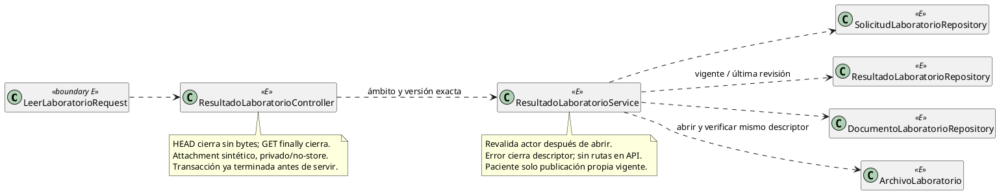

**Verificación diseñada/ejecutada parcialmente:** pruebas de API/cookies/archivos ficticios/PG exclusivo, worker de Kernel HTTP con conexiones/PIDs distintos y bloqueos observados. Revisiones simultáneas, lector binario y CU-22 durante publicación, lectura durante reasociación y revocación concurrente; commit/rollback sin bytes/punteros mezclados. No confundir esta concurrencia real SQL/procesos con servidor por socket/navegador (F6/frontend). Resultado final en README/contexto, no suite global ni cambios de esquema por F5.

<a id="laboratorio-backend-fase4"></a>
## CU-26 — Backend Fase 4: revisar y publicar versión exacta (2026-10-30)

**Cierre local de P58/Fase 4:** dirigida final **199 pruebas/2108 aserciones correctas**, código 0, 1 min 05,781 s/138 MB, incluidos 28 casos nuevos. PostgreSQL idéntico al inventario inicial, sin raíces propias residuales; sin suite global ni cambio de base habitual. Resultado/selección en README/contexto §17.174. Las notas siguientes de verificación en curso son cronología superada; no cierre integral del módulo ni entrega de bytes/frontend/F5/F6.

**P58 efectivo, incremento en verificación dirigida; no cierre integral de laboratorio.** Actores Admin/Médico solicitante, PN21/ampliación de laboratorio, RN12/RN14 y VS-LAB-06/07/10/13. Se conservan P53–P57 y sus fuentes históricas; entrega binaria/frontend y seguridad integrada posterior siguen F5/F6. Contratos/resultados en README/contexto §17.174.

| Clase participante | Responsabilidad efectiva |
| --- | --- |
| RevisarResultadoLaboratorioRequest / RevisionResultadoController | Frontera JSON cerrada, originales canónicos, decisión/declaración/motivo; Controller adapta HTTP y delega, devuelve Resource/201 sin consultas de negocio. |
| RevisionResultadoService | Actor interno y Médico propio o Admin; coordina transacción/locks, compara todos los originales, exige vigente última y no revisada, verifica archivo, anexa revisión y publica si Autorizar. No modifica archivo/atención; revalida identidad/sesión antes de devolver. |
| ResultadoLaboratorioService | Contexto/originales/acciones de revisión al Admin y Médico responsable; Médico sin acciones de CU-25. Respuesta posterior revalida ámbito; Paciente no recibe contexto privado. |
| ResultadoLaboratorioRepository / SolicitudLaboratorioRepository | Consultas/versiones/revisión existentes, agregarRevision con Usuario ejecutor y Médico responsable separados; publicar actualiza solo estado/puntero. Reglas de decisión en Service, no en Repository. |
| DocumentoLaboratorioRepository / ArchivoLaboratorio | Recuperar metadatos y comprobar bytes privados de vigente (existencia/tamaño/SHA-256), sin URL/entrega HTTP, transformación ni eliminación. |
| RevisionResultado / Usuario | Relación revisadaPor/revisionesResultados mediante nueva FK nullable para legado. Nuevas revisiones API siempre acreditan actor real; hidden restringe serialización, Resource interno controla exposición explícita. |
| Autenticacion/Continuidad/Planificacion/Medico/HistoriaClinica/ConsultaMedica | Colaboradores ya implementados para actor/locks/relación asistencial: continuidad→actor→planificación→Médico→Paciente→Cita→Consulta→Solicitud. Inactividad profesional no equivale a cuenta desactivada. |
| BitacoraRepository / ReferenciasBitacora | Eventos de autorización/devolución con metadatos numéricos seguros y ejecutor real, atómicos con revisión/punteros; sin motivos clínicos/bytes. |

### P58 — Decidir sobre la vigente comprobada

POST /revisiones → Request/Controller → Service. Rechaza rol, sesión o Médico ajeno; bajo coordinación valida asociaciones, originales y estado. Solo En revisión/vigente última/sin publicación/sin revisión previa; una devolución obliga nueva versión por CU-25. Archivo ausente/alterado y originales obsoletos409. Anexa RevisionResultado con id_medico responsable, revisada_por real, fecha/decisión/motivo solo al devolver. Autorizar publica esa versión directamente; Devolver permanece En revisión sin puntero publicado. Auditoría y cambios SQL confirman juntos, sin efectos sobre disco/Cita/clínica/avisos. Revalidación final de identidad/sesión protege respuesta y rollback ante revocación durante persistencia. Fallo de respuesta posterior a commit se reconcilia por GET, no se repite revisión ni se borra archivo.

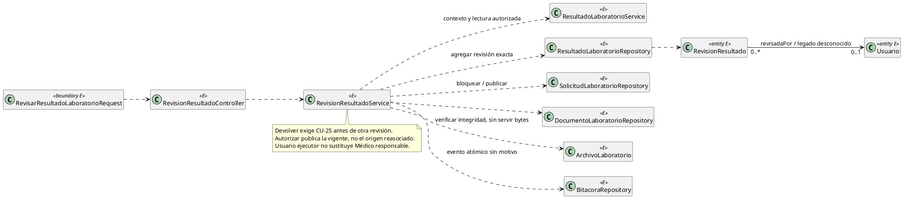

**Persistencia/alcance verificado:** 000037 agrega BIGINT NULL/índice/FK restrictiva sin backfill o modificación de triggers; legado publicado se preserva. Nuevas revisiones exigen revisor de sesión. Pruebas HTTP con PostgreSQL/raíz propia y regresión de módulos afectados, sin suite global por rutina. Persisten fases posteriores para navegador/entrega y nuevas carreras multiproceso; resultado definitivo pendiente de dirigida en curso, no se presenta como completo por existencia del código.

<a id="laboratorio-backend-fase3"></a>
## CU-25 — Backend Fase 3: documentos, correcciones y versiones (2026-10-30)

**Cierre local de Fase 3:** P55–P57 y el alcance documental CU-25 de esta fase quedan verificados con la suite global ya finalizada: **4002 pruebas/56 779 aserciones correctas**, código 0, 27 min 23,548 s/550 MB. Inventario PostgreSQL idéntico al inicial y sin raíces temporales propias de archivos pendientes. Se conservan análisis y fuentes UML históricos; las notas de verificación en curso siguientes son cronología superada. No cierre integral de laboratorio ni inicio de F4/CU-26, descarga CU-27, frontend o producción. Cierre documental sin nueva ejecución funcional.

**Incremento implementado/verificación en curso:** P55 cargar documento, P56 corregir/sustituir/reasociar y P57 leer versiones internas de laboratorio. Ampliación PN20/RN12/RN14, reglas VS-LAB y decisiones aprobadas de F1; no CU-26/publicación/descarga binaria de CU-27 ni frontend. Backend README/contexto §17.173 contienen contratos/entorno/resultados finales. Se conservan todos los análisis/diagramas anteriores; los cuatro Models ya existentes no se vuelven a contar como nuevos ni se añaden columnas de revisión en esta fase.

| Participante efectivo | Responsabilidad y colaboración |
| --- | --- |
| CargarDocumentoLaboratorioRequest / DocumentoLaboratorioController | Boundary multipart/JSON sin archivo para reasociar: allowlists, originales/punteros/revisión exactos, declaraciones 1 y motivo; adapta UploadedFile a SplFileInfo para negocio, no persiste ni decide permisos. |
| DocumentoLaboratorioService | P55/P56: Admin preliminar, prepara archivo fuera de locks largos, coordina actor/planificación/recursos ordenados/solicitudes, revalida originales/estado/devolución/asociaciones y guarda documento/versión/punteros/auditoría en una transacción. Reasociación conserva fuente sin vigente y destino con versión nueva, no consulta/Médico/Paciente reasignados ni publicación. |
| ArchivoLaboratorioValidator | Formato/tamaño real, Fileinfo/extensión concordante, GD con dimensiones/píxeles acotados y qpdf con timeout/sin shell para PDF no cifrado/estructura correcta/páginas. No interpreta laboratorio ni certifica malware/legibilidad. Herramienta ausente rechaza seguro. |
| ArchivoLaboratorio | Bytes privados con claves UUID exclusivas, copia efímera cerrada para qpdf en Windows, hashes/tamaño y compensación de archivo nuevo. No entrega HTTP, URL pública ni borrado de historial/clave ajena; conserva privado ante commit/rollback dudoso. |
| DocumentoLaboratorioRepository / ResultadoLaboratorioRepository | Metadatos inmutables y nuevas versiones con autor/origen/numeración; consultas de vigente/última/revisión y paginación histórica. No Storage/negocio ni modificación de versiones/revisiones anteriores. |
| SolicitudLaboratorioRepository | Contextos cruzados de ambos extremos, bloqueos de solicitudes ordenados y cambio atómico de punteros/En revisión. No nuevas tablas, reglas en Repository ni estados nuevos. |
| ResultadoLaboratorioService / Resource / LeerLaboratorioRequest / Controller | P57 y detalle: contexto administrativo orientativo/originales, lectura histórica por ámbito y proyección explícita. Médico del destino no recibe origen ni motivo de reasociación que puede contener datos ajenos; Paciente no recibe históricos/contexto. Los listados previos conservan forma y C22 sus metadatos. |
| Colaboradores E existentes | Autenticacion/Continuidad/Planificacion/Medico/HistoriaClinica/ConsultaMedica coordinan sesión/locks y atención; BitacoraRepository/ReferenciasBitacora auditan solo referencias numéricas y ejecutor real, no nombres/estudios/motivos/archivos. |

### P55 — Cargar un documento privado

POST → Request → Controller → Service: comprueba Admin, valida bytes y prepara clave privada exclusiva fuera de transacción; continuidad → actor/sesión → planificación → Médicos → Pacientes → Citas → consultas → solicitudes ordenados. Revalida identidad/originales y carga permitida: Pendiente sin versiones, o fuente En revisión vacía tras reasociación acreditada que exige motivo/max+1. Crea Documento/VersionResultado y apunta vigente En revisión, audita y devuelve detalle autorizado/201, sin publicar ni cambiar Cita/clínica/avisos. Archivo inválido/declaración422, estado/obsoleto409, herramienta503 y error inesperado500 seguro. Documento físico y SQL no comparten rollback: compensar solo clave nueva con rollback confirmado/no referencias; conservar ante incertidumbre o limpieza fallida.

### P56 — Sustituir o corregir asociación devuelta

Mismo Service y límites; versión vigente debe ser última y su revisión más reciente Devolver por responsable, originales exactos incluyendo revisión. Sustituir agrega Documento y versión con origen anterior, motivo y actor; no sobrescribe bytes. Reasociar exige destino distinto Pendiente sin historial/documento, comprobación explícita de paciente/estudio en ambos extremos, incluso otras fichas. Bloquea conjuntos en orden global, verifica bytes previos y reutiliza documento sin copiarlo: versión nueva del destino con origen, fuente sin vigente En revisión e historial intacto. Ambas puntas/evento en una transacción; destino requiere revisión futura propia, Disponible jamás se altera. Motivo cruzado/origen no se proyectan al Médico de destino por histórico; no cambia relación asistencial ni concede acceso cruzado.

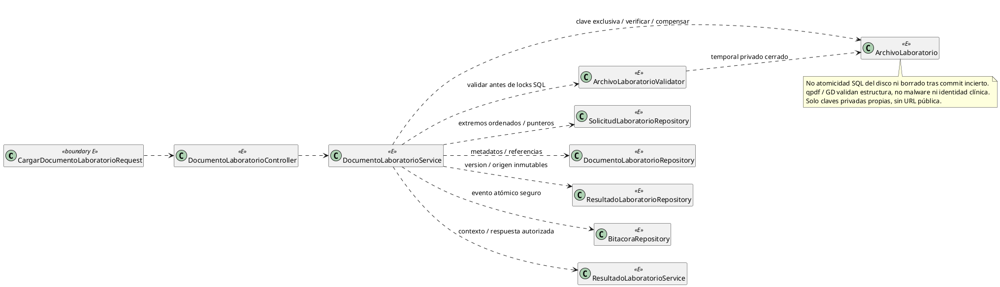

### P57 — Leer contexto y versiones internas

GET/HEAD /solicitudes-laboratorio/{id}/versiones pasa por gate Admin/Médico, ámbito SQL existente, coordinación de lectura y revalidación final. Repository selecciona metadatos de versión por solicitud y orden numérico descendente; Resource no entrega bytes/ruta/hash/nombre_original ni expande origen. Admin ve autor/motivo/origen; Médico responsable ve versiones de su solicitud, omitiendo motivo/origen de una reasociación desde otra solicitud. Paciente/Recepción403, Médico ajeno404, HEAD autorizado sin cuerpo. Detalle administrativo añade originales/acciones/vigente/última devolución; no se habilita revisión o descarga inexistente.

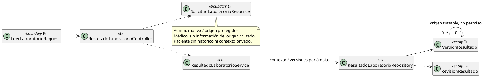

**Pruebas/entorno:** archivos ficticios reales qpdf/GD sobre raíz exclusiva por caso y PostgreSQL/esquema aislado, cookies/CSRF y herramientas con salida controlada, correo simulado. PDF tmpfile de tests Windows impedía lectura a qpdf; copia privada cerrada de iguales bytes resuelve sin relajar validación. Error esperado de `_method=1` es400 por método HTTP inválido, no405; contexto nuevo de detalle Admin permite motivo de devolución, sin relajar privacidad de Médico/Paciente. Nueva prueba protege motivo de reasociación de otro paciente ante Médico del destino. Resultado final, regresión/calidad/limpieza e incidencias en README/contexto. Sin carrera multiproceso nueva ni integración navegador, que conservan fases posteriores; no nueva migración ni física DER en esta fase.

<a id="laboratorio-backend-fase2"></a>
## CU-24 — Backend Fase 2: solicitud y lectura por ámbito (2026-10-30)

**Incremento implementado, no módulo completo:** P53 registrar solicitud y P54 consultar solicitudes/metadatos, vinculados a PN19/RN12/RN14/ampliación de laboratorio. CU-25/CU-26/entrega de bytes CU-27 siguen pendientes. Backend README/contexto §17.172 detallan cuatro rutas y evidencia final; análisis/diagramas anteriores permanecen históricos. No se representa un Controller por cada rol ni un método por tabla.

| Participante efectivo | Responsabilidad y colaboración |
| --- | --- |
| CrearSolicitudLaboratorioRequest / LeerLaboratorioRequest | Boundary HTTP: allowlists, ID canónico, cuerpo/query separados, booleano true, estudio no vacío <=255, originales de consulta, fechas locales y paginación. No conceden acceso por existencia del ID. |
| SolicitudLaboratorioController | Adapta POST, extrae datos validados/contexto seguro y responde Resource/201; no SQL ni negocio. |
| ResultadoLaboratorioController | Adapta tres GET/HEAD (por consulta/lista/detalle) al Service y Resource; no descargas ni rutas públicas. |
| SolicitudLaboratorioService | P53: coordina continuidad/sesión/planificación/recursos, exige Admin/Médico responsable, consulta/version vigente/originales/atención real desde inicio, crea solicitud y audita. Retorna detalle autorizado del Service de lectura en misma transacción; rollback conjunto ante fallo. |
| ResultadoLaboratorioService | P54: obtiene identidad por sesión normal, acota Médico solicitante o Paciente titular; selección administrativa y filtros por ámbito. Materializa SQL/edición orientativa de alta y revalida cuenta/rol/vínculo/sesión antes de responder. identidad(Usuario) reutilizada por Service de alta, sin ciclo de dependencias. |
| SolicitudLaboratorioRepository | Resuelve referencias de consulta/solicitud, crea Eloquent y lista/detalle por ámbito con joins/proyección seleccionada/criterio SQL de publicación consistente; sin permisos de negocio ni autor autoasignado desde payload. |
| SolicitudLaboratorio/Usuario | Entidades con creada_por nullable/FK restrictiva e inversas; API nueva siempre guarda ejecutor real. NULL legado desconocido, no Médico inventado; hidden de atributo y relación ante serialización automática. |
| Colaboradores existentes | AutenticacionService, ContinuidadAdministrativaService, PlanificacionRepository, MedicoRepository, HistoriaClinicaRepository y ConsultaMedicaRepository aportan coordinación/identidad/locks y contexto clínico existente. BitacoraRepository registra ESTUDIO_SOLICITADO con referencias seguras; Resources/ReferenciasBitacora filtran salida de CU-30. |

### P53 — Registrar estudio desde una consulta real

POST/Request → Controller → Service: continuidad → actor bloqueado/sesión → planificación → Médico responsable → Paciente → Cita → Consulta bloqueada. Referencias previas se revalidan, original de versión exacto y declaración true; reloj fresco comprueba inicio/Cita compatible, sin exigir ficha/profesional activo para atención previa. Repository crea Pendiente con Usuario ejecutor, Service audita atómicamente y lee detalle autorizado antes de commit. No cambia consulta/antecedentes/Cita/avisos; dos estudios con mismo texto son dos solicitudes permitidas, no idempotencia de intención. 409 obsoleto/estado, 404 ajena/inexistente, 422 campos/declaración y error inesperado seguro sin guardar parcialmente.

```plantuml
@startuml CVS_P53_solicitar_laboratorio
hide members
left to right direction
class CrearSolicitudLaboratorioRequest <<boundary E>>
class SolicitudLaboratorioController <<E>>
class SolicitudLaboratorioService <<E>>
class ResultadoLaboratorioService <<E>>
class SolicitudLaboratorioRepository <<E>>
class BitacoraRepository <<E>>
class SolicitudLaboratorio <<entity E>>
class Usuario <<entity E>>
class ConsultaMedica <<entity E>>
class Cita <<entity E>>
CrearSolicitudLaboratorioRequest ..> SolicitudLaboratorioController
SolicitudLaboratorioController ..> SolicitudLaboratorioService
SolicitudLaboratorioService ..> SolicitudLaboratorioRepository
SolicitudLaboratorioService ..> ResultadoLaboratorioService : identidad / detalle confirmado
SolicitudLaboratorioService ..> BitacoraRepository : evento seguro atómico
SolicitudLaboratorioRepository ..> SolicitudLaboratorio
SolicitudLaboratorio "0..*" --> "0..1" Usuario : creada_por acreditada
SolicitudLaboratorio "0..*" --> "1" ConsultaMedica
ConsultaMedica "0..1" --> "1" Cita : Paciente / Médico responsable
note bottom of SolicitudLaboratorioService
  Colaboradores de seguridad/locks existentes reutilizados.
  Guardar estudio no modifica atención ni estado de Cita.
  Legado NULL no permite inventar autor.
end note
@enduml
```

### P54 — Consultar solicitudes y metadatos autorizados

GET/HEAD/Request → Controller → ResultadoLaboratorioService → coordinación y Repository bajo transacción, ámbito SQL de Médico responsable/Paciente propio. Admin exige paciente o consulta en lista general; por consulta incluso vacía entrega edición de alta solo Admin/responsable. Resource selecciona campos/IDs textuales/UTC6 y meta; Paciente no recibe autor/contexto privado ni diferencia interna En revisión. Criterio Autorizar/responsable/punteros/última versión determina metadatos publicados; no afirma que bytes existan/estén íntegros ni habilita descarga. Consulta desconocida/ajena no se convierte en lista legítima vacía, filtros no amplían ámbito. Revalidación final de sesión descarta datos materializados tras revocación; HEAD sin cuerpo, no mutación clínica.

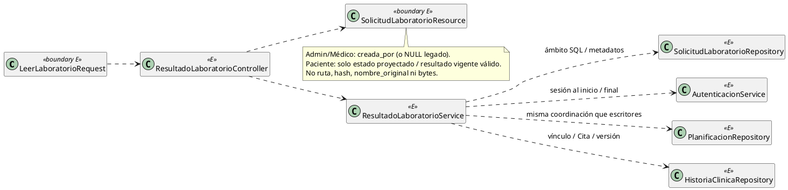

**Persistencia y límites:** migración 000036 añade creada_por a solicitud y relación inversa Usuario, sin modificar triggers ni migraciones previas; DER §6.23 vigente. Revisión aún sin revisada_por/F4, archivos/reasociación F3, entrega y seguridad ampliada F5, cierre global F6. Nuevas pruebas de API/cookies/CSRF/PostgreSQL aislado/rollback/proyección/legado y hooks de revalidación, no nuevas carreras SQL multiproceso de negocio. Resultado y controles finales en README/contexto, sin convertir pruebas previas en evidencia nueva ni afirmar aplicada la migración habitual.

**Cierre final de Fase 2/P53–P54:** suite global nueva **3937 pruebas/56 226 aserciones correctas**, 28:57,640/534 MB con límite solo CLI 768M, tras ensayo de 512M interrumpido por memoria; no sumar ejecuciones. Inventario PostgreSQL final idéntico al inicial y esquema parcial propio retirado; controles de sintaxis/Pint/Composer/rutas/alcance/UML/documentación correctos, evidencia y particularidad del código de salida PowerShell en contexto §17.172/backend README. **Fase 2 backend cerrada localmente**, no módulo completo, entrega de bytes, frontend ni producción. Los participantes/relaciones anteriores de esta entrada describen implementación efectiva, sin anticipar CU-25/CU-26 o fases posteriores.

<a id="laboratorio-backend-fase1"></a>
## CU-24–CU-27 — Backend Fase 1: diseño de participantes y contratos (2026-10-29)

**Estado:** diseño previsto P, no ejecución funcional terminada. Laboratorio es ampliación aprobada, vinculada a RN12/RN14 y PN19–PN22; RF/RN oficiales no cambian. Contexto §17.171/backend README contienen endpoints **previstos** y matriz de fases. Models/persistencia existentes E no acreditan cargas/descargas/revisión; la lectura CU-22 solo entrega metadatos. No crear procedimientos P53–P56 ni diagramas de ejecución por numerar CU antes de implementar; conservar todos los análisis y UML históricos.

| CU / participantes previstos (no archivos nuevos) | Responsabilidad y colaboración diseñada |
| --- | --- |
| CU-24: SolicitudLaboratorioController/Service/Repository | Request valida estudio/original/declaración; Service autentica Admin/Médico responsable y consulta/atención autorizada desde inicio, incluso Atendida/inactivo profesional con cuenta activa. Repository crea Pendiente con creada_por real prevista y origen de consulta, sin nueva identidad clínica ni estado de Cita. |
| CU-25: DocumentoLaboratorioController/Service/Repository, SolicitudLaboratorioRepository y ResultadoLaboratorioRepository | Admin verifica asociación; validar bytes PDF/JPEG/PNG <=10 MiB y disco privado; anexar versión y punteros/auditoría. Sustituir exige devolución, motivo e historial intacto; reasociar bloquea ambos ámbitos/solicitudes ordenados, crea versión de destino Pendiente con origen, deja fuente En revisión sin vigente y permite nueva carga numerada. No mover consulta/Paciente/Médico ni transformar el contenido emitido. |
| CU-26: RevisionResultadoController/Service, ResultadoLaboratorioRepository y colaboración de documento | Admin/Médico solicitante revisan versión vigente; revalidar originales/revisión/archivo y decisión, anexar revisión con revisada_por prevista y Médico responsable separado. Autorizar publica directamente; devolver exige motivo y corrección/nueva revisión, sin cuarto estado ni cambio de Disponible. |
| CU-27: ResultadoLaboratorioController/Service, repositorios y DocumentoLaboratorioService | Lista/detalle proyectados por ámbito, solo publicado vigente para Paciente; GET/HEAD de archivo reautorizados y descriptor privado íntegro, sin URL pública ni caché/bytes antiguos. Médico solicitante no hereda historia de origen ajeno por reasociación. |
| E existentes compartidos | SolicitudLaboratorio, DocumentoLaboratorio, VersionResultado y RevisionResultado conservan tablas/FK/triggers. ConsultaMedica/Cita derivan identidad clínica; Usuario es ejecutor. AutenticacionService/ContinuidadAdministrativaService/PlanificacionRepository/MedicoRepository y BitacoraRepository permiten coordinar sesión/rol/relaciones y evento real, sin duplicar seguridad. |

**Colaboración:** Request/Controller → Service → Repositories/Eloquent → PostgreSQL; Service de documento coordina adaptador físico privado y compensación solo de archivo nuevo con rollback comprobado, nunca supone transacción del disco ni borra después de commit incierto. Lecturas/descargas verifican sesión/cuenta/rol/relación y publicación bajo contexto fresco; no decisiones en React. Originales incluyen versión/revisión/punteros de solicitud, no solo nombre de archivo; corrección/publicación/traslado con carreras obligan lectura nueva. Ante corte de red no repetir automáticamente operaciones ni afirmar rollback. Clases previstas se crean dentro de `laboratorio/` de cada capa solo cuando su fase las necesite, no un árbol vacío; Requests/Resources también de presentación, no dominio.

**Brechas diseñadas:** creada_por de solicitud y revisada_por de revisión serán migraciones aditivas de Fases 2/4. Legado sin autor comprobable permanece desconocido; no hacer pasar Médico responsable por ejecutor ni mutar revisión inmutable publicada para inventarlo. FK de publicación no prueba Autorizar/rol ni integridad del archivo. Los contratos vigentes CU-22 se preservan; nueva autoría de revisión mantiene id_medico como responsable clínico y exige regresión sobre lectura de metadatos/publicación.

**Decisiones aprobadas por usuario:** VS-LAB-11–13, archivos/formato/límite; solicitudes de atención previa incluso inactividad profesional/Atendida; reasociación a destino Pendiente incluso otro Paciente verificado y origen sin vigente conservado. Configuración técnica pendiente de validar al implementar F3: inspección PDF/imagen, límites de píxeles/PHP/proxy y eventual dependencia que requerirá autorización; no certificación antivirus por Fileinfo. Entrega prevista attachment/nosniff, no PDF activo embebido en origen de la SPA.

**Cierre de esta fase:** documental, sin código/SQL/archivos clínicos/dependencias/API nuevos ni pruebas funcionales ejecutadas como evidencia de laboratorio. Matriz diseñada de autorización/legado/rollback-disco/publicación/errores/concurrencia/descarga e integración en README; ejecutar con PostgreSQL y archivos ficticios aislados al implementar cada fase. UML global conserva fuentes/censo y participantes P; DER solo nota de evolución prevista, no nuevo esquema aplicado. Fases 2–6/frontend/producción pendientes, no iniciar automáticamente.

<a id="cu22-cu23-frontend-fase6"></a>
## CU-22/CU-23 — Frontend Fase 6: integración y cierre local (2026-10-29)

**Objetivo/actores:** cierre de las fronteras de lectura CU-22 y documentación CU-23 para Administrador/Médico responsable, con lectura propia vigente del Paciente y exclusión clínica de Recepción. Se conservan RF/RN y decisiones clínicas aprobadas, sin ampliar permisos ni introducir reglas en React. Contexto §17.170/README y colaboración acumulativa UML §16; análisis previos conservados como historia, no sustituidos por este resumen.

**Participantes efectivos:** HistoriaClinicaPage coordina selección administrativa o perfil propio y lectura; ConsultaDetallePage representa vigente, metadatos de estudios y acceso al editor según respuesta; VersionesClinicasPage consulta versiones internas paginadas. ConsultaEditorPage/useRegistroConsulta coordinan contexto fresco, alta/corrección/no-op, declaración/revisión, exclusión de duplicados y recuperación incierta solo GET. RegistroConsultaForm presenta cambios y ContenidoClinico muestra contenido permitido; useClinicaQuery/ClinicaQuery coordinan lectura, vacío/error/retirada. historiaClinica.service proyecta respuestas autorizadas, consultaMedica.service prepara allowlist y valida confirmación, api.js mantiene cookies/CSRF/época local sin otorgar permisos. AuthContext/useAuth y rutas existentes preservan identidad pública. Son componentes/hooks/módulos JavaScript, **no nuevas clases PHP**.

**Colaboración real verificada:** Chrome → Page/Component → hook → Feature Service → Axios/CSRF → middleware/Controller → Service/Repository clínicos existentes → PostgreSQL. Alta Administrador y Médico, corrección conjunta y solo antecedentes, históricos, no-op y documentación posterior a Atendida conservan versiones y ejecutor/responsable separados. Modificar antecedentes desde otra cita produce 409 en el borrador obsoleto, retira revisión y exige contexto nuevo, sin rebase. Corte de POST/PATCH después de commit deja resultado incierto; GET explícito recupera vigente sin atribuir indebidamente autoría ni repetir escritura. CU-19 queda separado; Paciente no recibe internos/versiones/edición, recurso ajeno da 404 y Recepción recibe 403 sin invalidar su sesión. Revocación de sesión Laravel sí retira clínica.

**Verificación:** recorrido final 15 comprobaciones reales, 14 vistas/70 disposiciones y 28 axe sin infracciones automáticas, teclado/foco y cero excepciones JS. Persistencia: 4 citas/3 consultas/5 versiones de consulta/4 de antecedentes/9 eventos clínicos/1 cambio de asistencia; snapshots iniciales intactos y bitácora sin contenido privado. Suite global frontend nueva **2954/2954 en 100 archivos**, integración backend dirigida nueva **25/3842** (3:18,834/90 MB), build correcto con aviso 806,94kB. No nueva suite global backend, certificación de accesibilidad integral, zoom completo ni prueba productiva. Errores reales observados y límites de fixtures/correos/HTTP se distinguen en README/contexto de la matriz simulada anterior.

**Cierre:** arneses corregidos y repetidos íntegramente desde esquema nuevo; intentos parciales y PHPUnit interrumpido no se suman. Solo esquemas/procesos/credenciales propios retirados, inventario PostgreSQL idéntico al inicial y servicio del usuario Running. Sin cambios productivos nuevos, persistencia/DER/RF/RN intactos, sin otro módulo/producción. **Fase 6 y seis fases frontend CU-22/CU-23 cerradas localmente**, integradas al backend cerrado §17.164. La evidencia no implementa laboratorio/recordatorios/reportes pendientes.

<a id="cu22-cu23-frontend-fase5"></a>
## CU-22/CU-23 — Frontend Fase 5: aislamiento y robustez verificados (2026-10-29)

**Incremento de seguridad de la interfaz, no integración real ni cierre de módulo.** Contexto §17.169/frontend README. Se preservan análisis/diagramas históricos y backend cerrado; no nuevas clases PHP, reglas, permisos, endpoints o persistencia. Cuatro reproducciones nuevas fallaron antes del cambio (lectura retenida al avanzar época, escritura pendiente no retirada y despacho POST/PATCH bajo época distinta) y pasan después; no se infiere una vulnerabilidad de autorización Laravel a partir de estos defectos de contexto cliente.

| Participante efectivo ampliado | Responsabilidad y colaboración |
| --- | --- |
| api.js | Contador/aviso local de avance de época y opción sessionEpochExpected antes de despacho; descarta éxito/error de contexto clínico sustituido sin invalidar nueva sesión por 401 antiguo. No crea sesiones, decide roles ni reenvía solicitudes. Opción compatible con consumidores anteriores. |
| historiaClinica.service / consultarMiPerfil | Lecturas clínicas y cadena de perfil propio→historia usan una sola época; contexto de edición incorpora epocaSesion local y descartable, sin modificar Resource/API Laravel/AuthContext. Argumento opcional de perfil no altera consumidores existentes. |
| consultaMedica.service | Exige contexto de lectura de época actual y la fija en CSRF/POST/PATCH; snapshot intacto de antecedentes o nueva versión/ID/autor/origen coherentes al confirmar alta. Metadata de transporte nunca se incluye en payload. |
| useClinicaQuery | Retirada de datos/secuencia y abort inmediato por pagehide o avance de época; pausa segura sin GET automático y reconsulta explícita. No presenta resultado de otra identidad/recurso/revisión. |
| useRegistroConsulta | Al cambiar época retira resultado y descarta respuesta pendiente, conservando solo incertidumbre de envío/recuperación en curso. No replay tras aborto ni afirmación de rollback; 422/409/419/429 y GET incierto mantienen sus flujos. |
| SeleccionAdministrativa de HistoriaClinicaPage | Desmonta lista de fichas ante cambio local de sesión y exige acción explícita para consultar de nuevo; no tabla privada retenida tras logout fallido. |
| describirErrorClinico | Mensajes seguros reutilizados y espera Retry-After numérica/fecha HTTP; tiempo de presentación, nunca regla de disponibilidad/atención. |

**Colaboración endurecida:** AuthContext continúa siendo dueño del estado público y sus acciones ya avanzan época → aviso local retira fronteras clínicas/aborta → sesión Laravel sigue siendo fuente de verdad → acción manual solicita contexto mediante GET ligado a época → formulario/revisión → CSRF y escritura ligados al mismo contexto → API descarta despacho/respuesta sustituida → coordinación muestra confirmado/error/incertidumbre sin datos antiguos. El cierre fallido de sesión no afirma logout, pero tampoco conserva datos visibles. Error tardío 401 de otra época no revoca sesión actual; 401 vigente conserva invalidación central existente.

**Verificación/cierre local de Fase 5:** dirigida 313 pruebas correctas en 14 archivos (clínica/navegación/perfil), con matriz HTTP de ambos escritores, épocas/CSRF/retirada/cambio de rol/BFCache/límites/proyección y ausencia de replay. Regresión global final nueva **2954/2954 correctas en 100 archivos**, aproximadamente 156s (`pnpm test --maxWorkers=4`), sin sumar ejecuciones. Build correcto con aviso de tamaño; Chrome con API simulada trece vistas sin overflow/excepciones, logout fallido retirando lectura/revisión y reconsulta manual sin restaurar borrador/declaración. No integración real ni nuevos ensayos SQL de revocación/concurrencia/inmutabilidad. Control exclusivo: 763 archivos cotejados, 751 intactos, 12 existentes modificados/5 nuevos, backend/UML/DER/rutas/CSS y cuatro contenidos documentales históricos íntegros, UTF-8/cercas/diff-check correctos. Contexto §17.169; helpers React/transporte no se convierten en clases de dominio PHP. Fase 6/módulo frontend completo/producción pendientes, no iniciados.

<a id="cu23-frontend-fase4"></a>
## CU-23 — Frontend Fase 4: corrección y antecedentes implementados (2026-10-29)

**Incremento efectivo de corrección, no cierre del módulo/frontend completo.** Contexto §17.168/frontend README. Se reutiliza frontera de Fase 3, lectura e históricos de Fase 2 y backend clínico cerrado §17.164; fuentes históricas y UML selectivo/DER intactos, sin clases de dominio nuevas ni participantes PHP ficticios. No nuevas reglas/RF/RN, endpoints, tablas ni permisos.

| Participante efectivo ampliado | Responsabilidad y colaboración |
| --- | --- |
| ConsultaDetallePage / ConsultaEditorPage | Enlace de corrección según acción autorizada; editor común decide alta/corrección mediante consulta vigente/GET fresco. Mantiene contexto responsable por recurso y misma ruta protegida; no permite edición al Médico meramente relacionado ni Paciente/Recepción. |
| RegistroConsultaForm | Precarga tipo/motivo, presenta vigentes de opcionales/antecedentes y acciones conservar/modificar/quitar, motivo de corrección ante cambio efectivo y declaración real desmarcada; revisión vigente/después de guardar y caso sin cambios explícito, sin nueva página/modal. |
| prepararCorreccion / cambiosCorreccion | Preparan allowlist parcial y validación de experiencia, distinguen omisión/null/igualdad sin normalizar contenido. Motivo solo ante cambio efectivo; originales no se reconstruyen. Esta comparación no autoriza recursos ni sustituye el orden de validación Laravel. |
| actualizarConsulta / proyectarConsulta | CSRF/sessionBound → PATCH existente → verifica 200/modificado, consulta/código/identidades/fechas/programación preservadas, snapshots por bloque/autor/motivo/origen y valores combinados; no decide ni persiste versiones en React. No-op requiere respuesta vigente validada, no éxito local. |
| useRegistroConsulta | Mismo coordinador para alta/corrección, elección de transporte por contexto y error motivo_cambio permitido; lock/abort/secuencia/429 y recuperación exclusivamente GET de resultado incierto, sin reconvertir a alta ni replay. |
| navigation | Sidebar «Registrar o corregir consulta» y título contextual «Documentar consulta médica», sin ruta nueva ni duplicación por rol. |

**Colaboración efectiva:** entrada autorizada → GET clínico/Resources → originales y acciones responsables → formulario de corrección/revisión/declaración → prepararCorreccion → Axios CSRF/PATCH → ConsultaMedicaController/ActualizarConsultaRequest → ConsultaMedicaService valida recurso/actor/originales/atención/estado y compara contenido → repositorios versionados/bitácora segura → Resource transaccional 200/modificado → proyección/resultado → GET vigente e históricos internos existentes. Usuario ejecutor conserva identidad y Médico responsable no cambia; antecedentes usan la consulta real de origen y versión coordinada por Paciente. Modificar solo antecedentes no crea otra consulta ni cambia versión de consulta intacta; ambos bloques modificados generan sus snapshots en backend; primeros antecedentes después del alta admiten versión 1.

**Flujos alternativos:** no-op sin motivo conserva versiones tras validación del servidor, nunca evita originales obsoletos. 409 por consulta/antecedentes compartidos retira borrador y exige contexto nuevo/revisión, sin rebase de originales bajo un formulario anterior. 422 conserva datos corregibles en memoria y desmarca declaración; otros rechazos conocidos exigen consulta manual/espera. Incertidumbre tras PATCH o respuesta inválida bloquea escrituras y solo permite GET que no atribuye autoría/terminación/rollback. Se conservan retirada por identidad/recurso/pagehide/desmontaje y BFCache; no persistencia clínica ni filtrado por CSS de históricos del Paciente.

**Evidencia/cierre local de Fase 4:** dirigida 242 pruebas correctas de clínica/navegación en nueve archivos; regresión global final nueva **2892/2892 correctas en 96 archivos**, aproximadamente 150s (`pnpm test --maxWorkers=4`), sin sumar ejecuciones. Build correcto con aviso de tamaño; doce vistas Chrome con API simulada (1440/390/320px) sin overflow/excepciones, cambios/no-op y recuperación GET sin replay. Pruebas de snapshots son mocks de contrato/presentación, no nuevos ensayos PostgreSQL de inmutabilidad/concurrencia ni integración real. Control exclusivo: 761 archivos cotejados, 747 intactos, 14 existentes modificados/2 tests nuevos; backend/UML/DER/rutas y cuatro contenidos documentales históricos íntegros, UTF-8/cercas/diff-check correctos. Contexto §17.168; no cerrar Fases 5–6 ni módulo por este incremento y conservar todas las fuentes anteriores.

<a id="cu23-frontend-fase3"></a>
## CU-23 — Frontend Fase 3: alta implementada (2026-10-29)

**Incremento de alta; correcciones/frontend completo no cerrados.** Se concreta el alta prevista en §17.165 sobre backend cerrado §17.164, sin cambios de reglas VS-CLI-01–12 ni PHP/persistencia. Contexto §17.167/frontend README contienen diseño, estados y evidencia. Se preservan análisis/vistas/procedimientos y cierre de lectura anteriores; no se inventan clases PHP para funciones React ni se amplía el censo UML selectivo.

| Participante efectivo nuevo o ampliado | Responsabilidad y colaboración |
| --- | --- |
| ConsultaEditorPage | Selección guiada de cita por rol y alta por cita con GET fresco, elegibilidad del servidor, resultado/relectura y protección de salida. Misma página Administrador/Médico responsable; existente no habilita corrección. |
| RegistroConsultaForm / TextoClinico | Secciones etiquetadas de consulta y antecedentes vigentes; acciones explícitas conservar/modificar/quitar; validación de experiencia, declaración desmarcada y revisión inmutable por paso. Ejecutor visible separado del profesional; retiro de revisión al volver/corregir. |
| historiaClinica.service / proyectarConsulta | Reutiliza proyección de detalle, validación opcional interna de edicion/originales/acciones/impedimentos para registro y respuesta 201 de escritura. La lectura ordinaria/Paciente sigue descartando contexto editable y extras. |
| consultaMedica.service / prepararAlta / registrarConsulta | Allowlist de payload, originales intactos, preparación CSRF, un POST ligado a sesión y validación/proyección de alta confirmada; distingue fallo previo a envío de resultado posterior incierto. Sin reglas de autorización definitivas ni replay. |
| useRegistroConsulta | Máquina local de envío/validación/conflicto/incertidumbre/GET de recuperación, lock síncrono, abort/secuencia/retirada, espera 429 y no reutilización automática de originales. No persistencia clínica ni éxito inferido de GET posterior. |
| Router/navigation/destinoSeguro/ConsultaDetallePage | Entrada `/registrar-consulta` y editor `/citas/:id/consulta/editar` solo A/M; enlace de alta en detalle según contexto responsable. Sidebar ya tiene alta, pero no acredita PATCH/correcciones. |

**Flujo efectivo:** selección desde agenda/historial existente → detalle o editor GET → HistoriaClinicaController/HistoriaClinicaService y Resources existentes → contexto responsable proyectado → formulario/revisión/declaración → prepararAlta → Axios CSRF/sessionBound → POST existente → ConsultaMedicaController/RegistrarConsultaRequest → ConsultaMedicaService/repositorios clínicos/Models/bitácora segura → lectura transaccional Resource 201 → proyección/validación → resultado de alta y posterior lectura fresca. Se preserva autor Usuario real frente a Médico responsable, máximo una consulta por cita, originales vigentes y antecedentes aportados atómicos según backend. No dependencia circular nueva ni Service PHP/UI de laboratorio/asistencia instanciados.

**Contratos y estados:** registro desde inicio según acción del servidor, sin Confirmada/fin/mismo día ni cambio automático a Atendida. IDs grandes como texto/UTC seis decimales copiados sin Date/toISOString; omitidos conservan/null explícito limpia opcional, sin trim silencioso. 422 por campo conocido conserva borrador y exige revisar/declarar otra vez; 409/419 y errores conocidos exigen nueva consulta de contexto; red/5xx/respuesta posterior incoherente mantienen incertidumbre, nunca reenvío automático. GET de recuperación no atribuye autoría ni acredita terminación/rollback de petición anterior. pagehide retira contenido/revisión/declaración y preserva solo riesgo si había envío; desmontaje/identidad aborta e ignora respuestas obsoletas. useBlocker/beforeunload sin guardar contenido en URL/state/storage.

**Verificación/cierre local de Fase 3:** dirigida final 187 pruebas correctas (130 clínicas/57 navegación) en siete archivos; regresión global final nueva **2837/2837 correctas en 94 archivos**, aproximadamente 144s (`pnpm test --maxWorkers=4`), sin sumar ejecuciones. Build correcto con aviso de tamaño de chunk; once vistas Chrome con API simulada a 1440/390/320px sin overflow/excepciones y recuperación de envío simulado por GET. Incluye error de declaración vinculado, 401 durante POST y respuesta tardía tras abandono. No integración real ni correcciones. Control exclusivo: 754 archivos cotejados, 741 intactos, 13 existentes modificados/7 nuevos; backend/UML/DER y cuatro contenidos documentales históricos íntegros, UTF-8/cercas/diff-check correctos. Fuentes históricas/DER/UML operativo se preservan; no cierre de módulo que requiera promover participantes al modelo PHP selectivo. Contexto §17.167; Fase 4 y producción no iniciadas.

<a id="cu22-frontend-fase2"></a>
## CU-22 — Frontend Fase 2: lectura implementada (2026-10-29)

**Incremento de lectura frontend implementado, sin cierre del módulo CU-22/CU-23.** Se concreta la frontera prevista de Fase 1/contexto §17.165; no se altera el backend cerrado §17.164 ni las vistas/procedimientos anteriores. Ver `frontend/README.md` y contexto §17.166 para alcance/verificación. Editor y servicio de escritura de CU-23 permanecen previstos, no archivos vacíos ni participantes promovidos a implementados.

| Participante de interfaz efectivo | Responsabilidad y colaboración |
| --- | --- |
| HistoriaClinicaPage | Coordina entrada por rol, paginación de consultas, identidad/antecedentes/listado. Administración reutiliza PatientsPage/PatientsTable con selección clínica; Médico sigue a su agenda; Paciente pide titular mediante consultarMiPerfil sin modificar sesión pública. |
| ConsultaDetallePage | Lectura compartida de contexto de cita/consulta vigente nullable, antecedentes actuales y metadatos de estudios; pagina estudios, no consultas; retorno a cita o historia con rutas construidas localmente. |
| VersionesClinicasPage | Vista compartida por tipo de histórico, solo Administrador/Médico; pagina versiones y muestra metadatos internos autorizados, sin restauración o modificación. |
| ContenidoClinico, IdentidadClinica, FechaClinica | Componentes presentacionales por props: etiquetas clínicas, identidad mínima y fecha visible local sin reinterpretar la programación como hecho real; nulos desconocidos, saltos de línea y texto escapado por React. |
| ClinicaQuery / useClinicaQuery | Estados de carga/error/listo, retiro de datos por identidad/recurso/página, secuencia/AbortController, pagehide/pageshow, Retry-After y reconsulta manual. Estado local sin persistencia clínica; Axios protege época de sesión. |
| historiaClinica.service.js | Consume cuatro GET reales, valida identificadores/páginas/forma/coherencia y proyecta campos por rol; no decide relación asistencial ni escribe clínica. Descarta contexto editable/archivos/extras en esta fase. |
| Router, RoleRoute, navigation, destinoSeguro y GuestRoute | Rutas y menú por rol/retorno seguro exacto clínico, sin conceder permiso sobre recurso; CU-23 sigue pendiente. Enlaces desde cita para A/M/P y ficha solo A, Recepción conserva recorrido administrativo sin pedir clínica. |

**Flujo de lectura efectivo:** ruta protegida → Page → hook local → Service → Axios central sessionBound/cookies → HistoriaClinicaController/LeerHistoriaClinicaRequest → HistoriaClinicaService/Repositories/Models existentes → HistoriaClinicaResource/VersionClinicaResource → proyección explícita → componentes por props. Paciente entra por GET `/mi-perfil` antes de historia propia; no deduce PK desde Usuario ni conserva perfil completo en contexto clínico. Médico relacionado puede leer consultas de otros responsables por permiso del servidor; interfaz no crea selector médico general ni obtiene permisos de edición por leer. Los históricos requieren autorización también en servidor, no ocultamiento posterior con CSS.

**Separación y errores:** cuatro GET, ninguna escritura clínica/CU-19/laboratorio nuevo. Originales BIGINT y fechas UTC seis decimales no se convierten para volver a enviarse; aquí solo se representan datos y se descarta `edicion`. Paginación de consultas/estudios/versiones independiente. 200 inválido no es vacío, 401 retira sesión, 403 no se confunde con logout, 404 no confirma existencia ajena, 419/red/5xx permiten GET manual, 422 orienta y 429 espera. Petición abandonada no actualiza otra identidad/recurso; BFCache obliga relectura. Sin persistencia/URL/state clínico/logs ni HTML inyectado.

**Documentación acumulativa:** los participantes React no son clases de dominio PHP ni se incorporan al censo selectivo de 124 identidades. UML operativo/DER históricos se conservan, sin nuevas tablas/atributos/relaciones. No se cierra CU-23 ni se reemplaza la integración real de Fase 6 por tests de mocks/presentación. Fuentes históricas preservadas íntegramente.

**Verificación final/cierre local de Fase 2:** dirigida 125 pruebas correctas (68 clínicas/57 navegación); regresión global final nueva **2775/2775 correctas en 91 archivos**, aproximadamente 145s (`pnpm test --maxWorkers=4`), build correcto con aviso de tamaño de chunk. Chrome con API simulada, nueve layouts de lectura sin overflow a 1440/390/320px, proyección propia y solo GET; no integración real. Control exclusivo de fase: baseline 742 archivos, 729 intactos, 13 existentes modificados/12 nuevos solo en feature clínica, backend/UML/DER y cuatro contenidos documentales históricos conservados. Contexto §17.166; no sumar conteos de ejecuciones distintas. Fases 3–6/frontend clínico completo/producción pendientes, sin iniciarlas automáticamente.

<a id="cu22-cu23-frontend-fase1"></a>
## CU-22/CU-23 — Frontend Fase 1: fronteras y colaboraciones previstas (2026-10-29)

**Diseño documental terminado; frontend clínico aún no implementado.** Contexto §17.165 y `frontend/README.md` contienen bocetos escritorio/móvil, contratos efectivos, entradas por rol, estados y plan de verificación. Se preservan íntegros análisis y diagramas anteriores (incluidos P49–P52 y cierre backend §17.164); no se agregan clases de dominio, procedimientos ficticios ni se promueven participantes previstos a implementados.

**Fronteras previstas, no clases PHP:** HistoriaClinicaPage coordinará identidad autorizada/antecedentes/lista de consultas; ConsultaDetallePage, vigente/contexto de cita/estudios; ConsultaEditorPage, alta o corrección explícitas con revisión; vista de versiones, lectura interna paginada. Componentes de feature presentan datos y callbacks; los compartidos MainLayout/PageHeading/FormField/FormSection/Alert/QueryMessage/Pagination/ConfirmationPanel se reutilizarán. No hay interfaz de edición global de antecedentes fuera de una atención real CU-23.

**Control de interfaz previsto:** servicios `historiaClinica.service.js` y `consultaMedica.service.js` en `features/historia-clinica/services/` consumirán los seis endpoints existentes mediante `src/api/api.js`; proyección/payload explícitos, sesión ligada/abort y originales intactos, sin reglas clínicas autoritativas. Estado de peticiones/revisión/escritura incierta será local y descartable por identidad/recurso. Tests futuros en `features/historia-clinica/tests/` por responsabilidad. No se crean archivos vacíos ni otro Context de pacientes o diagnósticos.

**Colaboración prevista CU-22:** ruta protegida/rol → entrada propia, selección administrativa reutilizada de CU-07 o cita de agenda médica propia → Page → Feature Service → Axios/cookies → cuatro GET existentes → HistoriaClinicaController/HistoriaClinicaService/Repositories/Resources efectivos. UsuarioAutenticadoResource no expone id_paciente: Paciente reutilizará `consultarMiPerfil`/GET `/mi-perfil`, proyectando solo ID para pedir historia propia, sin extender AuthContext ni deducir PK de Usuario. Médico no obtiene buscador de pacientes ajenos; relación asistencial se comprueba en servidor. Paciente solo vigente, sin pedir versiones internas; Recepción no carga clínica. Meta de historia pagina consultas, meta de detalle pagina estudios y cada histórico sus versiones. Laboratorio solo metadatos autorizados, sin simular descarga/publicación.

**Colaboración prevista CU-23:** detalle GET fresco → `edicion.acciones/originales/impedimentos` → formulario por cita y actor → revisión/declaración real desmarcada inicialmente → POST 201 o PATCH 200 → ConsultaMedicaController/ConsultaMedicaService efectivos → lectura final autorizada. Usuario ejecutor y Médico responsable siguen distintos; guardar no llama a CU-19. IDs BIGINT/timestamps de seis decimales conservados literalmente; omitir conserva, null explícito limpia opcional. Motivo requerido solo para corrección efectiva; no-op se representa según `modificado=false`, nunca como replay. Conflicto exige nueva consulta/revisión y red/timeout no demuestra rollback: reconciliar mediante GET sin afirmar autoría ni reenviar ciegamente.

**Alcance de esta actualización:** bocetos de expediente legible, controles de privacidad/sesión, retornos locales por allowlist y criterios de pruebas de las fases 2–6; no cierre funcional de CU-22/CU-23 frontend. Sin cambio de reglas VS-CLI-01–12, RF/RN, UML de clases operativas, DER, PHP, JSX, CSS, router/sidebar ni dependencias. Diagramas globales/persistencia se conservan porque no cambian clases operativas ni esquema. Implementación e integración requerirán autorización de las fases siguientes por separado.

<a id="cu22-cu23-backend-fase6"></a>
## CU-22/CU-23 — Backend Fase 6: integración y cierre acumulativo (2026-10-29)

**Fase 6 y módulo backend CU-22/CU-23 cerrados localmente.** Se revisan P49–P52 contra seis endpoints reales y clases efectivas descritas en Fases 2–4; las 73 vistas/52 procedimientos/17 antecedentes y 76 bloques previos se conservan, sin crear procedimiento por una prueba. Fase 5 cerrada localmente con 2597/37392 correcta, evidencia histórica §17.163; no equivale a suite global de esta fase.

**Colaboración integral efectiva:** React/UI no participa en esta fase. HTTP/cookies/CSRF → middleware de cuenta/rol/sesión → HistoriaClinicaController/LeerHistoriaClinicaRequest para cuatro lecturas o ConsultaMedicaController/RegistrarConsultaRequest/ActualizarConsultaRequest para escrituras → HistoriaClinicaService/ConsultaMedicaService → repositorios propios y seguridad/planificación/Médico/Cita/bitácora → Models/PostgreSQL → Resources mínimos. El escritor reutiliza lectura final dentro de transacción, no hay ciclo Service→Service. Motivo/snapshots quedan clínicos y bitácora solo actor/referencias/números. Administrador ejecutor no suplanta Médico responsable, Paciente solo vigente propia y Recepción sin lectura/edición clínica. No dependencia de laboratorio funcional P inexistente para devolver metadatos permitidos.

**Prueba nueva ClinicaIntegracionTest:** 25/3842 correcta, 22,786 s/64 MB, primer intento. Matriz 3 reservantes × 2 autores de alta × 2 correctores × llegada opcional =24, más desactivación/reactivación de cuenta con nuevo login. Preparación funcional por APIs de catálogos/Médico/sala/asignación/horario/invitación/aceptación/login/habilitación/reserva, luego lectura anticipada/alta desde inicio, inactivación profesional real sin perder atención asignada, consulta incompleta/primer antecedente, correcciones/motivo/versiones/no-op/revisión/originales, CU-19 separado y corrección documental posterior, auditoría segura, lectura de Paciente/histórico interno/roles, nuevo login/GET sin replay. Identidades verificadas/ficha vinculada y aviso previo son fixtures; no CU-04/CU-28/laboratorio nuevos. Reconciliación lógica de commit conocido, no corte de red real. Esquema aleatorio PostgreSQL/35 migraciones/commits reales/afterCommit, Mail::fake/HTTP externo impedido, teardown solo propio; sin base habitual.

**Revisión UML y persistencia:** diagrama-clases §15 integra tres vistas nuevas conservando 21 anteriores; 474 firmas propias/81 clases operativas cotejadas por reflexión, 239 participaciones de inyección/183 aristas distintas, cero ciclos Service→Service. Índice vigente 124 identidades/108 E/15 P+Sesion R. Todos los métodos propios públicos/privados/constructores de las seis clases clínicas y BitacoraRepository concretados; Request/Resources auxiliares fuera del modelo selectivo. 24 PlantUML verificados/renderizados a SVG local, tres PNG inspeccionados, requieren zoom; ni render remoto ni reescritura histórica. DER contrastado con Models/migraciones y protegido: sin cambio de entidades/atributos/FK/UQ/triggers, máximo una consulta por cita, versiones inmutables y origen/autor legítimos. No nuevos RF/RN ni clase/tabla HistoriaClinica.

**Cierre verificado:** suite global final nueva **3828 pruebas/55111 aserciones correctas**, 27 min 12,393 s/498 MB, incluye integración/concurrencia sin sumar dirigidas. Inventario PostgreSQL pre/post dos esquemas/doce tablas/public vacío conservado. Controles finales correctos de 674 archivos protegidos/un test nuevo/siete documentos, sintaxis/UTF-8/PSR-4/Pint de 26 PHP acumulados/Composer/cercas/anclas/diff-check, seis endpoints clínicos y 84 rutas API únicas; UML cotejado de nuevo sin ciclos y fuentes históricas intactas. Resultado/comando en contexto §17.164/README. Fuente editable acumulativa en Markdown, recursos externos solo temporales aprobados. **Seis fases backend cerradas localmente; frontend clínico/producción/otros módulos no iniciados.**

<a id="cu22-cu23-backend-fase5"></a>
## CU-22/CU-23 — Backend Fase 5: verificación de seguridad y concurrencia (2026-10-29)

**Cierre local confirmado:** regresión ampliada final 2597/37392 correcta, 20 min 17,889 s/436 MB, incluidos 226 casos finales; inventario aislado pre/post conservado, controles de 672 archivos protegidos/tres PHP/seis Markdown/rutas/cercas/anclas correctos. Misma estructura/76 bloques de análisis/148 UML intactos, sin nueva vista por prueba. No suite global. Las notas de ejecución siguientes conservan su alcance histórico; evidencia §17.163, Fase 6 autorizada posteriormente.

**Pruebas ampliadas en curso; no clases productivas ni procedimiento nuevo.** RN12/RN14 y VS-CLI-01–12 sin cambio. P49–P52 efectivos/diseños conservan 73 vistas/52 procedimientos/17 antecedentes; 76 bloques cercados previos intactos. La concurrencia observa las mismas colaboraciones Controller/Request → Service → Repository → Models/PostgreSQL, no justifica inventar entidades o sustituir análisis histórico.

- **ClinicaConcurrenteTest** orquesta procesos independientes, cookies/sesión/CSRF y esquemas PostgreSQL propios, alta inicial por API real cuando corresponde y verificación SQL de solo su fixture. Espera de lock observada, no inferida de retardos; dos escritores y lector ante commit/rollback, versiones/números/origen/autoría, citas/avisos y eventos íntegros.
- **PausarEscrituraPlanificacionRepository** amplía tres métodos de bitácora clínica: ejecuta persistencia real y una barrera por operación, aun con dos bloques; confirmar continúa flujo real o fallo simulado revierte todo. **autenticacion-worker** reutiliza gestion-http y la barrera posterior a middleware para rutas clínicas por cita/Paciente; Mail::fake y HTTP externo bloqueado.
- **RelojTrasPlanificacionRepository/PausarConsultaAgenda** se reutilizan sin cambios, respectivamente reloj determinista después de lock y barrera antes de Controller. No modificación de código productivo ni sustitución de reglas por mocks.
- **Seguridad:** seis operaciones/todos sus roles válidos revalidados tras cuenta bloqueada y cambios confirmados/revertidos de estado/rol/sesión/hash/vínculo/dualidad; ámbito del Médico tras planificación, sin convertir mera lectura en escritura. Lector Paciente vigente sin metadatos internos.
- **Consistencia:** alta única, versiones protegidas/no-op/originales obsoletos y antecedentes desde consultas de distintos Médicos; cruces reales con asistencia/gestión y duración. Registro clínico nunca marca Atendida ni altera programación/avisos; CU-19 independiente. Cambio de relación bajo protocolo es fixture SQL, no reasignación clínica nueva. No garantías ante SQL arbitrario fuera del protocolo.

**Evidencia/estado:** ensayo de carga inicial falló por helper result() final de PHPUnit, corregido a resultado() antes de ejecutar pruebas. Selección de escritores 20/1040 correcta, 20,211 s/58 MB, previa al refuerzo de autoría/origen y duración. Batería completa/regresión ampliada, consumidores del worker, controles e inventario finales pendientes en contexto §17.163/README; no suite global ni suma de ejecuciones. Fixtures/relojes de participantes/cortes documentados no prometen historia de pared para toda preparación. Fuentes UML/DER intactas, censo selectivo sin clases nuevas; análisis estructural/cierre integral en Fase 6. **No iniciar Fase 6.**

<a id="cu23-backend-fase4"></a>
## CU-23 — Backend Fase 4: corrección clínica y antecedentes efectivos (2026-10-28)

**Fase 4 cerrada localmente, no cierre integral del módulo.** PN18/ampliación clínica con RN12/RN14 y VS-CLI-05/08/12, sin nuevos requisitos/reglas. P52 efectivo complementa el previsto: **73 vistas acumuladas, 52 procedimientos y 17 antecedentes**. Conserva las 72 vistas anteriores y cuatro diseños de Fase 1, sin reemplazar el análisis histórico. Fases 5–6/frontend/producción pendientes.

| Clase efectiva | Responsabilidad/colaboración |
| --- | --- |
| ConsultaMedicaController.actualizar | Adapta PATCH/validated() y devuelve HistoriaClinicaResource/200; no consultas ni reglas clínicas |
| ActualizarConsultaRequest → RegistrarConsultaRequest | Reutiliza ID/originales/declaración/longitudes/arrays cerrados; PATCH parcial y motivo opcional estructural, consulta/versión originales obligatorias |
| ConsultaMedicaService.actualizar / registrar / guardar privado | Flujo transaccional común sin duplicación por rol: recurso/sesión/originales/atención/estado, mezcla y comparación, motivo efectivo, versionado por bloque/no-op, auditoría y respuesta revalidada |
| ConsultaMedicaRepository.agregarVersion / agregarAntecedentes | Inserciones inmutables con número/motivo del Service; parámetros opcionales conservan alta versión 1/motivo null, sin UPDATE de snapshots |
| HistoriaClinicaService / Repository y CitaRepository / MedicoRepository / PlanificacionRepository | Lectura delimitada/originales/acción actualizar, coordinación de padres/recursos existentes; el escritor reutiliza lectura final sin ciclo |
| HistoriaClinicaResource / VersionClinicaResource | Respuesta explícita, modificado solo para PATCH y snapshots clínicos protegidos; vigente únicamente para Paciente |
| BitacoraRepository / ReferenciasBitacora / BitacoraDetalleResource | CONSULTA_ACTUALIZADA y ANTECEDENTES_ACTUALIZADOS atómicos por bloque; números/referencias sin datos o motivo clínicos |
| AutenticacionService / ContinuidadAdministrativaService y Models existentes | Revalidación y persistencia previas, mismos actores/entidades/esquema; Usuario ejecutor separado de Médico responsable |

### P52 — Vista efectiva de corrección parcial, versiones por bloque y no-op autorizado

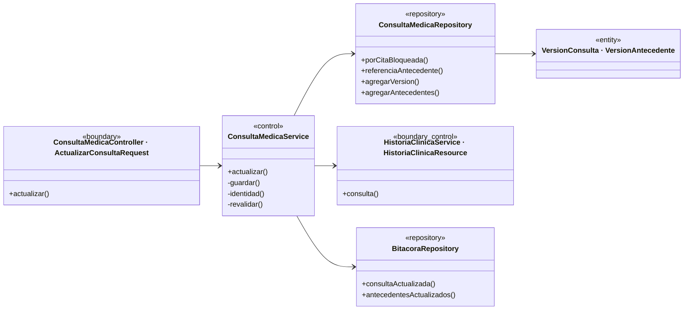

Vista simplificada de métodos/participantes propios; cajas compuestas no son nuevas clases PHP ni expansión transitiva exhaustiva. Contexto GET sigue en HistoriaClinicaService, no nuevo Controller/ruta por rol. ActualizarConsultaRequest hereda estructura de alta y concreta obligatoriedad/presencia parcial; no introduce DTO de negocio ni dependencia HTTP en el Service.

**Flujo/garantías:** continuidad → actor normal/planificación → referencia acotada → Médico → Paciente → Cita releída/acotada → Consulta padre bloqueado → vigentes/originales/revalidación → declaración y mezcla → revalidación/reloj fresco/estado/atención → motivo obligatorio solo si cambio efectivo → snapshots por bloque/eventos → lectura final/revalidación → commit. No-op recorre permisos/originales/atención/estado y devuelve modificado false sin INSERT/UPDATE de dominio ni bitácora; nunca acepta originales obsoletos como replay. PATCH sin consulta 404, incoherencia/versiones obsoletas 409, validación/motivo 422; errores centrales seguros. Los padres protegen versión+1 incluso ante ausencia de antecedentes y conservan originales entre distintas atenciones; carreras multiproceso ampliadas se verificarán en Fase 5.

**Contenido/historia:** omitido conserva, null explícito borra opcionales, obligatorios presentes no vacíos. Snapshots completos solo para bloques cambiados, razón/autor/fecha y número máximo controlado, sin sobrescritura de versiones ni duplicar consulta. Antecedentes con origen de la misma cita real y Paciente; cambios desde otra atención invalidan formulario previo aunque solo se envíe consulta. Paciente ve vigente corregida sin motivo/autor/edición/versiones previas, independientemente de completitud. Bitácora solo números/referencias, nunca motivo/contenido. Cita/estado/programación/fechas/CambioCita/avisos permanecen intactos y CU-19 separado.

**Pruebas/cierre:** dirigida inicial ActualizarConsultaTest 72/894 correcta; once casos añadidos después completan 83 casos finales incluidos en regresión ampliada posterior a Pint **1628 pruebas/14590 aserciones correctas**, 6 min 3,044 s/194 MB. No sumar ejecuciones ni suite global. Alta real preparatoria, fixtures explícitas para avisos/estados/versión máxima; callbacks de fallo/revocación no prueban multiproceso. Matriz añade PATCH/ocho combinaciones y pruebas anteriores solo actualizan disponibilidad de edición. Pint/Composer/sintaxis/UTF-8/PSR-4 de 15 PHP, siete Markdown/cercas/anclas/diff-check correctos. 658 archivos protegidos y 75 bloques previos de análisis/148 UML conservados, trece existentes/dos nuevos previstos; 84 rutas API únicas/cuatro GET y dos escrituras clínicas, reflexión de 31 Services sin ciclos/métodos cotejados. Inventario PostgreSQL pre/post dos esquemas/doce tablas/public vacío conservado. Evidencia/comando en contexto §17.162/README. DER sin cambios; nota incremental UML conserva fuentes históricas sin render nuevo, revisión estructural acumulativa en Fase 6. **No iniciar Fase 5.**

<a id="cu23-backend-fase3"></a>
## CU-23 — Backend Fase 3: contexto de alta y registro efectivo (2026-10-28)

**Fase 3 cerrada localmente, no CU-23 completo.** RN12/RN14 y ampliación clínica/PN18; reglas VS-CLI-02–06/08/11/12 sin modificarlas. P50/P51 efectivos se agregan como dos vistas a las 70 anteriores: **72 vistas, 52 procedimientos y 17 antecedentes**. Las cuatro previstas de Fase 1 y la lectura efectiva de Fase 2 permanecen intactas; P52 y corrección posterior siguen previstos. No nuevos identificadores de procedimiento por concretar vistas previas.

| Participante real | Responsabilidad y colaboración |
| --- | --- |
| HistoriaClinicaController / LeerHistoriaClinicaRequest / HistoriaClinicaService | GET consulta reutilizado; lectura autorizada y, solo para Administrador/Médico responsable, originales de cita/consulta/versiones y elegibilidad de registrar. Paciente/Médico meramente relacionado sin contexto editable |
| ConsultaMedicaController / RegistrarConsultaRequest | Adaptación HTTP POST/201 y validación cerrada/anidada/IDs/null explícitos/fecha exacta/booleano true/límites de contenido. Sin decisión clínica en Controller |
| ConsultaMedicaService | Autoriza rol/recurso propio, coordina locks y originales, declara atención real y reloj fresco desde inicio, crea consulta/snapshot 1 y antecedentes aportados efectivos, audita y materializa lectura dentro de la misma transacción |
| ConsultaMedicaRepository | Consulta padre bloqueada por cita/Paciente, referencia de versión de antecedentes, inserción Eloquent de consulta/versión/antecedentes. UUID servidor y persistencia, no decide permiso/estado/plazo |
| HistoriaClinicaRepository / CitaRepository / MedicoRepository / PlanificacionRepository | Lectura clínica acotada/vigente, cita filtrada y releída bajo lock, recursos existentes y coordinación compartida; no nuevas capas paralelas |
| AutenticacionService / ContinuidadAdministrativaService | Sesión/rol/vínculo revalidados y coordinación administrativa existente, sin suplantación |
| HistoriaClinicaResource / VersionClinicaResource | Proyección explícita del detalle de lectura/alta y bloque edicion cuando autorizado; privados no-store, IDs texto/UTC con microsegundos |
| BitacoraRepository / ReferenciasBitacora / BitacoraDetalleResource | Eventos atómicos CONSULTA_REGISTRADA/ANTECEDENTES_ACTUALIZADOS, filtros/referencias/números seguros, jamás contenido clínico o motivos |
| ConsultaMedica / VersionConsulta / VersionAntecedente / Cita / Paciente / Usuario | Models E existentes y FK/UQ/triggers sin cambio; ejecutor Usuario distinto de Médico responsable derivado de Cita |

### P50 — Vista efectiva del contexto de registro por cita

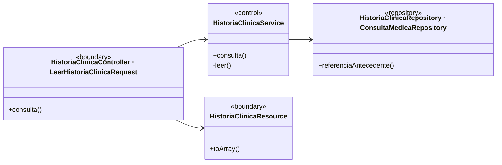

El contexto conserva GET lectura CU-22 en vez de crear otro GET/Controller por rol. Incluye originales explícitos y registrar según consulta ausente/estado/inicio; actualizar sigue no disponible. Es orientativo: no reserva ni acredita atención real, siempre se revalida al guardar. Profesional relacionado por otra cita puede leer pero no escribir ni obtener contexto. Consulta/antecedente desconocidos se expresan null, sin inventar hechos.

### P51 — Vista efectiva de alta transaccional de consulta y antecedentes aportados

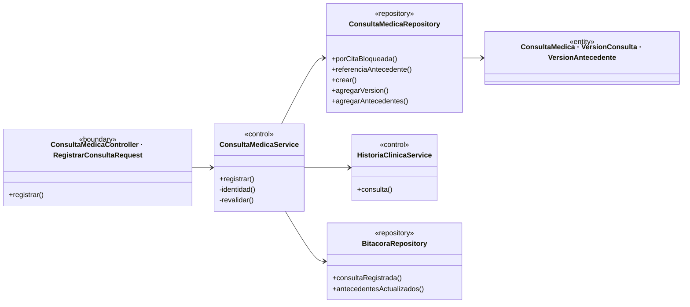

Vistas simplificadas de participantes propios; cada caja compuesta no es una clase PHP nueva ni catálogo transitivo exhaustivo. Service→Service real: ConsultaMedicaService → HistoriaClinicaService, nunca dependencia circular; lectura no depende de escritor, solo de su Repository para referencias de versión.

**Flujo:** continuidad/actor → planificación → referencia acotada → Médico → Paciente → Cita releída/acotada → Consulta padre → originales/versiones y revalidación → declaración true/contenido permitido → revalidación/reloj fresco/estado/plazo → inserción consulta/versión 1/antecedentes efectivos → eventos → lectura final revalidada → commit. Cita controla unicidad antes de existir consulta y Paciente serializa antecedentes entre distintas citas; UQ PostgreSQL última barrera. El reloj del guardado no sustituye hora real: iniciada_en queda NULL. Paciente/Médico responsable derivados de Cita, autor Usuario real. Ficha/catálogos/profesional inactivos no eliminan asignaciones; cuenta desactivada sí impide operar.

**Versiones/alternativos:** alta sin motivo de corrección, primera versión de consulta completa con opcionales NULL. Antecedentes omitidos/iguales/desconocidos no generan versión; cambios iniciales aportados se combinan con previos, preservando anteriores y origen real. Cambio de originales de cualquier atención obliga revisión/409; repetir alta no es replay ni crea segunda consulta. Máximo INTEGER controlado. No modificación de Cita/avisos/CambioCita ni Atendida automática; CU-19 separado. Históricos/autor/motivo nunca al Paciente ni contenido a bitácora general. Escritos posteriores, motivo/no-op de corrección y PATCH siguen Fase 4. Rechazos 401/403/404/409/419/422 y 500 seguro mediante manejador central.

**Verificación/cierre:** dirigida nueva **101 pruebas/777 aserciones correctas**; regresión ampliada posterior a Pint **1537/13564 correctas**, 6 min 16,320 s/170 MB, no suite global ni suma de ejecuciones. Incidencias/comando exacto en contexto §17.161/README: expectativa de CSRF ajustada sin cambio de seguridad, ensayo conjunto con timeout no se presenta como correcto. Pint/Composer/sintaxis/UTF-8/PSR-4 de 15 PHP y siete Markdown/cercas/anclas/diff-check correctos. 656 archivos protegidos, contenido previo de matriz/negativa de bitácora y 73 bloques históricos de análisis/148 UML conservados; diez archivos existentes/cinco nuevos previstos. Reflexión de 31 Services sin ciclos y métodos propios nuevos cotejados; cuatro rutas GET/HEAD y un POST clínicos únicos/83 rutas API. Inventario PostgreSQL pre/post conservado: dos esquemas/doce tablas/public vacío. Fixtures clínicas previas/avisos son preparación declarada, no flujo de corrección/laboratorio/generación. Callbacks de esperas/revocación no prueban carreras multiproceso; Fase 5 pendiente. DER sin cambios de persistencia; UML nota incremental conserva fuentes históricas sin render nuevo, revisión estructural completa al cerrar módulo. **No iniciar Fase 4.**

<a id="cu22-backend-fase2"></a>
## CU-22 — Backend Fase 2: lectura clínica efectiva (2026-10-28)

**Fase 2 cerrada localmente; P49 efectivo verificado, CU-23/P50–P52 escritura siguen previstos.** Son cuatro GET/HEAD sin escritura clínica. Esta vista efectiva complementa las cuatro previstas de Fase 1, no las sustituye: 70 vistas totales (65 históricas + cuatro previstas + una efectiva), 52 procedimientos y 17 antecedentes. RN12/RN14/perfil del Paciente y VS-CLI-01/07/09/10, sin nuevos RF/RN/reglas funcionales.

### Participantes efectivos y colaboración

| Clase/archivo real | Responsabilidad |
| --- | --- |
| HistoriaClinicaController | Cuatro adaptadores HTTP historia/consulta/versionesConsulta/versionesAntecedentes; recibe validated() y delega |
| LeerHistoriaClinicaRequest | ID BIGINT de ruta, page/per_page acotados; rechaza extras/query de ámbito, cuerpos y formatos inválidos |
| HistoriaClinicaService | Ámbito servidor por rol/vínculo/relación; coordina transacción/seguridad/locks, materializa lecturas y revalida identidad/relación antes de devolver. Valida coherencia de publicación para metadatos de estudios |
| HistoriaClinicaRepository | Consultas SQL/Eloquent acotadas por Paciente: referencia/cita/relación/antecedente vigente/consultas/resumen/versión vigente/históricos/estudios. No decide rol ni publica documentos |
| HistoriaClinicaResource | Forma explícita data/meta de las cuatro vistas; identidad mínima, resumen sin diagnóstico completo, detalle permitido y estudios sin archivos; no-store |
| VersionClinicaResource | Campos clínicos de snapshot + IDs/UTC/microsegundos; añade autor/motivo/origen solo en ámbito interno construido por Service, no por query del cliente |
| AutenticacionService / ContinuidadAdministrativaService / PlanificacionRepository / MedicoRepository | E reutilizados, misma coordinación de cuenta/sesión/planificación/profesionales que módulos anteriores; no reglas de clínica en middlewares |
| Paciente / Cita / ConsultaMedica / VersionConsulta / VersionAntecedente y Models de laboratorio | Persistencia E reutilizada sin cambios; no entidad HistoriaClinica ni nuevas migraciones |

### P49 — Vista efectiva de historia, detalle y versiones autorizadas

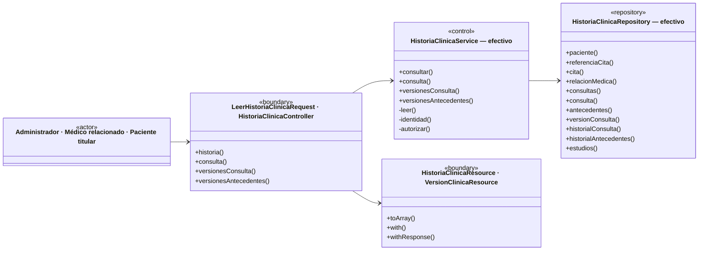

Vista simplificada de participantes/métodos propios efectivos, no expansión transitiva de todas las llamadas de seguridad ni clase PHP adicional por caja. Histogramas P49–P52 previos permanecen como diseño; contexto editable P50 todavía no se implementa. GET consulta de esta fase lo sirve HistoriaClinicaController/Service como lectura CU-22; no crear ConsultaMedicaController/Service vacíos para anticipar Fase 3.

**Flujo principal:** middleware de sesión/rol → ID/filtros validados → continuidad → actor bloqueado → planificación → Médico(s) ordenados sin perder precisión de IDs → Paciente → Cita si detalle. Primero autorizar con relación propia Programada/Confirmada/Atendida o vínculo titular, luego recuperar texto con ámbito SQL de Paciente. Médico relacionado puede leer una consulta de otro profesional del mismo Paciente; no habilita escritura. Revalidar identidad/sesión y relación después de materializar datos, antes de salir. Cuenta/ficha/profesional son estados independientes; inactividad de ficha/profesional no rechaza por sí sola lecturas ya autorizadas. Administración usa permiso explícito sin suplantar al Médico.

**Proyección:** historia muestra antecedentes vigentes y consultas paginadas por inicio de cita/ID descendentes; detalle consulta vigente y antecedentes/estudios; históricos paginados por versión descendente solo internos. Paciente no consulta columnas de autor/motivo_cambio ni recibe origen interno/historial/contexto editable; vigente incompleto permitido y desconocidos NULL. Paginación page/per_page de detalle se concreta para estudios, no para versiones ni nuevas escrituras. Resumen no arrastra diagnóstico/síntomas completos, CI/contactos/nacimiento/motivo de reserva. Antecedente cuyo origen no corresponde al Paciente se excluye; si es la mayor versión no se presenta una menor como vigente. BIGINT texto/UTC seis decimales/no-store y HEAD vacío.

**Laboratorio:** Repository une solo estudios de esa consulta/Paciente y punteros coherentes, Service comprueba Disponible/Autorizar/versión actual-mayor/revisor responsable según esquema vigente. Paciente ve Pendiente hasta publicación coherente; internos ven estado real sin metadata documental incoherente. Resource solo entrega estudio/fecha/estado/número/fecha de publicación; no rutas/nombres/hashes/IDs de documento/revisión/bytes ni enlaces de descarga. Lectura CU-22 no implementa carga/revisión/CU-27 ni soluciona autoría administrativa futura de laboratorio.

**Alternativos/errores:** ajeno/inexistente 404 neutro, Recepción 403 y Paciente históricos 403; sesión ausente/revocada/desactivada 401, restricción legítima 403. Extras/cuerpo/filtros/ID inválidos 422, verbos de escritura 405; 500 central seguro. Sin consulta o antecedentes: null/colección vacía, nunca crear al abrir ni inventar hechos. GET no modifica Cita/versiones/CambioCita/avisos/bitácora clínica; las sesiones sí mantienen su infraestructura normal. No originales/acciones de edición hasta fases de escritura, evitando anunciar capacidad inexistente.

**Verificación dirigida nueva:** HistoriaClinicaTest (87 casos con esquemas PostgreSQL propios) + MatrizPermisosBackendTest ampliada en 30 combinaciones de las cuatro rutas → **656 pruebas/3449 aserciones correctas**, 34,614 s/92 MB, antes del formateo sin cambios semánticos; Pint/sintaxis de diez PHP y Composer validate correctos. Primer intento detenido en 61/594 por expectativa errónea: cambiar marca de clave obligatoria sin sesión temporal válida invalida con 401; se conserva rechazo y se agrega emisión/login restringido real para 403. No cambio de autenticación productiva ni relajación. Laboratorio/versiones son fixtures de solo preparación, no flujos CU-23/CU-26. Callbacks de revocación/revalidación no son concurrencia multiproceso. Regresión ampliada posterior correcta: **1117 pruebas/8966 aserciones**, 3 min 22,081 s/132 MB; incluye dirigida, no suite global ni pruebas frontend. Inventario aislado dirigido/ampliado pre/post dos esquemas/doce tablas/public vacío conservado. Controles finales de UTF-8/PSR-4/alcance, matriz previa, cuatro rutas únicas de lectura y registro único correctos; 659 archivos protegidos/68 bloques históricos de análisis/148 bloques UML conservados, ocho archivos nuevos previstos. DER sin cambio físico, fuentes UML previas intactas con nota incremental; cierre integral del módulo y estructura global se revisarán en Fase 6. **No iniciar Fase 3.**

<a id="cu22-cu23-backend-fase1"></a>
## CU-22/CU-23 — Backend Fase 1: diseño clínico autorizado (2026-10-28)

**Diseño P, no implementación:** se agregan cuatro vistas previstas P49–P52 a las 65 vistas anteriores intactas: 69 vistas totales, 52 procedimientos (P01–P52) y 17 antecedentes. No 69 procedimientos ni métodos PHP nuevos. Backend/README contiene los seis contratos HTTP previstos, payloads cerrados, proyecciones, coordinación, errores y matriz de pruebas; contexto §17.159. CU-22/CU-23 son ampliación clínica aprobada y perfil del Paciente, con RN12/RN14; no se modifica el examen ni se declaran completas las fases 2–6.

**Decisiones confirmadas por el responsable:** Paciente ve versiones vigentes propias, incluso consultas guardadas incompletas, sin historial/motivos internos; Médico con cita propia Programada/Confirmada/Atendida lee historia del Paciente incluso antes del inicio, sin caducidad adicional y sin habilitación por Cancelada/Inasistencia solas. Alta CU-23 desde inicio vigente + declaración de atención real iniciada/realizada (no atención terminada CU-19); corrección efectiva posterior exige motivo y versión nueva. No-op válido devuelve vigente sin nueva versión/evento, siempre después de autorización y originales actuales.

### Participantes y estado real

| Participante | Estado / responsabilidad |
| --- | --- |
| HistoriaClinicaController / Service / Repository | P, candidatos ya incluidos en UML: HTTP/ámbito clínico/lecturas filtradas y proyección por rol; no entidad HistoriaClinica |
| ConsultaMedicaController / Service / Repository | P, apertura de contexto/alta/corrección atómicas de misma consulta y anexado de snapshots; no setter de estado de Cita |
| Requests y Resources de historia/consulta | P, en dtos/historia_clinica; formatos/allowlists y salida explícita. No clases vacías ni nombres definitivos inventados como existentes |
| ConsultaMedica / VersionConsulta / VersionAntecedente | E, persistencia ya disponible: consulta única por cita y versiones inmutables con autor Usuario/origen; no funcionalidades CU-22/CU-23 ejecutadas por existir los Models |
| AutenticacionService / ContinuidadAdministrativaService / PlanificacionRepository / CitaRepository / MedicoRepository | E reutilizables; coordinación de cuenta/rol/sesión/vínculo/planificación/Médico/cita y revalidación posterior a esperas |
| BitacoraRepository / ReferenciasBitacora / Resources de bitácora / RespuestaError | E con ampliaciones P para eventos/referencias/códigos clínicos seguros; sin volcar contenido ni motivos a bitácora |
| Paciente / Cita / Medico / Usuario | E; identidades y relaciones fuente de verdad. No duplicar Paciente/Médico en ConsultaMedica ni confundir sus PK con Usuario |
| Modelos de laboratorio existentes | E de persistencia, lectura mínima prevista en CU-22 según publicación vigente; flujos/servicios/descargas CU-24–CU-27 aún P |

Subcarpetas historia_clinica en controllers/dtos/services/repositories, conforme al diseño previo. Firmas preliminares P de UML (`guardar`, constructor dependiente de ResultadoLaboratorioService P) son antecedentes; se concretarán con abrir/registrar/actualizar y sin dependencia obligatoria de un servicio inexistente. No introducir capa artificial ni nuevo Service clínico dentro de las carpetas de agenda/usuarios.

### P49 — Consultar historia clínica y versiones permitidas (CU-22, previsto)

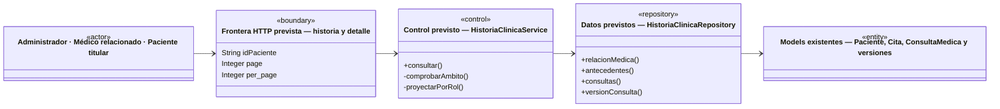

**Colaboración:** sesión/rol/vínculo → ámbito construido por servidor → relación comprobada antes de recuperar texto → antecedentes vigentes y consultas paginadas con detalle autorizado. Administración no suplanta a Médico; Médico relacionado puede leer atenciones de otros profesionales del mismo Paciente, pero no modificarlas. Paciente solo versión vigente propia: no contexto editable ni motivos/autoría interna/versiones anteriores, aunque la consulta esté incompleta. GET históricos se reservan a Administrador/Médico con ámbito clínico, paginados; Recepción/Paciente reciben 403. Ajeno/inexistente, 404 neutro. Sin historia/antecedentes: null/colección vacía, no inventar «sin alergias». Laboratorio solo metadatos permitidos, sin bytes/rutas/enlaces inventados ni servicio futuro simulado.

### P50 — Abrir consulta/contexto de edición de una cita (CU-23, previsto)

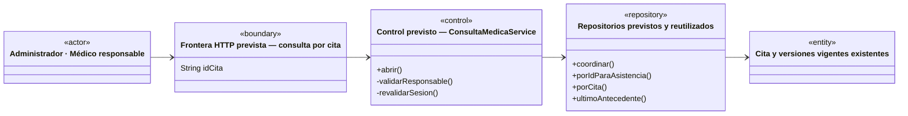

**Colaboración:** GET por cita entrega null si no hay consulta, o la vigente; contexto de edición solo a Administrador/Médico responsable. Ese mismo recurso puede leerse por CU-22 con proyección titular/relación y sin edición. Originales obligatorios del contexto: versión/timestamp exacto de Cita e IDs actuales de consulta/VersionConsulta/VersionAntecedente, null explícito cuando no existen. Apertura no crea consulta ni reserva el alta. Lecturas revalidan acceso y no garantizan snapshot entre peticiones. Paciente/profesional relacionados por otra cita no reciben originales de edición ni permiso de escritura.

### P51 — Registrar atención clínica y primeras versiones (CU-23, previsto)

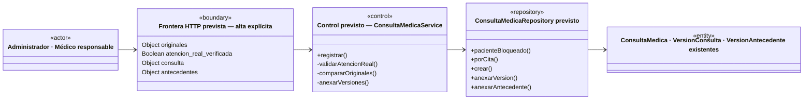

**Colaboración:** transacción/continuidad/sesión/planificación → Médico/Paciente/Cita/Consulta en orden estable → cuenta/rol/vínculo/recurso/originales revalidados tras esperas → ahora fresco >= inicio_at, estado permitido y declaración true estricta → alta única + VersionConsulta 1 + antecedentes solo si aportan cambio efectivo + auditoría segura → commit/201. Autor Usuario real, responsable por Cita. No fecha de inicio real inventada: iniciada_en NULL si se desconoce. UQ id_cita resiste dos altas; segunda devuelve 409, no duplica ni sobrescribe con un supuesto upsert. No CambioCita/Atendida/avisos automáticos. Existencia de consulta, incluso inicio NULL, bloquea gestión/llegada/inasistencia incompatibles según módulos ya implementados.

### P52 — Completar/corregir consulta o antecedentes sin sobrescribir (CU-23, previsto)

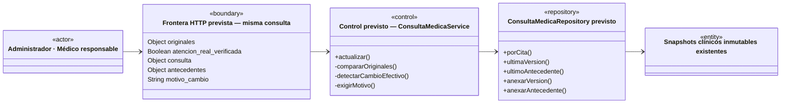

**Colaboración:** mismos controles/bloqueos/originales del contexto antes de no-op; PATCH exige consulta existente. Campo omitido conserva; null borra solo opcionales de la nueva versión, nunca una versión previa. Cambios efectivos de cada bloque anexan snapshot completo con motivo/fecha/autor; bloque idéntico no se versiona. Solo antecedentes, solo consulta o ambos son válidos y atómicos. Padre Paciente protege numeración y originales de antecedentes frente a dos atenciones distintas; padre Consulta protege versiones de consulta. No-op 200 modificado=false, sin versión/evento nuevo, pero un original obsoleto siempre 409. Motivo clínico permanece en versiones protegidas, no bitácora general.

### Dependencias, verificación y cierre de fase

El protocolo previsto mantiene coordinación común con gestión/asistencia/planificación/cuentas: continuidad → actor → planificación → Médico → Paciente → Cita → Consulta, numeración de versiones bajo sus padres. No se cambian los locks de módulos terminados sin pruebas de cruces; verificar seguridad/concurrencia con PostgreSQL aislado en Fase 5, no inferirla de esta vista. Ampliaciones futuras de bitácora/allowlists/códigos de error son necesarias, no implementadas. Motivos/diagnósticos/antecedentes excluidos de auditoría general; no afirmar que hidden basta para Resources.

Las cuatro vistas son simplificadas **previstas**, no censo de llamadas/métodos existentes ni sustituto del UML acumulativo. Clases E reutilizadas permanecen en su módulo propietario. Firmas operativas definitivas y participaciones de repositorio se contrastarán con código al implementar, sin inventar E a partir de diseño P. Dos textos del DER se corrigen por permisos administrativos aprobados; no nueva tabla/atributo/migración. Se anota la concreción en UML sin alterar sus 21 fuentes ni censo 102 E/21 P+Sesion R. Controles correctos: 660 archivos protegidos intactos, ocho documentos UTF-8/cercas/anclas/diff-check; los 68 bloques cercados anteriores de análisis se conservan exactamente y solo se agregan estas cuatro vistas previstas, 148 bloques UML intactos. Sin render nuevo, pruebas funcionales/SQL/migraciones/APIs ni suites históricas atribuidas a esta fase. **Fase 1 documental cerrada; detenerse antes de Fase 2.**

<a id="cu17-cu19-frontend-fase6"></a>
## CU-17–CU-19 — Frontend Fase 6: integración real y cierre (2026-10-28)

**Fase 6 y seis fases frontend cerradas localmente: fronteras P45–P48 integradas en navegador real y suite global nueva correcta.** No nuevos procedimientos/clases productivas/firmas ni cambios del modelo persistido. Se conservan las 65 vistas del análisis y las 21 PlantUML globales; React no se convierte en clase PHP ni se amplía silenciosamente el alcance selectivo del UML. RF10/RN10/RN12/RN14 y VS-EST-01–09 intactos; evidencia/contexto §17.158 y frontend/README. Producción y otros módulos pendientes, no iniciados.

### Colaboración efectiva verificada de extremo a extremo

1. **AgendaPage/selector/CitasTable/Workspace y AsistenciaCitaPage:** selección administrativa o agenda propia médica, ruta compartida de asistencia. GET asistencia orientativo + detalle para etiquetas mínimas cotejadas; estado/programación/elegibilidad nunca se toman de otra lectura ni de reloj del navegador. Paciente sin acceso y cada rol sin escrituras ajenas.
2. **AsistenciaResumen/ConfirmacionAsistencia:** declaración inicialmente desmarcada → revisión de identidad/programación/efecto → confirmación explícita. Casilla por teclado/foco de revisión y layouts reales verificados. Llegada/inasistencia no son atención, ni tiempo/documentación prueban automáticamente el hecho. Ejecutar como Administrador no atribuye autoría al profesional.
3. **useAsistenciaCita/asistenciaCita.service/Axios:** señales/lock/originales/CSRF, wrappers específicos → Routes/middleware → AsistenciaController/Request → AsistenciaService → repositorios/modelos/PostgreSQL. Seis reservas reales y transiciones de los tres tipos, cortes de respuesta tras commit y GET sin replay/causalidad inequívoca. Resumen anterior no vigente, 409 entre revisión y escritura exige reconsulta sin reapertura.
4. **Laravel/persistencia y seguridad:** cuatro roles/cookies/CSRF reales; originales obsoletos/419/422/permisos rechazados, sesión restaurada por recarga y revocación real. Médico profesionalmente inactivo con cuenta activa conserva asignaciones anteriores. Programación/versión/Paciente/Médico/ejecutor/historial preservados; bitácora mínima, avisos propios invalidados y ninguna consulta clínica creada.

### Evidencia y alcance

Arnés loopback temporal con base/rol de tests sin privilegios elevados, esquema exclusivo de 35 migraciones existentes y correo fake/HTTP externo impedido. Reloj fijado explícitamente en dos momentos del día de fixture, avisos preexistentes y profesional inactivo preparados como fixture; no generador CU-28 ni CU-23 operativo. Recorrido final independiente: **15 comprobaciones, cuatro respuestas cortadas tras commit, 80 disposiciones y 32 axe sin infracciones automáticas**, cero excepciones JS, Web Storage vacío, cookie HttpOnly/SameSite Lax y CORS con credenciales. Anchos 1440/768/390/320/texto 200% a 320; foco/teclado/salto al contenido/Escape menú y capturas representativas inspeccionados. No certificación exhaustiva/HTTPS/SLA ni carreras SQL nuevas.

Verificación SQL final de solo lectura: seis citas (4 Atendidas/2 Inasistencia), ocho cambios (2 LLEGADA/2 INASISTENCIA/4 ATENCION), catorce eventos de negocio (seis reservas incluidas), seis avisos invalidados/cero consultas/versión 1 intacta. Esquema/reloj/fixture/credenciales y procesos propios retirados, inventario inicial de esquemas/estructura public conservado, no auditoría de filas ajenas. Dos supuestos de arnés corregidos antes de repetición completa con fixture nueva: h1 real del selector y distinción lógica de Usuario/Médico (PK numéricamente coincidentes entre tablas no son identidad compartida). Producto intacto, no replay ni suma de intentos.

**Revisión acumulativa:** comprobadores reejecutados cotejan 433 firmas/75 clases operativas/218 participaciones de inyección y cero ciclos Service→Service; P45–P48 mantienen 17/20/21/20 participaciones transitivas y diagramas intactos. UML global anota integración frontend conservando 124 participantes/102 E/21 P/Sesion R y sus 21 vistas; DER no requiere modificación. Build nuevo correcto, aviso conocido >500 kB/sin lint; **suite global final nueva 2702 pruebas/88 archivos correctos**, 266,58 s, §17.158/README; no sumar comprobaciones del navegador ni reutilizar suite anterior. Sin cambios productivos/CSS/dependencias ni pruebas versionadas nuevas; documentación de cierre no convierte CU-22–CU-29/producción en implementados.

<a id="cu17-cu19-frontend-fase5"></a>
## CU-17–CU-19 — Frontend Fase 5: robustez ampliada (2026-10-28)

**Verificación transversal de fronteras P45–P48, sin nuevos participantes productivos, firmas, reglas ni diagramas.** CU-17/18/19 conservan RF10/RN10/RN12/RN14 y declaraciones explícitas según cada operación. Esta fase añade infraestructura de prueba, no clases del dominio ni procesos clínicos. Consulta/etiquetas/cotejo de identidades P45, llegada P46, ausencia P47 y atención P48 reutilizan exactamente los componentes/hooks/services efectivos documentados en Fases 2–4. Administrador/Recepción y Administrador/Médico propio mantienen sus permisos específicos, sin suplantar al Médico responsable.

### Colaboraciones comprobadas

- **Transporte privado ↔ Axios:** AbortSignal y época HTTP antes/después de CSRF y tras PATCH. Barreras de inicio del adapter establecen orden, sin sleeps. Cancelación anterior no envía; cancelación posterior no prueba rollback. Época anterior se descarta, no reenvía. Quince errores HTTP y respuestas 201/202/204/206 no se convierten en éxito confirmado. GET discordantes por identidad no mezclan etiquetas ni programación; detalle anterior solo aporta etiquetas cotejadas, no elegibilidad/estado.
- **Coordinador ↔ tres wrappers/GET:** un lock cruzado impide doble envío/recuperación, no reset durante incertidumbre; operación real conservada tras pagehide y GET fallido. Estados no contractuales posteriores bloquean hasta GET explícito, rechazos conocidos retiran revisión sin replay. Retry-After inválido no inventa espera, espera válida persiste al ocultar y no ejecuta nada al vencer. Campos 422 limitados al hecho propio/originales; sin contenido clínico/técnico ni declaración ajena.
- **Página/formulario ↔ sesión/router/consulta:** identidad/rol/restricción/revocación/cita cambiados retiran borrador, abortan señal y descartan respuesta anterior; Médico ajeno sigue sujeto a Laravel. Navegación durante PATCH advierte, permite permanecer o salir sin asegurar reversión; beforeunload se retira al desmontar. GET/PATCH/CSRF descartados tras logout fallido no dejan busy permanente ni publican respuesta anterior. Recuperación rechazada conserva bloqueo y GET sin cambio no acredita causalidad ni replay. 429/pagehide/pageshow no habilitan otra escritura ni conservan declaración; datos no persisten en Web Storage.

### Infraestructura y evidencia nueva

Tres archivos bajo citas/tests: `hooks/useAsistenciaCitaRobustez.test.js` (108 casos), `services/asistenciaCitaRobustez.service.test.js` (159), `pages/AsistenciaCitaRobustez.test.jsx` (84). Matriz de seis combinaciones autorizadas; Router/AuthProvider/servicios/Axios reales, sesión/HTTP simulados. **Dirigida 351 pruebas/3 archivos correctos**, 43,28 s, comando en frontend/README. Primer intento 338/339 por dato ficticio de especialidad idéntico al original, corregido sin cambio productivo ni relajación; doce escenarios adicionales de rol/GET rechazado incluidos en la dirigida final. No se detectó defecto productivo en el alcance probado. Build nuevo correcto con artefactos iguales a Fase 4, aviso conocido >500 kB/sin lint. **Suite global final nueva 2702 pruebas/88 archivos correctos**, 265,76 s, contexto §17.157; incluye dirigidas, no sumar ejecuciones. **Fase 5 cerrada localmente con API simulada.**

README/contexto/CU/análisis sincronizados. Controles exclusivos de fase: 658 archivos protegidos intactos, tres tests nuevos/cuatro documentos; UTF-8/cercas/anclas de siete archivos/diff-check correctos, 68 bloques del análisis/148 del UML preservados (65 diagramas/21 PlantUML anteriores). Las clases/relaciones/diagramas previos de P45–P48 y UML global selectivo PHP permanecen; DER/reglas/RF/RN/código productivo/dependencias intactos. Pruebas simuladas no acreditan nueva integración Laravel/PostgreSQL/concurrencia SQL/cookies ni revisión real de navegador/axe/responsive. Módulo frontend no cerrado, Fase 6/producción pendientes; no iniciarlas automáticamente.

<a id="cu19-frontend-fase4"></a>
## CU-19 — Frontend Fase 4: marcar Atendida (2026-10-28)

**Frontera P48 implementada con API/sesión simuladas; Fases 5–6 pendientes.** Corresponde a RF10/RN10/RN12/RN14 y VS-EST-03, sin modificar requisitos/reglas ni afirmar persistencia nueva probada desde React. Reutiliza consulta P45/coordinación P46–P47. No nuevo procedimiento ni clase PHP; conserva todos los diagramas de procedimientos y UML global selectivo backend.

| Participante existente ampliado | Responsabilidad efectiva |
| --- | --- |
| asistenciaCita.service | marcarAtendida(entrada, signal) fija acción/campo/ruta/destino/operación y comparte escribirAsistencia privado. Atención admite Administrador/Médico y Programada/Confirmada; llegada/inasistencia mantienen sus roles/estado anteriores. Proyección de respuesta mínima y verificación del actor sin enviarlo |
| useAsistenciaCita | marcarAtendida(entrada) usa un único lock/secuencia/AbortSignal/espera para las tres escrituras, con operacion ATENCION durante incertidumbre/recuperación/pagehide. Traduce CITA_ATENCION_ANTICIPADA y admite exclusivamente atencion_realizada/originales en errores de campos |
| ConfirmacionAsistencia | Prop operacion ATENCION, declaración desmarcada de atención real, revisión de identidades/programación/efecto final y confirmación explícita. No depende de consulta clínica ni crea formulario de clínica |
| AsistenciaCitaPage | Preparar/abandonar atención, selección exclusiva de formulario, foco en preparación/revisión/retorno, resultados específicos y recuperación GET sin replay. Refresco fallido conserva guardado confirmado |
| AsistenciaResumen / navigation.js | Atención ya disponible y explicación de separación con clínica; CU-17–CU-19 comparten una entrada de lectura/gestión, sin conceder operaciones por su trazabilidad de navegación |
| Tests de atención, hook y fixtures/navegación | Nuevos archivos de servicio/página y ampliaciones existentes: roles/estados/contrato/privacidad/declaración/revisión/foco/limpieza/errores/lock/incertidumbre, sin clases de producción nuevas |

**Colaboración P48:** Administrador o Médico propio seleccionan cita; GET asistencia/etiquetas mínimas cotejadas proporcionan contexto. Preparar atención → declarar que el Médico responsable realmente atendió → revisar misma cita/Paciente/profesional/estado/intervalo/duración/ubicación y efecto → Marcar como Atendida. No se deriva el hecho de tiempo transcurrido ni de existencia de ConsultaMedica. Elegibilidad exclusivamente del servidor: no exigir Confirmada previa, fin, mismo día ni consulta; cuenta/vínculo/titularidad se revalidan en Laravel, sin simular el rol profesional para Administración.

**Escritura:** CSRF → PATCH /citas/{id}/atencion con originales exactos + atencion_realizada JSON true, sin IDs de actor/profesional/estado/otros hechos/diagnósticos → comprobar 200 Atendida, programación/versión intactas, timestamp creciente, cambio ATENCION y ejecutor esperado → resultado → GET separado. Conserva responsable y ejecutor independientes, BIGINT/microsegundos/versión máxima. No modifica consulta/antecedentes/documentos ni crea atención clínica ficticia; el backend conserva historial/retira avisos propios/audita dentro de sus garantías ya implementadas.

**Alternativas:** finales/anticipada/rol ajeno impiden preparar según servidor. 409 obsoleto/estado/inicio exige consulta y nueva declaración/revisión; 401 limpia sesión, 403/404 seguros, 419 sin reenvío, 422 campo específico, 429 espera sin autoenvío. Red/408/5xx/200 inválido tras enviar → incierto y bloqueo compartido, GET explícito sin replay/causalidad inequívoca. Abandono no prueba rollback; pagehide conserva operación incierta, descarta respuestas tardías y limpia borrador. Volver/abandonar/cambiar acción/actualizar retiran declaración/revisión; sin Web Storage ni resumen anterior presentado vigente.

**Verificación:** primera dirigida 379/383 con cuatro colisiones de datos ficticios actor/Médico, corregidas sin cambio de lógica. Dirigida posterior **176 pruebas/4 archivos correctos**, 11,35 s; ampliada **415 pruebas/10 archivos correctos**, 20,27 s, incluye llegada/inasistencia/Inicio/sidebar. Build correcto, aviso conocido >500 kB/sin lint. UTF-8 de 28 archivos acumulados/cercas/anclas/diff-check correctos, 633 archivos protegidos y 68 bloques cercados previos preservados (65 diagramas). **Suite global final nueva 2351 pruebas/85 archivos correctos**, 244,93 s, §17.156/README; incluye dirigidas, no sumar ejecuciones. HTTP/session adapter simulados con Router/AuthProvider/services reales, sin integración nueva Laravel/PostgreSQL ni navegador/axe. README/contexto/CU/análisis P48 sincronizados; P45–P47 revisados por reutilización, diagramas anteriores/21 PlantUML globales conservados. **Fase 4 cerrada localmente con API simulada**; módulo frontend no cerrado, Fases 5–6/producción/otros módulos no iniciados.

<a id="cu18-frontend-fase3"></a>
## CU-18 — Frontend Fase 3: inasistencia comprobada (2026-10-28)

**Frontera de P47 implementada con API simulada; P48 frontend permanece previsto.** Reutiliza P45 consulta y la coordinación de P46 llegada, sin nuevo procedimiento/diagrama/clase PHP ni pantallas por rol. 65 vistas/48 procedimientos/17 antecedentes y 21 PlantUML globales conservados; backend/DER/reglas RF10/RN12/RN14/VS-EST-01–09 intactos. La consulta orientativa no acredita ausencia: requiere declaración responsable del usuario autorizado y nueva validación de Laravel al guardar.

### Participantes efectivos y cambios sobre Fase 2

| Participante existente ampliado | Responsabilidad efectiva |
| --- | --- |
| asistenciaCita.service | Nueva registrarInasistencia(entrada, signal), que fija internamente ruta/estado/campo/operación. Comparte escribirAsistencia privado con confirmarLlegada, sin aceptar estado/ruta de la UI; valida y proyecta respuesta específica |
| useAsistenciaCita | Nueva registrarInasistencia(entrada) en el mismo coordinador, con operacion en estado local. Un lock/secuencia/AbortSignal para ambas acciones; retiene nombre de acción al recuperar/pagehide, no formularios ni declaraciones |
| ConfirmacionAsistencia({ contexto, onGuardar, operacion = 'LLEGADA' }) | Formulario y revisión compartidos para llegada/inasistencia, con declaración desmarcada/etiqueta/efecto/botón específicos. Cambios de modo/consulta/originales desmontan revisión; volver o abandonar no escribe |
| AsistenciaCitaPage | Preparar/abandonar inasistencia, foco en encabezado y retorno al botón preparatorio, revisión/confirmación/resultado con acción real; no nuevas rutas ni búsquedas. El componente muestra una sola preparación a la vez |
| AsistenciaResumen y navigation.js | Inasistencia ya no se anuncia como función futura, CU-17/CU-18 comparten entrada de consulta/gestión y CU-19 sigue pending. Rol de lectura médica en esa página no concede escritura de ausencia |
| Tests de servicio/página nuevos, hook/fixtures/navegación existentes ampliados | Contrato/seguridad/flujo/ciclo de vida y regresión de llegada con HTTP/session adapter simulados; no clases productivas ni prueba de SQL real |

**Colaboración P47:** GET asistencia determina registrar_inasistencia; Administrador/Recepción eligen Preparar inasistencia, declaran ausencia comprobada, revisan misma cita/estado/intervalo/duración/ubicación/responsable/efecto y confirman. No inferir ausencia por haber terminado el intervalo, no forzar desde Confirmada ni reabrir un final. Campo ausencia_verificada JSON true exclusivo, junto a versión/timestamp originales; no presencia_verificada, atencion_realizada, rol/actor/IDs/motivo/fecha del hecho. idActor solo verifica respuesta. POST/GET clínicos o de recordatorios no se solicitan. Criterio temporal es del servidor (incluida igualdad en fin y posibilidad de registrar otro día), no cálculo del navegador.

**Guardado específico:** CSRF → PATCH /citas/{id}/inasistencia → 200 de identidad/programación/versión intactas, Inasistencia/timestamp creciente/último cambio INASISTENCIA/ejecutor esperado → resultado confirmado → GET de elegibilidad separado. Validación compartida no debilita llegada, cuyo destino/campo/operación siguen fijos. La programación histórica y duración/ubicación no cambian por la transición; versión máxima y microsegundos conservados. Advertencia clara de final sin reapertura y retiro de avisos existentes propios por backend, no gestión CU-28 en cliente ni nueva consulta médica.

**Errores/recuperación:** un solo lock bloquea llegada y ausencia durante envío/recuperación; los mensajes/errores 422 admitidos siguen la operación real. CITA_INASISTENCIA_ANTICIPADA, originales obsoletos, documentación o transición inválida → 409 seguro y nueva consulta/declaración/revisión. 401 limpia sesión, 403/404/419/422 rechazan sin éxito/replay, 429 espera local sin autoenvío. Red/5xx/408/respuesta no verificable tras envío → incierto sin formularios ni resumen previo vigente; GET explícito puede recuperar estado pero no causalidad inequívoca ni replay. Guardado confirmado no se pierde al fallar refresco. Abandonar preparación devuelve foco/limpia declaración; pagehide/abort conservan incertidumbre de una escritura en vuelo sin afirmar rollback, descartan respuestas tardías y no guardan Web Storage.

**Verificación dirigida:** **288 pruebas/6 archivos correctos**, 11,13 s, incluidos los casos de llegada y navegación; comando en frontend/README. Dos archivos nuevos de inasistencia para servicio/página y ampliación de hook/fixtures/navegación; no nuevos componentes funcionales ni dependencias. Build correcto con aviso conocido >500 kB/sin script lint; sesión/HTTP simulados, no evidencia nueva de Laravel/PostgreSQL/concurrencia SQL/navegador/axe. Regresión global/comprobaciones finales en contexto §17.155, sin sumar ejecuciones ni atribuir la global de Fase 2 a esta fase.

Primera global interrumpió el cierre documental con dos expectativas obsoletas en HomePage.test.jsx: Recepcionista ya no tiene módulos pendientes. Se adaptó únicamente la prueba transversal para verificar tanto presencia como ausencia de la sección según el catálogo real, sin cambiar HomePage ni el análisis de clases de autenticación ni sus permisos. Dirigida posterior **88 pruebas/3 archivos correctos**, 10,98 s; **suite global final nueva 2256 pruebas/83 archivos correctos**, 237,62 s, contexto §17.155/README. Incluye dirigidas; la global anterior 2254/2256 (239,20 s) no se presenta como correcta ni se suman resultados.

**Documentación/límites:** README/contexto/CU/P47 actualizados y P45/P46 revisados por reutilización, sin modificar sus diagramas anteriores; P48 frontend no se implementa. UTF-8 de 26 archivos acumulados/cercas/anclas/diff-check correctos, 633 archivos protegidos y 68 bloques cercados previos preservados; 65 diagramas/21 PlantUML globales conservados. UML global selectivo backend/DER/RF/RN/reglas/paquetes/CSS/PHP sin cambios. **Fase 3 cerrada localmente con API simulada**; Fases 4–6/producción pendientes, detenerse antes de Fase 4.

<a id="cu17-frontend-fase2"></a>
## CU-17 — Frontend Fase 2: lectura de asistencia y llegada (2026-10-28)

**Fronteras implementadas de P45/P46 con API simulada; P47/P48 frontend siguen previstos.** Se conservan los 65 diagramas/48 procedimientos/17 antecedentes; no añadir uno por el incremento ni sustituir fuentes previas. Clases PHP/relaciones del backend no cambian; componentes/hooks/funciones JavaScript son fronteras/coordinadores reales, no nuevas clases de dominio del UML global filtrado. Reglas RF10/RN12/RN14/VS-EST-01–09 intactas, sin decisiones funcionales nuevas.

### Responsabilidades y colaboración efectivas

| Participante real | Responsabilidad en esta fase |
| --- | --- |
| AgendaPage({ asistencia = false }), CitasTable(..., detailPath, detailState), AgendaWorkspace | La entrada /asistencia reutiliza consulta/criterios/origen de agenda; Médico propio, selección administrativa para Administrador/Recepción. DetailPath existente y nuevo estado opcional acotado navegan a asistencia sin cambiar el detalle ordinario |
| CitaDetallePage, router.jsx, navigation.js, destinoSeguro | Enlace contextual autorizado, rutas compartidas protegidas, sidebar/Inicio/título/retornos fijos. El catálogo incorpora CU-17 como página de consulta/llegada, con lectura médica, no permiso de llegada para ese rol; CU-18/CU-19 siguen pending |
| AsistenciaCitaPage | Valida ID, remonta flujo por identidad/rol/ID, coordina lectura de contexto/confirmación/resultado/espera/bloqueo/retorno. Nunca escribe HTTP directamente ni toma reglas clínicas |
| AsistenciaResumen | Identidades mínimas/programación y condiciones del servidor por acción, último cambio seguro y distinción ejecutor/Médico. Ausencia/Atendida informadas, sin botones operativos |
| ConfirmacionAsistencia | Solo llegada por ahora: casilla de presencia/identidad desmarcada, revisión explícita de programación/efecto, confirmación o vuelta sin envío; limpieza de declaración al cambiar/actualizar/abandonar |
| useAsistenciaCita(id, rol, idActor) | Coordinación local de llegada, lock/secuencia/señales/resultado/error/Retry-After/incertidumbre/recuperación; no amplía useGestionCita con otras transiciones ni guarda estado global de pacientes |
| asistenciaCita.service | consultarAsistenciaCita({ id, rol }, signal), consultarContextoAsistencia({ id, rol }, signal), confirmarLlegada({ id, rol, original, declaracion, idActor }, signal), con HTTP/proyección/validación de contrato. idActor sirve solo para comprobar respuesta, nunca viaja en payload |
| useAgendaQuery | Reutilización de lectura con kind asistencia; mensajes de ese contrato y salida de carga para SESSION_SUPERSEDED. Adaptación local preserva otros tipos de consulta |
| Button/Alert/ActionGroup/PageHeading/QueryMessage, formatos agenda, describirError, useAuth, api/csrfURL | Reutilizados: controles/fechas/errores/sesión/Axios; sin nueva dependencia o instancia HTTP. Declaración usa label/input nativos accesibles con estilo local, sin coerción de booleano |

**Lectura P45:** GET asistencia y detalle autorizado en paralelo → comprobar IDs/código → retener solo nombres/apellidos/especialidad del detalle → programación/versiones/acciones exclusivamente de asistencia. No snapshot atómico prometido entre GET separados; una divergencia de identidad falla cerrada. CI/teléfono/nacimiento/motivo/clínica/UUID no pasan al contexto. Impedimentos por acción deben ser conocidos/no duplicados y coherentes con booleano; un rol sin permiso recibe únicamente ACCESO_DENEGADO en esa acción. No recalcular tiempo ni ofrecer privilegios por una respuesta contradictoria. Operación desconocida de último cambio se muestra como Cambio administrativo, no en bruto ni como confirmación causal.

**Escritura P46:** declaración inicialmente false → revisar → confirmar → CSRF real de transporte simulado → PATCH /citas/{id}/llegada con tres campos permitidos → verificar 200 de identidad/programación/versión conservadas, Confirmada, timestamp UTC creciente y CambioCita LLEGADA/actor esperado → resultado confirmado → GET separado para elegibilidad. Nunca enviar estado/actor/Médico/fecha del hecho/motivo ni redondear originales. Versión máxima válida porque llegada no incrementa version_programacion. Sin interfaces para registrar ausencia/atención, consulta clínica o CU-28.

**Estados/riesgos:** preparación/revisión se eliminan al modificar declaración, volver, actualizar o abandonar. Un solo envío activo; no reenviar en red/timeout/5xx/408/200 inválido. Resultado incierto bloquea reset/escrituras hasta GET explícito, cuyo fallo mantiene incertidumbre; lectura exitosa no prueba causalidad inequívoca ni activa reenvío automático. Guardado confirmado no desaparece si falla GET de refresco. Resumen anterior oculto tras envío/error y hasta consulta con timestamp no anterior al resultado validado; declaraciones no persisten. pagehide/abort/desmontaje descartan respuestas tardías sin afirmar rollback; beforeunload/useBlocker avisan al salir. Errores seguros 401/403/404/409/419/422/429 y Retry-After local sin autoenvío. Axios/AuthContext global intactos; no Web Storage.

**Verificación:** dirigida de cinco archivos, **214 pruebas correctas**, 7,77 s, con Router/layout/AuthProvider/hooks/services/Axios reales y API/sesión simuladas. Payloads/respuestas/roles/ID/microsegundos/versión máxima/identidad mínima, declaración y revisión, ejecución/retorno directo/historial/agenda médica propia, errores/lock/abandonos/incertidumbre/recuperación sin replay y futuras acciones no operativas; navegación/layout actualizados sin reducir permisos negativos. Build correcto con aviso conocido de tamaño, sin lint configurado. **Suite global final nueva 2158 pruebas/81 archivos correctos**, 234,74 s, comando/límites en contexto §17.154/README; incluye dirigidas, no sumar ejecuciones ni atribuir integración PostgreSQL/navegador/axe/responsive real nueva.

**Documentación/límites:** README/CU/contexto y análisis de P45/P46 actualizados; diseño Fase 1 conserva su estado histórico. Verificación UTF-8 de 23 archivos afectados/cercas/anclas/diff-check correcta; 634 archivos protegidos y 68 bloques cercados previos del análisis preservados. Las 65 vistas del análisis y 21 PlantUML globales se mantienen íntegras; no cambio del censo PHP/DER/RF/RN/reglas/backend/dependencias. **Fase 2 cerrada localmente con API simulada**; Fases 3–6/producción pendientes, detenerse antes de Fase 3.

<a id="cu17-cu19-frontend-fase1"></a>
## CU-17–CU-19 — Frontend Fase 1: diseño y contratos (2026-10-28)

**Diseño previsto, no implementación React.** Backend cerrado localmente (§17.152), con P45 consulta, P46 llegada, P47 inasistencia y P48 atención ya implementados. Esta fase prepara sus fronteras frontend, sin crear otro procedimiento/diagrama por CU ni sustituir los existentes: se conservan 65 vistas/48 procedimientos/17 antecedentes. RF10/RN12/RN14 y VS-EST-01–09 no cambian. El UML global selectivo solo backend conserva 21 vistas/102 E/21 P+Sesion R; componentes/hooks/funciones JavaScript no se cuentan como clases PHP.

### 1. Navegación y límites de permisos previstos

Entrada única «Gestionar asistencia» bajo «Asistencia y estados», para Administrador/Recepcionista/Médico, trazable internamente a CU-17–CU-19 sin mostrar esos códigos en menús. Sustituirá progresivamente los tres elementos pending, sin crear tres búsquedas/páginas por acción ni duplicar por rol. Ruta de entrada prevista `/asistencia` reutiliza AgendaPage con un modo de navegación/presentación explícito: Administrador/Recepción seleccionan profesional mediante el selector existente; Médico ve exclusivamente su agenda, sin selector ajeno. Misma API `/agenda`/`/agenda/medicos`, filtros y paginación actuales, sin inventar listado global de asistencia. CitasTable ya acepta detailPath; en esta entrada dirigirá a `/citas/:id/asistencia`, mientras `/agenda` conserva el detalle actual.

Ruta de trabajo prevista `/citas/:id/asistencia` dentro de AgendaWorkspace y ProtectedRoute/RoleRoute para esos tres roles. CitaDetallePage incorporará enlace para los mismos roles desde agenda/detalle directo o historial administrativo. Retorno por enum de origen acotado: `asistencia` → `/asistencia`, `direct` → `/citas/{id}`, `historial` → `/recepcion/historial-citas/{id}`; al entrar directamente a URL, retorno fijo al detalle. Nunca aceptar un returnTo externo/arbitrario ni IDs/roles de location.state como autorización. La procedencia solo orienta navegación, no modifica recursos ni permisos.

El workspace puede recordar filtros/selector/origen, nunca la cita, declaraciones o resultados clínicos; se limpia al cambiar identidad/rol y pagehide como actualmente. Una vuelta a agenda/detalle/historial vuelve a consultar, conservando criterios pero no una copia vieja de filas. Se actualizarán router.jsx/navigation.js/contextPages/destinoSeguro/pruebas de navegación únicamente en Fase 2, sin cambiar rutas de los demás módulos. No enlazar asistencia desde Mis citas ni habilitarla al Paciente; acceso directo queda denegado sin GET protegido. Un Médico que manipula ID recibe el 404 neutro de Laravel.

| Actor | Lectura asistencia | Llegada | Inasistencia | Atendida |
| --- | --- | --- | --- | --- |
| Administrador | Sí | Sí, si elegible | Sí, si elegible | Sí, si elegible; conserva Médico responsable |
| Recepcionista | Sí | Sí, si elegible | Sí, si elegible | No |
| Médico | Solo propia | No | No | Solo propia y elegible |
| Paciente | No | No | No | No |

No recalcular permiso/elegibilidad con fecha local del navegador, estado de ficha/catálogos o suposiciones clínicas. Usar acciones/impedimentos del servidor y lista fija de roles como protección de presentación, nunca como autorización suficiente. Si se descubre una respuesta que contradice el rol esperado, cerrar el flujo de forma segura, no mostrar una acción privilegiada. En Fase 2 solo lectura/llegada operativas; Fase 3 incorpora ausencia y Fase 4 atención: los campos del GET se validan sin falsear sus valores ni ofrecer escrituras todavía no construidas.

### 2. Contrato real HTTP que consumirá React

Axios central existente (`api`, cookies/Sanctum, `sessionBound: true`, época de sesión, AbortSignal), sin instancia nueva ni cambios de timeout/reintentos globales. Preparar CSRF mediante csrfURL antes de cada escritura; no reenviar PATCH automáticamente por 419/red/conflicto. API relativa a la base `/api`:

| Método/ruta real | Entrada |
| --- | --- |
| GET `/citas/{id}/asistencia` | Solo ID de ruta, sin query/cuerpo |
| PATCH `/citas/{id}/llegada` | version_programacion_original, actualizada_en_original, presencia_verificada=true |
| PATCH `/citas/{id}/inasistencia` | version_programacion_original, actualizada_en_original, ausencia_verificada=true |
| PATCH `/citas/{id}/atencion` | version_programacion_original, actualizada_en_original, atencion_realizada=true |

IDs canónicos positivos BIGINT hasta 9223372036854775807 como texto, versión entera positiva hasta 2147483647 y originales UTC `Y-m-d\TH:i:s.u\Z` con seis decimales. Mantener los strings originales íntegros: Number/Date/toISOString no deben redondear identificadores ni perder microsegundos. Formatos y límites son comprobaciones de contrato/usabilidad, no sustituir reglas Laravel. La versión máxima sigue válida para asistencia porque estas escrituras no la incrementan.

**GET 200/data:** programación mínima de id_cita/codigo_cita/id_paciente/id_medico/id_especialidad/id_consultorio, estado, inicio_at/fin_at, duracion_minutos, modalidad Presencial, sede_atencion/consultorio_atencion, version_programacion/actualizada_en. Añade zona_horaria America/La_Paz, consultado_en, acciones (confirmar_llegada/registrar_inasistencia/marcar_atendida), impedimentos con un array **por cada acción**, ultimo_cambio mínimo o null (id_cambio_cita/id_actor/operacion/realizado_en). Cada acción exige booleano y coherencia true ↔ impedimentos vacíos; códigos desconocidos/estructura inconsistente impiden ofrecer envío. No reutilizar parser de GET gestión, que recibe impedimentos planos y solo dos acciones.

Códigos de impedimentos vigentes: ACCESO_DENEGADO (solo acción de otro rol); CITA_TRANSICION_NO_PERMITIDA; CITA_CON_ATENCION_DOCUMENTADA (llegada/ausencia); CITA_LLEGADA_FUERA_DE_PLAZO (llegada); CITA_INASISTENCIA_ANTICIPADA (ausencia); CITA_ATENCION_ANTICIPADA (atención). Pueden concurrir varios impedimentos; no ocultar uno porque otro exista. No requerir OPERACION_NO_DISPONIBLE, que fue un antecedente backend parcial y ya no lo emite el servicio actual. El último cambio puede ser de gestión/ubicación u otra operación permitida: mostrar etiqueta segura genérica para una operación no reconocida, sin imprimir un texto arbitrario del servidor ni atribuir causalidad.

**Contexto de identidad:** consultarCita ya autoriza/proyecta nombres. El futuro consultarContextoAsistencia combinará esa lectura con GET asistencia solo para los tres roles válidos, cotejando id_cita/codigo_cita/id_paciente/id_medico/id_especialidad antes de retener nombres/apellidos y nombre de especialidad. Si divergen IDs/código, rechazar el contexto y pedir reconsulta. Programación/estado/versiones/acciones proceden **solo de GET asistencia**; no adoptar los del detalle ni prometer snapshot atómico entre GET independientes. CI/teléfono/nacimiento/motivo_breve/UUID/clínica del detalle se descartan del contexto de asistencia. No ampliar endpoint/contrato para traer nuevas identidades o permisos.

**PATCH 200/data:** misma proyección mínima y ultimo_cambio, sin acciones/impedimentos/consultado_en/declaración. Verificar identidad y todos los campos de programación contra la revisión enviada, estado destino específico, version_programacion inalterada, actualizada_en estrictamente creciente, último cambio con operación LLEGADA/INASISTENCIA/ATENCION y actor coincidente con la identidad que inició el envío. Proyectar solo campos permitidos; no exponer extras ni tratar una respuesta 200 malformada como éxito. La lectura posterior no reutiliza acciones del snapshot anterior. Mostrar el resultado validado aunque falle el refresco; no presentar el resumen previo como vigente hasta nueva consulta con timestamp no anterior al resultado.

### 3. Flujo de interacción, declaraciones y revisión

Página compartida de programación/identidades, último cambio y acciones del rol. Si hay varias acciones elegibles (por ejemplo llegada y atención durante el turno, o ausencia y atención después del fin), el Administrador elige explícitamente una; no escoger/despachar por estado o edad de la cita. Inasistencia/Atendida son finales para estos flujos, no hay botón de deshacer/reabrir. La elegibilidad del GET es orientativa y puede caducar; Laravel comprueba estado/tiempo/relaciones de nuevo al escribir.

Cada operación prepara una declaración inicialmente **desmarcada**, con texto inequívoco:

| Operación | Declaración de interfaz | Efecto que se revisa |
| --- | --- | --- |
| Llegada | He verificado presencialmente la presencia y la identidad del paciente. | Programada → Confirmada; conserva avisos, no marca Atendida |
| Inasistencia | He comprobado que el paciente no se presentó a esta cita. | Programada → Inasistencia; final, retira avisos propios vigentes |
| Atendida | Confirmo que la atención de esta cita fue efectivamente realizada. | Programada/Confirmada → Atendida; final, retira avisos propios; no crea consulta clínica |

Seleccionar acción/declaración no envía. «Revisar» comprueba la declaración y fija la revisión de la misma cita/versión/timestamp; muestra Paciente, Médico responsable, especialidad, código, estado, inicio/fin/duración, sede/consultorio histórico, declaración y efecto. «Confirmar llegada», «Registrar inasistencia» o «Marcar como Atendida» ejecutan **solo después de esa revisión**; «Volver»/«Abandonar» no escriben. Cambiar cita/acción/declaración/reconsulta/originales limpia revisión y exige declarar de nuevo; sin casilla preseleccionada ni persistida. Sin motivo/diagnóstico/fecha del hecho del cliente. No usar nombre o rol del Médico como si fuera el ejecutor administrativo.

Explicaciones de negocio tomadas del contrato ya aprobado: llegada solo mismo día America/La_Paz/antes del fin y sin consulta; ausencia desde fin sin tolerancia/sin consulta; atención desde inicio sin exigir fin/mismo día/consulta. El navegador muestra estas condiciones, no las verifica como autoridad. Médico profesionalmente inactivo con cuenta activa puede completar sus asignaciones; ficha/catálogos inactivos no bloquean por sí solos asistencia de cita existente. Desactivar cuenta sí impide acceso. No cargar clínica para comprobar existencia ni crear consulta ficticia.

### 4. Máquina de estado de interfaz prevista y protección de datos

Consulta: carga → disponible/error/sin acceso, con actualización manual. Acción: inicial → preparación → revisión → guardando → guardada/error/incierto; recuperación explícita incierto → consultando → recuperada/incierto. Son estados **de interfaz**, no nuevos estados de Cita. Un solo lock inmediato y secuencia coordinan las tres operaciones; deshabilitar todas las escrituras durante guardado/consulta incierta y no aceptar doble clic ni otra acción paralela. Resultado confirmado/recuperado queda separado del GET actualizado; nueva acción requiere consulta/revisión/declaración nuevas.

| Situación | Respuesta prevista |
| --- | --- |
| Fallo preparando CSRF antes de enviar PATCH | Indicar que no se envió; no afirmar resultado incierto de un PATCH inexistente, retirar revisión y solicitar consulta nueva |
| 401 | Integración con invalidación de sesión existente, limpiar datos privados y dirigir al login de forma segura; destinoSeguro no concede rol |
| 403 | Acceso denegado, sin cerrar sesión por asumir 401 ni mostrar datos previos |
| 404 | Cita no disponible/no accesible, mensaje neutro sin enumeración |
| 409 | Explicar mediante código seguro obsolescencia/transición/documentación/plazo, retirar revisión y pedir GET antes de otra acción; sin reenvío ni adopción automática de originales |
| 419 | Protección caducada, sin replay; consulta y revisión explícitas antes de un nuevo intento |
| 422 | Solo errores de los dos originales y de la declaración específica; error seguro si faltan/no son de campos permitidos |
| 429 | Respetar Retry-After local al flujo, bloquear envío/consulta según espera y no autoenviar al vencer |
| Red/timeout/5xx/408/otro estado inesperado o 200 malformado después de enviar PATCH | Resultado incierto; ocultar programación anterior como vigente, bloquear escrituras y permitir solo GET explícito de recuperación |
| GET de recuperación falla o es inválido | Mantener incertidumbre/bloqueo; no permitir reset que habilite reenvío ciego |
| 200 PATCH válido y luego falla GET de refresco | Guardado confirmado no se convierte en fallo; mostrar éxito y que falta consultar elegibilidad actual |

GET recuperado muestra estado/último cambio persistidos, **no confirma qué petición los causó** ni demuestra rollback por estado igual. No hay replay de asistencia; tampoco utilizar propuesta/resultado de reserva CU-14 para recuperar esta escritura. Al cambiar sesión/época/ID/desmontar, abortar solicitudes e ignorar respuestas tardías; cancelar espera HTTP no demuestra rollback. pagehide limpia datos/declaración, conserva incertidumbre mientras viva el flujo si se envió PATCH y evita un PATCH tardío después de abandonar durante CSRF. Volver mediante pageshow no restaura revisión ni dispara escritura; consulta normal de entrada puede repetirse con GET, pero no debe resolver silenciosamente una recuperación incierta que requiere acción explícita. Recarga completa inicia consulta fresca sin guardar historial local de operaciones, nunca reenvía PATCH.

Reutilizar useAgendaQuery para lectura con adaptación acotada del tipo `asistencia`: hoy SESSION_SUPERSEDED sale de carga solo para gestion/reprogramacion; el nuevo flujo no debe quedar cargando indefinidamente tras cambio de época/logout fallido. Usar mensajes propios, no los textos de login o gestión, y mantener sin cambios el comportamiento de otras consultas. No modificar Axios/AuthContext global salvo defecto demostrado. Reutilizar el patrón de ciclo de vida/bloqueo de useGestionCita, **no añadirle ramas para tres operaciones ajenas** ni crear una abstracción genérica sin necesidad.

Confirmaciones/resultados con encabezado enfocable, etiquetas visibles, teclado y mensajes aria-live/aria-busy sin anunciar éxito anticipado. Resumen responsive en estilos existentes; no comunicar estado solo por color. Cerrar/abandonar limpia declaración/contexto privado; beforeunload/useBlocker advierten si una escritura puede haberse confirmado. No contexto global de citas, localStorage/sessionStorage, cookies JS de autenticación, logs de payloads o datos reales. Retry-After del navegador no sustituye límites del servidor ni se promete protección entre pestañas.

### 5. Participantes existentes y previstos

| Participante | Estado al terminar esta fase | Responsabilidad prevista/reutilización |
| --- | --- | --- |
| AgendaPage, CitasTable, AgendaWorkspace, CitaDetallePage | Existentes; adaptación pendiente Fase 2 | Selección/origen/criterios/enlace, con detailPath ya disponible, sin nueva página de agenda por rol |
| ProtectedRoute, RoleRoute, navigation.js, destinoSeguro, useAuth, api.js | Existentes | Presentación/autenticación/época/HTTP central; ampliar rutas explícitas, no permisos de servidor |
| AsistenciaCitaPage en citas/pages/ | **Previsto, sin archivo** | Coordinación de consulta/acción/revisión/resultado/retorno; clave por identidad/rol/ID |
| AsistenciaResumen en citas/components/ | **Previsto, sin archivo** | Identidad mínima, programación de asistencia, impedimentos por acción y último cambio seguro; no reutilizar GestionCitaResumen con contrato incompatible |
| ConfirmacionAsistencia en citas/components/ | **Previsto, sin archivo** | Formulario/revisión parametrizados por las tres acciones fijas, declaración desmarcada/limpieza; no tres clones por rol |
| useAsistenciaCita en citas/hooks/ | **Previsto, sin archivo** | Un coordinador de escrituras para todo este flujo, lock/secuencia/CSRF/resultado/espera/incertidumbre/recuperación/ciclo de vida |
| asistenciaCita.service.js en citas/services/ | **Previsto, sin archivo** | consultarAsistenciaCita({ id }, signal), consultarContextoAsistencia({ id, rol }, signal), confirmarLlegada/registrarInasistencia/marcarAtendida({ id, original, declaracion, idActor }, signal); idActor solo para verificar respuesta, nunca payload |
| Button/Alert/FormField/ActionGroup/PageHeading/QueryMessage, formatos agenda, describirError | Existentes | Controles/presentación/fechas/mensajes seguros; proyecciones de campos explícitas |
| AsistenciaController/Request/Service y colaboradores P45–P48 | Backend existentes/cerrados | Única autoridad de autorización/reglas/transacción; ninguna ampliación PHP necesaria por este diseño |

Las firmas JavaScript son **propuestas**, no afirmación de exportaciones existentes; se concretarán contra el flujo real al implementar, sin añadir interfaces vacías. Servicios solo HTTP/proyección/validación de contrato; hooks coordinan estado, componentes presentan; no JSX/hooks en Service ni Axios directo repetido en Page.

### 6. Plan de entrega y pruebas previstas

| Fase frontend | Entrega autorizable y verificación |
| --- | --- |
| 1 (actual) | Diseño/contratos/navegación/máquina de estado/matriz; solo documentación, sin UI registrada |
| 2 | Rutas/entrada compartida/GET asistencia/contexto y llegada con declaración/revisión/CSRF; pruebas de consulta/roles/origen/contrato/llegada/errores básicos |
| 3 | Inasistencia en mismo flujo, declaración/revisión/fin según servidor, no desde Confirmada/finales; pruebas de avisos solo como efecto informado, no CRUD de recordatorios |
| 4 | Atendida por Administrador/Médico propio, con/sin Confirmada, separación ejecutor/responsable y sin consulta ficticia; pruebas de negativas y respuesta de guardado |
| 5 | Matriz ampliada de sesión/época/StrictMode/respuestas tardías/abandono/doble acción/CSRF/Retry-After/red/estado incierto/snapshots viejos |
| 6 | Integración React→Laravel→PostgreSQL aislada, cuatro roles, API obsoleta/resultado incierto/recuperación y auditoría real; responsive 1440/768/390/320/texto200, teclado/foco/axe según herramientas, suite global nueva/build/documentación/cierre |

Tests futuros bajo citas/tests/services, hooks, pages y components, además de las pruebas existentes de router/navegación/layout afectadas. Matriz mínima: roles normales/restringidos/anonimato, ID BIGINT/timestamp seis decimales/versión máxima, respuesta inválida/extra/rol contradictorio/impedimento desconocido, CSRF previo/POST no usado/PATCH cerrado, declaración true estricta sin preselección, originales tras reprogramar/trasladar/otra asistencia, 401/403/404/409/419/422/429 y fallos después de enviar, tres acciones sin paralelismo, no replay, recuperación sin causalidad inequívoca, resultados coherentes con agenda/detalle/historial, Médico ajeno y Paciente sin lectura, no datos sensibles/Web Storage. Pruebas simuladas no se presentarán como integración real/concurrencia SQL.

**Cierre de Fase 1:** no se modifican React/CSS/rutas/servicios/paquetes/backend/SQL ni se crean archivos funcionales vacíos. Comprobaciones solo documentales/estáticas; no ejecutar ni atribuir tests/build/navegador nuevos. Se actualizan frontend/README/contexto/CU y este análisis; reglas/RF/RN/DER/UML global intactos, todos los diagramas anteriores conservados. Recursos de verificación temporales fuera de Git, sin secretos. **Fase 1 cerrada documentalmente; detenerse antes de Fase 2.**

<a id="cu17-cu19-backend-fase6"></a>
## CU-17–CU-19 — Backend Fase 6: integración y cierre (2026-10-28)

**P45–P48 revisados conjuntamente; sin sustituir diagramas anteriores.** Las clases productivas no cambian respecto a Fases 2–5: AsistenciaController/Request adaptan HTTP/entrada cerrada, AsistenciaService coordina autorización/tiempo/transacción, CitaRepository/MedicoRepository mantienen alcance SQL/relectura/locks, RecordatorioService/Repository invalidan solo en finales, BitacoraRepository registra ejecutor real/referencias seguras. Ninguna dependencia clínica nueva ni salto de capas. Se conservan las 65 vistas/48 procedimientos/17 antecedentes; no se crea un procedimiento por una batería de integración ni se duplican las clases por rol.

### Colaboración comprobada de extremo a extremo backend

AsistenciaIntegracionTest prepara por API especialidad, profesional, consultorio, impacto/asignación y horario; habilita la ficha existente, invita y activa al Médico, realiza login real con cookies/CSRF y reserva mediante disponibilidad/propuesta/confirmación. Solo identidades verificadas/ficha vinculada y avisos son fixtures; la invitación usa Mail::fake/array y commit real para ejecutar afterCommit. Esquema propio aleatorio de PostgreSQL por caso, sin transacción exterior que sustituya commits; cleanup elimina solo el esquema de este caso y restaura search_path.

Doce secuencias combinan reserva de Administrador/Recepcionista/Paciente con atención de Administrador/Médico y con/sin llegada previa. GET asistencia es una frontera autorizada orientativa, no prueba de hechos físicos. Llegada cambia solo estado/timestamp y conserva avisos; desde el inicio exacto, atención cambia estado/timestamp/historial/avisos/auditoría sin crear ConsultaMedica/VersionConsulta. Reserva/agenda/historial/detalle comparten Cita y conservan responsables/programación/versiones/ubicación. Bitácora consultada por API prueba ejecutor real distinto del profesional cuando administra, sin motivo/declaraciones/contenido clínico. Logout/nuevo login/GET permiten reconciliación sin replay ni causalidad inequívoca de respuesta incierta.

Dos secuencias adicionales integran llegada de Administrador/Recepcionista con GestionCitaService.reprogramar: Confirmada vuelve Programada, avanza version_programacion, invalida avisos anteriores y obliga a originales nuevos. El fin anterior no autoriza ausencia en la nueva programación: rechaza temprano y admite exactamente en el nuevo fin, conservando la misma cita y el historial de tres operaciones. No hay confirmación ni inasistencia automáticas. No implementación CU-23/CU-28 completa ni frontend.

**Evidencia dirigida:** 14 pruebas/2410 aserciones correctas, 11,087 s/60 MB; ajustes previos exclusivamente de fixtures (catálogo de roles, afterCommit, ficha inactiva y ruta anidada del Médico en el detalle). Sin modificación productiva. Comando/resultado global e inventario PostgreSQL pre/post en README/contexto §17.152; no sumar ejecuciones ni usar la regresión de Fase 5 como suite global nueva.

**Cobertura transversal y regresión final:** el primer intento global se interrumpió por la lista esperada desactualizada de MatrizPermisosBackendTest, que omitía las cuatro rutas nuevas. Se agregaron exclusivamente rutas/roles aprobados al proveedor, generando 31 casos adicionales de gates/anonimato/estados inválidos; dirigida de la matriz 539/2418 correcta (6,205 s/58 MB). No nuevas clases productivas, actores, procedimientos ni permisos por esta corrección de pruebas. **Suite global final nueva 3260 pruebas/40375 aserciones correctas**, 20 min 39,374 s/334 MB; inventario PostgreSQL pre/post conservado (dos esquemas/doce tablas/public vacío). Evidencia/comando/límites en contexto §17.152, sin presentar como correcta la ejecución interrumpida ni sumar resultados.

**UML integrado vigente:** §14 de diagrama-clases añade índice global actualizado y vista operativa efectiva enlazada a módulos anteriores, conservando las 19 vistas históricas (21 actuales). Censo 102 E/21 P+Sesion R sin nuevas clases seleccionadas; reflexión de 433 firmas/75 clases operativas, 218 participaciones de inyección (166 dependencias distintas entre clases) y cero ciclos Service→Service correcta. 21 PlantUML comprobados/renderizados localmente a SVG; dos PNG nuevos inspeccionados (global 2915×1582, asistencia 2276×2008), sin render remoto. P45–P48 cotejados con 17/20/21/20 participaciones transitivas; 65 diagramas del análisis conservados. Atributos/relaciones de entidades sin cambios; DER no requiere actualización. Pint/sintaxis/UTF-8/PSR-4 de 18 PHP acumulados, Composer/diff-check/documentos/rutas correctos. **Fase 6 y módulo backend cerrados localmente**, producción y frontend pendientes.

<a id="cu17-cu19-backend-fase5"></a>
## CU-17–CU-19 — Backend Fase 5: seguridad y concurrencia (2026-10-28)

**Verificación ampliada de P45–P48, no cierre integral del módulo.** Mantiene las clases/colaboraciones productivas de las Fases 2–4 y las 65 vistas/48 procedimientos/17 antecedentes; no consolida ni reemplaza diagramas previos ni inventa clases productivas para representar pruebas. RF10/RN12/RN14 y VS-EST-01–09 no cambian. Revisión UML global/integración/regresión global/cierre corresponde a Fase 6, no iniciada.

| Clase exclusiva de pruebas | Responsabilidad y relación con las clases efectivas |
| --- | --- |
| AsistenciaConcurrenteTest | Esquema propio con migraciones vigentes, navegadores de sesión real, procesos PHP/PID distintos y barreras; observa pg_stat_activity/pg_blocking_pids y valida resultado confirmado/revertido, historial/avisos/auditoría/privacidad y conservación de programación/identidades |
| PausarEscrituraPlanificacionRepository | Overrides de citaLlegadaConfirmada/citaInasistenciaRegistrada/citaAtendida llaman primero a BitacoraRepository real y después esperan CONFIRMAR/REVERTIR, todavía en la transacción; conserva overrides anteriores |
| RelojTrasPlanificacionRepository | Sustitución de tests de PlanificacionRepository: adquiere el advisory lock real mediante parent::coordinar y solo después avanza Carbon/CarbonImmutable; prueba cortes temporales tras espera sin instrumentar AsistenciaService |
| autenticacion-worker.php | Reutiliza gestion-http, HTTP kernel/Sanctum/sesión database/CSRF/origen reales y controles de base/rol/esquema. Opción de reloj posterior al lock exclusiva del worker; otros modos conservados |

**Matriz:** 42 carreras entre llegada/inasistencia/atención y contra cancelación/reprogramación en ambos órdenes, commit/rollback; 80 revocaciones tras middleware para los cuatro endpoints y todos los roles válidos, estado/rol/sesión/hash y además vínculo/identidad dual del Médico; 16 consultas simuladas (NULL/iniciada, commit/rollback) antes de adquirir planificación; seis cortes temporales avanzando reloj tras espera; ocho cruces gestión/atención al inicio con relojes monotónicos; doce comprobaciones de alcance de Médico (ajena/inexistente/reasignada, lectura/atención, commit/rollback). Total diseñado actual: 164 casos. La primera ejecución previa a las últimas ampliaciones pasó 144 pruebas/4452 aserciones (1 min 46,753 s/96 MB); no es el resultado final ampliado ni se suma a la regresión.

**Límites de evidencia:** la matriz de serialización usa relojes independientes para activar precondiciones incompatibles; no representa toda una cronología monotónica. Los casos dedicados de cruce/corte sí avanzan el tiempo y rechazan gestión que ya alcanzó inicio aunque el primer escritor revierta. La consulta/reasignación concurrente son escritores simulados bajo protocolo compartido, no CU-23 ni una nueva API para reasignar atenciones. No garantía frente a SQL arbitrario que omita locks/validaciones. Las declaraciones no prueban hechos físicos; GET de reconciliación no atribuye causalidad inequívoca ni reenvía PATCH. Revocación se modela con cambios transaccionales y locks reales, no nuevos endpoints administrativos. El esquema se elimina exclusivamente si fue creado por este caso en la base de pruebas.

**Regresión ampliada final: 1396 pruebas/22337 aserciones correctas**, 12 min 48,945 s/274 MB, incluidos los 164 casos finales, consumidores del worker compartido y flujos relacionados; comando/límites en contexto §17.151 y backend/README. No sumar la ejecución inicial ni atribuir suite global/Fase 6. Sin fallos productivos detectados ni cambios productivos necesarios. Pint/sintaxis/UTF-8/PSR-4/Composer/diff-check/documentos/rutas correctos; P45–P48 cotejados de nuevo con 17/20/21/20 participaciones transitivas. No hay cambio de persistencia que requiera modificar DER, ni clases productivas nuevas que incorporar al UML. **Fase 5 cerrada localmente**, sin iniciar Fase 6/frontend/despliegue.

<a id="cu19-backend-fase4"></a>
## CU-19 — Backend Fase 4: marcar atención realizada (2026-10-28)

**Implementado localmente; módulo aún no cerrado.** RF10/RN10/RN12/RN14 según ficha; Administrador o Médico responsable, no Recepción/Paciente. P48 documenta esta escritura, distinta de llegada/inasistencia; las 64 vistas anteriores permanecen íntegras, total 65 vistas/48 procedimientos/17 antecedentes. P45 consulta agrega elegibilidad de atención en texto sin nuevos repositorios (17), P46/P47 conservan 20/21. No diagrama obligatorio por CU ni consolidación de anteriores. Frontend/Fases 5–6/producción pendientes.

### Responsabilidades y colaboración real

AsistenciaRequest selecciona atencion_realizada para marcarAtendida, valida originales/ID y true estricto/entrada cerrada, rechazando campos de llegada/ausencia/clínica/actor. AsistenciaController.marcarAtendida delega array validado/contexto seguro en AsistenciaService.marcarAtendida. Actor admite Administrador/Médico; medicoDelActor exige vínculo legítimo/sin doble identidad; CitaRepository.porIdParaAsistencia filtra al Médico propio antes de materializar en ambas lecturas. MedicoRepository bloquea responsable antes de cita; revalidar renueva cuenta/sesión/rol/vínculo. No consulta Eloquent en Controller/Service ni método por rol.

impedimentosAtencion privado exige estado Programada/Confirmada y ahora >= inicio_at, no fin ni mismo día; se usa en escritura y GET orientativo autorizado. No llama CitaRepository.tieneConsulta en P48: no exige ni altera clínica y no confunde su existencia con atención efectiva. Médico inactivo profesionalmente/cuenta activa conserva sus atenciones asignadas; Administrador actúa sin apropiarse de identidad/Médico responsable. GET de Recepción no ofrece esa acción, Paciente no accede. Declaración no acredita físicamente el hecho ni concede por sí sola permiso sobre el recurso.

Transacción: continuidad administrativa → actor → planificación → primera lectura acotada → Médico responsable → cita bloqueada/releída/acotada → revalidación/originales/declaración → última revalidación/reloj fresco → impedimentos → UPDATE estado/timestamp → CambioCita ATENCION/declaración true → RecordatorioService.invalidarPorCita → CITA_ATENDIDA → ultimoCambio → commit. Preserva programación/versiones/identidades/ubicación/creación, timestamp monotónico. Invalida solo avisos existentes propios no invalidados sin crear otros; rollback después de cualquier paso requerido. Sin ConsultaMedica/VersionConsulta escrita ni lectura de clínica para autorizar P48; las fixtures clínicas de pruebas no son entidades de este flujo operativo. CambioCita contiene el booleano dentro de datos_nuevos JSONB, no columna nueva.

| Método/contexto del diagrama | Clase efectiva |
| --- | --- |
| marcarAtendida [controller]; validationData/rules/withValidator [validator] | AsistenciaController / AsistenciaRequest, módulo citas de presentación |
| marcarAtendida, actor, medicoDelActor, citaBloqueada, revalidar, detalle, ultimoCambio, impedimentosAtencion [service] | AsistenciaService; solo entrada pública de escritura marcarAtendida en P48 |
| invalidarPorCita [service] | RecordatorioService, recordatorios/; invalidación interna sin generador CU-28 |
| coordinarAdministracion/porId [repository] | UsuarioRepository, usuarios/ |
| usuarioId/guard/store/contexto/coincide/vigente/credencialTemporalId/actualizarActor/cerrar [repository] | SesionRepository; ramas de rechazo y privados técnicos incluidos por llamada transitiva, no operaciones públicas HTTP |
| temporalPorId [repository] | TokenAccesoRepository; comprobación/rechazo de sesión restringida, no habilita acceso normal |
| coordinar [repository]; porIdBloqueado [repository] | PlanificacionRepository y MedicoRepository |
| porIdParaAsistencia/guardar/agregarCambio/ultimoCambio [repository] | CitaRepository; tieneConsulta no participa en esta escritura |
| invalidarPorCita [repository]; citaAtendida [repository] | RecordatorioRepository y BitacoraRepository |

**20 participaciones transitivas de repositorio**, por clase+método, no número de consultas SQL. Auditoría mediante whitelists: antes Programada/Confirmada, después Atendida, ejecutor real/rol y referencias/versiones, sin declaración del formulario/clínica/snapshots. No altera el contrato previo GET gestión de Administrador/Recepcionista. Recuperación por GET asistencia sin replay/causalidad inequívoca; originales viejos y actuales de un final rechazan sin otro historial/evento. Las cuatro operaciones del módulo ya tienen rutas; eso no acredita seguridad ampliada/integración/cierre Fases 5–6.

<a id="analisis-cu19-marcar-atendida"></a>
### P48 — Marcar Atendida la misma cita

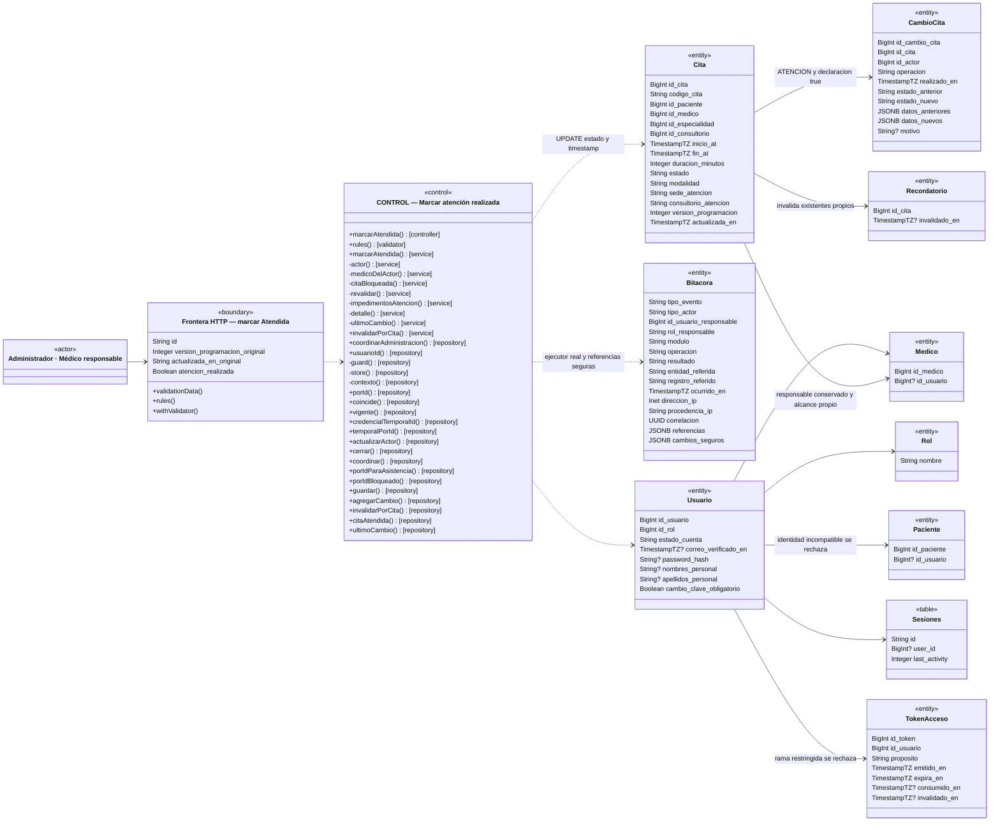

**Verificación y límites:** AtencionCitaTest inicial 69/852 correcto al primer intento; negativas GET de Paciente/acción Recepción reforzadas después y cubiertas en **regresión dirigida final nueva 777 pruebas/9079 aserciones correctas**, 3 min 54,944 s/104 MB, contexto §17.150/README. Incluye los 69 casos, no sumar ejecuciones ni presentar como suite global. PostgreSQL aislado/sesiones/cookies/CSRF reales, fixtures de cita/clínica/versiones/avisos y esperas/cambios por callbacks/mocks; no nuevo CU-23/CU-28 ni multiproceso. Cobertura de actor/estado, cortes temporales, consulta no requerida/no alterada/no transición automática, original/declaración/entrada/ID, profesional inactivo, identidad/alcance/rol/sesión, rollback tras escrituras reales y lectura final, reloj fresco y privacidad. P48 cotejado por llamadas efectivas (20 participaciones de repositorio), render Mermaid 10.9.5/Chrome local SVG/PNG 2198×1847 e imagen inspeccionada en %LOCALAPPDATA%/Temp/opencode/cu19-f4-review/. P45/P46/P47 mantienen 17/20/21; las 64 vistas anteriores intactas, 65 actuales. Pint/sintaxis/UTF-8/PSR-4/Composer/rutas/documentos correctos. UML incremental sin nueva entidad/esquema, **Fase 4 cerrada localmente**; cierre global pendiente Fases 5–6, sin frontend/despliegue.

<a id="cu18-backend-fase3"></a>
## CU-18 — Backend Fase 3: registrar inasistencia comprobada (2026-10-28)

**Implementado localmente, módulo aún no cerrado.** RF10/RN12/RN14 según ficha CU-18; Administrador/Recepcionista, no Médico/Paciente. Solo Programada con intervalo finalizado y ausencia declarada, no desde Confirmada. Reutiliza fronteras/control/persistencia del módulo y añade P47 para esta escritura distinta de llegada. Las 63 vistas anteriores permanecen íntegras; total 64 vistas/47 procedimientos/17 antecedentes. P45 consulta sigue con 17 participaciones de repositorio y añade en texto la elegibilidad de inasistencia; P46 llegada mantiene 20 y conserva todos los avisos. No se consolidan ni borran diagramas anteriores.

### Responsabilidades y colaboraciones efectivas

AsistenciaRequest selecciona ausencia_verificada por registrarInasistencia, conservando presencia_verificada solo para llegada. Originales/ID/entrada cerrada/declaración true estricta validados antes del Controller; campos de la otra operación se rechazan, no coerción de string/número. AsistenciaController.registrarInasistencia adapta datos/contexto HTTP; AsistenciaService.registrarInasistencia decide reglas y transacción. impedimentosInasistencia privado verifica Programada, consulta inexistente y ahora >= fin_at, reutilizado por consultar. GET no acredita ausencia ni ejecuta cambio al finalizar el turno; marcar_atendida sigue no disponible.

Dentro de transacción se mantiene orden continuidad administrativa/actor/planificación → lectura inicial → Médico → cita bloqueada/releída → revalidación/originales/declaración → consulta → revalidación/reloj fresco → estado/timestamp → CambioCita → RecordatorioService.invalidarPorCita → evento → metadata → commit. El Service no consulta Eloquent directamente. Preserva programación/versiones/identidad/ubicación/creación; timestamp monotónico. CambioCita INASISTENCIA conserva ejecutor y declaración true en JSONB datos_nuevos, motivo null; no nuevos atributos/entidades/DER. Inasistencia final rechaza repeticiones con originales viejos o actuales, sin otro cambio/evento.

RecordatorioRepository invalida solo filas no invalidadas de esa cita; conserva lectura e invalidaciones previas/avisos ajenos y no crea nuevos. Evento CITA_INASISTENCIA_REGISTRADA conserva actor real/rol y referencias/estados/versiones, no declaración del formulario ni contenido clínico. ReferenciasBitacora/BitacoraDetalleResource amplían whitelists, antes Programada/después Inasistencia; no permisos de edición de bitácora. Fallo requerido después de cualquiera de las escrituras reales o lectura final revierte todo. Recuperación explícita por GET asistencia sin replay ni causalidad inequívoca.

| Método/contexto del diagrama | Clase efectiva |
| --- | --- |
| registrarInasistencia [controller], rules/validationData/withValidator [validator] | AsistenciaController / AsistenciaRequest, módulo citas de presentación |
| registrarInasistencia, actor, medicoDelActor, citaBloqueada, revalidar, detalle, ultimoCambio, impedimentosInasistencia [service] | AsistenciaService, business/services/citas/; solo entrada pública registrarInasistencia en este contexto |
| invalidarPorCita [service] | RecordatorioService, business/services/recordatorios/; ahora colaborador real de esta escritura, no de llegada |
| coordinarAdministracion/porId [repository] | UsuarioRepository, usuarios/ |
| usuarioId/guard/store/contexto/coincide/vigente/credencialTemporalId/actualizarActor/cerrar [repository] | SesionRepository, usuarios/; privados técnicos y ramas de rechazo de sesión incluidos por llamada transitiva |
| temporalPorId [repository] | TokenAccesoRepository, usuarios/; no habilita sesión restringida |
| coordinar [repository], porIdBloqueado [repository] | PlanificacionRepository, horarios/; MedicoRepository, medicos/ |
| porIdParaAsistencia/tieneConsulta/guardar/agregarCambio/ultimoCambio [repository] | CitaRepository, citas/ |
| invalidarPorCita [repository], citaInasistenciaRegistrada [repository] | RecordatorioRepository, recordatorios/; BitacoraRepository, bitacora/ |

Las **21 participaciones transitivas de repositorio** se cuentan por clase+método, no por número de llamadas o consultas SQL. No se incluyen escritores de CU-19/CU-23 ni generador CU-28 inexistentes. AsistenciaService.consultar agrega impedimentosInasistencia sin nuevos repositorios de lectura, por lo que P45 conserva sus 17; P46 permanece igual y no llama invalidación. Entidades con solo campos usados; Sesiones es tabla técnica, no nuevo Model. Ausencia_verificada es campo del Boundary y del JSONB del cambio, no columna nueva en Cita/Recordatorio.

<a id="analisis-cu18-registrar-inasistencia"></a>
### P47 — Registrar inasistencia de la misma cita

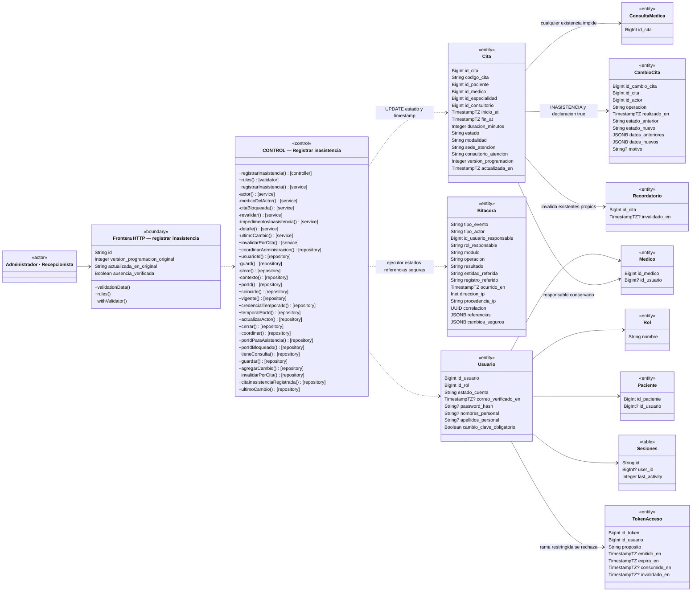

**Verificación:** nueva batería InasistenciaCitaTest 63/643 correcta al primer intento; PostgreSQL aislado y autenticación/cookies/CSRF reales, datos clínicos/avisos/citas como fixtures, no integración completa Fase 6. Pruebas de fin±1µs/igualdad/otro día, estados/consulta NULL, originales/entrada/declaración estricta, avisos propios/ajenos e historia, cuatro roles/Service/seguridad, rollback después de escrituras reales y cambios tras espera por callbacks/mocks. **Regresión dirigida final 708 pruebas/8223 aserciones correctas**, 4 min 29,619 s/102 MB, incluye los 63 casos y GET/HEAD con aviso existente preservado; no sumar ejecuciones ni llamarla suite global. Primera regresión 708/8223 (3 min 29,531 s) previa a reforzar esa fixture también correcta, no evidencia final sustitutiva. P47 cotejado con 21 participaciones de repositorio y renderizado con Mermaid 10.9.5/Chrome local (SVG/PNG 2139×1743), captura inspeccionada en %LOCALAPPDATA%/Temp/opencode/cu18-f3-review/. P45/P46 conservan 17/20 y sus vistas, 63 diagramas previos intactos, total 64/47 procedimientos/17 antecedentes. Sintaxis/Pint/PSR-4/UTF-8/Composer/rutas/documentos correctos, contexto §17.149/README. No render remoto ni atribución de pruebas multiproceso aún no realizadas. **Fase 3 cerrada localmente**; DER sin cambios, Fases 4–6/frontend/producción pendientes.

<a id="cu17-backend-fase2"></a>
## CU-17 — Backend Fase 2: asistencia consultable y llegada presencial (2026-10-28)

**Implementado localmente, no cierre del módulo.** RF10/RN12/RN14, CU-17 Administrador/Recepcionista; lectura compartida con Médico solo para sus citas. CU-18/CU-19 todavía no operativos. Dos procedimientos distintos, P45 consulta/recuperación y P46 escritura, no un diagrama obligatorio por CU. P01–P44 y los 17 antecedentes se conservan íntegros: ahora 63 vistas/46 procedimientos/17 antecedentes. Boundary es AsistenciaRequest HTTP real, no formulario React futuro; no campos de estado/actor/fecha/médico manipulables.

### Participantes, métodos y colaboraciones efectivas

AsistenciaController adapta consultar/confirmarLlegada; AsistenciaRequest valida ID/entrada cerrada y originales/declaración estricta. AsistenciaService coordina actor, cita bloqueada, revalidación, originales, estado, consulta y reloj; recibe arrays y contexto seguro, no objetos HTTP. CitaRepository.porIdParaAsistencia filtra Médico en SQL y aplica lock cuando se pide; MedicoRepository.porIdBloqueado precede al lock de cita. AutenticacionService/ContinuidadAdministrativaService y sus repositorios revalidan sesión/rol/vínculo; PlanificacionRepository usa coordinación transaccional ya existente. Eloquent/PostgreSQL son persistencia, no decisiones en Controller. No RecordatorioService en estos dos procedimientos: Confirmada conserva avisos.

| Método del diagrama | Clase/ubicación efectiva y contexto |
| --- | --- |
| consultar / confirmarLlegada [controller] | AsistenciaController, presentation/controllers/citas/ |
| validationData / rules / withValidator [validator] | AsistenciaRequest, presentation/dtos/citas/; authorize() devuelve true, roles por middleware y Service |
| consultar / confirmarLlegada / actor / medicoDelActor / citaBloqueada / revalidar / impedimentosLlegada / detalle / ultimoCambio [service] | AsistenciaService, business/services/citas/; auxiliares privados salvo las dos entradas |
| coordinarAdministracion / porId [repository] | UsuarioRepository, data/repositories/usuarios/; continuidad y usuario autenticado, no Cita |
| usuarioId / guard / store / contexto / coincide / vigente / credencialTemporalId / actualizarActor / cerrar [repository] | SesionRepository, usuarios/; contexto real/huella/cookie y revocación. Métodos privados técnicos incluidos por llamada transitiva, no endpoints |
| temporalPorId [repository] | TokenAccesoRepository, usuarios/; rama de comprobación/rechazo de credencial temporal, no permiso para sesión restringida |
| coordinar [repository] | PlanificacionRepository, horarios/ |
| porIdBloqueado [repository] | MedicoRepository, medicos/; responsable de la cita, no Médico escogido por el cliente |
| porIdParaAsistencia / tieneConsulta / ultimoCambio [repository] | CitaRepository, citas/; P45/P46. guardar/agregarCambio solo P46 |
| citaLlegadaConfirmada [repository] | BitacoraRepository, bitacora/, solo P46. Proyección de consulta CU-30 añade whitelist en ReferenciasBitacora/BitacoraDetalleResource, no otro escritor de llegada |

Análisis estático transitivo de las llamadas propias de AsistenciaService confirma **17 participaciones de repositorio en P45 y 20 en P46** (método+clase, no número de consultas SQL); includes ramas de rechazo de sesión. Los métodos de SesionRepository guard/store/contexto son privados y no aparecen como operaciones de negocio. En las entidades de los diagramas se muestran solo campos leídos/escritos en esos contextos, no se expone su contenido en la API. La tabla técnica Sesiones no es un Model propio; TokenAcceso y relaciones de identidad participan en autorización, sin credenciales devueltas. `presencia_verificada` se almacena dentro de datos_nuevos JSONB, no como columna de Cita.

<a id="analisis-cu17-consulta-asistencia"></a>
### P45 — Consultar asistencia y recuperar estado persistido

GET/HEAD no muta negocio. Administrador/Recepcionista consultan cita seleccionada; Médico solo propia, profesionalmente inactivo permitido con cuenta válida. Vínculo incompatible → 403; ajena/inexistente → 404 neutro. Después de coordinación/lectura inicial/Médico/cita bloqueada, revalida sesión/vínculo y obtiene consulta existente solo para evaluar llegada administrativa; reloj fresco fija día local/fin y consultado_en. UltimoCambio retorna solo ID/actor/operación/momento, nunca snapshots ni motivos. No infiere causalidad ni reenvía escritura. Inasistencia/Atendida quedan false por disponibilidad futura o permiso, sin anticipar sus flujos.

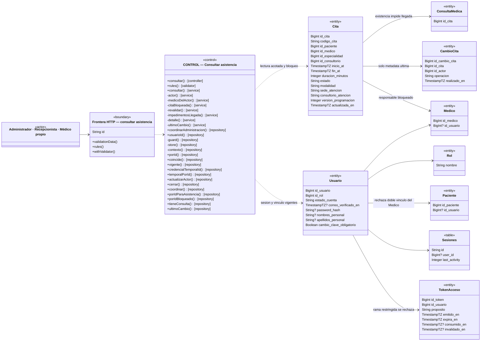

<a id="analisis-cu17-confirmar-llegada"></a>
### P46 — Confirmar llegada de la misma cita

PATCH cerrado con originales y presencia_verificada=true estricto. Tras los mismos locks/alcance y revalidación, compara versión/timestamp completos, comprueba declaración también en Service y ausencia de cualquier consulta; obtiene reloj después de volver a revalidar. Solo Programada/mismo día America/La_Paz/ahora < fin. Actualiza estado/timestamp monotónico, conserva programación/versiones/identidades, añade CambioCita LLEGADA y evento seguro, devuelve metadata tras escrituras reales. Repetición con originales viejos → edición obsoleta; actuales de Confirmada → transición no permitida. No avisos, consulta ni atención automática. Fallo requerido revierte todo, sin afirmar éxito previo a commit.

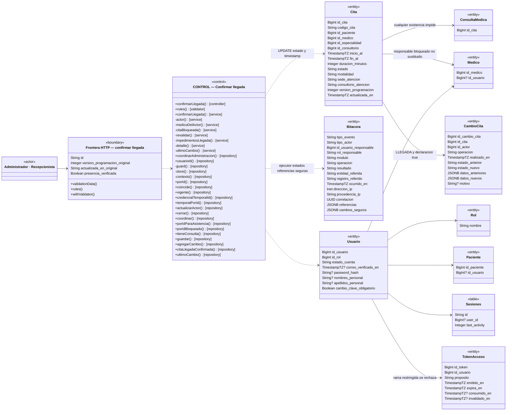

**Pruebas y límites:** LlegadaCitaTest 74/739 dirigido correcto antes de precisar el 401 exacto de vínculo; regresión final nueva **643 pruebas/7565 aserciones correctas**, 3 min 35,996 s/102 MB, incluye esa precisión y los 74 casos, no sumar ejecuciones. SQL/cookies/sesión/CSRF reales aislados; fixtures de consulta/avisos y cambios tras callbacks declarados, no nuevos flujos CU-23/CU-28 ni carreras multiproceso. Rollback después de cada escritura real/lectura final, metadatos seguros y cuatro roles verificados. Diagramas nuevos cotejados por llamadas efectivas (17/20 participaciones de repositorio), Mermaid 10.9.5 local en Chrome renderiza SVG/PNG P45 (2157×1371) y P46 (2120×1641), ambas capturas inspeccionadas; no remoto ni imágenes/scripts versionados, recursos en %LOCALAPPDATA%/Temp/opencode/cu17-f2-review/. Las evidencias de P01–P44 no se atribuyen a estas vistas. 61 diagramas anteriores idénticos, 63 actuales; sintaxis/Pint/PSR-4/UTF-8/rutas/documentos correctos en contexto §17.148. **Fase 2 cerrada localmente**, sin DER nuevo ni cierre integral del módulo; Fases 3–6 pendientes.

<a id="cu17-cu19-backend-fase1"></a>
## CU-17–CU-19 — Backend Fase 1: análisis y contratos previstos (2026-10-28)

**Estado:** diseño documental completado; ningún CU operativo nuevo. RF10 y RN10/RN12/RN14 según trazabilidad de sus fichas; CU-17/CU-18 Administrador/Recepcionista, CU-19 Administrador/Médico responsable. Las tres decisiones explícitas del usuario se registran como VS-EST-07–09: declaración del hecho true, Atendida desde inicio_at y bloqueo de llegada/inasistencia por cualquier ConsultaMedica (también iniciada_en NULL). No son exigencias literales nuevas del examen. Plan de seis fases y contratos completos/matriz de aceptación en backend/README; contexto §17.147. Fases 2–6/frontend/producción pendientes.

### Fronteras y controles previstos, no clases existentes

AsistenciaController y AsistenciaService ya están P en el UML global, no implementados. Se prevé AsistenciaRequest único por responsabilidad de entrada, en dtos/citas/, sin duplicar clases por rol. GET /citas/{id}/asistencia permite consulta/recuperación Administrador/Recepcionista y Médico solo propio; tres PATCH específicos llegada/inasistencia/atencion, no setter genérico de estado. Guardas transversales existentes más validación estructural de ID/originales/declaración true estricta/entrada cerrada; JsonResource de array explícito, sin nuevo Resource nominal obligatorio.

Controller recibe datos validados y contexto seguro HTTP; AsistenciaService decide permisos sobre la cita, estado/plazos, controla transacción e integra efectos. Firmas previstas: consultar(string $id): array y confirmarLlegada/registrarInasistencia/marcarAtendida(string $id, array $datos, array $contexto): array; array contiene originales y declaración específica, nunca Request/Response. Concretan las firmas preliminares P de booleano en el UML, no se presentan como firmas PHP existentes. No nuevo diagrama operativo ni método público de transición arbitraria, interfaces vacías o repositorio genérico.

### Colaboradores existentes y responsabilidades

| Participante real | Reutilización prevista |
| --- | --- |
| AutenticacionService / ContinuidadAdministrativaService | Sesión/cuenta/rol actual y coordinación previa a locks de actores; revalidación al escribir. |
| PlanificacionRepository | Advisory lock transaccional actual común a planificación/reserva/gestión; no una capa de permisos. |
| MedicoRepository | Lectura bloqueada del responsable para conservar vínculo/obligaciones y orden de recursos, sin exigir profesional activo. |
| CitaRepository | Lectura acotada/bloqueada, guardar, comprobar consulta y agregarCambio/ultimoCambio. Añadir lectura acotada si procede durante implementación, sin consultar Eloquent desde Service. |
| RecordatorioService / RecordatorioRepository | Invalidación interna solo para Atendida/Inasistencia, no para Confirmada; no genera avisos ni completa CU-28. |
| BitacoraRepository / ReferenciasBitacora / BitacoraDetalleResource | Nuevos eventos/metadatos seguros en futuras fases, mediante listas permitidas; no contenido clínico ni formulario completo. |
| Cita / CambioCita / Usuario / Medico / ConsultaMedica / Recordatorio / Bitacora | Entidades existentes; consulta solo como comprobación de existencia que impide CU-17/CU-18, sin prueba automática de atención ni documentación clínica nueva. |

### Flujo diseñado y persistencia

Route/middleware → Controller/Request → AsistenciaService → Repositories → Models/PostgreSQL. Dentro de transacción: coordinación administrativa → actor → planificación → lectura inicial acotada para identificar Médico → Médico bloqueado → cita releída/bloqueada/acotada → originales/rol/vínculo/estado/consulta → reloj fresco → UPDATE estado y timestamp → CambioCita → invalidación si final → evento → proyección → commit. Revalidar luego de esperas; nunca bloquear cita y después recursos en orden inverso a planificación. Futuro CU-23 debe compartir protocolo de coordinación/relectura; sus fixtures concurrentes no acreditarán CU-23 implementado ni protección contra SQL que ignore protocolo.

Llegada: Programada, misma fecha local, ahora < fin y sin consulta; conserva avisos. Inasistencia: Programada, ahora >= fin y sin consulta; invalida avisos. Atendida: Programada/Confirmada, ahora >= inicio, Médico propio o Administrador real, sin consulta obligatoria. Declaraciones presencia_verificada/ausencia_verificada/atencion_realizada son JSON true estricto y no demuestran físicamente el hecho. Exactamente inicio admite atención; exactamente fin rechaza llegada y admite ausencia declarada. Fichas inactivas/catálogos inactivos no borran elegibilidad de citas previas por sí solos; cuenta desactivada sí impide acceso.

CambioCita soporta LLEGADA/INASISTENCIA/ATENCION sin ampliar esquema: actor, instante, antes/después y declaración correspondiente en datos_nuevos, motivo null. Snapshot administrativo sin clínica/contactos; conservar programación/identidad/version_programacion incluso máxima; actualizada_en monotónica detecta obsolescencia. Eventos previstos CITA_LLEGADA_CONFIRMADA/CITA_INASISTENCIA_REGISTRADA/CITA_ATENDIDA con ejecutor real, no atribuidos al Médico si ejecuta Administrador. Cualquier fallo requerido revierte estado/cambio/avisos/evento. No columnas duplicadas de confirmado_por/atendido_en ni nueva tabla; DER sin cambios.

GET devuelve programación mínima/metadata de último cambio y acciones/impedimentos orientativos, nunca autorización definitiva. 200 no-store/private, IDs como texto/timestamps UTC de seis decimales; sin motivo/CI/contacto/clínica/snapshots. Médico ajeno → 404 neutro, vínculo incoherente/rol no permitido → 403. Originales y conflictos → 409; declaración/formato/extra → 422. Tras resultado incierto reconsultar explícitamente sin repetir PATCH ni atribuir causalidad inequívoca. GET gestión anterior no se abre al Médico; el nuevo GET asistencia evita un bypass de aquel contrato.

### Verificación y límites de esta fase

Inspeccionados código/rutas, bootstrap, composer.json/paquetes instalados, modelos/migraciones/repositorios y baterías de gestión como referencia; versiones y matriz prevista en backend/README. Artisan confirma ausencia de endpoints nuevos; no pruebas funcionales nuevas, SQL/migraciones o concurrencia ejecutados para este módulo. Se definirán pruebas por CU durante Fases 2–4, multiproceso en Fase 5 e integración/global nueva en Fase 6, sin reutilizar números históricos como evidencia nueva.

Se conservan todos los diagramas anteriores y la revisión UML global del módulo anterior. AsistenciaController/Service siguen P; UML operativo se concretará contra clases reales y revisión acumulativa al cierre. No diagrama obligatorio por CU ni recuentos transitivos inventados de repositorios antes de escribir código. Sin cambios frontend, Word/PDF/draw.io, dependencias, commit/push/despliegue. **Fase 1 documental cerrada; detenerse antes de Fase 2.**

<a id="cu15-cu16-frontend-fase6"></a>
## CU-15/CU-16 — Frontend Fase 6: integración real y revisión de cierre (2026-10-27)

**Unidad cerrada localmente:** Reprogramación y cancelación, seis fases frontend completas, mismos actores/requisitos/reglas de sus fichas y análisis anteriores. Las fronteras React reales añadidas progresivamente en Fases 2–5 se integran con P41/P42/P43/P44; no se fusionan ni eliminan vistas previas. Backend permanece en su cierre §17.140. Esta fase verifica integración local, no producción ni módulos ajenos; evidencia final de suite/limpieza/cierre en contexto §17.146.

### Procedimientos y colaboraciones integrados

- **Selección y lectura:** sidebar/Inicio Gestionar citas → SeleccionarPacienteHistorialPage/PatientsPage → ficha administrativa → HistorialCitas/CitaDetallePage → GestionCitaPage, dentro de guardas normales compartidas y AgendaWorkspace. Contexto de nombres procede del detalle autorizado por IDs coincidentes, programación/acciones/versiones del GET de gestión; no copia clínica/contactos/motivos a estado global. Médico/Paciente no obtienen gestión aun manipulando URL/API. Retorno reconsulta detalle/historial; recarga consulta estado final persistido sin restaurar una reserva.
- **P41 → P43:** ReprogramacionCita/Alternativas consultan fecha/paginación del mismo recurso, muestran programación anterior/nueva y revisión explícita; useGestionCita → reprogramarCita → CSRF/PATCH con originales/HMAC → capas Laravel/transacción existente. Prueba real con ficha inactiva y Confirmada (fixture controlada), nueva duración vigente, misma identidad, Programada y versión siguiente. Cortar respuesta HTTP 200 después de commit produce incertidumbre, no otro PATCH; P42 recupera estado y exige revisión nueva, sin demostrar causalidad inequívoca.
- **P44:** CancelacionCita revisa código/identidades/intervalo/duración/ubicación/motivo opcional y confirmación destructiva; mismo coordinador/transportes/capas backend. Respuesta cortada tras guardar se consulta, no reenvía; estado Cancelada, intervalo/versión conservados, aviso retirado y motivos privados fuera de resultados/auditoría/historial. Otra petición real de reprogramación después de revisar cancelación invalida los originales; UI recibe 409, vuelve a consultar y solo otra confirmación explícita cancela. Nueva reserva UI sobre intervalo liberado tiene otro ID y no restaura la cancelada.
- **Consulta administrativa/auditoría:** detalle e historial mantienen citas canceladas y ubicación histórica; doce eventos programada/reprogramada/cancelada tienen ejecutor real y Médico responsable separado. Bitácora conserva proyección segura/solo lectura; no se añade editor clínico ni permisos. Revocación de sesión real retira gestión y exige login.

### Clases y funciones revisadas, sin cambios estructurales ficticios

GestionCitaPage/GestionCitaResumen/ReprogramacionCita/Alternativas/CancelacionCita/useGestionCita/gestionCita.service mantienen responsabilidades de presentación/consulta/confirmación/coordinación HTTP, frente a Requests/Controllers/Services/Repositories/Eloquent/PostgreSQL existentes. No nuevos endpoints, clases PHP, modelos, migraciones ni relaciones; CU-28 conserva exclusivamente invalidación interna. Fixtures de Confirmada/avisos/configuración no acreditan CU-17/generador/scheduler CU-28.

P41–P44 conservan 23/16/28/20 participaciones transitivas de repositorio, contrastadas de nuevo contra código efectivo; frontera HTTP y atributos de entidades previos intactos. El verificador histórico se adaptó en temporal al HEAD actual de 61 diagramas y nulabilidad del motivo, sin editar diagramas para satisfacer un contador antiguo. Se mantienen 61 vistas/44 procedimientos/17 antecedentes y todos los 64 bloques cercados previos. UML global acumulativo revisado al cierre del módulo conforme a su alcance aprobado **solo backend**: 100 E en cuatro familias, 23 P y Sesion R, 124 participantes; 411 firmas propias de 73 clases operativas/207 dependencias de inyección y cero ciclos comprobados nuevamente. No cajas PHP de componentes React ni nuevo render de las 19 vistas cuyo origen no cambió. DER/requisitos/reglas sin modificaciones.

### Evidencia real y ajuste visual mínimo

Chrome headless/CDP → frontend Vite/Axios → Laravel/Sanctum/PostgreSQL reales, localhost:5174/8001, esquema aleatorio propio en base/rol de tests sin privilegios elevados. Correo simulado/HTTP externo prohibido, datos ficticios y credenciales aleatorias solo en temporal. PostgreSQL detenido al comenzar fue iniciado por el usuario; el primer intento no creó esquema. Se reutilizó arnés previo sin modificarlo, con comprobaciones de identidad/ámbito propio y baseline de esquemas/public. Preparación de identidades/profesional/horarios/fichas se hace por fixture; las cuatro reservas son UI real. Confirmada y cuatro avisos de invalidación son fixtures explícitas, no endpoints pendientes ni generación funcional.

El recorrido completo por ambos operadores verificó 18 comprobaciones, cuatro cortes de respuesta tras commit, 65 disposiciones sin overflow y 26 axe sin infracciones automáticas, ocho estados HTTP observados 200/201/204/401/403/409/419/422 y ninguna excepción JS. Incluye ficha inactiva/Confirmada/duración, privacidad/motivos, 409 real entre revisión/escritura, reutilización de intervalo, límites Médico/Paciente, cookies HttpOnly/SameSite=Lax/CORS con credenciales, Web Storage vacío, recarga y revocación, teclado/foco/salto de contenido/Escape móvil. Se reejecutó en fixture nueva tras ambos ajustes para dejar recorrido final completo independiente de pausa inicial; evidencia definitiva en contexto.

Revisión visual detectó un desbordamiento real de palabra larga en encabezado Reprogramar cita a 320px/texto200. Primera corrección productiva: clase gestion-cita-page en página y overflow-wrap:anywhere en CSS existente; no cambio de paleta/tokens/dependencias/reglas. Nueva expectativa de clase en prueba de gestión. Revisión diagnóstica posterior y todas las disposiciones del recorrido corregido pasaron; capturas de revisión de reprogramación/cancelación y gestión inspeccionadas. No certificación exhaustiva de accesibilidad, compatibilidad de todos los navegadores o producción HTTPS. Fallos auxiliares del arnés (extracción por espacios y contadores/nulabilidad históricos del verificador) se corrigieron en temporal, no cambiando código de negocio ni ampliando timeouts.

La inspección posterior de capturas detectó además una ambigüedad: tras 409/incertidumbre, el resumen consultado antes del PATCH conservaba el título Programación actual. **GestionCitaPage** ahora lo oculta mientras hay guardado/error/incertidumbre/recuperación pendiente; tras resultado confirmado/recuperado solo presenta GET con timestamp al menos igual al del resultado validado. Se conserva el resultado separado y se pide reconsulta explícita, sin introducir un GET automático que reenvíe escrituras. Nuevas aserciones de ambas operaciones y gestión: **108 pruebas/3 archivos correctos**, 18,05 s; nuevas capturas reales sin resumen antiguo en incertidumbre/409. No nuevas reglas/versiones, solo no presentar un snapshot anterior como vigente. El recorrido final completo en fixture nueva pasó con ambos ajustes.

Verificación SQL final de solo lectura: cuatro citas Canceladas/version2, ocho cambios, doce eventos de negocio, cuatro avisos invalidados; ejecutor y Médico preservados, sin secretos/motivos en bitácora ni consultas clínicas creadas, public/otros esquemas conservados. Tras ese recorrido se retiraron esquema/fixture/credenciales y procesos propios PHP/Vite, preservando el servicio PostgreSQL que inició el usuario. No auditoría del contenido de todas las filas ajenas por el mero inventario. Una pausa auxiliar de teclado al redimensionar se resolvió esperando dos frames de resize antes de accionar menú; no cambio de layout global ni aumento de timeouts.

Build final reejecutado correctamente: 731,77 kB JS/gzip 203,15 kB y 66,49 kB CSS/gzip 11,23 kB; aviso conocido >500 kB, sin script lint. **Regresión global final nueva tras ambos ajustes y sincronizaciones de tests: 2015 pruebas/78 archivos correctos, 234,12 s**, `pnpm test --maxWorkers=2`; no sumar ejecuciones. No nueva suite backend ni afirmar su resultado histórico como prueba de esta fase. Sin Word/PDF/draw.io/commit/push/despliegue. Frontend del módulo cerrado localmente; producción pendiente y otros módulos no iniciados. Entradas anteriores conservadas como historial.

**Incidencias de sincronización en regresión:** se conservan la primera global correcta (2015/78, 236,12 s), una intermedia 2014/2015 por foco en DoctorManagement y su dirigida posterior 21/21. La global posterior a ambos ajustes terminó 2014/2015 (229,89 s) por PasswordPages.test.jsx:177, no por gestión de citas. La batería aislada pasó 23/23 (20,96 s). ResetPasswordPage limpia la entrega en useEffect: encontrar el encabezado no garantiza finalizar ese efecto. Se cambia solo la aserción por await waitFor conservando token nulo y flujo completo StrictMode/restablecimiento/nuevo login, conforme al patrón de invitaciones. La siguiente global pasó autenticación pero repitió el fallo de foco (2014/2015, 233,20 s): useDoctorSubmission usa requestAnimationFrame tras mostrar error; se sincroniza únicamente esa expectativa con waitFor conservando foco y ausencia de escritura. No cambian clases/funciones productivas de esos módulos ni timeouts. La siguiente global final pasó completa; no se ocultan los fallos anteriores ni se atribuye a una dirigida el cierre global.

<a id="cu15-cu16-frontend-fase5"></a>
## CU-15/CU-16 — Frontend Fase 5: sesiones, ciclo de vida y recuperación (2026-10-27)

**Alcance:** robustez de los flujos implementados, no integración real ni cierre del módulo frontend. Mismos CU/actores/reglas/contratos del backend; no permisos por ocultación, nuevos endpoints o estados de cita. Los estados internos de UI no son estados del dominio. Se reutilizan los participantes y vistas de Fases 2–4; tres archivos nuevos de pruebas, ninguna clase productiva nueva.

### Hallazgos y cambios efectivos

1. **Intención pendiente de CSRF:** el transporte anterior no recibía señal de cancelación. Un cambio de ruta/identidad/pagehide mientras esperaba CSRF podía dejar pendiente la continuación del PATCH aunque ya no existiera la revisión de pantalla. **useGestionCita** ahora crea AbortController por ejecución y entrega señal tanto a reprogramarCita/cancelarCita como a consultarGestionCita de recuperación. pagehide/desmontaje abortan señal e invalidan secuencia. **escribirGestion** comprueba señal antes y después del GET CSRF, y la pasa a ambos requests. Error previo al PATCH se marca no enviado; abortar tras iniciar PATCH se marca enviado y nunca acredita rollback. La lectura explícita posterior sigue siendo necesaria si falta resultado verificado. No se cancela una transacción PostgreSQL desde React.
2. **Espera de alternativas:** useAgendaQuery antes residía en Alternativas, que se desmontaba al editar fecha. Su límite local desaparecía con esa edición. Ahora la consulta pertenece a **ReprogramacionCita** durante todo el formulario, usa enabled solo con criterios válidos y conserva el mismo límite/secuencia/sesión entre cambios de fecha. **Alternativas** recibe query/onPage como props y conserva solo selección/revisión. Fecha/página/revisión invalidan selección; cambiar fecha aborta request previo. El submit comprueba remaining y está deshabilitado durante Retry-After, sin solicitud automática al vencer. No compartir esta espera con una cancelación legítima de otro endpoint ni atribuirle protección global entre pestañas/recargas: servidor sigue limitando.
3. **Época descartada y logout fallido:** Axios central conserva su rechazo SESSION_SUPERSEDED de respuestas HTTP exitosas de una época previa. Si logout falla, AuthContext puede conservar la misma identidad montada. useAgendaQuery antes ignoraba ese error dejando gestión/alternativas cargando sin salida. Ahora esos dos tipos específicos producen fallo seguro con reconsulta explícita; ningún dato de aquella respuesta se publica. Otros consumidores/tipos conservan tratamiento anterior, sin refactor global de Axios/AuthContext.
4. **HTTP no contractual tras PATCH:** useGestionCita antes consideraba inciertos red/5xx, pero un timeout HTTP 408 u otro estado ajeno al contrato tampoco demuestra ausencia de commit. Solo rechazos conocidos 400/401/403/404/405/409/419/422/429 permiten salir a error con nueva revisión explícita; los demás, si hubo envío, requieren recuperación GET. Lectura de recuperación fallida conserva incertidumbre incluso si su status es un rechazo conocido. No reenviar PATCH por estado HTTP, abort, fallo de CSRF, timeout o consulta de resultado.
5. **Espera de escritura tras restauración:** pagehide limpia errores/borradores, pero no borra el vencimiento del límite del hook. GestionCitaPage ahora hace visible esa espera cuando el estado vuelve a inicial y oculta el formulario de reprogramación hasta vencer; Preparar cancelación/Actualizar gestión siguen deshabilitados. Impide botones activos que antes terminaban en un no-op silencioso del lock temporal. No guardar datos privados o plazos en Web Storage.

### Colaboraciones/firmas y procedimientos

- **reprogramarCita()/cancelarCita()** incorporan segundo argumento AbortSignal opcional, compatible con consumidores previos; escribirGestion interno también. GET/PATCH/payloads/proyecciones/versiones/actor auténtico siguen idénticos. No nuevas firmas PHP.
- **useGestionCita** mantiene un lock de ambas escrituras, secuencia, resultado seguro por operación y una referencia temporal al AbortController; no guarda motivo/entrada/vista en estado/contexto. La señal es control de espera HTTP, no una garantía de rollback. Callback de página solo refresca si ejecución vigente confirmó/recuperó resultado.
- **GestionCitaPage** conserva guardas, claves usuario/rol/ID, revisión, resultado separado del refresco y retorno; **ReprogramacionCita/Alternativas** redistribuyen consulta/selección dentro de la misma feature sin nuevas capas.
- **P41/P42/P43/P44** conservan sus fronteras efectivas descritas en las fases anteriores, métodos y 23/16/28/20 participaciones transitivas de repositorio. Este cambio de manejo HTTP no añade un caso de uso, repositorio ni transacción. Las 61 vistas/44 procedimientos/17 antecedentes y 64 bloques cercados previos permanecen intactos; actualización textual sin diagrama obligatorio por CU. UML global filtrado backend/DER sin cambios de persistencia/clases/relaciones; revisión integral al cerrar Fase 6 aún pendiente.

### Evidencia y límites

**208 pruebas dirigidas/5 archivos correctos**, 29,11 s: tres baterías nuevas de robustez y regresión de ReprogramacionCita/CancelacionCita; 143 casos netos nuevos de servicio/hook/página. No sumar ejecuciones previas como casos distintos. Servicio verifica señal ya abortada/abandono durante CSRF/cambio de época antes y después de PATCH/abort tras envío/status HTTP sin replay/enlaces externos ignorados. Hook verifica matriz de estados conocidos/desconocidos, lock cruzado, recuperación con señal/doble consulta/fallo de lectura, desmontaje/pagehide/privacidad, Retry-After inválido y campos de error permitidos. Página recorre ambos operadores/operaciones con pagehide/identidad/restricción durante CSRF, respuesta tardía de PATCH, 408/estado sin cambio, logout fallido durante escritura/GET/alternativas, espera conservada al editar fecha o restaurar y descarte de fecha anterior. Barreras de promesas y señales demuestran secuencias, no esperas arbitrarias para inferir ejecución concurrente.

Primer dirigido de 133 casos detectó dos expectativas usando toHaveValue con radio, no soportado por jest-dom; 131 correctos y dos fallos de matcher. Se sustituyó por atributo value, sin cambiar lógica productiva ni aumentar timeouts; ampliación final correcta. **Suite global final nueva: 2015 pruebas/78 archivos correctos**, `pnpm test --maxWorkers=2`, 232,54 s; 143 casos netos adicionales, incluye las dirigidas sin sumar ejecuciones. Build JS 731,46 kB/gzip 203,08 kB, aviso conocido >500 kB; sin script lint. UTF-8 de 30 archivos acumulados, cercas/anclas y 64 bloques cercados previos de análisis verificados; diff-check sin errores. **Fase 5 cerrada localmente con API simulada**, evidencia y límites en contexto §17.145/README.

React/Router/layout/guardas/AuthProvider/hooks/services/Axios reales con sesión/adapter HTTP simulados; no nueva integración Laravel/PostgreSQL, auditoría/CSRF/cookies o carreras reales entre procesos ni certificación nueva de navegador/axe/responsive. Los tiempos locales no sustituyen límites/revocaciones de servidor ni persisten entre flujos desmontados/pestañas/recargas. Backend/Axios global/AuthContext/CSS/dependencias/requisitos/reglas/DER/UML intactos; sin SQL/migraciones/Word/PDF/draw.io/commit/push/despliegue. Fase 6 de integración/regresión/cierre no iniciada.

<a id="cu16-frontend-fase4"></a>
## CU-16 — Frontend Fase 4: cancelación y resultado compartido (2026-10-27)

**Estado:** cancelación React implementada y verificada con API simulada, sin integración real ni cierre integral de CU-15/CU-16. Se conserva trazabilidad RF09/RN09/RN10/RN12/RN14, actores Administrador/Recepcionista, corte temporal/ausencia de cualquier ConsultaMedica y reglas ya vigentes. No cancelación para Médico/Paciente ni nuevos estados. La actividad actual de ficha/profesional/especialidad/consultorio no es condición de esta escritura y no se consulta disponibilidad para cancelarla.

### Participantes y procedimiento efectivo

1. **GestionCitaPage (E ampliado)** conserva consulta/autorización visual/retorno de fases anteriores; alterna reprogramación y cancelación sin formularios concurrentes. Preparar cancelación desmonta el formulario de alternativas; volver restaura reprogramación sin conservar borrador privado. Solo GET gestión con acciones.cancelar habilita el formulario; ninguna confirmación aparece automáticamente. Durante guardado/resultado incierto/recuperación no se habilita la otra escritura. Después de cancelar, nueva revisión reconsulta estado final y no lo reabre.
2. **CancelacionCita (E nuevo)** recibe contexto verificado, formulario de motivo y callbacks explícitos. Normaliza/valida al revisar; cualquier edición invalida revisión anterior. Muestra código/identidades, Programada o Confirmada, intervalo, duración y ubicación que se conservarán, motivo a enviar o Sin motivo, advertencia de Cancelada/liberación solo tras confirmación. Botón destructivo independiente de submit de revisión, Volver sin cancelar/Abandonar cancelación no envían PATCH y limpian el borrador por desmontaje. Foco en revisión; Enter desde motivo solo prepara, confirmación posterior por teclado.
3. **normalizarMotivoCancelacion() (E)** aplica trim, vacío/ausente/null a null, máximo 500 puntos de código Unicode y rechazo de caracteres de control, conforme al Request real. No truncamiento ni conteo UTF-16 que impediría 500 caracteres astrales válidos. El motivo no se convierte en dato clínico/motivo_breve ni se pone en URL/Web Storage/logs/contexto global.
4. **cancelarCita() (E)** valida ID textual/programación original/estado elegible, crea payload cerrado version_programacion_original/actualizada_en_original/motivo. No recalcula microsegundos ni envía ID de recurso/actor/rol/estado/propuesta/HMAC de alternativa. Comparte **escribirGestion() (E interno)** con reprogramarCita para CSRF/sessionBound/PATCH único y marca de envío previo/posterior; no nueva instancia Axios ni mecanismo global de reintentos. Esta extracción conserva contrato/resultados de reprogramación, cubiertos por regresión.
5. **Proyección de cancelación:** HTTP 200, misma identidad/código/Paciente/Médico/especialidad/consultorio/intervalo/duración/sede/ubicación/version_programacion; solo estado Cancelada y actualizada_en creciente difieren. Último cambio debe ser CANCELACION con ID/actor/timestamp válidos. Versión máxima INTEGER sigue cancelable, no se exige incrementarla. Motivo/extras de respuesta y cambio nunca se retienen; no exigir acciones/zona/consultado_en de GET para validar PATCH. Un 200 incongruente pasa a resultado incierto, no éxito visual.
6. **useGestionCita (E ampliado)** expone cancelar además de guardar (reprogramación) y consultar; operación real determina Service/textos/campos de error y se conserva en recuperación. Un único lock ref/secuencia bloquea ambas escrituras, incluso llamadas antes de render. No guarda motivo/vista/entrada en su estado ni Context; el estado final solo contiene resultado mínimo seguro. pagehide de acción en vuelo limpia contenido y conserva necesidad de consulta, no rollback; respuesta tardía/desmontaje descartados. La recuperación es el mismo GET de estado, nunca un replay de cancelación.
7. **Resultado:** éxito confirmado informa Cancelada e historial conservado, refresca GET gestión y permite retornar a detalle/historial que reconsultan. Fallo de refresco conserva guardado confirmado. 409 exige nueva consulta/revisión sin adoptar originales; 419/422/429 y rechazos conocidos no reenvían; campos de error permitidos en cancelación solo motivo/originales. Red/5xx/200 inválido después de enviar exige GET explícito, bloquea ambas acciones y no confirma que la petición concreta causó el estado leído. El motivo deja de mostrarse al enviar y no aparece en resultado/último cambio/historial. No se intenta reconstruirlo con GET.

### Fronteras y capas, sin diagramas ficticios

**P44** ahora tiene frontera de presentación real: GestionCitaPage → CancelacionCita/revisión explícita → useGestionCita.cancelar → cancelarCita → escribirGestion/Axios/CSRF → GestionCitaRequest → GestionCitaController.cancelar → GestionCitaService.cancelar y repositorios/modelos/transacción efectivos de su vista existente. Conserva las **20 participaciones transitivas de repositorio**, roles/recurso, UPDATE/CambioCita/invalidación de Recordatorio/Bitácora y separación de ejecutor/Médico responsable. No se transforma React en clase de dominio PHP ni se crea otro método de repositorio por botón.

**P42** sigue resolviendo GET gestión/resultado persistido; contexto de nombres procede del detalle con comprobación de IDs. **P41/P43** mantienen alternativas/escritura de reprogramación y el mismo transporte/coordinador, sin alterar sus métodos/colaboraciones backend. Las 61 vistas/44 procedimientos/17 antecedentes y 64 bloques cercados previos se conservan; esta fase amplía análisis textual de fronteras implementadas, no obliga a un diagrama por CU. UML global filtrado backend y DER sin cambios de firmas/relaciones/modelos; revisión final frontend del módulo sigue Fase 6.

### Verificación actual y límites

CancelacionCita.test/revisión de servicio/useGestionCita.test: **107 pruebas/3 archivos correctos**, 13,83 s, incluidos casos previos del hook. Recorridos de ambos operadores con motivo opcional/vacío/privado, Confirmada y Programada, conservación de versión/ubicación/intervalo, confirmación/deshacer/editar/borrador/actualización, retorno a detalle/historial Cancelada con registro visible, teclado/foco. Servicio comprueba Unicode/control/500 caracteres, IDs/originales/estados finales, versión máxima, rechazo 200 con cambios improcedentes/último cambio inválido, extras privados, CSRF previo y HTTP/red sin reenvío. Página/hook cubren doble clic y exclusión cruzada con reprogramación, fallo de alternativas sin impedir cancelación, conflictos/errores/Retry-After/401, respuestas inciertas/GET, guardado confirmado/GET fallido, roles, pagehide/desmontaje/logout y limpieza. Primera regresión conjunta con ReprogramacionCita pasó 132 pruebas antes de añadir tres recorridos; no sumarla a ejecuciones finales.

Son pruebas con kernel de UI Router/guardas/AuthProvider/hooks/servicios/Axios reales y sesión/adapter HTTP simulados: no motor PostgreSQL/cookies/CSRF/auditoría real ni nueva certificación visual/navegador/axe/responsive. **Suite global final nueva: 1872 pruebas/75 archivos correctos**, `pnpm test --maxWorkers=2`, 225,10 s; 94 casos netos adicionales, incluye las dirigidas y regresión de reprogramación/transporte compartido. Build correcto JS 730,78 kB/gzip 202,92 kB, aviso conocido >500 kB; sin script lint. UTF-8 de 27 archivos acumulados, cercas/anclas y 64 bloques cercados anteriores verificados; diff-check sin errores. **Fase 4 cerrada localmente con API simulada**, evidencia/límites en contexto §17.144/README. Backend/Axios/CSS/dependencias/requisitos/reglas/DER/UML sin cambios. Robustez ampliada Fase 5 e integración real/regresión/cierre Fase 6 siguen pendientes; no SQL/migraciones/Word/PDF/draw.io/commit/push/despliegue.

<a id="cu15-frontend-fase3"></a>
## CU-15 — Frontend Fase 3: alternativas, revisión y guardado (2026-10-27)

**Estado:** flujo React de reprogramación implementado/verificado con API simulada, no integración real ni cierre integral del módulo. Mantiene actores/requisitos de la ficha CU-15 y VS-CIT-14–16; no nuevas reglas. CU-16 conserva consulta/impedimentos pero no formulario/PATCH. Las entradas Fases 1/2 debajo reflejan su momento histórico, no el estado actual de escritura CU-15.

### Participantes y colaboración reales

1. **GestionCitaPage** reutiliza el resumen vigente y monta ReprogramacionCita solo cuando GET gestión concede elegibilidad básica y no hay escritura/recuperación pendiente. La clave usuario/rol/ID sigue separando identidades; nueva revisión reconsulta gestión. El resultado está fuera del bloque de consulta para no perder una escritura confirmada si falla refrescar. useBlocker y beforeunload advierten en guardado/incertidumbre/consulta de recuperación; salir no promete rollback ni reenvía.
2. **ReprogramacionCita** recibe programación original, gestiona fecha civil y criterios de consulta. **Alternativas** separa selección/página/revisión, llama al Service mediante useAgendaQuery y presenta resultados/errores/vacíos/paginación. No calcula disponibilidad clínica: solo representa turnos entregados. Al cambiar fecha/página/refrescar/volver retira revisión; no permite confirmar hasta seleccionar y revisar. No usa DisponibilidadTurnos/useReservaRegistro ni aplica el flag de ficha activa de CU-14.
3. **consultarDisponibilidadReprogramacion()**, en gestionCita.service, GET con solo fecha/page/per_page bajo ID canónico, señal/sessionBound. Proyecta originales/contexto/turnos/meta sin secretos ajenos ni paciente_reservable; contrasta programación original revisada completa con cita_original y no adopta otra versión. Comprueba IDs, fecha/zona, orden/no duplicados, HMAC opaco 64 hex, hora local del inicio, duración/fin y paginación; un 200 incongruente falla de forma segura. No usa reloj cliente para autorizar futuro ni crea reservas. Original distinto requiere actualizar gestión, no reenvío silencioso.
4. **Revisión** muestra identidad de la misma cita y anterior/nueva fecha/intervalo/duración/sede/consultorio, con dirección vigente cuando existe. Advierte pérdida de llegada Confirmada al volver a Programada. No campos para cambiar Paciente/Médico/especialidad/motivo_breve ni confirmación automática; foco explícito en encabezado de revisión.
5. **useGestionCita** es coordinador local de escritura. Guarda con lock ref inmediato, secuencia/montaje, estados inicial/guardando/guardada/error/incierto/consultando/recuperada y Retry-After. Solo inicial admite PATCH; doble clic/nueva llamada en vuelo no se envían. Solo incierto admite lectura de recuperación; no reset/reenvío mientras falte comprobar estado. pagehide invalida secuencia, limpia resultado/failure y conserva necesidad de consulta si había escritura incierta/en vuelo; desmontaje ignora resultado tardío sin atribuir rollback.
6. **reprogramarCita()**, mismo Service, valida pertenencia del turno a vista revisada y payload cerrado: fecha/hora_inicio/revision_turno/version_programacion_original/actualizada_en_original. CSRF con sesión antes de PATCH; fallo previo marca no enviado, fallo posterior marca enviado. Proyecta resultado propio sin exigir acciones/zona/consultado_en de GET y compara identidad/código/originales de versión, inicio/fin/duración/ubicación revisados, estado Programada, timestamp creciente y cambio REPROGRAMACION con actor real. No fabrica actor ni lo envía, no reserva de nuevo ni usa UUID/replay.
7. **Resultado y recuperación:** 200 válido confirma guardado y vuelve a consultar gestión; si esa consulta falla, se conserva éxito con «actualización pendiente». Red/5xx/respuesta de PATCH no verificable exige GET explícito de estado y bloquea nuevo PATCH. Una lectura exitosa (aunque programación igual) solo informa estado, no causalidad ni fracaso de la solicitud original; requiere nueva consulta/revisión antes de otra escritura. 409/419/422/429 y otros rechazos conocidos retiran revisión sin repetición, con mensajes seguros y espera cuando proceda. No cambiar originales o destino sin nueva revisión. Encabezado de resultado recibe foco al cambiar de estado.

### Correspondencia con procedimientos existentes

- **P41:** frontera React efectiva de consulta ahora ReprogramacionCita/Alternativas → useAgendaQuery → consultarDisponibilidadReprogramacion → Axios → DisponibilidadReprogramacionRequest/DisponibilidadController/DisponibilidadService y colaboradores reales ya dibujados. Se conservan todas sus 23 participaciones de repositorio, sin simular nuevo método por componente.
- **P43:** frontera de confirmación React ahora ReprogramacionCita/Alternativas → GestionCitaPage → useGestionCita → reprogramarCita → Axios/CSRF/PATCH → GestionCitaRequest/Controller/Service y repositorios efectivos. Conserva sus 28 participaciones de repositorio, invalidación/auditoría/transacción y ejecutor separado del Médico.
- **P42:** reconsulta/recuperación usa consultarGestionCita (solo estado) o consultarContextoGestion (gestión+nombres verificados), mismas 16 participaciones de repositorio de la rama de gestión; contexto de detalle conserva su CU autorizado. No endpoint nuevo de resultado ni replay de gestión.
- **P44** conserva su Boundary HTTP: no formulario React de cancelación todavía. Las 61 vistas de diagramas/44 procedimientos/17 antecedentes y todos los 64 bloques cercados previos se preservan. Se amplía análisis textual de fronteras reales, no un diagrama obligatorio por CU ni clases ficticias. UML global backend/DER sin nuevas firmas/modelos/relaciones; cierre frontend y revisión final de módulo siguen Fase 6.

### Verificación de esta entrega y límites

Batería dirigida nueva de citas: **428 pruebas/10 archivos correctos**, 100,36 s; 88 casos netos nuevos respecto de Fase 2. Servicio: payloads/precisión/BIGINT/proyecciones, sin dependencia de paciente_reservable, página vacía/final/fuera de rango, originales cambiados, respuesta inválida, mismo inicio, CSRF previo, PATCH rechazado/incierto/200 inválido. Página parametriza recorrido exitoso por ambos operadores y verifica revisión Confirmada→Programada, distinta duración/sala, actualización de gestión, vacíos/selección/cambios de criterios, ficha inactiva/ausencia de reserva adicional, doble clic, conflictos/códigos HTTP, incertidumbre/lectura sin replay, CSRF fallido, refresco posterior fallido y advertencia de navegación. Hook verifica bloqueo ref/lectura de resultado igual/recuperación fallida/rechazos conocidos/error local/pagehide/desmontaje/beforeunload/Retry-After sin reintento. Se mantiene cobertura previa de roles/sesiones/retornos de la página de gestión; solo cambia expectativa de ausencia de formulario por ausencia de confirmación prematura.

Router/guardas/AuthProvider/layout/hooks/services/Axios reales con sesión y adapter HTTP simulados; no certifica motor PostgreSQL/sesión/auditoría concurrente reales ni todos los escenarios Fase 5. **Suite global final nueva: 1778 pruebas/73 archivos correctos**, `pnpm test --maxWorkers=2`, 221,22 s; incluye las dirigidas, no sumar ejecuciones. Build correcto JS 725,45 kB/gzip 201,88 kB, aviso conocido >500 kB; sin lint instalado. UTF-8 de 24 archivos acumulados, cercas/anclas y 64 bloques cercados anteriores verificados; diff-check sin errores. Backend/Axios/CSS/dependencias/requerimientos/reglas/DER/UML sin cambios. **Fase 3 cerrada localmente con API simulada**, contexto §17.143/README. Sin Word/PDF/draw.io, SQL/migraciones, commit/push/despliegue. Cancelación Fase 4/robustez Fase 5/integración real y cierre Fase 6 pendientes, no iniciarlos automáticamente.

<a id="cu15-cu16-frontend-fase2"></a>
## CU-15/CU-16 — Frontend Fase 2: consulta de gestión y accesos (2026-10-27)

**Implementación parcial de presentación, no escrituras de CU-15/CU-16.** Backend continúa cerrado en su alcance previo; esta entrega incorpora solo lectura de gestión con API simulada en pruebas, sin modificar endpoints/reglas. Participación compartida Administrador/Recepcionista; Médico/Paciente no reciben enlaces ni llamadas de gestión. El diseño de Fase 1 siguiente se conserva como antecedente y lo no realizado sigue P.

### Participantes y responsabilidades efectivos

- **GestionCitaPage (E)** coordina ID canónico, identidad/rol, consulta, carga/errores, refresco y retorno; instancia Gestión reiniciada por usuario/rol/ID. No contiene Axios ni reglas temporales. Route/ProtectedRoute/RoleRoute son guardas visuales, no sustituyen Laravel.
- **gestionCita.service.js (E parcial)** exporta `consultarGestionCita()` y `consultarContextoGestion()`. La primera usa GET `/citas/{id}/gestion`, señal de cancelación y sessionBound, valida respuesta 200 y proyecta claves mínimas: identidades textuales/versiones/timestamps exactos/programación/acciones/impedimentos/último cambio. Rechaza esquema malformado, zona incorrecta, impedimentos desconocidos y acciones inconsistentes, sin recalcular autorización mediante reloj del cliente. Las funciones de disponibilidad/PATCH previstas no existen aún.
- **consultarContextoGestion() (E)** consulta en paralelo gestión y `consultarCita()` de agenda; solo combina nombres de Paciente/Médico/especialidad si coinciden sus IDs y código de cita. Programación y originales siempre proceden de gestión. No conserva CI/teléfono/motivo breve/clínica del detalle ni extras arbitrarios. Si cualquiera de las lecturas falla o sus identidades difieren, no publica contexto parcial ni nombres de otra ficha.
- **GestionCitaResumen (E)** presenta programación actual, identidad mínima, condiciones básicas/impedimentos seguros y último cambio. Operación desconocida se representa con etiqueta neutra, sin volcar contenido bruto; usuario ejecutor se muestra separado del Médico responsable. Se explica que consultar no reserva turno ni acredita causalidad de petición perdida. No formularios ni botones de reprogramación/cancelación simulados: se indica expresamente que aún no están disponibles.
- **useAgendaQuery (E reutilizado)** coordina AbortController/secuencia, sesión/identidad, carga/reconsulta, Retry-After y pagehide/pageshow. Solo se añade mensaje seguro para fallos de consulta de gestión; los tipos previos conservan su comportamiento. `api.js`/AuthContext/useAuth permanecen intactos; SESSION_SUPERSEDED y 401 siguen la invalidación central existente.
- **CitaDetallePage (E adaptado)** incorpora enlace a gestión solo tras detalle válido para Administrador/Recepcionista, con origen interno limitado a historial/directo. El retorno se construye por ID, nunca desde una URL arbitraria de state. Los detalles siguen sin escribir ni cambiar estados.
- **SeleccionarPacienteHistorialPage/PatientsPage (E adaptados mínimamente)** reutilizan búsqueda administrativa/ficha/historial para la entrada del módulo, con prop de contexto y títulos/instrucciones de gestión. No nuevos servicios/buscadores/listados ni pantallas duplicadas. Fichas inactivas, sin CI y sin cuenta siguen consultables. Clave por identidad/rol/restauración/contexto y limpieza existente de selección conservadas.
- **Router/navigation/roles (E adaptados)** registran `/recepcion/citas/gestion` y `/citas/:id/gestion` bajo AgendaWorkspace/guardas de ambos operadores; sidebar/Inicio derivan una sola entrada «Gestionar citas», título/módulo profundo y restauración de destino seguro sin query/hash ajenos. Sustituir los dos pendientes por lectura parcial no convierte CU-15/CU-16 en terminados. Once CU siguen sin enlace operativo; las escrituras de gestión siguen pendientes aunque exista el acceso de consulta.

### Procedimiento efectivo de consulta y límites de las vistas

Agenda/historial → detalle verificado → GestionCitaPage → useAgendaQuery → consultarContextoGestion → consultarGestionCita + consultarCita → Axios central → endpoints HTTP existentes. La rama de gestión continúa **P42**, sin alterar su Request/Controller/Service/repositorios ni sus 16 participaciones transitivas de repositorio. El GET de detalle mantiene su propio flujo autorizado de CU-20/CU-21; no se usa para versiones/acciones ni se transforma en un nuevo repositorio de gestión. Con retorno se vuelve a montar/reconsultar el detalle y después agenda/historial con los criterios de AgendaWorkspace aún en memoria, sin copias globales de citas.

P41 (alternativas), P43 (reprogramación) y P44 (cancelación) conservan frontera HTTP efectiva y siguen sin frontera React de escritura implementada. Se documenta esta ampliación de frontera de lectura en texto, sin inventar métodos PHP para componentes/funciones React ni exigir otro diagrama por CU. Las 61 vistas/bloques de diagramas anteriores y los 64 bloques cercados completos de HEAD se preservan literalmente. UML global filtrado por clases backend y DER no requieren cambios: mismas firmas/modelos/relaciones/persistencia, sin cerrar el módulo frontend.

### Comportamientos verificados y pendientes

**85 pruebas nuevas de servicios/página** con Router/layout/guardas/AuthProvider/hooks/servicios/Axios reales, sesión y adapter de transporte simulados: GET exacto sin cuerpo/query; BIGINT/timestamp precisos; validación/proyección/fallo seguro; identidades dispares; ambos operadores y negativas de otros roles; estados de sesión anónima/restringida/401; 403/404/419/422/429/500/red/200 inválido; impedimentos/último cambio; recarga explícita; retorno/origen no confiable; cambio de ID/identidad, logout y respuestas tardías; pagehide/pageshow; espera sin auto-reintento y ausencia de escrituras/Web Storage. Recorrido sidebar → ficha inactiva sin CI/cuenta → historial → detalle → gestión → retornos ejercita los servicios existentes con el mismo adapter, **no integración Laravel/PostgreSQL real**. Navigation.test/ModuleNavigation amplían cobertura de título/área/módulo/foco sin nuevos privilegios.

Un primer recorrido ampliado detectó selector de test ambiguo entre enlace de Inicio y sidebar; se acotó a «Navegación principal», sin corregir lógica productiva ni aumentar timeouts. Las 85 nuevas pasan. **Suite global nueva correcta: 1690 pruebas/70 archivos**, `pnpm test --maxWorkers=2`, 206,25 s; incluye esas 85 y cuatro casos adicionales de navegación/orientación, no sumar ejecuciones aparte. Build correcto (709,26 kB JS/gzip 197,87 kB), con aviso conocido >500 kB y sin script lint. 19 archivos afectados UTF-8 válidos, cercas/anclas verificadas y los 64 bloques cercados anteriores idénticos a HEAD. **Fase 2 cerrada localmente en alcance de consulta**, evidencia/límites en contexto §17.142/README.

**Pendientes:** Fases 3/4 (alternativas/revisión/PATCH), coordinador de escrituras/recuperación de resultado incierto, robustez ampliada Fase 5 e integración real/navegador/accesibilidad/responsive/cierre Fase 6. No nuevas pruebas backend/SQL/migraciones/render de diagramas; sin CSS/dependencias/Word/PDF/draw.io/commit/push/despliegue. Esta entrega no acredita reprogramar ni cancelar desde React. Detenerse antes de Fase 3.

<a id="cu15-cu16-frontend-fase1"></a>
## CU-15/CU-16 — Frontend Fase 1: contratos y diseño del flujo (2026-10-26)

**Estado: análisis/diseño, no React implementado.** Se inicia únicamente la primera de seis fases frontend después del cierre backend en contexto §17.140. CU-15 corresponde a RF05/RF07/RF08 y RN04–RN08/RN10/RN12–RN14; CU-16 a RF09 y RN09/RN10/RN12/RN14, según sus fichas. Administrador/Recepcionista comparten interfaz y endpoints; Médico/Paciente no gestionan. Las menciones antiguas de exclusividad de Recepción están superadas por la matriz administrativa vigente. No se modifican RF/RN ni VS-CIT-14–16. No se declara terminado un CU frontend por documentar su diseño.

### 1. Flujo y navegación previstos

- Entrada principal desde agenda o historial administrativo → detalle existente → enlace «Gestionar cita» para ambos operadores → ruta UI prevista `/citas/:id/gestion`. No iniciar una escritura al seguir un enlace, montar una página o seleccionar un turno. Detalles del Médico/Paciente conservan solo consulta.
- Una sola página de gestión para consultar, elegir reprogramación/cancelación y revisar resultado. No páginas/endpoints por rol ni copia del flujo de reserva. El identificador debe ser canónico y permanecer como texto, sin conversión BIGINT a Number.
- Acceso del módulo desde el sidebar: sustituir los dos pendientes por una entrada «Gestionar citas», ruta UI prevista `/recepcion/citas/gestion`, que reutilizará SeleccionarPacienteHistorialPage y su búsqueda existente → historial → detalle → gestión. No inventar búsqueda global de citas, endpoint por código o segundo selector de Pacientes. La ruta de entrada es distinta del historial para no duplicar el mismo destino activo del sidebar. Al pasar al historial se identifica su módulo real; no simular que sigue activa otra pantalla.
- Ambas rutas nuevas estarán bajo ProtectedRoute normal y RoleRoute de Administrador/Recepcionista. La gestión quedará dentro de AgendaWorkspace para conservar solo criterios/origen de consulta en memoria. Revisar navigationAtPath/navigationTitle y destinoSeguro al registrarlas; no aceptar URL de retorno arbitraria ni query con datos privados. Mantener identidad administrativa aunque la entrada compartida empiece por `/recepcion`.
- Retorno de gestión al detalle autorizado que la abrió: variantes directas `/citas/:id` o `/recepcion/historial-citas/:id`, con origen interno validado. En acceso directo/recarga sin origen usar `/citas/:id`; el GET de gestión se ejecuta de nuevo. No guardar fichas, cambios, originales, motivo o HMAC en URL/Web Storage. Agenda/historial/detalle se reconsultan al volver; no conservar programación antigua como vigente.
- Fase 1 no activa estas rutas/enlaces ni cambia etiquetas de pantallas existentes. La consulta se implementa en Fase 2; confirmaciones de escritura en Fases 3/4. Asistencia, clínica, avisos CU-28 y reportes quedan fuera.

### 2. Contratos comprobados en el backend existente

Los cuatro endpoints requieren sesión normal de Administrador/Recepcionista; escrituras con cookies/CSRF reales, a través del Axios central. Respuestas de éxito con `data`, privadas/no-store. Campos adicionales se rechazan: construir payload por lista permitida, no propagar formularios/modelos completos.

| HTTP y ruta bajo `/api` | Entrada permitida | Respuesta efectiva |
| --- | --- | --- |
| GET `/citas/{id}/gestion` | Solo ID de ruta; sin query/cuerpo | Programación mínima + zona_horaria/consultado_en/acciones/impedimentos/ultimo_cambio |
| GET `/citas/{id}/disponibilidad-reprogramacion` | Query fecha Y-m-d, page 1–1000000 y per_page 1–100 opcionales; sin cuerpo | Contexto mínimo Paciente/Médico/especialidad/consultorio/sede/dirección/duración vigente, cita_original y turnos; meta/links de paginación |
| PATCH `/citas/{id}/reprogramacion` | fecha, hora_inicio H:i:s, revision_turno y ambos originales obligatorios; sin query | Programación mínima resultante + ultimo_cambio; HTTP 200 |
| PATCH `/citas/{id}/cancelacion` | Ambos originales y motivo opcional nullable; sin query | Programación mínima resultante + ultimo_cambio; HTTP 200 |

**Programación mínima de gestión/PATCH:** id_cita/id_paciente/id_medico/id_especialidad/id_consultorio (texto), codigo_cita, estado, modalidad Presencial, duracion_minutos, sede_atencion, consultorio_atencion, version_programacion (entero positivo hasta 2147483647), inicio_at/fin_at/actualizada_en (UTC canónico con seis decimales y Z). Originales: `version_programacion_original` y `actualizada_en_original`, copiados literalmente de la vista revisada; no regenerar el timestamp con Date/toISOString, que perdería precisión. Fechas/horas de atención se muestran en America/La_Paz mediante utilidades existentes.

**GET gestión no devuelve nombres/CI/teléfono/motivo breve/motivo de cancelación.** `ultimo_cambio` es null o {id_cambio_cita, id_actor, operacion, realizado_en}, no la lista histórica completa ni identidad nominal del ejecutor. No atribuir ese actor al Médico. Para nombres se puede consultar el detalle existente, comparando IDs antes de combinar etiquetas; la programación/acciones/originales de gestión nunca se toman del detalle. Si falla o difiere la consulta de detalle, no presentar etiquetas antiguas como verificadas ni habilitar una confirmación con identidad dudosa.

**GET gestión expresa elegibilidad básica**, no disponibilidad ni actividad del destino: sus dos acciones pueden ser true aunque Médico/especialidad/sala no admitan reprogramación. Los impedimentos actuales son CITA_GESTION_NO_PERMITIDA, CITA_PLAZO_GESTION_FINALIZADO y CITA_CON_ATENCION_DOCUMENTADA. Explicar por códigos conocidos sin contenido clínico. El reloj del navegador no autoriza ni modifica estados; el backend vuelve a comprobar plazo y consulta al escribir. Cancelación sigue disponible cuando proceda, aunque falle disponibilidad por recursos inactivos.

**Alternativas:** `cita_original` contiene programación/identidades/versiones, pero no modalidad; no aplicar ciegamente el validador de GET gestión. No hay `paciente_reservable` en esta respuesta: no deshabilitar por faltar ese campo ni exigir ficha activa para gestionar el mismo registro. El servidor fija Paciente/Médico/especialidad; no selectores de sustitución ni esos IDs en payload. Turnos contienen inicio_at/fin_at/hora_inicio/revision_turno (64 hex minúsculas); la revisión es opaca, solo en memoria. No reutilizar el POST de propuesta ni UUID de reserva para gestionar.

**PATCH no devuelve zona_horaria/consultado_en/acciones/impedimentos**: validar su proyección propia y después reconsultar GET gestión. La respuesta 200 válida confirma la escritura; si falla la reconsulta, distinguir «guardado confirmado; actualización pendiente» de una escritura incierta. No inventar acciones a partir del estado retornado. `motivo` de cancelación: trim, vacío a null, hasta 500 caracteres Unicode y sin caracteres de control; no confundir con motivo_breve original ni mostrarlo luego como obtenido del servidor.

### 3. Participantes existentes y previstos, sin clases ficticias

| Participante | Estado y responsabilidad |
| --- | --- |
| CitaDetallePage, CitaDetalle, AgendaWorkspace, SeleccionarPacienteHistorialPage, PatientsPage | E: consulta/origen/criterios y selección administrativa. Adaptación de acceso/contexto prevista; no duplicar componentes por rol |
| ProtectedRoute, RoleRoute, useAuth, Axios api/sessionBound y csrfURL | E: guardas visuales, identidad de sesión, cookies/CSRF y descarte de respuestas de sesión anterior; autorización definitiva en Laravel |
| Alert, Button, ActionGroup, PageHeading, QueryMessage, CatalogResults; agendaFormat | E: mensajes, controles, carga/paginación y formato local; reutilización según contrato, no copiar estilos globales |
| GestionCitaPage, en features/citas/pages/ | P: coordinar consulta/acciones, nombres verificados, retorno, resultado y estados privados por usuario/rol/ID |
| gestionCita.service.js, en features/citas/services/ | P: consultarGestionCita, consultarDisponibilidadReprogramacion, reprogramarCita, cancelarCita; Axios central, payload cerrado y validadores/proyecciones diferenciados |
| GestionCitaResumen, ReprogramacionCita, CancelacionCita, en features/citas/components/ | P: programación/impedimentos/último cambio; selección y revisión anterior/nueva; motivo opcional y confirmación destructiva. Separar componentes al existir necesidad real, sin archivos vacíos |
| useGestionCita, en features/citas/hooks/ | P para escrituras: transiciones, exclusión de doble envío, limpieza, incertidumbre y reconsulta. No moverlo al contexto global ni crear un framework de formularios |
| DisponibilidadTurnos y useReservaRegistro | E, no reutilizables directamente: el primero está acoplado a nueva reserva/paciente_reservable/motivo_breve; el segundo a propuesta/UUID/replay. Reutilizar controles/estilos, no invocar reserva para reprogramar/cancelar |
| useAgendaQuery y describirError | E: patrones de consulta/errores a reutilizar cuando encajen. Los textos genéricos de detalle/419 no bastan para gestión; adaptación específica sin alterar semántica de otros módulos |

Estos nombres P son diseño propuesto, no exports existentes ni clases PHP. No nuevas firmas en el UML backend ni diagramas por CU. P41–P44 conservan fronteras HTTP reales, métodos y todos los repositorios participantes; al implementar se revisará cada procedimiento afectado con la frontera React efectiva, sin borrar antecedentes ni fusionar diagramas. El UML global filtrado conserva su alcance actual; DER sin modificaciones.

### 4. Estados y confirmaciones previstos

1. Consulta inicial: carga → datos/vacío legítimo de turnos/error; cancelar GET obsoletos o ignorar respuestas por secuencia/identidad/ID/fecha/página. Cambio de usuario/rol, logout, pagehide o desmontaje limpia datos y selecciones; al restaurar reconsultar, no recuperar borradores sensibles del navegador.
2. Reprogramación: consultar fecha/página → elegir → revisar programación anterior y nueva (fecha/intervalo/duración/sede/consultorio) → confirmar explícitamente → enviando → guardado confirmado o conflicto/error/resultado incierto. Cambiar filtros, página, originales o reconsultar invalida selección/revisión anterior. Informar que Confirmada volverá a Programada; no pedir otro motivo ni cambiar Médico/especialidad/Paciente.
3. Cancelación: revisar cita actual → motivo opcional privado → confirmación explícita «Cancelar cita» → enviando → resultado. Ofrecer «Volver sin cancelar». No exigir disponibilidad ni recursos activos para abrir/guardar; no borrar registro ni anunciar generación de recordatorios.
4. Mientras un PATCH está en curso, impedir ambos envíos y dobles clics. Advertir navegación/salida con patrón useBlocker existente cuando corresponda; abortar una espera o cerrar la pestaña no demuestra rollback. Nunca reintentar PATCH automáticamente, ni por CSRF ni por timeout. No adoptar originales nuevos y repetir el borrador automáticamente después de un conflicto.
5. Error anterior a PATCH (p. ej., obtención de CSRF fallida): marcar no enviado; puede corregirse sin afirmar incertidumbre de una escritura que no se inició. PATCH enviado con red/timeout/abort, 5xx o respuesta 200 malformada: resultado no verificable; bloquear nuevo envío y ofrecer «Consultar estado actual» mediante GET gestión.
6. La consulta de recuperación muestra programación/versión/timestamp/último cambio vigentes. No llama a resultado/replay de reserva y no asegura «tu petición se ejecutó» solo por coincidir la programación: otro operador pudo cambiarla. Incluso si permanece igual, no demostrar causalidad/rollback; abandonar revisión anterior y exigir consultar/revisar/confirmar de nuevo antes de otra escritura. Tras nueva sesión se abre GET gestión, sin conservar secretos/borrador de la sesión anterior.

| Respuesta | Tratamiento previsto |
| --- | --- |
| 401 / SESSION_SUPERSEDED | Limpiar datos/selección; flujo de sesión existente o descartar respuesta tardía, sin PATCH posterior automático |
| 403 / 404 | Acceso denegado/recurso no disponible; sin información privada ni formulario habilitado |
| 409 CITA_EDICION_OBSOLETA | Retirar revisión, consultar programación actual y exigir adopción/revisión explícita; conservar criterios inocuos |
| 409 CITA_REPROGRAMACION_OBSOLETA / CITA_TURNO_NO_DISPONIBLE / CITA_PACIENTE_SOLAPADO | Invalidar turno/HMAC y reconsultar alternativas, sin cambiar destino silenciosamente |
| 409 por plazo/estado/consulta, o mismo inicio | Refrescar gestión y explicar impedimento seguro; misma hora exige otra elección, nunca crear una cita sustituta |
| 419 | Explicar CSRF caducado y permitir renovación explícita; no reenviar escritura ni heredar el texto genérico «vuelve a enviar» sin revisión |
| 422 | Errores solo de campos permitidos; preservar entradas corregibles en memoria; no exponer cuerpo técnico |
| 429 | Respetar Retry-After válido y bloquear acción correspondiente durante espera, sin bucle automático |
| Red/5xx/respuesta no verificable tras PATCH | Resultado incierto, lectura explícita del estado persistido, nunca anuncio de rollback ni repetición automática |

### 5. Verificación y entregas por fase

- **Fase 1 actual:** contraste estático de cuatro endpoints/Requests/Resources/Services, navegación/formatos/errores y reutilización real; solo documentación, sin pruebas funcionales/build nuevos ni acceso SQL.
- **Fase 2:** servicio de GET/proyección y consulta de gestión, entrada/retornos/rutas/navegación compartidas; pruebas de ambos operadores, negativas Médico/Paciente y sesión/identidad/ID/respuestas malformadas. No exponer confirmaciones de escritura aún inexistentes como operativas.
- **Fase 3:** alternativas/revisión/PATCH reprogramación y pruebas de programación/Confirmada, ficha inactiva, cambio de duración/ubicación, mismo inicio, paginación y cambios concurrentes; nunca manipular originales/HMAC.
- **Fase 4:** cancelación/motivo opcional/PATCH y pruebas de confirmación/privacidad/recursos inactivos/estado final/historia conservada. Extender lectura de resultado sin duplicar coordinadores.
- **Fase 5:** matriz de sesión/HTTP/CSRF/incertidumbre/5xx/200 inválido/doble envío/navegación/pagehide/restauración/respuestas fuera de orden; formularios y consultas de otros roles intactos. Pruebas de features bajo sus carpetas tests/pages, tests/services, tests/components o tests/hooks según responsabilidad.
- **Fase 6:** suite frontend completa y build con pnpm confirmado (sin script lint instalado), integración real aislada React/Laravel/PostgreSQL cuando se prepare entorno seguro, agenda/historial/reserva/bitácora actuales tras ambas escrituras, teclado/foco/móvil/texto ampliado y documentación. No atribuir mocks JSDOM a integración real ni repetir pruebas históricas como evidencia nueva. Cierre frontend no equivale a producción.

**Cierre de Fase 1:** contratos y diseño documentados; implementación React y toda verificación funcional permanecen P. No se inicia Fase 2 sin autorización. Evidencia/alcance en contexto §17.141 y frontend/README.

## Revisión por procedimientos — Fase 1: inventario y estructura (2026-10-26)

### Decisión vigente y alcance de esta fase

**Se descarta la regla de un único diagrama por CU.** Se conserva la división de diagramas por procedimiento, escenario y contexto del flujo. Esta decisión sustituye el criterio de consolidación registrado anteriormente en este documento y en contexto §17.127; no revoca los permisos administrativos ya aprobados. El UML global de `diagrama-clases.md` sigue siendo una representación distinta del análisis por procedimiento.

**Fase 1 completada como inventario, no como corrección de diagramas:** se localizaron entonces **33 bloques `classDiagram`: 17 consolidados anteriores y 16 por procedimiento**, estos últimos almacenados en bloques `text` antes de su revisión. Los 17 consolidados se conservan como antecedente descartado, no como análisis vigente ni como plantilla obligatoria. Ningún bloque se eliminó ni fusionó en Fase 1. **Cierre acumulado de Fase 6:** 57 bloques, de los cuales 17 son antecedentes descartados y 40 son vistas por procedimiento cotejadas/reactivadas como Mermaid; cuatro se incorporaron en Fase 3, doce en Fase 4 y ocho en Fase 5 a partir del análisis textual y el software existentes, no como diagramas originales recuperados. La revisión integral corrige doce anotaciones de tipo/nulabilidad en once vistas, sin cambiar procedimientos, actores, métodos ni relaciones.

**Estado actual tras CU-15 Fase 2 backend:** 58 bloques, 41 procedimientos y 17 antecedentes descartados; P41 añade únicamente disponibilidad de reprogramación. P01–P40 y el cierre histórico de seis fases anterior se conservan intactos. No hay 30 CU con diagramas de ejecución: CU-15 es parcial (sin escritura); CU-16–CU-19 y CU-22–CU-29 siguen pendientes. El conteo no demuestra cobertura funcional. P41 tiene validación propia de 23 participaciones de repositorio, render Mermaid e imagen inspeccionada; no hereda la evidencia de P01–P40.

**Avance posterior CU-15 Fase 3 backend:** 60 bloques/43 procedimientos/17 antecedentes. P42 consulta gestión y P43 guarda reprogramación; 16/28 participaciones de repositorio cotejadas, Mermaid renderizados e imágenes inspeccionadas. Las vistas P01–P41 anteriores quedan intactas. CU-15 incorpora escritura local; no implica cierre integral del módulo (Fases 5/6) ni cancelación CU-16 (Fase 4). El estado de Fase 2 arriba se conserva como antecedente, no como estado funcional actual.

**Avance actual CU-16 Fase 4 backend:** 61 bloques/44 procedimientos/17 antecedentes. P44 añade cancelación de la misma cita con 20 participaciones de repositorio. GET gestión P42 agrega `acciones.cancelar` sin cambiar sus participantes ni el diagrama; esa elegibilidad no promete disponibilidad de reprogramación. P01–P43 se conservan. El módulo aún requiere seguridad/concurrencia ampliadas e integración/regresión global de Fases 5/6; no se impone un diagrama único por CU.

**Avance actual Fase 6 backend CU-15/CU-16:** integración de cuatro recorridos (298 aserciones) correcta, uno de cada recorrido por Administrador/Recepcionista. Se mantienen P41–P44 y 61 bloques/44 procedimientos/17 antecedentes, sin inventar Boundary React ni agregar diagramas por obligación de CU. El UML global se actualiza acumulativamente; evidencia final de suite/cierre en contexto §17.140 y en [cierre del grupo CU-15/CU-16](#analisis-cu15-cu16-cierre-backend). Los estados de Fases 2–5 arriba son antecedentes cronológicos.

### Criterio de revisión aplicado en las seis fases

- **Boundary:** campos y funciones existentes que participan en ese procedimiento de frontend. Contrastar formularios/estado, servicios HTTP y contrato real; no copiar todo el payload de otro escenario ni inventar interfaces conceptuales. Las clases Boundary son agrupaciones del análisis, no nuevas clases de software.
- **Control:** métodos principales reales del controlador, servicio y validador; únicamente auxiliares necesarios para comprender ese recorrido. **Del repositorio, todos los métodos que participan en ese flujo**, incluidos los de repositorios colaboradores cuando se invoquen para ejecutarlo. No incluir operaciones de otros procedimientos por pertenecer al mismo CU.
- **Formato:** `nombre() [controller]`, `nombre() [service]`, `nombre() [validator]` o `nombre() [repository]`; sin parámetros ni prefijos de clase. Los métodos de nombre coincidente se distinguen por capa y por su clase/archivo en la tabla externa; no se suprime una participación real solo por repetir el nombre.
- **Orden:** entrada del controlador como inicio de lectura, seguida de validación y operaciones de servicio/repositorio por recorrido. No es una secuencia literal de ejecución: Laravel valida los Form Requests antes de invocar el controlador. Se evita repetir una misma operación de la misma clase solo por llamarse varias veces.
- **Entidades:** exclusivamente las participantes en el procedimiento, con **solo los atributos que se utilizan en ese flujo**, incluidos los leídos para validar o autorizar cuando correspondan. No trasladar todo el esquema de la entidad ni campos de otros escenarios. Distinguir tabla técnica de modelo propio. Un campo interno no implica exposición en la API.
- **Comprobación:** existencia de un nombre no basta: verificar llamadas y ramas del flujo, campos de entrada y atributos leídos/escritos; dejar fuera del diagrama la correspondencia con clases y archivos concretos. No incorporar elementos pendientes como implementación ni agregar métodos ficticios para completar capas.
- **Actores:** Administrador en CU-01–CU-03, CU-05–CU-07 y CU-09–CU-30; CU-04/CU-08 personales del Paciente. Conservar permisos restantes, titularidad, ejecutor real y Médico responsable separados. Aceptar invitación/completar contraseña son acciones del titular, no del Administrador por terceros; emisión de código es CU-07, no participación administrativa en CU-04.

### Inventario de diagramas anteriores por procedimiento

Identificadores `P01`–`P40` solo para este inventario documental; no son nuevos CU. Se localizan por sus encabezados y nombre de Control, no por números de línea que cambiarán al editar. Estado al cierre de Fase 1: P01–P16 existentes y pendientes de cotejo detallado. **Actualización Fase 2:** P01–P10/P12–P16 revisados. **Actualización Fase 3:** P11 revisado y P17–P20 incorporados. **Actualización Fase 4:** P21–P32 incorporados. **Actualización Fase 5:** P33–P40 incorporados. Las incorporaciones representan procedimientos ya implementados y descritos textualmente. La columna Fuentes remite al mapa posterior.

| Ref. | CU / encabezado del procedimiento existente | Control del bloque existente | Actores del procedimiento | Fuentes / fase |
| --- | --- | --- | --- | --- |
| P01 | CU-01 — Diagrama de análisis, flujo principal | Iniciar sesión | Cuatro roles, sesión propia | U1 / Fase 2 |
| P02 | CU-02 — Diagrama de análisis | Cerrar sesión | Cuatro roles, sesión propia | U1 / Fase 2 |
| P03 | CU-03 — Alta y reenvío de invitación del personal | Alta e invitación | Administrador | U2 / Fase 2 |
| P04 | CU-03 — Aceptar invitación y establecer primera contraseña | Aceptar invitación | Titular Administrador/Recepcionista/Médico | U2 / Fase 2 |
| P05 | CU-03 — Listado y consulta administrativa | Consultar cuentas | Administrador | U3 / Fase 2 |
| P06 | CU-03 — Estado de acceso y rol | Modificar acceso o rol | Administrador | U3 / Fase 2 |
| P07 | CU-03 — Emitir credencial temporal excepcional | Emitir temporal | Administrador | U4 / Fase 2 |
| P08 | CU-03 — Completar cambio obligatorio del personal | Completar cambio obligatorio | Titular Administrador/Recepcionista/Médico | U4 / Fase 2 |
| P09 | CU-04 — Escenario A, inicio y reenvío | Iniciar o reenviar | Paciente sin sesión | U5 / Fase 2 |
| P10 | CU-04 — Escenario A, verificación y creación definitiva | Verificar registro nuevo | Paciente sin sesión | U5 / Fase 2 |
| P11 | CU-07 — Emisión de código de Recepción, necesario para 7B | Emitir código de Recepción | Administrador/Recepcionista | P1 / Fase 3 |
| P12 | CU-04 — Escenario B, reservar la vinculación histórica | Reservar vinculación | Paciente sin sesión | U5 / Fase 2 |
| P13 | CU-04 — Escenario B, confirmar correo y vincular atómicamente | Confirmar vínculo histórico | Paciente sin sesión | U5 / Fase 2 |
| P14 | CU-05 — Diagrama de análisis | Cambiar contraseña propia | Cuatro roles, contraseña propia | U6 / Fase 2 |
| P15 | CU-06 — Solicitar enlace | Solicitar enlace | Cuatro roles, recuperación propia | U7 / Fase 2 |
| P16 | CU-06 — Restablecer mediante el enlace | Restablecer contraseña | Cuatro roles, recuperación propia | U7 / Fase 2 |
| P17 | [CU-07 — Consulta y registro administrativo](#analisis-cu07-consulta-alta) | Consultar o registrar ficha | Administrador/Recepcionista | P1 / Fase 3 |
| P18 | [CU-07 — Actualización, CI y estado](#analisis-cu07-actualizacion) | Actualizar ficha o estado | Administrador/Recepcionista | P1 / Fase 3 |
| P19 | [CU-08 — Perfil propio](#analisis-cu08-perfil) | Consultar o actualizar perfil propio | Paciente titular | P2 / Fase 3 |
| P20 | [CU-08 — Correo propio](#analisis-cu08-correo) | Verificar cambio de correo propio | Paciente titular | P2 / Fase 3 |
| P21 | [CU-09 — Catálogo de especialidades](#analisis-cu09-catalogo) | Gestionar catálogo de especialidades | Administrador | M1 / Fase 4 |
| P22 | [CU-10 — Datos profesionales](#analisis-cu10-profesional) | Consultar o guardar datos profesionales | Administrador | M2 / Fase 4 |
| P23 | [CU-10 — Actividad/habilitaciones](#analisis-cu10-habilitaciones) | Cambiar actividad o habilitaciones | Administrador | M2 / Fase 4 |
| P24 | [CU-11 — Catálogo de consultorios](#analisis-cu11-catalogo) | Gestionar catálogo de consultorios | Administrador | C1 / Fase 4 |
| P25 | [CU-11 — Asignación e impacto](#analisis-cu11-asignacion) | Revisar y confirmar asignación | Administrador | C1 / Fase 4 |
| P26 | [CU-12 — Horarios](#analisis-cu12-horarios) | Revisar y guardar horarios | Administrador | H1 / Fase 4 |
| P27 | [CU-12 — Duración global](#analisis-cu12-duracion) | Revisar y cambiar duración | Administrador | H1 / Fase 4 |
| P28 | [CU-13 — Catálogos para reserva](#analisis-cu13-catalogos) | Consultar catálogos de reserva | Administrador/Recepcionista/Paciente | R1 / Fase 4 |
| P29 | [CU-13 — Disponibilidad](#analisis-cu13-turnos) | Consultar disponibilidad por fecha | Administrador/Recepcionista/Paciente | R1 / Fase 4 |
| P30 | [CU-14 — Propuesta](#analisis-cu14-propuesta) | Preparar propuesta revisada | Administrador/Recepcionista/Paciente | R2 / Fase 4 |
| P31 | [CU-14 — Confirmar reserva](#analisis-cu14-confirmacion) | Confirmar o reconciliar reserva | Administrador/Recepcionista/Paciente | R2 / Fase 4 |
| P32 | [CU-14 — Consultar resultado](#analisis-cu14-resultado) | Consultar resultado persistido | Administrador/Recepcionista/Paciente | R2 / Fase 4 |
| P33 | [CU-20 — Selector de Médico](#analisis-cu20-selector) | Consultar selector de agenda | Administrador/Recepcionista | A1 / Fase 5 |
| P34 | [CU-20 — Agenda seleccionada](#analisis-cu20-seleccionada) | Consultar agenda seleccionada | Administrador/Recepcionista | A1 / Fase 5 |
| P35 | [CU-20 — Agenda propia](#analisis-cu20-propia) | Consultar agenda propia | Médico vinculado | A1 / Fase 5 |
| P36 | [CU-21 — Historial por ficha](#analisis-cu21-ficha) | Consultar historial por ficha | Administrador/Recepcionista | A1 / Fase 5 |
| P37 | [CU-21 — Mis citas](#analisis-cu21-propias) | Consultar citas propias | Paciente titular | A1 / Fase 5 |
| P38 | [CU-20/CU-21 — Detalle compartido](#analisis-cu20-cu21-detalle) | Consultar detalle autorizado | Cuatro roles, ámbito/matriz propios | A1 / Fase 5 |
| P39 | [CU-30 — Listado/filtros](#analisis-cu30-listado) | Filtrar y consultar eventos | Administrador | B1 / Fase 5 |
| P40 | [CU-30 — Detalle de evento](#analisis-cu30-detalle) | Consultar evento persistido | Administrador | B1 / Fase 5 |
| P41 | [CU-15 — Alternativas de reprogramación](#analisis-cu15-disponibilidad) | Consultar turnos de la misma cita | Administrador/Recepcionista | Fase 2 backend CU-15; parcial, sin escritura |
| P42 | [CU-15 — Consultar gestión](#analisis-cu15-gestion) | Programación/versiones/impedimentos y último cambio | Administrador/Recepcionista | Fase 3 backend; sin cancelación |
| P43 | [CU-15 — Guardar reprogramación](#analisis-cu15-reprogramar) | Cambio atómico de la misma cita | Administrador/Recepcionista | Fase 3 backend; cierre integral Fases 5/6 |
| P44 | [CU-16 — Cancelar cita](#analisis-cu16-cancelar) | Cancelación atómica sin borrado | Administrador/Recepcionista | Fase 4 backend; cierre integral Fases 5/6 |
| P45 | [CU-17 — Consulta de asistencia](#analisis-cu17-consulta-asistencia) | Consultar asistencia y estado persistido | Administrador/Recepcionista/Médico propio | Fase 2 backend CU-17; sin CU-18/CU-19 |
| P46 | [CU-17 — Confirmar llegada](#analisis-cu17-confirmar-llegada) | Llegada presencial atómica | Administrador/Recepcionista | Fase 2 backend CU-17; sin avisos/consulta automáticos |
| P47 | [CU-18 — Registrar inasistencia](#analisis-cu18-registrar-inasistencia) | Ausencia comprobada tras finalizar turno | Administrador/Recepcionista | Fase 3 backend; invalidación de avisos existentes, sin CU-19 |
| P48 | [CU-19 — Marcar Atendida](#analisis-cu19-marcar-atendida) | Atención efectivamente realizada de la misma cita | Administrador/Médico responsable | Fase 4 backend; sin consulta clínica automática ni cierre Fases 5–6 |

P11 está físicamente dentro de la sección histórica de CU-04 porque soporta su escenario B, pero **pertenece a CU-07**. No se incorpora al actor Administrador en los diagramas personales P09/P10/P12/P13 ni se mueve esa sección en esta fase.

### Cobertura restante y diferencias encontradas

| CU / fuentes | Material localizado además del inventario P01–P16 | Tratamiento por fase |
| --- | --- | --- |
| CU-07 / P1 | En Fase 1 había análisis textual, un consolidado descartado y P11 | Fase 3 completada: P11 revisado, P17/P18 nuevos como representación de procedimientos existentes. No se presentan estos dos últimos como diagramas originales recuperados. |
| CU-08 / P2 | En Fase 1 había análisis textual de perfil/correo y un consolidado descartado | Fase 3 completada: P19/P20 por contextos separados, sin imponer un único diagrama. |
| CU-09 / M1 | Análisis incremental de catálogo/estado; un consolidado descartado | Fase 4 completada: P21. |
| CU-10 / M2 | Análisis incremental de alta/datos, actividad y habilitaciones; un consolidado descartado | Fase 4 completada: P22/P23; invitación de cuenta conserva CU-03. |
| CU-11 / C1 | Análisis de catálogo y asignación/impacto/traslado; un consolidado descartado | Fase 4 completada: P24/P25 separados. |
| CU-12 / H1 | Análisis de horarios/impacto y duración global; un consolidado descartado | Fase 4 completada: P26/P27 separados. |
| CU-13 / R1 | Análisis de catálogos/búsqueda/turnos; un consolidado descartado | Fase 4 completada: P28/P29; no creación de cita. |
| CU-14 / R2 | Análisis de propuesta, confirmación y resultado incierto; un consolidado descartado | Fase 4 completada: P30/P31/P32 por rama efectiva. |
| CU-20 / A1 | Análisis de selector/agenda y detalle compartido; un consolidado descartado | Fase 5 completada: P33/P34/P35 y P38 compartido, sin suplantación de Médico. |
| CU-21 / A1 | Análisis de historial por ficha/Mis citas y detalle; un consolidado descartado | Fase 5 completada: P36/P37 y P38 compartido, sin historial general para Médico. |
| CU-30 / B1 | Análisis de listado/filtros y detalle de evento; un consolidado descartado | Fase 5 completada: P39/P40, solo lectura administrativa. |
| CU-15–CU-19, CU-22–CU-29 | Sin diagramas de ejecución; soporte parcial de modelos/persistencia, salvo reportes sin módulo | Fase 5 completada documentalmente: referencias/actores y soporte existente distinguidos de flujos pendientes; sin métodos ficticios. |

Los 17 consolidados anteriores corresponden a CU-01–CU-14, CU-20, CU-21 y CU-30. No son 17 procedimientos adicionales que deban mantenerse activos junto a los anteriores: su contenido solo sirve de referencia para contrastar, sin sustituir las divisiones originales ni acreditar atributos/métodos correctos por contexto.

### Mapa de fuentes reales para el cotejo

Rutas relativas a la raíz. En las columnas PHP, los nombres indican archivos `.php` en las carpetas descritas a continuación, no clases nuevas. En Fase 1 se comprobó la existencia de los **118 archivos de código referenciados por las tablas de la consolidación anterior**, sin comprobar entonces la exhaustividad por procedimiento. Fases 2–5 siguieron las entradas y colaboradores de cada contexto; Fase 6 repite el cotejo conjunto de las cuarenta vistas. Las fuentes listadas son puntos de entrada, no el límite del recorrido.

- Frontend: `frontend/src/features/<feature>/services/`, además de `pages/`, `components/` y hooks realmente utilizados para campos de Boundary; transporte común `frontend/src/api/api.js` y router `frontend/src/app/router.jsx`.
- Backend: `backend/src/presentation/controllers/<modulo>/`, `backend/src/presentation/dtos/<modulo>/`, `backend/src/business/services/<modulo>/`, `backend/src/data/repositories/<modulo>/`. Validadores adicionales en `backend/src/business/validators/`; modelos en `backend/src/data/models/` y columnas en `backend/src/data/database/migrations/`.
- Autorización/contrato: rutas reales en `backend/src/presentation/routes/`, `casos-de-us.md` §3.1, `reglas-negocio.md`, RF/RN de `requerimientos.md`, `contexto-maestro.md`, DER y UML global. Las pruebas existentes aportan escenarios, no sustituyen la lectura de las llamadas productivas.

| Fuente | Servicios frontend, relativos a `features/` | Entradas backend y servicios principales | Repositorios iniciales a seguir |
| --- | --- | --- | --- |
| U1 | auth/services/auth.service.js | usuarios/AutenticacionController; AutenticacionService | usuarios/UsuarioRepository, SesionRepository, TokenAccesoRepository |
| U2 | usuarios/services/usuario.service.js; auth/services/invitation.service.js | usuarios/PersonalController, InvitacionPersonalController; InvitacionPersonalService | usuarios/UsuarioRepository, TokenAccesoRepository |
| U3 | usuarios/services/usuario.service.js | usuarios/CuentaController; AdministracionCuentaService, ContinuidadAdministrativaService | usuarios/UsuarioRepository, SesionRepository |
| U4 | usuarios/services/usuario.service.js; auth/services/password.service.js | usuarios/CredencialTemporalController; CredencialTemporalService | usuarios/UsuarioRepository, TokenAccesoRepository, SesionRepository |
| U5 | auth/services/registration.service.js | usuarios/RegistroPacienteController; RegistroPacienteService | usuarios/RegistroPacienteRepository, UsuarioRepository; pacientes/CodigoActivacionRepository |
| U6 | auth/services/password.service.js | usuarios/ClaveController; ClaveService | usuarios/UsuarioRepository, TokenAccesoRepository, SesionRepository, CambioCorreoRepository |
| U7 | auth/services/password.service.js | usuarios/RecuperacionClaveController; RecuperacionClaveService | usuarios/UsuarioRepository, TokenAccesoRepository, SesionRepository, CambioCorreoRepository |
| P1 | pacientes/services/paciente.service.js, activation.service.js | pacientes/PacienteController, CodigoActivacionController; PacienteService, CodigoActivacionService | pacientes/PacienteRepository, CodigoActivacionRepository; usuarios/RegistroPacienteRepository |
| P2 | pacientes/services/perfil.service.js, cambioCorreo.service.js | pacientes/MiPerfilController, usuarios/CambioCorreoController; MiPerfilService, CambioCorreoService | pacientes/PacienteRepository; usuarios/CambioCorreoRepository, UsuarioRepository, SesionRepository |
| M1 | especialidades/services/especialidad.service.js | medicos/EspecialidadController; EspecialidadService | medicos/EspecialidadRepository |
| M2 | medicos/services/medico.service.js | medicos/MedicoController; MedicoService | medicos/MedicoRepository, EspecialidadRepository; usuarios/UsuarioRepository |
| C1 | consultorios/services/consultorio.service.js, asignacionConsultorio.service.js | consultorios/ConsultorioController, AsignacionConsultorioController; ConsultorioService, AsignacionConsultorioService | consultorios/ConsultorioRepository, AsignacionConsultorioRepository; medicos/MedicoRepository |
| H1 | horarios/services/horario.service.js, configuracionCitas.service.js | horarios/HorarioController, ConfiguracionCitasController; HorarioService, ConfiguracionCitasService | horarios/HorarioRepository, ConfiguracionCitasRepository |
| R1 | citas/services/reserva.service.js | citas/DisponibilidadController; DisponibilidadService | citas/DisponibilidadRepository; horarios/ConfiguracionCitasRepository |
| R2 | citas/services/reserva.service.js | citas/ReservaController; ReservaService, DisponibilidadService | citas/CitaRepository, DisponibilidadRepository |
| A1 | agenda/services/agenda.service.js | agenda/AgendaController, HistorialCitasController, ConsultaCitaController; AgendaService, HistorialCitasService, ConsultaCitaService | agenda/AgendaRepository |
| B1 | bitacora/services/bitacora.service.js | bitacora/BitacoraController; BitacoraService | bitacora/BitacoraRepository |

En los recorridos se comprobaron también los repositorios transversales realmente invocados, como autenticación/sesión, planificación y bitácora, sin añadirlos indiscriminadamente a todos los diagramas ni incorporar todo el pipeline previo de rate limiting. Los Form Requests/Validators concretos se identifican por ruta/acción y en las tablas externas; no se presupone un mismo validador para todo el CU.

### Estado de las seis fases

| Fase | Estado / condición de cierre |
| --- | --- |
| 1 — Inventario y estructura | Completada: 33 bloques inventariados, división original identificada, diferencias y fuentes registradas; sin cambios en cuerpos de diagramas. |
| 2 — CU-01–CU-06 | Completada documentalmente: P01–P10/P12–P16 cotejados y corregidos por contexto, sin fusionarlos; comprobaciones debajo. |
| 3 — CU-07/CU-08 | Completada documentalmente: P11 revisado; P17/P18 de ficha y P19/P20 de perfil/correo representados con código existente. |
| 4 — CU-09–CU-14 | Completada documentalmente: P21–P32 cotejados por contexto; sin fusión ni cambios de software. |
| 5 — CU-20/CU-21/CU-30 y referencias pendientes | Completada documentalmente: P33–P40 cotejados por contexto; trece CU pendientes revisados sin diagramas de ejecución ficticios. |
| 6 — Revisión integral | Completada documentalmente: 40 vistas/702 participaciones de repositorio cotejadas, tipos/nulabilidades corregidos, actores/índice/anclas y renderizado conjunto comprobados; límites debajo. |

Esta tarea no completa ni implementa nuevos CU; no modifica código, permisos, RF/RN, DER ni UML global. La Fase 5 de integración frontend administrativa sigue pausada y es independiente de estas seis fases documentales, ahora cerradas. Las comprobaciones de la consolidación descartada quedan como evidencia de su versión y no validan el criterio por procedimiento; la verificación actual corresponde al cierre conjunto siguiente.

### Cierre de Fase 6 — revisión integral por procedimientos (2026-10-26)

**Se cierran las seis fases documentales**, no nuevas funcionalidades ni la integración pendiente. Se mantienen cuarenta vistas P01–P40 para los diecisiete CU con flujos implementados, diecisiete consolidados expresamente descartados y la tabla de trece CU pendientes sin diagramas de ejecución ficticios. No se elimina ni fusiona ningún bloque; P11 conserva ubicación de soporte a CU-04 pero pertenece a CU-07.

#### Alcance y resultado del cotejo conjunto

| Grupo de vistas | Cantidad | Participaciones de métodos de repositorio |
| --- | ---: | ---: |
| P01–P10/P12–P16, usuarios/autenticación | 15 | 256 |
| P11/P17–P20, ficha/perfil/correo | 5 | 103 |
| P21–P32, catálogos/planificación/reserva | 12 | 230 |
| P33–P40, agenda/historial/bitácora | 8 | 113 |
| **Total** | **40** | **702** |

Son **142 métodos de repositorio distintos** repetidos según su participación en las vistas, no 702 métodos diferentes ni pruebas funcionales. El recorrido estático sigue Services de entrada, colaboradores, llamadas internas de repositorios, validadores invocados, callbacks y errores; delimita Nuevo/Vinculacion en verificación y guardar=false en resultado incierto. No confunde una llamada repetida de la misma clase con una operación adicional, pero conserva operaciones homónimas de clases distintas. Conjunto dibujado y conjunto analizado coinciden; no se detectan omisiones/adiciones de repositorio en ese perímetro.

Controller/Request se contrastan con las clases concretas asociadas al Service de cada procedimiento; se comprueban declaraciones propias/heredadas pertinentes, capa, visibilidad, formato sin parámetros/prefijos y Controller como comienzo de lectura. Boundary tiene una sola caja por vista con funciones exportadas y campos reales de su servicio frontend, cotejados con su uso/contrato: cuerpo, query, ruta y proyección local se distinguen en el texto. `rol` de detalle no se envía como permiso; cookies/CSRF/cancelación de transporte no se convierten en atributos de dominio. No se exige a cada vista mostrar todas las funciones de su feature.

Entidades y atributos seleccionados se contrastan con usos de Service/Repository/Resource y con Model/migraciones, incluidas las ampliaciones aditivas 000030–000034. Solo se representan participantes del contexto, no entidades de módulos pendientes por asociación conceptual. La revalidación puede aportar entidades de identidad o credencial restringida sin exponer esos atributos ni autorizar el flujo normal. No se convierten proyecciones/conteos/contextos de respuesta en columnas, ni se reconstruyen datos históricos de Cita desde la asignación actual del consultorio. Bitácora no expande los recursos referidos ni carga datos clínicos.

#### Correcciones documentales detectadas en esta revisión

`?` conserva el significado de **nulabilidad física**, no obligatoriedad condicional del flujo. Se corrigen doce anotaciones en once vistas, sin tocar el código ni el DER:

| Vistas | Atributo | Corrección / fundamento real |
| --- | --- | --- |
| P04/P06/P07/P08/P14/P16 | VerificacionCorreo.id_usuario | `BigInt?`: columna nullable en 000015, compartida con activación de registro. El cambio de correo por cuenta exige su ID no nulo en su propio contexto; no vuelve obligatoria toda la columna. |
| P25 | CambioCita.estado_anterior / datos_anteriores | `String?` / `JSONB?` según 000020. El traslado de ubicación llena ambos, aunque la tabla admita NULL en otros registros. |
| P27 | ConfiguracionClinica.id_configuracion | `Integer`, no BigInt, según 000005; singleton sigue restringido a 1. |
| P31/P32 | Cita.id_propuesta_reserva | `UUID?` según 000034: registros anteriores pueden conservar NULL; una creación/reconciliación por propuesta usa un UUID válido. |
| P38 | Paciente.fecha_nacimiento | `Date`, no Date?, según 000010. Resource/cliente toleran NULL defensivamente; eso no cambia la columna implementada. |

Se aclara también la cifra vigente de persistencia en la guía: **28 entidades/244 atributos/43 relaciones** según el DER actual; 239 atributos corresponde a su fuente original histórica. No es una nueva migración ni un cambio del modelo en esta tarea. Los conteos y comprobaciones de fases anteriores se conservan con su fecha; este cierre los vuelve a contrastar y corrige las anotaciones, no los presenta como nuevas pruebas de software.

#### Actores, integridad documental y renderizado

Matriz de actores cotejada en las cuarenta vistas con política aprobada, rutas/Services y consumidores reales: Administrador en sus procedimientos autorizados, sin CU-04/CU-08; aceptación de invitación/clave temporal por titular del personal; Paciente propio y Médico propio; operadores administrativos con selección explícita. Se conservan usuario ejecutor, Paciente afectado y Médico responsable separados. Trece CU pendientes mantienen autorización aprobada y límites, no implementación; sin ampliación de los otros roles.

Se verifica inventario P01–P40 sin saltos, anclas explícitas únicas y destinos internos del análisis existentes, cercas equilibradas, UTF-8 válido y `git diff --check`. Frente a la copia previa de Fase 6 hay **57 bloques conservados: 46 intactos (incluidos los 17 descartados) y 11 con solo las 12 correcciones de anotación**; cuerpos de métodos, campos Boundary, actores, relaciones y orden de procedimientos intactos. Mermaid 10.9.5/Chrome headless analiza y renderiza **40/40** vistas finales, con SVG/captura por vista y cero etiquetas fuera del lienzo en la comprobación geométrica. Se revisan visualmente ocho capturas representativas (invitación, acceso/rol, vínculo histórico, actualización de ficha, asignación, duración, resultado incierto y detalle de cita) sin recortes de texto observados. El chequeo geométrico no acredita por sí solo legibilidad a cualquier escala de impresión.

Herramientas, copia previa y evidencias JSON/SVG/PNG permanecen en directorio temporal externo, sin dependencias del proyecto. Se comprueba por hashes que los archivos ajenos a `analisis-clases.md`/`contexto-maestro.md` permanecen sin cambios durante esta fase; se preserva el trabajo local acumulado. No se ejecutan suites funcionales, migraciones, accesos a bases, servidores de aplicación, envíos, commits ni despliegues. El cotejo estático no demuestra ejecución integral de cada rama ni aceptación productiva. **Revisión documental terminada; desarrollo de los trece CU pendientes e integración administrativa Fase 5 frontend continúan separados y no autorizados por este cierre.**

### Cierre de Fase 2 — CU-01–CU-06 (2026-10-26)

**15 diagramas por procedimiento corregidos y reactivados como Mermaid**, conservando sus divisiones y actores. Boundary muestra campos y funciones reales del servicio frontend; Control distingue métodos principales de presentación/negocio/validación y todas las operaciones de repositorio del contexto, con `nombre() [capa]`, sin parámetros ni prefijos. Se añaden repositorios colaboradores omitidos en las fuentes anteriores (correo, sesiones, bitácora, reservas y persistencia de ficha dentro del vínculo). Se mantienen separados P10/Nuevo y P13/Vinculacion, y se retira `Paciente.activo` de P13 porque vincular no consulta ni modifica ese atributo. Las tablas externas y el mapa común documentan clases, archivos y homónimos.

**Verificaciones ejecutadas:** cotejo estático de llamadas desde los Services de entrada y sus colaboradores, con ramas Nuevo/Vinculacion delimitadas: **256 participaciones de métodos de repositorio entre las 15 vistas**, sin omisiones ni adiciones frente al conjunto cotejado (incluye internos invocados y ramas de error; no son 256 métodos distintos del software). Declaraciones de métodos, funciones Boundary y nombres de atributos contrastados con código/modelos/migraciones. Los 15 diagramas pasan análisis y renderizado con Mermaid 10.9.5/Chrome headless; revisión visual de alta/reenvío de personal, inicio de registro nuevo, confirmación del vínculo histórico y restablecimiento por enlace, sin recortes de texto observados. Herramientas, evidencia JSON/SVG y capturas temporales externas al repositorio; sin dependencias nuevas.

Comparación con la copia previa: **18 bloques intactos** (17 consolidados descartados y P11/CU-07); ningún diagrama fusionado ni perdido. UTF-8 y `git diff --check` comprobados al cierre. No se ejecutaron nuevas pruebas funcionales ni se cambió software, base de datos, permisos o requisitos. La revisión es documental/estática, no una nueva certificación de ejecución de todos los caminos ni de producción. Fase 3 pendiente.

## Antecedente descartado: consolidación por CU — 2026-10-26

**No vigente.** La consolidación siguiente había sustituido los diagramas por procedimiento por un único diagrama por CU implementado. Esa decisión fue descartada expresamente; sus bloques y comprobaciones se conservan temporalmente para trazabilidad mientras se corrigen las divisiones originales en las fases correspondientes. No se crean clases PHP nuevas ni se cambia la arquitectura real. Los encabezados «análisis vigente», «diagrama único vigente» y las convenciones de esta sección describen la versión anterior y no prevalecen sobre la revisión por procedimientos de Fase 1.

### Criterio acordado y trazabilidad

**Actores sincronizados (2026-10-26):** Administrador participa en **28/30 CU: CU-01–CU-03, CU-05–CU-07 y CU-09–CU-30**, conforme a `casos-de-us.md` §3.1, `reglas-negocio.md` VS-GEN-03 y contexto §17.117. CU-04 y CU-08 siguen personales del Paciente. Se conservan los permisos de los demás roles y las precondiciones de cada operación, sin suplantación ni excepción global. En CU-01/CU-02/CU-05/CU-06 actúa sobre su propia sesión/credenciales; en programación, historial y recordatorios administrativos selecciona Paciente. En atención, consulta y laboratorio se mantienen separados ejecutor real y Médico responsable. La autorización de los CU pendientes no acredita su implementación. Esta actualización solo añade actores/conexiones y armoniza textos de permisos; no modifica métodos, entidades ni relaciones entre estas.

**Verificación del ajuste de actores:** cotejo automático de los 33 bloques de diagramas contra la copia previa, con contenido ajeno a actores/conexiones/estilos de actor intacto. Los 15 CU implementados autorizados incluyen Administrador conectado a su Boundary; CU-04/CU-08 no lo incluyen. Los 13 pendientes explicitan Administración en la tabla de actores, sin crear diagramas ni métodos de ejecución. Los 17 diagramas vigentes se volvieron a analizar y renderizar correctamente con Mermaid 10.9.5. Cotejo de métodos/archivos sin discrepancias, UTF-8 válido y `git diff --check` sin errores. Sin cambios de código ni nuevas pruebas funcionales; no se altera la matriz de los documentos fuente.

- **Boundary:** datos que envía React (cuerpo, filtros o ID de ruta, según operación), más funciones reales de sus servicios HTTP. No todos los atributos se envían juntos; no se envían estados/IDs privilegiados fuera de su operación autorizada. Cookies y CSRF son transporte, no atributos de dominio.
- **Control:** selección de métodos principales existentes, sin prefijos de clase ni responsabilidades ficticias. El primer método es una entrada real del Controller; después se agrupan validación, Service y Repository por recorrido. `rules()` aparece una sola vez y corresponde a los Form Requests indicados en la tabla. No se muestran constructores, callbacks ni todos los métodos auxiliares.
- **Orden:** lectura del flujo principal y después variantes. No es un diagrama de secuencia: Laravel valida antes de invocar el Controller y un mismo método puede ejecutarse en varias etapas. Los nombres coincidentes se muestran una vez y se desambiguan en la tabla de clases/archivos; no se atribuyen todos a una clase Control inexistente.
- **Entidades:** clases Eloquent reales con solo atributos pertinentes al CU. `Sesiones` representa la tabla técnica `sessions`, no un modelo propio. Los tipos son alias documentales (`bigint`, `string`, `datetime`, `boolean`, `array`); no sustituyen nullabilidad, longitud o restricciones del DER. Un atributo en una entidad no implica que salga en la API.
- **Relaciones:** dependencias Control → entidad resumen acceso mediado por repositorios, no consultas desde Controllers ni un nuevo orden transaccional. Las asociaciones no dibujadas no se niegan. Responsabilidades, errores, contratos y evidencia se conservan en el texto histórico, fuera de los compartimentos de métodos.
- **Estado real:** 17 CU implementados (01–14, 20, 21, 30). Los otros 13 quedan pendientes, sin métodos/diagramas inventados. Los permisos vigentes son los de casos-de-us.md §3.1. La Fase 5 frontend iniciada antes de esta tarea permanece **pausada e incompleta**; no se declara integrada por reorganizar análisis.

Las rutas de las tablas son relativas a la raíz: `frontend/src/` y `backend/src/`. Cada fila identifica archivos concretos; los nombres mostrados deben encontrarse como funciones/métodos declarados en esos archivos. Los métodos internos del framework no se presentan como propios.

**Verificación documental (2026-10-26):** 17 diagramas, cada uno con un Boundary y un Control; 269 entradas de métodos y 339 referencias a declaraciones en archivos reales cotejadas automáticamente, sin discrepancias de nombres. Los nombres de atributos de entidades se contrastaron con modelos y migraciones; este cotejo no sustituye la revisión del contrato ni del flujo. Los 17 bloques se analizaron y renderizaron correctamente con Mermaid 10.9.5 en Chrome headless; se revisaron visualmente capturas de CU-06, CU-07 y CU-14, sin recortes de texto observados. Herramientas, SVG y capturas son temporales externos al repositorio, sin dependencias nuevas del proyecto. No se ejecutaron pruebas funcionales nuevas por este cambio exclusivamente documental.

| CU | Diagrama único vigente | Actores |
| --- | --- | --- |
| CU-01 | [Iniciar sesión](#vigente-cu-01) | Cuatro roles |
| CU-02 | [Cerrar sesión](#vigente-cu-02) | Cuatro roles |
| CU-03 | [Administrar cuentas](#vigente-cu-03) | Administrador; personal en aceptación/cambio obligatorio propios |
| CU-04 | [Registro y vinculación web](#vigente-cu-04) | Paciente |
| CU-05 | [Cambiar contraseña](#vigente-cu-05) | Cuatro roles, propia |
| CU-06 | [Recuperar contraseña](#vigente-cu-06) | Cuatro roles, propia |
| CU-07 | [Registro administrativo de pacientes](#vigente-cu-07) | Administrador, Recepcionista |
| CU-08 | [Perfil propio](#vigente-cu-08) | Paciente |
| CU-09 | [Especialidades](#vigente-cu-09) | Administrador |
| CU-10 | [Médicos](#vigente-cu-10) | Administrador |
| CU-11 | [Consultorios y asignaciones](#vigente-cu-11) | Administrador |
| CU-12 | [Horarios y duración](#vigente-cu-12) | Administrador |
| CU-13 | [Buscar disponibilidad](#vigente-cu-13) | Administrador, Recepcionista, Paciente propio |
| CU-14 | [Programar o reservar](#vigente-cu-14) | Administrador, Recepcionista, Paciente propio |
| CU-20 | [Agenda médica](#vigente-cu-20) | Administrador, Recepcionista, Médico propio |
| CU-21 | [Historial de citas](#vigente-cu-21) | Administrador, Recepcionista, Paciente propio |
| CU-30 | [Consultar bitácora](#vigente-cu-30) | Administrador |

<a id="vigente-cu-01"></a>
## CU-01 — Iniciar sesión: análisis vigente

Boundary transmite correo/contraseña; `consultarSesion()` restaura identidad pública. La consulta no concede permisos de otro rol ni transforma ficha/profesional inactivo en cuenta desactivada.

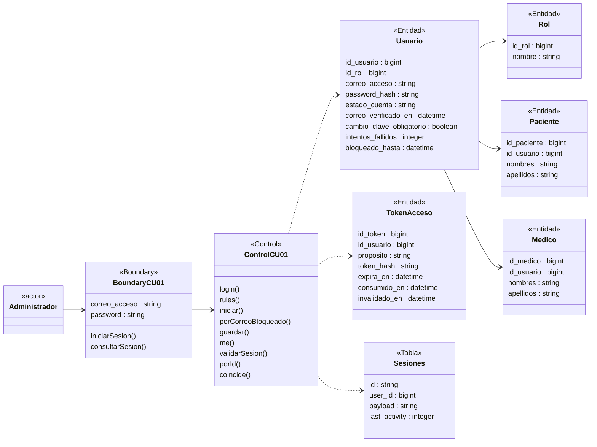

| Archivo real | Métodos del diagrama |
| --- | --- |
| frontend/src/features/auth/services/auth.service.js | iniciarSesion, consultarSesion |
| backend/src/presentation/controllers/usuarios/AutenticacionController.php | login, me |
| backend/src/presentation/dtos/usuarios/LoginRequest.php | rules |
| backend/src/business/services/usuarios/AutenticacionService.php | iniciar, validarSesion |
| backend/src/data/repositories/usuarios/UsuarioRepository.php | porCorreoBloqueado, guardar, porId |
| backend/src/data/repositories/usuarios/SesionRepository.php | iniciar, coincide |

<a id="vigente-cu-02"></a>
## CU-02 — Cerrar sesión: análisis vigente

No requiere campos de negocio en el cuerpo. Boundary envía cookies/CSRF por el transporte existente. El cierre restringido también invalida credenciales temporales según reglas vigentes.

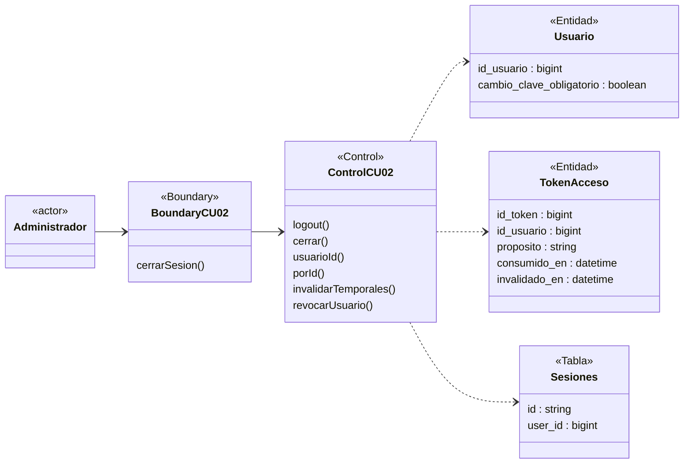

| Archivo real | Métodos del diagrama |
| --- | --- |
| frontend/src/features/auth/services/auth.service.js | cerrarSesion |
| backend/src/presentation/controllers/usuarios/AutenticacionController.php | logout |
| backend/src/business/services/usuarios/AutenticacionService.php | cerrar |
| backend/src/data/repositories/usuarios/SesionRepository.php | usuarioId, cerrar, revocarUsuario |
| backend/src/data/repositories/usuarios/UsuarioRepository.php | porId |
| backend/src/data/repositories/usuarios/TokenAccesoRepository.php | invalidarTemporales |

<a id="vigente-cu-03"></a>
## CU-03 — Administrar cuentas y acceso: análisis vigente

Unifica consulta/estado/rol del personal y acceso mínimo de Pacientes, alta/invitación y credencial temporal. Aceptación y contraseña definitiva son acciones personales del destinatario. Las operaciones administrativas sobre Pacientes no cambian credenciales, rol o vínculo.

```mermaid
classDiagram
direction LR
class BoundaryCU03 {
  <<Boundary>>
  id : bigint
  rol : string
  estado_cuenta : string
  correo_acceso : string
  nombres_personal : string
  apellidos_personal : string
  id_medico : bigint
  identidad_verificada : boolean
  token : string
  password : string
  password_confirmation : string
  page : integer
  per_page : integer
  crearPersonal()
  reenviarInvitacion()
  aceptarInvitacion()
  listarCuentas()
  consultarCuenta()
  cambiarEstadoCuenta()
  cambiarRolCuenta()
  emitirCredencialTemporal()
  completarClaveTemporal()
}
class ControlCU03 {
  <<Control>>
  store()
  rules()
  crear()
  crearPersonal()
  reenviar()
  aceptar()
  consumir()
  index()
  listar()
  listadoAdministrativo()
  show()
  consultar()
  estado()
  cambiarEstado()
  rol()
  cambiarRol()
  emitir()
  emitirTemporal()
  completar()
  guardar()
  revocarUsuario()
}
class Usuario {
  <<Entidad>>
  id_usuario : bigint
  id_rol : bigint
  correo_acceso : string
  nombres_personal : string
  apellidos_personal : string
  estado_cuenta : string
  password_hash : string
  correo_verificado_en : datetime
  cambio_clave_obligatorio : boolean
  bloqueado_hasta : datetime
}
class Rol {
  <<Entidad>>
  id_rol : bigint
  nombre : string
}
class Medico {
  <<Entidad>>
  id_medico : bigint
  id_usuario : bigint
  nombres : string
  apellidos : string
  activo : boolean
}
class Paciente {
  <<Entidad>>
  id_paciente : bigint
  id_usuario : bigint
}
class TokenAcceso {
  <<Entidad>>
  id_token : bigint
  id_usuario : bigint
  proposito : string
  token_hash : string
  emitido_en : datetime
  expira_en : datetime
  consumido_en : datetime
  invalidado_en : datetime
}
class Sesiones {
  <<Tabla>>
  id : string
  user_id : bigint
}
class Administrador {
  <<actor>>
}
Administrador --> BoundaryCU03 : operaciones administrativas y propias
BoundaryCU03 --> ControlCU03
ControlCU03 ..> Usuario
ControlCU03 ..> Medico
ControlCU03 ..> Paciente
ControlCU03 ..> TokenAcceso
ControlCU03 ..> Sesiones
Usuario --> Rol
Usuario --> Medico
Usuario --> Paciente
Usuario --> TokenAcceso
```

| Archivo real | Métodos del diagrama |
| --- | --- |
| frontend/src/features/usuarios/services/usuario.service.js | crearPersonal, reenviarInvitacion, listarCuentas, consultarCuenta, cambiarEstadoCuenta, cambiarRolCuenta, emitirCredencialTemporal |
| frontend/src/features/auth/services/invitation.service.js | aceptarInvitacion |
| frontend/src/features/auth/services/password.service.js | completarClaveTemporal |
| backend/src/presentation/controllers/usuarios/PersonalController.php | store, reenviar |
| backend/src/presentation/controllers/usuarios/InvitacionPersonalController.php | aceptar |
| backend/src/presentation/controllers/usuarios/CuentaController.php | index, show, estado, rol |
| backend/src/presentation/controllers/usuarios/CredencialTemporalController.php | emitir, completar |
| backend/src/presentation/dtos/usuarios/CrearPersonalRequest.php | rules |
| backend/src/presentation/dtos/usuarios/AceptarInvitacionRequest.php | rules |
| backend/src/business/services/usuarios/InvitacionPersonalService.php | crear, reenviar, aceptar |
| backend/src/business/services/usuarios/AdministracionCuentaService.php | listar, consultar, cambiarEstado, cambiarRol |
| backend/src/business/services/usuarios/CredencialTemporalService.php | emitir, completar |
| backend/src/data/repositories/usuarios/UsuarioRepository.php | crearPersonal, listadoAdministrativo, guardar |
| backend/src/data/repositories/usuarios/TokenAccesoRepository.php | consumir, emitirTemporal |
| backend/src/data/repositories/usuarios/SesionRepository.php | revocarUsuario |

`rules()` también agrupa la validación de listado, estado/rol, reenvío y temporal: ListarCuentasRequest, CambiarEstadoCuentaRequest, CambiarRolCuentaRequest, ReenviarInvitacionRequest, EmitirCredencialTemporalRequest y la heredada de ClaveRequest en CompletarClaveTemporalRequest, dentro de backend/src/presentation/dtos/usuarios/. No se repite en la caja. Las precondiciones de último Administrador y obligaciones profesionales siguen en los servicios reales, aunque sus auxiliares no se seleccionen visualmente.

<a id="vigente-cu-04"></a>
## CU-04 — Registro y vinculación web del Paciente: análisis vigente

Dos caminos dentro del mismo diagrama: paciente nuevo o ficha histórica con código presencial. El código administrativo se emite por CU-07, no por este CU; nadie ejecuta los pasos personales suplantando al titular.

```mermaid
classDiagram
direction LR
class BoundaryCU04 {
  <<Boundary>>
  documento_identidad : string
  nombres : string
  apellidos : string
  fecha_nacimiento : date
  telefono : string
  sexo : string
  correo_contacto : string
  direccion : string
  correo_acceso : string
  password : string
  password_confirmation : string
  codigo_activacion : string
  codigo : string
  registrarPaciente()
  vincularPaciente()
  reenviarCodigoRegistro()
  verificarRegistro()
}
class ControlCU04 {
  <<Control>>
  iniciar()
  rules()
  porContexto()
  crear()
  emitirCodigo()
  reenviar()
  vincular()
  pacientePorDocumento()
  verificar()
  ultimoCodigo()
  crearPaciente()
  guardar()
  invalidarCodigos()
}
class RegistroPacientePendiente {
  <<Entidad>>
  id_registro_pendiente : bigint
  tipo_registro : string
  documento_identidad : string
  correo_propuesto : string
  password_hash_temporal : string
  datos_registro : array
  id_paciente : bigint
  id_codigo_activacion : bigint
  iniciado_en : datetime
  expira_en : datetime
  completado_en : datetime
  invalidado_en : datetime
}
class CodigoActivacionPaciente {
  <<Entidad>>
  id_codigo_activacion : bigint
  id_paciente : bigint
  codigo_hash : string
  expira_en : datetime
  intentos_fallidos : integer
  consumido_en : datetime
  invalidado_en : datetime
}
class VerificacionCorreo {
  <<Entidad>>
  id_verificacion : bigint
  id_registro_pendiente : bigint
  codigo_hash : string
  enviado_en : datetime
  expira_en : datetime
  intentos_fallidos : integer
  consumido_en : datetime
  invalidado_en : datetime
}
class Usuario {
  <<Entidad>>
  id_usuario : bigint
  id_rol : bigint
  correo_acceso : string
  password_hash : string
  estado_cuenta : string
  correo_verificado_en : datetime
}
class Paciente {
  <<Entidad>>
  id_paciente : bigint
  id_usuario : bigint
  codigo_paciente : string
  documento_identidad : string
  nombres : string
  apellidos : string
  fecha_nacimiento : date
  telefono : string
  activo : boolean
}
BoundaryCU04 --> ControlCU04
ControlCU04 ..> RegistroPacientePendiente
ControlCU04 ..> CodigoActivacionPaciente
ControlCU04 ..> VerificacionCorreo
ControlCU04 ..> Usuario
ControlCU04 ..> Paciente
Usuario --> Paciente
RegistroPacientePendiente --> VerificacionCorreo
RegistroPacientePendiente --> CodigoActivacionPaciente
```

| Archivo real | Métodos del diagrama |
| --- | --- |
| frontend/src/features/auth/services/registration.service.js | registrarPaciente, vincularPaciente, reenviarCodigoRegistro, verificarRegistro |
| backend/src/presentation/controllers/usuarios/RegistroPacienteController.php | iniciar, vincular, reenviar, verificar |
| backend/src/presentation/dtos/usuarios/RegistrarPacienteRequest.php | rules |
| backend/src/presentation/dtos/usuarios/VincularPacienteRequest.php | rules |
| backend/src/presentation/dtos/usuarios/VerificarRegistroPacienteRequest.php | rules |
| backend/src/business/services/usuarios/RegistroPacienteService.php | iniciar, reenviar, vincular, verificar |
| backend/src/data/repositories/usuarios/RegistroPacienteRepository.php | porContexto, crear, emitirCodigo, ultimoCodigo, crearPaciente, guardar, invalidarCodigos |
| backend/src/data/repositories/pacientes/CodigoActivacionRepository.php | pacientePorDocumento, vincular |
| backend/src/data/repositories/usuarios/UsuarioRepository.php | crearPaciente |

La huella del contexto de registro se conserva dentro de `datos_registro` como `_contexto_hash`; no existe una columna `contexto_hash` independiente y no se dibuja como atributo persistido propio.

<a id="vigente-cu-05"></a>
## CU-05 — Cambiar contraseña propia: análisis vigente

No es el restablecimiento administrativo de otra cuenta. Se conserva sesión actual regenerada y se revocan contextos anteriores conforme al flujo real.

```mermaid
classDiagram
direction LR
class BoundaryCU05 {
  <<Boundary>>
  current_password : string
  password : string
  password_confirmation : string
  cambiarClave()
}
class ControlCU05 {
  <<Control>>
  update()
  rules()
  cambiar()
  exigirSesionNormal()
  guardar()
  invalidarRecuperaciones()
  revocarUsuario()
  iniciar()
}
class Usuario {
  <<Entidad>>
  id_usuario : bigint
  password_hash : string
  estado_cuenta : string
  cambio_clave_obligatorio : boolean
  actualizado_en : datetime
}
class TokenAcceso {
  <<Entidad>>
  id_usuario : bigint
  proposito : string
  consumido_en : datetime
  invalidado_en : datetime
}
class Sesiones {
  <<Tabla>>
  id : string
  user_id : bigint
  payload : string
}
class Administrador {
  <<actor>>
}
Administrador --> BoundaryCU05
BoundaryCU05 --> ControlCU05
ControlCU05 ..> Usuario
ControlCU05 ..> TokenAcceso
ControlCU05 ..> Sesiones
```

| Archivo real | Métodos del diagrama |
| --- | --- |
| frontend/src/features/auth/services/password.service.js | cambiarClave |
| backend/src/presentation/controllers/usuarios/ClaveController.php | update |
| backend/src/presentation/dtos/usuarios/CambiarClaveRequest.php | rules |
| backend/src/business/services/usuarios/ClaveService.php | cambiar |
| backend/src/business/services/usuarios/AutenticacionService.php | exigirSesionNormal |
| backend/src/data/repositories/usuarios/UsuarioRepository.php | guardar |
| backend/src/data/repositories/usuarios/TokenAccesoRepository.php | invalidarRecuperaciones |
| backend/src/data/repositories/usuarios/SesionRepository.php | revocarUsuario, iniciar |

<a id="vigente-cu-06"></a>
## CU-06 — Recuperar contraseña: análisis vigente

Se conserva exactamente la selección de diez métodos de Control acordada con el usuario. Solicitud: correo; restablecimiento: token/contraseña/confirmación. No son un único envío.

```mermaid
classDiagram
direction LR
class BoundaryCU06 {
  <<Boundary>>
  correo_acceso : string
  token : string
  password : string
  password_confirmation : string
  solicitarRecuperacion()
  restablecerClave()
}
class ControlCU06 {
  <<Control>>
  solicitar()
  rules()
  porCorreoBloqueado()
  invalidarRecuperaciones()
  emitirRecuperacion()
  restablecer()
  recuperacionPorHash()
  guardar()
  consumir()
  revocarUsuario()
}
class Usuario {
  <<Entidad>>
  id_usuario : bigint
  id_rol : bigint
  correo_acceso : string
  password_hash : string
  estado_cuenta : string
  correo_verificado_en : datetime
  cambio_clave_obligatorio : boolean
  nombres_personal : string
  apellidos_personal : string
  actualizado_en : datetime
}
class Rol {
  <<Entidad>>
  id_rol : bigint
  nombre : string
}
class Paciente {
  <<Entidad>>
  id_paciente : bigint
  id_usuario : bigint
}
class Medico {
  <<Entidad>>
  id_medico : bigint
  id_usuario : bigint
}
class TokenAcceso {
  <<Entidad>>
  id_token : bigint
  id_usuario : bigint
  proposito : string
  token_hash : string
  emitido_en : datetime
  expira_en : datetime
  consumido_en : datetime
  invalidado_en : datetime
}
class VerificacionCorreo {
  <<Entidad>>
  id_usuario : bigint
  proposito : string
  enviado_en : datetime
  consumido_en : datetime
  invalidado_en : datetime
}
class Sesiones {
  <<Tabla>>
  id : string
  user_id : bigint
}
class Bitacora {
  <<Entidad>>
  tipo_evento : string
  tipo_actor : string
  id_usuario_responsable : bigint
  id_usuario_objetivo : bigint
  rol_responsable : string
  rol_objetivo : string
  resultado : string
  causa_codigo : string
  ocurrido_en : datetime
}
class Administrador {
  <<actor>>
}
Administrador --> BoundaryCU06
BoundaryCU06 --> ControlCU06
ControlCU06 ..> Usuario
ControlCU06 ..> TokenAcceso
ControlCU06 ..> VerificacionCorreo
ControlCU06 ..> Sesiones
ControlCU06 ..> Bitacora
Usuario --> Rol
Usuario --> Paciente
Usuario --> Medico
Usuario --> TokenAcceso
Usuario --> VerificacionCorreo
```

| Archivo real | Métodos del diagrama |
| --- | --- |
| frontend/src/features/auth/services/password.service.js | solicitarRecuperacion, restablecerClave |
| backend/src/presentation/controllers/usuarios/RecuperacionClaveController.php | solicitar, restablecer |
| backend/src/presentation/dtos/usuarios/SolicitarRecuperacionRequest.php | rules |
| backend/src/presentation/dtos/usuarios/RestablecerClaveRequest.php | rules |
| backend/src/business/services/usuarios/RecuperacionClaveService.php | solicitar, restablecer |
| backend/src/data/repositories/usuarios/UsuarioRepository.php | porCorreoBloqueado, guardar |
| backend/src/data/repositories/usuarios/TokenAccesoRepository.php | invalidarRecuperaciones, emitirRecuperacion, recuperacionPorHash, consumir |
| backend/src/data/repositories/usuarios/SesionRepository.php | revocarUsuario |

El servicio también invalida verificaciones de cambio de correo y registra auditoría; por selección explícita sus métodos auxiliares no se añaden a Control. Sus entidades sí participan. Envío posterior al commit, expiración/uso único y sesiones quedan descritos en el expediente. No se presentan contraseñas/tokens de entrada como atributos persistidos en claro.

<a id="vigente-cu-07"></a>
## CU-07 — Gestionar registro administrativo de pacientes: análisis vigente

Incluye consulta/alta/edición/estado de ficha y emisión de código, sin registro personal ni credenciales. El historial enlazado desde ficha pertenece a CU-21 y no concede edición clínica.

```mermaid
classDiagram
direction LR
class BoundaryCU07 {
  <<Boundary>>
  id : bigint
  documento_identidad : string
  nombres : string
  apellidos : string
  fecha_nacimiento : date
  sexo : string
  telefono : string
  correo_contacto : string
  direccion : string
  contacto_emergencia : object
  posibles_duplicados_revisados : boolean
  identidad_verificada : boolean
  motivo : string
  actualizado_en_original : datetime
  activo : boolean
  page : integer
  per_page : integer
  listarPacientes()
  consultarPaciente()
  crearPaciente()
  actualizarPaciente()
  cambiarEstadoPaciente()
  emitirCodigoActivacion()
}
class ControlCU07 {
  <<Control>>
  index()
  rules()
  listar()
  show()
  consultar()
  store()
  crear()
  update()
  actualizar()
  guardar()
  estado()
  cambiarEstado()
  emitir()
  pacientePorId()
  invalidarAnteriores()
}
class Paciente {
  <<Entidad>>
  id_paciente : bigint
  id_usuario : bigint
  codigo_paciente : string
  documento_identidad : string
  nombres : string
  apellidos : string
  fecha_nacimiento : date
  sexo : string
  telefono : string
  correo_contacto : string
  direccion : string
  activo : boolean
  actualizado_en : datetime
}
class ContactoEmergencia {
  <<Entidad>>
  id_paciente : bigint
  nombre : string
  parentesco : string
  telefono : string
}
class CodigoActivacionPaciente {
  <<Entidad>>
  id_codigo_activacion : bigint
  id_paciente : bigint
  id_recepcionista : bigint
  codigo_hash : string
  emitido_en : datetime
  expira_en : datetime
  consumido_en : datetime
  invalidado_en : datetime
}
class RegistroPacientePendiente {
  <<Entidad>>
  id_registro_pendiente : bigint
  id_paciente : bigint
  documento_identidad : string
  invalidado_en : datetime
}
class Usuario {
  <<Entidad>>
  id_usuario : bigint
  id_rol : bigint
  estado_cuenta : string
}
class Administrador {
  <<actor>>
}
Administrador --> BoundaryCU07
BoundaryCU07 --> ControlCU07
ControlCU07 ..> Paciente
ControlCU07 ..> ContactoEmergencia
ControlCU07 ..> CodigoActivacionPaciente
ControlCU07 ..> RegistroPacientePendiente
ControlCU07 ..> Usuario
Paciente --> ContactoEmergencia
Paciente --> CodigoActivacionPaciente
CodigoActivacionPaciente --> Usuario
```

| Archivo real | Métodos del diagrama |
| --- | --- |
| frontend/src/features/pacientes/services/paciente.service.js | listarPacientes, consultarPaciente, crearPaciente, actualizarPaciente, cambiarEstadoPaciente |
| frontend/src/features/pacientes/services/activation.service.js | emitirCodigoActivacion |
| backend/src/presentation/controllers/pacientes/PacienteController.php | index, show, store, update, estado |
| backend/src/presentation/controllers/pacientes/CodigoActivacionController.php | emitir |
| backend/src/presentation/dtos/pacientes/CrearPacienteRequest.php | rules |
| backend/src/presentation/dtos/pacientes/ActualizarPacienteRequest.php | rules |
| backend/src/presentation/dtos/pacientes/CambiarEstadoPacienteRequest.php | rules |
| backend/src/presentation/dtos/pacientes/EmitirCodigoActivacionRequest.php | rules |
| backend/src/business/services/pacientes/PacienteService.php | listar, consultar, crear, actualizar, cambiarEstado |
| backend/src/business/services/pacientes/CodigoActivacionService.php | emitir |
| backend/src/data/repositories/pacientes/PacienteRepository.php | listar, consultar, crear, guardar |
| backend/src/data/repositories/pacientes/CodigoActivacionRepository.php | pacientePorId, invalidarAnteriores, crear |

`id_recepcionista` es el nombre persistido de la FK a Usuario: guarda también al Administrador emisor auténtico. No es una restricción de rol ni una identidad simulada.

<a id="vigente-cu-08"></a>
## CU-08 — Actualizar perfil propio: análisis vigente

Contacto/emergencia/preferencias y cambio verificado del correo de acceso propio; no edición de identidad clínica, rol o historial. Correo de contacto y correo de acceso son datos distintos.

```mermaid
classDiagram
direction LR
class BoundaryCU08 {
  <<Boundary>>
  telefono : string
  correo_contacto : string
  direccion : string
  contacto_emergencia : object
  recordatorios_habilitados : boolean
  actualizado_en_original : datetime
  correo_acceso : string
  current_password : string
  codigo : string
  consultarMiPerfil()
  actualizarMiPerfil()
  solicitarCambioCorreo()
  reenviarCambioCorreo()
  verificarCambioCorreo()
}
class ControlCU08 {
  <<Control>>
  show()
  rules()
  consultar()
  porUsuario()
  update()
  actualizar()
  guardar()
  guardarEmergencia()
  guardarRecordatorios()
  solicitar()
  reenviar()
  verificar()
  ultimo()
  crear()
  revocarUsuario()
}
class Paciente {
  <<Entidad>>
  id_paciente : bigint
  id_usuario : bigint
  telefono : string
  correo_contacto : string
  direccion : string
  actualizado_en : datetime
}
class ContactoEmergencia {
  <<Entidad>>
  id_paciente : bigint
  nombre : string
  parentesco : string
  telefono : string
}
class PreferenciaPaciente {
  <<Entidad>>
  id_paciente : bigint
  recordatorios_habilitados : boolean
}
class Usuario {
  <<Entidad>>
  id_usuario : bigint
  correo_acceso : string
  password_hash : string
  correo_verificado_en : datetime
}
class VerificacionCorreo {
  <<Entidad>>
  id_verificacion : bigint
  id_usuario : bigint
  proposito : string
  correo_destino : string
  codigo_hash : string
  enviado_en : datetime
  expira_en : datetime
  consumido_en : datetime
  invalidado_en : datetime
}
class Sesiones {
  <<Tabla>>
  id : string
  user_id : bigint
}
BoundaryCU08 --> ControlCU08
ControlCU08 ..> Paciente
ControlCU08 ..> Usuario
ControlCU08 ..> VerificacionCorreo
ControlCU08 ..> Sesiones
Paciente --> ContactoEmergencia
Paciente --> PreferenciaPaciente
Usuario --> Paciente
Usuario --> VerificacionCorreo
```

| Archivo real | Métodos del diagrama |
| --- | --- |
| frontend/src/features/pacientes/services/perfil.service.js | consultarMiPerfil, actualizarMiPerfil |
| frontend/src/features/pacientes/services/cambioCorreo.service.js | solicitarCambioCorreo, reenviarCambioCorreo, verificarCambioCorreo |
| backend/src/presentation/controllers/pacientes/MiPerfilController.php | show, update |
| backend/src/presentation/controllers/usuarios/CambioCorreoController.php | solicitar, reenviar, verificar |
| backend/src/presentation/dtos/pacientes/MiPerfilRequest.php | rules |
| backend/src/presentation/dtos/usuarios/CambioCorreoRequest.php | rules |
| backend/src/business/services/pacientes/MiPerfilService.php | consultar, actualizar |
| backend/src/business/services/usuarios/CambioCorreoService.php | solicitar, reenviar, verificar |
| backend/src/data/repositories/pacientes/PacienteRepository.php | porUsuario, guardar, guardarEmergencia, guardarRecordatorios |
| backend/src/data/repositories/usuarios/CambioCorreoRepository.php | ultimo, crear, guardar |
| backend/src/data/repositories/usuarios/SesionRepository.php | revocarUsuario |

<a id="vigente-cu-09"></a>
## CU-09 — Gestionar especialidades: análisis vigente

```mermaid
classDiagram
direction LR
class BoundaryCU09 {
  <<Boundary>>
  id : bigint
  nombre : string
  descripcion : string
  activa : boolean
  actualizado_en_original : datetime
  page : integer
  per_page : integer
  listarEspecialidades()
  consultarEspecialidad()
  crearEspecialidad()
  actualizarEspecialidad()
  cambiarEstadoEspecialidad()
}
class ControlCU09 {
  <<Control>>
  index()
  rules()
  listar()
  show()
  consultar()
  porIdBloqueado()
  store()
  crear()
  update()
  actualizar()
  guardar()
  estado()
}
class Especialidad {
  <<Entidad>>
  id_especialidad : bigint
  nombre : string
  descripcion : string
  activa : boolean
  actualizado_en : datetime
}
class Administrador {
  <<actor>>
}
Administrador --> BoundaryCU09
BoundaryCU09 --> ControlCU09
ControlCU09 ..> Especialidad
```

| Archivo real | Métodos del diagrama |
| --- | --- |
| frontend/src/features/especialidades/services/especialidad.service.js | listarEspecialidades, consultarEspecialidad, crearEspecialidad, actualizarEspecialidad, cambiarEstadoEspecialidad |
| backend/src/presentation/controllers/medicos/EspecialidadController.php | index, show, store, update, estado |
| backend/src/presentation/dtos/medicos/CrearEspecialidadRequest.php | rules |
| backend/src/presentation/dtos/medicos/ActualizarEspecialidadRequest.php | rules |
| backend/src/presentation/dtos/medicos/CambiarEstadoEspecialidadRequest.php | rules |
| backend/src/business/services/medicos/EspecialidadService.php | listar, consultar, crear, actualizar |
| backend/src/data/repositories/medicos/EspecialidadRepository.php | listar, porIdBloqueado, crear, guardar |

<a id="vigente-cu-10"></a>
## CU-10 — Gestionar médicos: análisis vigente

Actividad profesional independiente de la cuenta. Asociación de especialidades conserva historia; crear acceso profesional es CU-03, no un método ficticio de CU-10.

```mermaid
classDiagram
direction LR
class BoundaryCU10 {
  <<Boundary>>
  id : bigint
  nombre : string
  id_especialidad : bigint
  registro_profesional : string
  nombres : string
  apellidos : string
  telefono : string
  correo_contacto : string
  especialidades : array
  activo : boolean
  actualizado_en_original : datetime
  page : integer
  per_page : integer
  listarMedicos()
  consultarMedico()
  crearMedico()
  actualizarMedico()
  cambiarEstadoMedico()
  cambiarEspecialidadesMedico()
}
class ControlCU10 {
  <<Control>>
  index()
  rules()
  listar()
  show()
  consultar()
  porIdBloqueado()
  store()
  crear()
  update()
  actualizar()
  guardar()
  estado()
  cambiarEstado()
  especialidades()
  cambiarEspecialidades()
  guardarHabilitaciones()
}
class Medico {
  <<Entidad>>
  id_medico : bigint
  id_usuario : bigint
  codigo_medico : string
  registro_profesional : string
  nombres : string
  apellidos : string
  telefono : string
  correo_contacto : string
  activo : boolean
  actualizado_en : datetime
}
class Especialidad {
  <<Entidad>>
  id_especialidad : bigint
  nombre : string
  activa : boolean
}
class MedicoEspecialidad {
  <<Entidad>>
  id_medico : bigint
  id_especialidad : bigint
  habilitada : boolean
}
class Cita {
  <<Entidad>>
  id_medico : bigint
  id_especialidad : bigint
  inicio_at : datetime
  estado : string
}
class Administrador {
  <<actor>>
}
Administrador --> BoundaryCU10
BoundaryCU10 --> ControlCU10
ControlCU10 ..> Medico
ControlCU10 ..> Especialidad
ControlCU10 ..> MedicoEspecialidad
ControlCU10 ..> Cita
Medico --> MedicoEspecialidad
MedicoEspecialidad --> Especialidad
```

| Archivo real | Métodos del diagrama |
| --- | --- |
| frontend/src/features/medicos/services/medico.service.js | listarMedicos, consultarMedico, crearMedico, actualizarMedico, cambiarEstadoMedico, cambiarEspecialidadesMedico |
| backend/src/presentation/controllers/medicos/MedicoController.php | index, show, store, update, estado, especialidades |
| backend/src/presentation/dtos/medicos/CrearMedicoRequest.php | rules |
| backend/src/presentation/dtos/medicos/ActualizarMedicoRequest.php | rules |
| backend/src/presentation/dtos/medicos/CambiarEstadoMedicoRequest.php | rules |
| backend/src/presentation/dtos/medicos/CambiarEspecialidadesMedicoRequest.php | rules |
| backend/src/business/services/medicos/MedicoService.php | listar, consultar, crear, actualizar, cambiarEstado, cambiarEspecialidades |
| backend/src/data/repositories/medicos/MedicoRepository.php | listar, porIdBloqueado, crear, guardar, guardarHabilitaciones |

<a id="vigente-cu-11"></a>
## CU-11 — Gestionar consultorios y asignación: análisis vigente

Un diagrama reúne catálogo/asignación/impacto/confirmación. La vista previa no autoriza traslados silenciosos ni reprograma citas por otro CU.

```mermaid
classDiagram
direction LR
class BoundaryCU11 {
  <<Boundary>>
  id : bigint
  q : string
  codigo_consultorio : string
  nombre : string
  activo : boolean
  id_consultorio : bigint
  actualizado_en_original : datetime
  huella_impacto : string
  confirmar_traslados : boolean
  page : integer
  per_page : integer
  listarConsultorios()
  consultarConsultorio()
  crearConsultorio()
  actualizarConsultorio()
  cambiarEstadoConsultorio()
  consultarAsignacion()
  consultarImpactoAsignacion()
  confirmarAsignacion()
}
class ControlCU11 {
  <<Control>>
  index()
  rules()
  listar()
  show()
  consultar()
  store()
  crear()
  update()
  actualizar()
  guardar()
  estado()
  impacto()
  confirmar()
  horarios()
  citas()
  trasladar()
}
class Consultorio {
  <<Entidad>>
  id_consultorio : bigint
  codigo_consultorio : string
  nombre : string
  activo : boolean
  actualizado_en : datetime
}
class Medico {
  <<Entidad>>
  id_medico : bigint
  id_consultorio : bigint
  activo : boolean
  actualizado_en : datetime
}
class HorarioAtencion {
  <<Entidad>>
  id_medico : bigint
  dia_semana : integer
  hora_inicio : time
  hora_fin : time
  activo : boolean
}
class Cita {
  <<Entidad>>
  id_cita : bigint
  id_medico : bigint
  id_consultorio : bigint
  inicio_at : datetime
  fin_at : datetime
  estado : string
  consultorio_atencion : string
  actualizada_en : datetime
}
class Administrador {
  <<actor>>
}
Administrador --> BoundaryCU11
BoundaryCU11 --> ControlCU11
ControlCU11 ..> Consultorio
ControlCU11 ..> Medico
ControlCU11 ..> HorarioAtencion
ControlCU11 ..> Cita
Medico --> Consultorio
Medico --> HorarioAtencion
```

| Archivo real | Métodos del diagrama |
| --- | --- |
| frontend/src/features/consultorios/services/consultorio.service.js | listarConsultorios, consultarConsultorio, crearConsultorio, actualizarConsultorio, cambiarEstadoConsultorio |
| frontend/src/features/consultorios/services/asignacionConsultorio.service.js | consultarAsignacion, consultarImpactoAsignacion, confirmarAsignacion |
| backend/src/presentation/controllers/consultorios/ConsultorioController.php | index, show, store, update, estado |
| backend/src/presentation/controllers/consultorios/AsignacionConsultorioController.php | show, impacto, update |
| backend/src/presentation/dtos/consultorios/CrearConsultorioRequest.php | rules |
| backend/src/presentation/dtos/consultorios/ActualizarConsultorioRequest.php | rules |
| backend/src/presentation/dtos/consultorios/CambiarEstadoConsultorioRequest.php | rules |
| backend/src/presentation/dtos/consultorios/ImpactoAsignacionConsultorioRequest.php | rules |
| backend/src/presentation/dtos/consultorios/ConfirmarAsignacionConsultorioRequest.php | rules |
| backend/src/business/services/consultorios/ConsultorioService.php | listar, consultar, crear, actualizar |
| backend/src/business/services/consultorios/AsignacionConsultorioService.php | consultar, impacto, confirmar |
| backend/src/data/repositories/consultorios/ConsultorioRepository.php | listar, crear, guardar |
| backend/src/data/repositories/consultorios/AsignacionConsultorioRepository.php | horarios, citas, trasladar |

<a id="vigente-cu-12"></a>
## CU-12 — Gestionar horarios y duración: análisis vigente

Consolida horarios de Médico, impacto y configuración de duración. `ejecutar()` existe en dos Services distintos; la tabla conserva ambos orígenes. Duración efectiva de citas previas no se sustituye por cambiar la configuración.

```mermaid
classDiagram
direction LR
class BoundaryCU12 {
  <<Boundary>>
  id : bigint
  horario : bigint
  accion : string
  dia_semana : integer
  hora_inicio : time
  hora_fin : time
  activo : boolean
  actualizado_en_original : datetime
  duracion_turno_minutos : integer
  page : integer
  per_page : integer
  listarHorarios()
  consultarImpactoHorario()
  crearHorario()
  actualizarHorario()
  cambiarEstadoHorario()
  consultarConfiguracionCitas()
  consultarImpactoDuracion()
  actualizarDuracion()
}
class ControlCU12 {
  <<Control>>
  index()
  rules()
  ejecutar()
  propios()
  impacto()
  store()
  update()
  estado()
  guardar()
  show()
  bloqueada()
  horariosActivos()
}
class HorarioAtencion {
  <<Entidad>>
  id_horario : bigint
  id_medico : bigint
  dia_semana : integer
  hora_inicio : time
  hora_fin : time
  activo : boolean
}
class Medico {
  <<Entidad>>
  id_medico : bigint
  id_consultorio : bigint
  activo : boolean
  actualizado_en : datetime
}
class Consultorio {
  <<Entidad>>
  id_consultorio : bigint
  activo : boolean
}
class ConfiguracionClinica {
  <<Entidad>>
  id_configuracion : bigint
  duracion_turno_minutos : integer
  zona_horaria : string
  actualizado_en : datetime
}
class Cita {
  <<Entidad>>
  id_cita : bigint
  id_medico : bigint
  id_consultorio : bigint
  inicio_at : datetime
  fin_at : datetime
  duracion_minutos : integer
  estado : string
}
class Administrador {
  <<actor>>
}
Administrador --> BoundaryCU12
BoundaryCU12 --> ControlCU12
ControlCU12 ..> HorarioAtencion
ControlCU12 ..> Medico
ControlCU12 ..> Consultorio
ControlCU12 ..> ConfiguracionClinica
ControlCU12 ..> Cita
Medico --> HorarioAtencion
Medico --> Consultorio
```

| Archivo real | Métodos del diagrama |
| --- | --- |
| frontend/src/features/horarios/services/horario.service.js | listarHorarios, consultarImpactoHorario, crearHorario, actualizarHorario, cambiarEstadoHorario |
| frontend/src/features/horarios/services/configuracionCitas.service.js | consultarConfiguracionCitas, consultarImpactoDuracion, actualizarDuracion |
| backend/src/presentation/controllers/horarios/HorarioController.php | index, impacto, store, update, estado |
| backend/src/presentation/controllers/horarios/ConfiguracionCitasController.php | show, impacto, update |
| backend/src/presentation/dtos/horarios/HorarioRequest.php | rules |
| backend/src/presentation/dtos/horarios/ConfiguracionCitasRequest.php | rules |
| backend/src/business/services/horarios/HorarioService.php | ejecutar |
| backend/src/business/services/horarios/ConfiguracionCitasService.php | ejecutar |
| backend/src/data/repositories/horarios/HorarioRepository.php | propios, guardar |
| backend/src/data/repositories/horarios/ConfiguracionCitasRepository.php | bloqueada, horariosActivos, guardar |

<a id="vigente-cu-13"></a>
## CU-13 — Buscar médicos y disponibilidad: análisis vigente

Catálogos/turnos orientativos, no reserva. `id_paciente` solo en contexto administrativo; Paciente propio se deriva del servidor.

```mermaid
classDiagram
direction LR
class BoundaryCU13 {
  <<Boundary>>
  nombre : string
  consultorio : string
  id_especialidad : bigint
  id_medico : bigint
  id_paciente : bigint
  fecha : date
  page : integer
  per_page : integer
  listarEspecialidadesReserva()
  listarMedicosReserva()
  consultarDisponibilidad()
}
class ControlCU13 {
  <<Control>>
  especialidades()
  rules()
  medicos()
  turnos()
  bloqueada()
  paciente()
  medico()
  especialidad()
  habilitado()
  consultorio()
  horarios()
  ocupacion()
}
class Paciente {
  <<Entidad>>
  id_paciente : bigint
  id_usuario : bigint
  activo : boolean
}
class Medico {
  <<Entidad>>
  id_medico : bigint
  id_consultorio : bigint
  nombres : string
  apellidos : string
  activo : boolean
  actualizado_en : datetime
}
class Especialidad {
  <<Entidad>>
  id_especialidad : bigint
  nombre : string
  activa : boolean
}
class Consultorio {
  <<Entidad>>
  id_consultorio : bigint
  codigo_consultorio : string
  nombre : string
  activo : boolean
}
class HorarioAtencion {
  <<Entidad>>
  id_medico : bigint
  dia_semana : integer
  hora_inicio : time
  hora_fin : time
  activo : boolean
}
class ConfiguracionClinica {
  <<Entidad>>
  duracion_turno_minutos : integer
  zona_horaria : string
}
class Cita {
  <<Entidad>>
  id_paciente : bigint
  id_medico : bigint
  id_consultorio : bigint
  inicio_at : datetime
  fin_at : datetime
  estado : string
}
class Administrador {
  <<actor>>
}
Administrador --> BoundaryCU13
BoundaryCU13 --> ControlCU13
ControlCU13 ..> Paciente
ControlCU13 ..> Medico
ControlCU13 ..> Especialidad
ControlCU13 ..> Consultorio
ControlCU13 ..> HorarioAtencion
ControlCU13 ..> ConfiguracionClinica
ControlCU13 ..> Cita
Medico --> Consultorio
Medico --> HorarioAtencion
```

| Archivo real | Métodos del diagrama |
| --- | --- |
| frontend/src/features/citas/services/reserva.service.js | listarEspecialidadesReserva, listarMedicosReserva, consultarDisponibilidad |
| backend/src/presentation/controllers/citas/DisponibilidadController.php | especialidades, medicos, turnos |
| backend/src/presentation/dtos/citas/DisponibilidadRequest.php | rules |
| backend/src/business/services/citas/DisponibilidadService.php | especialidades, medicos, turnos |
| backend/src/data/repositories/citas/DisponibilidadRepository.php | especialidades, medicos, paciente, medico, especialidad, habilitado, consultorio, horarios, ocupacion |
| backend/src/data/repositories/horarios/ConfiguracionCitasRepository.php | bloqueada |

<a id="vigente-cu-14"></a>
## CU-14 — Programar o reservar cita: análisis vigente

Propuesta, confirmación y resultado incierto en un único diagrama. Propuesta cifrada no es una credencial ni una retención de turno. Actor real y Médico responsable permanecen separados.

```mermaid
classDiagram
direction LR
class BoundaryCU14 {
  <<Boundary>>
  id_paciente : bigint
  id_especialidad : bigint
  id_medico : bigint
  fecha : date
  hora_inicio : time
  revision_turno : string
  motivo_breve : string
  propuesta : string
  proponerReserva()
  confirmarReserva()
  consultarResultadoReserva()
}
class ControlCU14 {
  <<Control>>
  propuesta()
  rules()
  proponer()
  turnos()
  store()
  confirmar()
  porPropuesta()
  pacienteSolapado()
  crear()
  citaProgramada()
  resultado()
}
class Cita {
  <<Entidad>>
  id_cita : bigint
  codigo_cita : string
  id_paciente : bigint
  id_medico : bigint
  id_especialidad : bigint
  id_consultorio : bigint
  inicio_at : datetime
  fin_at : datetime
  duracion_minutos : integer
  modalidad : string
  sede_atencion : string
  consultorio_atencion : string
  motivo_breve : string
  estado : string
  creada_por : bigint
  id_propuesta_reserva : uuid
  version_programacion : integer
}
class Paciente {
  <<Entidad>>
  id_paciente : bigint
  id_usuario : bigint
  nombres : string
  apellidos : string
  activo : boolean
}
class Medico {
  <<Entidad>>
  id_medico : bigint
  id_consultorio : bigint
  activo : boolean
}
class Especialidad {
  <<Entidad>>
  id_especialidad : bigint
  activa : boolean
}
class Consultorio {
  <<Entidad>>
  id_consultorio : bigint
  activo : boolean
}
class Usuario {
  <<Entidad>>
  id_usuario : bigint
  id_rol : bigint
  estado_cuenta : string
}
class Bitacora {
  <<Entidad>>
  tipo_evento : string
  id_usuario_responsable : bigint
  rol_responsable : string
  registro_referido : string
  referencias : array
  cambios_seguros : array
}
class Administrador {
  <<actor>>
}
Administrador --> BoundaryCU14
BoundaryCU14 --> ControlCU14
ControlCU14 ..> Cita
ControlCU14 ..> Paciente
ControlCU14 ..> Medico
ControlCU14 ..> Especialidad
ControlCU14 ..> Consultorio
ControlCU14 ..> Usuario
ControlCU14 ..> Bitacora
Cita --> Paciente
Cita --> Medico
Cita --> Consultorio
Cita --> Usuario
```

| Archivo real | Métodos del diagrama |
| --- | --- |
| frontend/src/features/citas/services/reserva.service.js | proponerReserva, confirmarReserva, consultarResultadoReserva |
| backend/src/presentation/controllers/citas/ReservaController.php | propuesta, store, resultado |
| backend/src/presentation/dtos/citas/ReservaRequest.php | rules |
| backend/src/business/services/citas/ReservaService.php | proponer, confirmar, resultado |
| backend/src/business/services/citas/DisponibilidadService.php | turnos |
| backend/src/data/repositories/citas/CitaRepository.php | porPropuesta, pacienteSolapado, crear |
| backend/src/data/repositories/bitacora/BitacoraRepository.php | citaProgramada |

HorarioAtencion/ConfiguracionClinica y consultas de ocupación se reutilizan al revalidar disponibilidad según CU-13; no se repite su inventario completo de atributos en este diagrama seleccionado.

<a id="vigente-cu-20"></a>
## CU-20 — Consultar agenda médica: análisis vigente

Administrador/Recepción seleccionan Médico; profesional desde su sesión. Detalle compartido se consulta sin dar acceso a otra agenda. La selección/filtros no conceden permiso de modificar citas.

```mermaid
classDiagram
direction LR
class BoundaryCU20 {
  <<Boundary>>
  id : bigint
  id_medico : bigint
  nombre : string
  fecha : date
  estado : string
  page : integer
  per_page : integer
  listarMedicosAgenda()
  consultarAgenda()
  consultarCita()
}
class ControlCU20 {
  <<Control>>
  index()
  rules()
  consultar()
  medico()
  citas()
  medicos()
  show()
  detalle()
}
class Cita {
  <<Entidad>>
  id_cita : bigint
  codigo_cita : string
  id_medico : bigint
  id_paciente : bigint
  id_especialidad : bigint
  inicio_at : datetime
  fin_at : datetime
  duracion_minutos : integer
  estado : string
  modalidad : string
  sede_atencion : string
  consultorio_atencion : string
  motivo_breve : string
  creada_en : datetime
}
class Medico {
  <<Entidad>>
  id_medico : bigint
  id_usuario : bigint
  codigo_medico : string
  nombres : string
  apellidos : string
  activo : boolean
}
class Paciente {
  <<Entidad>>
  id_paciente : bigint
  codigo_paciente : string
  nombres : string
  apellidos : string
  documento_identidad : string
  telefono : string
  fecha_nacimiento : date
}
class Especialidad {
  <<Entidad>>
  id_especialidad : bigint
  nombre : string
}
class Administrador {
  <<actor>>
}
Administrador --> BoundaryCU20
BoundaryCU20 --> ControlCU20
ControlCU20 ..> Cita
ControlCU20 ..> Medico
ControlCU20 ..> Paciente
ControlCU20 ..> Especialidad
Cita --> Medico
Cita --> Paciente
Cita --> Especialidad
```

| Archivo real | Métodos del diagrama |
| --- | --- |
| frontend/src/features/agenda/services/agenda.service.js | listarMedicosAgenda, consultarAgenda, consultarCita |
| backend/src/presentation/controllers/agenda/AgendaController.php | index, medicos |
| backend/src/presentation/controllers/agenda/ConsultaCitaController.php | show |
| backend/src/presentation/dtos/agenda/AgendaRequest.php | rules |
| backend/src/presentation/dtos/agenda/ConsultaCitaRequest.php | rules |
| backend/src/business/services/agenda/AgendaService.php | consultar, medicos |
| backend/src/business/services/agenda/ConsultaCitaService.php | consultar |
| backend/src/data/repositories/agenda/AgendaRepository.php | medico, citas, medicos, detalle |

Los atributos CI/teléfono/motivo son exclusivamente del detalle administrativo autorizado, nacimiento del detalle Médico; no del listado ni de todas las respuestas por el hecho de figurar en la entidad.

<a id="vigente-cu-21"></a>
## CU-21 — Consultar historial de citas: análisis vigente

Un diagrama para historial administrativo por ficha y Mis citas del titular, con detalle/retorno. Período/estado se filtran independientemente; el tiempo no cambia estados.

```mermaid
classDiagram
direction LR
class BoundaryCU21 {
  <<Boundary>>
  id : bigint
  periodo : string
  estado : string
  page : integer
  per_page : integer
  consultarHistorialPaciente()
  consultarMisCitas()
  consultarCita()
}
class ControlCU21 {
  <<Control>>
  paciente()
  rules()
  consultar()
  historial()
  propias()
  show()
  detalle()
}
class Paciente {
  <<Entidad>>
  id_paciente : bigint
  id_usuario : bigint
  codigo_paciente : string
  nombres : string
  apellidos : string
  documento_identidad : string
  telefono : string
  fecha_nacimiento : date
}
class Cita {
  <<Entidad>>
  id_cita : bigint
  codigo_cita : string
  id_paciente : bigint
  id_medico : bigint
  id_especialidad : bigint
  inicio_at : datetime
  fin_at : datetime
  duracion_minutos : integer
  estado : string
  modalidad : string
  sede_atencion : string
  consultorio_atencion : string
  motivo_breve : string
  creada_en : datetime
}
class Medico {
  <<Entidad>>
  id_medico : bigint
  codigo_medico : string
  nombres : string
  apellidos : string
}
class Especialidad {
  <<Entidad>>
  id_especialidad : bigint
  nombre : string
}
class Administrador {
  <<actor>>
}
Administrador --> BoundaryCU21
BoundaryCU21 --> ControlCU21
ControlCU21 ..> Paciente
ControlCU21 ..> Cita
ControlCU21 ..> Medico
ControlCU21 ..> Especialidad
Cita --> Paciente
Cita --> Medico
Cita --> Especialidad
```

| Archivo real | Métodos del diagrama |
| --- | --- |
| frontend/src/features/agenda/services/agenda.service.js | consultarHistorialPaciente, consultarMisCitas, consultarCita |
| backend/src/presentation/controllers/agenda/HistorialCitasController.php | paciente, propias |
| backend/src/presentation/controllers/agenda/ConsultaCitaController.php | show |
| backend/src/presentation/dtos/agenda/HistorialCitasRequest.php | rules |
| backend/src/presentation/dtos/agenda/ConsultaCitaRequest.php | rules |
| backend/src/business/services/agenda/HistorialCitasService.php | consultar |
| backend/src/business/services/agenda/ConsultaCitaService.php | consultar |
| backend/src/data/repositories/agenda/AgendaRepository.php | paciente, historial, detalle |

`id` identifica ficha en la ruta administrativa o cita al consultar detalle; Mis citas no envía ficha ajena. La búsqueda administrativa anterior a elegir ficha reutiliza CU-07. CI/teléfono/motivo/nacimiento siguen la matriz de detalle de CU-20, nunca listados mínimos.

<a id="vigente-cu-30"></a>
## CU-30 — Consultar bitácora: análisis vigente

Solo lectura para Administrador. El origen de reserva es metadata segura de CITA_PROGRAMADA, no un permiso ni un rol nuevo.

```mermaid
classDiagram
direction LR
class BoundaryCU30 {
  <<Boundary>>
  id : bigint
  fecha_desde : date
  fecha_hasta : date
  id_usuario_responsable : bigint
  id_usuario_objetivo : bigint
  tipo_actor : string
  modulo : string
  operacion : string
  tipo_evento : string
  resultado : string
  direccion_ip : string
  entidad_referida : string
  registro_referido : string
  page : integer
  per_page : integer
  listarBitacora()
  consultarEvento()
}
class ControlCU30 {
  <<Control>>
  index()
  rules()
  listar()
  filtrarRecurso()
  show()
  consultar()
  porId()
}
class Bitacora {
  <<Entidad>>
  id_evento : bigint
  tipo_evento : string
  tipo_actor : string
  id_usuario_responsable : bigint
  id_usuario_objetivo : bigint
  rol_responsable : string
  rol_objetivo : string
  modulo : string
  operacion : string
  resultado : string
  causa_codigo : string
  ocurrido_en : datetime
  registrado_en : datetime
  direccion_ip : string
  procedencia_ip : string
  correlacion : string
  entidad_referida : string
  registro_referido : string
  referencias : array
  cambios_seguros : array
  metadatos_seguros : array
  version_formato : integer
}
class Usuario {
  <<Entidad>>
  id_usuario : bigint
  id_rol : bigint
  estado_cuenta : string
}
class Administrador {
  <<actor>>
}
Administrador --> BoundaryCU30
BoundaryCU30 --> ControlCU30
ControlCU30 ..> Bitacora
ControlCU30 ..> Usuario
```

| Archivo real | Métodos del diagrama |
| --- | --- |
| frontend/src/features/bitacora/services/bitacora.service.js | listarBitacora, consultarEvento |
| backend/src/presentation/controllers/bitacora/BitacoraController.php | index, show |
| backend/src/presentation/dtos/bitacora/ListarBitacoraRequest.php | rules |
| backend/src/presentation/dtos/usuarios/CuentaRequest.php | rules |
| backend/src/business/services/bitacora/BitacoraService.php | listar, consultar |
| backend/src/data/repositories/bitacora/BitacoraRepository.php | listar, filtrarRecurso, porId |

## Casos aún no implementados: sin diagrama de ejecución

| CU | Actores autorizados | Motivo de no dibujar métodos |
| --- | --- | --- |
| CU-15 — Reprogramar cita | Administrador, Recepcionista | Persistencia disponible, sin flujo funcional aprobado como implementado |
| CU-16 — Cancelar cita | Administrador, Recepcionista | Estado persistible no equivale a Controller/Service funcional |
| CU-17 — Confirmar llegada | Administrador, Recepcionista | Sin flujo funcional de transición |
| CU-18 — Registrar inasistencia | Administrador, Recepcionista | Sin flujo funcional de transición |
| CU-19 — Marcar Atendida | Administrador, Médico responsable | Sin flujo funcional de transición |
| CU-22 — Consultar historia clínica | Administrador, Médico autorizado, Paciente titular | Modelos existentes, sin interfaz/API funcional del CU |
| CU-23 — Registrar o actualizar consulta | Administrador, Médico responsable | Versiones/persistencia existentes, sin flujo funcional del CU |
| CU-24 — Solicitar estudios | Administrador, Médico responsable | Sin flujo funcional ni métodos de ejecución que documentar |
| CU-25 — Incorporar documentos | Administrador | Sin carga/archivo protegido funcional del CU |
| CU-26 — Revisar y publicar resultados | Administrador, Médico solicitante | Sin flujo funcional; autoría del revisor por resolver |
| CU-27 — Consultar/descargar resultados | Administrador, Médico autorizado, Paciente titular | Sin entrega protegida funcional del CU |
| CU-28 — Consultar recordatorios | Administrador por Paciente seleccionado, Paciente titular | Sin consulta/scheduler funcional, no generar desde frontend |
| CU-29 — Reportes administrativos | Administrador | Sin módulo funcional |

El diseño previsto en el UML global sigue siendo planificación, no evidencia de estos CU. Esta tarea no altera ese archivo ni convierte sus clases previstas en implementación. **Aclaración de Fase 5:** al implementar cada caso se añadirán vistas comprobables según sus procedimientos/contextos reales, sin imponer un único diagrama por CU. El detalle de soporte y límites actuales se revisa en la tabla de pendientes de Fase 5.

## Expediente de evolución y análisis por procedimientos

<a id="analisis-cu15-cu16-cierre-backend"></a>
### CU-15/CU-16 — Fase 6 backend: integración y cierre del módulo

**Cierre backend local confirmado:** cuatro pruebas/298 aserciones de integración y suite global nueva **2845/29851 correcta**, sin sumar ejecuciones. Inventario PostgreSQL pre/post preservado; UML/análisis/rutas/sintaxis/estilo verificados. CU-15/CU-16 terminados en alcance backend aprobado; frontend/producción y demás módulos pendientes. Evidencia/límites en contexto §17.140.

**Unidad analizada:** Reprogramación y cancelación, CU-15/RF08 con RN04–RN08/RN10/RN12–RN14 según ficha; CU-16/RF09/RN09/RN12/RN14. Administrador y Recepcionista comparten los cuatro endpoints, sin permisos nuevos para Médico/Paciente y sin sustituir al Médico responsable por el ejecutor. Las concreciones VS-CIT-14–16 conservan corte estricto de inicio original, impedimento por cualquier consulta y rechazo de mismo inicio. Sin nueva regla oficial, estado, tabla o clase propia por este cierre.

**Vistas reales del módulo:** P41 consulta alternativas, P42 consulta gestión/último cambio, P43 guarda reprogramación y P44 guarda cancelación. Boundary siguen siendo los Requests HTTP reales, no páginas React futuras. Controller adapta solicitud/respuesta; Service autoriza y coordina transacción; Repositories consultan/escriben sobre Eloquent; PostgreSQL conserva exclusiones/unicidad/FK y los registros inmutables. GestionCitaController/GestionCitaService son compartidos; disponibilidad usa DisponibilidadController/Service existentes; RecordatorioService/Repository solo invalidación interna. Recursos JSON de disponibilidad/bitácora y JsonResource de gestión proyectan datos explícitos, no modelos clínicos completos. Principales/homónimos/entidades/atributos de cada contexto se conservan en sus cuatro vistas, sin consolidarlas ni duplicar diagramas anteriores.

**Colaboraciones integradas:** CU-09/CU-10 catálogos/profesional → CU-11 asignación/traslado → CU-12 horarios/duración → CU-07 ficha presencial sin CI/cuenta → CU-14 reserva → CU-15 misma cita → CU-16 cancelación → CU-20/CU-21 detalle/agenda/historial y CU-30 auditoría. ReservaService se utiliza solo desde sus endpoints de creación/resultado/repetición, no como Service interno de reprogramación. Resultado/repetición de propuesta de creación muestran programación/estado actuales tras gestionar, sin restaurar la reserva original ni agregar eventos. Consulta de gestión permite revisar resultado incierto incluso tras logout/nuevo login, pero no prueba causalidad inequívoca de petición perdida. Reprogramación cambia duración/ubicación revisadas/versión y devuelve Confirmada a Programada; cancelación conserva programación/versión y libera intervalo solo tras commit, sin borrar registro.

**Evidencia de integración nueva:** GestionCitaIntegracionTest usa kernel HTTP/cookies/CSRF/sesión database/PostgreSQL reales; cuatro pruebas/298 aserciones correctas. Solo identidades ya verificadas son fixtures (no nueva prueba de alta/invitación); catálogos/Médico/consultorio/horarios/ficha/reserva/cambios de duración/inactividad/traslado se preparan por APIs reales. Avisos se insertan como fixtures de invalidación, no prueba de generador CU-28. Recorrido principal: reservar → duración vigente distinta → alternativas → reprogramar → consultar agenda/historial/detalle → sesión nueva/GET de gestión → reconciliar propuesta de creación sin reinsertar → cancelar con motivo privado → consultar historia/auditoría → reservar otra cita válida en intervalo liberado. Conserva ID/código/Paciente/Médico/especialidad/creación/UUID/motivo originales, autor auténtico y un evento/cambio por escritura; privados ausentes en listados/bitácora/gestión.

Segundo recorrido por cada operador: inactivar misma ficha por CU-07 y trasladar ubicación mediante CU-11 real con impacto/confirmación → originales anteriores rechazan → nueva revisión de misma cita permite CU-15 aun con ficha inactiva → CU-14 sigue rechazando nueva reserva → cancelar mantiene una cita y los tres cambios (ubicación/reprogramación/cancelación). No se acredita atención/laboratorio ni operación CU-17/CU-23 por crear fixtures. Antecedentes/documentos clínicos no se tocan. El historial administrativo se distingue de la historia clínica.

**Verificación estructural acumulativa:** UML global conserva 124 participantes diseñados, con 100 clases E en cuatro familias y 23 solo P más Sesion R; 411 firmas propias de 73 clases operativas cotejadas con reflexión, 207 dependencias de inyección representadas y sin ciclos reales Service→Service. Las 19 vistas PlantUML se verifican/renderizan localmente y se inspeccionan seis vistas representativas; no se envía el documento a render remoto. Revisión de P41–P44 conserva método por contexto y diagramas previos. Vista de entidades del UML/DER/modelos/migraciones sin cambios estructurales; no P ficticios convertidos en implementación. La excepción de respaldo solicitada aparte en ReservaService.insertar no cambia sus firmas ni las vistas, y conserva prueba de reintento.

**Límites del cierre:** backend local, no frontend/producción ni sistema completo. RecordatorioService solo invalida avisos existentes, sin scheduler/generación/consulta CU-28; asistencia, clínica, laboratorio y reportes siguen sus módulos pendientes. Evidencia de suite global y salvaguarda pre/post de inventario PostgreSQL en README/contexto §17.140; no sustituir esa verificación por suites históricas ni sumar ejecuciones como casos distintos.

### CU-15/CU-16 — Fase 5 backend: seguridad, plazo tras espera y concurrencia

**Cierre local verificado:** 114 pruebas multiproceso/2010 aserciones y regresión dirigida final 1431/14154 correctas (los nuevos casos ya están incluidos). Sin nuevos procedimientos ni diagramas; integración/suite global/cierre integral conservan Fase 6. Evidencia completa y límites en contexto §17.139.

**Extensión de verificación de P41–P44, no nuevo procedimiento ni diagrama consolidado.** Permanecen 61 bloques/44 procedimientos/17 antecedentes. GestionCitaService.reprogramar comprueba ahora también `inicio_at` original frente al instante obtenido **después de la última consulta de existencia** y antes del UPDATE; antes comprobaba allí solo el destino. Es una corrección de VS-CIT-14 para una posible espera, no cambio funcional aprobado nuevo ni firma/participante adicional. P43 mantiene sus métodos/entidades y recorrido; cancelar ya tenía ese cierre temporal. No cambios de clases o persistencia de negocio que requieran nuevas cajas/DER.

**Frontera/clases reales conservadas:** P41 disponibilidad, P42 gestión, P43 reprogramación y P44 cancelación siguen usando los mismos Requests/Controllers/Services/Repositories. Los fixtures nuevos no son Boundary de negocio ni UML de aplicación: GestionCitaConcurrenteTest/GestionCitaSeguridadTest, modo gestion-http de autenticacion-worker y extensiones de PausarEscrituraPlanificacionRepository solo instrumentan pruebas. La barrera PausarConsultaAgenda existente se reutiliza para detener la petición después de middleware de sesión/rol y antes del Service; su nombre histórico no crea un procedimiento de agenda dentro de CU-15/CU-16. Pausa de auditoría ocurre tras INSERT real, con transacción sin confirmar, y permite elegir commit/rollback por stdin. Workers tienen PHP/PID PostgreSQL distintos y verifican identidad de la base/rol de tests y esquema permitido; no rutas de depuración/pausas en producción.

**Cobertura multiproceso diseñada y ejecutada por contextos:** pares de gestión sobre misma cita en cuatro combinaciones, ambos operadores primero, commit/rollback; dos citas hacia un mismo destino por Médico/Paciente y turnos contiguos; reserva HTTP real frente a reprogramación en ambos órdenes; INSERT SQL sin protocolo frente a reprogramación y cancelación para Médico/sala/Paciente; cuatro endpoints frente a estado/rol/sesión/hash de clave cambiados después de middleware y de espera real; gestión frente a cambios de planificación y consulta NULL simulados con protocolo; endpoints reales de duración/horario frente a reprogramación en ambos órdenes. Las esperas se acreditan con pg_stat_activity/Lock, no solo temporizadores. Salidas no confirmadas no son visibles al observador; commits conflictivos conservan un resultado/cambio/evento, rollbacks permiten continuar al segundo escritor. El SQL sin protocolo prueba restricciones existentes, no se presenta como endpoint clínico/reserva autorizado. Los cambios administrativos simulados son fixtures incluso cuando resultan incompatibles, no prueba de que CU-11/CU-12 admitan ese cambio; los dos endpoints de planificación reales tienen comprobación separada. Revisor de sesión conserva distinción entre los dos operadores; la matriz de revocación los alterna, no prueba todas las combinaciones cartesianas de roles.

**Seguridad adicional:** sesión restringida real de credencial temporal rechazada por los cuatro endpoints; HEAD/GET privados sin escritura ni datos de creación/motivos; proyección de bitácora rechaza motivo/clínica/revisión/IDs inválidos/versiones fuera de rango aun al inyectarlos al Resource. Prueba dirigida de reloj avanza exactamente al inicio original al volver la cuarta consulta de existencia en reprogramación: rechaza y no cambia cita/historia/avisos/auditoría. ReprogramacionCitaTest pasa de 57 a 58; junto con tres casos de GestionCitaSeguridadTest, 61/705 correctos en la ejecución dirigida inicial de esta fase. Evidencia final de concurrencia/regresión y límites en README/contexto §17.139. No aceptación productiva, CU-23/CU-28/frontend ni cierre integral del módulo; Fase 6 pendiente.

<a id="analisis-cu16-cancelar"></a>
### CU-16 — Fase 4 backend: cancelar la misma cita atómicamente (P44)

**Implementado localmente:** PATCH `/api/citas/{id}/cancelacion`, compartido Administrador/Recepcionista con sesión normal. RF09/RN09/RN12/RN14 y VS-CIT-14/15; las condiciones de cita/actor e historia se conservan, no se modifican RF/RN oficiales. Boundary HTTP real GestionCitaRequest (`backend/src/presentation/dtos/citas/`): ID de ruta, originales de programación/timestamp y motivo opcional nullable hasta 500 caracteres, recortado y vacío→NULL. Sin query/estado/actor/IDs de recursos/revisión de turno; sin funciones React ficticias. La normalización prepareForValidation solo actúa en cancelar: los contextos anteriores de GET/reprogramación conservan sus contratos.

**Control y propietarios:** cancelar [controller] pertenece a GestionCitaController; cancelar/originales/revalidar/impedimentos/detalle/ultimoCambio [service] a GestionCitaService; invalidarPorCita [service] a RecordatorioService; rules [validator] y Boundary a GestionCitaRequest. Repositorios participantes completos (20): UsuarioRepository.coordinarAdministracion/porId; SesionRepository.usuarioId/guard/store/contexto/coincide/vigente/credencialTemporalId/actualizarActor/cerrar; TokenAccesoRepository.temporalPorId; PlanificacionRepository.coordinar; CitaRepository.porId/tieneConsulta/guardar/agregarCambio/ultimoCambio; RecordatorioRepository.invalidarPorCita; BitacoraRepository.citaCancelada. Los dos porId tienen propietarios diferentes; ultimoCambio e invalidarPorCita repiten nombre entre Service/Repository y no se fusionan. Se incluyen auxiliares de sesión y rama restringida realmente transitivos. actor/cita del Service son adaptadores explicados en recorrido, no principales adicionales por obligación de dibujar cada auxiliar.

```mermaid
classDiagram
    direction LR
    class OperadoresCancelar["Administrador · Recepcionista"] {
        <<actor>>
    }
    class InterfazCancelar["Frontera HTTP — cancelar cita"] {
        <<boundary>>
        String id
        Integer version_programacion_original
        String actualizada_en_original
        String? motivo
        #prepareForValidation()
        +validationData()
        +rules()
        +withValidator()
    }
    class ControlCancelar["CONTROL — Cancelar misma cita"] {
        <<control>>
        +cancelar() [controller]
        +rules() [validator]
        +cancelar() [service]
        -originales() [service]
        -revalidar() [service]
        -impedimentos() [service]
        -detalle() [service]
        +invalidarPorCita() [service]
        -ultimoCambio() [service]
        +coordinarAdministracion() [repository]
        +usuarioId() [repository]
        -guard() [repository]
        -store() [repository]
        -contexto() [repository]
        +porId() [repository]
        +coincide() [repository]
        +vigente() [repository]
        +credencialTemporalId() [repository]
        +temporalPorId() [repository]
        +actualizarActor() [repository]
        +cerrar() [repository]
        +coordinar() [repository]
        +porId() [repository]
        +tieneConsulta() [repository]
        +guardar() [repository]
        +agregarCambio() [repository]
        +invalidarPorCita() [repository]
        +citaCancelada() [repository]
        +ultimoCambio() [repository]
    }
    class Cita {
        <<entity>>
        BigInt id_cita
        String codigo_cita
        BigInt id_paciente
        BigInt id_medico
        BigInt id_especialidad
        BigInt id_consultorio
        TimestampTZ inicio_at
        TimestampTZ fin_at
        Integer duracion_minutos
        String estado
        String modalidad
        String sede_atencion
        String consultorio_atencion
        Integer version_programacion
        TimestampTZ actualizada_en
    }
    class ConsultaMedica {
        <<entity>>
        BigInt id_cita
    }
    class CambioCita {
        <<entity>>
        BigInt id_cambio_cita
        BigInt id_cita
        BigInt id_actor
        String operacion
        TimestampTZ realizado_en
        String estado_anterior
        String estado_nuevo
        JSONB datos_anteriores
        JSONB datos_nuevos
        String? motivo
    }
    class Recordatorio {
        <<entity>>
        BigInt id_cita
        TimestampTZ? invalidado_en
    }
    class Bitacora {
        <<entity>>
        String tipo_evento
        String tipo_actor
        BigInt id_usuario_responsable
        String rol_responsable
        String modulo
        String operacion
        String resultado
        String entidad_referida
        String registro_referido
        TimestampTZ ocurrido_en
        Inet direccion_ip
        String procedencia_ip
        UUID correlacion
        JSONB referencias
        JSONB cambios_seguros
    }
    class Usuario {
        <<entity>>
        BigInt id_usuario
        BigInt id_rol
        String estado_cuenta
        TimestampTZ? correo_verificado_en
        String? password_hash
        String? nombres_personal
        String? apellidos_personal
        Boolean cambio_clave_obligatorio
    }
    class Rol {
        <<entity>>
        String nombre
    }
    class TokenAcceso {
        <<entity>>
        BigInt id_token
        BigInt id_usuario
        String proposito
        TimestampTZ emitido_en
        TimestampTZ expira_en
        TimestampTZ? consumido_en
        TimestampTZ? invalidado_en
    }
    class Sesiones {
        <<table>>
        String id
        BigInt? user_id
        Integer last_activity
    }
    OperadoresCancelar --> InterfazCancelar
    InterfazCancelar ..> ControlCancelar
    ControlCancelar ..> Cita : UPDATE estado y timestamp
    Cita --> ConsultaMedica : existencia bloquea
    Cita --> CambioCita : CANCELACION inmutable
    Cita --> Recordatorio : invalida sin borrar
    ControlCancelar ..> Bitacora : referencias estados versiones
    ControlCancelar ..> Usuario : ejecutor autentico
    Usuario --> Rol
    ControlCancelar ..> TokenAcceso : revalidacion restringida
    ControlCancelar ..> Sesiones
    style InterfazCancelar fill:#fef9c3,stroke:#a16207,stroke-dasharray:5 5
    style ControlCancelar fill:#dbeafe,stroke:#1d4ed8
```

**Recorrido real:** coordinación administrativa → actor bloqueado → planificación → cita bloqueada y lectura actual → comparar originales → revalidar sesión/rol → estado/plazo/consulta → reloj otra vez tras consulta → snapshot administrativo anterior → UPDATE Cancelada/timestamp monotónico → snapshot nuevo/CambioCita CANCELACION con actor/motivo privado → invalidar avisos → CITA_CANCELADA con referencias/estados/versiones seguros → metadata último cambio → commit. Todo dentro de una transacción; no se bloquean después recursos de destino, evitando invertir el orden de reservas. No llama DisponibilidadService ni consulta la actividad actual de ficha/Médico/especialidad/par/sala/horarios: esas condiciones no impiden liberar cita elegible. Se conserva programación/duración/ubicación/version_programacion; creada_por/creada_en/id_propuesta_reserva/motivo_breve siguen intactos y no se leen/escriben en este flujo, por eso no se dibujan. No borrar/reinsertar ni generar avisos. Versión máxima INTEGER no impide cancelar porque no aumenta.

**Entidades y privacidad:** Cita contiene atributos usados en validación/snapshots/respuesta; ConsultaMedica solo id_cita/existencia, nunca iniciada_en ni contenido clínico. CambioCita conserva motivo separado de JSON administrativo, no retornado por GET/PATCH ni metadata último cambio; la bitácora general tampoco lo guarda. Recordatorio solo usa id_cita/invalidado_en, conserva leido_en/generado_en/historia. Bitacora no incorpora horarios, motivos, HMAC ni datos clínicos; su Resource admite solo estados/versión/referencias conocidos. El rol interno de sesión no se convierte en autor Médico; el ejecutor real es el actor guardado. No se dibujan Paciente/Médico/Especialidad/Consultorio como entidades consultadas de negocio solo porque sus IDs estén en Cita. Carga de relaciones de identidad de sesión para rechazos conserva el límite transversal explicado en P42.

**Errores/resultado incierto:** 401/403/419/422/404 conservan contrato existente; originales obsoletos → 409 CITA_EDICION_OBSOLETA; estado/plazo/consulta → sus 409 existentes, mensajes seguros. Cancelar de nuevo con datos anteriores no duplica cambio/evento; con originales nuevos tampoco permite reabrir/finalizar otra vez. Fallo de UPDATE/historial/avisos/auditoría/lectura posterior revierte todos los efectos, no se informa éxito parcial. GET gestión muestra Cancelada/acciones falsas y último cambio sin acreditar causalidad exacta de petición perdida. El turno queda libre tras commit para nuevas reservas válidas; no se ocupa ni libera anticipadamente mediante otra fila.

**Verificación de esta fase:** CancelacionCitaTest dirigido 50 pruebas/628 aserciones correctas; incluye ambos operadores/Programada/Confirmada, motivo omitido/null/vacío/500 caracteres, inactividad simultánea de todos los recursos, privacidad, no borrado/programación/versiones, avisos previos/ajenos, repetición y rollback incluso después de auditoría, límites temporales/consulta con NULL, originales obsoletos, roles/sesión/CSRF/entradas y nueva reserva real sobre intervalo liberado. Esperas/escritores posteriores simulados por callbacks/mocks: no nuevas carreras multiproceso. Evidencia de regresión dirigida y controles finales en README/contexto §17.138. P01–P43/antecedentes se conservan; módulo no se cierra integralmente hasta Fases 5/6, sin frontend ni CU-28 funcional.

<a id="analisis-cu15-gestion"></a>
### CU-15 — Fase 3 backend: consultar gestión y estado persistido (P42)

**Implementado:** GET `/api/citas/{id}/gestion`, también para citas finales/pasadas, sin mutarlas. Boundary HTTP real: GestionCitaRequest en `backend/src/presentation/dtos/citas/`; ID canónico en ruta, sin query/cuerpo. No existe todavía función React de este contexto. GestionCitaController.consultar → GestionCitaService.consultar → coordinación administrativa/actor/planificación → cita bloqueada → revalidación → impedimentos/proyección/último cambio. No bloquea después recursos de destino, no invierte el orden de reserva. Relacionado con RF08/RN13/RN14; no acredita nueva escritura de CU-16.

**Correspondencia de métodos:** consultar [controller] pertenece a GestionCitaController; consultar/impedimentos/detalle/ultimoCambio/revalidar [service], a GestionCitaService; rules [validator] y Boundary, a GestionCitaRequest. Todos los métodos de repositorio transitivos: coordinarAdministracion y primer porId son UsuarioRepository; usuarioId/guard/store/contexto/coincide/vigente/credencialTemporalId/actualizarActor/cerrar son SesionRepository; temporalPorId es TokenAccesoRepository; coordinar es PlanificacionRepository; segundo porId/tieneConsulta/ultimoCambio son CitaRepository. Son 16 participaciones distintas, incluidos auxiliares internos de sesión y rama de credencial restringida; un nombre homónimo no elimina ninguna. Las relaciones de identidad profesional/ficha solo sirven en rechazos de roles ajenos: no se proyectan datos de ellos ni se inventan entidades clínicas adicionales.

```mermaid
classDiagram
    direction LR
    class OperadoresGestion["Administrador · Recepcionista"] {
        <<actor>>
    }
    class InterfazGestion["Frontera HTTP — consultar gestión"] {
        <<boundary>>
        String id
        +validationData()
        +rules()
        +withValidator()
    }
    class ControlGestion["CONTROL — Consultar gestión de cita"] {
        <<control>>
        +consultar() [controller]
        +rules() [validator]
        +consultar() [service]
        -impedimentos() [service]
        -detalle() [service]
        -ultimoCambio() [service]
        -revalidar() [service]
        +coordinarAdministracion() [repository]
        +usuarioId() [repository]
        -guard() [repository]
        -store() [repository]
        -contexto() [repository]
        +porId() [repository]
        +coincide() [repository]
        +vigente() [repository]
        +credencialTemporalId() [repository]
        +temporalPorId() [repository]
        +actualizarActor() [repository]
        +cerrar() [repository]
        +coordinar() [repository]
        +porId() [repository]
        +tieneConsulta() [repository]
        +ultimoCambio() [repository]
    }
    class Cita {
        <<entity>>
        BigInt id_cita
        String codigo_cita
        BigInt id_paciente
        BigInt id_medico
        BigInt id_especialidad
        BigInt id_consultorio
        TimestampTZ inicio_at
        TimestampTZ fin_at
        Integer duracion_minutos
        String estado
        String modalidad
        String sede_atencion
        String consultorio_atencion
        Integer version_programacion
        TimestampTZ actualizada_en
    }
    class ConsultaMedica {
        <<entity>>
        BigInt id_cita
    }
    class CambioCita {
        <<entity>>
        BigInt id_cambio_cita
        BigInt id_cita
        BigInt id_actor
        String operacion
        TimestampTZ realizado_en
    }
    class Usuario {
        <<entity>>
        BigInt id_usuario
        BigInt id_rol
        String estado_cuenta
        TimestampTZ? correo_verificado_en
        String? password_hash
        String? nombres_personal
        String? apellidos_personal
        Boolean cambio_clave_obligatorio
    }
    class Rol {
        <<entity>>
        String nombre
    }
    class TokenAcceso {
        <<entity>>
        BigInt id_token
        BigInt id_usuario
        String proposito
        TimestampTZ emitido_en
        TimestampTZ expira_en
        TimestampTZ? consumido_en
        TimestampTZ? invalidado_en
    }
    class Sesiones {
        <<table>>
        String id
        BigInt? user_id
        Integer last_activity
    }
    OperadoresGestion --> InterfazGestion
    InterfazGestion ..> ControlGestion
    ControlGestion ..> Cita
    Cita --> ConsultaMedica : existencia solamente
    Cita --> CambioCita : metadata del ultimo
    ControlGestion ..> Usuario : ejecutor real
    Usuario --> Rol
    ControlGestion ..> TokenAcceso : revalidacion restringida
    ControlGestion ..> Sesiones
    style InterfazGestion fill:#fef9c3,stroke:#a16207,stroke-dasharray:5 5
    style ControlGestion fill:#dbeafe,stroke:#1d4ed8
```

Salida: programación administrativa mínima, zona/instante de servidor, `acciones.reprogramar`, códigos seguros de impedimento y `ultimo_cambio` como ID/actor/operación/fecha. No incluye motivo ni instantáneas de CambioCita. Acciones expresa elegibilidad básica (estado/plazo/consulta), **no certifica disponibilidad de destino** ni autoriza un PATCH de cancelación inexistente. Sirve para revisar resultado incierto sin reenvío automático; no atribuye causalidad a una petición perdida solo por ver un cambio. ConsultaMedica participa únicamente por existencia/id_cita, no diagnósticos ni iniciada_en. No Bitacora/Recordatorio en esta lectura. JsonResource existente envuelve la proyección explícita; no serializa modelos completos. Sesión inválida puede cerrarse, pero no se mutan datos de negocio.

<a id="analisis-cu15-reprogramar"></a>
### CU-15 — Fase 3 backend: guardar reprogramación atómica (P43)

**Implementado localmente:** PATCH `/api/citas/{id}/reprogramacion`, Administrador/Recepcionista. Boundary real GestionCitaRequest: ID de ruta y cinco campos de cuerpo; query/campos extra/IDs de recursos rechazados. Sin pantalla/funciones React inventadas. Relacionado con RF05/RF07/RF08 y RN04–RN08/RN10/RN12–RN14, según ficha CU-15; el código concreta VS-CIT-14–16, sin editar sus textos oficiales. Fase 3 añade escritura; cancelación y robustez/concurrencia/cierre integral siguen sus fases.

**Clases concretas:** GestionCitaController.reprogramar; GestionCitaService.reprogramar/originales/impedimentos/revalidar/detalle/ultimoCambio/obsoleta; DisponibilidadService.turnosReprogramacion/exigirReprogramable/calcularTurnos/original (P41) e IntervalosAtencion.candidatos; RecordatorioService.invalidarPorCita interno. `PropuestaReserva.revision` es utilidad HMAC existente, no entidad/Service de reserva. Los privados actor/cita son adaptadores de lectura/autorización, descritos en recorrido; no se duplican como principales. Control muestra todos los repositorios participantes: los 23 de P41 más CitaRepository.guardar/agregarCambio/ultimoCambio, RecordatorioRepository.invalidarPorCita y BitacoraRepository.citaReprogramada: 28 participaciones distintas. primer porId UsuarioRepository, segundo CitaRepository. ultimoCambio tiene homónimos Service/Repository; invalidarPorCita tiene homónimos RecordatorioService/Repository. Guard/store/contexto y demás sesión conservan los propietarios explicados en P42; coordinar/bloqueada/recursos tienen los de P41. No se agregan escrituras de CU-28 ni ReservaService.

```mermaid
classDiagram
    direction LR
    class OperadoresReprogramar["Administrador · Recepcionista"] {
        <<actor>>
    }
    class InterfazReprogramar["Frontera HTTP — guardar reprogramación"] {
        <<boundary>>
        String id
        String fecha
        String hora_inicio
        String revision_turno
        Integer version_programacion_original
        String actualizada_en_original
        +validationData()
        +rules()
        +withValidator()
    }
    class ControlReprogramar["CONTROL — Reprogramar misma cita"] {
        <<control>>
        +reprogramar() [controller]
        +rules() [validator]
        +reprogramar() [service]
        -originales() [service]
        -impedimentos() [service]
        +turnosReprogramacion() [service]
        -exigirReprogramable() [service]
        -calcularTurnos() [service]
        -original() [service]
        +candidatos() [validator]
        -revalidar() [service]
        -detalle() [service]
        -ultimoCambio() [service]
        -obsoleta() [service]
        +invalidarPorCita() [service]
        +coordinarAdministracion() [repository]
        +usuarioId() [repository]
        -guard() [repository]
        -store() [repository]
        -contexto() [repository]
        +porId() [repository]
        +coincide() [repository]
        +vigente() [repository]
        +credencialTemporalId() [repository]
        +temporalPorId() [repository]
        +actualizarActor() [repository]
        +cerrar() [repository]
        +coordinar() [repository]
        +porId() [repository]
        +tieneConsulta() [repository]
        +bloqueada() [repository]
        +medico() [repository]
        +especialidad() [repository]
        +habilitado() [repository]
        +consultorio() [repository]
        +horarios() [repository]
        +paciente() [repository]
        +ocupacion() [repository]
        +guardar() [repository]
        +agregarCambio() [repository]
        +invalidarPorCita() [repository]
        +citaReprogramada() [repository]
        +ultimoCambio() [repository]
    }
    class Cita {
        <<entity>>
        BigInt id_cita
        String codigo_cita
        BigInt id_paciente
        BigInt id_medico
        BigInt id_especialidad
        BigInt id_consultorio
        TimestampTZ inicio_at
        TimestampTZ fin_at
        Integer duracion_minutos
        String estado
        String modalidad
        String sede_atencion
        String consultorio_atencion
        Integer version_programacion
        TimestampTZ actualizada_en
    }
    class ConsultaMedica {
        <<entity>>
        BigInt id_cita
    }
    class CambioCita {
        <<entity>>
        BigInt id_cambio_cita
        BigInt id_cita
        BigInt id_actor
        String operacion
        TimestampTZ realizado_en
        String estado_anterior
        String estado_nuevo
        JSONB datos_anteriores
        JSONB datos_nuevos
    }
    class Recordatorio {
        <<entity>>
        BigInt id_cita
        TimestampTZ? invalidado_en
    }
    class Bitacora {
        <<entity>>
        String tipo_evento
        String tipo_actor
        BigInt id_usuario_responsable
        String rol_responsable
        String modulo
        String operacion
        String resultado
        String entidad_referida
        String registro_referido
        TimestampTZ ocurrido_en
        Inet direccion_ip
        String procedencia_ip
        UUID correlacion
        JSONB referencias
        JSONB cambios_seguros
    }
    class Paciente {
        <<entity>>
        BigInt id_paciente
        BigInt? id_usuario
        String codigo_paciente
        String nombres
        String apellidos
        Boolean activo
    }
    class Medico {
        <<entity>>
        BigInt id_medico
        BigInt? id_consultorio
        String codigo_medico
        String nombres
        String apellidos
        Boolean activo
        TimestampTZ actualizado_en
    }
    class Especialidad {
        <<entity>>
        BigInt id_especialidad
        String nombre
        Boolean activa
        TimestampTZ actualizado_en
    }
    class MedicoEspecialidad {
        <<entity>>
        BigInt id_medico
        BigInt id_especialidad
        Boolean habilitada
    }
    class Consultorio {
        <<entity>>
        BigInt id_consultorio
        String codigo_consultorio
        String nombre
        Boolean activo
        TimestampTZ actualizado_en
    }
    class HorarioAtencion {
        <<entity>>
        BigInt id_horario
        BigInt id_medico
        Integer dia_semana
        Time hora_inicio
        Time hora_fin
        Boolean activo
    }
    class ConfiguracionClinica {
        <<entity>>
        Integer duracion_turno_minutos
        String nombre_sede
        String? direccion_sede
        TimestampTZ actualizado_en
    }
    class Usuario {
        <<entity>>
        BigInt id_usuario
        BigInt id_rol
        String estado_cuenta
        TimestampTZ? correo_verificado_en
        String? password_hash
        String? nombres_personal
        String? apellidos_personal
        Boolean cambio_clave_obligatorio
    }
    class Rol {
        <<entity>>
        String nombre
    }
    class TokenAcceso {
        <<entity>>
        BigInt id_token
        BigInt id_usuario
        String proposito
        TimestampTZ emitido_en
        TimestampTZ expira_en
        TimestampTZ? consumido_en
        TimestampTZ? invalidado_en
    }
    class Sesiones {
        <<table>>
        String id
        BigInt? user_id
        Integer last_activity
    }
    OperadoresReprogramar --> InterfazReprogramar
    InterfazReprogramar ..> ControlReprogramar
    ControlReprogramar ..> Cita : UPDATE misma fila
    Cita --> ConsultaMedica : existencia bloquea
    Cita --> CambioCita : historial inmutable
    Cita --> Recordatorio : invalida sin borrar
    Cita --> Paciente
    Cita --> Medico
    Medico --> MedicoEspecialidad
    MedicoEspecialidad --> Especialidad
    Medico --> Consultorio
    Medico --> HorarioAtencion
    ControlReprogramar ..> ConfiguracionClinica
    ControlReprogramar ..> Usuario : ejecutor real
    Usuario --> Rol
    ControlReprogramar ..> Bitacora : metadatos sin contenido clinico
    ControlReprogramar ..> TokenAcceso : revalidacion restringida
    ControlReprogramar ..> Sesiones
    style InterfazReprogramar fill:#fef9c3,stroke:#a16207,stroke-dasharray:5 5
    style ControlReprogramar fill:#dbeafe,stroke:#1d4ed8
```

**Recorrido y errores:** coordinación administrativa/actor/planificación → lectura inicial sin lock/versión/impedimentos/mismo inicio → disponibilidad P41 bajo la misma transacción exterior → cita releída bloqueada/versiones → selección y hash_equals de revisión → actor/consulta/reloj justo antes de UPDATE → guardar misma fila/insertar CambioCita/invalidar avisos/insertar Bitacora → metadata del último cambio → commit. Adquiere recursos antes de cita, conserva locks hasta confirmar. Las llamadas anidadas/reentrantes de disponibilidad no liberan locks antes del UPDATE. No aceptación ciega del GET anterior: recomputa candidatos con recursos/horarios/ocupación actuales; revisiones ajenas o cambiadas rechazan 409. SQL 23P01 conocido de Paciente/Médico/sala se traduce fuera de la transacción abortada; otros errores conservan 500 seguro y rollback. Sin reintento automático ni replay exitoso: originales obsoletos → 409 sin nuevo cambio/evento.

**Historia/alcance de entidades:** se conserva ID/código/Paciente/Médico/especialidad/modalidad/creación/motivo/UUID; los últimos campos no se leen ni escriben en este flujo y no se dibujan. Aplica duración y ubicación vigentes revisadas; estado Programada (Confirmada pierde llegada previa), versión +1 y timestamp estrictamente creciente incluso si el anterior es futuro. CambioCita almacena proyecciones administrativas anterior/nueva (no motivo ni clínica), actor/fecha/operación/estados; las mismas claves de Cita representan los JSON. Ocupantes solo proyectan id_cita/inicio_at/fin_at. Recordatorio solo filtra por id_cita/invalidado_en y escribe invalidado_en; preserva lectura/historia y no genera versión nueva. Bitácora solo referencias y estados/versiones, no horarios, HMAC ni texto libre. Campos internos de sesión/hash nunca implican exposición. CU-28 sigue sin generador/scheduler/listado.

**Verificación de Fase 3:** ReprogramacionCitaTest dirigido 57 pruebas/651 aserciones correctas. Comprueba ambos operadores/estados, ficha inactiva, conservación/segundos/duración/ubicación/versión/timestamp, original obsoleto/revisión alterada o transferida, restricciones SQL reales y traducción, roles/sesión/CSRF/entradas, plazo/consulta incluso NULL, rollback tras cambio/avisos/auditoría y después de todos los INSERT. Los escritores posteriores/esperas se simulan mediante callbacks/mocks, no concurrencia multiproceso nueva. Resultado de regresión dirigida y controles documentales de cierre en README/contexto §17.137. P01–P41 y los 17 antecedentes se conservan; total 60 bloques/43 procedimientos/17 antecedentes. CU-15 implementa reprogramación local, pero robustez/integración/cierre del módulo conservan Fases 5/6; CU-16 Fase 4 no iniciada.

<a id="analisis-cu15-disponibilidad"></a>
### CU-15 — Fase 2 backend: disponibilidad específica de la misma cita (P41)

**Implementación parcial, no cierre de CU-15/CU-16.** Única ruta nueva: GET `/api/citas/{id}/disponibilidad-reprogramacion`, Administrador/Recepcionista, auth/cuenta/sesión normal revalidados en Service. No GET gestion, PATCH reprogramación/cancelación ni avisos/auditoría de cambios todavía. Reutiliza `calcularTurnos()` privado en DisponibilidadService para reservas y reprogramación, sin cambiar la entrada ni el resultado de CU-13/CU-14. Constructor incorpora CitaRepository existente; nuevas lecturas `porId()`/`tieneConsulta()` y parámetro opcional de exclusión en `DisponibilidadRepository.ocupacion()`.

**Boundary real de esta etapa:** frontera HTTP de `presentation/dtos/citas/DisponibilidadReprogramacionRequest.php`, no página React. `id` es la ruta; `id_objetivo` se deriva dentro del Request y se retira antes del Service. Sus funciones propias reales validationData/rules/withValidator se representan en Boundary; rules también aparece como validación principal de Control. El frontend aún no tiene función HTTP de este contexto y no se inventa. Query solo fecha/page/per_page, sin cuerpo JSON/formulario ni IDs de recursos/actor/rol/exclusión manipulables. Laravel valida antes del Controller aunque el orden visual empiece en él.

**Trazabilidad concreta (rutas relativas a backend/src):** DisponibilidadController.reprogramacion (`presentation/controllers/citas/`) → DisponibilidadService.turnosReprogramacion/exigirReprogramable/calcularTurnos/original (`business/services/citas/`) → CitaRepository.porId/tieneConsulta (`data/repositories/citas/`) y recursos/configuración/planificación. IntervalosAtencion.candidatos (`business/validators/`) es principal, ocupaFranja participa como auxiliar real. PropuestaReserva.revision (`shared/utils/`) genera el HMAC con propósito de operación y contexto, no es Service/Repository ni entidad de propuestas. DisponibilidadResource existente pagina/restringe links a filtros de query que realmente existen; no publica referencias a ocupantes.

**Repositorios de revalidación:** UsuarioRepository.coordinarAdministracion/porId; SesionRepository.usuarioId/guard/store/contexto/coincide/vigente/credencialTemporalId/actualizarActor/cerrar y TokenAccesoRepository.temporalPorId, mediante ContinuidadAdministrativaService/AutenticacionService y rama restringida de CredencialTemporalValidator. Los dos porId del dibujo son UsuarioRepository y CitaRepository; los internos guard/store/contexto pertenecen a SesionRepository. `coordinar()` es PlanificacionRepository; `bloqueada()` ConfiguracionCitasRepository. medico/especialidad/habilitado/consultorio/horarios/paciente/ocupacion pertenecen a DisponibilidadRepository. No escritores de citas/avisos/bitácora dentro de esta consulta.

```mermaid
classDiagram
    direction LR
    class OperadoresReprogramacion["Administrador · Recepcionista"] {
        <<actor>>
    }
    class InterfazAlternativas["Frontera HTTP — alternativas de cita"] {
        <<boundary>>
        String id
        String fecha
        Integer page
        Integer per_page
        +validationData()
        +rules()
        +withValidator()
    }
    class ControlAlternativas["CONTROL — Consultar alternativas de reprogramación"] {
        <<control>>
        +reprogramacion() [controller]
        +rules() [validator]
        +turnosReprogramacion() [service]
        -exigirReprogramable() [service]
        -calcularTurnos() [service]
        -original() [service]
        +candidatos() [validator]
        +coordinarAdministracion() [repository]
        +usuarioId() [repository]
        -guard() [repository]
        -store() [repository]
        -contexto() [repository]
        +porId() [repository]
        +coincide() [repository]
        +vigente() [repository]
        +credencialTemporalId() [repository]
        +temporalPorId() [repository]
        +actualizarActor() [repository]
        +cerrar() [repository]
        +coordinar() [repository]
        +porId() [repository]
        +tieneConsulta() [repository]
        +bloqueada() [repository]
        +medico() [repository]
        +especialidad() [repository]
        +habilitado() [repository]
        +consultorio() [repository]
        +horarios() [repository]
        +paciente() [repository]
        +ocupacion() [repository]
    }
    class Cita {
        <<entity>>
        BigInt id_cita
        String codigo_cita
        BigInt id_paciente
        BigInt id_medico
        BigInt id_especialidad
        BigInt id_consultorio
        TimestampTZ inicio_at
        TimestampTZ fin_at
        Integer duracion_minutos
        String estado
        String sede_atencion
        String consultorio_atencion
        Integer version_programacion
        TimestampTZ actualizada_en
    }
    class ConsultaMedica {
        <<entity>>
        BigInt id_cita
    }
    class Paciente {
        <<entity>>
        BigInt id_paciente
        BigInt? id_usuario
        String codigo_paciente
        String nombres
        String apellidos
        Boolean activo
    }
    class Medico {
        <<entity>>
        BigInt id_medico
        BigInt? id_consultorio
        String codigo_medico
        String nombres
        String apellidos
        Boolean activo
        TimestampTZ actualizado_en
    }
    class Especialidad {
        <<entity>>
        BigInt id_especialidad
        String nombre
        Boolean activa
        TimestampTZ actualizado_en
    }
    class MedicoEspecialidad {
        <<entity>>
        BigInt id_medico
        BigInt id_especialidad
        Boolean habilitada
    }
    class Consultorio {
        <<entity>>
        BigInt id_consultorio
        String codigo_consultorio
        String nombre
        Boolean activo
        TimestampTZ actualizado_en
    }
    class HorarioAtencion {
        <<entity>>
        BigInt id_horario
        BigInt id_medico
        Integer dia_semana
        Time hora_inicio
        Time hora_fin
        Boolean activo
    }
    class ConfiguracionClinica {
        <<entity>>
        Integer duracion_turno_minutos
        String nombre_sede
        String? direccion_sede
        TimestampTZ actualizado_en
    }
    class Usuario {
        <<entity>>
        BigInt id_usuario
        BigInt id_rol
        String estado_cuenta
        TimestampTZ? correo_verificado_en
        String? password_hash
        String? nombres_personal
        String? apellidos_personal
        Boolean cambio_clave_obligatorio
    }
    class Rol {
        <<entity>>
        String nombre
    }
    class TokenAcceso {
        <<entity>>
        BigInt id_token
        BigInt id_usuario
        String proposito
        TimestampTZ emitido_en
        TimestampTZ expira_en
        TimestampTZ? consumido_en
        TimestampTZ? invalidado_en
    }
    class Sesiones {
        <<table>>
        String id
        BigInt? user_id
        Integer last_activity
    }
    OperadoresReprogramacion --> InterfazAlternativas
    InterfazAlternativas ..> ControlAlternativas
    ControlAlternativas ..> Cita : relee y excluye solo cita propia
    Cita --> ConsultaMedica : existencia bloquea
    Cita --> Paciente
    Cita --> Medico
    Medico --> MedicoEspecialidad
    MedicoEspecialidad --> Especialidad
    Medico --> Consultorio
    Medico --> HorarioAtencion
    ControlAlternativas ..> ConfiguracionClinica
    ControlAlternativas ..> Usuario : ejecutor real
    Usuario --> Rol
    Usuario --> Paciente : identidad de sesion
    Usuario --> Medico : identidad de sesion
    ControlAlternativas ..> TokenAcceso : solo revalidacion restringida
    ControlAlternativas ..> Sesiones
    style InterfazAlternativas fill:#fef9c3,stroke:#a16207,stroke-dasharray:5 5
    style ControlAlternativas fill:#dbeafe,stroke:#1d4ed8
```

**Recorrido real:** coordinación/actor → planificación → lectura inicial sin lock de cita y elegibilidad → configuración/Médico/especialidad/par/sala/horarios/ficha/ocupación con locks → cita objetivo releída/bloqueada/comparada → sesión revalidada y elegibilidad temporal/consulta comprobadas otra vez → candidatos/anclaje/colisiones → revisión HMAC y respuesta. La segunda llamada reentrante de coordinar dentro del cálculo conserva el mismo lock transaccional ya adquirido; no representa un segundo recurso. Cita incluye tanto la original como ocupantes: de estos últimos solo se seleccionan id_cita/inicio_at/fin_at, no los demás atributos de la caja. ConsultaMedica solo participa por id_cita/existencia, no lectura clínica ni de iniciada_en. No se dibuja CambioCita/Bitacora/Recordatorio, porque este flujo no los lee ni escribe; Sesiones puede invalidarse al rechazar autenticación.

Respuesta `data`: fecha/zona/consultado_en, duración vigente, Médico/especialidad/consultorio mínimos, turnos con HMAC; añade `cita_original` (identificadores/código/intervalo/ubicación/estado/versiones), Paciente mínimo y sede/dirección vigentes. No `paciente_reservable`: pertenecer a esta consulta no autoriza CU-14 para ficha inactiva. No motivo_breve/CI/teléfono/creada_por/UUID de creación/consulta clínica. Paginas vacías conservan contexto; GET/HEAD sin efectos de negocio. Misma hora excluida, solapamientos parciales con la propia cita permitidos como alternativa, otras citas/franjas compartidas siguen bloqueando. Los intervalos se calculan por duración vigente; no se modifica la histórica.

**Estado de verificación:** pruebas dirigidas DisponibilidadReprogramacionTest y regresión de disponibilidad/reservas/permisos; evidencia de cierre y límites en README backend/contexto §17.136. No reprogramación guardada, cancelación, recordatorios, frontend ni nuevos estados/esquema. Carreras multiproceso ampliadas y suite completa conservan Fases 5/6. Los anteriores 57 bloques quedan intactos; total 58, con 41 procedimientos y 17 antecedentes descartados. La revisión documental de seis fases de P01–P40 conserva su cierre histórico, no se reabre ni se atribuye a P41 su evidencia anterior.

### CU-15/CU-16 — Fase 1 backend: participantes y contratos previstos (2026-10-26)

**Solo diseño, no implementación ni cierre funcional de CU.** Nuevo módulo Reprogramación/cancelación, seis fases: análisis/contratos → disponibilidad específica → reprogramación atómica → cancelación atómica → seguridad/concurrencia → integración/regresión/cierre. Fase 1 documental completada, Fases 2–6 pendientes. Trazabilidad: CU-15/PN12/RF05/RF07/RF08 y RN04–RN08/RN10/RN12–RN14; CU-16/PN13/RF09 y RN09/RN10/RN12/RN14; reglas VS-CIT-06–11, VS-HOR-03/12 y decisiones propias VS-CIT-14–16. Administrador/Recepcionista con identidad real, no Médico/Paciente; misma cita, sin rutas o Services por rol.

**Tres decisiones nuevas aprobadas expresamente:** ambas operaciones solo mientras inicio_at sea estrictamente posterior al instante del servidor; cualquier ConsultaMedica asociada impide gestionarlas aun con iniciada_en NULL; CU-15 rechaza el mismo inicio sin reajustar duración/ubicación ni quitar Confirmada. No son nuevas RN oficiales. La lectura de gestión puede representar una cita pasada/final y sus impedimentos sin habilitar escritura. Motivo de cancelación continúa opcional; no se añade motivo obligatorio a reprogramación.

#### Inventario E/P y responsabilidades del diseño

Rutas relativas a `backend/src/`. **E** significa existente; **P** previsto sin declaración productiva. Las ampliaciones P no se consideran métodos existentes por pertenecer a una clase E. El contrato detallado y la matriz de pruebas están en `backend/README.md`, sección «CU-15/CU-16 — Fase 1».

| Participante / ubicación | Estado comprobado | Responsabilidad / colaboración |
| --- | --- | --- |
| Frontera HTTP / `presentation/routes/citas.php`, DTO `presentation/dtos/citas/` | Archivo de rutas E, cuatro entradas y Requests/Resources de gestión P | GET gestion; GET disponibilidad-reprogramacion; PATCH reprogramacion; PATCH cancelacion bajo /citas/{id}, campos cerrados/versiones y respuestas mínimas. No frontend implementado ni funciones React ficticias. |
| GestionCitaController / `presentation/controllers/citas/` | P, diseñado antes en UML global, no archivo PHP | Adaptar lectura y escrituras de gestión, delegar y responder; no Eloquent ni reglas. |
| DisponibilidadController / `presentation/controllers/citas/` | E; entrada de reprogramación P | Reutilizar responsabilidad de consultar turnos; Request específico que deriva cita desde ruta, sin aceptar Médico/Paciente/especialidad de reemplazo. |
| GestionCitaService / `business/services/citas/` | P | Autorizar operadores, leer cita/contexto, cotejar versiones, orquestar reprogramación/cancelación/cambio/avisos/auditoría en transacción. No invocar ReservaService para actualizar. |
| DisponibilidadService / `business/services/citas/` | E, especialidades/medicos/turnos existentes; modalidad CU-15 P | Calcular alternativas por cita persistida, excluir ocupación propia, permitir ficha inactiva solo en ese contexto, conservar reglas de nuevas reservas y revisar actor/recursos. |
| AutenticacionService y ContinuidadAdministrativaService / `business/services/usuarios/` | E | Reutilizar exigirSesionNormal/validarSesion y coordinación administrativa, incluidos repositorios colaboradores reales; no un bypass de Administración. |
| PlanificacionRepository y ConfiguracionCitasRepository / `data/repositories/horarios/` | E | Coordinar con planificación/reservas; leer configuración bloqueada/duración vigente. `coordinar()` usa advisory exclusivo transaccional. |
| CitaRepository / `data/repositories/citas/` | E: porPropuesta/pacienteSolapado/crear; gestión por ID/actualización/cambio P | Leer y bloquear cita, comprobar consulta, excluir cita propia en conflicto de Paciente y guardar misma fila/CambioCita; jamás borrar/reinsertar como reserva nueva. |
| DisponibilidadRepository / `data/repositories/citas/` | E; exclusión específica P | Reutilizar medico/especialidad/habilitado/consultorio/horarios/paciente/ocupacion; limitar exclusión a ID persistido de cita autorizada. |
| PropuestaReserva / `shared/utils/` e IntervalosAtencion / `business/validators/` | E; nuevo contexto HMAC P | Reutilizar revision y cálculo de candidatos/anclaje/franjas; contexto `operacion=REPROGRAMAR` ligado a cita/actor/rol/programación/versiones/recursos/destino. No tabla/token de reserva nuevos ni servicio criptográfico ficticio. |
| RecordatorioService/Repository / `business/services/recordatorios/`, `data/repositories/recordatorios/` | P | Solo invalidación interna de avisos existentes en esta entrega; no generación/scheduler/consulta CU-28 anticipados. |
| BitacoraRepository / `data/repositories/bitacora/` | E, escritores de gestión P | CITA_REPROGRAMADA/CITA_CANCELADA con responsable real y referencias/estados/versiones seguros; sin motivo/consulta/HMAC. Resources/utilidad de referencias E requerirán ampliaciones P acotadas para esos eventos. |
| Cita, CambioCita, Recordatorio, ConsultaMedica | Models y migraciones E | Misma cita/versiones; historial inmutable; invalidación de avisos; existencia de consulta como impedimento conservador, sin leer versiones clínicas. |
| Paciente/Medico/Especialidad/MedicoEspecialidad/Consultorio/HorarioAtencion/ConfiguracionClinica | E | Recursos y atributos usados para disponibilidad/destino/identidad; no copiar esquema íntegro en vistas de análisis futuras. |
| Usuario/Rol/SesionRepository/TokenAccesoRepository y colaboradores de sesión | E | Actor y revalidación compartidos; tabla sessions sin Model propio. Su participación exacta se trazará por llamadas al implementar, no por inclusión indiscriminada del módulo de seguridad. |

No se requiere migración nueva según la revisión: Cita.version_programacion/actualizada_en, CambioCita con motivo opcional/antes/después inmutables, Recordatorio con UNIQUE(cita,versión) y Bitacora JSON seguro ya existen. Las exclusiones GiST vigentes de Médico/sala no Cancelada y de Paciente Programada/Confirmada protegen UPDATE además de INSERT. ReservaService y su UUID original permanecen exclusivamente responsables de creación/reconciliación de CU-14; no reutilizar creada_por para atribuir el cambio.

#### Procedimientos que se representarán progresivamente

| Contexto previsto | Frontera / control previsto | Límite de representación |
| --- | --- | --- |
| Consultar programación/impedimentos para gestionar | GET gestion → GestionCitaController/Service → CitaRepository y sesión | Lectura administrativa independiente del detalle compartido CU-20/CU-21. Muestra versiones/acciones y metadata mínima del último cambio, no historia clínica. |
| Consultar alternativas para la misma cita | DisponibilidadController/Service → recursos/configuración/cita/ocupación | Fecha/página; no reserva ni escritura de CambioCita, no habilitación universal para ficha inactiva. |
| Reprogramar y comprobar resultado persistido | GestionCitaController/Service → disponibilidad/CitaRepository/avisos/bitácora | Conserva identidad, aplica duración/ubicación vigentes revisadas, incrementa versión y Confirmada vuelve a Programada; cualquier fallo revierte todo. |
| Cancelar y comprobar resultado persistido | Mismo Controller/Service, rama de cancelación → CitaRepository/avisos/bitácora | No consulta disponibilidad de destino ni exige profesional/ficha/catálogos activos, no borra ni reabre; motivo opcional protegido. |

**No se añaden ahora diagramas de ejecución ni referencias P41+ al inventario implementado.** Al desarrollar las fases correspondientes se incorporarán vistas según esos contextos reales (podrán dividirse si el flujo lo requiere), preservando P01–P40 y los 17 antecedentes descartados. Boundary identificará la frontera HTTP realmente implementada; React queda explícitamente pendiente hasta su etapa, sin atribuirle funciones futuras. Control usará `nombre() [controller|service|validator|repository]`, Controller primero como lectura, principales/auxiliares pertinentes y **todos los métodos de repositorio efectivamente invocados**, incluidos colaboradores/internos/errores, sin parámetros/prefijos y homónimos trazados fuera. Entidades solo participantes/atributos utilizados, con nulabilidad física y visibilidad contrastadas. No se vuelve al criterio de un único diagrama por CU.

#### Contrato, seguridad y atomicidad diseñados

Ambas escrituras envían `version_programacion_original` y `actualizada_en_original` para impedir decisiones sobre una cita que cambió; reprogramar añade fecha/hora/revision_turno, cancelar solo motivo opcional. ID de ruta, IDs originales de Paciente/Médico/especialidad, rol/actor y estados no se sustituyen desde el cliente. Revisión HMAC liga original/destino/contexto; fecha civil local/hora con segundos, instantes UTC con seis decimales, sin mínimos/máximos arbitrarios de anticipación. Comparar versiones y revisar recursos/tiempo/ausencia de consulta después de las esperas y antes de escribir. Consultar la disponibilidad de CU-14 no habilita CU-15.

Protocolo compatible con reservas: coordinación administrativa → actor bloqueado → advisory de planificación → recursos en orden vigente → ficha/citas ordenadas/relectura objetivo. No bloquear primero Cita y luego invertir el orden de recursos. Cancelar requiere coordinación/cita/versiones/consulta, no cálculo de turnos. Reprogramación y cancelación anexan CambioCita/invalida avisos/evento junto al UPDATE; timeout puede ocurrir tras commit, no garantiza rollback. Repetir originales antiguos da 409, sin otra mutación/evento; consulta de gestión permite revisar estado/metadatos actuales, no afirmar autoría exacta de petición perdida sin evidencia. No nueva idempotency key/tabla ni reenvío HTTP automático.

Reprogramar aumenta version_programacion y actualizada_en monotónica; cancelar conserva versión de programación y avanza timestamp. Cambios de ubicación CU-11 conservan versión pero sí modifican timestamp, por lo que también invalidan una selección anterior. Se conservan creada_por/creada_en/id_propuesta_reserva y motivo_breve originales. Avisos anteriores se invalidan sin eliminarse; el futuro generador CU-28 recalculará nueva programación con sus reglas propias, sin generación en esta entrega. Auditoría general solo metadata segura, no snapshots clínicos o motivo libre.

Nuevos códigos 409 y Resources de cambios requieren integración explícita futura con RespuestaError/ReferenciasBitacora para no caer en 500 o exponer extras; sin modificar su implementación ahora. Pruebas de roles/tiempo exacto/consulta con NULL/selección idéntica/ficha inactiva/recursos activos/versiones/HMAC/rollback y carreras previstas en README, con PostgreSQL aislado y correo simulado. La suite backend histórica no se vuelve a atribuir a esta fase.

**Verificación/cierre:** revisión estática de rutas/capas/models/migraciones/contratos y fuentes Markdown; participantes E/P diferenciados, tres decisiones funcionales aprobadas registradas, plan/contratos y matriz de pruebas diseñados. Sin endpoints/Requests/Services/Repositories nuevos, pruebas funcionales, base/Artisan/migraciones, cambios frontend, dependencias, Word/PDF/draw.io o Git remoto. DER sin modificación necesaria; nota del UML global distingue esta concreción de sus firmas previstas anteriores. Se autoriza solo Fase 1; implementación de Fase 2 requiere siguiente aprobación. Contexto §17.135.

### Administrador — Fase 5 frontend: integración y cierre local (2026-10-26)

**Las cinco fases frontend administrativas quedan completadas localmente**, incluida la integración pausada antes de la revisión documental. No nuevas clases, funciones productivas o relaciones: PatientsPage/PatientForm/edición/estado/código reutilizan paciente.service/activation.service; ReservarCitaPage/ReservaRegistro/useReservaRegistro utilizan reserva.service con selección administrativa; AgendaWorkspace/HistorialCitas/CitaDetallePage/CitaDetalle utilizan agenda.service; BitacoraEventData consume proyecciones seguras. Router/guards/AuthProvider/Axios conservan rol auténtico, sesión y aislamiento. Controllers/Services/Repositories existentes siguen autorizando, validando y persistiendo en Laravel/PostgreSQL. P11/P17/P18/P28–P40 conservan sus vistas por procedimiento y no se fusionan por este cierre.

Chrome/React/Axios/Laravel/Sanctum/PostgreSQL reales, cuatro roles ficticios y esquema propio aislado. Recorrido completo final: 19 comprobaciones de alta sin CI/incorporación misma ficha, edición 409, estado, emisión/ocultación, exclusiones personales, reserva administrativa/resultado incierto tras 201 cortado, historial/detalle/retorno/agenda y límites de los demás roles, bitácora, CSRF/validación, teclado/restauración/revocación. SQL final confirma cuatro citas/cuatro eventos, dos de ADMINISTRACION y uno de RECEPCION/PROPIA, cuatro propuestas distintas y ejecutor/Médico separados; auditoría sin motivo ni contraseña. No certifica nuevos flujos de registro personal, clínica o CU pendientes. Correo simulado.

**Evidencia nueva:** suite frontend 1601/68 correcta (208,60 s), build correcto con aviso conocido 700,42 kB; 56 disposiciones sin desbordamiento/controles fuera de pantalla y 23 axe sin infracciones automáticas, cuatro capturas representativas inspeccionadas. Sin excepciones JS observadas en ejecución completa final; Web Storage vacío, cookie HttpOnly/SameSite y CORS local correctos. Estado/cookies/CSRF/SQL reales; no se atribuye a este cierre la suite backend histórica. Fixture parcial comprobado antes de reanudar; después se retiró y preparó otro propio con 35 migraciones existentes para el recorrido completo. Al finalizar se retiraron esquema/credenciales/servidores propios con public/esquemas ajenos conservados.

Ajustes solo en herramientas temporales: comparación de IDs texto/entero y selectores/diagnóstico. Una ejecución intermedia se detuvo por espera al volver a entrar como Administrador y abrir un evento; causa no determinada, no defecto productivo corregido acreditado. Continuación y ejecución completa final nuevas correctas, sin aumentar timeouts. Evidencia JSON/PNG externa, sin secretos en repositorio. No nuevas modificaciones productivas, RF/RN, permisos, persistencia, DER o UML global; solo actualización del cierre/evidencia. Esta entrada y contexto §17.134 sustituyen el estado de pausa/incompleto previo, sin reescribir sus resultados históricos. Trece CU pendientes, correo real y producción quedan separados; sin commit/push/despliegue.

Se conserva el texto previo para no perder decisiones, pruebas y referencias históricas. **Prevalece la revisión por procedimientos:** Fase 2 actualiza y reactiva P01–P10/P12–P16; Fase 3 revisa P11 y completa P17–P20; Fases 4/5 incorporan P21–P32/P33–P40. Los 17 consolidados anteriores están descartados, no prevalecen sobre estas vistas. Las entradas de evolución, pruebas y referencias a React pendiente o a un UML global aplazado describen el estado de su fecha, salvo las convenciones y secciones expresamente revisadas.

**Lectura de las entradas fechadas:** los actores y permisos se armonizan con la política vigente de 28/30 CU; las pruebas, recorridos, fechas y estados parciales siguen siendo evidencia histórica y no se amplían retrospectivamente al Administrador. Una prueba antigua ejecutada con Recepción no constituye una prueba administrativa nueva. Las notas de implementación posterior de Fases 1–5 prevalecen sobre pendientes históricos. La participación administrativa en clínica corresponde a sus CU expresos, nunca a la consulta de bitácora ni a una autorización clínica de Recepción.

## CU-20/CU-21/CU-30 — Administrador: Fase 4 frontend (2026-10-25)

**Colaboración reutilizada:** SeleccionarPacienteHistorialPage usa PatientsPage, ficha administrativa enlaza HistorialCitasPage/HistorialCitas, useAgendaQuery consulta agenda.service y AgendaWorkspace conserva solo criterios en memoria por usuario/rol; CitaDetallePage reconsulta detalle y ofrece retorno existente. Estas piezas no requieren nuevos cambios productivos para Administración. consultarCita ahora valida/proyecta motivo para todos y CI/teléfono para Administración/Recepción, CitaDetalle muestra esa matriz; nacimiento solo Médico, listados/contexto mínimos conservados. Null permitido no equivale a ausencia de campo requerido. No nueva página, endpoint ni servicio por rol; permisos/titularidad siguen del servidor.

**Auditoría:** BitacoraEventData interpreta CITA_PROGRAMADA/formato conocido con origen permitido etiquetado, estado inicial Programada/duración válida y referencias a Cita/consultorio; distingue usuario responsable/Médico sin exponer motivo/tokens o enlazar recursos. Cambios recibe tipo de evento para no atribuir metadata de reserva a otros eventos; consulta CU-30 sigue exclusiva del Administrador/solo lectura. No cambios de modelos o clases PHP, DER/UML backend intactos.

**Evidencia:** 316 pruebas dirigidas/11 archivos; global **1601 pruebas/68 archivos correcta**, build correcto con aviso >500 kB. Recorridos Administrador/Recepción de ficha/historial/detalle, matriz por cuatro roles, privacidad, errores, paginación/retorno e identidades, metadata segura y desconocida de bitácora comprobados con servicios/Axios reales y transporte/sesión simulados. Fixtures actualizados, expectativa obsoleta de motivo y sincronización del test de cancelación corregidas sin omitir pruebas. No integración real nueva o revisión visual de navegador; Fase 5 pendiente, contexto §17.126. Fase 4 cerrada localmente, no cierre integral frontend.

## CU-13/CU-14 — Administrador: Fase 3 frontend (2026-10-24)

**Frontera/flujo compartido con Recepción, no nueva implementación de negocio.** ReservarCitaPage deriva contexto `administrativa` explícito por rol permitido y pasa a ReservaFlujo; el key usuario/rol existente aísla instancias. ReservaCatalogo carga Pacientes con listarPacientes antes de especialidad/Médico/fecha; DisponibilidadTurnos recibe criterios con id_paciente administrativo. ReservaRegistro muestra revisión/resultado y usa la misma prop para CTA Programar cita, sin asignar identidad de Recepción al Administrador. Paciente mantiene su propio flujo sin selector. No nuevas clases de dominio ni componentes/rutas duplicados.

useReservaRegistro coordina estados de propuesta/confirmación/resultado incierto con reserva.service y Axios; no cambian sus firmas/implementación. Los servicios conservan campos permitidos, verificación de Paciente esperado y protección CSRF; el servidor conserva actor/rol/revisión/idempotencia/disponibilidad. Confirmación usa propuesta/motivo, no actor o IDs reemplazados. React no reserva turnos ni decide integridad SQL. Invalidar paciente limpia dependencias y cambio usuario/rol descarta revisión/respuestas tardías mediante mecanismos existentes.

**Evidencia:** 255 pruebas citas/5 archivos; global **1549/68 correcto**, build correcto con aviso >500 kB. Batería de registro parametrizada por tres roles más búsqueda/selección/inactividad/limpieza en ambos operadores, rechazo de recibos ajenos y cambio entre roles permitidos. API/sesiones simuladas, no nueva integración real o revisión visual; Fase 5 pendiente. Sin cambios de persistencia o clases PHP/relaciones, DER/UML global backend intactos. Contexto §17.125, Fase 4 pendiente.

## CU-07 — Administrador: Fase 2 frontend (2026-10-24)

**Frontera React reutilizada para Administración/Recepción, verificada con API simulada.** PatientsPage/PatientsTable/usePatientQuery delegan listado y detalle a paciente.service; NewPatientPage/PatientForm/PatientDuplicateReview validan experiencia y revisión sin CI antes de crear; EditPatientPage/usePatientSubmission/PatientVersionReview conservan cambios y versión; PatientStateAction confirma estado de ficha independiente de cuenta. PatientActivationPage carga ficha y comprueba presencia de CI/ausencia de cuenta para orientar UI; Laravel revalida al emitir. ActivationCodePage confirma emisión, usa activation.service, muestra secreto temporal sin almacenamiento y lo retira al ocultar/pagehide/navegar. Único cambio productivo es enlace desde emisión independiente a búsqueda; rutas ya compartidas, no nuevos componentes/clases/servicios ni métodos por rol.

**Contratos y límites:** identidad/motivo/versiones de ficha y revisión de duplicados se conservan; emisión envía solo identidad_verificada, ID de ficha por ruta y cookies de sesión, nunca rol/id del operador/contraseña. Crear/editar ficha o emitir código no crea cuenta ni realiza registro personal CU-04/perfil CU-08. No convertir estado de ficha en estado de acceso/bloqueo. Services Axios delegan al servidor sin reglas nuevas ni elección de ejecutor.

**Pruebas:** baterías existentes de pacientes y emisión independiente parametrizadas por ambos operadores, sin copiar flujos. Nuevos recorridos reales de servicio/Axios con transporte simulado verifican emisión/errores/secretos. 275 pruebas dirigidas/9 archivos; suite completa **1438 pruebas/68 archivos correcta**, build correcto con aviso bundle. No nueva evidencia SQL/servidor/cookies persistidas/auditoría ni navegador. Contexto §17.124. DER/UML backend intactos; CU-07 revisado localmente, integración real pendiente Fase 5; Fases 3/4 no implementadas.

## Administrador — Fase 1 frontend: frontera de navegación (2026-10-24)

**Avance transversal parcial, no cierre funcional de CU-07/CU-13/CU-14/CU-21.** router.jsx amplía grupos existentes de RoleRoute a Administración/Recepción en diez rutas compartidas; NAVIGATION define cuatro accesos y autorización administrativa de pendientes sin enlaces; AREAS/destinoSeguro describen el área y limitan retorno tras login a rutas locales admitidas. HomePage deriva accesos desde NAVIGATION, MainLayout/ModuleNavigation muestran orientación y conservan identidad/área del ejecutor. ProtectedRoute/RoleRoute/AuthProvider continúan controlando sesión y rol sin cambio. No servicios HTTP nuevos, duplicación por rol o clases de dominio React.

**Colaboraciones preservadas:** los destinos siguen siendo PatientsPage/NewPatientPage/PatientDetailPage/EditPatientPage/PatientActivationPage/ActivationCodePage, ReservarCitaPage y selección/historial/detalle de agenda ya existentes. Esta fase solo abre sus guards: páginas de reserva/detalle requieren adaptación posterior, no completadas. ReservarCitaPage necesita selección administrativa también para Administrador (Fase 3); agenda.service/CitaDetalle necesitan matriz administrativa actualizada (Fase 4). CU-04/CU-08 y flujos propios del Paciente no se amplían. Los CU futuros se describen como pendientes, no se implementan.

**Pruebas:** AdministrativeNavigation.test.jsx aporta 77 casos de fronteras con rutas/guards/layout/AuthProvider reales y páginas/sesión simuladas; complementos en navegación/sidebar/Inicio verifican matrices/títulos/foco/retorno. Suite global 1352/68 correcta, build correcto con aviso bundle >500 kB. No nueva integración API/SQL ni revisión visual en navegador. Sin cambios de datos o clases/firmas/relaciones PHP: DER/UML global de alcance backend intactos; contexto §17.123. Solo Fase 1 frontend cerrada, Fase 2 pendiente de autorización.

## Administrador — cierre de Fase 5 con PostgreSQL (2026-10-24)

**Suite completa 2535 pruebas/25681 aserciones correcta**, 15 min 10,998 s/238 MB. Resuelve pendientes PostgreSQL de las entradas administrativas anteriores: regresiones positivas heredadas/nuevas, integración HTTP/cookies/sesiones database, integridad/rollback y concurrencia multiproceso (incluida Administración/Recepción). Sin nuevas clases productivas, firmas o relaciones: DER/UML estructural sin cambios necesarios. Correo simulado y fixtures de identidad/planificación mantienen sus límites; no certifica producción ni implementa Ciclo 2/React. Contexto §17.122/README registran comando, autorización y postflight.

**Correcciones de pruebas:** contraseña ficticia de carrera recuperación reemisión/consumo y constantes CAMBIADA/RECUPERADA de integración de usuarios ahora incluyen símbolo requerido. Antes eran rechazadas por validación de entrada, impidiendo ejecutar el flujo que sus aserciones pretendían probar. Se conserva el protocolo de locks y las expectativas de negocio; no cambian AutenticacionService/RecuperacionClaveService ni la política aprobada. Dirigidas de recuperación concurrente 5/73 e integración/auditoría/vinculación 74/772 correctas; no agregadas a la cifra global como casos diferentes. Fase 5 y ampliación backend cerradas localmente, React separado pendiente.

## Administrador — Fase 5: regresión transversal del Ciclo 1 (2026-10-24)

**Sin clases productivas nuevas ni cambio de colaboraciones.** MatrizPermisosBackendTest comprueba 58 operaciones con rol/70 API, cadena auth/cuenta/sesión normal y gates por cuatro roles; rechazos HTTP con AutenticacionService real y UsuarioRepository/SesionRepository/TokenAccesoRepository simulados, vigencia temporal simulada. No llama a Controllers/Services de negocio en gates positivos, por tanto no acredita ejecución positiva completa de los 15 CU administrativos del Ciclo 1. Revocación comprobada en revalidación directa con bloqueo, no SQL. CU-04/CU-08 y demás límites conservan evidencia previa.

**Evidencia:** 476 casos de matriz; junto con 128 previos e infraestructura/correo, 627 pruebas/3195 aserciones; política de claves seleccionada sin SQL 98/330. **725 pruebas/3525 aserciones correctas**. CORS/CSRF/cookies con driver array y Brevo simulado no equivalen a sesiones persistidas/envíos reales. ReservaIntegracionTest reutiliza recorrido para Administrador y audita rol/origen, cuatro casos descubiertos pero no ejecutados por migraciones. Descubrimiento global 2535; pendientes baterías PostgreSQL positivas/concurrentes/integradas de los módulos, sin repetir evidencia histórica como nueva. No nueva tabla/DTO/Service ni firma: DER y UML estructural sin cambios necesarios. Contexto §17.121/README documentan comandos y cierre integral condicionado; React no iniciado.

## CU-20/CU-21 — Administrador: Fase 4 backend (2026-10-24)

**Implementación y revisión dirigidas, integración SQL pendiente.** Por decisión administrativa vigente (RF11/RF12 y reglas VS-HIS), CU-21 admite historial de ficha seleccionada para Administrador/Recepcionista sin utilizar el historial propio del Paciente. /api/mis-citas mantiene titularidad exclusiva. Motivo breve/CI/teléfono del detalle administrativo se equiparan a Recepción; listados siguen mínimos. Las exclusiones administrativas históricas del análisis de CU-20/CU-21 quedan sustituidas por esta entrada, no sus evidencias antiguas.

**Colaboración:** agenda.php amplía middleware de historial; HistorialCitasRequest valida ID/filtros cerrados sin cambios; HistorialCitasController separa ID canónico de filtros y delega. HistorialCitasService admite Administrador, exige selección explícita, consulta paciente/historial mediante AgendaRepository y devuelve contexto/página; defaults Todas para roles administrativos, Próximas para titular. ConsultaCitaService selecciona campos administrativos compartidos y conserva ámbitos de Médico/Paciente; CitaDetalleResource expone solo mínimos permitidos. CitaListadoResource mantiene minimización incluso con extras inyectados. AgendaService ya maneja selección administrativa/agenda profesional propia: sin cambio, al igual que Requests, Controllers y Repository. No se modifican relaciones, firmas, modelos o persistencia, ni se agregan métodos por rol.

**Verificación:** 44 casos nuevos AgendaPermisosAdministrativosTest con kernel/Services/Resources reales y autenticación/Repositories/DB simulados; con Fases 2/3, **128 pruebas/935 aserciones correctas**. Se comprueba selección, filtros/paginación delegados, defaults, proyección/ámbitos por cuatro roles, minimización, vínculos recíprocos/ambiguos, inactividad, errores y entradas manipuladas. Las simulaciones de retorno 404 o rechazo de sesión prueban manejo/propagación, no SQL ni invalidación persistida real. 89 escenarios heredados adaptados (48 historial/37 detalle/4 integración) descubiertos, sin ejecutar por migraciones prohibidas; descubrimiento global 2058 casos. No afirmar pruebas reales de SQL/orden/conteo/cookies/rollback/concurrencia ni cierre de Fase 5. Fuente UML estructural y DER sin cambios necesarios, nota UML sincronizada; contexto §17.120. React pendiente.

## CU-13/CU-14 — Administrador: Fase 3 backend (2026-10-24)

**Alcance implementado:** Administrador participa en búsqueda/turnos y programación para Paciente seleccionado mediante las seis operaciones existentes. Recepcionista/Paciente conservan flujos y Médico sigue sin reservar. No UI nueva ni ampliación CU-21/Ciclo 2. RF06/RF07, RN03–RN08/RN12/RN13 y VS-CIT/VS-HOR conservan sus condiciones. Estado y evidencia en contexto §17.119.

**Colaboración reutilizada:** rutas reservas.php/citas.php amplían ExigirRol; DisponibilidadRequest/ReservaRequest exigen id_paciente en los dos roles administrativos y mantienen campos cerrados. DisponibilidadController/ReservaController sin cambios, delegan a los mismos métodos de DisponibilidadService/ReservaService, con autorización también en Services. DisponibilidadRepository/ConfiguracionCitasRepository/PlanificacionRepository/CitaRepository y auxiliar IntervalosAtencion no cambian. ReservaService.operar reconstruye selección administrativa con el Paciente revisado y conserva protocolo de revalidación/locks/idempotencia, creada_por real e id_medico independiente. PropuestaReserva.abrir admite Administrador sin omitir actor/rol/cifrado/propósito/versión ni revisar tokens por otro usuario.

**Auditoría:** BitacoraRepository.citaProgramada diferencia PROPIA, RECEPCION y ADMINISTRACION según rol real, conservando rol_responsable/id_usuario_responsable y referencias Paciente/Médico, sin motivo/token. BitacoraDetalleResource añade ADMINISTRACION a la lista de orígenes seguros. No se duplican métodos ni se altera tabla/entidad; metadata origen no equivale a cambiar rol o estado.

**Pruebas efectivamente ejecutadas:** 40 casos nuevos: ReservaPermisosAdministrativosTest (37) y ReservaBitacoraOrigenTest (3); con 44 de Fase 2, **84 pruebas/763 aserciones correctas**. HTTP/servicios/cálculo/HMAC/cifrado reales, sesión/repositorios/locks/transacciones simulados; evento de BitacoraRepository real interceptado antes de INSERT en conexión sin PDO y Resource real. Identidad/selección/revisión, recursos/inactividad/tiempo, campos cerrados, exclusión Médico/anonimato, sesión revalidada, resultado/replay, no reapertura y conflicto secuencial comprobados. No equivalen a persistencia/bitácora SQL/rollback/cookies/concurrencia reales.

**Regresión preparada, no ejecutada:** tres subclases reutilizan escenarios de DisponibilidadTest/ReservaTest/ReservaConcurrenteTest (55/56/62 = **173**), con Admin o Admin/Recepción. ROL_OPERADOR/ROLES_OPERADORES y selección del actor/destino de revocación evitan repetir flujos o invalidar al usuario equivocado. Bases originales permanecen con Recepción; negativas ahora solo Médico. No se ejecutan por preparaciones con migraciones, prohibidas en esta entrega; no declarar cerrado el control real de carreras. Descubrimiento global 2013 casos; Pint/sintaxis 17 PHP correctos. Sin cambio de firmas/relaciones, DER/UML sin modificación adicional por esta fase. Frontend y Fase 4 pendientes de aprobación.

## CU-07 — Administrador: Fase 2 backend (2026-10-24)

**Implementación autorizada y alcance:** seis operaciones compartidas de pacientes ahora permiten Administrador/Recepcionista en rutas y Services; CU-04/CU-08 siguen excluidos, otros roles sin cambios. No se completa una interfaz nueva ni los CU-13/CU-14/CU-21: fases posteriores independientes. RF02/RN01/RN11/RN12 y política VS-GEN-03/VS-AUT-15/VS-PAC conservados.

**Colaboración real:** pacientes.php agrega Administrador a ExigirRol en el grupo administrativo y emisión; conserva auth:sanctum, VerificarCuentaHabilitada, ExigirSesionNormal y LimitarCodigoActivacion. PacienteController y sus Requests/Resources reutilizados sin modificación. PacienteService renombra su guard privado recepcionista → actorAdministrativo, revalida sesión normal/rol bajo bloqueo y reutiliza listar/consultar/crear/actualizar/cambiarEstado, misma coordinación de RegistroPacienteRepository, PacienteRepository, CodigoActivacionRepository y BitacoraRepository. CodigoActivacionService.emitir admite ambos roles sin alterar comprobación presencial/CI/cuenta, invalidación de pendientes/códigos, HMAC, vigencia o límites técnicos.

**Autoría:** los mismos métodos de BitacoraRepository reciben el Usuario real, sin convertirlo en Recepcionista. CodigoActivacionPaciente.id_recepcionista conserva el ID real del Administrador emisor (FK Usuario); no hay cambio de esquema/Models/Repository. Modificar ficha/estado no cambia la cuenta ni el Médico ni crea citas/consultas. CU-04 continúa rechazando sesiones existentes y CU-08 mantiene rol Paciente, sin un bypass administrativo.

**Pruebas:** PacientePermisosAdministrativosTest ejecuta **44 casos/222 aserciones correctas** usando kernel/rutas/middlewares/Requests/Controllers/Services/Resources reales, autenticación/rate limit/Repositories/DB simulados, DB.connection nunca permitida. CRUD/código para ambos operadores, filtros/proyecciones, actor entregado a auditoría, HMAC/24 h, invalidación, identidad/CI/cuenta/versión, campos prohibidos, ausencia/restricción de sesión, límites y rechazo CU-04/CU-08. Simulación transaccional no acredita rollback, escritura/bitácora SQL, sesión real, límites persistidos ni concurrencia PostgreSQL. Fallos iniciales fueron ajustes de casts del doble Eloquent y argumentos nombrados/código de error en expectativas; corregidos sin cambios de dominio.

**Regresión real preparada, no ejecutada:** AdministradorPacienteAdministrativoTest y AdministradorPacienteActualizacionTest heredan **42 escenarios** existentes con ROL_OPERADOR=Administrador, sin duplicar flujos/aserciones. Bases conservan Recepcionista y ahora comprueban autor persistido de alta/código; matrices negativas se actualizan a Médico/Paciente en esas bases y VinculacionPacienteTest. No se ejecutan porque su setUp invoca migraciones y sigue vigente la restricción de no migrar. Descubrimiento global **1802 casos**, no suite ejecutada. Pint/sintaxis de nueve PHP correctos; seis rutas CU-07 con roles ampliados e historial de CU-21 aún exclusivo de Recepción. UML Markdown actualiza dos firmas del guard privado; mismas relaciones y sin render nuevo; DER intacto. Contexto §17.118/README backend.

## Administrador 28/30 CU — Fase 1: política y reutilización prevista (2026-10-24)

**Solo análisis/documentación, no cierre funcional nuevo.** Matriz de permisos/estado real en `casos-de-us.md` §3.1; decisión y diagnóstico en contexto §17.117. Administrador excluido solo de CU-04/CU-08, sin ampliar otros roles ni usar una excepción global de autorización. Los análisis históricos siguientes describen restricciones/código de su fecha, no prevalecen sobre esta política ni acreditan que los permisos ya hayan cambiado.

| Grupo / fase futura | Participantes existentes a reutilizar | Ajuste previsto, no implementado |
| --- | --- | --- |
| CU-07 / Fase 2 | PacienteController, PacienteService/PacienteRepository; CodigoActivacionController/Service/Repository; AutenticacionService y BitacoraRepository | Ampliar roles en rutas/Services; mismos métodos para ficha/estado/código. Registrar actor real, sin dar CU-04/CU-08 |
| CU-13/CU-14 / Fase 3 | DisponibilidadController/Service/Repository, DisponibilidadRequest; ReservaController/Service/Request, CitaRepository, PropuestaReserva, PlanificacionRepository, BitacoraRepository | Contexto administrativo con id_paciente, reconstrucción de selección y mismos controles de propuesta/resultado/idempotencia, bloqueos/revalidación. Cita.creada_por = Administrador real, no Médico |
| CU-20/CU-21 / Fase 4 | AgendaController/Service/Repository; HistorialCitasController/Service; ConsultaCitaController/Service, CitaDetalleResource | Agenda administrativa ya existe; ampliar historial por ficha y proyecciones administrativas, sin cargar contenido clínico en CU-21 |
| Otros 11 CU administrativos existentes / Fase 5 | Servicios/rutas existentes de usuarios, médicos/especialidades, consultorios/horarios, agenda y bitácora | Regresión de 15 permitidos/2 excluidos del Ciclo 1; no duplicar operación por rol |
| CU-15–CU-19, CU-22–CU-29 / fuera de implementación inmediata | Models/persistencia de CambioCita, consulta/versiones, laboratorio y recordatorios; auxiliares existentes | No existen flujos funcionales completos de esos CU; autorización documentada para aplicarla al desarrollarlos. Reportes sin módulo funcional |

**Trazabilidad:** CodigoActivacionPaciente.id_recepcionista referencia Usuario; conserva emisor real del código CU-07 pese al nombre histórico, sin migración necesaria ahora. ConsultaMedica se vincula a Cita y su Médico/Paciente; VersionConsulta/VersionAntecedente/VersionResultado.id_autor y DocumentoLaboratorio.cargado_por permiten autor usuario. SolicitudLaboratorio no separa ejecutor solicitante y RevisionResultado solo relaciona id_medico: evaluar representación del ejecutor de CU-24/CU-26 antes de implementar, sin atribuir al Médico actuaciones administrativas. No cambiar Models/relaciones ahora ni inventar métodos/clases para un diagrama.

**Verificación de entorno:** conexión local aislada a PostgreSQL 18.6, pdo_pgsql/btree_gist disponibles, transacción READ ONLY con identidad verificada y ROLLBACK; sin public.migrations, preparación de esquema no acreditada. Sin migraciones ni pruebas que las disparen. Coherencia documental/alcance se comprueban en esta fase; pruebas de autorización/operación se añadirán en sus fases funcionales. DER/UML permanecen intactos; ningún CU se declara reimplementado/completado por este ajuste documental.

## CU-03–CU-06 — composición y ayuda de contraseña, frontend (2026-10-23)

**Frontera/UI:** `PasswordCreationFields` se reutiliza en RegisterPatientPage (nuevo/vinculación), AcceptInvitationPage, ChangePasswordPage, ResetPasswordPage y RestrictedAccessPage. Recibe valores/callbacks/ocupación/errores por props; reutiliza PasswordField/FormField/Icon, asocia la lista mediante aria-describedby y mantiene el mostrar/ocultar. Lista de cinco requisitos con icono y texto Cumplido/Pendiente, sin depender solo del color; coincidencia en vivo de confirmación. No anuncia ni imprime el secreto en ayudas, URL o almacenamiento.

**Colaboración:** `evaluarRequisitosClave` evalúa longitud por puntos de código y categorías Unicode Lu/Ll/Nd/P/S; `validarNuevaClave` devuelve campos inválidos según composición, máximo común 1024 y coincidencia exacta sin recortar. Las cinco páginas bloquean el envío antes de sus hooks/servicios existentes. Servicios/Axios/Context/API no cambian; los hooks conservan 422 y demás errores del servidor, limitación de envíos y limpieza de secretos. Login y contraseña actual no reciben esta política. Los límites del hash son autoritativos del servidor: no se impone bcrypt a un cliente sin contrato público de algoritmo.

**Evidencia:** 47 casos nuevos (13 utilidad, cuatro componente, 30 rechazo por cinco requisitos × seis flujos); fixtures previos adaptados preservando pruebas de login con composición histórica. Suite completa **1262 pruebas/67 archivos correctos**, build correcto con aviso conocido >500 kB. Sin capturas/revisión visual en navegador ni integración PostgreSQL real en esta tarea. Se mantienen tokens, distribución y responsive existentes; sin dependencias ni cambios de dominio/persistencia. DER/UML backend selectivo no requieren modificación por este componente React; no se declara un nuevo cierre integral de módulos. Contexto §17.116.

## CU-03–CU-06 — composición de contraseña definitiva, backend (2026-10-23)

**Cambio aprobado:** mínimo 12 caracteres, mayúscula/minúscula/número decimal/especial; Unicode permitido, espacios conservados sin satisfacer el especial. La política no se aplica al login ni a la contraseña actual, no invalida credenciales históricas ni cambia los códigos/credenciales temporales. No es RF/RN nuevo del examen. Frontend pendiente, no cierre funcional integral de esta modificación.

**Colaboración:** el auxiliar `Clinica\business\validators\PoliticaClave` define `public static reglas(): array` con validación temprana required/string/longitud, composición y límites bcrypt. `ClaveRequest.rules()` reutiliza esas reglas y agrega confirmed; RegistrarPacienteRequest/VincularPacienteRequest, AceptarInvitacionRequest, CambiarClaveRequest, RestablecerClaveRequest y CompletarClaveTemporalRequest las heredan. La presentación responde 422 por el contrato existente antes de llamar al Controller/Service; no persiste ni consume tokens por un dato inválido. Los Services mantienen hash, transacciones, control de sesión, consumo y auditoría existentes, sin nuevas dependencias hacia el auxiliar.

**Instalación/demostración:** AdministradorInicialSeeder, CuentasPruebaSeeder y DemostracionSeeder validan las claves suministradas con el mismo auxiliar antes de escribir; el último conserva generación secreta aleatoria cuando no se configura clave. No sobrescribir credenciales previas ni registrar la clave. Ningún Model, atributo, FK o método de las cuatro familias del UML selectivo cambia; el nuevo auxiliar permanece fuera de las cajas según el alcance acordado. DER/diagrama sin modificación necesaria.

**Evidencia y límite:** `PoliticaClaveTest` define 99 casos; **98 pruebas/330 aserciones correctas** sin conexión a DB, con reglas de los seis Requests, seeders simulados y aceptación de contraseñas históricas por reglas de login/contraseña actual. Pint/sintaxis de 17 PHP correctos. El caso HTTP con contraseña histórica no pudo ejecutarse por PostgreSQL rechazando conexión en localhost:5432; regresiones de flujos reales/seeders/concurrencia y global pendientes. Se adaptan contraseñas ficticias de pruebas previas manteniendo casos/aserciones y límites de espacios/Unicode. No se atribuyen a esta tarea suites históricas ni una integración que no se ejecutó. Véase contexto §17.115.

## Diagrama global backend — fase 1: inventario y cobertura CU-01–CU-30 (2026-10-23)

**Nueva decisión expresa:** iniciar el diagrama global completo de backend para los 30 CU, también los pendientes; sustituye el aplazamiento anterior del diagrama, no el de actualización PHP. Excluir participantes React. No reescribir los análisis históricos ni convertir sus elementos previstos en clases existentes.

Se crea `diagrama-clases.md` como fuente acumulativa editable con inventario, entidades, matriz de los 30 CU y discrepancias; **todavía no contiene UML terminado**. Censo estático: 197 clases propias nombradas, 188 funcionales y 9 de instalación/arranque (8 seeders + AppServiceProvider). Las 28 entidades del DER corresponden a 27 Models propios; Sesion usa tabla sessions/SesionRepository e infraestructura Laravel sin Model Sesion propio. Modelos clínicos/laboratorio/avisos existentes no acreditan sus CU completos. CitasCollection permanece antecedente previsto superado, no clase existente. CU-09 especialidades/CU-10 médicos conservan el catálogo vigente.

Matriz distingue 17 CU con operación backend implementada localmente (01–14,20–21,30) y 13 pendientes (15–19,22–29). Para pendientes solo identifica responsabilidad y candidatos existentes, sin imponer nombres/clases/firmas nuevas; diseño en fase 2. Inventarios de Controllers/DTO/Services/Repositories/Models/transversales e infraestructura completos y localizables por carpeta; todas las entidades previstas para modelo global, no nuevos Models. Sin entidad HistoriaClinica/Reporte inventada ni herencia de Usuario por rol.

Fase 1 documental: contrastados código/rutas/Composer/migraciones existentes y fuentes Markdown pertinentes, no nueva prueba funcional, nueva lectura de base/secretos o cambio de esquema. Validación estática de cobertura/clases/recuentos/UTF-8/diff al cierre. Contexto §17.114 sincronizado. Código/backend/frontend/DER/RF/RN/reglas/Word/PDF intactos; sin dependencias/commit/push/despliegue. **Fase 2 no iniciada, atributos/multiplicidades y UML global final conservan fases 3–5.**

## CU-20/CU-21 — frontend fase 4: revisión integral (2026-10-23)

**Fase 4 y frontend CU-20/CU-21 cerrados localmente.** No nuevas clases/servicios de dominio ni componentes productivos en esta fase: se verifica la colaboración implementada de fases 1–3. Request/Service/Repository/Resources de Laravel siguen intactos; interfaz usa Router/guards → Workspace/Page/Hook → Service/Axios → API con contrato implementado → validación/proyección → componentes. El código consume endpoints reales, pero esta fase no acredita una nueva integración autenticada comprobada con servidor.

**Responsabilidades acumuladas:** AgendaPage/MedicoAgendaSelector/AgendaFilters coordinan día/Médico/estado/página; HistorialCitasPage/MisCitasPage/HistorialCitas/HistorialFilters, ficha propia o seleccionada/período/estado/página. CitasTable/CitaDetalle presentan allowlists distintas; CitaDetallePage aplica matriz y retorno seguro. AgendaWorkspace guarda solo criterios/IDs/origen, useAgendaQuery controla identidad/revisión/cancelación/errores/espera; agenda.service.js limita parámetros/proyecta/verifica contrato sin conceder permisos o recalcular reglas. agendaFormat presenta zona de sede/fechas civiles sin cambiar estados. SeleccionarPacienteHistorialPage reutiliza búsqueda administrativa y PatientDetailPage añade frontera de historial; no nueva operación de escritura.

**Verificación de colaboración final:** nueve casos en HistorialCitas.test.jsx: atrás/adelante para ambos roles, detalles directos/retornos por rol, 404 administrativo sin revelar ficha, error tardío obsoleto, página vacía por total cambiado, fallo de reconsulta sin datos anteriores y selector suspendido/restaurado. Seis contextos nuevos de navegación comprueban destinos por rol/títulos/módulo. No defecto reproducido que exigiera corregir producción. Dirigida **237 pruebas/9 archivos correctos**, 17,42 s; regresión completa final pendiente. Build correcto (698,44 kB, aviso conocido), diff-check verificado.

**Matriz acumulada:** cuatro roles/detalles/omisiones/null/«0», cinco estados/períodos/fechas/fin=t/en curso/pasadas/canceladas, sede/consultorio conservados, búsqueda/selección/páginas/contexto vacío, guards y negaciones, errores HTTP/red/respuesta incongruente, cambio de sesión/identidad/rol/ficha/filtros/logout/pagehide y ausencia de persistencia privada/escrituras. El backend decide titularidad/actividad/estado/tiempo; las pruebas UI usan API ficticia, no sustituyen las pruebas Laravel/PostgreSQL ya cerradas. Chrome/CDP con los tres arneses previos sobre interfaz final: **120 disposiciones sin desbordamiento/40 axe sin infracciones**, cero excepciones/escrituras; capturas finales inspeccionadas, teclado/foco/retorno/Web Storage comprobados. No nueva certificación productiva o integración autenticada real.

**Resultado global final:** **1215 pruebas/64 archivos correctos**, 156,64 s con dos workers. Sustituye el pendiente anterior; 175 pruebas nuevas acumuladas en las cuatro fases (1040 → 1215). No ajustes productivos necesarios en la revisión final.

README/CU/reglas/requerimientos (solo evidencia/avance)/contexto §17.113 sincronizados con el cierre local del frontend. Sin DER/persistencia/backend/reglas/RF/RN oficiales/Word/PDF/autenticación/reservas modificados. Diagrama global/PHP mantienen aplazamiento expreso, no se declaran finalizados. CU-15–CU-19 obligatorios pendientes. Sin inicio de otro módulo/commit/push/despliegue ni aceptación de producción.

## CU-21 — frontend fase 3: historial y Mis citas (2026-10-22)

**Fase 3 implementada/verificada y cerrada localmente.** Recepción desde ficha y Paciente propio, sin historial global de Admin/Médico. Backend de §17.109/RF12/RN10–RN12/RN14/VS-HIS conserva sus contratos/reglas. Revisión integral frontend conserva fase 4.

| Participante real de interfaz | Responsabilidad/colaboración |
| --- | --- |
| HistorialCitasPage / MisCitasPage → HistorialCitas | Fronteras de rutas por rol; ID de ficha canónico para Recepción, sin ID para Paciente. Componente común coordina consulta/contexto/estados/paginación y navegación. Default Próximas o Todas delegado al servidor; no calcula pertenencia temporal, estados ni permisos de dominio. |
| HistorialFilters / CitasTable | Período y estado independientes, cantidad de filas y envío explícito. Tabla existente añade variante Médico/código y fecha de registro, sin repetir Paciente ni trasladar campos del detalle. Caption/orden corresponde a filtros efectivos; no sort o filtrado local, ubicación efectiva de Cita preservada. |
| consultarMisCitas / consultarHistorialPaciente / useAgendaQuery existentes | GET reales de fase 1, allowlist de filtros/errores, proyección/contexto/ID/página y estado ligado a identidad/parámetros. Sin perfil/disponibilidad para habilitar lectura, nunca condición local de actividad. Cancelación/descartes/401/429/errores seguros reutilizados. |
| AgendaWorkspace / CitaDetallePage | Solo criterios/ID/origen por ficha en memoria. Otro Paciente reinicia criterios; detalle preserva ámbito y retorno/reconsulta sin persistir filas o poner datos en history.state. Detalle de cada flujo tiene ruta real por rol, misma API autorizada y matriz del Resource. Retorno directo administrativo deriva ficha de la respuesta autorizada o vuelve a selección. |
| SeleccionarPacienteHistorialPage → PatientsPage / PatientDetailPage | Reutiliza búsqueda administrativa en ruta de entrada /recepcion/historial-citas sin duplicar destino de Gestionar pacientes. Selector reinicia por identidad/pagehide, abre ficha y enlace CU-21 visible también sin CI/cuenta o con ficha inactiva. No alta nueva ni historial global; comportamiento ordinario de gestión se mantiene en su ruta previa. |
| Router / navegación / HomePage | Guards exclusivos, enlaces descriptivos por rol y contexto/breadcrumb de lista/detalle. Paciente tiene Mis citas, Administrador/Recepción Consultar historial según permisos vigentes; ningún destino vacío o CU visible. No activación de CU-15–CU-19 ni nuevas operaciones de negocio. |

**Colaboración:** entrada/ficha o Mis citas → componente de consulta → Service/Axios con sesión → API/backend cerrado → validación/proyección → tabla/detalle. Citas en curso, fin=t, canceladas futuras y Programada antigua se muestran según respuesta, no se transforman en React. Empty conserva contexto y filtros, distinto de 404; no contenido técnico/clínico o contactos fuera de matriz, almacenamiento persistente o caché global.

**Evidencia dirigida:** agenda/navegación/HomePage/consultas de pacientes **211 pruebas/8 archivos correctos**, con transporte simulado y AuthProvider/Axios/Router reales. Recorridos completos por roles, períodos/estados/orden/página/retorno, ficha sin CI/cuenta/inactiva, IDs, cambio de ficha/identidad/errores/sesión y cancelación verificados. Regresión completa final en ejecución. Chrome/CDP/API ficticia **34 disposiciones sin desbordamiento/16 axe sin infracciones**, cero excepciones/escrituras, capturas y foco/Enter/retorno/privacidad revisados. Build correcto (698,44 kB, aviso conocido)/diff correctos; no backend repetido o nueva integración autenticada real.

**Resultado global final:** `pnpm test --maxWorkers=2`, **1200 pruebas/64 archivos correctos**, 151,94 s; 44 casos nuevos respecto de fase 2. Sustituye el pendiente anterior, sin correcciones adicionales tras esta regresión.

README frontend/CU-21/contexto §17.112 sincronizados con el cierre local de fase 3; reglas/RF/RN/backend/persistencia/DER/reservas/autenticación/Word/PDF intactos. Diagrama global/PHP aplazados. No cierre integral frontend ni fase 4 adelantada; esta última requiere autorización.

## CU-20 — frontend fase 2: agenda médica (2026-10-22)

**Agenda implementada/verificada localmente para Administrador, Recepción y Médico; no cierre integral del módulo.** CU-21 conserva fase 3, revisión final fase 4. RF11 y RN10–RN12/RN14/reglas VS-HIS vigentes sin cambios. Backend cerrado de §17.109 permanece intacto.

| Participante real de interfaz | Responsabilidad y colaboración |
| --- | --- |
| AgendaPage → useAgendaQuery/consultarAgenda | Coordina selección, filtros borrador/aplicados, estados y página del servidor. Consulta deshabilitada para Admin/Recepción sin selección; Médico propio sin id_medico. Día inicial del backend, no del reloj local; conserva fecha efectiva al paginar/volver, sin ordenar o reclasificar citas en React. |
| MedicoAgendaSelector → listarMedicosAgenda | Selector plegable con búsqueda/página independientes, profesionales inactivos incluidos. Sin catálogo administrativo o condiciones de disponibilidad nueva. Mantiene selección hasta que se elige expresamente otro ID; no descarga todos los profesionales ni elige uno por defecto. |
| AgendaFilters / CitasTable | Presentación de controles y tabla adaptativa con callbacks; solo código/intervalo/Paciente mínimo/especialidad/sede/consultorio conservado/modalidad/estado y enlace a detalle. Sin campos adicionales o acciones de escritura; servidor define orden y permisos. |
| AgendaWorkspace (Context local de rutas) | Conserva solo criterios/ID/página/origen, no filas/objetos de dominio. Reinicio por identidad/rol/salida/pagehide. Detalle reutilizado de fase 1 vuelve a agenda y reconsulta sin perder criterios; sin history.state ni Web Storage. No sustituye AuthContext ni crea estado global clínico. |
| Router / navegación / HomePage | /agenda bajo guard de tres roles; sidebar/Inicio con enlace descriptivo sin CU. Detalle pertenece al módulo según rol y conserva fallback directo del Paciente. HomePage filtra páginas reales en módulos mixtos y mantiene historial pendiente, corrigiendo un enlace sin destino reproducido por la regresión. |

**Colaboración:** guard/sesión → Workspace/Page → selector o filtros → Service/Axios existentes → API Laravel cerrada → proyección/contexto/página → componentes. useAgendaQuery amplía enabled/tipo/allowlist de campos para no ejecutar agenda sin selección y orientar 422 sin mensajes internos; conserva aborto, clave de identidad/parámetros/revisión, época de Axios, limpieza pagehide y espera 429 manual. Sin requerir actividad/habilitación actual para leer historia autorizada, sin crear estados/consultas clínicas ni alterar ubicación histórica.

**Verificación:** AgendaPage.test.jsx **26 casos nuevos**, ajuste de expectativas de navegación de fase 1 al activar CU-20 y aserciones de historial pendiente en HomePage. Dirigida final agenda/navegación/layouts/HomePage/AuthContext **189/9 correcta**; global final **1156 pruebas/63 archivos correctos**, 151,01 s. Primera global detectó tres fallos por Link sin destino de una función pendiente en módulo mixto; corregido HomePage sin cambiar permisos o relajar pruebas. Build correcto (bundle 690,81 kB, aviso conocido), diff-check correcto. Chrome/CDP/API ficticia: **50 disposiciones sin desbordamiento/16 axe sin infracciones**, cero excepciones/escrituras; selector, agenda de tres roles, vacío/error/Paciente denegado, tabla, Enter/detalle/retorno/foco y privacidad, capturas inspeccionadas. No nueva integración Laravel/PostgreSQL real ni suite backend repetida.

README frontend/CU-20/contexto §17.111 sincronizados. Sin cambios backend/API/persistencia/DER/RF/RN/reglas/reservas/autenticación/Word/PDF o dependencias. Diagrama global/PHP aplazados. **Fase 2 cerrada localmente; no iniciar fase 3 sin autorización.**

## CU-20/CU-21 — frontend fase 1: servicios y detalle autorizado (2026-10-22)

**Avance parcial de interfaz, no cierre de ambos CU completos.** Backend conserva cierre local §17.109 y sus cinco GET/matriz/permisos. Plan frontend aprobado: 1 servicios/detalle compartido, 2 agenda, 3 historial/Mis citas, 4 revisión integral/cierre. Actores: cuatro roles para detalle con scope determinado en Laravel; servicios de listados aún sin pantallas de fases 2/3. RF11/RF12 y RN10–RN12/RN14 sin modificaciones.

| Participante real de interfaz (no clase PHP de dominio) | Responsabilidad/colaboración |
| --- | --- |
| CitaDetallePage → useAgendaQuery | Ruta /citas/:id protegida, ID validado antes de consultar, usuario/rol tomados de useAuth, carga/error/reconsulta manual. Resultado ligado a identidad/parámetros/revisión, aborto/descartes por navegación/sesión/desmontaje; pagehide limpia y pageshow reconsulta. Retry-After controla espera, sin retry automático. |
| agenda.service.js → api.js | Cinco GET reales con AbortSignal/sessionBound, parámetros cerrados y BIGINT textual; valida estructura/paginación/contexto/filtros/IDs y proyecta campos previstos. Detalle según rol público para minimizar presentación, nunca para conceder acceso. Backend valida sesión/vínculo/scope. No usa endpoints de reserva ni inventa permisos o reglas. |
| CitaDetalle | Componente presentacional con secciones cita/profesional/Paciente/motivo autorizado; Administrador/Recepción motivo/CI/teléfono, Médico motivo/nacimiento, Paciente motivo propio, según matriz vigente. No serialización genérica, contactos profesionales, datos clínicos o acciones de escritura. Reutiliza paneles/rejilla record-data y componentes globales. |
| agendaFormat.js | Presentación explícita de instantes en America/La_Paz y fecha civil sin convertir nacimiento a UTC; enum de cinco estados/períodos, validación de formato. No decide disponibilidad, autorización o transición/reclasificación temporal de Cita. |
| Router / navigationAtPath / guards existentes | Ruta real sin enlace de sidebar ni listado ficticio. Contexto Agenda e historial/título Detalle de cita; los accesos de listados siguen pendientes. Entrada directa retorna a Inicio, retorno al listado se implementará con sus pantallas. |

**Flujo:** sesión/guard → página valida ID → hook consulta Service → Axios con cookies/sessionBound → API ya implementada → proyección/validación de respuesta → componente de detalle. JSON malformado/contexto incorrecto no se presenta como cita válida; errores seguros, omisiones diferentes de null y motivo «0» conservado. React escapa texto; sin estado privado persistente ni promesa de retirar bytes ya entregados. Identidad visual existente conservada tras cargar frontend-design, no nuevo sistema de diseño.

**Evidencia:** 90 casos nuevos (86 feature/4 navegación), suite completa **1130 pruebas/62 archivos correctos**, 144,96 s con dos workers; primera global tuvo un fallo de tiempo de una prueba previa de correo que pasó aislada y en la repetición, sin modificarla. Tras ajuste exclusivamente visual de rejilla existente, dirigida agenda/navegación/layouts **131/6 correcta**, build correcto (aviso conocido bundle 679,53 kB), diff-check correcto. Axios/AuthProvider/Router reales con transporte simulado para servicios/errores/sesión/roles/IDs/fechas/página/privacidad/descartes/logout/pagehide/429. Chrome/CDP/API ficticia: 36 disposiciones sin desbordamiento, 8 axe sin infracciones, cero excepciones/escrituras; capturas inspeccionadas. No nueva integración autenticada Laravel/PostgreSQL ni suite backend repetida.

README frontend/contexto §17.110 sincronizados. Sin backend/persistencia/DER/reglas/RF/RN/diagramas/Word/PDF modificados; diagrama global/PHP siguen aplazados. **Fase 1 cerrada localmente; fases 2–4 pendientes**, sin CU-15–CU-19 ni cambios al módulo de reserva existente.

## CU-20/CU-21 — fase 6: integración y cierre backend (2026-10-22)

**Fase 6 y backend CU-20/CU-21 cerrados localmente en esta entrega histórica.** RF11/RF12 y RN10–RN12/RN14 conservan su texto oficial. Actores vigentes: Administrador/Recepción con agenda seleccionada, Médico con agenda propia; Administrador/Recepción con historial por ficha y Paciente con historial propio. Detalle compartido con scope/matriz por rol. Frontend y CU-15–CU-19 no incluidos en esa entrega.

**Colaboración implementada acumulada:** rutas de agenda + middleware transversal → AgendaController/AgendaRequest, HistorialCitasController/HistorialCitasRequest o ConsultaCitaController/ConsultaCitaRequest → AgendaService, HistorialCitasService o ConsultaCitaService → AutenticacionService (sesión normal/actor/rol/vínculo bajo lock) y AgendaRepository → Cita/Paciente/Medico/Especialidad y PostgreSQL. Proyección cerrada/scope antes de materializar; CitaListadoResource/MedicoAgendaResource/CitaDetalleResource adaptan respuesta. Colección paginada nativa con metadata explícita, no clase CitasCollection sin uso. Sin entidad Agenda/Historial, nuevas tablas o lógica clínica. El detalle reutiliza la proyección común y añade allowlist; las lecturas no llaman a escritores de reserva.

**Integración real:** AgendaIntegracionTest conecta disponibilidad/propuesta/POST /citas existentes con los cinco GET del módulo. Dos casos por reservante (Recepción/Paciente) verifican misma cita entre los cuatro roles, matriz de campos, logout/401/nuevo login, aislamiento ajeno/404 indistinguible, inactividad/ubicación y fin=t sin transición automática. Tercer caso recorre links.next devueltos con período/estado/per_page, pasado remoto/presente/futuro y detalle de cada elemento. Identidades ya activadas/planificación y cambios administrativos posteriores son fixtures, no nuevos recorridos de sus CU. Sesiones/cookies/CSRF/kernel reales y PostgreSQL aislado, HTTP externo bloqueado.

**Evidencia:** tres pruebas nuevas/**394 aserciones correctas**, 1,836 s/72 MB. Dominio intacto tras lecturas y ciclo de sesión; una cita/evento de reserva, sin cambios/avisos/consultas derivados de leer. Auditoría técnica de autenticación conservada, no confundida con efectos de las consultas. Matriz y volumen acumulados remiten a fases 2–5; pruebas multiproceso siguen siendo evidencia de fase 5. Pint/sintaxis 23 PHP, Composer/autoload estricto, 72 rutas/cinco GET sin duplicados y diff correctos. Suite completa final de fase 6: **1612 pruebas/19176 aserciones correctas**, 12 min 20,196 s/200 MB, límite CLI 512 MB solo para PHPUnit; global 1609/18782 pertenece a fase 5.

README/CU/reglas/requerimientos propios/contexto §17.109 sincronizados con el cierre local del backend. Persistencia y DER sin cambios (28/244/43); diagrama global/PHP mantienen aplazamiento expreso, no se declaran terminados. Frontend/producción siguen pendientes por separado, sin commit/push/despliegue.

## CU-20/CU-21 — fase 5: seguridad y límites de consulta (2026-10-22)

**Solo refuerzo de pruebas, sin nuevas clases productivas o cambio de colaboración de fases 2–4.** Se mantienen Request → Service (sesión/rol/vínculo/scope) → Repository (proyección) → Resource (allowlist). No fallo reproducido que exija corregir producción, esquema o permisos. Integración/cierre integral del módulo conserva fase 6.

| Participante de prueba | Responsabilidad/evidencia |
| --- | --- |
| AgendaConcurrenteTest | 56 casos de consulta frente a estado/rol/sesión/hash/vínculo confirmado o revertido. Esquema efímero prueba_auth_*, kernel HTTP/sesión real y proceso PHP/PID PostgreSQL distintos. Actor bloqueado después de barrera de middleware, comprobación de wait_event_type=Lock, commit rechaza 401 sin datos y rollback conserva 200 autorizado. No nuevos estados ni escritores funcionales CU-15–CU-19. |
| PausarConsultaAgenda / autenticacion-worker.php modo agenda-antes | Fixture de pausa tras middleware, solo cinco patrones GET; señal VALIDADA/CONTINUAR y resultado HTTP controlado. Worker existente conserva guard de base/rol/esquema y HTTP externo bloqueado. Sin registro en aplicación ni secretos reales. |
| AgendaSeguridadTest | 45 casos: consultas sin escrituras de dominio, HEAD privado/vacío, GET sin cabecera CSRF de escritura, entradas hostiles/literales, 500 seguro, extremos civiles/año bisiesto/zona de conexión y snapshot de respuesta vs nueva lectura. Inserción al terminar SQL usa callback en misma conexión, no certifica carrera independiente. |

**Garantías comprobadas:** revocación confirmada mientras la consulta espera el actor no se elude con el estado que ya aceptó el middleware; rollback no deniega una sesión válida. Los listados no adquieren motivo por usar el worker/detalle y las respuestas revocadas no contienen data. No se promete retirar información ya entregada o impedir revocaciones posteriores al punto de autorización de una consulta. Dominio intacto al consultar; sesión técnica mantiene sus operaciones nativas.

**Resultado dirigido:** 101 pruebas nuevas/1129 aserciones (56/756 concurrentes y 45/373 seguridad). Cinco clases de agenda/historial/detalle/seguridad/concurrencia: **229 pruebas/2421 aserciones correctas**, 1 min 20,925 s/94 MB. Pint/sintaxis/Composer/autoload estricto y rutas/diff comprobados; regresión completa en ejecución por worker compartido, aún sin resultado acreditado. No benchmark/SLA ni aceptación productiva.

**Cierre de regresión:** suite completa **1609 pruebas/18782 aserciones correctas**, 10 min 44,239 s/198 MB, límite CLI 512 MB solo para PHPUnit. Sustituye el pendiente anterior de fase 5 y verifica también las ramas previas del worker compartido.

README/CU/reglas/requerimientos propios/contexto §17.108 sincronizados. Sin código productivo nuevo, persistencia/DER/frontend/diagrama global (aplazado) modificados. **Fase 5 cerrada localmente**, sin cierre integral del módulo ni fase 6 adelantada.

## CU-20/CU-21 — fase 4: detalle compartido autorizado (2026-10-22)

**Implementación del detalle de ambos CU, no cierre del módulo integral.** Actores cuatro roles según scope y matriz VS-HIS-04/05; RF11/RF12 y RN10–RN12/RN14. No consulta clínica ni acciones de CU-15–CU-19. Fases 5/6 conservan robustez ampliada e integración/cierre.

| Participante real | Responsabilidad y colaboración |
| --- | --- |
| ConsultaCitaController / ConsultaCitaRequest | Nuevo GET /api/citas/{id}; solo ID canónico de ruta, sin campos query/body/expansiones ni selección de rol. Controller adapta petición y devuelve Resource, sin Eloquent o permisos de negocio. |
| ConsultaCitaService → AutenticacionService | Revalida sesión normal/actor/rol/vínculo bajo lock en transacción corta. Decide scope SQL y columnas: Médico propio, Paciente titular, Admin/Recepción lectura administrativa autorizada. Scope/rol no provienen de React. Devuelve fila materializada y rol revalidado, no modelo con relaciones diferidas. |
| AgendaRepository::detalle → citasProyectadas | Reutiliza base común mínima de agenda/historial, aplica id_cita + scope antes de leer y añade solo columnas solicitadas internamente por Service. No decide permisos de negocio ni consulta historia/laboratorio. Ajeno/inexistente sin fila → mismo 404 genérico del Service. |
| CitaDetalleResource → CitaListadoResource | Compone campos comunes y allowlist adicional por rol revalidado: Administrador/Recepción motivo/CI/teléfono; Médico motivo/nacimiento para identificación; Paciente motivo propio, según matriz vigente. Prohibido = clave omitida, permitido sin dato = null. Segunda barrera incluso si fila interna trae extras; no exposición genérica de modelos. |
| Route/middlewares/modelos/errores existentes | GET nuevo en agenda.php, sin cambiar POST /citas, Cita/Paciente/Medico o contratos de listados/reserva. No nuevo estado/modelo/tabla/efecto de negocio. Respuesta privada con origen/HEAD y errores uniformes. |

**Flujo:** sesión/origen/middleware → Request → Service revalida actor y determina scope/proyección → Repository obtiene solo fila autorizada → Service convierte ausencia/ajeno a 404 → Resource aplica matriz. Según la matriz vigente, Administrador/Recepción reciben motivo breve/CI/teléfono solo en detalle; listados continúan sin datos adicionales. Datos de intervalo/duración/ubicación conservados de Cita, sin exigir condiciones de nueva reserva a historia autorizada o estados de atención. No permiso clínico nuevo por mostrar identificación en detalle.

**Verificación:** ConsultaCitaTest, **37 pruebas nuevas**; tres clases del módulo **128/1292 correctas**. Regresión de ocho clases agenda/historial/detalle/reserva/integración reserva/perfil/registro y actualización administrativa: **257 pruebas/2753 aserciones correctas**, 1 min 17,993 s/80 MB, PostgreSQL aislado/sesiones/kernel reales. Matriz cuatro roles/null/columnas SQL, claves omitidas, motivo «0», ficha sin CI/cuenta, cinco estados/historia/inactividad/ubicación, scope SQL/404 idéntico/ID ajeno directo, BIGINT/entradas/privilegios/cuerpo, huésped/origen/HEAD/expiración/restricción, revalidación tardía/allowlist ante extras y dominio intacto. Inyecciones tardías en misma conexión, no carrera multiproceso (fase 5). Pint/sintaxis 18 PHP/Composer/autoload estricto/72 rutas/cinco GET del módulo sin duplicados/diff correctos. No regresión global nueva: 1423/16794 sigue siendo ejecución de fase 2.

README/CU/reglas/requerimientos propios/contexto §17.107 sincronizados; sin frontend/persistencia/DER cambiados ni diagrama global creado (aplazado). **Fase 4 cerrada localmente; fases 5/6 pendientes.**

## Historial y Mis citas CU-21 — fase 3 (2026-10-22)

**Consultas de CU-21 implementadas; detalle compartido/módulo integral pendientes en esta fase histórica.** Actores vigentes: Administrador/Recepción por ficha seleccionada y Paciente titular, RF02/RF12 y RN01/RN10–RN12/RN14, VS-HIS-02–05/07/08. Reutiliza listado de CU-20 sin abrir este historial al Médico ni incluir CU-15–CU-19 o contenido clínico.

| Participante real | Responsabilidad/colaboración |
| --- | --- |
| HistorialCitasController / HistorialCitasRequest | Adaptar dos GET y entradas cerradas. ID de ficha de ruta para Administrador/Recepción, no sobrescribible por query/body; período/estado/page/per_page. Controller retira id_objetivo interno antes de pasar filtros y forma links/meta nativos, sin Eloquent. |
| HistorialCitasService → AutenticacionService | Revalida sesión normal/rol/vínculo con actor bloqueado en transacción corta. Paciente deriva ficha y rechaza ID explícito; Administrador/Recepción necesitan ficha seleccionada. Captura t después de revalidar y resuelve defaults/contexto; inactividad no impide consulta autorizada. |
| AgendaRepository | Añade paciente mínimo e historial con scope de id_paciente antes de paginar. Extrae citasProyectadas privada para compartir allowlist con agenda, preservando su filtro/orden. Estado/período combinan AND; snapshot de sentencia para página/count/vacío, no entre peticiones ni lock de planificación. |
| CitaListadoResource / paginador nativo | Reutilizados sin ampliar campos: IDs textuales/instantes UTC/datos comunes. Sin motivo/CI/contacto/nacimiento/UUID/creador/clínica. Ubicación/duración efectivas son las conservadas de Cita. |
| Modelos/middleware/errores existentes | Sin cambios. GET en agenda.php, sin entidad Historial/tabla, cambio de estado, evento de negocio/correo o permiso de escritura nuevos. |

**Flujo:** ruta/middleware → Request → Service revalida actor/titularidad/ficha → t/período → Repository scope/tiempo/estado/orden → página/count/contexto → Resource. Próximas = Programada/Confirmada y fin>t, incluidas en curso, ASC; Anteriores = fin<=t cualquiera estado, DESC; Todas sin tiempo, DESC. Canceladas futuras en Todas y pasadas también en Anteriores; no cambio de estado por tiempo. Vacío 200 con contexto, inexistente 404, ID de filtros 422 y actor ajeno 403/401 conforme a infraestructura.

**Verificación:** 48 pruebas nuevas; regresión dirigida de siete clases agenda/historial/reserva/integración reserva/perfil/registro y actualización administrativa **220 pruebas/2273 aserciones correctas**, 1 min 20,732 s/80 MB, PostgreSQL aislado/sesiones/kernel reales. Privacidad, titularidad, entradas, períodos/estados/microsegundos/fin=t, antigüedad/inactividad/ubicación, BIGINT/desempates/páginas/vacíos/errores, invocación directa/revalidación tardía y no efectos comprobados. 300 filas mantienen un SQL proyectado y página de un elemento, sin SLA. Inyección en misma conexión no acredita carreras multiproceso (fase 5). Pint/sintaxis/Composer/autoload estricto/71 rutas sin duplicados correctos. Resultado global **1423/16794** recibido ahora corresponde a fase 2, no nueva ejecución integral de fase 3.

README/CU/reglas/requerimientos propios/contexto §17.106 sincronizados; sin esquema/DER/frontend o diagrama global elaborado (aplazado). Detalle fase 4, refuerzo fase 5 e integración/cierre fase 6 pendientes; RF12/módulo integral no cerrado.

## Agenda médica CU-20 — fase 2: selector/listado implementados (2026-10-22)

**Alcance parcial de CU-20, no cierre integral del módulo.** Fase 2 implementa selector y agenda diaria; detalle compartido sigue en fase 4, CU-21 en fase 3. Actores Administrador/Recepcionista/Médico propio, RF03/RF11 y RN10–RN12/RN14, VS-HIS-01/03–06. No React ni CU-15–CU-19.

| Participante real | Responsabilidad y colaboración implementada |
| --- | --- |
| src/presentation/routes/agenda.php → AgendaController | Dos GET protegidos por sesión/cuenta normal/rol; selector solo Admin/Recepción. El Controller adapta Request/Service/Resource y links, sin Eloquent ni permisos de negocio. Puente routes/api.php registra una sola vez. |
| AgendaRequest | Campos cerrados por operación/rol, body no vacío rechazado, validación de BIGINT/fecha civil/estado/page/per_page/nombre literal; desconocidos y arrays inválidos dan 422. No ID de Paciente ni selector de Médico en sesión médica. |
| AgendaService → AutenticacionService | En transacción corta exige actor/rol/sesión vigente con bloqueo y vínculo propio, no solo middleware; captura t/fecha local después de validar. Decide profesional autorizado, día, orden/contexto y vacío vs inexistente; no exige actividad/habilitación de nueva reserva para leer. |
| AgendaRepository → Medico/Cita/joins mínimos | Query Builder/Eloquent proyectan profesional y Cita con paciente/especialidad/Médico mínimos. Scope profesional aplicado antes de paginar. SQL parametrizado CTE/total/página resuelve conteo y filas con mismo snapshot de sentencia incluso en vacío; no lee motivo, CI, contacto, UUID ni relaciones clínicas, ni bloquea planificación/Citas. |
| MedicoAgendaResource / CitaListadoResource | Allowlist de salida, IDs strings/instantes UTC con seis decimales; Cita guarda su consultorio_atencion/sede/duración. Colección paginada nativa con metadata/contexto efectivo, sin CitasCollection propia innecesaria. No lazy-load ni consultas de dominio tras transacción. |
| Modelos/middlewares/RespuestaError existentes | Reutilizados sin modificar: Cita, Medico, Paciente, Especialidad, AutenticacionService, ExigirOrigenSpa/SesionNormal/Rol/CuentaHabilitada y errores uniformes. No nueva entidad, estado, esquema, permiso clínico o efecto de negocio. |

**Flujo real:** cookie/origen → middleware → Request → Service revalida actor/bloqueo → Repository obtiene profesional mínimo → Service captura t/día local → una consulta SQL proyectada produce página/count → Resource forma respuesta privada. Rechaza Médico que envía id_medico, ficha/vínculo perdido y actor revocado; vacío válido 200 con contexto y total; desconocido 404. La paginación incluye fecha efectiva y omite id_medico en links de la propia agenda para no convertirlo en input prohibido.

**Verificación dirigida:** **43 pruebas/433 aserciones correctas** (11,904 s/74 MB), AgendaTest mediante kernel/sesiones/cookies/CSRF reales sobre PostgreSQL/base/rol aislados; lista cerrada por rol, negaciones, cuerpo/entradas, cinco estados, local vs UTC/microsegundos/día multidía, histórico/inactividad, identidad propia, BIGINT/orden/página vacía y preservación de dominio. Revalidaciones tardías inyectadas en misma conexión, no carrera multiproceso. 30/300 citas mantienen un SQL de página/count y una fila devuelta con per_page=1; no SLA. Pint/sintaxis/Composer/autoload estricto y 69 rutas/dos nuevas sin duplicados correctos. Regresión completa en ejecución, sin resultado final acreditado todavía.

README/ficha/reglas/requerimientos propios/contexto §17.105 sincronizados. Sin migraciones/modelos/DER cambiados; diagrama global/PHP aplazados. Historial/detalle/robustez ampliada/integración de fases 3–6 pendientes, sin cierre global CU-20/CU-21.

**Resultado final recibido de fase 2:** regresión completa **1423 pruebas/16794 aserciones correctas**, 9 min 1,466 s/180 MB. Sustituye el pendiente anterior; no se atribuye a fase 3.

## Agenda e historial CU-20/CU-21 — fase 1: análisis previsto (2026-10-22)

**Estado histórico: diseño, no implementación ni cierre de CU en esta fase.** Actores vigentes CU-20: Administrador, Recepcionista y Médico (propia agenda); CU-21: Administrador/Recepcionista por ficha y Paciente titular. Objetivo: consulta diaria e historial completo con detalle mínimo autorizado, sin mutar citas ni abrir contenido clínico desde estos CU. Trazabilidad: RF03/RF11 para CU-20, RF02/RF12 para CU-21; RN01/RN10–RN12/RN14 y precisiones aprobadas VS-HIS-01–08. CU-15–CU-19 se posponen expresamente, no desaparecen del alcance.

| Participante | Estado / responsabilidad y colaboración |
| --- | --- |
| Cita, Paciente, Medico, Especialidad y relaciones | Existentes en data/models. Cita mantiene intervalo/duración/ubicación/estado/registro; usar texto consultorio_atencion conservado, no consultorio fijo vigente. No crear entidad Agenda o Historial. No consultar relaciones clínicas/laboratorio. |
| AutenticacionService / middlewares de sesión/rol/origen / RespuestaError | Existentes. Revalidar sesión normal y actor en Service dentro de transacción corta, sin delegar titularidad al ID del cliente. Errores uniformes y respuesta privada. El vínculo propio se determina desde relaciones persistidas; inactividad de ficha/profesional no equivale a cuenta desactivada. |
| AgendaController / AgendaRequest / AgendaService | **Previstos**, módulo agenda dentro de sus capas. Adaptador HTTP/validación cerrada y orquestación de CU-20; Médico propio, Admin/Recepción seleccionan profesional. Selector propio evita ampliar MedicoService/endpoint administrativo exclusivo de Admin a Recepción. |
| HistorialCitasController / HistorialCitasRequest / HistorialCitasService | **Previstos**, mismo módulo por capa. Historial propio o por ficha seleccionada por Recepción. Período/estado y orden fijo; un instante t para clasificación/metadata. No reclasificar estados ni exigir actividad para consultar. |
| ConsultaCitaController / ConsultaCitaRequest / ConsultaCitaService | **Previstos en esta fase histórica** para detalle compartido. Scope de autorización por rol/relación antes de recuperar datos; cita ajena/inexistente responde igual 404. Administrador accede al detalle administrativo desde CU-20/CU-21, sin contenido clínico. |
| AgendaRepository | **Previsto** en data/repositories/agenda; lectura proyectada para selector/agenda/historial/detalle, scope en SQL antes de contar/paginar. No trasladar permisos al repositorio ni modificar CitaRepository de escritura para esta responsabilidad. |
| MedicoAgendaResource / CitaListadoResource / CitaDetalleResource / CitasCollection | **Previstos** en presentation/dtos/agenda. Allowlist de campos por rol, BIGINT textual, instantes UTC y zona America/La_Paz. Listados sin motivo/CI/teléfono/nacimiento; detalle omite completamente campos no autorizados, no solo null. Paginación/contexto efectivos sin datos privados ajenos. |
| src/presentation/routes/agenda.php y puente routes/api.php | Registro **previsto**, ninguno añadido ahora. Cinco GET diseñados (selector, agenda, historial propio, historial por ficha y detalle); sin nuevos endpoints de escritura o permisos sobre los existentes. |

**Flujo previsto:** Route/Middleware → Request valida → Service exige sesión/vínculo/rol → Repository obtiene scope y proyección autorizados → Resource materializa respuesta sin lazy-load fuera del ámbito de lectura. CU-20 obtiene día local/filtros; CU-21 deriva titular o valida ficha de Recepción; detalle aplica matriz. Próximas = Programada/Confirmada y fin_at > t; Anteriores = fin_at <= t; Todas no filtra tiempo. Una cita Cancelada futura solo se recupera en Todas/estado Cancelada. Período y estado combinan por AND; vacíos legítimos responden 200, no son denegación.

**Privacidad/consistencia:** no motivo en listados; detalle de Administrador/Recepción con motivo breve/CI/teléfono autorizados según matriz vigente, sin contenido clínico/UUID/credenciales/contacto médico. Actor revalidado después de esperar su lock con patrón existente; scope de cita propia en SQL. Snapshot local de lectura de conteo/filas a verificar durante la implementación de esta fase histórica sin congelar la sesión antes de revalidarla, sin snapshot entre páginas o bloqueo global de planificación. Datos materializados para serialización, sin prometer estado inmutable al navegar. No Cita/CambioCita/Recordatorio/auditoría de negocio/correo creados por consultar; se permiten escrituras técnicas normales de sesión.

**Secuencia y evidencia:** contratos completos y matriz de aceptación futura en `backend/README.md`; fases 2 agenda, 3 historial, 4 detalle, 5 seguridad y 6 integración/cierre. Versiones/rutas/modelos/recursos existentes inspeccionados; no pruebas funcionales nuevas ejecutadas en fase documental, ni endpoints/clases/migraciones creados. README/reglas/CU/requerimientos propios/contexto §17.104 sincronizados. DER contrastado sin cambios de esquema; diagrama global ausente y aplazado por decisión vigente. No React, Word/PDF, despliegue o cierre funcional del módulo por esta fase.

## Rediseño frontend — fase 7: revisión transversal y cierre local (2026-10-22)

**Cierre de las siete fases de presentación, no nuevo CU ni clase PHP.** Se revisan las fronteras ya documentadas en fases 1–6, conservando servicios/hooks, AuthContext, guards, contratos y procesos de negocio. No modifica persistencia ni requiere actualizar DER; el diagrama global/PHP permanece aplazado expresamente.

| Participantes reales afectados | Corrección y colaboración |
| --- | --- |
| navigationTitle → navigationAtPath/NAVIGATION/AREAS | Cuando no hay función propia activa, distingue ruta ajena conocida de inexistente para presentar Acceso no permitido. Solo orientación; RoleRoute sigue denegando, sin peticiones al recurso ni nuevo permiso. |
| MainLayout | Su listener de media query conserva cierre del menú y retorno de foco al botón en móvil. Añade recuperación del foco del botón ocultado al pasar a escritorio: enlace actual si es visible, o primer enlace. Ref local recuerda foco ante retirada anticipada del navegador; blur normal lo limpia. No mueve foco del formulario ni cambia expansión/ruta/blocker. |
| workspace.css → ModuleNavigation/HomePage | Ajuste de palabras largas en etiquetas y enlaces, y distribución flexible de texto/distintivo de módulos pendientes. Conserva contenido y semántica de etapas, navegación y pendientes; no presenta estos últimos como enlaces operativos. |

**Regresión final:** ocho pruebas nuevas (cuatro títulos por rol, cuatro transiciones de foco), **1040 pruebas/59 archivos correctos** en suite completa. Build correcto, aviso conocido 670,52 kB; diff comprobado. Chrome/CDP/API ficticia: repetición de arneses de fases 1–6 y variantes ampliadas, más inicio/menú de cuatro roles con nombre largo, todos los módulos abiertos, seis anchos y texto 100%/200%. Agregado de doce evidencias finales: **438 disposiciones sin desbordamiento, 224 axe sin infracciones detectadas, cero excepciones JS**; capturas representativas inspeccionadas. Acceso denegado conserva solo consulta de sesión sin cargar recurso ajeno; foco responsive comprobado. No nueva integración Laravel/PostgreSQL/correo real ni certificación exhaustiva de accesibilidad/producción/SLA.

README/contexto §17.103 sincronizados. No se alteran requisitos/reglas/CU funcionales ni diagramas; no se cierra otro CU o módulo funcional por completar el rediseño. **Siete fases de rediseño completadas localmente; funcionalidades pendientes y validación real de producción conservan su alcance previo.**

## Rediseño frontend — fase 6: fronteras de acceso y seguridad (2026-10-22)

**Presentación de CU-01–CU-08 ya implementados; no nuevas clases PHP ni cierre de CU.** Se contrastaron Pages/Componentes, servicios, router y contratos del cliente existentes. No cambia autenticación, autorización, persistencia, plazos, transportes o reglas. Se conservan todas las modificaciones de fases anteriores.

| Participantes reales | Responsabilidad de presentación |
| --- | --- |
| AuthLayout → Outlet/Modal | Mantiene marca, ilustración, ayuda, skip-link y foco por cambio de pathname. Orientación lateral específica por ruta, con texto estático sin secretos/identidades ni lectura adicional. Cabecera adaptable y tarea como superficie principal. |
| LoginPage | Distingue registro nuevo/vinculación bajo enlaces existentes. Conserva login, comprobación de sesión, cuenta atrás indicada por backend, contraseña visible/oculta y limpieza tras envío. |
| RegistrationProgress → WorkflowProgress | Reutiliza guía de dos etapas ordenadas, no interactiva. No decide el progreso del servidor ni permite saltos; verificación/éxito siguen los estados originales y el progreso se retira al completarse. |
| RegisterPatientPage/RegistrationSession/VerifyRegistrationPage | FormSection agrupa datos personales/ficha, contacto y acceso sin cambiar campos o validaciones. CI obligatorio, código presencial solo en vinculación y código del correo en verificación. Contexto pendiente, mensajes neutros, reenvío, limpieza de secretos y bloqueo por sesión existente intactos. |
| ResetPasswordPage/AcceptInvitationPage/RestrictedAccessPage | FormSection organiza nueva contraseña/confirmación sin cambiar captura/consumo del token, resultado o envío. Salida restringida agrupa acciones con ActionGroup y conserva advertencia de invalidación y logout real. Recuperación/invitación no autentican automáticamente. ForgotPasswordPage recibe los estilos compartidos sin cambiar código. |
| ChangePasswordPage | PageHeading y grupos de identidad/nueva contraseña; ActionGroup delimita guardado. Conserva validación, invalidación de sesiones previas y renovación de la actual por AuthContext. |
| ChangeEmailPage | PageHeading/FormSection/ConfirmationPanel/ActionGroup diferencian solicitud, consecuencias de sustituirla y verificación. Conserva current_password, destino vigente, sendRemaining/remaining, uncertain, readOnly/disabled, reenvío y reconciliación originales. |
| ActivationCodePage | FormSection agrupa identidad y ficha; ConfirmationPanel presenta invalidación del código/procesos anteriores sin emitir hasta confirmar. Entrega distingue código presencial/correo e instrucciones siguientes, sin convertir emisión en activación de ficha o cuenta. |
| CredentialReceiptHost | Conserva callback-only Context y secreto efímero local; la entrega sustituye Outlet privado. Advertencia de entrega única e instrucciones de vigencia/uso; output conserva nombre accesible y ocultación. CSS de credenciales compartido con código de Recepción, sin Web Storage/clipboard/descarga. |

**Colaboraciones conservadas:** Page → servicio → Axios → API existentes; ningún componente nuevo realiza peticiones o concede permisos. Clases/contextos/hook funcionales y API sin cambios. El texto lateral no lleva datos del proceso; FormSection/ConfirmationPanel/ActionGroup solo reciben contenido. Los plazos y bloqueos se consumen del servidor como antes, sin nuevos contadores autoritativos ni reintentos. Se preservan la captura temprana del enlace fuera del router, limpieza de secretos, tokens fuera del DOM/historial/Web Storage y datos públicos separados de credenciales efímeras.

**Verificación:** **1032 pruebas/59 archivos correctos**, cinco nuevas y aserciones adicionales de progreso/resultado/entrega. Cobertura regresiva de errores HTTP/red, privacidad, envío único, sesiones/reenvíos y enlaces existente conservada. Chrome/CDP con API ficticia: 27 escenarios × cuatro anchos y diez disposiciones con texto 200%: **118 sin desbordamiento, 64 axe sin infracciones detectadas, cero excepciones JS**; capturas inspeccionadas. Ayuda con Escape/retorno de foco, mensajes neutros, resultados de activación/recuperación/invitación, restricciones y entrega/ocultación comprobados. Sin escrituras al revisar, una emisión por entrega y sin Web Storage; no nueva integración Laravel/PostgreSQL o correo externo ni certificación integral/SLA. Build correcto con aviso conocido 670,09 kB; diff comprobado.

README/contexto §17.102 sincronizados; sin DER/diagramas/reglas/CU funcionales/backend cambiados. Diagrama global/PHP sigue aplazado. **Fase 6 cerrada localmente; fase 7 requiere autorización.**

## Rediseño frontend — fase 5: orientación de reserva y planificación (2026-10-22)

**Fronteras de CU-11–CU-14 existentes, no nuevo CU o clase PHP.** Se verificaron previamente Pages/Componentes y reserva.service: búsqueda/disponibilidad/propuesta/confirmación/consulta de resultado ya implementadas, sin inventar funcionalidades o contratos. Controllers/Services/Repositories/Models/PostgreSQL y hooks/servicios del cliente permanecen intactos.

| Participantes reales | Responsabilidad/cambio de presentación |
| --- | --- |
| `WorkflowProgress`, `PLANNING_STEPS` | Lista ordenada con aria-current=step y etapa actual textual. Solo recibe props; no links, callbacks de navegación, estado global o lógica de validación. Sus etapas no son estados de Cita ni acreditan guardado. PLANNING_STEPS evita duplicar etiquetas entre los tres flujos de planificación. |
| ReservarCitaPage/ReservaFlujo → WorkflowProgress/PageHeading/ActionGroup | Conserva estados privados, claves de identidad/rol y blocker. Orienta siguiente tarea y etapa sin reordenar condiciones/montajes del flujo ni añadir lecturas. Solo Recepción selecciona ficha; Paciente reserva para sí. |
| DisponibilidadTurnos, ReservaRegistro | Conservan consulta, selección nativa, motivo, resumen completo, foco por estado/error y acciones autorizadas. Secciones/acciones y rejillas adaptables. Resumen pendiente/incierto/consultado/ausente se identifica como propuesta, no prueba del registro; resultado confirmado conserva datos efectivos de Cita. |
| AsignacionConsultorioPage/ConsultorioSelector/AsignacionImpacto | Contexto vigente/propuesta/impacto/consentimiento visualmente diferenciados. Retiene invalidación de selección, huella/versión/páginas, consentimiento total y listo/confirm como fuentes UI existentes; no se altera coordinación atómica del servidor. |
| HorariosMedicoPage/HorarioEditor/HorarioImpacto | Contexto/tabla adaptables y editor con etapas presentacionales, propuesta, diagnóstico y confirmación. Conserva payload por accion, segundos, cobertura, bloqueo y descarte explícito. Impacto sigue calculado por API. |
| ConfiguracionCitasPage/DurationEditor | Distingue duración actual/propuesta/impacto global/confirmación, sin recalcular compatibilidad o cambiar duración histórica. Su hook y key de versión conservan el comportamiento anterior. |
| ConfirmationPanel/ActionGroup/FormSection/workflows.css | Reutilización de fronteras compartidas. label opcional mantiene nombres accesibles de confirmación de planificación. No altera los textos de consecuencias ni ejecuta acciones; los diagnósticos solo presentan puede_confirmar y totales que entrega el backend. |

**Colaboraciones conservadas:** selección explícita → GET disponibilidad → POST propuesta → consentimiento del resumen → POST cita → resultado real o consulta explícita del mismo sobre. Desplegar navegación no desmonta selección/revisión, y los cambios de criterios/páginas mantienen su invalidación. No guardado por avanzar etapas; tokens continúan fuera de DOM/URL/Web Storage. En planificación, propuesta → impacto completo/paginado → revisión/consentimiento → confirmación original; cambios de campos/página/huella retiran la aprobación anterior. Resultado incierto no se reenvía automáticamente ni se considera rollback.

**Verificación:** diez pruebas nuevas (cuatro componentes, seis flujos), suite completa **1027/59 correcta**; tras aclaración final de texto, **51 pruebas de registro correctas** sin repetir lo intacto. Chrome/API ficticia: 18 escenarios a cuatro tamaños + cuatro de texto 200%, **76 sin desbordamiento, 40 axe sin infracciones detectadas, cero excepciones JS**; capturas inspeccionadas. Revisión sin crear, un intento de creación ante guardado/incertidumbre/recuperación y consulta sin duplicar; planificación sin PUT/PATCH. Conflictos, ficha inactiva y permisos conservan controles previos. Build correcto, aviso conocido 667,93 kB. No integración Laravel/DB nueva ni certificación integral/SLA.

README/contexto §17.101 sincronizados; sin contratos/RF/RN/reglas/CU funcionales/DER/diagramas/backend cambiados. Diagrama global/PHP aplazados. **Fase 5 cerrada localmente; fase 6 pendiente de autorización.**

## Rediseño frontend — fase 4: fronteras de edición y confirmación (2026-10-22)

**Incremento UI sobre CU-03/CU-07–CU-11 existentes; no nuevo CU ni clase PHP.** No se trasladan validaciones/reglas a componentes compartidos ni se cambia Page → hook/Service → Axios → API. Las operaciones y permisos son los anteriores; la intervención agrupa y presenta información.

| Participantes efectivos | Responsabilidad y colaboración |
| --- | --- |
| `FormSection` | Componente fieldset/legend con children y disabled; agrupa cuenta/identidad/vínculo, datos de catálogos y contacto profesional/paciente. Conserva restricciones nativas e invalidación/foco de hooks existentes, sin enviar datos ni validarlos. |
| `ConfirmationPanel` | Región con encabezado y etiqueta única por useId; contiene explicación/revisión proporcionada por la feature. Sin dialog, foco automático, botones o llamadas propios. Los anuncios role=status previos permanecen en sus consumidores. |
| `PageHeading`, `ActionGroup`, `forms.css` | Header admite titleRef opcional y tabIndex para conservar enfoque al resultado confirmado. ActionGroup/form-actions separa acciones de campos/revisión, manteniendo orden/tipos/callbacks. Estilos comunes de rejillas, ayuda contextual, comparación de versiones y confirmaciones responsive. |
| NewStaffPage/AccountActions/AccountDetailPage | Alta distingue cuenta/identidad/vínculo y guía; acciones de estado/rol/credencial y reenvío de invitación conservan autorización, comprobación presencial, confirmación, sesión, incertidumbre y recibos. Solo reorganización visual de entrada/revisión, no nuevo flujo de seguridad. |
| PatientForm/NewPatientPage/EditPatientPage/MyProfilePage/PatientStateAction | Agrupan identidad/contacto/emergencia y pies de acciones. Conservan detección/revisión de duplicados sin CI, motivo/identidad para corrección, confirmación de cambios sensibles, restricciones del perfil, flags frozen/busy/blocked y adopción explícita de versión. |
| DoctorEditor/DoctorEditorPage/DoctorSpecialtiesPage/DoctorActivity/InitialSpecialties | Separan identidad profesional/contacto/habilitación, conservan selección completa/revisión y actividad independiente del acceso. Selección actual pasa a h2 por jerarquía accesible, sin modificar selección o peticiones. |
| SpecialtyEditor/ConsultorioEditor y sus Pages/Details | Secciones y acciones comunes; revisión de estado diferenciada. Mantienen validación, versión original, bloqueo tras incertidumbre, comparaciones y límites de desactivación que decide Laravel. |

**Flujo conservado:** Page/Editor mantiene borrador y validación → presenta errores/foco con hook propietario → muestra revisión solo donde el flujo ya la exigía → acción explícita ejecuta Service original → resultado real/navegación/reconsulta. FormSection no reautoriza; ConfirmationPanel no consume confirmaciones ni guarda. Estado obsoleto/incertidumbre mantiene borrador y controles bloqueados; revisión de datos actuales conserva acción explícita de descarte, sin reenvío automático. Variantes danger no cambian transiciones ni disponibilidad de acciones.

**Evidencia:** ocho pruebas nuevas (cinco componentes y tres colaboración de editores/confirmación/foco), suite completa **1017/58 correcta**; tras ajustes semánticos, cinco archivos afectados con **84 pruebas correctas**. Chrome/API ficticia: 18 escenarios × cuatro tamaños y cuatro revisiones de texto 200%, **76 sin desbordamiento, 40 axe sin infracciones detectadas, cero excepciones JS**, capturas inspeccionadas. Sin escrituras durante revisiones; un intento en 422/409/guardado, borrador conservado/bloqueo observado. Build correcto, aviso conocido 666,37 kB. No integración backend/DB nueva ni certificación integral.

**Hallazgos UI:** guía de alta dentro de main cambia de aside a sección etiquetada; h2 en selección de especialidades evita salto de nivel. Ajustes del arnés para esperas/selector/CSRF no alteran el producto ni relajan aserciones; escenarios válidos no se repiten. README/contexto §17.100 sincronizados; sin RF/RN/reglas/CU funcionales/DER/backend/diagramas cambiados. Diagrama global/PHP sigue aplazado. **Fase 4 cerrada localmente; fase 5 pendiente de autorización.**

## Rediseño frontend — fase 3: fronteras de consulta uniformes (2026-10-22)

**Incremento de presentación de CU-03, CU-07, CU-09–CU-12 y CU-30 ya implementados, no cierre de nuevos CU.** No nuevas clases PHP, modelos, servicios o reglas. Se conserva separación Page → hook/Service → Axios → API existente; el rediseño no decide permisos ni transforma payloads.

| Participantes efectivos | Responsabilidad/colaboración conservada o ampliada |
| --- | --- |
| AccountsPage, PatientsPage, DoctorsPage, HorariosPage, BitacoraPage | Adoptan PageHeading/ActionGroup ya compartidos; SpecialtiesPage/ConsultoriosPage conservan el piloto. Pages siguen gestionando borrador/filtros/aplicación/limpieza/consulta. PatientsPage delega Pagination; HorariosPage añade referencia y foco de resultados al paginar sin alterar solicitud. |
| `QueryMessage` | Nueva frontera presentacional mínima: carga textual con role=status o vacío con h2/orientación, sin petición, reintento o acceso al contexto. Reutilizada por CatalogResults, Cuentas/Pacientes y cargas de los seis detalles. |
| CatalogResults y componentes Failure propietarios | Mantienen selección de carga/error/vacío/datos, mensajes seguros, remaining y reconsulta manual. Cuentas/Pacientes conservan sus Failure específicos, sin imponer contrato/error del catálogo. |
| AccountsTable, PatientsTable, BitacoraTable y tablas inline de Médicos/Especialidades/Consultorios/Horarios | Conservan columnas, datos autorizados, labels y destinos. Clase query-table activa adaptación por ancho útil mediante container queries; todas las celdas siguen disponibles y se conservan roles de tabla/encabezados. Bitácora continúa solo lectura; Cuentas no incorpora nombre de Paciente. |
| AccountDetailPage, PatientDetailPage, DoctorDetailPage, SpecialtyDetailPage, ConsultorioDetailPage, BitacoraDetailPage | Header/retorno/carga/error consistentes. Preservan datos y confirmaciones; `query-detail` delimita presentación de lectura. Accesos de consultorio fijo/horarios del Médico separados del panel de datos. |
| DoctorData, SpecialtyData, ConsultorioData; estilos de consultas | Marca record-data para rejilla de lectura dentro de detalles exclusivamente. No cambia presentación funcional/estado de editores o revisión de versiones. Se conservan los grupos de identidad/contacto/emergencia, cuenta/actividad, asociaciones y metadatos ya existentes. |

**Flujo:** restauración/rol y consulta existentes → PageHeading/filtros → carga/error o datos autorizados → tabla adaptada al contenedor sin ocultar celdas → Pagination emite número al callback original → consulta y foco. Abrir detalle conserva guards, validación de ID y mensajes 404/permiso; no traslada acciones con IDs al sidebar ni crea destinos ficticios. Las acciones administrativas/versiones/confirmaciones existentes no se reimplementan por esta fase.

**Ajuste compartido de accesibilidad:** la revisión al 200% mostró un fragmento del skip-link por ocultación fija de 100px. CSS lo desplaza según su propia altura, restableciéndolo al foco; handler de MainLayout sin cambios. Chrome adicional comprueba ocultación/foco visible/salto a main/hash vacío. No se retira la protección de navegación de reservas.

**Verificación:** nueve pruebas nuevas (tres QueryMessage y seis de presentación integrada), **1009/57 correctas** en suite completa, incluidos filtros/paginación/roles/acciones/sesión/HTTP/reserva previos. Chrome/API ficticia: siete listados, seis detalles, vacío/error/carga y dos denegaciones Médico/Paciente, cuatro tamaños; 72 disposiciones más cuatro de texto al 200%. **76 sin desbordamientos/celdas ocultas, 40 axe sin infracciones detectadas, cero excepciones JS**, capturas inspeccionadas; alineación de acceso de ficha ajustada en móvil. Build correcto, aviso conocido 666,23 kB. No certificación integral ni nueva integración Laravel/DB.

README/contexto §17.99 sincronizados; sin contratos/RF/RN/reglas/CU funcionales/DER/diagramas/backend cambiados. Diagrama global/PHP mantiene aplazamiento aprobado. **Fase 3 cerrada localmente; fase 4 pendiente de autorización.**

## Rediseño frontend — fase 2: componentes compartidos de presentación (2026-10-22)

**Incremento transversal, no cierre de nuevos CU ni clases PHP.** Componentes React presentacionales, sin datos globales nuevos, acceso directo a Axios, reglas o decisiones de permisos. Se mantienen fronteras y colaboraciones funcionales previas de CU-01–CU-14/CU-30.

| Participante real | Responsabilidad y colaboración |
| --- | --- |
| `PageHeading` → `ActionGroup` | Presenta h1, descripción opcional y acciones proporcionadas; no genera rutas. Piloto compartido en SpecialtiesPage y ConsultoriosPage. |
| `ActionGroup` | Agrupa children en orden con ajuste de espacio y ancho responsive; usado también en filtros piloto y Pagination. No impone envío, confirmación ni roles ARIA de menú. |
| `Pagination` → `ActionGroup`/`Button` | Consume `meta.total/current_page/last_page` y `onPage`, presenta resumen y límites; no calcula totales/páginas ni consulta servicios. Reutilizada por CatalogResults y AccountsPage, que conservan filtro/foco/consulta. |
| `CatalogResults` → `Alert`/`Pagination` | Conserva contrato de carga/fallo/espera/datos/vacío; cambia solo presentación y delegación de paginación. Reconsulta continúa siendo explícita y bloqueada durante `remaining`. |
| `FormField`, `SelectField` | Controles con etiqueta/ayuda/error asociados; IDs generados por defecto o explícitos, descripciones externas combinadas. Mantienen props nativas/eventos. Ayuda opcional de SelectField consumida sin atributo DOM arbitrario. |
| `Button`, `Alert`, `Modal` | Button conserva tipos/callbacks/loading con estilo común. Alert mantiene semántica y clases base aun con className del consumidor. Modal mantiene contrato y etiqueta de cierre previa; closeLabel opcional, Tab contempla select/textarea y excluye ocultos/deshabilitados; scroll interno por CSS. |

**Colaboración:** Page obtiene datos con sus hooks/servicios sin cambios → header/grupos presentan acciones reales → CatalogResults selecciona estado existente → Pagination presenta meta y emite número al callback de Page → Page conserva filtros, foco y consulta. La nueva base de tokens/CSS sirve también a consumidores no migrados sin reorganizarlos. Solo adopción piloto de header/filtros en dos listados; no se anticipa la fase 3 completa ni se alteran contratos HTTP.

**Evidencia:** 30 pruebas nuevas (27 de primitivas/composición/consulta y tres de modal); regresión completa **1000/56 correcta**. Casos de variantes, submit, disabled/loading, IDs/ayudas/errores, callbacks, límites/espera sin retry, foco y cancel nativo. Chrome con API ficticia: seis estados a cuatro tamaños y cuatro revisiones adicionales de texto al 200%, **28 sin desbordamiento, 16 axe sin infracciones detectadas**, cero excepciones JS; Escape/restauración y capturas inspeccionados. Build correcto, aviso conocido 667,18 kB. No certificación integral ni nueva integración backend/DB. Ajustes iniciales del arnés/fixtures no se atribuyen a reglas de negocio.

README/contexto §17.98 sincronizados; backend/DER/RF/RN/reglas/CU funcionales/diagramas sin cambios. Diagrama global/PHP siguen aplazados. **Fase 2 cerrada localmente; fase 3 pendiente de autorización.**

## Rediseño frontend — fase 1: fronteras de navegación modular (2026-10-22)

**Incremento transversal de presentación, no nuevo CU ni clase de dominio.** Se conserva la implementación de CU-01–CU-14 y CU-30 descrita debajo. CU-15–CU-29 siguen pendientes de pantallas operativas, excepto la consulta de bitácora CU-30 ya existente. Las responsabilidades siguientes son funciones/componentes JavaScript, no clases PHP inventadas.

| Participante real | Responsabilidad y colaboración |
| --- | --- |
| `src/constants/navigation.js`: `NAVIGATION`, `ACCESS_FLOWS` | Metadata descriptiva de módulos/funcionalidades, roles visuales, patrones exactos registrados y trazabilidad CU-01–CU-30. CU-13/CU-14 comparten acceso por actor; CU-01/04/06 públicos y CU-02 acción existente fuera del árbol protegido. Pendientes sin `to` ni patrones. |
| `navigationForRole`, `navigationAtPath`, `navigationTitle` | Filtran opciones visuales, reconocen rutas completas por responsabilidad y producen orientación sin identificadores o datos de registros. Asignación fija corresponde a CU-11 aunque su URL esté bajo Médicos. No autorizan operaciones ni sustituyen `RoleRoute` o Laravel. |
| `MainLayout` | Consume usuario público de `useAuth`, consulta metadata y conserva Outlet/guards/logout. Coordina encabezado, ubicación actual, título documental, salto/foco, menú responsive y cierre por navegación/Escape/breakpoint. No cambia rutas o HTTP. |
| `ModuleNavigation` | Componente de layout con props explícitas y estado local de expansión; admite varios módulos, abre el activo al cambiar pathname y permite contraerlo manualmente. Clave identidad/rol impide heredar expansión entre personas. Renderiza enlaces solo para páginas existentes y texto para pendientes; no monta/desmonta la página del Outlet al desplegar. |
| `HomePage` | Frontera de inicio/áreas; reutiliza la metadata filtrada para accesos actuales y próximos módulos sin prometer funciones inexistentes. Conserva identidad pública y rutas de áreas existentes. |

**Flujo:** sesión restaurada por los mecanismos existentes → layout filtra catálogo por rol → ruta conocida identifica módulo y funcionalidad → despliegue automático/enlace activo/contexto. Enter/Espacio alternan un módulo sin navegar ni tocar formularios; navegar mantiene guards y blockers de React Router. Escape móvil cierra y devuelve foco al botón; navegar enfoca main, incluida selección de la misma ruta. Cambio de identidad/rol remonta únicamente el estado de navegación. No persistencia de expansión ni datos privados en Web Storage.

**Trazabilidad de actores actualizada:** CU-15/16 y CU-17/18 Administrador/Recepción; CU-19 Administrador/Médico responsable. CU-20 Administrador/Recepción/Médico; CU-21 Administrador/Recepción/Paciente titular; CU-22 Administrador/Médico autorizado/Paciente titular y CU-23 Administrador/Médico responsable; CU-24/26 Administrador/Médico responsable, CU-25 Administrador y CU-27 Administrador/Médico autorizado/Paciente titular; CU-28 Administrador por Paciente seleccionado/Paciente titular y CU-29 Administrador. Estos rótulos expresan autorización, no acreditan implementación. Acciones por registro y detalles conservan accesos reales desde sus listados, sin identificadores de ejemplo en enlaces del sidebar.

**Evidencia:** 41 pruebas nuevas (18 metadata/rutas/CU, 12 layout, ocho inicio/áreas y tres reserva). Suite completa 966/54 correcta, seguida de 60 pruebas correctas de los dos archivos afectados al añadir cuatro regresiones adicionales; inventario final 970. Reserva real del cliente conserva selección/motivo/revisión para Recepción/Paciente y resultado incierto sin nuevas solicitudes, blocker o envíos al desplegar. Chrome con transporte ficticio: 16 disposiciones de cuatro roles a 320/390/768/1440 px, ocho axe sin infracciones detectadas, cero excepciones JS; capturas inspeccionadas. Build correcto (667,04 kB, aviso conocido >500 kB). No nueva integración Laravel/DB ni certificación integral.

README/contexto §17.97 sincronizados; RF/RN/reglas/CU funcionales/DER/backend intactos. Diagrama global y PHP siguen aplazados expresamente. Se cierra solo fase 1 del plan de siete; fase 2 pendiente de autorización.

## CU-13/CU-14 — frontend fase 5: cierre integrado local (2026-10-22)

**Estado:** fases frontend 1–5 completadas, participantes productivos y colaboraciones de fases 2–4 contrastados con Laravel real. Page/selector/turnos → service/Axios/sessionBound/CSRF → rutas/guards/controller/service/repository/modelos/PostgreSQL; propuesta cifrada/UUID/auditoría y exclusiones sin cambios PHP. No nuevas clases de dominio, rutas API, persistencia o dependencias por esta fase.

**Integración real:** Recepción selecciona ficha sin CI/cuenta y Paciente solo reserva para sí; catálogos/turnos paginados → resumen con sede/sala/duración/segundos/motivo → creación Programada. Chrome interrumpe respuesta tras 201 confirmado: estado incierto → consulta explícita → misma cita vigente. Otra sesión HTTP ocupa el turno de una propuesta revisada y el guardado se rechaza; cambio de duración revisada también exige nueva consulta sin modificar las citas de 15 minutos ya guardadas. Cuatro citas/UUID/eventos comprobados en PostgreSQL, sin CambiosCita ni Recordatorios. CU-30 consulta por Administrador sin motivo/comprobantes; controles reales de sesión/rol/ficha/CSRF preservados.

**Hallazgo UI transversal acotado:** MainLayout skip-link activaba fragmento nativo fuera del historial que conoce React Router, generando advertencia con useBlocker. Handler enfoca main y cancela navegación por hash; mantiene semántica href y teclado, sin cambiar autorización/guardado. Navigation.test incorpora una regresión, comprobada en Chrome real con hash vacío/cero warnings de blocker. No se ocultó una advertencia ni se quitó protección de navegación para resolverla.

**Evidencia:** 23 comprobaciones funcionales (16 principales + 7 finales), 15 de disposición/legibilidad, 10 axe sin infracciones detectadas y cero excepciones JS; teclado/foco/texto200%/espaciado/320–1440 px y recarga sin conservar propuesta. SQL y cookies/CORS reales en base/rol aislados, no mocks de backend para estos recorridos (salvo interrupción controlada de la respuesta confirmada). 929 pruebas/51 archivos frontend y build correctos; módulo 138 pruebas de feature más una regresión de layout, 139 nuevas frente a 790 previas. Sin backend intacto repetido ni certificación integral/SLA. Entornos temporales retirados, public de pruebas intacto, base habitual/Railway no tocadas.

**Cierre documental:** frontend README/contexto §17.96/CU-13/CU-14 sincronizados, DER/reglas/RF/RN intactos. Diagrama global/PHP mantienen aplazamiento expreso, sin afirmar actualización del diagrama. Frontend/backend del módulo verificados localmente, no despliegue ni aceptación HTTPS/Railway; otros módulos no iniciados.

## CU-13/CU-14 — frontend fase 4: robustez implementada (2026-10-22)

**Sin clases de dominio nuevas:** mismos participantes de fases 2–3, contratos/permisos del backend intactos. Refuerzo de fronteras de presentación y transiciones locales, no reglas nuevas de cita ni cambio de arquitectura.

- **useReservaRegistro:** antes ignoraba SESSION_SUPERSEDED aun cuando el logout hubiera fallado y la ruta siguiera montada; se reproducía busy indefinido. Ahora descarta el contenido de esa respuesta sin confundir descarte con rollback y conserva resultado incierto consultable para la identidad vigente. Si aún no se había enviado POST, vuelve a revisión solo ante fallo previo reintentable. 403 de CSRF antes retenía confirmación: prueba roja y corrección para retirar propuesta utilizable ante permisos/404/422. Montaje/secuencia siguen evitando publicar respuestas de identidades/rutas anteriores.
- **ReservarCitaPage:** efecto limpia blocker/advertencia si la operación terminó y ya no es peligrosa; no navega a una intención antigua por sí solo. Navegar durante propuesta (sin guardado) no se confunde con envío de cita incierto.
- **reserva.service.js / DisponibilidadTurnos:** validación mínima de listas/meta/contexto evita render de respuestas incompatibles; contraste de inicio elegido en propuesta y Paciente esperado en Cita/resultado. Inicio/Paciente de comprobación son datos locales del service, fuera de la whitelist HTTP. No se exige mantener estado/Médico/sala/instantes del resumen al recuperar cita vigente; reglas/autoridad permanecen en backend. No nuevo modelo/caché/Context.

**Verificación:** 41 pruebas nuevas, módulo 138/5 archivos; regresión completa **928 pruebas/51 archivos correcta**, build correcto con aviso conocido bundle. 10 casos de consultas malformadas, 4 de respuestas vinculadas, 6 hook y 21 páginas (incluidas dos regresiones reproducidas antes de corregir). Retry-After no dispara reenvíos, 403 de resultado oculta resumen sin habilitar nueva cita, booleano inválido no equivale a ausencia, sesión/rol/pagehide/antes de salir descartan datos antiguos, doble consulta no duplica escritura. Testing Library/AuthProvider/Axios reales con transporte simulado, no nueva integración PostgreSQL ni certificación visual. Sin CSS modificado ni atribución nueva de capturas anteriores.

**Cierre:** README/contexto §17.95/CU-14 sincronizados; DER/reglas/RF/RN intactos. Fase 4 local terminada, fase 5 integración real/cierre no iniciada; frontend integral todavía abierto. Diagrama global/PHP aplazados; base habitual/Railway intactas, sin commits/despliegue ni otros CU implementados.

## CU-14 — frontend fase 3 implementada (2026-10-22)

**Objetivo/actores vigentes:** Administrador/Recepción programan para ficha seleccionada y Paciente reserva para sí mismo, RF05–RF07/RN03–RN08/RN12–RN14 y precisiones propias vigentes, sin cambios de reglas. Frontend de revisión/creación/resultado local, no reprogramación/cancelación/avisos. Backend real sin modificaciones en esta fase histórica.

| Participante real | Responsabilidad/colaboración |
| --- | --- |
| ReservarCitaPage/ReservaFlujo | Sustituye búsqueda por revisión/resultado; useBlocker para salida potencialmente incierta; claves de identidad/sesión conservadas |
| DisponibilidadTurnos | Selección de turno exacto y motivo opcional, validación de usabilidad y callback explícito a propuesta; sin calcular disponibilidad/cifrado |
| useReservaRegistro | Coordina máquina de estados local búsqueda/preparando/revisión/guardando/registrada/incierto/consultando/ausente/error, bloqueo síncrono, secuencias, limpieza y Retry-After; son estados UI, no nuevos estados de Cita |
| ReservaRegistro | Resumen permitido antes de confirmar; hora de sede h23/segundos, datos efectivos del recibo, acciones explícitas y mensajes seguros/foco |
| reserva.service.js | Proponer/confirmar/consultar resultado mediante API existente; whitelist/CSRF/sessionBound/normalizarMotivo y comprobación de DTO mínimo; marca diferencia entre fallo previo CSRF y POST intentado, sin reintentos |
| api.js/AuthProvider/guards/componentes compartidos existentes | Época de sesión y descarte tardío, sesión/rol, controles/alertas. No nuevo Context ni almacenamiento global de propuesta |

**Flujo real:** elegir turno → motivo opcional normalizado (incluido «0») → propuesta del servidor → revisión explícita de Paciente/Médico/especialidad/sala/sede/dirección/tiempos/duración/modalidad/motivo → body exacto propuesta+motivo → 201 o replay 200 y cita vigente. Volver antes de guardar descarta propuesta y requiere selección/revisión nueva. Guardado bloquea cambios y doble envío; no restaura estado inicial ni nombres/dirección no contenidos en Cita al consultar resultado. Se descarta sobre/resumen después del éxito.

**Alternativos mínimos seguros:** red/5xx/2xx inválido tras POST /citas → incierto, sin creación nueva automática; consultar resultado con solo el mismo sobre → true muestra vigente, false permite otra decisión expresa del mismo body o búsqueda nueva, fallo conserva incertidumbre. GET CSRF fallido antes de POST no afirma envío; 419/429 revisión solo para acción explícita/espera. 409/403/404/422 retiran propuesta utilizable; no texto SQL ni campos extra. Salida interna advertida por blocker, recarga/cierre con beforeunload condicionado; pagehide/logout/401/identidad/desmontaje limpia, secuencias/época descartan recibos antiguos. No persistencia/recuperación entre sesiones prometida.

**Pruebas/evidencia:** 46 nuevas, 97 acumuladas/4 archivos del módulo; regresión **887 pruebas/50 archivos correcta**, build correcto con aviso conocido bundle. 20 comprobaciones de disposición/10 axe sin infracciones detectadas en Chrome/API simulada, cero excepciones JS y capturas inspeccionadas. Revisión h23 corregida ante expectativa regional de 12 horas; instantes intactos. README/contexto §17.94/CU-14 sincronizados, DER/reglas/RF/RN/PHP intactos. Fase 3 local terminada, fase 4 ampliará robustez y fase 5 integración real/cierre; diagrama global/PHP aplazados, no cierre integral aún.

## CU-13 — frontend fase 2 implementada (2026-10-22)

**Actores vigentes:** Administrador/Recepcionista/Paciente, búsqueda orientativa para programación administrativa por ficha o reserva propia/presencial; RF03/RF05/RF06 y RN04–RN08/RN12 según ficha, más anclaje/segundos/ocupación de Paciente decididos por backend. No se modifica regla funcional. CU-14 frontend todavía pendiente en esta fase histórica, sin POST de propuesta/guardado/resultado ni nuevos estados de cita.

| Participante real | Responsabilidad/colaboración |
| --- | --- |
| ReservarCitaPage/ReservaFlujo interno | Page y estado local por identidad/rol; selección de ficha/especialidad/Médico/fecha, validación estructural de fecha y retiro de dependencias; no cálculo de disponibilidad |
| ReservaCatalogo | Búsqueda/paginación/selección explícita de catálogos autorizados; usa callbacks y useCatalogQuery existente; adaptador presentacional compartido dentro de feature, no clase de dominio |
| DisponibilidadTurnos | GET de turnos con contexto efectivo/paginación raíz, radio único con segundos, ficha no reservable y errores; selección local retirada al actualizar/paginar |
| reserva.service.js | Whitelist de tres GET, filtros/IDs textuales/cancelación/sessionBound y retorno JSON; no servicios de escritura prematuros |
| listarPacientes existente | Datos administrativos autorizados de ficha para Recepción, con CI nullable/actividad; responsabilidad sigue en pacientes/services |
| MainLayout/router/guards/AuthProvider/api.js/useCatalogQuery existentes | Rutas y navegación por rol, sesión y época, descarte de respuestas antiguas y consulta con cancelación; solo router/layout modificados para entradas/título, no sesión global nueva |

**Flujo real:** Recepción selecciona ficha (sin exigir CI/cuenta), Paciente omite selector → especialidad de catálogo de reserva → Médico/consultorio filtrado → fecha → API devuelve contexto y turnos → selección orientativa. Nuevas entradas invalidan dependencias antes de consultar; datos de ocupantes/revisión opaca nunca se imprimen. Cuenta/ficha independientes: inactividad de ficha del resultado deshabilita selección sin simular logout. 403/404/409 retiran turnos utilizables; 419/422/429/red/500 seguros; GET no solicita CSRF ni reintenta, backend conserva autorización efectiva.

**Privacidad y UI:** instancia key usuario/rol, estado solo en memoria, pagehide/desmontaje/logout/401/cambio de rol limpia/oculta datos. Sin URL/history.state/Web Storage ni lógica clínica/retenciones. Componentes Button/FormField/Alert/CatalogResults y tokens existentes reutilizados; radios/fieldset, mensajes de carga y foco de fecha inválida/paginación. CSS modular responsive; no nueva librería.

**Verificación:** 51 pruebas nuevas/2 archivos; suite completa **841 pruebas/48 archivos correcta**, build correcto con aviso conocido de tamaño. Chrome con API simulada: 16 comprobaciones de disposición y 8 axe sin infracciones detectadas, cero excepciones JS; capturas inspeccionadas. No acredita integración real backend/DB ni certificación integral. Documentación frontend README/contexto §17.93/CU-13 sincronizada, DER sin cambios. Diagrama global/PHP aplazados; fase 2 cerrada localmente sin iniciar fase 3.

## CU-13/CU-14 — frontend fase 1: diseño previsto (2026-10-22)

**No implementado:** diseño de frontera React, no clases de dominio PHP nuevas ni cierre frontend de los CU. Backend real permanece cerrado localmente (§17.91); contrato y diseño exhaustivos en frontend README/contexto §17.92. Rutas previstas /recepcion/citas/nueva y /reservar-cita, sin registro todavía en Router.

| Participante previsto o reutilizado | Responsabilidad/colaboración |
| --- | --- |
| ReservarCitaPage (prevista) | Coordinar una instancia de flujo por actor, criterios, carga/selección/revisión/guardado/resultado; sin reglas autoritativas de disponibilidad |
| Componentes de selector/criterios/turnos/revisión/resultado (previstos) | Presentación accesible según props; selector de ficha para Administrador/Recepción, turnos únicos con fecha/hora local completa y resumen antes de confirmar |
| reserva.service.js (previsto) | Seis llamadas API con whitelist, cookies/CSRF/sessionBound, shapes data/meta correctos y sin reintentos automáticos; no decide UI/permisos |
| Hook/estado local del flujo (previsto si se justifica) | Secuencias/cancelación, invalidación de propuesta al cambiar selección/motivo, bloqueo síncrono doble submit y reconciliación explícita; no almacenamiento persistente/global |
| api.js/AuthProvider/ProtectedRoute/RoleRoute/MainLayout (existentes) | Época de sesión, descarte transversal, identidad/guards y navegación; no almacenar motivo/propuesta/ficha dentro de AuthContext |
| Servicios Pacientes/perfil y componentes compartidos (existentes) | Datos autorizados y controles reutilizados desde módulo propietario, sin copiar catálogos administrativos a reserva |
| Backend existente | DisponibilidadController/Service/Repository y ReservaController/Service/CitaRepository con PropuestaReserva, Eloquent/SQL y auditoría; conserva permisos/locks/instantáneas/UUID, sin modificación por este diseño |

**Colaboración diseñada:** Page consulta catálogos/turnos por service → usuario elige explícitamente → motivo opcional → propuesta de backend y resumen → confirma body exacto → estado de cita persistido. Respuestas de consultas antiguas se ignoran. Cambiar ficha/especialidad/Médico/fecha/página de turnos/motivo retira lo incompatible; ninguna condición se adopta silenciosamente ni se calcula HMAC/ocupación en React. Revisión sirve para una selección de actor/ficha, no concede acceso.

**Errores y privacidad:** resultado incierto después de guardar bloquea nuevo envío y ofrece POST resultado; true muestra cita actual, false exige decisión expresa antes de confirmar otra vez o volver a buscar, fallo mantiene incertidumbre. Primera entrega funcional de CU-14 debe incluir esta protección mínima, no posponerla a fase 4. Datos solo en memoria de la ruta; desmontar/pagehide/logout/401/cambio de rol/actor limpia. No recuperación garantizada tras recarga/relogin, no almacén secreto sobre rutas públicas ni historial inventado. Resultado real no contiene nombres/dirección de sede, no mostrarlos como recién reconsultados. Ver frontend README para matriz completa, formatos de segundos/UTC y diferencias entre sesión/ficha.

**Diseño visual previsto:** identidad Source Sans 3/verde y tokens vigentes; Buscar turno → Revisar → Resultado dentro del layout actual, revisión como sección completa, móvil apilado, radios semánticos/foco/teclado/feedback no solo color. Sin cambios CSS ni capturas de una pantalla inexistente. Pruebas futuras por responsabilidad en features/citas/tests; fase 1 verifica documentación, no ejecuta tests/build ni acredita integración visual. README/contexto/CU sincronizados; DER/reglas/RF/RN sin cambios. Diagrama global/PHP aplazados. Se detiene antes de fase 2.

## CU-13/CU-14 — fase 5: integración y cierre backend local (2026-10-22)

**Alcance completado:** búsqueda y reserva presencial por Recepción/Paciente, RF03/RF05–RF07, RN03–RN08/RN12–RN14 y precisiones propias aprobadas. Fases 1–5 completadas; frontend separado. No CU-15/CU-16/CU-28 ni nuevos estados/roles/permisos.

**Colaboración efectiva acumulada:** rutas reservas/citas → middlewares de sesión normal/rol/cuenta/origen/CSRF → DisponibilidadController o ReservaController → DisponibilidadRequest/Resource o ReservaRequest/JsonResource nativo → DisponibilidadService/ReservaService → DisponibilidadRepository/CitaRepository y repositorios existentes de coordinación/autenticación/configuración/bitácora → modelos Eloquent/PostgreSQL. PropuestaReserva encapsula revisión/HMAC/sobre Crypt, IntervalosAtencion genera cuadrícula y comprueba intervalos; AppError/RespuestaError normalizan conflictos. Las responsabilidades y relaciones de fases 2–4 siguen vigentes; fase 5 añade solo pruebas, no clases productivas artificiales ni cambios de arquitectura.

**Flujo integrado real:** administración de recursos por APIs existentes → autenticación por correo/cookies → catálogos específicos → fecha/turno autorizado → propuesta revisada sin reserva → resultado ausente → confirmación atómica de Cita/evento → disponibilidad excluye turno y conserva contiguo → logout/401/nuevo login → resultado/replay sin duplicados → consulta CU-30 por Administrador con datos seguros. Recepción crea ficha sin CI/cuenta mediante CU-07 con revisión de duplicados declarada; identidad de Paciente ya activada es fixture, no integración nueva de CU-04. No turnos persistidos ni retenciones, CambioCita inicial o recordatorio.

**Pruebas:** ReservaIntegracionTest añade 3/129, dos recorridos de actores y medición con 30/300 citas ficticias en una fecha. Conteo constante de 31 consultas HTTP y 18,09/47,66 ms en regresión final; sin umbrales de tiempo/SLA ni índices nuevos. Suite backend completa **1380/16361 correcta**, 8 min 53,003 s/178 MB, límite CLI 512 MB solo en pruebas. Acumulado del módulo 192 casos nuevos frente a 1188 previos. Sintaxis/Pint/Composer/autoload/rutas/diff/documentación correctos; contexto §17.91/README/CU/reglas/DER sincronizados, esquema sin cambios adicionales.

**Cierre limitado:** backend CU-13/CU-14 terminado y verificado localmente; frontend/aceptación en navegador/producción y migraciones habituales/remotas no acreditados. Diagrama global y PHP aplazados por decisión expresa; no se declara diagrama actualizado. Sin commit/push/despliegue ni inicio automático de otro módulo. Los apartados históricos siguientes registran el progreso por fase.

## CU-13/CU-14 — backend fase 4: integridad y concurrencia (2026-10-22)

**Alcance:** refuerzo de la reserva ya implementada, sin nuevo CU/endpoint ni cambio de roles. RF07/RN07/RN13 para Médico/consultorio y ampliación aprobada VS-CIT-11 para Paciente (no obligación literal del examen). Se mantienen cuadrícula por intervalo, futura respecto al servidor, propuesta sin retención y snapshot/repetición de fase 3.

**Clases participantes:** ReservaController/Request siguen adaptando HTTP; ReservaService conserva coordinación administrativa → actor → planificación → recursos/ficha/citas, transacción Cita/evento y reconciliación. Único cambio productivo del Service: traducción del 23P01 identificado `citas_paciente_no_solapado_excl` a CITA_PACIENTE_SOLAPADO; errores SQL no conocidos no se confunden con conflictos de negocio. CitaRepository y DisponibilidadService/Repository mantienen prevalidación/locks; PostgreSQL añade última barrera frente a escritores que omiten esas capas. No interfaz/capa artificial ni modelo nuevo.

**Migración real 000035:** toma lock exclusivo de tabla en transacción, busca pares Programada/Confirmada del mismo Paciente intersectados y aborta sin detalles sensibles si existen; si no, instala exclusión GiST `[inicio,fin)`. INSERT/UPDATE/reentrada no eluden la barrera, contiguas son válidas y Médico/sala retienen sus predicados distintos. Reversión elimina solo la exclusión nueva. Esquema sigue 28/244/43; DER actualizado, base habitual/remota no migrada.

**Colaboradores de pruebas, no clases productivas:** ReservaConcurrenteTest usa esquema propio con migraciones completas, fixtures ficticios y sesiones reales; autenticacion-worker con PID independiente para confirmar/consultar resultado, ejecutar cambios administrativos o SQL/migración sin protocolo. PausarEscrituraPlanificacionRepository delega al productor real de Bitácora y pausa antes del commit/rollback, también para cita/Médico/especialidad/Paciente. Las barreras usan pipes y comprueban wait_event_type Lock de PostgreSQL; no se infiere concurrencia de llamadas consecutivas o sleeps. No rutas de prueba en API ni redes externas permitidas.

**Flujos concurrentes verificados (62 pruebas/1218 aserciones):** diez escenarios de reserva/replay/resultado/contiguas con commit/rollback, ocho de SQL/exclusión/migración, dieciséis de revocación estado/rol/sesión/clave tras middleware para confirmación/resultado, veintiocho de reserva frente a horario/duración/sala/habilitación/inactivaciones en ambos órdenes. Cita/evento se hacen visibles juntos; rollback permite reserva posterior o resultado ausente; revisión obsoleta nunca sustituye selección. Una reserva anterior se conserva ante inactividad/duración, mientras retiro de horario/par o asignación con impacto desactualizado rechaza. No se implementan reprogramación/cancelación ni recordatorios para probar estos resultados.

**Verificación de persistencia/API:** PacienteSolapamientoTest cubre estados/contiguas/otros pacientes/updates/conflictos previos/preservación y down; ReservaTest agrega traducción de GiST real; CitasRecordatoriosTest ajusta expectativa de tres exclusiones y fixture que antes superponía el mismo Paciente en recursos distintos. Conjunto dirigido 107/929 correcto; regresión completa final 1377/16232 y cierre en contexto §17.90/README. No cierre del módulo ni diagrama global por esta fase; fase 5 y frontend quedan separados, PHP aplazado.

**Compatibilidad de pruebas anteriores:** en PlanificacionGarantiasTest, la inyección tardía de ocupación y el barrido de conflictos proyectados emplean otro Paciente ficticio. Así siguen aislando la exclusión de consultorio y sus garantías originales, sin introducir previamente un solapamiento del Paciente ahora inválido. No se debilita la nueva restricción ni se cambia el comportamiento de producción.

**Cierre verificado de fase 4:** la primera regresión cargó ambos fixtures anteriores y terminó con un error/un fallo. Tras ajustarlos, PlanificacionGarantiasTest pasó 9 pruebas/429 aserciones y la regresión completa final **1377 pruebas/16232 aserciones**, 10 min 15,366 s/178 MB, con límite CLI 512 MB solo en PHPUnit. 77 casos nuevos respecto de fase 3. Pint/sintaxis/Composer/autoload/rutas/diff correctos; README/contexto §17.90/CU-14/reglas/DER sincronizados. Fase 4 cerrada localmente, fase 5 no iniciada; módulo integral, frontend y diagrama global conservan sus pendientes. Base habitual/Railway sin modificar.

## CU-14 — backend fase 3: propuesta, confirmación y resultado (2026-10-22)

**Alcance implementado:** reserva presencial propia del Paciente o por Recepción sobre ficha seleccionada, sin exigir CI/cuenta web a la ficha presencial. RF05–RF07/RN03–RN08/RN12–RN14 y VS-HOR-12/VS-CIT-11–13. Nueva reserva Programada; no implementación de CU-15/CU-16/CU-28 ni frontend. Fase 4 conserva garantías concurrentes ampliadas y fase 5 integración/cierre del módulo.

| Clase/estructura real | Responsabilidad y colaboración |
| --- | --- |
| ReservaRequest | Entrada cerrada según propuesta/confirmación/resultado, IDs/fecha/hora/revisión canónicos, motivo opcional normalizado/máximo 500 y token limitado; Paciente no selecciona ficha ajena |
| ReservaController + JsonResource nativo | Adapta HTTP, delega validado/contexto seguro y presenta resumen/cita/resultado; 201 primera creación y 200 repetición con meta.repetida |
| ReservaService | Coordina actor/planificación/transacción; compara selección/revisión/resumen, resuelve identidad de ficha, emite propuesta sin escritura y crea/reconcilia cita con permisos actuales |
| DisponibilidadService/Repository | Colaboradores reales de CU-13 reutilizados dentro de transacción exterior para misma cuadrícula/ocupación/locks; consulta mínima de ficha ampliada con código/nombres para resumen autorizado, sin clínica |
| PropuestaReserva | Revisión y motivo con HMAC por propósito; sobre Crypt nativo con propósito/versión, actor/rol/Paciente/UUID/selección/resumen/revisión y hash del motivo, no texto clínico; validación segura al abrir |
| CitaRepository / Cita | Persistencia con mass assignment cerrado, consulta por UUID y relectura bloqueada, segunda comprobación de solapamiento del Paciente; nonce oculto en serialización genérica |
| BitacoraRepository / ReferenciasBitacora / BitacoraDetalleResource | Productor/proyección/filtros seguros CITA_PROGRAMADA con Cita como entidad principal y referencias, origen/estado/duración; sin motivo, UUID, token, huellas ni clínica |
| AppError / RespuestaError | Códigos 409 de reserva y detalles opcionales; solo se publican categorías permitidas del conflicto de propuesta, no valores internos ni causas inventadas |

**Flujo principal ejecutado:** CU-13 entrega revision_turno → POST propuesta reevalúa candidato bajo coordinación/locks y exige misma revisión → resumen autorizado y UUID/token cifrado sin ocupar espacio → POST /citas verifica sobre/actor/motivo y existencia previa → si es nueva, reutiliza CU-13 con locks retenidos, compara revisión/resumen/identidad e inicio estrictamente futuro y persiste Cita + evento → respuesta 201. Propuesta no es estado de Cita ni autorización; cifrado de Laravel usa infraestructura nativa y marcador de propósito, HMAC sí emplea claves derivadas por propósito, sin encrypter paralelo.

**Repetición/resultado:** después de coordinación de actor/planificación, lectura no bloqueada de UUID solo elige rama; ficha bloqueada y relectura bloqueada de Cita, revalidación de sesión y pertenencia real al creador/Paciente. Si existe, devolver cita vigente autorizada (incluso si luego cambió de estado o su ficha está inactiva), sin reinsertar ni restaurar Programada. Resultado ausente devuelve registrada=false después de esperar escritores compatibles, nunca crea; red incierta exige consulta explícita. Nuevo login del mismo actor puede reconciliar el comprobante, cuenta revocada/actor ajeno no. La repetición de confirmación también exige motivo idéntico al revisado.

**Errores/historia:** cambio de condiciones, ocupación o inicio alcanzado rechaza propuesta; categorías de duración/sala cuando son comprobables, DISPONIBILIDAD genérica en el resto. Campo privilegiado/token alterado/propósito inválido/motivo cambiado → 422. Exclusiones conocidas de Médico/consultorio 23P01 → 409, SQL inesperado → 500 seguro. Código aleatorio colisionado se reintenta acotadamente en savepoints; UUID propio duplicado se reconcilia fuera de transacción abortada. Fallo después de insertar bitácora revierte todo. No CambioCita inicial, avisos ni correo. El flujo de ocupación puede rechazar antes con CITA_PROPUESTA_OBSOLETA; CitaRepository mantiene segunda barrera de Paciente sin revelar otro ocupante.

**Persistencia efectiva:** 000034 agrega Cita.id_propuesta_reserva UUID nullable/único; filas anteriores NULL conservadas, no entidades/relaciones nuevas. Inventario 28/244/43, DER actualizado. GiST del Paciente todavía **pendiente** de fase 4; el protocolo común/ficha bloqueada protege escritores aplicativos participantes, no escrituras arbitrarias que omitan dicho protocolo.

**Verificación dirigida:** 56 pruebas nuevas/678 aserciones correctas en ReservaTest con kernel HTTP real, cookies/CSRF y base/rol aislados. Creación de ambos actores, revisión sin persistencia, scopes/campos/propósitos, motivos, replay/resultado/nuevo login/estado vigente, cambios incompatibles, consulta segura CU-30, migración/preservación/unicidad, rollback tardío/SQL real/savepoint de código. Inyecciones tardías en la misma conexión, no carreras nuevas multiproceso. Regresión completa y verificaciones finales registradas a continuación y en contexto §17.89/README; diagrama global/PHP siguen aplazados. No adelantar fase 4 sin autorización.

**Cierre final de fase 3:** regresión completa **1300 pruebas/14957 aserciones correctas**, 8 min 54,64 s y 158 MB; límite CLI 512 MB solo para pruebas tras interrupción del intento original a 128 MB. Inventario de esquema previo actualizado al UUID aditivo y comprobado antes de la ejecución final; no php.ini/producción modificados. Pint/sintaxis de 24 PHP afectados acumulados, Composer/autoload estricto, 65 rutas/seis de reservas sin duplicados y validación documental/diff correctos. Contexto §17.89/README/CU-14/reglas/DER sincronizados; fase 3 cerrada localmente sin adelantar garantías de fase 4 ni cerrar el módulo completo.

## CU-13 — backend fase 2: búsqueda y disponibilidad implementadas (2026-10-22)

**Alcance real:** tres GET de búsqueda/turnos para Recepcionista/Paciente normal, sobre RF03/RF05–RF07 y VS-HOR-12/VS-CIT-11–13. CU-13 backend implementado localmente, CU-14 y cierre integrado del módulo pendientes. No se presentan propuesta cifrada/confirmación/resultado ni esquema del Paciente como implementados.

| Clase real | Responsabilidad y colaboración |
| --- | --- |
| DisponibilidadController | Adapta especialidades/Médicos/turnos a HTTP y Resources/colecciones; delega datos validados sin Eloquent ni decisiones de negocio |
| DisponibilidadRequest | Contrato cerrado según operación/rol, filtros/paginación, BIGINT positivo/canónico sin redondeo y fecha civil válida; Paciente no selecciona id_paciente |
| DisponibilidadResource | Proyecta respuesta mínima de turnos y links/meta; pagina sin incluir huellas en URL |
| DisponibilidadService | Autoriza/revalida sesión y actor, resuelve ficha propia/elegida, coordina bloqueos/transacción, verifica recursos activos/habilitación y filtra candidatos/ocupación sin datos clínicos |
| DisponibilidadRepository | Catálogos mínimos Eloquent, filtros/relaciones/orden/paginación y lecturas bloqueadas de Médico/especialidad/pivote/sala/horarios/Paciente/ocupación real del día |
| IntervalosAtencion | Colaborador previo ampliado con candidatos(): inicio del propio intervalo + múltiplos de duración, turnos enteros/sobrantes/segundos; también intersección semiabierta de franjas |
| PropuestaReserva | Solo revision() HMAC-SHA256 ligado a propósito/formato/actor/Paciente/selección/snapshot; no crea ni cifra todavía una propuesta CU-14 |

**Colaboración ejecutada:** reservas.php → auth/estado/sesión normal/roles → Request → Controller → Service → Repository/modelos existentes. Catálogos no abren los endpoints administrativos. Para turnos: coordinación administrativa → actor → planificación → configuración → Médico/especialidad/pivote/sala → horarios → ficha mínima → citas intersectadas, revalidar identidad tras esperas y tomar reloj fresco → candidatos anclados → exclusión de ocupación Médico/sala no Cancelada, Paciente Programada/Confirmada y franjas compartidas activas de otros Médicos, incluso inactivos → revisión por candidato → Resource/paginación. Snapshot HMAC sin reloj/página/todas las citas del día; no reancla a espacios libres. No bloquea durante interacción React ni reserva un turno por consultarlo.

**Alternativos:** fecha pasada local/estructura/campos extras/ID ajeno enviado por Paciente → 422; rol no autorizado → 403; sesión/identidad revocada → 401; recurso inexistente → 404; selección de Médico/especialidad/par/sala no disponible → 409 seguro. Día sin candidatos o catálogo sin resultados → lista vacía. Ficha inactiva puede consultar y recibe paciente_reservable=false; no permite reservar por esta respuesta. Ocupantes sin datos clínicos/identidad/IDs, sin cambios de citas/horarios/bitácora de negocio.

**Verificación/cierre de fase 2:** 56 pruebas nuevas de CU-13; regresión dirigida de disponibilidad y colaboradores de planificación **229 pruebas/2670 aserciones correctas** sobre base/rol de prueba aislados, kernel HTTP/cookies y correo externo impedido. Revocaciones tras planificación son inyecciones locales, no carreras nuevas entre procesos. Pint/sintaxis/Composer/autoload/rutas verificados, sin frontend ni migraciones ni repetición de toda la suite backend; detalles y contratos efectivos en README/contexto §17.88/CU-13/reglas. Análisis previsto de CU-14 se conserva abajo; DER efectivo intacto, diagrama global/PHP aplazados expresamente. Siguiente fase 3 solo tras autorización.

## CU-13/CU-14 — backend fase 1: diseño de clases y colaboraciones (2026-10-22)

**Estado histórico de esta fase:** análisis **previsto**, no CU implementados/cerrados entonces. Fuente: fichas CU-13/CU-14, RF03/RF05–RF07, RN03–RN08/RN12–RN14 y precisiones aprobadas VS-HOR-12/VS-CIT-11–13. Actores vigentes: Administrador/Recepcionista para Paciente seleccionado y Paciente para sí, con sesión normal; Médico no programa ni reserva, sin búsquedas públicas. Revisión del código real PHP 8.5.11/Laravel 13.37.0, rutas/capas/modelos/repositories y exclusiones de Cita; ninguna clase nueva creada por esta fase.

| Participante previsto | Responsabilidad y colaboración |
| --- | --- |
| DisponibilidadController; Requests/Resources de reserva en dtos/citas/ | Adaptar catálogos mínimos y disponibilidad por fecha a HTTP/paginación; entradas cerradas y proyección sin datos de ocupantes, sin abrir controllers administrativos |
| ReservaController; Requests/Resources de propuesta/confirmación/resultado | Recibir propuesta y motivo permitidos; 200 de revisión/consulta/repetición, 201 de creación; delegar sin queries ni lógica de reserva |
| DisponibilidadService en services/citas/ | Autorizar actores/alcance de Paciente y coordinar catálogo/turnos anclados/cobertura/ocupación real con duración/zona vigentes |
| ReservaService en services/citas/ | Revalidar actor/recursos/condiciones revisadas, emitir propuesta sin ocupar turno, coordinar creación/resultado/replay autorizado, transacción y evento CU-30 |
| DisponibilidadRepository y CitaRepository en repositories/citas/ | Consultas mínimas de recursos/intervalos intersectados y persistencia/búsqueda bloqueada por UUID; no permisos ni decisiones de compatibilidad |
| PropuestaReserva en shared/utils/ | Formato/huellas HMAC por propósito y cifrado autenticado Crypt de Laravel; snapshot/UUID/actor/Paciente/selección/motivo ligado, no auth alternativa ni acceso a DB |

**Reutilización real:** Cita/Paciente/Medico/Especialidad/Consultorio/HorarioAtencion/ConfiguracionClinica y relaciones; AutenticacionService, coordinación administrativa y PlanificacionRepository. Ampliación prevista de IntervalosAtencion para cuadrícula de cada intervalo con segundos, sin unir intervalos ni reanclar a huecos. Repositories de recursos aportarán consultas mínimas/bloqueadas donde falten, sin cargar emergencia/preferencias/clínica para reservar. BitacoraRepository recibirá productor/proyección segura CITA_PROGRAMADA al implementar CU-14. No interfaces vacías, servicios genéricos ni carpetas sin archivos.

**Colaboración prevista CU-13:** ruta → middleware sesión/rol → Request/Controller → DisponibilidadService → Repository/modelos → horarios + configuración + ocupación Médico/consultorio/Paciente → candidatos anclados futuros → Resource mínimo/revisión HMAC por turno. Catálogos sin datos administrativos/contacto, recepción identifica Paciente mediante selector ya autorizado y Paciente lo deriva de sesión. Consulta sin resultado es lista vacía. No persistir turnos ni acreditar agenda/historial.

**Colaboración prevista CU-14:** selección + revision_turno + motivo → POST propuesta compara revisión y reglas bajo locks → token cifrado/UUID y resumen de revisión → confirmación explícita → ReservaService revalida y coordina CitaRepository + BitacoraRepository en una transacción. UUID único previsto en Cita permite retornar la misma cita actual ante repetición autorizada sin otro evento; consulta POST resultado espera escritor y no crea nada. Sesión/rol/titularidad se revalidan incluso en consulta/repetición, sin considerar token una autorización. Una propuesta obsoleta no se corrige silenciosamente; red incierta exige consulta explícita sin reenvío automático. No CambioCita inicial, recordatorios, correo ni estados previos a Programada.

**Relaciones/datos previstos:** no nuevas entidades de turnos/propuestas. Fase 3 añadirá UUID nullable/único a Cita, manteniendo filas previas; fase 4 reforzará no solapamiento de Paciente en Programada/Confirmada con GiST tras detectar conflictos preexistentes, sin depurar historia. Se conservan restricciones más amplias de Médico/consultorio sobre citas no Canceladas. Análisis de implementación se actualizará por CU en fases 2/3, no se anticipa cierre. Contratos/errores/orden de locks/carreras/replay y límites exactos en README backend; reglas/requerimientos propios/fichas/contexto §17.87/nota DER sincronizados. No pruebas funcionales ejecutadas por esta entrega documental, ni cambios del diagrama global/PHP expresamente aplazados.

## CU-11/CU-12 — frontend fase 5: integración y cierre local (2026-10-22)

**Alcance:** cierre de los flujos administrativos de Consultorios y horarios, solo Administrador normal; RF05/RN08/RN12/RN14 y decisiones aprobadas de asignación/historia/duración. No incorpora búsqueda/reserva/reprogramación ni permisos nuevos. Las clases PHP, tablas y relaciones permanecen como en el cierre backend §17.81; no se requirió modificar código funcional frontend de fases 1–4.

**Colaboración comprobada:** router/ProtectedRoute/RoleRoute/MainLayout → ConsultoriosPage/ConsultorioEditorPage/ConsultorioDetailPage → servicios de consultorios → API real; DoctorDetailPage y rutas administrativas → AsignacionConsultorioPage/ConsultorioSelector/AsignacionImpacto → servicio de asignación → API real; HorariosPage/HorariosMedicoPage/HorarioEditor y ConfiguracionCitasPage/DurationEditor → servicios de horarios/configuración → API real. Los colaboradores ya analizados useCatalogQuery/useConsultorioSubmission/useHorarioSubmission coordinan carga, versiones, diagnóstico/confirmación y errores; no se agregan clases de dominio ni una nueva capa. AuthProvider y api.js participan transversalmente en restauración, revocación, rol, cookies/CSRF y descarte de respuestas de otra sesión.

**Flujo integrado:** catálogo/destino → impacto paginado y consentimiento completo → asignación con 22 traslados reales → horarios/impacto/cobertura y actividad → duración global/impacto/confirmación/reconsulta. Versiones y huella obsoletas por cambios concurrentes reales intercalados rechazan guardado; conservan borrador y exigen revisión explícita. El servidor impide dejar citas sin cobertura, desactivar sala ocupada y aprobar duración incompatible con el intervalo activo del Médico inactivo. Verificación PostgreSQL: 22 IDs/inicios/fines/estados/duraciones conservados, 22 cambios de cita y 30 eventos de bitácora sin contraseña temporal. No revalida aquí toda la matriz de concurrencia backend.

**Pruebas nuevas:** PlanificacionSesion.test.jsx, ubicado en horarios/tests/pages por responsabilidad transversal de la revisión final. Diez casos usan AuthProvider, servicios y Axios reales con adaptador HTTP ficticio: cuatro rutas descartan lecturas pendientes tras logout, cuatro tras /me 401 al recuperar foco, cambio de rol retira borrador/confirmación y PATCH tardío después de logout no publica éxito ni restaura datos. Los arneses Chrome/PHP externos son evidencia de integración desechable, no nuevas clases de aplicación.

**Cierre verificado:** suite frontend **790 pruebas/46 archivos**, build correcto (aviso conocido 635,97 kB); 27 comprobaciones reales de integración, 20 de disposición/legibilidad, 12 auditorías axe sin infracciones detectadas, cero excepciones JS. Base/rol de prueba y esquema propio, 33 migraciones existentes; servidor/esquema/credenciales/perfil Chrome temporales retirados y public sin diferencias en objetos/funciones/cantidades. Backend/base habitual/DER/reglas intactos, sin repetir suite backend. Evidencias y límites en frontend README/contexto §17.86/fichas CU. Módulo frontend cerrado funcionalmente **en local**, producción pendiente; diagrama global y actualización PHP aplazados por decisión expresa.

## CU-12 — frontend fase 4: duración global (2026-10-22)

**Alcance real:** consulta/propuesta/impacto/confirmación de duración global, exclusiva de Administrador con sesión normal. RF05, RN08/RN12/RN14, VS-HOR-03/11. Reutiliza backend cerrado, sin cambios de reglas ni persistencia. Fase 5 mantiene integración real y cierre conjunto; no acredita búsqueda/reserva CU-13/CU-14 ni reprogramación CU-15.

| Participante UI real | Responsabilidad / colaboración |
| --- | --- |
| ConfiguracionCitasPage / DurationEditor (interno) | Carga singleton/version global, borrador de minutos, validación estructural INTEGER/no-op, diagnóstico/confirmación, descarte explícito y reconsulta tras éxito o bloqueo |
| configuracionCitas.service.js | Tres endpoints GET/POST impacto/PATCH con payloads cerrados, versión exacta, CSRF/sessionBound, cancelación y sin reenvío automático |
| useHorarioSubmission | Colaborador de fase 3 ampliado mediante opción de configuración para campos/códigos/mensajes globales, bloqueo de versión obsoleta o escritura incierta y control doble envío |
| HorarioImpacto | Colaborador de fase 3 ampliado para título/alcance de duración; presenta intervalos incompatibles y meta, sin recalcular compatibilidad |
| HorariosPage / router.jsx | Acceso desde Horarios y ruta de configuración bajo guards Administrador/sesión normal |

**Flujo:** consultar configuración → proponer minutos → POST de impacto completo paginado → revisar cambio global antes/después → PATCH con versión de ConfiguracionClinica → reconsultar configuración vigente. No se usa huella ni versión de Médico. Backend determina si cabe en cada intervalo activo (incluye profesionales inactivos), transacción/evento/versiones y conservación de citas previas. Un cambio de borrador cancela lectura e invalida diagnóstico; cada página se consulta por POST y exige nueva confirmación. No hay estado persistente de la propuesta fuera de React.

**Alternativos:** 409 incompatible retira impacto conservando borrador; configuración obsoleta bloquea hasta descarte/reconsulta explícitos, sin sustituir silenciosamente la base. Red/500 de escritura es resultado incierto, no rollback supuesto ni reenvío automático; se consulta estado guardado antes de otra decisión. 401 retira datos, 403/404 bloquean, 419/422/429 seguros/Retry-After. Desmontaje/cambio de entrada descarta impactos tardíos. El servidor recibe solo campos permitidos.

**Cierre local de fase 4:** 37 pruebas nuevas/2 archivos, acumulado Horarios 79/5; suite completa frontend **780 pruebas/45 archivos correctos**, build correcto (aviso conocido bundle 635,97 kB). Chrome/React con HTTP ficticio: 12 comprobaciones responsive y 6 auditorías axe sin incidencias detectadas, cero excepciones JS y capturas revisadas. No integración real Laravel aún; evidencia en frontend README/contexto §17.85/CU-12. Backend/DER/reglas intactos y diagrama global/PHP aplazados.

## CU-12 — frontend fase 3: horarios por Médico (2026-10-22)

**Alcance real:** administración de intervalos semanales/actividad e impacto, exclusiva de Administrador normal. RF05, RN05/RN07/RN08/RN12/RN14, VS-HOR-01–04/09. Duración solo informativa en esta fase; edición global conserva fase 4 e integración real/revisión final conserva fase 5. No nuevas reglas ni cambios de backend.

| Participante UI real | Responsabilidad y colaboración |
| --- | --- |
| HorariosPage | Selección de Médico por lista/búsqueda/actividad/página del servidor, incluye inactivos mediante listarMedicos, useCatalogQuery/CatalogResults |
| HorariosMedicoPage / Load / Schedule (internos) | ID válido, contexto profesional/sala, filtros/página de horarios, versión vigente y duración; adapta data.elementos para presentar sin alterar API, abre una propuesta y reconsulta tras cierre/éxito |
| HorarioEditor | Borrador de alta/edición/estado, formato local con segundos, edición parcial/no-op, diagnóstico previo y confirmación; invalida revisión al cambiar campos y conserva borrador ante errores |
| HorarioImpacto | Proyecta códigos administrativos conocidos, referencias/estado/día/horas/fechas de sede y totales/página; sin JSON ni clínica genéricos, no decide cobertura |
| useHorarioSubmission | Cancelación/secuencia/montaje, exclusión de doble envío, errores seguros/Retry-After, bloqueo de propuesta obsoleta o escritura incierta |
| horario.service.js / horarioFormat.js | Cinco endpoints existentes con payloads cerrados/CSRF/sessionBound y versiones exactas; presentación de días ISO/horas HH:mm:ss/fechas en America/La_Paz sin normalización silenciosa |
| router.jsx / MainLayout / DoctorDetailPage | Dos rutas y navegación/título exclusivos, enlace localizado desde Médico, sin cambiar su gestión profesional |

**Colaboración:** Page/Component → servicio horarios → Axios → HorarioController/Service/Repository existentes. Listado recibe data.elementos/actualizado_en/duracion_turno_minutos y meta, sin calcular capacidad ni disponibilidad. Impacto CREAR/EDITAR/ESTADO comparte propuesta/versión, pagina mediante POST; no huella ni reserva. Campos nuevos cancelan diagnóstico, compatible habilita revisión/confirmación y escritura revalida backend. Estado conserva independencia con cuenta/Médico; React no gestiona citas ni su cobertura.

**Errores:** 409 compatible al consultar pero rechazado al guardar retira revisión y conserva borrador; versión profesional obsoleta bloquea y exige descartar explícitamente/reconsultar antes de nueva propuesta, sin rebase automático. Red/500 de escritura es incierto y sigue el mismo control sin prometer rollback/reenvío. 401 retira vista, 403/404 bloquean, 419/422 seguros y 429 espera. Cambios de filtro/contexto deshabilitados durante editor para no perder borrador implícitamente.

**Cierre fase 3:** 42 pruebas nuevas/3 archivos, suite frontend **743 pruebas/43 archivos correctos**, build correcto con aviso conocido de bundle. Chrome/React con HTTP ficticio: 20 comprobaciones responsive y 10 auditorías axe sin incidencias detectadas, capturas revisadas y cero excepciones JS; no integración Laravel real aún. README/contexto §17.84/CU-12 sincronizados, backend/DER/reglas intactos y diagrama global/PHP aplazados.

## CU-11 — frontend fase 2: asignación e impacto (2026-10-22)

**Alcance real:** consulta y cambio de consultorio fijo con impacto/consentimiento completo, exclusivo de Administrador normal. RF05, RN05/RN07/RN12/RN14, VS-HOR-01/05/06/09; sin cambio de reglas/backend. La interfaz no calcula elegibilidad ni solapamientos; representa el diagnóstico real. Fase 3 horarios, fase 4 duración y fase 5 integración mantienen autorización posterior.

| Participante UI real | Responsabilidad / colaboración |
| --- | --- |
| AsignacionConsultorioPage / Load / Assignment (internos) | ID Médico válido, contexto de Médico/asignación, propuesta en memoria, control de solicitudes/huella/consentimiento/confirmación, refresh explícito y errores/resultados inciertos |
| ConsultorioSelector | Búsqueda/paginación de activos mediante listarConsultorios/useCatalogQuery/CatalogResults; conserva selección fuera de página, sin descarga masiva ni límite ficticio de catálogo |
| AsignacionImpacto | Proyección permitida de conflictos/cambios administrativos, totales/meta del servidor, fechas locales validadas y paginación con callbacks; no interpreta datos clínicos ni HTML/JSON arbitrario |
| asignacionConsultorio.service.js | Tres endpoints existentes con payloads cerrados/ID/versión/huella exactos, CSRF y sessionBound; sin negocio visual ni reintento de PUT |
| DoctorDetailPage / router.jsx | Enlace localizado desde Médico y ruta bajo guards Administrador/sesión normal, sin cambiar administración profesional |

**Flujo:** Médico → consultar contexto → seleccionar destino → POST de impacto → revisar elementos/totales → aceptar conjunto completo si hay traslados → revisar confirmación → PUT con huella/versiones → respuesta de asignación/cantidad persistida. Backend AsignacionConsultorioService conserva autorización, revalidación y transacción, sin duplicar reglas en React. Destino nuevo cancela/descarta impacto; página nueva retira aceptación y huella diferente descarta toda la revisión. Lecturas obsoletas se abortan/ignoran por secuencia y desmontaje. No-op/sin traslados no exige checkbox; cambios con traslados no admiten selección parcial de citas.

**Alternativos:** conflictos en vista previa no habilitan guardado; 409 retira impacto/consentimiento conservando destino. Versión profesional obsoleta y PUT de resultado incierto bloquean hasta consultar base actual, sin reintento automático ni prometer rollback; éxito también exige consulta vigente para otra operación. 401 retira la vista mediante AuthProvider, 403/404 bloquean, 419/422/429 muestran datos seguros y esperan cuando corresponde. No nuevos permisos a Médico/Recepción/Paciente ni retirada de asignación.

**Verificación/cierre fase 2:** 41 pruebas nuevas, 80 acumuladas de Consultorios; suite completa frontend **701 pruebas/40 archivos correctos**, build correcto con aviso de bundle 607,06 kB. Chrome/React con HTTP ficticio: 8 comprobaciones responsive/4 auditorías axe sin incidencias detectadas, cero excepciones JS y captura móvil revisada. No integración real Laravel/PostgreSQL todavía. Frontend README/contexto §17.83/CU-11 sincronizados, backend/DER/reglas intactos y diagrama global/PHP aplazados.

## CU-11 — frontend fase 1: catálogo de consultorios (2026-10-22)

**Alcance real:** listado/filtros/paginación, alta/detalle/edición y actividad del catálogo exclusivos de Administrador normal. RF05/RN12/RN14, VS-HOR-10; backend administrativo ya cerrado en §17.81 del contexto. Frontend CU-11 parcial: asignación/impacto/traslado conserva fase 2. CU-12 frontend pendiente de fases 3/4; integración real/cierre en fase 5.

| Participante UI real (no clase PHP de dominio) | Responsabilidad y colaboración |
| --- | --- |
| ConsultoriosPage | Borrador de filtros y criterios aplicados, listado/página del servidor; reusa useCatalogQuery y CatalogResults sin recalcular totales ni consultar por pulsación |
| ConsultorioEditorPage / ConsultorioEditor | Alta/edición, carga por ID válido, validación de experiencia, lista cerrada de código/nombre, envío/versión; navegación al detalle con nueva consulta tras éxito |
| ConsultorioDetailPage / ConsultorioActivity (componente interno) | Detalle/cantidades, confirmación de actividad, rechazo seguro de asignaciones/obligaciones y reconsulta después de guardar |
| ConsultorioData / ConsultorioFailure | Presentación administrativa permitida y mensajes seguros; no serialización genérica de errores/objetos |
| ConsultorioVersionReview | Consulta independiente sin reenvío; muestra datos actuales antes de descartarse borrador o adoptarse estado explícitamente |
| useConsultorioSubmission | Bloqueo síncrono de doble envío, montaje/desmontaje, errores de campo/códigos conocidos, Retry-After y resultado incierto; no determina permisos ni compatibilidad |
| consultorio.service.js | Cinco endpoints existentes vía api.js/cookies/CSRF/sessionBound; payloads cerrados, IDs textuales, versión intacta, sin reintentos |
| router.jsx / MainLayout | Cuatro rutas bajo RoleRoute Administrador y ProtectedRoute, menú/título localizados; sin alterar módulos existentes |

**Colaboración:** Page/Component → servicio de feature → Axios → endpoints Laravel existentes de ConsultorioController/Service/Repository. Formularios no calculan obligaciones ni deciden desactivación: backend es fuente de verdad. Rechazo 409 por código permite corregir; versión obsoleta conserva borrador bloqueado y exige revisión/adopción antes de reenviar; red/500 inciertos requieren consulta del estado persistido. 401 retira datos mediante mecanismo de sesión compartido, 419 sin reintento automático, 429 respeta espera. Lecturas pendientes se cancelan/descartan. Renombrar no anuncia cambios en ubicaciones históricas; no expone facultad de reprogramar.

**Verificación/cierre local de fase 1:** 39 pruebas nuevas/2 archivos en tests/services y tests/pages de la feature; suite frontend completa 660 pruebas/38 archivos correctos, build correcto (aviso de bundle 592,48 kB). Chrome/React con HTTP ficticio interceptado: 16 tamaños/estados sin desbordamiento y 8 auditorías axe sin infracciones detectadas; capturas revisadas. Skill frontend-design local aplicada conservando tokens/layout/catalogs.css. Sin integración Laravel real en esta fase ni cambios de backend/DER/reglas. Evidencia y límites en frontend/README.md y contexto §17.82. Diagrama global/PHP aplazados.

## CU-11/CU-12 — fase 6: integración backend (2026-10-22)

**Alcance:** backend administrativo de ambos CU terminado, integrado y verificado localmente, fases 1–6 completadas. RF05, RN05/RN07/RN08/RN12/RN14 y VS-HOR-01–11. No nuevas clases de producción: se contrastan colaboraciones reales descritas en fases 2–5. Diagrama global aplazado por solicitud expresa; disponibilidad/reservas/frontend/producción no se acreditan por este cierre.

**Flujos contrastados por PlanificacionIntegracionTest:** tres recorridos, 183 aserciones correctas. Especialidad/MedicoController y sus Services/Repositories crean recursos; ConsultorioController/AsignacionConsultorioController y HorarioController/ConfiguracionCitasController coordinan catálogo/asignación/horario/duración con versiones compartidas, impacto y auditoría. PacienteController registra ficha real por Recepción; citas/avisos posteriores son fixtures. Recordatorio.cita obtiene ubicación vigente sin reescritura del aviso. BitacoraController/Service/Repository y Resources proyectan los ocho productores reales con responsable/referencias seguras. Logout y nuevo login reconstruyen sesión y recuperan estado persistido.

**Historia y estados:** Médico y HorarioAtencion mantienen actividad independiente; liberar franja requiere operación expresa, compartir sala no reactiva intervalos previos. ConsultaMedica existente con inicio desconocido impide traslado; cambio posterior válido de asignación conserva filas históricas de Cita, ConsultaMedica, VersionConsulta, VersionAntecedente, SolicitudLaboratorio, DocumentoLaboratorio, VersionResultado y RevisionResultado. No se crean versiones clínicas ni CambioCita sobre atención histórica. Los endpoints clínicos/documentales no se ejecutan ni se dan por implementados.

**Entorno/evidencia final:** kernel HTTP de Laravel con cookies/CSRF/origen y sesiones PostgreSQL cifradas, guard/Store nuevos por petición; sin actingAs ni mock de autenticación. No equivale a navegador, frontend ni producción. Fixtures de datos de CU pendientes aislados en tests, sin archivos médicos reales. **Suite completa 1188 pruebas/13798 aserciones correctas**; tres pruebas nuevas en esta fase y 201 acumuladas del módulo. Formato/sintaxis/Composer/autoload/rutas/diff correctos. Contrato/evidencia en backend/README.md y contexto §17.81; esquema sin cambios y DER conservado. No quedan funcionalidades administrativas backend pendientes de CU-11/CU-12.

## CU-11/CU-12 — fase 5: garantías transversales y rendimiento (2026-10-21)

**Alcance real:** conserva clases/contratos de fases 2–4 y añade evidencia de seguridad/concurrencia/rendimiento. RF05/RF07, RN05/RN07/RN08/RN12/RN14; operaciones administrativas exclusivas de Administrador normal, semántica funcional sin cambios. Integración/cierre del módulo conserva fase 6 y diagrama global aplazado.

**Clase de producción modificada:** AsignacionConsultorioService agrega conflictosDeTraslado: proyección de ocupación de sala destino/Médico con todas las citas relevantes, mapa de IDs trasladados, conversión UTC una vez e inicios ordenados con conjunto de intervalos abiertos. Comprueba pares que incluyan al menos una cita trasladada y retira fin <= inicio, manteniendo límites semiabiertos y conflictos completos sin consultas por cita. Continúa delegando recuperación/escritura a AsignacionConsultorioRepository y auditoría a BitacoraRepository; sin entidades, relaciones o índices nuevos. La huella sigue vinculada a todos los recursos/actor y no depende de la página.

**Colaboradores existentes contrastados:** AutenticacionService/ContinuidadAdministrativaService/SesionRepository revalidan actor y contexto persistido después de coordinar, antes de negocio; versiones de Médico/configuración se releen bajo locks. Services mantienen orden administración → actor → planificación → recursos; errores GiST reconocidos se traducen centralmente por AppError, fallos SQL inesperados mantienen 500 seguro. La transacción conserva unidad de datos/versiones/historial/bitácora ante rollback posterior al evento.

**Clases exclusivas de prueba:** PlanificacionGarantiasTest (matriz de 16 operaciones, errores reales PostgreSQL, semántica de barrido y medición 30/300 citas); AutenticacionConcurrenteTest (24 revocaciones tras middleware, 12 carreras horario/asignación/duración/versión compartida y 8 traslado/protocolo de reserva/atención); PausarEscrituraPlanificacionRepository deriva de BitacoraRepository solo en el worker de pruebas para detenerse después de auditoría antes de commit/fallo; EscritorPlanificacionSimulado reproduce únicamente coordinación/relectura de futuros CU-14/CU-23 y no define permisos clínicos ni endpoints. Fixtures no se registran en aplicación.

**Resultados/cierre local de fase 5:** revocación de estado/rol/clave/sesión rechaza todas las operaciones probadas tras espera; ambos órdenes/rollback conservan al escritor válido y sus eventos, sin ubicaciones parciales. GiST real → 409 y SQL inesperado → 500, sin detalles internos. Medición local redujo impacto con 300 citas de 12407,93 a 222,49 ms HTTP, manteniendo 24 consultas; dentro de la regresión final dio 238,15 ms HTTP y ocupación SQL 0,131 ms/310 bloques. Barrera era cálculo en PHP, sin índices nuevos ni SLA supuesto. **53 pruebas nuevas (9 garantías/44 concurrentes); suite completa 1185 pruebas/13615 aserciones correctas**, formato/sintaxis/Composer/autoload/rutas/diff correctos; evidencia en contexto §17.80/README. Sin cambios de esquema ni avance acreditado de CU-14/CU-23/CU-28; integración/cierre del módulo mantiene fase 6 y diagrama global/PHP aplazados.

## CU-12 — fase 4: horarios y duración (2026-10-21)

**Implementado:** administración de horarios semanales/actividad, consulta previa de impacto y duración global. Actor Administrador con sesión normal. RF05, RN05/RN07/RN08/RN12/RN14, VS-HOR-01–04/07/09/11. Revisión transversal/integración del módulo conserva fases 5/6; búsqueda/reserva CU-13/CU-14 y scheduler CU-28 siguen sus incrementos. Contrato HTTP real en backend/README.md fase 4.

| Clase real | Responsabilidad y colaboración |
| --- | --- |
| HorarioController | Frontera HTTP de listado, alta, edición, actividad e impacto; delega datos validados/actor implícito/contexto al Service |
| ConfiguracionCitasController | Frontera HTTP de lectura, impacto y cambio de duración global |
| HorarioRequest (deriva de CuentaRequest) | Lista cerrada según operación/acción: ID Médico de ruta, ID horario de ruta o propuesta de impacto, versión, horas/día/actividad y filtros. Rechaza suplantación de ruta y edición vacía |
| ConfiguracionCitasRequest | Entrada cerrada de configuración y límites INTEGER, versión/fechas reales y paginación del impacto |
| PlanificacionResource | Recibe proyecciones administrativas explícitas de los Services; data/links/meta y paginación de listado/diagnósticos completos |
| HorarioService | Control de compatibilidad: versión de Médico, sala activa, duración, franjas propias/compartidas, ocupación real y cobertura de citas vigentes; evalúa también impacto, coordina persistencia/versión/auditoría atómicas |
| ConfiguracionCitasService | Control de versión global, comprueba duración en todos los intervalos activos, coordina escritura/evento; no cambia citas previas |
| HorarioRepository | Consulta/bloqueo de horarios propios y citas relevantes, franjas compartidas, guardado de HorarioAtencion sin reglas de autorización |
| ConfiguracionCitasRepository | Singleton bloqueado, consulta de intervalos activos ordenados y guardado con versión monotónica |
| IntervalosAtencion | Validador existente ampliado con conversión de horas a segundos y cálculo entero de turnos completos; reutiliza solapamiento/cobertura local de fase 3 |
| PlanificacionRepository / MedicoRepository / ConsultorioRepository | Coordinación común, bloqueo y versión monotónica del Médico, lectura/bloqueo de sala. AutenticacionService/ContinuidadAdministrativaService revalidan actor antes de planificación |
| HorarioAtencion / ConfiguracionClinica / Medico / Consultorio / Cita | Entidades existentes, sin columnas nuevas; solo se persisten horario/versión profesional o configuración. Cita aporta intervalo/estado/referencias administrativas mínimos |
| BitacoraRepository / ReferenciasBitacora / BitacoraDetalleResource / RespuestaError | Eventos de horario/duración y proyecciones/filtros explícitos CU-30; errores de edición/conflicto normalizados |

**Colaboración:** Route/middleware → Controller/Request → Service → Repository → Eloquent/PostgreSQL. Coordinación administrativa/actor → planificación → configuración → Médico → sala → horarios → citas. El cambio de duración solo necesita configuración y lecturas protegidas por planificación. Vista previa usa las mismas reglas y devuelve diagnóstico completo paginado; no exige huella para estos cambios y no sustituye revalidación de la escritura. Los cambios efectivos avanzan versión/evento; no-op exige versión vigente y conserva ambas cosas. Rollback posterior a auditoría preserva todo el estado previo.

**Alternativos:** otro Médico inactivo con horario activo sigue reservando franja. Cita de otro Médico ocupa sala aunque su asignación actual sea distinta. Horario propio no puede perder cobertura entera de una Programada/Confirmada con fin futuro, aunque esté transcurriendo; puede desactivarse un intervalo redundante con cobertura alternativa válida. Finales/pasadas/canceladas preservan datos. Duración incompatible con cualquier intervalo activo se rechaza íntegra, incluidos Médicos inactivos; intervalos desactivados no bloquean, pero reactivarlos exige duración vigente. Horas no canónicas/IDs/campos extra → 422; horario ajeno → 404; reglas → 409. Los diagnósticos no contienen datos de Paciente o clínica.

**Verificación/cierre local de fase 4:** **55 pruebas nuevas: 51 funcionales** en HorariosTest y **4 carreras** independientes PostgreSQL. Suite completa **1132 pruebas/12506 aserciones correctas**; formato/sintaxis/Composer/autoload/rutas/diff correctos, evidencia en contexto §17.79/README. Reserva concurrente usa protocolo simulado, sin acreditar CU-14. Sin cambios de esquema; DER conserva 28 entidades/243 atributos/43 relaciones. Fases 5/6 pendientes de revisión ampliada/integración; diagrama global y actualización PHP aplazados.

## CU-11 — fase 3: asignación y traslado administrativo (2026-10-21)

**Estado:** operaciones backend CU-11 implementadas, revisión integrada del módulo en fases 5/6. Actor Administrador normal; RF03/RF05, RN05/RN07/RN12/RN14 y VS-HOR-01/05/06/09/10. No completa CU-12 ni los flujos futuros de citas/atención/avisos. Contrato y efectos exactos en backend/README.md fase 3.

| Clase real | Responsabilidad / relación |
| --- | --- |
| AsignacionConsultorioController | Frontera GET de asignación, POST de impacto y PUT de confirmación; delega sin Eloquent/negocio |
| ImpactoAsignacionConsultorioRequest / ConfirmarAsignacionConsultorioRequest | DTO de entrada derivados de CuentaRequest; propuesta/versión, paginación o huella/consentimiento, campos cerrados |
| AsignacionConsultorioResource / ImpactoAsignacionConsultorioResource | Proyección de asignación/versión y diagnóstico seguro; pagina presentación sin recortar el impacto evaluado |
| AsignacionConsultorioService | Control del CU: actor, versiones, compatibilidad, cálculo/comparación de huella, elegibilidad/consentimiento y transacción de asignación/traslados/auditoría |
| IntervalosAtencion | Validador de negocio puro reutilizable: solapamiento semiabierto, cobertura completa y ocupación de franja semanal local por un intervalo real incluso multidía |
| AsignacionConsultorioRepository | Consultas de horarios/ocupación/solo existencia de consulta, bloqueo de citas, persistencia de ubicación y CambioCita por cita; sin decisión de autorización clínica |
| PlanificacionRepository / MedicoRepository / ConsultorioRepository | Existentes de fases previas: coordinación, filas/versión de Médico y salas bloqueadas en orden |
| Cita / CambioCita / HorarioAtencion / Medico / Consultorio | Entidades existentes; no columnas nuevas. Cita preserva versión temporal y actualiza solo ubicación/actualizada_en; CambioCita añade historia inmutable |
| ConsultaMedica / Recordatorio | Consulta existente deniega traslado sin leer clínica; aviso obtiene ubicación desde Cita sin copiarla ni generar nueva versión/lectura |
| BitacoraRepository / ReferenciasBitacora / BitacoraDetalleResource | Evento MEDICO_CONSULTORIO_CAMBIADO y proyección explícita de referencias/antes/despues/cantidad, sin valores clínicos |

**Flujo principal:** actor → Controller/Request → AsignacionConsultorioService → repositorios/modelos/PostgreSQL. Previsualización y confirmación comparten evaluación bajo coordinación administrativa/actor → planificación → Médico → salas por ID → citas por ID. El diagnóstico puede paginarse, pero su huella incorpora todo el estado relevante y está vinculada al actor/destino. Confirmar exige versión/huella vigentes, ausencia de conflictos y consentimiento si se trasladan citas. Se persisten todos los cambios y el evento juntos; un fallo revierte Médico, ubicaciones, CambioCita y bitácora.

**Alternativos:** destino inactivo/conflictos → diagnóstico 200 no confirmable; escritura 409. Un Médico inactivo conserva horarios activos reservados. Citas de otros médicos ocupan sala incluso si la asignación actual ya es distinta. Cita futura fuera de cobertura o atención iniciada/documentada impide cambio; iniciada_en NULL no autoriza traslado. Pasadas/finales no se modifican. No-op con huella/versión vigentes no avanza versión ni reescribe snapshots por renombrado. Nueva cita/consulta/cambio de sala/horario u otra elegibilidad temporal invalidan la huella. No se registra información clínica en salida, huella o bitácora.

**Verificación/cierre local de fase 3:** 42 pruebas funcionales y 5 carreras PostgreSQL independientes nuevas; cobertura de intervalos contiguos/multidía, páginas, historia/avisos, rollback y límites de autorización. Suite completa **1077 pruebas/11943 aserciones correctas**; formato/sintaxis/autoload/rutas/diff correctos, evidencia en contexto §17.78/README. Reserva y atención concurrentes usan escritores de protocolo simulados, sin acreditar sus endpoints. Sin cambios físicos/DER de atributos; efectos de persistencia documentados. Diagrama global y actualización PHP siguen aplazados.

## CU-11 — fase 2: catálogo administrativo de consultorios (2026-10-21)

**Implementado parcialmente:** Administrador normal mantiene catálogo/estado; asignación/traslado conservan fase 3. RF03/RF05, RN12/RN14, VS-HOR-10. API y límites en backend/README.md fase 2. No se declara CU-11 completo ni CU-12 implementado.

| Clase real | Capa y colaboración |
| --- | --- |
| ConsultorioController | Frontera HTTP; cinco acciones con DI del Service, sin consultas/negocio |
| CrearConsultorioRequest / ListarConsultoriosRequest | DTO/FormRequest; validación estructural y listas cerradas de datos/filtros |
| ActualizarConsultorioRequest / CambiarEstadoConsultorioRequest | DTO derivados de CuentaRequest real de usuarios; ID de ruta, versión original y campos permitidos |
| ConsultorioResource | Proyección explícita de ID textual/código/nombre/activo/versión y cantidades cuando están cargadas; sin expandir entidades clínicas |
| ConsultorioService | Autorización revalidada, transacciones, comparación de versión/no-op, reglas de desactivación, traducción de unicidad conocida y auditoría |
| ConsultorioRepository | Listado literal/paginación, locks, resumen de asignaciones/citas vigentes y guardado con versión monotónica |
| PlanificacionRepository (horarios/) | Coordinación PostgreSQL (736201,2) concreta reutilizable; no implementa reglas de CU-12 |
| Consultorio | Entidad existente con nuevo cast/versionado actualizado_en; relaciones medicos/citas existentes |
| AutenticacionService / ContinuidadAdministrativaService | Se reutilizan desde usuarios para actor/sesión normal y coordinación antes de planificación |
| BitacoraRepository / ReferenciasBitacora / BitacoraDetalleResource / RespuestaError | Colaboradores existentes ampliados para eventos/referencias/campos Consultorio y errores 409 específicos |

**Flujo:** Administrador → Route/middleware → Controller/Request → ConsultorioService → ConsultorioRepository → Consultorio/PostgreSQL. Dentro de DB::transaction: coordinación administrativa → actor bloqueado/revalidado → planificación → consultorio. Versión antigua falla incluso en no-op. Desactivar consulta asignaciones de cualquier Médico y citas Programadas/Confirmadas con fin_at > ahora, incluido intervalo en curso aunque su Médico ya esté asignado a otro consultorio. No basta comprobar medicos.activo ni la asignación actual. Errores centralizados, sin try/catch de reenvío en Controller.

**Efectos:** cambios efectivos avanzan versión/auditoría atómicos; no-op no duplica eventos. Código único exacto, nombre no único. Catálogo no modifica ubicación histórica ni futura de citas, estado de Médico/horario, recordatorios o cuenta; traslado requiere fase 3. Datos de auditoría: responsable/contexto, id_consultorio y nombres de campos, sin texto libre del catálogo. CU-30 filtra/proyecta explícitamente Consultorio.

**Persistencia/verificación:** migración 000033 aditiva, DER §§3.12/6.19 actualizado a 243 atributos. 39 pruebas funcionales y 4 concurrentes nuevas en base/esquemas aislados; suite completa **1030 pruebas/11417 aserciones correctas**, formato/sintaxis/Composer/rutas/diff correctos. Escenarios y resultados finales en README/contexto §17.77; fase 2 cerrada localmente. Sin frontend, despliegue ni aplicación a base habitual. Diagrama global continúa aplazado.

## CU-11/CU-12 — fase 1: análisis de diseño backend (2026-10-21)

**Estado:** participantes y colaboraciones **previstos**, no clases ni endpoints nuevos implementados. Actor Administrador con sesión normal. Objetivo: consultorios/asignación fija compatible, horarios semanales y duración global sin alterar historia ni invalidar citas. RF03/RF05/RF07; RN05/RN07/RN08/RN12/RN14 y VS-HOR-01–11. Contrato técnico completo y fases 1–6 en `backend/README.md`, apartado «Consultorios y horarios CU-11/CU-12 — fase 1».

| Participante | Existencia / responsabilidad |
| --- | --- |
| ConsultorioController y Requests/Resources de consultorios | Previstos: frontera HTTP del catálogo/estado y asignación/impacto; entrada cerrada, datos mínimos |
| ConsultorioService / AsignacionConsultorioService | Previstos: reglas de estado, consulta de impacto y confirmación de ubicación atómica |
| ConsultorioRepository | Previsto: catálogo, bloqueos, asignaciones y persistencia de ubicación/historial administrativo |
| HorarioController / ConfiguracionCitasController y Requests/Resources | Previstos: frontera HTTP de intervalos/actividad/impacto y duración global |
| HorarioService / ConfiguracionCitasService | Previstos: compatibilidad semanal, cobertura de citas vigentes, independencia de actividades y duración compatible con todos los intervalos activos |
| HorarioRepository / ConfiguracionCitasRepository | Previstos: intervalos, configuración singleton, ocupación real y coordinación transaccional de planificación |
| AutenticacionService / ContinuidadAdministrativaService | Existentes: sesión normal, actor revalidado y coordinación administrativa; se reutilizan |
| MedicoRepository / BitacoraRepository / RespuestaError | Existentes: bloqueo/versión del Médico, eventos y errores centralizados. Ampliaciones específicas de eventos/proyecciones/códigos pendientes |
| Consultorio / Medico / HorarioAtencion / ConfiguracionClinica | Modelos existentes: asignación/intervalos y duración; solo Consultorio requiere atributo de versión nuevo previsto |
| Cita / CambioCita / ConsultaMedica / Recordatorio | Modelos existentes: intervalos/ubicación almacenada, historia inmutable, impedimento por atención documentada y avisos ligados a cita |

**CU-11:** Route/middleware → Controller/Request → Service → Repositories → modelos/PostgreSQL. La vista previa pagina cambios/conflictos mínimos pero calcula huella sobre el conjunto completo. Confirmación exige huella/versión y consentimiento de traslados; bajo locks revalida impacto y atención documentada, actualiza asignación/ubicación de citas elegibles, historial y bitácora en una transacción. No devuelve información clínica ni concede reprogramación. Consultorio con cualquier Médico asignado u obligación futura no se desactiva. No-op vigente no duplica eventos.

**CU-12:** Service valida intervalos locales, duración y ocupación de ambos recursos. Un Médico inactivo conserva horarios; todo horario activo reserva franja hasta cambio explícito compatible con citas. Reactivar Médico no reactiva horarios. Las escrituras de horarios avanzan la versión del Médico; duración global usa la versión existente de configuración y debe caber en todos los intervalos activos, sin exigir múltiplos exactos. No modifica duraciones previas. Consultar impacto no modifica datos.

**Coordinación diseñada:** lock administrativo existente → actor → lock compartido de planificación → configuración → Médicos → consultorios → demás recursos ordenados. Complementa exclusiones GiST de citas existentes; los CHECK/índice actuales de HorarioAtencion no protegen ocupación semanal entre médicos. Futuras reservas/reprogramaciones/atenciones deben respetar el mismo protocolo antes de bloquear recursos; se verificarán como integraciones reales al implementarlas. Hoy no se atribuyen esas garantías a endpoints inexistentes.

**Persistencia/avisos:** migración aditiva de consultorios.actualizado_en prevista para fase 2, no creada/aplicada. Horarios usan versión del Médico sin columna extra. Cambio solo de ubicación conserva version_programacion y avisos existentes, cuyos lectores obtendrán ubicación mediante Cita; la tabla Recordatorio no guarda texto de ubicación. Mantiene datos históricos y estados; no implementa scheduler CU-28.

**Cierre de fase 1:** revisión documental/estática, sin pruebas funcionales nuevas porque aún no hay código nuevo. CU-11/CU-12 continúan pendientes de implementación; DER físico sin cambios y diagrama global expresamente aplazado.

> **Ruta canónica:** `docs/ai/analisis-clases.md`\
> **Módulos:** Usuarios y autenticación (`CU-01`–`CU-06`); Pacientes y perfil personal (`CU-07`/`CU-08`); Médicos y especialidades (`CU-09`/`CU-10`, backend administrativo y frontend fases 1–5 implementados con integración local); Bitácora (`CU-30`, backend fases 1–5 completado/verificado localmente, frontend/producción pendientes); Consultorios y horarios (`CU-11`/`CU-12`, backend administrativo fases 1–6 completado, integrado y verificado localmente; frontend/producción pendientes). Agenda posterior y diagrama global aplazado.
> **Avance:** Usuarios backend fases 0–8, incluidas 7A/7B; Pacientes backend/frontend fases 1–6 revisados el 2026-10-20. Plan frontend de gestión administrativa, perfil y correo completado con integración real local. Consulta histórica de citas conserva dependencia de CU-21; no se acredita RF02 íntegro ni producción/Brevo real.
> **Estado:** backend de Usuarios y autenticación cerrado con revisión integrada de fase 8. React fases 1–6 implementadas, revisión del cliente con 213 pruebas y AUT-21 local aprobada en Chrome/Laravel/PostgreSQL reales (§17.34 del contexto). Incluye sesión, contraseñas, cuentas y registro/vinculación con emisión presencial de Recepción. Correo capturado localmente: aceptación/entrega real Brevo y comprobación de producción pendientes. `diagrama-clases.md` aplazado por solicitud expresa del usuario.
> **Presentación aprobada:** ACTOR → BOUNDARY → CONTROL → ENTITY; un bloque CONTROL por diagrama, métodos principales sin clase, parámetros ni retorno, y atributos seleccionados por procedimiento.

## Organización física de las clases por módulo (2026-10-21)

Decisión aprobada posterior al cierre de CU-09/CU-10: Controllers, DTO, Services y Repositories incorporan subcarpetas por módulo dentro de sus capas. No altera responsabilidades, colaboraciones ni flujos de los análisis siguientes. Namespaces y rutas documentadas se corresponden con las ubicaciones nuevas; los nombres simples de clase de los diagramas de análisis mantienen su significado.

| Subcarpeta | Clases y responsabilidad principal |
| --- | --- |
| `usuarios/` en las cuatro carpetas | CU-01–CU-06, cuentas, sesiones, credenciales, invitaciones, registro/activación web y correo de acceso. Incluye RegistroPacienteService/Repository y DTO de registro/vinculación. CuentaRequest/ClaveRequest/RespuestaError se reutilizan desde aquí; errores de toda la API continúan centralizados. |
| `pacientes/` en las cuatro carpetas | CU-07/CU-08, fichas/perfil y emisión presencial del código: CodigoActivacionController/Service/Repository y EmitirCodigoActivacionRequest. |
| `medicos/` en las cuatro carpetas | CU-09/CU-10, Médico y Especialidad. MedicoRepository es importado también por gestión de cuentas. |
| `bitacora/` en las cuatro carpetas | BitacoraRepository registra eventos y consulta listado/detalle; BitacoraController/Service, ListarBitacoraRequest y BitacoraListadoResource/BitacoraDetalleResource implementan CU-30 backend, cerrado localmente en fase 5. CuentaRequest se reutiliza desde usuarios; frontend pendiente. |

Las clases compartidas se importan desde su módulo propietario; no hay copias ni alias antiguos. Se actualizan referencias entre capas, bootstrap/rutas/middlewares y tests/fixtures. Modelos, validadores, rutas, middlewares y migraciones conservan ubicación. DER sin cambios; diagrama global aplazado expresamente. Evidencias de regresión en contexto §17.60 y README.

## CU-30 — frontend fase 4: garantías de las colaboraciones UI (2026-10-21)

**Revisión:** AuthProvider/SessionGate/ProtectedRoute/RoleRoute desmontan las fronteras de Bitácora y su estado local al detectar sesión revocada/no verificable o rol ajeno; useCatalogQuery cancela consultas al desmontar y api.js descarta respuestas de una sesión anterior. Nuevo login no recupera borrador de sesión revocada. Las pruebas verifican estas colaboraciones existentes, sin introducir autorización de negocio en React ni alterar el backend.

**Correcciones:** BitacoraFilters utiliza details nativo y reacciona a errores nuevos para abrir/enfocar; no mantiene un estado controlado que reabra el desplegable o robe foco tras un 422 anterior. bitacoraFormat valida que Date no haya normalizado una fecha imposible antes de presentarla en zona de sede; datos originales conservados. Sin nuevas entidades, contexto global ni persistencia.

**Evidencia/límite:** 9 escenarios nuevos de seguridad/teclado y 5 de fechas, acumulado Bitácora 100/6 archivos, suite completa 621/36 archivos y build correctos. Chrome con respuestas ficticias interceptadas: 72 comprobaciones responsive/18 auditorías axe sin incidencias detectadas, Espacio/Tab/foco, otros roles sin lecturas y retirada de detalle por sesión inválida, sin escrituras/excepciones. No acredita sesiones reales de Laravel/PostgreSQL ni conformidad universal de accesibilidad; cierre integrado en fase 5 pendiente. Backend/DER conservados y diagrama global aplazado.

## CU-30 — frontend fase 3: detalle y estado local de navegación (2026-10-21)

**Participantes/frontera implementados:** BitacoraDetailPage valida ID mediante esIdentificador y coordina consultarEvento/useCatalogQuery, estados de consulta y retorno. BitacoraEventData organiza cabecera/recursos/cambios/metadatos con componentes internos de presentación y etiquetas explícitas: no es una clase de dominio, no consulta perfiles y no expande referencias. bitacoraFormat añade traducciones de causas conocidas, conservando el código seguro. ID de evento relacionado solo se muestra.

**Colaboración real:** detalle → hook → service → Axios central → endpoint backend ya cerrado; respuesta proyectada → BitacoraEventData → secciones semánticas con valores conocidos, fechas de sede/UTC original, roles históricos, nombres de campos sin valores privados, referencias/habilitaciones y estados anteriores/posteriores. Formatos desconocidos y objetos adicionales vacíos no causan una exposición alternativa de JSON. Metadatos de instalación/pruebas explican límites de verificación de correo. 401 sigue invalidación central; ID inválido evita HTTP, 404/422 orientan al listado, otros fallos/429 permiten reintento controlado, cambio de ID descarta respuesta anterior.

**Estado acotado:** BitacoraWorkspace es frontera contenedora de rutas con useState y Outlet context (solo borrador/criterios/página), compartido por listado/detalle. No se introducen Context global, caché de eventos, URL de filtros ni persistencia de navegador. Listado vuelve a solicitar datos al regresar por enlace o historial; estado se descarta al salir del módulo/desmontar la protección. Una llegada directa al detalle no requiere recuperar ni inventar un listado previo.

**Evidencia/límite:** 28 pruebas nuevas de comportamiento, acumulado Bitácora 86/5 archivos y suite frontend completa 607/35 archivos correctos; build correcto. HTTP simulado con Router/AuthProvider/cliente Axios reales. Fases 1–3 frontend implementadas; revisión de interfaz y cierre integrado pendientes de fases 4–5. Backend/DER sin cambios y diagrama global aplazado.

## CU-30 — frontend fase 2: colaboración del listado (2026-10-21)

**Frontera React implementada:** BitacoraPage mantiene borrador y criterios aplicados, coordina servicio/página, reinicia al filtrar/limpiar y delega presentación. BitacoraFilters recibe datos/callbacks/errores, agrupa filtros principales/avanzados y abre/enfoca campos inválidos; BitacoraTable recibe eventos y muestra cabecera, roles históricos/origen/resultado/fecha de sede y enlace al detalle inicial. No son entidades PHP ni conceden acceso clínico.

**Colaboración real:** Page → useCatalogQuery → listarBitacora → api.js → contrato backend existente; respuesta → CatalogResults (carga, fallo, vacío, paginación de meta) → BitacoraTable/bitacoraFormat. El hook compartido cancela/descarta consultas previas y respeta Retry-After; el interceptor/contexto existente retira sesión ante 401. Fields permitidos de 422 llegan a filtros; mensajes generales seguros no imprimen errores técnicos. Borrador no enviado no altera criterios de paginación; no se ordena/filtra/pagina localmente la colección ni se persisten eventos.

**Evidencia/límite:** 14 escenarios nuevos de listado, feature 58/4 archivos y suite completa 579/34 archivos correctos, build correcto. Pruebas mediante Router/AuthProvider y cliente HTTP real con adaptador simulado. Backend/persistencia/DER sin cambios; frontend parcial hasta fases 3–5. Detalle/retorno con filtros en fase 3, revisión de interfaz/integración posteriores; diagrama global aplazado.

## CU-30 — frontend fase 1: fronteras y acceso preparados (2026-10-21)

**Avance parcial:** BitacoraPage y BitacoraDetailPage son fronteras React iniciales, con texto explícito de funcionalidades pendientes; aún no consultan ni presentan eventos. Router las protege con ProtectedRoute/RoleRoute y sesión normal; MainLayout ofrece menú solo a Administrador, título y foco compartidos. destinoSeguro conserva destinos de consulta tras login. La autorización definitiva continúa en Laravel.

**Colaboración preparada:** futuras páginas → listarBitacora/consultarEvento de bitacora.service.js → Axios central (cookies, sessionBound, señal de cancelación) → endpoints existentes → clases backend descritas a continuación. El servicio devuelve el contrato sin procesar reglas de negocio, conserva IDs como cadenas y precisión de fechas; valida ID de detalle mediante esIdentificador de usuarios y limita los parámetros de listado al contrato. bitacoraFormat prepara presentación de fechas en America/La_Paz y etiquetas de origen/resultado; no es una clase de dominio ni modifica eventos persistidos.

**Evidencia/límite:** 44 pruebas nuevas (servicio/navegación/utilidades); suite frontend 565/33 archivos y build correctos con adaptador HTTP simulado, sin integración real aún. Fases 2–5 pendientes; no se declara terminado CU-30 frontend. Diagrama global aplazado y persistencia/DER sin cambios.

## CU-30 — fase 5: análisis de cierre del backend (2026-10-21)

**Actor/objetivo/trazabilidad:** Administrador con cuenta habilitada/sesión normal investiga eventos persistidos sin modificarlos ni obtener permisos clínicos por consultar CU-30. Sus permisos clínicos expresos pertenecen a CU-22–CU-27 y no a la bitácora. Ampliación propia CU-30 / VS-AUD-01–06 compatible con RN12/RN14; no crea RF/RN oficiales ni un proceso manual para registrar eventos. Backend completo localmente, frontend/producción pendientes en esta fase histórica. Las entradas siguientes conservan el análisis incremental de fases anteriores.

| Participante implementado | Responsabilidad y colaboración de cierre |
| --- | --- |
| BitacoraController, ListarBitacoraRequest y CuentaRequest reutilizado | Frontera HTTP de listado/detalle, filtros e ID estrictos, delegación al control y entrega mediante Resources. Rutas con middlewares existentes de sesión/cuenta/rol. |
| BitacoraService | Control del CU: sesión normal/Administrador revalidados con bloqueo de Usuario dentro de transacción; coordinación con AutenticacionService y repositorios de Usuarios/Sesiones para rechazo de acceso revocado; listado o recurso inexistente seguro. |
| BitacoraRepository | Acceso Eloquent/SQL parametrizado para filtros exactos y recursos históricos, orden fijo, período local convertido a UTC y paginación; consulta de evento por ID. Conserva escritura automática de módulos existentes con atomicidad de sus Services. |
| Bitacora | Entidad existente de evento inmutable, responsable/objetivo y roles históricos diferenciados, origen usuario/sistema/anónimo, fechas/resultado/referencias/JSON internos. Sin relaciones clínicas expandidas ni cambios de esquema. |
| BitacoraListadoResource y BitacoraDetalleResource | Frontera de salida con cabecera explícita, BIGINT como cadenas, fechas UTC y cambios/metadatos limitados por familia/versión. JSON bruto, texto libre y secretos no se entregan; evento relacionado solo como ID. |
| ReferenciasBitacora | Mapa compartido de entidades/ubicaciones históricas y validación de IDs/referencias públicas. No consulta perfiles ni decide permisos clínicos. |

**Flujo principal integrado:** actor → frontera HTTP/Request → Service autorizado bajo bloqueo → Repository → Bitacora/PostgreSQL → Resource → listado paginado y detalle. Los productores de Médicos/Especialidades, cuentas y Pacientes/autenticación confirman operación/evento juntos cuando corresponde; intentos fallidos de seguridad conservan origen anónimo seguro. El filtro por recurso no convierte a un responsable en cuenta objetivo ni inventa una identidad de Paciente por CI/correo.

**Alternativos/historia:** otros roles/sesión restringida 403; sesión ausente/revocada 401; validación 422; recurso inexistente 404; fallo inesperado 500 sin datos internos. Conflictos de negocio no generan éxitos falsos. Fallo inyectado tras guardar auditoría demuestra rollback conjunto de catálogo/evento. API y PostgreSQL rechazan escrituras/alteraciones; lecturas conservan todos los eventos y la cabecera entre listado/detalle. Los roles registrados no se sustituyen por valores actuales. Concurrencia e índices documentados en fase 4 y contrato README.

**Evidencia de cierre:** BitacoraIntegracionTest 3 escenarios/206 aserciones con Kernel HTTP, cookies/CSRF/sesiones PostgreSQL y esquemas efímeros, sin suplantar el Repository ni los productores salvo la inyección de fallo del tercer caso; solo entrega de correo simulada. Incluye gestión de Médico/cuenta/invitación, Recepción/Paciente con ambos códigos y acceso, filtros/paginación/detalles y ausencia de secretos. Suite completa **987 pruebas/10910 aserciones correctas** y Pint de 17 PHP del alcance correcto. La integración no acredita navegador React, tráfico de red de producción o entrega real Brevo.

**Límite del cierre:** CU-30 backend local terminado; frontend, aceptación productiva e instrumentación de módulos futuros pendientes. Análisis acumulativo sincronizado sin crear clases ficticias para módulos posteriores. Persistencia/DER sin cambios y diagrama global aplazado expresamente por el usuario.

## CU-30 — fase 4 backend: revisión de colaboraciones y garantías (2026-10-21)

**Estado parcial:** fases 1–4 completadas; integración/cierre del backend pendientes de fase 5. Se conservan clases/capas/contratos de fases 2–3 y persistencia existente; no se agregan entidades de dominio por las pruebas.

**Colaboración verificada:** BitacoraService → AutenticacionService → UsuarioRepository (FOR UPDATE sobre actor) y SesionRepository (huella/contexto/vigencia) → BitacoraRepository (lectura sin bloqueo de eventos). Las barreras de pruebas demuestran que un cambio concurrente de estado/rol/sesión confirmado antes de la lectura impide el acceso; rollback conserva autorización. Si la lectura ya obtuvo el bloqueo del actor, el escritor de revocación espera; la consulta posterior al cambio se rechaza. Los fixtures PausarConsultaBitacora y PausarLecturaBitacoraRepository solo sincronizan procesos de tests; no son clases de negocio ni rutas de aplicación.

**Integridad/solo lectura:** rutas admiten GET/HEAD, escrituras API se rechazan sin alterar eventos. Model/Repository conservan restricciones PostgreSQL existentes: UPDATE/DELETE/TRUNCATE y guardado Eloquent fallan por bitacora_inmutable_ck; después la API lee el evento original. No hay operaciones administrativas de corrección/eliminación. Los casos hostiles de filtros no eligen columnas SQL/rutas JSON del Repository.

**Consultas:** count+página constantes y ausencia de N+1 al pasar de 1 a 100 eventos. Con 5000 eventos ficticios, planes reales utilizan índices de orden/fecha; filtro de recurso histórico recorre las ubicaciones existentes con coste local medido que no justifica otra migración. Ver README/contexto §17.70 para tiempos y límites de la evidencia. Se preservan proyecciones de Resources y la distinción entre JSON interno y salida autorizada.

**Evidencia de fase 4:** 14 casos nuevos de concurrencia y 20 de seguridad; suite completa **984 pruebas/10704 aserciones correctas** con PostgreSQL/sesiones reales y Pint de archivos afectados correcto. No se modifican clases productivas, DER o diagrama global aplazado; no se declara CU-30 completo.

## CU-30 — fase 3 backend: detalle seguro del evento (2026-10-21)

**Estado parcial:** contrato/listado/detalle implementados; fases 4–5 y cierre pendientes. Actor Administrador con sesión normal. CU-30 y VS-AUD-02–06, ampliación compatible con RN12/RN14; contrato README backend y contexto §17.69.

| Participante real | Responsabilidad y colaboración |
| --- | --- |
| `controllers/bitacora/BitacoraController::show` | Frontera HTTP: recibe ID validado, solicita evento al Service y devuelve BitacoraDetalleResource. |
| `dtos/usuarios/CuentaRequest` existente | Valida ID de ruta BIGINT y rechaza query/body extra; el cliente no sustituye el ID de ruta. Se reutiliza sin duplicar DTO ni modificar Usuarios. |
| `services/bitacora/BitacoraService::consultar` | Control: revalida sesión/rol con bloqueo del actor dentro de transacción, antes de consultar; devuelve error de recurso inexistente si el Repository retorna null. Listar y consultar comparten el mismo control privado. |
| `repositories/bitacora/BitacoraRepository::porId` y `models/Bitacora` | Recuperan el evento inmutable por ID; no bloquean/modifican el evento ni expanden sus relaciones. |
| `dtos/bitacora/BitacoraDetalleResource` | Extiende BitacoraListadoResource para conservar cabecera, IDs y roles históricos; agrega metadatos de cabecera y proyecciones estrictas por familia/versión. Valida estructuras/listas/valores, limita listas a 100, deduplica y omite secretos/texto libre. ReferenciasBitacora valida IDs y referencias compartidas. |

**Flujo:** Administrador → GET /bitacora/{id}/middlewares → CuentaRequest → Controller → Service (transacción/actor bloqueado/rol) → Repository → Bitacora → Resource. IDs fuera de rango y parámetros extra 422; ruta que no coincide 404; evento inexistente 404 solo tras autorizar; otros roles/sesión restringida 403; sesión inválida/revocada 401; fallo inesperado 500 seguro. Responsable/objetivo conservan sus roles registrados; origen SISTEMA/ANONIMO no inventa identidad. Evento anterior solo se entrega por ID, sin árbol de relaciones.

**Proyección:** nombres de campos administrativos, booleano sin_documento, listas de IDs de habilitaciones, IDs de Paciente/código de activación, rol/estado/vínculo antes/después y metadatos constantes de instalación/prueba. No se exponen valores personales/clínicos ni motivo administrativo libre. Listas excesivas se omiten completas; entradas desconocidas/estructuras inválidas se descartan sin error ni fallback al JSON bruto. Versiones desconocidas devuelven referencias/cambios/metadatos `{}` con cabecera preservada.

**Evidencia:** 36 casos nuevos de detalle, ejecutados con listado y UsuariosAuditoriaTest: **139 pruebas/1264 aserciones** correctas en PostgreSQL/sesiones reales. Cubren familias, versiones, confidencialidad, IDs e historia, objetos/listas malformados, límites, no mutación/expansión y autorización/errores. Pint de los archivos afectados correcto. Regresión completa previa de fase 2: 914/9988. Sin cambios de persistencia/DER ni cierre CU-30; diagrama global aplazado.

## CU-30 — fase 2 backend: consulta paginada de eventos (2026-10-21)

**Estado al cierre de fase 2:** contrato y listado implementados; detalle pendiente entonces, incorporado en fase 3 descrita arriba. Revisión integral y cierre del CU pendientes. Actor Administrador con cuenta habilitada/sesión normal. Trazabilidad CU-30, VS-AUD-01–06 y compatibilidad RN12/RN14 como ampliación propia; contrato en README backend y avance en contexto §17.68.

| Participante real | Responsabilidad y colaboración |
| --- | --- |
| `src/presentation/routes/bitacora.php` y middlewares existentes | Exponen únicamente GET de listado; autentican, revalidan cuenta y sesión normal y exigen rol Administrador antes de validar filtros/consultar eventos. |
| `controllers/bitacora/BitacoraController` | Frontera HTTP: recibe ListarBitacoraRequest, delega listado y devuelve colección BitacoraListadoResource con enlaces limitados a criterios validados. |
| `dtos/bitacora/ListarBitacoraRequest` | Valida criterios escalares, período, fechas reales, BIGINT, entidad/registro, IP y paginación; rechaza parámetros extra. No comprueba existencia actual de recursos ni decide permisos clínicos. |
| `services/bitacora/BitacoraService` | Control: exige sesión normal con bloqueo de la cuenta y rol Administrador dentro de transacción; delega al Repository. Colabora con AutenticacionService existente para coordinar la lectura con cambios de acceso. |
| `repositories/bitacora/BitacoraRepository` | Conserva productores de eventos y añade consulta filtrada/paginada. Orden fijo, límites UTC de fechas locales y grupo OR de ubicaciones históricas del recurso; acceso Eloquent/SQL parametrizado sin permitir al cliente elegir columnas o claves JSON. |
| `models/Bitacora` | Entidad Eloquent existente con casts de fechas/JSON y metadatos persistidos; no se expanden sus relaciones de Usuario o eventos. Las restricciones PostgreSQL existentes preservan inmutabilidad. |
| `shared/utils/ReferenciasBitacora` | Mapa compartido de entidades, eventos históricos con referencias de Paciente, validación/canonización de IDs y proyección de referencias adicionales por familia; no consulta fichas ni otorga permisos. |
| `dtos/bitacora/BitacoraListadoResource` | Frontera de salida: cabecera permitida, IDs como cadenas, fechas UTC, roles históricos y referencias seguras. Omite relaciones, cambios/metadatos, causas desconocidas y recursos/JSON no permitidos. |

**Flujo:** Administrador → ruta/middlewares → Request → Controller → Service (autenticación/bloqueo/rol) → Repository → Bitacora/PostgreSQL → Resource → colección con `data`, `links`, `meta`. Filtros diferentes AND; recurso OR entre ubicaciones fijas. Fechas filtran ocurrido_en; orden de inserción registrado_en/id_evento. La ausencia de coincidencias o página posterior a la última produce colección vacía, no 404. Filtros inválidos 422; sesión inválida/revocada 401; otro rol o sesión restringida 403; errores inesperados 500 seguros centralizados por RespuestaError.

**Confidencialidad/historia:** cuenta responsable y objetivo se distinguen por IDs y roles capturados, sin nombres/correos/CI actuales ni relaciones clínicas. JSON inválido no provoca cast numérico SQL ni se serializa en bruto; versión desconocida da referencias `{}`. Lectura no inserta ni modifica eventos. La fecha serializada con seis decimales representa la precisión física de segundos de la migración existente, no fracciones recuperadas.

**Evidencia parcial:** BitacoraListadoTest 62 pruebas/682 aserciones con PostgreSQL/sesiones reales; matriz de filtros, acceso, límites temporales, BIGINT, IP, recursos históricos/incorrectos, proyección y error inesperado seguro. Regresión/comprobaciones finales se registran en contexto/README. No cambia persistencia, DER ni el diagrama global expresamente aplazado. No se anticipan clases del detalle ni módulos futuros como implementados.

## CU-09/CU-10 — fase 5 frontend: vínculo CU-03 y cierre integrado (2026-10-21)

**Actor/objetivo/trazabilidad:** Administrador completa gestión administrativa de catálogo/profesionales y accede a creación de cuenta CU-03; RF01/RF03/RF04 y decisiones VS-MED vigentes. Autorización y unicidad del vínculo siguen en Laravel; consultorios/horarios/agenda son posteriores.

| Participante real | Responsabilidad y colaboración |
| --- | --- |
| `DoctorActivity` | Enlaza a CU-03 solo sin cuenta vinculada; no interpreta el booleano como ID/estado de acceso. |
| `NewStaffPage` / `SelectedDoctor` internos | Validan parámetro único BIGINT; consultan por `consultarMedico`/`useCatalogQuery`, descartan respuestas anteriores y bloquean alta con vínculo existente. Son funciones UI, no clases de dominio. |
| `StaffForm` interno | Fija rol/ID consultados y solicita correo de acceso independiente; reutiliza envío, errores e invitación CU-03. Incertidumbre bloquea repetir hasta revisar vínculo. |
| `crearPersonal` / Axios | Conservan POST `/personal`, cookies/CSRF/sessionBound y campos explícitos; sin endpoints nuevos ni reintentos automáticos. |
| `PersonalController` / `InvitacionPersonalService` / repositorios existentes | Validan Administrador y vínculo bajo transacción/locks; crean cuenta pendiente e invitación. Aceptación/login reutilizan clases de Usuarios ya analizadas. |

**Flujo/alternativos:** detalle → reconsulta → formulario fijado → servicio CU-03 → cuenta pendiente/invitación → aceptación → nuevo login Médico. Parámetro inválido/duplicado no consulta; vínculo concurrente 409 no anuncia éxito; incertidumbre bloquea duplicación. Cambiar de Médico descarta consulta previa. Contacto, actividad, cuenta, catálogo y pares históricos siguen independientes.

**Evidencia:** suite React **521 pruebas/30 archivos**, 12 nuevas; build correcto con aviso conocido 556,88 kB. PHPUnit focalizado **2 pruebas/140 aserciones**. Chrome/Laravel/PostgreSQL reales en base/rol/esquema aislados y migraciones completas: 17 comprobaciones funcionales, incluido 409 obsoleto/adopción, retiro/rehabilitación, cita futura/rollback, cuenta/invitación/login, independencia, permisos y CSRF. SQL final: cita/tres pares/25 eventos sin secretos; solo correo capturado localmente. Diez vistas y breakpoints/texto/espaciado: 52 comprobaciones de disposición y 23 auditorías axe sin infracciones; teclado/semántica/capturas revisados. CSS corrige códigos largos y selección móvil; sin excepciones JS/Web Storage. Auxiliares fuera de Git; limpieza de esquema/secretos y servidores al finalizar.

**Estado:** plan administrativo frontend CU-09/CU-10 completado localmente. README/casos/contexto §17.65 sincronizados; DER sin cambios nuevos y diagrama global expresamente aplazado. Producción/Brevo real y módulos posteriores conservan sus pendientes.

## CU-10 — incremento frontend fase 4: actividad y habilitaciones (2026-10-21)

**Actor/objetivo/trazabilidad:** Administrador gestiona actividad profesional y habilitaciones conservando asociaciones históricas, conforme RF03/RF04, VS-MED-01/04/05/06/07. Se consume el backend existente; React no calcula obligaciones futuras ni decide permisos de atención. Sin nuevos actos clínicos o de cancelación/reprogramación.

| Participante real | Responsabilidad y colaboración |
| --- | --- |
| `DoctorActivity` / `DoctorDetailPage` | Presentan registro y coordinan confirmación de actividad; envían estado deseado/versionado por servicio y reconsultan tras éxito. Explican independencia de cuenta/rol/catálogo/sesiones. |
| `DoctorSpecialtiesPage` / `SpecialtyEditor` interno | Consultan base, inicializan pares habilitados, coordinan selección y resumen de adiciones/retiros; validan mínimo una habilitación y envían conjunto completo después de confirmación. El componente interno es UI, no clase PHP. |
| `InitialSpecialties` | Reutilizado con `managing`: presenta catálogo paginado y selección fuera de página; permite opciones inactivas sin reactivarlas ni inferir turnos. |
| `DoctorVersionReview` | Reutilizado para comparar antes de adoptar base vigente. Actividad reinicia confirmación; habilitaciones reemplazan borrador únicamente por acción explícita. |
| `useDoctorSubmission` / `DoctorFailure` | Traducen códigos de citas futuras, conjunto vacío y vínculo incompatible además de obsolescencia/incertidumbre. Conservan borrador, esperan 429, excluyen doble envío y retiran éxito ficticio. |
| `cambiarEstadoMedico` / `cambiarEspecialidadesMedico` | Agregados al servicio existente; validan ID, preparan CSRF y envían respectivamente PATCH estado o PUT conjunto con versión exacta, sin campos de cuenta/datos ni reintentos. |

**Flujo:** guard de Administrador → detalle/gestión → confirmación → Feature Service/Axios → backend de Médicos ya analizado. Laravel comprueba versión, rol/vínculo y obligaciones bajo locks; React representa respuesta. Rehabilitar reutiliza relación histórica por servidor; tras éxito reconsulta detalle que muestra habilitadas/retiradas. Catálogo/profesional/cuenta siguen independientes.

**Alternativos:** 409 por citas futuras conserva selección corregible y comunica que no hubo cambios; nunca cancela o reprograma. Obsolescencia/red incierta bloquean reenvío hasta consultar/adoptar versión. Vínculo incompatible dirige a CU-03 sin asignar roles ni activar cuentas. Mínimo una habilitación/no-op tienen validación visual, además del backend. 419/422/429/403/401 conservan semántica HTTP y no generan reintentos automáticos.

**Evidencia:** 34 pruebas nuevas, suite completa 509 pruebas/29 archivos, build/diff correctos. Transporte HTTP ficticio con servicios/Axios reales: no acredita integridad real PostgreSQL ni carreras de reserva. Cierre integrado/navegador en fase 5; DER sin cambios y diagrama global aplazado expresamente. Contexto §17.64 y README frontend registran alcance.

## CU-10 — incremento frontend fase 3: datos profesionales y alta (2026-10-21)

**Actor/objetivo/trazabilidad:** Administrador registra profesionales con una o varias especialidades y consulta/edita sus datos conforme RF03/RF04, VS-MED-01/06. Avance parcial de interfaz CU-10; actividad/habilitaciones y cierre integrado siguen posteriores. Los elementos React son fronteras/coordinación, no clases PHP de dominio.

| Participante real | Responsabilidad y colaboración |
| --- | --- |
| `DoctorEditorPage` / `DoctorEditor` | Cargan base o inicializan alta; validan formato de cinco campos, coordinan borrador/selección/envío y versión original exacta. Edición no modifica relaciones, código, actividad ni cuenta. |
| `InitialSpecialties` | Consulta catálogo por nombre/página, presenta inactivas, conserva selección como objetos etiquetados entre consultas y comunica conjunto de IDs como texto al alta. No inventa opciones ni disponibilidad. |
| `DoctorDetailPage` / `DoctorData` | Reconsultan tras guardado y presentan datos administrativos, habilitaciones/historia y actividad del catálogo por separado; vínculo de cuenta booleano no acredita estado de acceso. |
| `DoctorVersionReview` | Consulta versión actual por servicio/hook compartido y ofrece comparación/adopción explícita, sin reenviar borrador. |
| `useDoctorSubmission` / `DoctorFailure` | Controlan envío único/lifecycle, errores por campos, 429 y foco; obsolescencia/resultado incierto bloquean nuevos envíos hasta revisión. Mensajes seguros sin cuerpos técnicos. |
| `medico.service.js` | `consultarMedico`, `crearMedico`, `actualizarMedico`: ID validado, CSRF, `sessionBound`, payload permitido, correo normalizado y microsegundos intactos. `camposMedico` declara los cinco campos profesionales permitidos compartidos con formulario. |

**Flujo:** guard Administrador → Page/Component → Feature Service → Axios/CSRF → capas backend de Médicos ya analizadas. Alta envía campos y especialidades existentes; backend genera código/estado y crea pares atómicamente. Edición envía datos profesionales/versiones sin habilitaciones. Éxito navega al detalle que vuelve a consultar. Correo de contacto no cambia acceso; registro profesional y contacto no se tratan como únicos.

**Alternativos:** 422 conserva borrador/selección y agrega errores de índices al conjunto de especialidades; 409 obsoleto exige comparar y adoptar datos vigentes; red/5xx orientan a consultar antes de repetir. Alta incierta bloquea duplicación; 419 no reintenta, 429 respeta espera, 401 invalida sesión privada. Catálogo vacío/fallo no permite escribir IDs arbitrarios; búsqueda con Enter no envía el alta. No-op no escribe.

**Evidencia:** 32 pruebas nuevas; suite completa 475 pruebas/28 archivos, build y diff correctos, con transporte HTTP ficticio y servicios reales. Integración Laravel y revisión visual/accesible pendientes del cierre integrado. Persistencia/DER sin cambios, diagrama global aplazado expresamente. Contexto §17.63 y README frontend registran avance.

## CU-09 — incremento frontend fase 2: gestión del catálogo (2026-10-21)

**Actor/objetivo/trazabilidad:** Administrador normal crea, consulta, edita y cambia el estado del catálogo conforme RF04/VS-MED-02. Interfaz implementada sobre los cinco endpoints existentes de Especialidades; sin ampliar permisos ni cambiar reglas de reserva. Elementos React son frontera/coordinación, no entidades PHP.

| Participante real | Responsabilidad y colaboración |
| --- | --- |
| `SpecialtyEditorPage` / `SpecialtyEditor` | Cargan detalle para edición o inicializan alta; coordinan base/borrador, validación de formato y envío explícito, preservando la versión exacta recibida. Navegan al detalle tras éxito. |
| `SpecialtyDetailPage` / `SpecialtyState` | Consultan datos actuales, explican independencia del catálogo y coordinan confirmación de activación/inactivación; reconsultan después de éxito. |
| `SpecialtyData` / `SpecialtyFailure` | Presentan datos públicos y fallos seguros, sin imprimir cuerpos HTTP técnicos. |
| `SpecialtyVersionReview` | Consulta versión vigente por servicio/hook existente; permite comparar antes de adopción explícita, sin reenviar cambios. En edición descarta borrador solo tras acción del usuario; en estado reinicia confirmación. |
| `useSpecialtySubmission` | Excluye doble envío con ref síncrona, controla ciclo de vida y 429, traduce códigos de duplicado/obsolescencia y detecta resultado incierto sin reintentos. Enfoca campo/alerta. |
| `especialidad.service.js` | Agrega `consultarEspecialidad`, `crearEspecialidad`, `actualizarEspecialidad` y `cambiarEstadoEspecialidad`; verifica formato de ID, prepara CSRF y limita payload, conservando microsegundos y campos nullable. |

**Flujo normal:** guards existentes → página/componente → Feature Service → Axios/CSRF → Controller/Request/Service/Repository de Especialidades ya analizados. Alta no impone activa; estado se envía por endpoint propio con versión y confirmación. Tras respuesta exitosa se consulta nuevamente el detalle. Describir inactivación no concede permisos de cancelación/reprogramación ni modifica citas desde React.

**Alternativos:** 409 duplicado conserva borrador corregible; 409 obsoleto o escritura incierta bloquea envío y permite revisar versión vigente. Alta incierta orienta al catálogo sin repetir POST. 422 conserva datos/errores permitidos; 419 no reenvía automáticamente; 429 impide envío durante espera; 401 vigente limpia sesión por Axios existente. IDs inválidos no consultan HTTP. No-op del formulario no escribe; retirar descripción envía NULL.

**Evidencia:** 34 pruebas nuevas (11 de servicios y 23 de gestión), suite completa 443 pruebas/26 archivos, build y diff correctos. Recorridos con servicios/Axios reales sobre transporte ficticio, no integración Laravel. Integración real y revisión visual/accesible pendientes de cierre integrado. Sin cambio del DER; diagrama global mantiene aplazamiento expreso. Contexto §17.62 y README frontend registran avance.

## CU-09/CU-10 — incremento frontend fase 1: listados administrativos (2026-10-21)

**Actor/objetivo/trazabilidad:** Administrador con sesión normal consulta catálogo y profesionales según RF03/RF04 y VS-MED-01/06. Implementación parcial de interfaz; altas, detalles, ediciones, estados y habilitaciones siguen posteriores. Los elementos React siguientes son fronteras y coordinación de UI, no clases de dominio PHP.

| Participante real | Responsabilidad y colaboración |
| --- | --- |
| `SpecialtiesPage` / `DoctorsPage` | Coordinan borradores/filtros aplicados, consulta y página; presentan descripción/estado del catálogo y actividad/especialidades habilitadas del profesional. |
| `SpecialtyFilter` | Consulta catálogo por nombre y página, incluidas inactivas; conserva ID/etiqueta seleccionados fuera de página y comunica selección sin inferir disponibilidad. |
| `useCatalogQuery` | Ejecuta el servicio recibido con AbortController, descarta respuestas antiguas, mantiene carga/error/revisión manual y espera de 429 sin reintentos automáticos. |
| `CatalogResults` | Presenta carga, error seguro, vacío, total y paginación de servidor; callbacks calculan página desde `meta`, no navegan enlaces HTTP recibidos. |
| `listarMedicos` / `listarEspecialidades` | En servicios de sus features, permiten únicamente filtros del contrato, conservan inactivos e IDs de texto y usan Axios central con `sessionBound`. |
| Router / MainLayout / guards existentes | Restringen ambas vistas a Administrador, esperan restauración y proporcionan navegación, título y destino seguro. La autorización definitiva permanece en Laravel. |

**Flujo:** ruta protegida → Page → hook → Feature Service → Axios → endpoints existentes → Controller/Service/Repository/Resources ya analizados. Cambiar filtro aplicado o página cancela consulta anterior; una respuesta tardía no sustituye resultados nuevos. Fallos 422 muestran campos permitidos; 403/419/429/500/red conservan filtros y permiten reconsulta manual, respetando espera cuando corresponde. Un 401 vigente de Axios invalida sesión y retira contenido privado. Fallo del selector no bloquea búsqueda por nombre/actividad.

**Evidencia:** 30 pruebas nuevas de contratos/pantallas; suite completa 409 pruebas/25 archivos y build correctos. Incluye roles, restauración, navegación, selección paginada/BIGINT, respuestas obsoletas y errores. Integración real Laravel y revisión de las nuevas vistas en navegador pendientes. Sin cambios de persistencia; diagrama global conserva aplazamiento expreso. Detalle del avance en contexto §17.61 y README frontend.

## CU-09/CU-10 — fase 5: integración del módulo administrativo backend (2026-10-21)

**Actor/objetivo/trazabilidad:** Administrador mantiene catálogo/profesionales/habilitaciones y usa CU-03 para cuenta independiente; Médico invitado confirma acceso y conserva permisos según cuenta/rol. RF03/RF04 y VS-MED-01–07. Agenda RF03/CU-20 y frontend específico siguen posteriores; no se atribuye al cierre administrativo cumplimiento integral del requisito ni aceptación de producción.

**Colaboración acumulativa implementada:** EspecialidadController/Requests/Resource → EspecialidadService → EspecialidadRepository → Especialidad; MedicoController/Requests/Resources → MedicoService → MedicoRepository y EspecialidadRepository → Medico/MedicoEspecialidad/Especialidad. Ambos reutilizan AutenticacionService y BitacoraRepository, AppError/RespuestaError. MedicoService coordina CU-03 mediante ContinuidadAdministrativaService/UsuarioRepository. InvitacionPersonalService vincula el profesional existente y coordina invitación con TokenAccesoRepository/CorreoSeguridadService; AdministracionCuentaService conserva responsabilidad de estado/rol y revocación a través de SesionRepository. Se reutilizan clases reales, sin capa/modelo paralelo.

**Pruebas integradas nuevas:** MedicosEspecialidadesIntegracionTest ejecuta todos los componentes en esquemas PostgreSQL efímeros y cookies/CSRF con reinicio de guard por petición; Mail fake, sin envíos externos. Dos recorridos/140 aserciones correctos: catálogo/alta Médico/invitación/aceptación/login/contacto/actividad/habilitaciones/cuentas/sesiones múltiples; y mantenimiento de ficha con ocho tablas de historia clínica/laboratorio conservadas, retiro bloqueado sin alta parcial y posterior retiro/rehabilitación. Comprueba actor/eventos, IDs/credenciales/vínculos independientes, proyecciones y ausencia de contenido clínico/contactos/tokens en eventos administrativos.

**Cierre técnico:** se revisaron las clases/relaciones de las fases inferiores, consumidores de habilitaciones, eventos, reglas CU-03 y contratos de 11 endpoints. Esta fase solo agrega pruebas/documentación; sin nuevas migraciones ni modificaciones de comportamiento. Resultado global final en README/contexto §17.59. DER conserva 28 entidades/242 atributos/43 relaciones; base habitual/Railway pendientes de aplicar 000030–000032. Diagrama de clases global mantiene aplazamiento expreso, no se presenta como actualizado. Las dependencias de agenda, consultorios/horarios y validación de nuevas reservas no se implementan en este módulo.

## CU-10 — fase 4 backend: habilitaciones conservando historia (2026-10-21)

**Actor/objetivo/trazabilidad:** Administrador normal sustituye conjunto habilitado sin borrar pares históricos. RF03/RF04, RN02/RN11 y VS-MED-01/03/06/07; restricción de retiro es decisión aprobada del proyecto, no una nueva regla atribuida al examen.

| Participante real | Responsabilidad y colaboración |
| --- | --- |
| CambiarEspecialidadesMedicoRequest / MedicoController.especialidades | PUT con IDs distintos en lista, versión y campos cerrados; adapta datos/contexto y proyecta detalle mediante MedicoAdministrativoResource |
| MedicoService.cambiarEspecialidades | Revalida actor, compara versión, conserva mínimo uno, verifica relaciones, calcula altas/retiros y corte temporal único después de locks; coordina persistencia y evento |
| MedicoRepository.pares/tieneCitasFuturas/guardarHabilitaciones | Obtiene/bloquea pares ordenados, consulta citas de pares retirables y escribe marcas/pares nuevos sin borrar. guardar avanza versión de Médico |
| EspecialidadRepository.porIdBloqueado | Bloquea especialidades ordenadas y permite verificar existencia sin confundir actividad del catálogo con habilitación |
| Medico/Especialidad/MedicoEspecialidad | N:M histórica con withPivot habilitada y cast booleano. PK/FK compuesta original, sin ID sustituto |
| MedicoListadoResource / MedicoAdministrativoResource | Listado y filtro solo habilitadas; detalle conserva todas con marca. especialidadesVisibles permite reutilizar proyección sin ocultar historia |
| BitacoraRepository.medicoModificado | Extensión opcional de metadatos de habilitación: IDs habilitados/retirados; evento en misma transacción, sin contactos ni clínica |
| AppError / RespuestaError | 409 de mínimo un par, citas futuras y versión; 422 de relaciones/entrada, con salida central segura |

**Flujo y relaciones:** coordinación CU-03 → actor → Médico bloqueado → versión → mínimo uno → IDs de especialidades ordenados → pares bloqueados → diff/corte UTC → consulta de impedimentos → marcas/pares/versión/evento → Resource. La relación histórica se conserva incluso con habilitada=false y citas anteriores referenciando el mismo par. Rehabilitar reutiliza fila; conjunto vigente idéntico, incluido cambio solo de orden, no avanza versión ni emite. Versión antigua falla antes del no-op.

**Alternativos:** Programada/Confirmada con inicio >= corte bloquea únicamente el retiro de su par. Citas anteriores o estados finales no bloquean por VS-MED-07. Conflicto de cualquier retiro rechaza también altas del mismo PUT; fallo de evento revierte pares nuevos, marcas y versión. Actividad de Médico/catálogo permanece independiente; ni una asociación retirada ni catálogo inactivo se reactivan implícitamente por seeders.

**Persistencia/verificación:** migración aditiva 000032 añade habilitada BOOLEAN NOT NULL DEFAULT TRUE y conserva citas/PK/FK existentes; esquema 28 entidades/242 atributos/43 relaciones. Pruebas funcionales y de esquema/seeder: 110 pruebas/1126 aserciones correctas; cinco carreras/70 aserciones correctas en conexiones/procesos independientes prueban retiro vs reserva en ambos órdenes, commit/rollback y dos conjuntos concurrentes. La reserva es un escritor **exclusivo de tests**, no un endpoint CU-14/CU-15; futuros consumidores deberán tomar el mismo bloqueo y revalidar. **Regresión completa: 850 pruebas/9166 aserciones correctas**, con límite de 512 MB solo en el proceso (130 MB consumidos); Pint/sintaxis, Composer/autoload, rutas y documentación/diff correctos. Evidencia en README/contexto §17.58. Migración habitual/Railway y diagrama global mantienen sus pendientes; módulo conserva fase 5 de integración.

## CU-10 — fase 3 backend: actividad profesional e integración CU-03 (2026-10-21)

**Actor/objetivo/trazabilidad:** Administrador normal cambia actividad de la ficha sin confundir cuenta, rol y estado profesional. RF03, RN04/RN11 y VS-MED-04–06; incremento parcial, habilitaciones/agenda siguen posteriores.

**Participantes reales:** CambiarEstadoMedicoRequest extiende CuentaRequest y valida ID, booleano, versión y lista cerrada. MedicoController.estado recibe datos/contexto y devuelve MedicoAdministrativoResource. MedicoService.cambiarEstado coordina transacción, actor y profesional; compara versión antes del no-op y comprueba rol/vínculo mediante UsuarioRepository.porId al activar con cuenta. Reutiliza ContinuidadAdministrativaService/AutenticacionService, MedicoRepository.guardar/cargarEspecialidades y BitacoraRepository.medicoModificado. RespuestaError agrega 409 MEDICO_VINCULO_INCOMPATIBLE, además del conflicto de versión existente.

**Colaboración:** middleware/Request → Controller → Service/transacción → coordinación administrativa → actor → Médico bloqueado → comprobación de cuenta para activación → persistencia/versión/evento → Resource. La cuenta se consulta sin adquirir lock después de Médico; la coordinación compartida con CU-03 serializa cambios de rol/vínculo. Sin cuenta puede activarse; con cuenta se exige rol Médico, mismo vínculo y ausencia de ficha Paciente. Estado Pendiente/Desactivada o bloqueo no son actividad profesional: se conservan sin habilitar acceso.

**Flujos alternativos:** versión antigua 409 antes del no-op; vínculo incompatible 409 sin promoción automática; no-op vigente no guarda ni duplica evento; fallo de auditoría revierte actividad/versión. Inactivar preserva consultas/citas/solicitudes pendientes y sesiones. CU-03 conserva rechazo de retiro de rol cuando hay obligaciones o profesional activo; no se acredita cierre clínico por inactivar. Retornar al rol Médico se realiza explícitamente por CU-03 y luego se puede activar la ficha. Desactivar cuenta sigue revocando sesiones sin alterar ficha.

**Verificación y cierre de fase 3:** MedicosAdministrativosTest incorpora 17 casos (52 acumulados), roles/CSRF/entrada estricta, sesiones múltiples, cuentas y bloqueo, salida/retorno de rol, versión común y rollback. Cuatro carreras nuevas en AutenticacionConcurrenteTest prueban retiro/activación en ambos órdenes, datos vs estado y activación tras desactivar cuenta. Procesos PostgreSQL independientes con bloqueo comprobado; no se declaran implementadas reservas/agenda/atenciones por estas pruebas. **Regresión completa: 821 pruebas/8863 aserciones correctas**, 299,87 s; Pint/sintaxis de 32 PHP afectados acumulados, Composer/autoload estricto, rutas y revisión documental/diff correctos. Sin cambios de esquema ni nuevas entidades; DER conserva 28/241/43. Diagrama global continúa aplazado.

## CU-10 — fase 2 backend: datos y asociaciones iniciales (2026-10-21)

**Actor/objetivo/trazabilidad:** Administrador normal registra/consulta/edita datos profesionales conforme RF03/RF04, RN02/RN04/RN11/RN12/RN14 y VS-MED-01/06. Incremento parcial de CU-10; no acredita estado profesional, retiro de habilitaciones ni agenda.

| Participante real | Responsabilidad y colaboración |
| --- | --- |
| Rutas medicos y middleware compartido | Cuatro endpoints, Sanctum/cuenta habilitada/sesión normal/rol; origen y CSRF mediante configuración existente |
| MedicoController | index/show/store/update adaptan HTTP, entrada validada y contexto; devuelven 200 o 201 |
| CrearMedicoRequest / ActualizarMedicoRequest / ListarMedicosRequest | Datos/tamaños/lista de IDs distintos, PATCH parcial con versión UTC/seis decimales y filtros/paginación limitados; listas cerradas de campos. CuentaRequest valida BIGINT de ruta |
| MedicoListadoResource / MedicoAdministrativoResource | ID/código/nombres/actividad/especialidades; detalle añade registro/contacto/booleano de vínculo/versión, sin serializar Usuario, agenda ni datos clínicos |
| MedicoService | Revalida actor después de ContinuidadAdministrativaService.coordinar y AutenticacionService.exigirSesionNormal. Coordina alta, relaciones existentes, versión, no-op y auditoría; convierte solo colisión de código conocida a 409 |
| MedicoRepository / EspecialidadRepository | Eloquent, filtros literales/AND, paginación, bloqueo de filas, código criptográfico, insert de pares iniciales y versión monotónica. Se amplía el repositorio usado por CU-03 |
| Medico / Especialidad / MedicoEspecialidad | Entidades existentes, N:M con PK/FK compuesta preservada; nuevo cast de fecha inmutable en Medico. Sin columna habilitada todavía |
| BitacoraRepository / Bitacora, AppError / RespuestaError | Eventos MEDICO_CREADO/ACTUALIZADO en la misma transacción, referencias y campos sin contactos; 409 de versión/código y errores centrales seguros |

**Colaboración:** actor → API/Request → Controller → Service/transacción → coordinación CU-03 → actor bloqueado → Médico (si existe) → especialidades ordenadas → persistencia/auditoría → Resource. Alta bloquea/verifica especialidades existentes antes de insertar un profesional nuevo, no accesible por otras operaciones hasta commit. Registro/contacto repetibles; código generado por servidor. PATCH no modifica vínculos, asociaciones, actividad ni ubicación y no reescribe citas.

**Alternativos/concurrencia:** relación inexistente 422 sin altas parciales; borrador obsoleto 409 antes del no-op; no-op vigente conserva fecha/evento. Fallo de evento revierte médico/pares/versión; fallos SQL ajenos a código permanecen 500 seguro. Pérdida de especialidad y revocación del Administrador mientras espera se revalidan. Asociar catálogo inactivo no lo reactiva ni da disponibilidad; todos los pares representan habilitación como antes hasta fase 4.

**Evidencia y cierre de fase 2:** 35 pruebas/436 aserciones correctas de MedicosAdministrativosTest y tres carreras nuevas con procesos/conexiones PostgreSQL independientes. Se actualiza expectativa de columnas de MedicosHorariosTest; pruebas aisladas verifican migración aditiva 000031 sobre filas previas, precisión/default/NOT NULL/cast e integridad. **Regresión completa: 800 pruebas/8613 aserciones correctas**, 286,38 s; Pint/sintaxis de 31 PHP afectados acumulados, Composer/autoload/plataforma, rutas y revisión documental/diff correctos. Esquema con extensión: 28 entidades/241 atributos/43 relaciones; base habitual/Railway pendientes de migrar. Diagrama global continúa aplazado; CU-10 conserva fases 3/4/5 pendientes.

## CU-09 — fase 1 backend: gestión de especialidades implementada (2026-10-21)

**Actor, objetivo y trazabilidad:** Administrador con sesión normal mantiene catálogo sin nombres normalizados duplicados, conservando citas e historia. RF04, RN12/RN14, VS-MED-02/03; no concede permisos a otros roles ni implementa agenda, reserva o reprogramación.

| Participante real | Responsabilidad / colaboración |
| --- | --- |
| Rutas especialidades y middlewares existentes | Auth Sanctum, origen/CSRF, cuenta habilitada, sesión normal y rol Administrador; cinco rutas registradas una sola vez |
| EspecialidadController | Adapta index/show/store/update/estado a HTTP; delega datos validados/contexto al Service |
| ListarEspecialidadesRequest / CrearEspecialidadRequest | Filtros/paginación y datos de alta con lista cerrada, longitudes/formato; nombre recortado y descripción nullable |
| ActualizarEspecialidadRequest / CambiarEstadoEspecialidadRequest | Reutilizan CuentaRequest para BIGINT de ruta, rechazan entradas extra y exigen precondición UTC/seis decimales; separan datos y estado |
| EspecialidadResource | Proyecta solo ID textual/nombre/descripción/activa/versión; no serializa relaciones ni datos de otros módulos |
| EspecialidadService | Revalida sesión/rol a través de AutenticacionService; transacción, fila bloqueada, comparación de versión, no-op y auditoría. Traduce solo violación del índice de nombre conocido a conflicto |
| EspecialidadRepository / Especialidad | Consultas Eloquent paginadas/literales, lock de fila y persistencia; avance monotónico de timestamp administrado por Repository. Modelo representa actividad y fecha inmutable |
| BitacoraRepository / Bitacora | Evento con actor/referencia/campos; pertenece a la misma transacción del cambio, sin copiar descripción ni datos clínicos |
| AppError / RespuestaError | 409 de duplicado/edición obsoleta y contrato central de 401/403/404/419/422/500, sin detalles SQL |

**Colaboración principal:** middleware → Request → Controller → Service/transacción → actor bloqueado → Repository/fila → comparación y cambio → evento → Resource. Alta inicia activa y genera ID en PostgreSQL. Edición de datos no acepta `activa`, ni estado acepta nombre/descripción. Sin diferencias reales y versión vigente no guarda ni emite; versión obsoleta falla antes del no-op. Lecturas también revalidan actor; listado escapa semánticamente comodines mediante strpos y mantiene el orden/paginación acordados.

**Métodos principales comprobados:** index/show/store/update/estado en EspecialidadController; rules en los cuatro Requests; listar/consultar/crear/actualizar en EspecialidadService; listar/porIdBloqueado/crear/guardar en EspecialidadRepository; especialidadModificada en BitacoraRepository; toArray en EspecialidadResource. La colaboración con Usuario/Rol expresa autorización, no modificación de la cuenta. Las asociaciones históricas y citas se preservan y no se incluyen como contenido clínico en la respuesta administrativa.

**Alternativos:** nombre duplicado provoca rollback y 409; recurso ausente 404; versión inválida 422 o ajena/antigua 409; fallos inesperados/auditoría conservan 500 seguro y rollback de datos/versión. Desactivar/reactivar conserva sin modificación médicos/pares/citas, sin borrar filas ni crear turnos. La reserva futura deberá comprobar actividad bajo protocolo compartido al persistir; no se declara implementada en este CU.

**Persistencia y pruebas:** migración aditiva 000030 incorpora actualizado_en TIMESTAMPTZ(6), inicializando filas anteriores y sin tocar migraciones previas. Esquema con ella: 28 entidades/240 atributos/43 relaciones; aplicado solo en pruebas aisladas. EspecialidadesTest: 30 pruebas/329 aserciones correctas; cuatro carreras nuevas en AutenticacionConcurrenteTest: 57 aserciones, procesos/conexiones independientes y distintos Administradores. Comprueban índice ante alta/renombrado, edición/estado y actor revocado mientras espera; fallos no dejan cambios/eventos de éxito. Se actualiza la expectativa de columnas de CatalogosInicialesTest y se comprueban tipo/precisión/default/cast de la extensión; ambas clases suman 57 pruebas/457 aserciones correctas. Regresión global posterior, evidencia final en README/contexto §17.55. Diagrama global aplazado, CU-10 pendiente; la fase 0 inferior conserva el diseño histórico.

**Cierre:** regresión completa **762 pruebas/8143 aserciones correctas**, incluidos Usuarios/Pacientes y carreras PostgreSQL. Pint/sintaxis de 18 PHP, Composer/autoload/plataforma, rutas y documentación/diff correctos. Backend CU-09 verificado; no se acredita interfaz específica ni módulo completo CU-09/CU-10. Migración habitual/Railway y diagrama global conservan sus pendientes explícitos.

## Médicos y especialidades — fase 0: análisis técnico previsto CU-09/CU-10 (2026-10-21)

**Actor/objetivo:** Administrador con sesión normal administra catálogo y profesionales según RF03/RF04, RN02/RN04/RN11/RN12/RN14 y VS-MED-01–07. La política de retiro aprobada impide deshabilitar un par con citas futuras Programadas/Confirmadas, conservando siempre su relación histórica. CU-15 no traslada citas a otro Médico/especialidad; agenda conserva dependencia CU-20. No se declaran CU-09/CU-10 implementados.

**Participantes existentes inspeccionados:** Especialidad, Medico y MedicoEspecialidad representan catálogo/profesional/pivote; Cita referencia la PK compuesta del pivote. MedicoRepository ya bloquea profesionales, vincula usuarios y consulta obligaciones para CU-03; se ampliará, no se duplicará. AutenticacionService y middlewares existentes controlan actor/sesión/rol; BitacoraRepository y RespuestaError/AppError se reutilizarán para auditoría atómica y HTTP seguro.

**Participantes previstos, todavía inexistentes:** EspecialidadController/MedicoController y sus Form Requests/Resources adaptarán HTTP; EspecialidadService/MedicoService decidirán permisos, estado, unicidad, versionado y habilitaciones; EspecialidadRepository y la ampliación de MedicoRepository encapsularán acceso/bloqueos. Las rutas se registrarán en presentación sin consultas ni reglas dentro del Controller. No crear nuevas clases por cada fase ni repetir las de cuentas.

**Colaboración diseñada:** petición autenticada/validada → Service en transacción → revalidación del actor → bloqueos compatibles con CU-03 → entidad/versionado → validación de relaciones/citas futuras → cambios y bitácora → Resource. La sustitución del conjunto habilitado bloquea Médico y especialidades/pares en orden estable, conserva las filas retiradas y avanza la versión del Médico. Nueva reserva/reprogramación futura deberá adquirir el mismo bloqueo y verificar habilitación al guardar; su implementación no se anticipa en este módulo. Auditoría fallida revierte datos/versión/asociaciones.

**Persistencia prevista:** tres columnas aditivas, no aplicadas: actualizado_en de Especialidad/Medico y habilitada del pivote. El DER implementado conserva 28 entidades/239 atributos/43 relaciones. No borrar pares referidos, no agregar ID sustituto, no alterar viejas migraciones ni restricciones ajenas. Contratos, códigos futuros y matriz de pruebas en README backend/contexto §17.54. Evidencia de esta fase: inspección documental/código y versiones locales; pruebas funcionales y carreras se incorporan por fase. Diagrama global ausente y aplazado expresamente.

## Revisión integral de fronteras — fase visual 4 (2026-10-21)

`AuthLayout` y `MainLayout` añaden al ciclo de navegación el restablecimiento del desplazamiento al inicio. `AuthLayout` conserva una referencia al contenido y a la ruta previa: enfoca el contenido al cambiar de pantalla, mientras que en el primer montaje conserva el recorrido de teclado de cabecera. El destino público del enlace «Saltar al contenido» admite foco programático sin incorporarse al orden de Tab. Son responsabilidades de frontera, sin nuevas clases de dominio, servicios ni cambios de contratos HTTP. `Navigation.test.jsx` verifica ambas variantes de navegación, desplazamiento y destino de foco.

Plan visual de cuatro fases completado para las vistas existentes. Regresión final: 379 pruebas correctas/23 archivos, build y revisión de diferencias correctos. Chrome con transporte ficticio: 108 comprobaciones de distribución y 47 auditorías axe sin infracciones automáticas; límites responsive, texto al 200 %, espaciado ampliado, navegación desde páginas largas, salto al contenido, ayuda/menú por teclado y reducción de movimiento revisados. Ver contexto §17.53 y README frontend para alcance y límites. No acredita integración nueva ni cierre de módulos futuros; diagrama global mantiene el aplazamiento expreso.

## Revisión visual de fronteras autenticadas — fase 3 (2026-10-21)

`AccountsTable` conserva su función presentacional y enlaces por ID; las filas se apilan en móvil y las etiquetas visuales duplicadas quedan fuera del árbol accesible. `AccountsPage`, `AccountDetailPage`, `NewStaffPage` y `AccountActions` mantienen sus colaboraciones de servicios/contexto y separan visualmente datos y operaciones. `PatientDetailPage` organiza identidad, contacto, emergencia y estado sin cambiar su orden semántico; edición/perfil conservan `PatientForm`, hooks y revisión explícita de versiones. `ChangeEmailPage` distingue solicitud y verificación en su composición, conservando los dos formularios y el flujo de sesión documentado. `ActivationCodePage` y `CredentialReceiptHost` mantienen entrega única/ocultación en memoria; `HomePage` adapta la presentación según los datos de rol existentes. No son nuevas clases de dominio ni cambian contratos/estados/permisos.

Evidencia en contexto §17.52/README frontend: 377 pruebas correctas, build correcto y revisión Chrome con transporte API ficticio, 100 comprobaciones visuales y 32 auditorías axe sin infracciones automáticas. Tabla accesible y foco por teclado comprobados; prueba previa de login sincroniza la espera del efecto de foco. Sin nueva integración real ni cierre funcional adicional, persistencia/DER conservados y diagrama global aplazado expresamente.

## Pacientes — incremento frontend fase 1: consulta administrativa de CU-07 (2026-10-20)

**Actores/objetivo vigentes:** Administrador o Recepcionista con sesión normal localizan fichas por CI, nombres, apellidos y estado y abren su detalle administrativo; trazabilidad RF02/RN01 y VS-PAC-01/02/05/06. Avance parcial histórico de CU-07: alta, edición, estado e integración de emisión desde ficha seguían en fases posteriores; CU-08 conservaba implementación frontend pendiente.

**Frontera y colaboración real:** `PatientsPage` coordina filtros locales, paginación por `meta`, carga/vacío/error y reconsulta; `PatientsTable` presenta la proyección reducida y enlaces por ID textual. `PatientDetailPage` valida el ID BIGINT, consulta identidad/contacto/emergencia y distingue estado de ficha de mera vinculación de cuenta; nacimiento se representa como fecha civil sin conversión UTC. Los componentes React son funciones de interfaz, no nuevas clases PHP de dominio. `PatientFailure` y `describirErrorPaciente` presentan errores seguros, campos permitidos y Retry-After, sin cuerpos técnicos.

`usePatientQuery` coordina consultas, cancela mediante AbortController y descarta respuestas de filtros/rutas anteriores. `paciente.service` usa GET `/pacientes` y `/pacientes/{id}` mediante `api` con `sessionBound`, lista explícita de filtros y cookies existentes; conserva `false`/`0`, IDs y microsegundos sin convertirlos. Reutiliza el validador de identificadores ya consumido por la emisión de activación. Laravel conserva `PacienteController` → `PacienteService` → `PacienteRepository` → Eloquent y sus Resources como fuente de verdad de permisos/proyecciones/paginación. No se agregan escrituras ni reglas de dominio en React.

`router`/`RoleRoute` restringen ambas rutas a Recepción; `MainLayout` y su área de `HomePage` incorporan navegación. `destinoSeguro` admite los destinos internos nuevos tras login; el guard sigue comprobando rol. Un 401 de Axios limpia sesión y retira vistas; 403 mantiene autenticación. `ActivationCodePage` actualiza su indicación histórica sobre catálogo disponible, manteniendo la emisión por ID hasta fase 3. Filtros y datos viven en memoria local, sin Web Storage ni CI/nombres en rutas UI.

**Verificación:** 30 pruebas nuevas (20 interfaz/rutas y 10 contratos HTTP), regresión completa **243 pruebas/16 archivos correctos**, build correcto. Se estabiliza la espera de una prueba previa de invitación para distinguir carga de confirmación. Chrome headless con API simulada: listado → detalle → búsqueda vacía, teclado Tab entre filtros, anchos 1440/768/390/320 sin overflow global; capturas desktop/móvil revisadas, axe sin infracciones automáticas en listado/detalle a 1440/390 y sin excepciones JS. No acredita integración autenticada real de estas nuevas consultas con Laravel/PostgreSQL ni cierre integral de CU-07/CU-08. Persistencia/DER sin cambios; diagrama global aplazado expresamente. Ver contexto §17.41 y README frontend.

## Pacientes — incremento frontend fase 2: alta administrativa de CU-07 (2026-10-20)

**Actores/alcance vigentes:** Administrador o Recepcionista con sesión normal registran ficha por la ruta compartida `/recepcion/pacientes/nuevo`, desde el listado. RF02/RN01 y VS-PAC-01/02/06: CI opcional en el alta administrativa (excepción aprobada del proyecto), sin omitir su obligatoriedad en CU-04. Se registran identidad, nacimiento como fecha civil, sexo opcional sin catálogo inventado, teléfono, correo de contacto/dirección opcionales y emergencia completa opcional. La operación no crea Usuario, código web, preferencias ni contenido clínico.

**Fronteras y coordinación:** `NewPatientPage` coordina borrador local, revisión de duplicados, validación de experiencia, envío y confirmación; `PatientForm` recibe datos/errores/callbacks y presenta campos administrativos y emergencia. `PatientDuplicateReview` consulta a través de `usePatientQuery`/`listarPacientes`: CI exacto o nombres/apellidos, sin combinarlos ni filtrar solo fichas activas. Presenta resultados paginados y permite abrir su detalle en otra pestaña sin abandonar el formulario; la semejanza o ausencia de coincidencias no demuestra identidad ni garantiza unicidad. Para registrar sin CI, una consulta exitosa habilita la declaración explícita `posibles_duplicados_revisados`; cambiar CI/nombres/apellidos/nacimiento invalida búsqueda y declaración. Respuestas antiguas se cancelan/descartan. No se fusionan fichas automáticamente.

**Colaboración HTTP:** `usePatientSubmission` bloquea doble envío con ref y estado, muestra errores seguros mediante `PatientFailure`/`describirErrorPaciente`, enfoca campos accesibles y respeta Retry-After. `crearPaciente` proyecta campos permitidos (incluida lista cerrada de emergencia), transforma opcionales vacíos en NULL, renueva CSRF y hace POST `/pacientes` con cookies/sessionBound. Solo 201 con ID textual válido confirma resultado; al éxito limpia borrador, enfoca confirmación y enlaza al detalle que reconsulta la ficha. Conserva fecha sin conversión UTC y BIGINT sin conversión numérica. Laravel mantiene `CrearPacienteRequest` → `PacienteController` → `PacienteService` → repositorios/transacción/Eloquent/bitácora como autoridad de CI, permisos e integridad. No cambian clases PHP ni contratos.

**Alternativos:** 409 por documento/reserva o unicidad orienta al registro sin exponer cuerpos técnicos; 422 conserva campos corregibles, incluidos errores anidados; 419 permite nuevo envío manual con CSRF; 403 conserva sesión y 401 retira formulario/datos mediante interceptor. Un fallo de red/5xx o respuesta de alta no confirmada se trata como resultado incierto: se conserva el borrador y se bloquea otro envío hasta consultar de nuevo fichas; revisar y decidir si corresponde otra alta sigue siendo responsabilidad de Recepción. La consulta no afirma rollback ni descarta automáticamente duplicados, y nunca reenvía escrituras. No hay persistencia en Web Storage ni datos personales en URL UI.

**Verificación:** 28 pruebas nuevas (20 interfaz/integración del cliente y 8 de contrato); suite completa **271 pruebas/17 archivos correctos**, build correcto. Pruebas HTTP reales de Axios con adaptador simulado cubren revisión → CSRF → alta sin CI → detalle y 401 durante POST. Chrome headless simulado completa sin CI/emergencia/revisión/alta/detalle: un POST, Web Storage vacío, sin excepciones JS; formulario y confirmación responsive a 1440/768/390/320 sin overflow global, capturas revisadas y axe sin infracciones automáticas a 1440/390; Tab entre campos correcto. No acredita integración autenticada real con Laravel/PostgreSQL ni cierre completo CU-07/CU-08. Fase 3 pendiente para edición/CI/estado/activación desde ficha; sin cambios DER ni diagrama global, aplazado expresamente. Ver contexto §17.42 y README frontend.

## Pacientes — incremento frontend fase 3: mantenimiento y activación de CU-07 (2026-10-20)

**Actores/alcance vigentes:** Administrador o Recepcionista con sesión normal corrigen la misma ficha, administran su estado y emiten activación desde su detalle. RF02/RN01 y decisiones aprobadas de identidad, CI y separación ficha/cuenta; integración real y cierre frontend del módulo pendientes en esta fase histórica.

**Fronteras:** `EditPatientPage` carga la ficha y coordina borrador, cambios parciales, comprobación presencial/motivo de identidad y confirmación; reutiliza `PatientForm`. `patientDraft` prepara valores de formulario y diferencias de campos permitidos, incluido NULL de emergencia y no-op del mismo CI normalizado; no decide unicidad ni vinculaciones. `PatientStateAction` coordina motivo y confirmación de desactivar/reactivar desde `PatientDetailPage`, explica independencia de cuenta/sesiones/citas y reconsulta al guardar. `PatientActivationPage` consulta elegibilidad orientativa por CI/vínculo y reutiliza `ActivationCodePage` con identificador fijo y referencia administrativa visible, sin duplicar emisión. Estas fronteras son funciones React, no clases PHP de dominio.

**Colaboración y alternativos:** `usePatientSubmission` admite contexto de edición/estado, bloqueo de doble envío, errores seguros y Retry-After. `actualizarPaciente`/`cambiarEstadoPaciente` proyectan campos explícitos y consumen PATCH existentes mediante `api`, CSRF/cookies/sessionBound; conservan BIGINT textual y `actualizado_en_original` con seis decimales intactos. `ActualizarPacienteRequest`/`CambiarEstadoPacienteRequest` → `PacienteController` → `PacienteService` → repositorios/transacciones/Eloquent mantienen autorización, concurrencia, reglas y trazabilidad en Laravel. CI informado no se retira; cambio efectivo advierte invalidaciones de códigos/procesos sin alterar identidad vinculada. No se envían estado, cuenta, credenciales, preferencias ni clínica por edición administrativa.

Un 409 obsoleto o red/5xx/resultado no confirmado bloquea otro envío conservando borrador/motivo. `PatientVersionReview` consulta datos actuales sin sobrescribir: la acción explícita descarta borrador y adopta nueva precondición; para estado reinicia motivo y confirmación. La reconsulta no reenvía escrituras. Otros errores conservan campos y usan mensajes seguros; 403 no implica logout y las rutas mantienen guards/interceptor de sesión existentes. Sin persistencia local de fichas ni códigos.

**Verificación:** 35 pruebas nuevas (26 interfaz/integración y 9 contratos), **306 pruebas/18 archivos correctos**, build correcto. Incluye recorrido PATCH obsoleto → revisión explícita → nueva versión → detalle con Axios real/adaptador simulado. Chrome con API simulada verifica CI, conflicto, estado y activación/ocultado; cuatro vistas a 1440/768/390/320 sin overflow global, capturas identidad móvil/conflicto desktop revisadas, axe sin infracciones automáticas a 1440/390 y sin excepciones JS/Web Storage. Integración autenticada real Laravel/PostgreSQL aún pendiente de fase 6. Contexto §17.43 y README sincronizados; sin cambios de persistencia/DER; diagrama global aplazado expresamente.

## Pacientes — incremento frontend fase 4: perfil propio de CU-08 (2026-10-20)

**Actor/objetivo:** Paciente autenticado con sesión normal consulta y actualiza su perfil permitido, incluso con ficha inactiva. Trazabilidad RF01/RF02, RN01/RN12/RN14 y VS-PAC-02/03/05/06/09; la matriz específica es decisión aprobada del proyecto. La fase no cierra el cambio verificado de correo ni la integración real de CU-08.

**Fronteras y colaboración:** `MyProfilePage`/`ProfileEditor` coordinan consulta, borrador local, diferencias, validación de experiencia, confirmación, guardado y reconsulta. Identidad/estado se presentan sin controles editables; fecha civil sin conversión UTC, CI conserva ceros y referencia al código de ficha. Reutiliza `PatientForm` en modo solo contacto/emergencia. Preferencia ausente conserva NULL sin predeterminado; solo una elección explícita envía booleano. Retirar emergencia/deshabilitar avisos requiere confirmación. Correo de contacto y de acceso se distinguen, con enlace al cambio de contraseña CU-05; no se carga clínica ni se ofrecen acciones administrativas. Funciones React de frontera, sin nuevas clases PHP.

`usePatientQuery` consulta ahora también perfil propio mediante `consultarMiPerfil`, con cancelación y descarte de respuestas tardías. `perfil.service` centraliza GET/PATCH `/mi-perfil` sin ID ni filtros de titular, proyecta campos permitidos y emergencia, conserva microsegundos y usa `api` con CSRF/cookies/sessionBound. `MiPerfilRequest`/`MiPerfilResource` → `MiPerfilController` → `MiPerfilService` → `PacienteRepository`/Eloquent y bitácora ya existentes mantienen titularidad, campos, transacción, conflictos y permisos en Laravel. No se modifica backend ni persistencia.

`usePatientSubmission`/`PatientFailure` conservan borrador ante errores corregibles y respetan Retry-After. Conflicto obsoleto o resultado incierto bloquean nuevas escrituras; `PatientVersionReview` en modo perfil reconsulta exclusivamente `/mi-perfil`, muestra identidad/contacto/preferencias/correo actuales y solo adopta versión y descarta borrador por acción explícita. No reenvía PATCH. Interceptor 401 y guards retiran datos privados; 403 no cierra sesión. Sin Web Storage ni ID de paciente manipulable para determinar titularidad.

**Verificación:** 32 pruebas nuevas (23 interfaz/integración y 9 contratos), regresión **338 pruebas/20 archivos correctos**, build correcto. Incluye roles, restauración, nulos, ficha inactiva, campos excluidos, emergencia, confirmaciones, conflictos, incertidumbre, errores/espera/foco y respuestas tardías; Axios real/adaptador simulado para consulta → CSRF/PATCH → reconsulta y 401 en PATCH. Se estabilizan esperas existentes de reconsulta, foco de activación y confirmación de invitación. Chrome simulado verifica edición con ficha inactiva, emergencia/preferencia, conflicto/revisión y retirada/deshabilitación; tres vistas a 1440/768/390/320 sin overflow global, capturas perfil móvil/conflicto desktop revisadas, axe sin infracciones automáticas a 1440/390, Tab correcto, sin consultas administrativas ni Web Storage/excepciones JS. Contexto §17.44 y README sincronizados. Pendientes correo verificado (fase 5) e integración autenticada real/cierre (fase 6); DER sin cambios y diagrama global aplazado expresamente.

## Pacientes — incremento frontend fase 5: correo de acceso verificado CU-08 (2026-10-20)

**Actor/objetivo:** Paciente autenticado solicita/verifica cambio de su correo de acceso sin alterar correo de contacto, contraseña, ficha ni historia. Trazabilidad RF01/RF02 y RN12/RN14, VS-PAC-02/04/10 y política VS-AUT-17. Este circuito específico y sus límites son decisiones aprobadas del proyecto. La integración real y el cierre frontend del módulo siguen pendientes.

**Frontera y colaboración:** `ChangeEmailPage`, enlazada desde `MyProfilePage` y protegida por rol en `/mi-perfil/correo`, coordina nueva solicitud con contraseña/confirmación, verificación de seis dígitos y reenvío de la última solicitud de la cuenta. No presupone destino a partir del formulario editable ni inventa endpoint de consulta de solicitud pendiente: permite retomar manualmente código/reenvío con sesión válida tras recargar o volver a iniciar sesión. Mantiene correo vigente hasta la confirmación y distingue aceptado/simulado/fallido/pendiente de entrega al buzón. Vencimiento se muestra con UTC explícito sin convertirlo en decisión local de vigencia.

`cambioCorreo.service` consume POST `/mi-perfil/correo`, `/reenviar`, `/verificar` con `api`, CSRF/cookies/sessionBound y campos explícitos; preserva contraseña y ceros del código, normaliza solo correo. Solo 202 con contrato reconocido confirma emisión y solo 204 confirma cambio. `useEmailChangeSubmission` bloquea concurrencia local, ignora resultados tardíos de UI, enfoca errores y coordina espera visual de emisión/Retry-After; `describirErrorCambioCorreo` presenta mensajes seguros y campos permitidos. No se modelan componentes React como entidades PHP ni se modifica backend.

**Control/entidades existentes:** `CambioCorreoRequest`/`CambioCorreoController`/`LimitarCambioCorreo` → `CambioCorreoService` → `CambioCorreoRepository`, repositorios de Usuario/registro/sesiones/tokens/bitácora → `Usuario`/`VerificacionCorreo`. Laravel conserva validación de contraseña/titularidad, destino único/reservado, vigencia/consumo/cancelaciones, afterCommit y confirmación de transporte, revocación de sesiones y auditoría. `CorreoSeguridadService` y correo específico permanecen exclusivos de seguridad.

**Sesión y alternativos:** `AuthContext.completeEmailChange` recibe la operación HTTP, invalida comprobaciones anteriores y su generación de sesión y, solo tras éxito confirmado, retira usuario y deja aviso público acotado al login. No mantiene secreto/destino ni autentica automáticamente. Errores 401 siguen el interceptor; 403 no implica cierre. Red/5xx/respuesta no confirmada conservan incertidumbre, bloquean nuevas escrituras y requieren consulta explícita de perfil/sesión; la consulta no acredita cambio ni entrega y nunca reenvía. Código inválido/vencido/agotado usa mensaje común según el código estable del servidor, sin contar errores localmente. Contraseña/código se limpian tras operación y pagehide/salida; sin Web Storage o secretos en URL.

**Verificación:** 39 pruebas nuevas (26 interfaz/integración y 13 contrato); regresión **377 pruebas/22 archivos correctos**, build correcto con aviso de bundle principal ~503 kB minificado. Incluye solicitud/verificación con Axios real/adaptador simulado, 401 real del interceptor, /me previo que no restaura sesión, roles, transporte, espera, reanudación, secretos y resultado incierto. Chrome simulado recorre Mi perfil → solicitud → confirmación → código → login, tres vistas a 1440/768/390/320 sin overflow global; capturas código móvil/confirmación desktop revisadas, axe sin infracciones automáticas a 1440/390, Tab correcto, sin Web Storage/excepciones JS. Contexto §17.45 y README sincronizados. Fase 6 de integración autenticada real/cierre pendiente; Brevo real aplazado al despliegue. Sin cambios DER; diagrama global aplazado expresamente.

## Pacientes — revisión integrada frontend fase 6: CU-07/CU-08 (2026-10-20)

**Alcance y trazabilidad:** cierre del plan frontend aprobado de ficha administrativa CU-07/PN04 y perfil/correo CU-08/PN05, RF01/RF02 y RN01/RN11/RN12/RN14 en sus partes pertinentes, con las políticas propias VS-PAC-01–10. Consulta de citas anteriores conserva dependencia de CU-21: este cierre no acredita RF02 íntegro ni incorpora funciones clínicas de CU-22/CU-27 o generación de avisos CU-28. Se mantiene aplazado el diagrama global por decisión expresa.

**Colaboración contrastada con integración real:** `PatientsPage`/`NewPatientPage`/`PatientDetailPage`/`EditPatientPage`, `PatientDuplicateReview`/`PatientForm`/`PatientStateAction` y `PatientVersionReview` coordinan consulta, alta, cambios parciales y decisión explícita tras conflicto → `paciente.service` → Axios con cookies/CSRF/sessionBound → Controllers/Requests de Paciente → `PacienteService` y repositorios existentes → PostgreSQL. Activación seleccionada reutiliza `PatientActivationPage`/`ActivationCodePage` → servicio/controlador de código, sin crear cuenta. `MyProfilePage` usa `perfil.service` y la proyección propia de `MiPerfilService`; `ChangeEmailPage` usa `cambioCorreo.service`/`CambioCorreoService` y coordina el cierre público con `AuthContext.completeEmailChange`. Se conserva lo diseñado en los incrementos previos, sin nuevas clases, relaciones ni migraciones por esta revisión.

**Evidencia integrada:** Chrome contra React/Laravel/PostgreSQL reales, base/rol aislados y esquema aleatorio, frontend temporal 5174 y backend 8001. Solo transporte de correo capturado localmente; CSRF real habilitado. Recorrido de Recepción: listado/paginación/búsqueda → alta sin CI con revisión → detalle → incorporación CI en misma ficha → activación seleccionada/ocultación → 409 de edición con conservación de borrador y adopción de versión → guardado → desactivar/reactivar con motivo/confirmación. Recorrido del titular: ficha inactiva editable → contacto/emergencia/preferencia → 409 propio/adopción → retirada y deshabilitación confirmadas → recarga/restauración → solicitud correo/código → 204/login → acceso con nuevo correo conservando ID, contraseña y correo de contacto → expiración/retirada de datos. Administrador/Médico rechazados en UI/API sin confundir 403 con logout.

La última frase describe los rechazos del escenario histórico: CU-08 sigue rechazando a ambos roles; en CU-07 el Administrador está autorizado por la ampliación posterior y el Médico continúa sin acceso administrativo. No debe interpretarse como una prohibición administrativa vigente sobre CU-07.

Respuestas reales 200/201/202/204/401/403/409/419/422/429, incluidas peticiones fetch autenticadas para negativos de CSRF/campos/permisos/límites. Cookies HttpOnly/SameSite Lax y CORS con credenciales contrastados; sin Web Storage/excepciones JS. Consulta SQL final confirma identidad/vínculo, estado independiente, correo nuevo y contraseña conservada, sin secretos de la fixture en bitácora. Seis vistas a 1440/768/390/320 sin overflow global, axe sin infracciones automáticas a 1440/390 y Tab correcto en perfil; capturas listado desktop/perfil móvil revisadas.

**Regresión y cierre:** **377 pruebas frontend/22 archivos**, build correcto con aviso conocido ~503 kB; **134 pruebas backend/1272 aserciones** en CambioCorreoTest, MiPerfilTest, PacienteActualizacionTest, PacienteAdministrativoTest, PacientesActivacionTest y PacientesIntegracionTest. No se repitió la suite backend completa de 723 pruebas; se conserva como evidencia de su cierre previo. Servidores temporales, esquema y secretos retirados. README frontend/backend y contexto §17.47 sincronizados; DER sin cambios. Entrega real Brevo y HTTPS/cookies de producción pendientes del despliegue; diagrama global aplazado expresamente, sin declarar cierre documental integral de ese diagrama.

## Incremento frontend — fase 1: frontera de CU-01/CU-02

Implementación parcial, sin declarar cerrados los CU en frontend ni modificar los diagramas existentes. `App`/`router` montan `AuthLayout` y `LoginPage` en `/login`. `AuthLayout` reutiliza `Brand`, `Button`, `Icon` y `Modal` para estructura/ayuda; `LoginPage` coordina el formulario con `FormField`, `Button` y `Alert`. Los componentes React son funciones de presentación, no nuevas entidades/clases PHP del dominio.

`LoginPage` delega en `iniciarSesion()` de `features/auth/services/auth.service.js`: GET CSRF y POST login mediante la instancia común `api`. `consultarSesion()` recupera la proyección pública solo para comprobar un resultado incierto/conflicto; `cerrarSesion()` renueva CSRF y solicita logout para salir de la confirmación. `describirError()` normaliza la presentación segura de HTTP y errores de campos permitidos. No se duplican reglas, contadores de bloqueo, roles editables o autorización del backend.

La respuesta ordinaria se muestra como confirmación con nombre/rol del servidor; la restringida exige cambio obligatorio y no expone un panel normal. No se almacenan secretos ni sesión en localStorage/sessionStorage; la contraseña se limpia tras enviar. El cierre solo retira la confirmación al confirmarse en servidor. El estado público es local transitorio: AuthContext, restauración automática, MainLayout y rutas protegidas son fase 2. No se inventan destinos de panel ni se implementa aún el formulario obligatorio de fase 5.

**Evidencia:** 19 pruebas correctas de servicio/interfaz con roles, restricción, errores, reintentos excluidos, foco, limitación por Retry-After y cierre. Chrome headless revisa desktop/móvil y modal por teclado; axe sin infracciones automáticas en login móvil. Integración real parcial con cookies/CORS/CSRF y rechazo seguro 401/419/401; éxitos por rol simulados, sin credenciales reales. Compilación correcta. Ver `frontend/README.md` y contexto §17.27. Aprobación visual, recorrido exitoso real/AUT-21 y resto del módulo frontend pendientes.

## Incremento frontend — fase 2: sesión y navegación de CU-01/CU-02 (2026-10-20)

El incremento de fase 1 anterior se conserva como evidencia histórica. Ahora `App` envuelve el router con `AuthProvider`; `useAuth` ofrece estado público/login/logout/refreshSession. El contexto coordina los métodos del servicio ya existente, valida la proyección del servidor y distingue loading, anonymous, authenticated, restricted y unavailable. No guarda passwords, tokens, datos clínicos o usuarios en almacenamiento persistente.

`SessionGate` bloquea presentación/redirecciones durante la comprobación inicial y ante fallos operativos; `ProtectedRoute` exige sesión normal o restringida según la rama; `GuestRoute` dirige un login exitoso a una ruta interna permitida y `RoleRoute` restringe las cuatro áreas. `AccessDeniedPage` no desautentica a quien intenta una ruta de otro rol. `RestrictedAccessPage` mantiene la frontera mínima de cambio obligatorio sin navegación normal; su formulario corresponde a fase 5.

`MainLayout` integra `Brand`, `Icon`, `LogoutButton` y `Outlet`; muestra solo Inicio y el área de `AREAS`/`ROLES` del usuario. `HomePage` presenta identidad pública y alcance futuro explícito, sin datos de negocio ficticios ni acciones aún inexistentes. `LogoutButton` confirma el cierre en servidor antes de limpiar; si el servidor devuelve 401, la sesión ya no existe. Los fallos de cierre no se anuncian como éxito.

La instancia Axios marca peticiones protegidas con `sessionBound`; su interceptor notifica 401 mediante suscripción sin dependencia circular de React. 403 conserva autenticación. La generación HTTP y secuencia del contexto evitan resurrección por respuestas antiguas o invalidación de un login nuevo por un 401 tardío. La restauración inicial se comparte bajo StrictMode; al regresar a una pestaña/ventana visible se revalida. Un resultado de red/403/419/500 al consultar sesión oculta el área y ofrece reintento, sin confundirlo con logout.

**Evidencia:** 43 pruebas correctas (24 nuevas de contexto/rutas, 15 adaptadas de login y 4 de servicio); compilación correcta. Chrome con respuestas simuladas comprueba recarga por cuatro roles, URLs manipuladas, logout, acceso restringido, revocación al foco y menú móvil; anchos 1440/768/390/320 sin overflow y capturas revisadas. Axe sin infracciones automáticas en inicio desktop/móvil. Laravel real solo para rechazo anónimo y redirección desde `/inicio`; éxitos autenticados simulados sin cuentas reales. No se cierra AUT-21 ni el módulo completo. Ver contexto §17.28 y README frontend. Backend, reglas, DER y diagramas existentes sin modificaciones.

## Incremento frontend — fase 3: CU-05/CU-06 (2026-10-20)

**CU-05, cuatro roles con sesión normal:** `MainLayout` añade navegación a `/mi-cuenta/contrasena`; `ProtectedRoute` excluye el contexto restringido. `ChangePasswordPage` coordina contraseña actual, nueva y confirmación; `PasswordField`, `Button`, `Alert` y `PasswordFailure` presentan controles accesibles. La frontera delega en `AuthContext.updatePassword` → `password.service.cambiarClave` → Axios → `ClaveController`/`CambiarClaveRequest` → `ClaveService`, con repositorios y entidades del análisis backend de CU-05. El servidor verifica la contraseña actual, guarda y revoca sesiones anteriores, renovando la actual. El contexto reconcilia con `/me` y descarta comprobaciones previas; no replica autorización o persistencia.

**CU-06, titular que solicita recuperar acceso:** `ForgotPasswordPage` llama a `solicitarRecuperacion` con el correo; el servicio obtiene CSRF y llama al Controller/Service de recuperación existentes. La respuesta 202 solo permite informar solicitud recibida con texto genérico, sin confirmar cuenta ni entrega de correo. `capturarEnlaceRecuperacion` retira el fragmento antes del router; `ResetPasswordPage` conserva el token solo localmente y delega el restablecimiento en el contexto/servicio. `RestablecerClaveRequest` y `RecuperacionClaveService` continúan validando vigencia, uso y elegibilidad con sus repositorios/entidades ya documentados. Tras 204 se reconsulta `/me`: no hay autenticación automática y una sesión ajena solo se conserva si el backend la confirma.

**Alternativas y colaboración compartida:** `validarNuevaClave` ayuda con mínimo 12 caracteres/coincidencia; `usePasswordSubmission` impide duplicación, comunica 422/419/429/red/servidor con `describirError`, enfoca errores y representa el Retry-After sin reenviar escrituras. Contraseña actual incorrecta conserva la sesión; enlace inválido/vencido/usado retira el formulario y ofrece otra solicitud. Secretos se limpian tras cada envío; token no persiste ni se entrega al DOM o Router state. Los componentes React son funciones de frontera, no nuevas clases PHP de dominio.

**Evidencia:** 38 pruebas nuevas y 43 de regresión correctas en ejecuciones focalizadas (81 en total); build correcto. Chrome con respuestas simuladas verifica los tres recorridos, limpieza del token, recarga sin token y ausencia de login automático. Capturas revisadas y axe sin infracciones automáticas WCAG 2 A/AA y 2.1 AA en las tres pantallas desktop/móvil; cambio responsive entre 320 y 1440 px. El intento real no completó `/me`; no había escucha PostgreSQL en 5432. Integración real de CU-05/CU-06, Brevo y AUT-21 pendientes. Ver README frontend y contexto §17.29; no se declara cerrado todo el módulo ni se altera el DER o diagrama global aplazado.

## Incremento frontend — fase 4: consulta, alta e invitaciones de CU-03 (2026-10-20)

**Trazabilidad:** CU-03/PN02, RF01, RN12/RN14 y decisiones VS-AUT-06/07; sesión de CU-01/CU-02 y política de primera contraseña separada de CU-05/CU-06. Actor de consulta/alta/reenvío: Administrador con sesión normal; titular del personal para aceptar la invitación. `RoleRoute` protege las rutas UI y `MainLayout` ofrece la navegación administrativa; Laravel mantiene la autorización efectiva.

**Frontera y lectura:** `AccountsPage` coordina filtros locales y paginación autoritativa con `useAccountQuery` → `listarCuentas` → Axios → `CuentaController`/`ListarCuentasRequest` → `AdministracionCuentaService`/repositorios del análisis backend existente. `AccountsTable` presenta filas y enlaces sin seguir URLs externas de `links`. `AccountDetailPage` consulta por ID validado y muestra solo campos administrativos permitidos. La proyección de Paciente se limita a correo, ID, rol, estado y verificación; no ofrece invitación ni datos de ficha o clínica. El hook cancela consultas obsoletas e ignora sus resultados; una clave de consulta/revisión evita mostrar información anterior como vigente.

**Alta:** `NewStaffPage` → `crearPersonal` → `PersonalController`/`CrearPersonalRequest` → `InvitacionPersonalService` → `UsuarioRepository`/`MedicoRepository`/`TokenAccesoRepository` y colaboradores backend ya analizados. El formulario distingue Administrador/Recepcionista (nombres y apellidos) de Médico (referencia profesional existente), sin contraseña ni alta de Paciente. Se conserva BIGINT como texto. No hay catálogo médico HTTP implementado: se solicita el identificador previo y se deja al servidor comprobar disponibilidad/vínculo sin crear otro profesional.

**Invitación:** `InvitationResult` representa los metadatos de envío simulado/aceptado/fallido/pendiente sin prometer entrega. La cuenta creada permanece Pendiente; la UI permite consultar la misma cuenta ante fallo de envío. `AccountDetailPage` ofrece reenvío solo a personal pendiente sin verificación visible, pide confirmación por invalidación del enlace anterior, delega en `reenviarInvitacion` y reconsulta el detalle tras confirmación. `useAccountSubmission` controla doble envío, errores por campo y espera comunicada por el backend; `accountError` limita mensajes a códigos conocidos/campos permitidos. Conflictos o timeout no se convierten en alta exitosa; el resultado incierto orienta a consultar antes de repetir.

**Aceptación por el titular:** captura del fragmento antes del router → `AcceptInvitationPage` con token solo local → `invitation.service.aceptarInvitacion` → Axios/CSRF → `InvitacionPersonalController`/`AceptarInvitacionRequest` → `InvitacionPersonalService`. El backend consume/activa atómicamente y cierra sesiones; React no replica esa lógica. Con sesión normal o restringida muestra cierre mediante `LogoutButton` antes del formulario, conservando token mientras permanezca montado. Contraseñas se limpian tras envío; enlace definitivo inválido retira el formulario; 204 muestra acceso listo y exige login posterior, nunca autentica automáticamente. Componentes de frontera son funciones React, sin nuevas entidades/clases PHP.

**Evidencia:** 131 pruebas correctas en ejecuciones focalizadas, 50 nuevas de esta fase; build y revisión de formato correctos. Chrome con respuestas simuladas verifica consulta/alta/reenvío/aceptación, rechazo de otros roles, mínimo de Paciente y limpieza de token, sin excepciones JS. Capturas desktop/móvil revisadas; cuatro pantallas sin infracciones automáticas axe WCAG 2 A/AA y 2.1 AA a 1440/390 px. Listado/alta/detalle sin overflow global en 1440/768/390/320 px, tabla desplazable local. PostgreSQL sin escucha en 5432: integración real, AUT-21 y entrega Brevo pendientes. CU-03 sigue parcial: estado/roles/temporal en fase 5. Backend, persistencia, DER y diagrama global aplazado sin cambios; ver README y contexto §17.30.

## Incremento frontend — fase 5: acceso, roles y credencial temporal de CU-03/CU-05 (2026-10-20)

**Trazabilidad:** CU-03/PN02, RF01, RN12/RN14 y decisiones VS-AUT-25–27, con login/cierre restringido de CU-01/CU-02 y establecimiento obligatorio de contraseña de CU-05. Actor administrativo: Administrador normal; titular del personal con sesión restringida para completar la contraseña. Laravel sigue decidiendo elegibilidad, continuidad administrativa, identidad y obligaciones médicas.

**Frontera administrativa:** `AccountDetailPage` integra `AccountActions`, controles compartidos y `useAccountSubmission`. Los servicios `cambiarEstadoCuenta`, `cambiarRolCuenta` y `emitirCredencialTemporal` envían campos explícitos mediante Axios con CSRF y sesión vinculada a los Controllers/Requests y Services backend ya analizados. Paciente solo admite estado de acceso previamente verificado; no se ofrece cambio de rol/credencial. Médico conserva ID histórico o exige ID legítimo y declaración presencial para vínculo inicial. El servidor aplica las restricciones de salida de Médico y último Administrador, sin que React reproduzca consultas clínicas o reglas decisivas.

**Sesión y entrega:** `AuthContext.mutateAccount` invalida comprobaciones antiguas, coordina la escritura y reconcilia `/me` tras confirmación. Cambios propios pueden retirar la sesión normal. `CredentialReceiptHost`, frontera por encima de las rutas protegidas, sustituye el Outlet por una entrega aislada antes de reconciliar: conserva la entrega incluso tras revocación propia, sin mostrar el área administrativa. Comparte solo el callback por contexto UI; el secreto permanece local al componente, nunca en AuthContext ni almacenamiento/URL/Router state. Ocultar, navegar o abandonar la página elimina la entrega; no hay reconsulta del secreto.

**Cambio obligatorio:** `RestrictedAccessPage` → `AuthContext.completeTemporaryPassword` → `password.service.completarClaveTemporal` → PUT `/auth/password/temporal` → `CredencialTemporalController`/`CompletarClaveTemporalRequest` → `CredencialTemporalService` y colaboradores backend existentes. El formulario envía solo nueva contraseña/confirmación. Tras 204 el contexto pasa a anónimo con aviso público de éxito; `ProtectedRoute` exige login posterior. No autentica automáticamente. Logout restringido advierte invalidación de la temporal. Claves se limpian tras envío, errores y Retry-After reutilizan `usePasswordSubmission`; la sesión restringida no recibe navegación normal.

**Evidencia:** 167 pruebas correctas en 11 archivos (36 nuevas), build correcto; incluye cambios propios, último Administrador rechazado, obligaciones médicas, identidad inicial/histórica, Paciente limitado, carreras de sesión, entrega tras revocación propia, retirada al navegar, duplicación y errores. Chrome simulado recorre estados/rol/emisión/cambio obligatorio; cinco vistas responsive a 1440/768/390/320 px sin overflow global, capturas revisadas y axe sin infracciones automáticas WCAG 2 A/AA y 2.1 AA a 1440/390 px. Sin excepciones JS. Integración real pendiente por falta de escucha PostgreSQL en 5432; AUT-21/Brevo pendientes. No se cierra todo el módulo frontend. Ver README y contexto §17.31; DER sin cambios y diagrama global aplazado expresamente.

## Incremento frontend — fase 6: CU-04 y emisión parcial de CU-07 (2026-10-20)

**Trazabilidad:** CU-04/PN03 y emisión de CU-07/PN04, RF01/RF02, RN01/RN12/RN14 y decisiones propias VS-AUT-13–22. Actores vigentes: Paciente anónimo para Nuevo/Vinculación/verificación y Administrador o Recepcionista con sesión normal para emisión por CU-07, sin participar en los pasos personales de CU-04. CI obligatorio web, doble autorización para ficha histórica y límites son políticas aprobadas; React no sustituye la comprobación presencial ni decide unicidad o titularidad.

**Fronteras públicas:** `RegisterPatientPage` presenta dos formularios separados según ruta, compartiendo controles y validación de contraseña; Nuevo incluye perfil/contacto permitido sin código de Recepción, Vinculación solo CI/código/correo/clave. `RegistrationSession` exige cierre previo de una sesión normal/restringida mediante el logout del servidor. `VerifyRegistrationPage` comparte correo/reenvío, mantiene códigos como texto, retira secretos tras envío y anuncia activación solo tras 204. El contexto de reanudación pertenece a la cookie HttpOnly, nunca a IDs de URL o estado de React. Los componentes son funciones de frontera, no nuevas entidades PHP.

**Revisión visual de fronteras (2026-10-21, contexto §17.51):** ambas páginas reutilizan `RegistrationProgress`, componente presentacional que recibe `verification` y señala el paso actual con `aria-current`. No navega, consulta servicios ni determina el avance del proceso en servidor. Registro agrupa campos mediante fieldsets/legends y adapta columnas al ancho disponible; verificación separa código, acciones y condiciones. `AuthLayout` aplica composición orientada a tareas fuera de login, con prioridad al formulario hasta 960 px. Recuperación, invitación y cambio de contraseña comparten la misma base visual. Las colaboraciones de sesión/servicios/validación ya documentadas se conservan. Regresión: 377 pruebas; revisión visual con API ficticia y 16 auditorías axe sin infracciones automáticas. Sin nuevo cierre funcional ni cambio de persistencia; diagrama global aplazado expresamente.

**Colaboración:** páginas → `registration.service` → Axios con cookies/CSRF → `RegistroPacienteController` y `RegistrarPacienteRequest`/`VincularPacienteRequest`/`VerificarRegistroPacienteRequest` → `RegistroPacienteService`, repositorios y entidades ya analizados en backend. Las respuestas 202 conservan privacidad y no acreditan envío; el error genérico de verificación no se transforma en diagnóstico de existencia, vencimiento o agotamiento. `useRegistrationSubmission` coordina duplicación, errores seguros/foco y espera derivada exclusivamente de Retry-After. Tras activación se reconsulta sesión y se ofrece login, sin autenticación automática. Un inicio que termina después de abandonar el formulario no navega otra pantalla.

**Emisión de CU-07, actores actualizados:** `RoleRoute`/`MainLayout` ofrecen la ruta compartida `/recepcion/activacion-web` a Administrador/Recepcionista con sesión normal. `ActivationCodePage` solicita ID interno de la ficha comprobada, declaración presencial y confirmación de reemplazo → `activation.service.emitirCodigoActivacion` → Axios con CSRF/`sessionBound` → `CodigoActivacionController`/`EmitirCodigoActivacionRequest` → `CodigoActivacionService`/Validator/repositorios existentes. En esta fase histórica aún no había catálogo HTTP de fichas: se usaba ID textual; su búsqueda/CRUD se incorporó posteriormente por CU-07. El servidor decide elegibilidad; 201 entrega un secreto una sola vez en memoria local, con fecha UTC explícita. Ocultar, navegar o abandonar retira el código. La emisión no crea Usuario, no activa ficha ni permite leer clínica.

**Evidencia:** suite completa 201 pruebas/13 archivos, 34 nuevas; build y revisión de formato correctos. Incluye ambos escenarios, CI, ceros iniciales, BIGINT, exclusión de campos, limpieza, sesión normal/restringida, denegación de otros roles, respuestas tardías, duplicación y errores/reenvío/Retry-After. Chrome simulado completa ambos recorridos de activación y emisión; cinco vistas responsive 320–1440 px sin overflow global, capturas revisadas y axe sin infracciones automáticas WCAG 2 A/AA y 2.1 AA desktop/móvil. Sin excepciones JS. Integración real de fases 3–6, AUT-21 y Brevo pendientes por ausencia de escucha PostgreSQL en 5432. CU-07 conserva pendiente su CRUD restante; módulo frontend requiere fase 7 de integración/cierre. Backend/persistencia/DER sin cambios; diagrama global aplazado expresamente. Ver contexto §17.32 y README frontend.

## Revisión integrada frontend — fase 7: CU-01–CU-06 y emisión parcial de CU-07 (2026-10-20)

Se revisan las colaboraciones implementadas de las fases anteriores sin agregar clases, contratos, reglas o capas productivas. `AuthIntegration.test.jsx` monta `AuthProvider` + router + páginas/componentes + servicios + interceptores reales de Axios, sustituyendo solo el transporte HTTP. Doce recorridos verifican la colaboración de las fronteras y el contexto con los servicios: login/remontaje/me/logout para cuatro roles; Nuevo/Vinculación → verificación → login → CU-05 → logout; temporal → cambio obligatorio → nuevo login; 403 frente a 401 protegido; alta/detalle/reenvío del personal; entrega de temporal propia tras revocación; invitación y recuperación con login posterior. Se comprueban payloads, CSRF previo, sesión vinculada, limpieza de secretos y ausencia de elevación automática. El adaptador simulado no prueba Laravel, cookies cross-origin ni PostgreSQL.

**Resultado:** 213 pruebas correctas en 14 archivos (12 nuevas), build y diff-check correctos. La evidencia visual/accesibilidad de las fases anteriores se conserva como histórica; no hubo cambios visuales ni nuevas capturas en esta revisión. Se contrastaron servicios con el inventario consolidado de 20 endpoints API, guards/roles, errores, enlaces secretos y consultas cancelables. No se detectó necesidad de modificar producción, persistencia, reglas ni DER.

**Bloqueo real:** servicio Windows `postgresql-x64-18` detenido, puerto 5432 sin escucha; Vite/Laravel sí escuchan en 5173/8000. El intento de Start-Service no pudo abrir el servicio por falta de permisos. README frontend incluye procedimiento de reanudación y matriz por CU, separando integración simulada, AUT-21 y entrega Brevo. No se ejecutaron pruebas backend ni migraciones en este estado. **Fase 7 revisada en cliente; cierre real del módulo pendiente**, con diagrama global aplazado expresamente. Ver contexto §17.33.

## Integración local real — cierre de AUT-21 y recorridos CU-01–CU-06 (2026-10-20)

El bloqueo anterior se resolvió al iniciar PostgreSQL. Chrome headless/CDP ejecutó páginas, AuthProvider, guards, servicios y Axios reales contra Laravel/PostgreSQL en localhost:5174/8001; base/rol de pruebas y esquema aleatorio exclusivo, sin cambiar clases productivas. Solo CorreoSeguridadService se sustituyó en un auxiliar externo para capturar invitaciones, recuperación y códigos. Se conserva íntegra la colaboración Page/Component → Feature Service → Axios → Middleware/Controller/FormRequest → Service → Repository → Eloquent/PostgreSQL descrita por CU.

**Resultados:** cuatro roles completan login/me/recarga/área propia/logout y rechazan rutas ajenas sin perder sesión; expiración al foco retira datos privados. Cookies HttpOnly/SameSite=Lax, CSRF y CORS exacto con credenciales verificados. Alta/invitación aceptada, estado/rol persistidos, emisión de temporal y cambio restringido, ambos escenarios de registro, emisión presencial, cambio ordinario y recuperación completados. Activación/recuperación/temporal no producen login automático; cambio ordinario conserva sesión actual. La ficha histórica conserva ID/CI y estado inactivo al vincularse. Sin excepciones JS; Web Storage vacío en el recorrido principal. Se comprobó ausencia de contraseña inicial y secretos de correo capturados en bitácora, sin afirmar inspección exhaustiva de todo secreto posible.

**Evidencia:** respuestas reales 200/201/202/204/401/403/409/419/422/429 (algunas mediante fetch en navegador); 429 visual respetado durante automatización antes del login final. Tres pruebas/190 aserciones de UsuariosAutenticacionIntegracionTest correctas complementan con varias sesiones y persistencia. Evidencia previa frontend: 213 pruebas/build correctos, sin repetición en este cierre documental. Detalle de recorridos y resúmenes locales sin secretos en README frontend; esquema, secretos y servidores temporales retirados. AUT-21 local aprobada; Brevo/entrega a buzón y producción pendientes. Sin cambios de clases, relaciones o esquema/DER; diagrama global sigue aplazado expresamente. CU-07 solo comprende emisión autorizada; CRUD restante pendiente. Ver contexto §17.34.

## Pacientes y perfil personal — fase 1: análisis técnico previsto de CU-07/CU-08

**Estado:** especificación/diseño, no implementación ni cierre funcional de los CU. Se integra con Usuarios/autenticación sin sustituir sus clases ni ampliar permisos. Matriz de campos aprobada en CU-07/CU-08 y VS-PAC-06–10; restricciones de identidad/estado son decisiones del proyecto, no textos adicionales del examen.

**Fronteras previstas:** PacienteController y FormRequests/Resources adaptarán listado/detalle/alta/PATCH/estado solo para Recepción; MiPerfilController obtendrá la ficha desde la sesión Paciente y limitará cambios a contacto/emergencia/recordatorios. CambioCorreoController recibirá contraseña/correo, reenvío sin selectores y código según propósito; estas clases no existen todavía. La emisión actual mantiene CodigoActivacionController/Service/Repository y su contrato.

**Control/datos previstos:** PacienteService/Repository coordinarán registro administrativo, identidad y estado; MiPerfilService reutilizará la persistencia de ficha y relaciones, sin leer historia clínica; CambioCorreoService/Repository coordinarán VerificacionCorreo de propósito CambioCorreo y Usuario/SesionRepository/CorreoSeguridadService. Las clases se crearán en sus fases, no como esqueletos. Reutilización de Paciente, ContactoEmergencia y PreferenciaPaciente, con FK únicas reales 1:0..1; Usuario/Paciente conserva vínculo opcional único. BitacoraRepository requiere una operación del módulo PACIENTES con metadatos permitidos y sin datos personales completos ni contenido clínico. CU-21/22/27 mantienen sus responsabilidades y desarrollo posterior.

**Concurrencia diseñada sobre el esquema existente:** Paciente dispone de actualizado_en TIMESTAMPTZ(6) y Eloquent conserva microsegundos. Se utilizará precondición HTTP actualizado_en_original + bloqueo de fila/transacción; comparación completa y avance estrictamente monotónico del timestamp padre por cambios de ficha/emergencia/preferencias, sin columna de versión. Lectura consistente del agregado bajo bloqueo breve; PATCH parcial no sobrescribe campos omitidos. El contacto no tiene timestamp propio: por eso tocar solo ese registro sería insuficiente. Advisory lock de RegistroPacienteRepository antes de actor/ficha y reservas/códigos conserva el protocolo de CU-04 para altas/correcciones de CI. Pruebas concurrentes de fases 2–5 deben acreditar esta solución; no se afirma ya comprobada por leer el modelo.

**Cambio de correo previsto:** la migración 000015 ya contempla Usuario/destino/propósito/hash/intentos/vigencias/consumo/invalidación, sin necesidad identificada de otra entidad. Confirmación revoca sesiones e invalida recuperaciones; CU-03/05/06 deberán invalidar solicitudes pendientes. Transporte externo después de commit, emisión no consumible hasta aceptación y revalidación del ID exacto, última emisión e instantánea de seguridad de Usuario al volver, para impedir respuestas tardías que resuciten solicitudes. Límites agregados sobreviven a sustituciones/fallos. Sin nuevos atributos/DER en fase 1; si las pruebas muestran una limitación real se justificará antes cualquier cambio de esquema.

**Contratos y verificaciones:** métodos/rutas previstos, campos, estados HTTP, validación y pruebas por fase están en README backend, sección Pacientes fase 1. No son endpoints disponibles. No se completan CU-07/CU-08 ni se crean diagramas ficticios en esta entrega; diagrama global continúa aplazado. Contexto §17.35 registra la preparación y siguiente fase 2.

## CU-07 — fase 2 backend: consulta y registro administrativo implementados

**Actores/objetivo vigentes:** Administrador o Recepcionista con sesión normal registran/listan/buscan/consultan fichas sin contenido clínico por CU-07 ni crear credenciales. Trazabilidad RF02, RN01/RN11/RN12/RN14; decisiones VS-PAC/VS-AUT y matriz CU-07/CU-08. Esta fase histórica no completaba edición/estado ni consulta de citas de CU-21; CU-08 seguía previsto.

**Fronteras reales:** PacienteController.index/show/store delega en PacienteService y devuelve PacienteListadoResource/PacienteAdministrativoResource. ListarPacientesRequest limita filtros y página, CrearPacienteRequest valida datos/CI opcional/declaración de revisión/contacto de emergencia y rechaza campos ajenos incluso anidados; CuentaRequest ya existente valida ID de detalle. Recursos proyectan claves explícitas: listado mínimo, detalle administrativo/indicador de vínculo sin id_usuario o correo de acceso, relaciones opcionales y timestamp con microsegundos. Según permisos vigentes, middleware exige sesión/cuenta habilitada, sesión normal y rol Administrador o Recepcionista; origen/cookies/CSRF/no-store siguen la infraestructura existente.

**Control y entidades:** PacienteService revalida actor bajo lock en transacciones y aplica elegibilidad del alta y conflicto de CI definitivo/reservado. PacienteRepository consulta/crea Paciente y ContactoEmergencia; lee PreferenciaPaciente sin modificarla. RegistroPacienteRepository.coordinar/reservasPorDocumento/documentoRegistrado/invalidar reutiliza exclusión de CU-04, comprueba reservas vigentes y retira vencidas atómicamente. BitacoraRepository.pacienteCreado registra módulo PACIENTES, referencia ID y sin_documento; sin datos personales completos ni credenciales. No se genera Usuario, preferencia ficticia ni contenido clínico.

**Flujo con actores vigentes:** coordinación global de registro → revalidación de Administrador/Recepcionista y sesión → CI/reservas (409 si no disponible) → alta con código aleatorio/estado activo → emergencia opcional → auditoría → commit → 201. PostgreSQL UQ refuerza unicidad y traduce conflicto a 409; errores de auditoría/emergencia revierten todo. Lecturas validan actor en transacción y detalle bloquea padre antes de cargar relaciones. La emisión de activación existente colabora directamente con las fichas nuevas, conservando su contrato. No se añaden tablas ni atributos.

**Pruebas:** 25 nuevas/223 aserciones correctas en ejecuciones focalizadas, permisos de cuatro roles, sesión anónima/restringida/revocada, CSRF real, validación, alta sin CI/revisión, preservación de ceros, datos semejantes sin fusión, consulta/búsqueda/paginación, proyección sin datos clínicos, rollback de auditoría y reservas. AutenticacionConcurrenteTest reutiliza worker con dos carreras HTTP reales de procesos/conexiones PostgreSQL independientes: altas iguales 201/409 con un evento y reserva web visible al revalidar tras lock. Pint/rutas correctos; resultado global de regresión se registra al finalizar. Documentación en README backend y contexto §17.36. DER sin cambios; diagrama global aplazado. La precondición de edición y los flujos CU-08 no se presentan implementados en esta fase.

**Cierre verificado de fase 2:** suite completa `php artisan test --compact --no-ansi` → **642 pruebas/6606 aserciones correctas**, 190,11 s. Confirma la regresión de autenticación/vinculación y nuevas operaciones administrativas; sustituye la espera del resultado global indicada arriba. Sintaxis PHP y comprobaciones documentales correctas. CU-07 continúa parcial y CU-08 pendiente.

## CU-07 — fase 3 backend: actualización administrativa, CI y estado

**Alcance y actores vigentes:** Administrador/Recepción modifican ficha y emergencia autorizadas, incorporan/corrigen CI y desactivan/reactivan ficha; no modifican cuenta, vínculo, credenciales ni información clínica mediante CU-07. Misma trazabilidad RF02/RN01/RN11/RN12/RN14 y decisiones VS-PAC-06–10. Estado de cuenta, ficha y bloqueo independientes; CU-21 sigue siendo responsable de consultar citas anteriores. CU-08 todavía no estaba implementado en esta fase histórica.

**Fronteras:** PacienteController.update/estado consume ActualizarPacienteRequest/CambiarEstadoPacienteRequest, ambos derivados de CuentaRequest para ID/clave permitida. ActualizarPacienteRequest reutiliza las reglas de campos de alta como PATCH parcial sin declaración de duplicados; validación estricta de emergencia y precondición UTC con seis decimales. Estado exige booleano/motivo. PacienteAdministrativoResource conserva proyección segura existente.

**Control con actores vigentes:** PacienteService.actualizar/cambiarEstado toma coordinación global de RegistroPacienteRepository → revalida Administrador/Recepcionista y sesión bajo lock → ficha bloqueada/actualizado_en original → comprueba cambios. Corrección efectiva de identidad exige declaración presencial/motivo, CI no se retira, CI definitivo/reservado ajeno se rechaza. Cambio efectivo de CI invalida códigos con CodigoActivacionRepository y procesos/códigos de correo con RegistroPacienteRepository; conserva cuenta/historia. Escrituras obsoletas devuelven 409 antes de invalidar o persistir. Sin cambios reales no se avanza timestamp ni se duplican eventos; la precondición se exige igualmente.

**Datos:** PacienteRepository.guardar avanza timestamp padre estrictamente (máximo entre reloj actual y anterior + un microsegundo); guardarEmergencia crea/actualiza/elimina solo la relación opcional. Cambios únicamente en emergencia avanzan el padre, lectura/cambios coordinados por ficha. CodigoActivacionRepository recibe PacienteRepository por constructor y vincular reutiliza el mismo avance para preservar coherencia del snapshot ante CU-04. Ninguna columna de versión nueva. BitacoraRepository.pacienteModificado registra tipo permitido, referencia, nombres de campos y motivo administrativo, sin valores personales completos/códigos. Transacción incluye dato, invalidaciones, relaciones y evento; fallar auditoría revierte todo. Motivo de uso administrativo no implica inspección semántica automática de su contenido.

**Verificación:** PacienteActualizacionTest incorpora 21 casos y se añaden cuatro carreras al worker HTTP existente: contacto frente a emergencia, contacto frente a estado, corrección CI frente a confirmación web y dos fichas disputando CI. Pruebas focalizadas 25/284 aserciones correctas; PostgreSQL/procesos independientes y middleware real. Preservación de cuenta, sesión e instantánea de cita; no retirada de CI, corrección de identidad, límites/errores/CSRF/roles, timestamp futuro/rollover, rollback e invalidaciones verificados. Regresión total **667 pruebas/6890 aserciones correctas** en 239,84 s, Pint 12 archivos y seis rutas del módulo comprobados. Sin cambio de esquema/DER o diagrama global aplazado. README backend y contexto §17.37 sincronizados. Próxima fase 4: perfil propio y sus preferencias; las clases futuras de CU-08 no se dan por implementadas.

## CU-08 — fase 4 backend: consulta y actualización del perfil propio

**Actor/objetivo:** Paciente con cuenta activa, sesión normal y ficha vinculada consulta sus datos y modifica solo contacto, emergencia y preferencia de recordatorios. Ficha inactiva no impide estas operaciones. Se aplica la matriz de CU-07/CU-08 y las decisiones VS-PAC; no se conceden edición de identidad, clínica o cuenta. El cambio verificado del correo de acceso sigue pendiente de fase 5; historial administrativo/clínico conserva CU-21/CU-22/CU-27.

**BOUNDARY:** rutas GET/PATCH mi-perfil con middlewares de cuenta/sesión/rol; MiPerfilController.show/update delega a MiPerfilService. MiPerfilRequest diferencia GET sin entradas admitidas de PATCH parcial con lista cerrada, emergencia estricta, booleano y precondición UTC de seis decimales. MiPerfilResource extiende PacienteAdministrativoResource con correo de acceso propio solo lectura; Usuario no se serializa completo.

**CONTROL:** MiPerfilService.fichaPropia exige sesión normal revalidada y rol Paciente, obtiene ficha por usuario autenticado bajo bloqueo y asocia al actor para proyección del correo. consultar ejecuta lectura autorizada en transacción; actualizar compara snapshot, detecta cambios de contacto/emergencia/preferencia y coordina persistencia/auditoría atómicas. No-op conserva timestamp y evento; edición obsoleta falla antes de escribir. No acepta selector de otro titular ni requiere ficha activa.

**ENTITY/datos:** PacienteRepository.porUsuario filtra por vínculo real y bloquea ficha, cargando solo emergencia/preferencia. guardarRecordatorios reutiliza PreferenciaPaciente, conserva privacidad existente y crea objeto vacío solo ante elección explícita si faltaba; ausencia sigue null. guardarEmergencia y guardar reutilizan el avance monotónico del padre, también para cambios solo de relaciones. BitacoraRepository.pacienteModificado registra responsable, referencia y nombres de campos sin contacto completo. La transacción revierte también relaciones si falla auditoría. No cambia esquema/DER.

**Evidencia:** MiPerfilTest (25 casos) y dos carreras de AutenticacionConcurrenteTest/worker HTTP (preferencias frente a emergencia propia y frente a Recepción): **27 pruebas/261 aserciones focalizadas correctas**. Verifica aislamiento, ficha inactiva, proyección segura, cuenta/sesión conservadas, campos prohibidos, permisos/CSRF, conflicto, timestamp futuro/rollover, preferencia ausente/false/true, privacidad conservada, emergencia y rollback. Regresión completa **694 pruebas/7151 aserciones correctas**, 241,65 s. Pint nueve PHP correcto; README/contexto §17.38 sincronizados. Fase 4 cerrada, CU-08 todavía parcial por cambio verificado de correo; diagrama global aplazado expresamente.

## CU-08 — fase 5 backend: cambio verificado de correo de acceso

**Actor/objetivo y trazabilidad:** Paciente con cuenta activa, sesión normal y ficha vinculada (puede estar inactiva) confirma contraseña actual y control del nuevo correo antes de sustituir el acceso. Implementa el flujo alternativo aprobado de CU-08 y depende de CU-01/02/05/06 y de la administración de seguridad de CU-03. No concede este cambio al personal ni modifica la ficha/contacto/clave/rol/historial. Esta entrega completa el flujo de correo en backend, sujeta a revisión integrada de fase 6; no cierra frontend/Brevo real/producción.

**BOUNDARY:** CambioCorreoController.solicitar/reenviar/verificar adapta POST mi-perfil/correo y sus sufijos a CambioCorreoService. CambioCorreoRequest valida listas cerradas por acción (destino/contraseña, sin campos o código textual de seis dígitos). LimitarCambioCorreo → ControlIntentosService aplica límites técnicos de acción/IP/usuario con controles persistidos, más los límites funcionales de emisión en el Service. Contrato 202 data/envio/expira_en o 204 sin cuerpo; RespuestaError centraliza 409/422/429 y errores comunes. CorreoSeguridadService.enviarCambioCorreo → CambioCorreoMail → vista de correo exclusivamente de seguridad.

**CONTROL:** CambioCorreoService adquiere coordinación global de identidades antes de Usuario y última verificación. solicitar revalida actor/contraseña/disponibilidad, reenviar deriva destino de la cuenta, emitir limita 60 segundos/cinco por hora por usuario/destino, invalida anterior y crea secreto/hash separados del resto de propósitos. La solicitud no reserva un correo ajeno. Enviar se difiere a afterCommit y se ejecuta fuera de locks; la finalización vuelve a bloquear y compara ID exacto, vigencia y snapshot HMAC interno de Usuario/vínculo/actualizado_en, evitando resurrecciones por respuestas tardías. verificar exige última emisión habilitada, vigencia, errores y hash; repite disponibilidad, guarda correo/verificación, consume, invalida recuperaciones/otras verificaciones, revoca todas las sesiones y cierra la actual. Un fallo necesario revierte y no anuncia éxito. Logout simple no invalida el proceso.

**ENTITY/datos y convención:** CambioCorreoRepository encapsula VerificacionCorreo (propósito CambioCorreo, FK Usuario; no entidad nueva). Última emisión por ID, historial de hashes y límites por ventana. `invalidado_en = enviado_en` es la marca no consumible de emisión en transporte/fallida; solo el callback vigente puede retirar la marca tras aceptación. Invalidación definitiva escribe un instante al menos enviado_en + un microsegundo, también sobre las emisiones todavía en transporte, impidiendo reenvíos de solicitudes canceladas. Agotamiento exige nuevo inicio con contraseña. UsuarioRepository.guardar avanza timestamp de forma estricta incluso con reloj congelado. ClaveService/RecuperacionClaveService/AdministracionCuentaService/CredencialTemporalService/InvitacionPersonalService reciben CambioCorreoRepository e invalidan en sus transacciones de seguridad; la mera solicitud de recuperación no cancela. RegistroPacienteRepository aporta comprobación de reserva vigente por correo; UsuarioRepository comprueba ocupación definitiva sin bloquear otra identidad. SesionRepository/TokenAccesoRepository conservan revocación/integridad existente. BitacoraRepository.autenticacion registra tipos/resultados y referencias sin secretos/destinos.

**Pruebas:** 21 casos CambioCorreoTest y cinco carreras del worker HTTP/PHP/PostgreSQL: **26 pruebas/321 aserciones focalizadas correctas**. Verifican secreto/vigencia/política de reenvío, identidad/clave/sesiones y ficha conservadas, logout, invalidaciones de seguridad, disponibilidad/reservas, unicidad externa, transporte fallido, rollback, campos/permisos/CSRF y límites. Carreras de transporte vs sustitución/password/desactivación-reactivación, consumo simultáneo de la misma cuenta y dos cuentas por igual destino; código no consumible durante envío y ganador único. Regresión completa **720 pruebas/7472 aserciones correctas**, 264,80 s; Pint 25 PHP correcto. README/contexto §17.39 sincronizados, sin cambios DER ni versión nueva. Próxima fase 6 revisión integrada; diagrama global aplazado expresamente.

## CU-07/CU-08 — fase 6 backend: integración y revisión de cierre

**Estado y alcance:** plan backend de Pacientes fases 1–6 completado para gestión administrativa, vinculación y perfil/correo propios. No acredita por sí solo RF02 completo: consultar citas anteriores mantiene CU-21; CU-22/CU-27 y CU-28 conservan sus operaciones propias. Frontend de Pacientes y aceptación de correo real/producción se verifican en entregas separadas. Diagrama global continúa aplazado expresamente; los análisis incrementales anteriores reflejan las clases efectivamente utilizadas.

**Colaboración integrada revisada:** PacienteController/Requests/Resources → PacienteService → PacienteRepository/RegistroPacienteRepository/CodigoActivacionRepository/BitacoraRepository; CU-04 aporta RegistroPacienteService/CorreoSeguridadService y su confirmación atómica. MiPerfilController/Request/Resource → MiPerfilService → PacienteRepository; CambioCorreoController/Request y LimitarCambioCorreo → CambioCorreoService → CambioCorreoRepository/UsuarioRepository/RegistroPacienteRepository/TokenAccesoRepository/SesionRepository/BitacoraRepository. Reutilizan Paciente, ContactoEmergencia, PreferenciaPaciente, Usuario, RegistroPacientePendiente, CodigoActivacionPaciente y VerificacionCorreo, sin versiones nuevas del esquema. ClaveService/RecuperacionClaveService/AdministracionCuentaService y demás servicios de credenciales conservan invalidaciones de seguridad transaccionales.

**Corrección concreta:** PacienteService.actualizar compara el CI recibido con el histórico normalizado antes de obtener cambios. Si son iguales conserva almacenamiento/snapshot/códigos/procesos; si difieren ejecuta corrección verificada y todas las invalidaciones ya analizadas. Evita el falso conflicto contra la propia ficha con espacios históricos, sin reformatear documentos o historia automáticamente.

**Evidencia de integración:** PacientesIntegracionTest (dos escenarios) usa todas las migraciones existentes en esquema efímero y correo simulado: alta administrativa sin CI → CI → reserva/corrección/reemisión → vinculación de misma ficha → perfil y conflictos bidireccionales con Recepción → inactividad de ficha → nuevo correo/revocación multidispositivo → recuperación al nuevo correo y nuevo login. Segundo escenario conserva filas completas de cita/consulta/antecedentes/solicitud/documento/versiones ficticias. Verifica proyección administrativa y bitácora sin secretos. AutenticacionConcurrenteTest añade respuesta tardía de login, sin restaurar sesión revocada por correo aunque se conserve contraseña. **Tres pruebas nuevas/185 aserciones adicionales; total 723 pruebas/7657 aserciones correctas**, 243,18 s. Pint tres PHP, sintaxis/rutas y documentación/diff revisados al cierre. README/contexto §17.40 sincronizados; regla de citas existentes preservada como explicación de VS-PAC-05/07 para retirar una etiqueta VS-PAC-06 duplicada. DER sin cambios; frontend pendiente.

## CU-07/CU-08 — revisión por procedimientos: Fase 3 (2026-10-26)

Se completan las representaciones de los procedimientos ya implementados y descritos en las entradas anteriores. **No se fusionan CU ni se implementan flujos nuevos.** CU-07 queda representado por consulta/alta (P17), actualización/CI/estado (P18) y emisión (P11, conservado en su ubicación de soporte del escenario B de CU-04). CU-08 mantiene separados perfil/contacto/preferencias (P19) y cambio verificado del correo de acceso (P20). P17–P20 son referencias documentales nuevas, no casos de uso nuevos ni diagramas originales recuperados.

Se aplica el mismo perímetro de Fase 2: entrada Controller/Service, colaboradores de negocio, callbacks y errores; pipeline previo de origen/CSRF/rate limiting descrito por separado. Revalidación común de AutenticacionService y sus repositorios realmente invocados incluida en cada Control. Los campos de Boundary son claves de servicios frontend; `id` es parámetro de ruta y no `id_objetivo`, que el Request deriva internamente. `contacto_emergencia` es un objeto con claves reales `nombre`, `parentesco`, `telefono`, o null; no una cadena ni entidad enviada completa. Los atributos de entidades son una selección de los que se usan en ese procedimiento, no un inventario del modelo.

**Cierre documental de Fase 3:** cinco vistas cotejadas (P11/P17–P20), sin fusionar procedimientos. Comprobación estática de llamadas desde sus Services y colaboradores: **103 participaciones de métodos de repositorio** en las cinco vistas, sin omisiones/adiciones frente al conjunto cotejado; no son 103 métodos distintos del software. Campos/funciones Boundary, declaraciones por capa y nombres de atributos contrastados con servicios HTTP, PHP, modelos y migraciones. Las cinco vistas pasan análisis/renderizado con Mermaid 10.9.5 en Chrome headless y revisión visual de sus capturas, sin recortes de texto observados. Evidencia JSON/SVG/capturas y herramientas temporales externas al repositorio, sin dependencias nuevas.

Frente a la copia previa quedan **32 bloques intactos** (17 consolidados descartados y 15 procedimientos de Fase 2); solo se corrige P11 y se incorporan las cuatro representaciones que faltaban del análisis textual de CU-07/CU-08. Actores cotejados con rutas: Administrador/Recepcionista en CU-07; solo Paciente en CU-08. UTF-8/cercas Markdown y `git diff --check` comprobados al cierre. Sin cambios de código, persistencia, permisos, RF/RN, DER o UML global ni nueva ejecución de pruebas funcionales; la comprobación estática no acredita ejecución integral o producción. Fase 4 documental e integración administrativa Fase 5 frontend permanecen pendientes y separadas.

### Fuentes y trazabilidad comunes de Fase 3

| Fuente real | Participación |
| --- | --- |
| frontend/src/features/pacientes/services/paciente.service.js | listarPacientes, consultarPaciente, crearPaciente en P17; actualizarPaciente, cambiarEstadoPaciente en P18 |
| frontend/src/features/pacientes/services/activation.service.js | emitirCodigoActivacion en P11 |
| frontend/src/features/pacientes/services/perfil.service.js | consultarMiPerfil, actualizarMiPerfil en P19 |
| frontend/src/features/pacientes/services/cambioCorreo.service.js | solicitarCambioCorreo, reenviarCambioCorreo, verificarCambioCorreo en P20 |
| backend/src/presentation/controllers/pacientes/PacienteController.php | index/show/store en P17; update/estado en P18 |
| backend/src/presentation/controllers/pacientes/CodigoActivacionController.php | emitir en P11 |
| backend/src/presentation/controllers/pacientes/MiPerfilController.php | show/update en P19 |
| backend/src/presentation/controllers/usuarios/CambioCorreoController.php | solicitar/reenviar/verificar en P20 |
| backend/src/business/services/pacientes/PacienteService.php | listar/consultar/crear; actualizar/cambiarEstado y fichaVigente según contexto |
| backend/src/business/services/pacientes/CodigoActivacionService.php | emitir en P11 |
| backend/src/business/services/pacientes/MiPerfilService.php | consultar/actualizar y fichaPropia en P19 |
| backend/src/business/services/usuarios/CambioCorreoService.php | solicitar/reenviar/verificar; emitir como auxiliar principal y callback post-commit en P20 |
| backend/src/data/repositories/pacientes/PacienteRepository.php | Métodos de ficha/emergencia/preferencias enumerados por vista; no se invocan todos en cada una |
| backend/src/data/repositories/pacientes/CodigoActivacionRepository.php | P11 consulta/invalida/crea autorización; P18 invalida al cambiar efectivamente CI |
| backend/src/data/repositories/usuarios/RegistroPacienteRepository.php | Exclusión, reservas, invalidación de procesos/códigos; correoReservado solo en P20 |
| backend/src/data/repositories/usuarios/CambioCorreoRepository.php | Emisión, límites, consulta y consumo de VerificacionCorreo en P20 |
| backend/src/data/repositories/usuarios/UsuarioRepository.php | porId en revalidación; existeCorreo/guardar adicionales en P20 |
| backend/src/data/repositories/usuarios/SesionRepository.php | Revalidación e internos guard/store/contexto; revocarUsuario/limpiarTrasFallo solo adicionales en P20 |
| backend/src/data/repositories/usuarios/TokenAccesoRepository.php | temporalPorId en rechazo de sesión restringida; invalidarRecuperaciones adicional en P20 |
| backend/src/data/repositories/bitacora/BitacoraRepository.php | pacienteCreado en P17; pacienteModificado en P18/P19; autenticacion en P11/P20 |
| backend/src/presentation/routes/pacientes.php | CU-07 Administrador/Recepcionista; CU-08 exclusivamente Paciente |

Las declaraciones y responsabilidades de revalidación, tablas técnicas, modelos y migraciones se resuelven con el mapa común de Fase 2. Los Requests concretos y los homónimos de cada vista se detallan debajo; el nombre dentro del diagrama no lleva prefijos de clase. No se crea un Validator PHP nuevo para llenar la caja: `rules()` pertenece a Form Requests reales.

<a id="analisis-cu07-consulta-alta"></a>
### CU-07 — consulta y registro administrativo de ficha (P17)

**Actores:** Administrador/Recepcionista con sesión normal. **Boundary:** `PatientsPage`, `PatientDetailPage`, `NewPatientPage`, sus componentes/hooks y `paciente.service.js`. `activo` es filtro de listado, no campo que imponga el estado inicial del alta; `posibles_duplicados_revisados` solo se envía al registrar sin CI. La consulta de detalle no entrega correo de acceso ni datos clínicos. Crear ficha no crea cuenta, código de activación o preferencias.

| Capa / clase real | Métodos seleccionados y contexto |
| --- | --- |
| PacienteController | index, show, store |
| ListarPacientesRequest, CrearPacienteRequest, CuentaRequest | rules; los dos primeros en dtos/pacientes, CuentaRequest en dtos/usuarios |
| PacienteService | listar, consultar, crear |
| PacienteRepository | listar, consultar, crear |
| RegistroPacienteRepository | coordinar, documentoRegistrado, reservasPorDocumento, invalidar, invalidarCodigos |
| UsuarioRepository | porId, para revalidar el actor |
| SesionRepository | usuarioId, guard, store, contexto, coincide, vigente, credencialTemporalId, actualizarActor, cerrar |
| TokenAccesoRepository | temporalPorId, rama de rechazo de contexto restringido |
| BitacoraRepository | pacienteCreado; las lecturas no registran un alta ficticia |

```mermaid
classDiagram
    direction LR
    class ActoresFicha["Administrador · Recepcionista"] {
        <<actor>>
    }
    class InterfazFichaAlta["Consulta y alta de ficha"] {
        <<boundary>>
        String id
        String documento_identidad
        String nombres
        String apellidos
        String fecha_nacimiento
        String sexo
        String telefono
        String correo_contacto
        String direccion
        Object contacto_emergencia
        Boolean posibles_duplicados_revisados
        Boolean activo
        Integer page
        Integer per_page
        +listarPacientes()
        +consultarPaciente()
        +crearPaciente()
    }
    class ControlFichaAlta["CONTROL — Consultar o registrar ficha"] {
        <<control>>
        +index() [controller]
        +show() [controller]
        +store() [controller]
        +rules() [validator]
        +listar() [service]
        +consultar() [service]
        +crear() [service]
        +coordinar() [repository]
        +usuarioId() [repository]
        -guard() [repository]
        -store() [repository]
        -contexto() [repository]
        +porId() [repository]
        +coincide() [repository]
        +vigente() [repository]
        +credencialTemporalId() [repository]
        +temporalPorId() [repository]
        +actualizarActor() [repository]
        +cerrar() [repository]
        +listar() [repository]
        +consultar() [repository]
        +documentoRegistrado() [repository]
        +reservasPorDocumento() [repository]
        +invalidar() [repository]
        +invalidarCodigos() [repository]
        +crear() [repository]
        +pacienteCreado() [repository]
    }
    class Paciente {
        <<entity>>
        BigInt id_paciente
        BigInt? id_usuario
        String codigo_paciente
        String? documento_identidad
        String nombres
        String apellidos
        Date fecha_nacimiento
        String? sexo
        String telefono
        String? correo_contacto
        String? direccion
        Boolean activo
        TimestampTZ actualizado_en
    }
    class ContactoEmergencia {
        <<entity>>
        BigInt id_paciente
        String nombre
        String parentesco
        String telefono
    }
    class PreferenciaPaciente {
        <<entity>>
        BigInt id_paciente
        Boolean recordatorios_habilitados
    }
    class RegistroPacientePendiente {
        <<entity>>
        BigInt id_registro_pendiente
        String? documento_identidad
        TimestampTZ expira_en
        TimestampTZ? completado_en
        TimestampTZ? invalidado_en
        String? password_hash_temporal
        JSONB? datos_registro
    }
    class VerificacionCorreo {
        <<entity>>
        BigInt? id_registro_pendiente
        String proposito
        TimestampTZ? consumido_en
        TimestampTZ? invalidado_en
    }
    class Usuario {
        <<entity>>
        BigInt id_usuario
        BigInt id_rol
        String estado_cuenta
        TimestampTZ? correo_verificado_en
        String? password_hash
        Boolean cambio_clave_obligatorio
        String? nombres_personal
        String? apellidos_personal
    }
    class Rol {
        <<entity>>
        String nombre
    }
    class Medico {
        <<entity>>
        BigInt id_medico
    }
    class TokenAcceso {
        <<entity>>
        BigInt id_token
        BigInt id_usuario
        String proposito
        TimestampTZ emitido_en
        TimestampTZ expira_en
        TimestampTZ? consumido_en
        TimestampTZ? invalidado_en
    }
    class Sesiones {
        <<table>>
        String id
        BigInt? user_id
        Integer last_activity
    }
    class Bitacora {
        <<entity>>
        String tipo_evento
        BigInt? id_usuario_responsable
        String? rol_responsable
        String resultado
        JSONB? referencias
        JSONB? cambios_seguros
    }
    ActoresFicha --> InterfazFichaAlta
    InterfazFichaAlta ..> ControlFichaAlta
    ControlFichaAlta ..> Paciente
    Paciente --> ContactoEmergencia
    Paciente --> PreferenciaPaciente : solo lectura en detalle
    ControlFichaAlta ..> RegistroPacientePendiente : revisa reservas de CI
    ControlFichaAlta ..> VerificacionCorreo : invalida reservas vencidas
    ControlFichaAlta ..> Usuario : revalida operador
    Usuario --> Rol
    Usuario --> Medico : identidad de sesion
    Usuario --> Paciente : identidad de sesion
    ControlFichaAlta ..> TokenAcceso : rechazo de sesion restringida
    ControlFichaAlta ..> Sesiones
    ControlFichaAlta ..> Bitacora : solo alta
    style ActoresFicha fill:#fff7ed,stroke:#9a3412
    style InterfazFichaAlta fill:#fef9c3,stroke:#a16207,stroke-dasharray:5 5
    style ControlFichaAlta fill:#dbeafe,stroke:#1d4ed8
```

**Recorrido:** consultas revalidan actor y delegan filtros/ID al Repository. Alta toma coordinación de registros antes del actor; si informa CI comprueba ficha y reserva vigente, retira reservas vencidas y crea la ficha/emergencia con auditoría atómica. Sin CI exige revisión de duplicados, no asigna documento ficticio ni fusiona fichas semejantes. Conflictos de unicidad se traducen a 409; el código de ficha y su estado inicial los determina el servidor. Datos de contacto/emergencia se consultan en detalle, no en listado mínimo. Preferencias solo se leen si ya existen.

<a id="analisis-cu07-actualizacion"></a>
### CU-07 — actualización administrativa, CI y estado de ficha (P18)

**Actores:** Administrador/Recepcionista. **Boundary:** `EditPatientPage`, `PatientStateAction`, sus componentes/hooks y `paciente.service.js`. `actualizado_en_original` es obligatorio y procede de la lectura previa. PATCH de datos e intercambio de estado son operaciones distintas: `activo` solo se envía al endpoint de estado; corregir identidad exige `identidad_verificada`/`motivo` según el Service. El objeto de emergencia no permite campos extra.

| Capa / clase real | Métodos seleccionados y contexto |
| --- | --- |
| PacienteController | update, estado |
| ActualizarPacienteRequest, CambiarEstadoPacienteRequest | rules; dtos/pacientes, herencia de CuentaRequest y reglas de CrearPacienteRequest |
| PacienteService | actualizar, cambiarEstado, fichaVigente como auxiliar de versión |
| PacienteRepository | consultar, guardarEmergencia, guardar |
| RegistroPacienteRepository | coordinar, documentoRegistrado, reservasPorDocumento, invalidar, invalidarCodigos, porPaciente |
| CodigoActivacionRepository | invalidarAnteriores, solo si cambia efectivamente CI |
| UsuarioRepository | porId, del actor autenticado |
| SesionRepository | usuarioId, guard, store, contexto, coincide, vigente, credencialTemporalId, actualizarActor, cerrar |
| TokenAccesoRepository | temporalPorId, en rechazo de sesión restringida |
| BitacoraRepository | pacienteModificado, con campos/motivo seguros, sin valores personales completos |

```mermaid
classDiagram
    direction LR
    class ActoresFicha["Administrador · Recepcionista"] {
        <<actor>>
    }
    class InterfazFichaCambio["Actualizar datos o estado de ficha"] {
        <<boundary>>
        String id
        String documento_identidad
        String nombres
        String apellidos
        String fecha_nacimiento
        String sexo
        String telefono
        String correo_contacto
        String direccion
        Object contacto_emergencia
        String actualizado_en_original
        Boolean identidad_verificada
        String motivo
        Boolean activo
        +actualizarPaciente()
        +cambiarEstadoPaciente()
    }
    class ControlFichaCambio["CONTROL — Actualizar ficha o estado"] {
        <<control>>
        +update() [controller]
        +estado() [controller]
        +rules() [validator]
        +actualizar() [service]
        +cambiarEstado() [service]
        -fichaVigente() [service]
        +coordinar() [repository]
        +usuarioId() [repository]
        -guard() [repository]
        -store() [repository]
        -contexto() [repository]
        +porId() [repository]
        +coincide() [repository]
        +vigente() [repository]
        +credencialTemporalId() [repository]
        +temporalPorId() [repository]
        +actualizarActor() [repository]
        +cerrar() [repository]
        +consultar() [repository]
        +documentoRegistrado() [repository]
        +reservasPorDocumento() [repository]
        +invalidar() [repository]
        +invalidarCodigos() [repository]
        +porPaciente() [repository]
        +invalidarAnteriores() [repository]
        +guardarEmergencia() [repository]
        +guardar() [repository]
        +pacienteModificado() [repository]
    }
    class Paciente {
        <<entity>>
        BigInt id_paciente
        BigInt? id_usuario
        String codigo_paciente
        String? documento_identidad
        String nombres
        String apellidos
        Date fecha_nacimiento
        String? sexo
        String telefono
        String? correo_contacto
        String? direccion
        Boolean activo
        TimestampTZ actualizado_en
    }
    class ContactoEmergencia {
        <<entity>>
        BigInt id_paciente
        String nombre
        String parentesco
        String telefono
    }
    class PreferenciaPaciente {
        <<entity>>
        BigInt id_paciente
        Boolean recordatorios_habilitados
    }
    class RegistroPacientePendiente {
        <<entity>>
        BigInt id_registro_pendiente
        BigInt? id_paciente
        String? documento_identidad
        TimestampTZ expira_en
        TimestampTZ? completado_en
        TimestampTZ? invalidado_en
        String? password_hash_temporal
        JSONB? datos_registro
    }
    class CodigoActivacionPaciente {
        <<entity>>
        BigInt id_paciente
        TimestampTZ? consumido_en
        TimestampTZ? invalidado_en
    }
    class VerificacionCorreo {
        <<entity>>
        BigInt? id_registro_pendiente
        String proposito
        TimestampTZ? consumido_en
        TimestampTZ? invalidado_en
    }
    class Usuario {
        <<entity>>
        BigInt id_usuario
        BigInt id_rol
        String estado_cuenta
        TimestampTZ? correo_verificado_en
        String? password_hash
        Boolean cambio_clave_obligatorio
        String? nombres_personal
        String? apellidos_personal
    }
    class Rol {
        <<entity>>
        String nombre
    }
    class Medico {
        <<entity>>
        BigInt id_medico
    }
    class TokenAcceso {
        <<entity>>
        BigInt id_token
        BigInt id_usuario
        String proposito
        TimestampTZ emitido_en
        TimestampTZ expira_en
        TimestampTZ? consumido_en
        TimestampTZ? invalidado_en
    }
    class Sesiones {
        <<table>>
        String id
        BigInt? user_id
        Integer last_activity
    }
    class Bitacora {
        <<entity>>
        String tipo_evento
        BigInt? id_usuario_responsable
        String? rol_responsable
        String resultado
        JSONB? referencias
        JSONB? cambios_seguros
        JSONB? metadatos_seguros
    }
    ActoresFicha --> InterfazFichaCambio
    InterfazFichaCambio ..> ControlFichaCambio
    ControlFichaCambio ..> Paciente
    Paciente --> ContactoEmergencia
    Paciente --> PreferenciaPaciente : solo lectura en respuesta
    ControlFichaCambio ..> RegistroPacientePendiente : solo cambio efectivo de CI
    ControlFichaCambio ..> CodigoActivacionPaciente : invalida autorizaciones previas
    ControlFichaCambio ..> VerificacionCorreo : invalida codigos de procesos
    ControlFichaCambio ..> Usuario : revalida operador
    Usuario --> Rol
    Usuario --> Medico : identidad de sesion
    ControlFichaCambio ..> TokenAcceso : rechazo de sesion restringida
    ControlFichaCambio ..> Sesiones
    ControlFichaCambio ..> Bitacora
    style ActoresFicha fill:#fff7ed,stroke:#9a3412
    style InterfazFichaCambio fill:#fef9c3,stroke:#a16207,stroke-dasharray:5 5
    style ControlFichaCambio fill:#dbeafe,stroke:#1d4ed8
```

**Recorrido:** coordinación → actor real → ficha bloqueada/versión → cambios autorizados. Un CI normalizado idéntico no es una corrección ni invalida nada; CI informado no se puede retirar. Un cambio efectivo comprueba unicidad/reservas y retira autorizaciones/procesos de la misma ficha; guardar emergencia o estado efectivo avanza el timestamp padre y audita. No-op conserva timestamp/evento, pero exige versión vigente; 409 permite reconsultar/revisar sin sobrescribir. Cambiar `activo` de ficha no modifica cuenta ni sus sesiones, no cancela citas y no edita antecedentes.

<a id="analisis-cu08-perfil"></a>
### CU-08 — consultar y actualizar el perfil propio (P19)

**Actor:** exclusivamente Paciente titular. **Boundary:** `MyProfilePage`, `PatientForm`, hooks de consulta/envío y `perfil.service.js`. GET no recibe ID ni filtros de otra ficha; PATCH solo contacto/emergencia/preferencia y versión. Los datos identificativos, actividad y correo de acceso se muestran en la lectura, no se envían como modificaciones. No hay edición de clínica ni sustitución de correo de acceso en este procedimiento.

| Capa / clase real | Métodos seleccionados y contexto |
| --- | --- |
| MiPerfilController | show, update |
| MiPerfilRequest | rules; dtos/pacientes, GET sin campos y PATCH con lista cerrada |
| MiPerfilService | consultar, actualizar, fichaPropia como auxiliar de titularidad |
| PacienteRepository | porUsuario, guardarEmergencia, guardarRecordatorios, guardar |
| UsuarioRepository | porId, revalidación de sesión |
| SesionRepository | usuarioId, guard, store, contexto, coincide, vigente, credencialTemporalId, actualizarActor, cerrar |
| TokenAccesoRepository | temporalPorId, en rechazo de contexto restringido |
| BitacoraRepository | pacienteModificado, solo cambios efectivos del perfil |

```mermaid
classDiagram
    direction LR
    class ActorPaciente["Paciente"] {
        <<actor>>
    }
    class InterfazPerfil["Mi perfil"] {
        <<boundary>>
        String telefono
        String correo_contacto
        String direccion
        Object contacto_emergencia
        Boolean recordatorios_habilitados
        String actualizado_en_original
        +consultarMiPerfil()
        +actualizarMiPerfil()
    }
    class ControlPerfilPropio["CONTROL — Consultar o actualizar perfil propio"] {
        <<control>>
        +show() [controller]
        +update() [controller]
        +rules() [validator]
        +consultar() [service]
        +actualizar() [service]
        -fichaPropia() [service]
        +usuarioId() [repository]
        -guard() [repository]
        -store() [repository]
        -contexto() [repository]
        +porId() [repository]
        +coincide() [repository]
        +vigente() [repository]
        +credencialTemporalId() [repository]
        +temporalPorId() [repository]
        +actualizarActor() [repository]
        +cerrar() [repository]
        +porUsuario() [repository]
        +guardarEmergencia() [repository]
        +guardarRecordatorios() [repository]
        +guardar() [repository]
        +pacienteModificado() [repository]
    }
    class Paciente {
        <<entity>>
        BigInt id_paciente
        BigInt? id_usuario
        String codigo_paciente
        String? documento_identidad
        String nombres
        String apellidos
        Date fecha_nacimiento
        String? sexo
        String telefono
        String? correo_contacto
        String? direccion
        Boolean activo
        TimestampTZ actualizado_en
    }
    class ContactoEmergencia {
        <<entity>>
        BigInt id_paciente
        String nombre
        String parentesco
        String telefono
    }
    class PreferenciaPaciente {
        <<entity>>
        BigInt id_paciente
        Boolean recordatorios_habilitados
        JSONB preferencias_privacidad
    }
    class Usuario {
        <<entity>>
        BigInt id_usuario
        BigInt id_rol
        String correo_acceso
        String estado_cuenta
        TimestampTZ? correo_verificado_en
        String? password_hash
        Boolean cambio_clave_obligatorio
        String? nombres_personal
        String? apellidos_personal
    }
    class Rol {
        <<entity>>
        String nombre
    }
    class Medico {
        <<entity>>
        BigInt id_medico
    }
    class TokenAcceso {
        <<entity>>
        BigInt id_token
        BigInt id_usuario
        String proposito
        TimestampTZ emitido_en
        TimestampTZ expira_en
        TimestampTZ? consumido_en
        TimestampTZ? invalidado_en
    }
    class Sesiones {
        <<table>>
        String id
        BigInt? user_id
        Integer last_activity
    }
    class Bitacora {
        <<entity>>
        String tipo_evento
        BigInt? id_usuario_responsable
        String? rol_responsable
        String resultado
        JSONB? referencias
        JSONB? cambios_seguros
    }
    ActorPaciente --> InterfazPerfil
    InterfazPerfil ..> ControlPerfilPropio
    ControlPerfilPropio ..> Usuario : titular autenticado
    Usuario --> Rol
    Usuario --> Medico : comprobacion de identidad de sesion
    Usuario --> Paciente : vinculo propio
    ControlPerfilPropio ..> Paciente
    Paciente --> ContactoEmergencia
    Paciente --> PreferenciaPaciente
    ControlPerfilPropio ..> TokenAcceso : rechazo de sesion restringida
    ControlPerfilPropio ..> Sesiones
    ControlPerfilPropio ..> Bitacora : solo cambios efectivos
    style ActorPaciente fill:#fff7ed,stroke:#9a3412
    style InterfazPerfil fill:#fef9c3,stroke:#a16207,stroke-dasharray:5 5
    style ControlPerfilPropio fill:#dbeafe,stroke:#1d4ed8
```

**Recorrido:** la ficha se deriva del usuario de sesión, no de parámetros manipulables; se permite consultar/editar incluso con ficha inactiva. Se compara versión y solo se escriben cambios de contacto, emergencia o recordatorios elegidos. `preferencias_privacidad` aparece únicamente porque `guardarRecordatorios()` la inicializa vacía al crear una preferencia ausente; no es un campo editable del formulario ni se sobrescribe una preferencia existente. Cambios en relaciones avanzan la versión de ficha y auditan; no-op no crea preferencia ficticia. El rechazo a Administrador/Recepción/Médico se conserva; Medico en el diagrama solo pertenece a la revalidación transversal de identidad, no es actor autorizado.

<a id="analisis-cu08-correo"></a>
### CU-08 — solicitar, reenviar y verificar correo de acceso propio (P20)

**Actor:** exclusivamente Paciente titular. **Boundary:** `ChangeEmailPage` y `cambioCorreo.service.js`. Solicitar envía correo nuevo/contraseña actual; reenviar no envía campos; verificar envía solo código. La interfaz no cambia el correo de contacto ni suplanta otras cuentas. La emisión informa el resultado real del transporte, no declara verificación; un 204 confirmado obliga a nuevo login.

| Capa / clase real | Métodos seleccionados y contexto |
| --- | --- |
| CambioCorreoController | solicitar, reenviar, verificar |
| CambioCorreoRequest | rules; dtos/usuarios, lista cerrada por acción |
| CambioCorreoService | solicitar, reenviar, verificar; emitir como auxiliar de emisión/callback |
| RegistroPacienteRepository | coordinar, correoReservado |
| UsuarioRepository | porId, existeCorreo, guardar |
| CambioCorreoRepository | ultimo, ultimoPorCorreo, emisionesHora, invalidar, codigoUtilizado, crear, guardar |
| SesionRepository | usuarioId, guard, store, contexto, coincide, vigente, credencialTemporalId, actualizarActor, cerrar, revocarUsuario, limpiarTrasFallo |
| TokenAccesoRepository | temporalPorId de revalidación; invalidarRecuperaciones al confirmar |
| BitacoraRepository | autenticacion; solicitud, transporte y verificación con referencias seguras |

```mermaid
classDiagram
    direction LR
    class ActorPaciente["Paciente"] {
        <<actor>>
    }
    class InterfazCorreoPropio["Cambiar mi correo de acceso"] {
        <<boundary>>
        String correo_acceso
        String current_password
        String codigo
        +solicitarCambioCorreo()
        +reenviarCambioCorreo()
        +verificarCambioCorreo()
    }
    class ControlCorreoPropio["CONTROL — Verificar cambio de correo propio"] {
        <<control>>
        +solicitar() [controller]
        +reenviar() [controller]
        +verificar() [controller]
        +rules() [validator]
        +solicitar() [service]
        +reenviar() [service]
        +verificar() [service]
        -emitir() [service]
        +coordinar() [repository]
        +usuarioId() [repository]
        -guard() [repository]
        -store() [repository]
        -contexto() [repository]
        +porId() [repository]
        +coincide() [repository]
        +vigente() [repository]
        +credencialTemporalId() [repository]
        +temporalPorId() [repository]
        +actualizarActor() [repository]
        +existeCorreo() [repository]
        +correoReservado() [repository]
        +ultimo() [repository]
        +ultimoPorCorreo() [repository]
        +emisionesHora() [repository]
        +invalidar() [repository]
        +codigoUtilizado() [repository]
        +crear() [repository]
        +guardar() [repository]
        +guardar() [repository]
        +invalidarRecuperaciones() [repository]
        +revocarUsuario() [repository]
        +cerrar() [repository]
        +autenticacion() [repository]
        +limpiarTrasFallo() [repository]
    }
    class Usuario {
        <<entity>>
        BigInt id_usuario
        BigInt id_rol
        String correo_acceso
        String? password_hash
        String estado_cuenta
        TimestampTZ? correo_verificado_en
        Boolean cambio_clave_obligatorio
        String? nombres_personal
        String? apellidos_personal
        TimestampTZ actualizado_en
    }
    class Paciente {
        <<entity>>
        BigInt id_paciente
        BigInt? id_usuario
    }
    class Rol {
        <<entity>>
        String nombre
    }
    class Medico {
        <<entity>>
        BigInt id_medico
    }
    class VerificacionCorreo {
        <<entity>>
        BigInt id_verificacion
        BigInt? id_usuario
        String proposito
        String correo_destino
        String codigo_hash
        TimestampTZ enviado_en
        TimestampTZ expira_en
        Integer intentos_fallidos
        TimestampTZ? consumido_en
        TimestampTZ? invalidado_en
    }
    class RegistroPacientePendiente {
        <<entity>>
        String correo_propuesto
        TimestampTZ expira_en
        TimestampTZ? completado_en
        TimestampTZ? invalidado_en
    }
    class TokenAcceso {
        <<entity>>
        BigInt id_token
        BigInt id_usuario
        String proposito
        TimestampTZ emitido_en
        TimestampTZ expira_en
        TimestampTZ? consumido_en
        TimestampTZ? invalidado_en
    }
    class Sesiones {
        <<table>>
        String id
        BigInt? user_id
        Integer last_activity
    }
    class Bitacora {
        <<entity>>
        String tipo_evento
        BigInt? id_usuario_responsable
        BigInt? id_usuario_objetivo
        String resultado
        String? causa_codigo
    }
    ActorPaciente --> InterfazCorreoPropio
    InterfazCorreoPropio ..> ControlCorreoPropio
    ControlCorreoPropio ..> Usuario
    Usuario --> Rol
    Usuario --> Paciente : comprueba titularidad
    Usuario --> Medico : identidad de sesion rechazada si no es Paciente
    ControlCorreoPropio ..> VerificacionCorreo
    ControlCorreoPropio ..> RegistroPacientePendiente : correo reservado vigente
    ControlCorreoPropio ..> TokenAcceso
    ControlCorreoPropio ..> Sesiones
    ControlCorreoPropio ..> Bitacora
    style ActorPaciente fill:#fff7ed,stroke:#9a3412
    style InterfazCorreoPropio fill:#fef9c3,stroke:#a16207,stroke-dasharray:5 5
    style ControlCorreoPropio fill:#dbeafe,stroke:#1d4ed8
```

**Homónimos y recorrido:** los dos `guardar()` son, en orden de lectura, CambioCorreoRepository (habilitación post-transporte, intentos/consumo) y UsuarioRepository (nuevo correo/verificación/timestamp al confirmar). `invalidar()` pertenece a CambioCorreoRepository; `coordinar()`/`correoReservado()` a RegistroPacienteRepository. Los internos `instantanea()`, `disponible()`, `limitar()` y `enTransporte()` existen en el Service y sus llamadas se cotejan para obtener el conjunto de repositorios, pero no se añaden todos como auxiliares al Control.

La solicitud revalida titular/contraseña/disponibilidad; la emisión invalida anterior, aplica 60 segundos y cinco/hora por cuenta/destino y guarda el código no consumible durante transporte. El callback después del commit relee cuenta/última emisión y contrasta instantánea de seguridad para habilitar únicamente la versión todavía vigente; usa también `actualizado_en`, no un campo de snapshot nuevo del modelo. La instantánea incluye datos originales reales de Usuario, no un atributo persistido `instantanea`. Verificar comprueba vigencia/código/intentos, revalida disponibilidad, cambia el correo, consume e invalida solicitudes/enlaces y revoca sesiones. Ni timeout ni 202 equivalen a cambio confirmado; el servidor responde conflictos y fallos seguros. No modifica Paciente ni sus datos de contacto, actividad o clínica.

## CU-09–CU-14 — revisión por procedimientos: Fase 4 (2026-10-26)

Se representan por separado los procedimientos ya descritos e implementados de catálogos, actividad/habilitaciones, asignación, horarios, duración, búsqueda, disponibilidad, propuesta, confirmación y reconciliación. P21–P32 son referencias documentales, no nuevos CU. No se fusionan ni sustituyen las vistas corregidas de Fases 2/3; los seis consolidados anteriores de estos CU siguen descartados.

**Cierre documental:** doce vistas cotejadas; **230 participaciones de métodos de repositorio** contrastadas estáticamente desde sus Services y colaboradores, sin diferencias frente al conjunto analizado (no son 230 métodos distintos). Para P32 se delimita expresamente `operar()` con guardar=false: no se atribuyen consultas de disponibilidad ni escritores de la rama de creación. Campos/funciones Boundary y declaraciones por capa se contrastan con servicios HTTP/Controllers/Requests/Services/Repositories; nombres de atributos con modelos/migraciones, sin presentar proyecciones como columnas.

Las doce vistas pasan parser y renderizado de Mermaid 10.9.5 en Chrome headless; se revisan capturas de asignación/impacto, horarios, confirmación y resultado incierto sin recortes de texto observados. Los **37 bloques previos permanecen intactos**; hay 49 totales (17 antecedentes descartados y 32 procedimientos revisados). Actores cotejados con rutas: CU-09–CU-12 Administrador; CU-13/CU-14 Administrador/Recepcionista/Paciente con ámbitos propios. Evidencia JSON/SVG/capturas y herramientas temporales externas, sin dependencias nuevas. UTF-8/cercas/anclas y `git diff --check` comprobados al cierre. Sin nuevas pruebas funcionales, implementación, cambio de permisos, RF/RN, persistencia, DER o UML global; no certifica ejecución integral ni producción. Fases documentales 5/6 pendientes y Fase 5 frontend administrativa sigue pausada.

Se conserva el perímetro Controller/Service y colaboradores de las fases anteriores, con todos los métodos de repositorio alcanzados dentro de cada contexto, incluidos revalidación e internos propios de sesión. Se seleccionan solo principales de Controller/Service/Request y algún auxiliar o validador de negocio relevante. El orden es de lectura, no una secuencia literal de llamadas; Laravel valida antes del Controller y las ramas se intercalan. `id`/`horario` son nombres de parámetros reales del servicio frontend; `id_objetivo` se deriva en el Request, no se inventa como campo enviado por React. No todos los campos de una caja Boundary se envían juntos. Las funciones auxiliares frontend de validación de recibos no son operaciones HTTP nuevas.

### Fuentes comunes y homónimos de Fase 4

Controllers y DTO/Requests residen en `backend/src/presentation/controllers/<modulo>/` y `backend/src/presentation/dtos/<modulo>/`; Services y Repositories en `backend/src/business/services/<modulo>/` y `backend/src/data/repositories/<modulo>/`. Se indican los módulos y clases concretos en cada procedimiento. Boundary corresponde a archivos de `frontend/src/features/<feature>/services/` y sus páginas/componentes/hooks consumidores. Modelos/columnas: `backend/src/data/models/` y `backend/src/data/database/migrations/`. No se crean clases de producción para el análisis.

La revalidación compartida conserva UsuarioRepository.porId, los internos/operaciones de SesionRepository y TokenAccesoRepository.temporalPorId enumerados en las cajas, según el mapa de Fase 2. ContinuidadAdministrativaService.coordinar llama UsuarioRepository.coordinarAdministracion; **no** implica llamar existeAdministradorNormal/verificar si ese flujo no lo hace. PlanificacionRepository.coordinar es otra operación: bloqueo de planificación, no el de registros web ni una entidad Planificacion ficticia. Las entidades de seguridad muestran una selección mínima de atributos realmente utilizados; no se cargan perfiles clínicos por dibujar vínculo de sesión. La identidad profesional validada de la sesión no convierte al Administrador en el Médico responsable.

| Ref. | CU y contexto | Actor | Servicio frontend / módulo backend |
| --- | --- | --- | --- |
| P21 | CU-09 catálogo/estado de especialidades | Administrador | especialidades/especialidad.service.js; medicos/EspecialidadController/Service/Repository |
| P22 | CU-10 consulta, alta y datos profesionales | Administrador | medicos/medico.service.js; medicos/MedicoController/Service/Repository |
| P23 | CU-10 actividad profesional y habilitaciones | Administrador | medicos/medico.service.js; medicos/MedicoController/Service/Repository |
| P24 | CU-11 catálogo/estado de consultorios | Administrador | consultorios/consultorio.service.js; consultorios/ConsultorioController/Service/Repository |
| P25 | CU-11 asignación, impacto y traslado de ubicación | Administrador | consultorios/asignacionConsultorio.service.js; consultorios/AsignacionConsultorioController/Service/Repository |
| P26 | CU-12 horarios, impacto y guardado | Administrador | horarios/horario.service.js; horarios/HorarioController/Service/Repository |
| P27 | CU-12 duración global | Administrador | horarios/configuracionCitas.service.js; horarios/ConfiguracionCitasController/Service/Repository |
| P28 | CU-13 catálogos para reserva | Administrador/Recepcionista/Paciente | citas/reserva.service.js; citas/DisponibilidadController/Service/Repository |
| P29 | CU-13 turnos orientativos | Administrador/Recepcionista/Paciente | citas/reserva.service.js; citas/DisponibilidadController/Service/Repository |
| P30 | CU-14 propuesta revisada | Administrador/Recepcionista/Paciente | citas/reserva.service.js; citas/ReservaController/Service, DisponibilidadService |
| P31 | CU-14 confirmación y repetición idempotente | Administrador/Recepcionista/Paciente | citas/reserva.service.js; citas/ReservaController/Service, CitaRepository |
| P32 | CU-14 consultar resultado incierto | Administrador/Recepcionista/Paciente | citas/reserva.service.js; citas/ReservaController/Service, CitaRepository |

En P28–P32, Paciente opera para sí mismo; Administrador/Recepción seleccionan ficha cuando el endpoint la exige. Médico no es actor de búsqueda/reserva. Autor ejecutor de Cita.creada_por y Médico responsable de Cita.id_medico se mantienen separados. BitacoraRepository aporta únicamente el escritor invocado en cada procedimiento, no operaciones de consulta CU-30.

<a id="analisis-cu09-catalogo"></a>
### CU-09 — catálogo y estado de especialidades (P21)

**Boundary:** `especialidad.service.js`, pantallas de listado/detalle/editor del catálogo. Filtro `activa`, datos nombre/descripción, versión e ID por operación; creación no envía un estado impuesto por el cliente. **Trazabilidad:** EspecialidadController.index/show/store/update/estado → EspecialidadService.listar/consultar/crear/actualizar. `rules()` corresponde a ListarEspecialidadesRequest/CrearEspecialidadRequest/ActualizarEspecialidadRequest/CambiarEstadoEspecialidadRequest (dtos/medicos) y CuentaRequest (dtos/usuarios). Repositorios propios: EspecialidadRepository.listar/porIdBloqueado/crear/guardar y BitacoraRepository.especialidadModificada; los demás métodos son revalidación de sesión.

```mermaid
classDiagram
    direction LR
    class Administrador {
        <<actor>>
    }
    class InterfazEspecialidades["Catálogo de especialidades"] {
        <<boundary>>
        String id
        String nombre
        String descripcion
        Boolean activa
        String actualizado_en_original
        Integer page
        Integer per_page
        +listarEspecialidades()
        +consultarEspecialidad()
        +crearEspecialidad()
        +actualizarEspecialidad()
        +cambiarEstadoEspecialidad()
    }
    class ControlEspecialidades["CONTROL — Gestionar catálogo de especialidades"] {
        <<control>>
        +index() [controller]
        +show() [controller]
        +store() [controller]
        +update() [controller]
        +estado() [controller]
        +rules() [validator]
        +listar() [service]
        +consultar() [service]
        +crear() [service]
        +actualizar() [service]
        +usuarioId() [repository]
        -guard() [repository]
        -store() [repository]
        -contexto() [repository]
        +porId() [repository]
        +coincide() [repository]
        +vigente() [repository]
        +credencialTemporalId() [repository]
        +temporalPorId() [repository]
        +actualizarActor() [repository]
        +cerrar() [repository]
        +listar() [repository]
        +porIdBloqueado() [repository]
        +crear() [repository]
        +guardar() [repository]
        +especialidadModificada() [repository]
    }
    class Especialidad {
        <<entity>>
        BigInt id_especialidad
        String nombre
        String? descripcion
        Boolean activa
        TimestampTZ actualizado_en
    }
    class Usuario {
        <<entity>>
        BigInt id_usuario
        BigInt id_rol
        String estado_cuenta
        Boolean cambio_clave_obligatorio
    }
    class Rol {
        <<entity>>
        String nombre
    }
    class Paciente {
        <<entity>>
        BigInt id_paciente
    }
    class Medico {
        <<entity>>
        BigInt id_medico
    }
    class TokenAcceso {
        <<entity>>
        BigInt id_token
        BigInt id_usuario
        String proposito
        TimestampTZ expira_en
    }
    class Sesiones {
        <<table>>
        String id
        BigInt? user_id
        Integer last_activity
    }
    class Bitacora {
        <<entity>>
        String tipo_evento
        BigInt? id_usuario_responsable
        JSONB? referencias
        JSONB? cambios_seguros
    }
    Administrador --> InterfazEspecialidades
    InterfazEspecialidades ..> ControlEspecialidades
    ControlEspecialidades ..> Especialidad
    ControlEspecialidades ..> Usuario : revalida actor
    Usuario --> Rol
    Usuario --> Paciente : identidad de sesion
    Usuario --> Medico : identidad de sesion
    ControlEspecialidades ..> TokenAcceso
    ControlEspecialidades ..> Sesiones
    ControlEspecialidades ..> Bitacora : solo cambios efectivos
    style InterfazEspecialidades fill:#fef9c3,stroke:#a16207,stroke-dasharray:5 5
    style ControlEspecialidades fill:#dbeafe,stroke:#1d4ed8
```

Un cambio exige versión vigente antes de no-op; duplicado normalizado conocido produce 409. Desactivar no elimina referencias históricas ni ejecuta reprogramaciones. El estado usa `actualizar()` con su variante, no un método Service.estado inexistente.

<a id="analisis-cu10-profesional"></a>
### CU-10 — consulta, alta y edición de datos profesionales (P22)

**Boundary:** `medico.service.js`, `DoctorsPage`/`DoctorDetailPage`/`DoctorEditorPage`. `activo`, `nombre`, `id_especialidad` son filtros del listado; alta envía campos profesionales y lista `especialidades`; edición no cambia habilitaciones. **Trazabilidad:** MedicoController.index/show/store/update → MedicoService.listar/consultar/crear/actualizar. `rules()` de ListarMedicosRequest/CrearMedicoRequest/ActualizarMedicoRequest y CuentaRequest. MedicoRepository.listar/porIdBloqueado/cargarEspecialidades/crear/guardar; EspecialidadRepository.porIdBloqueado comprueba IDs del alta; BitacoraRepository.medicoModificado. Hay dos `porIdBloqueado()` diferentes, en ese orden: MedicoRepository y EspecialidadRepository.

```mermaid
classDiagram
    direction LR
    class Administrador {
        <<actor>>
    }
    class InterfazMedicoDatos["Datos profesionales de médicos"] {
        <<boundary>>
        String id
        String nombre
        Boolean activo
        String id_especialidad
        Integer page
        Integer per_page
        String registro_profesional
        String nombres
        String apellidos
        String telefono
        String correo_contacto
        Array especialidades
        String actualizado_en_original
        +listarMedicos()
        +consultarMedico()
        +crearMedico()
        +actualizarMedico()
    }
    class ControlMedicoDatos["CONTROL — Consultar o guardar datos profesionales"] {
        <<control>>
        +index() [controller]
        +show() [controller]
        +store() [controller]
        +update() [controller]
        +rules() [validator]
        +listar() [service]
        +consultar() [service]
        +crear() [service]
        +actualizar() [service]
        +coordinarAdministracion() [repository]
        +usuarioId() [repository]
        -guard() [repository]
        -store() [repository]
        -contexto() [repository]
        +porId() [repository]
        +coincide() [repository]
        +vigente() [repository]
        +credencialTemporalId() [repository]
        +temporalPorId() [repository]
        +actualizarActor() [repository]
        +cerrar() [repository]
        +listar() [repository]
        +porIdBloqueado() [repository]
        +cargarEspecialidades() [repository]
        +porIdBloqueado() [repository]
        +crear() [repository]
        +guardar() [repository]
        +medicoModificado() [repository]
    }
    class Medico {
        <<entity>>
        BigInt id_medico
        BigInt? id_usuario
        String codigo_medico
        String registro_profesional
        String nombres
        String apellidos
        String telefono
        String correo_contacto
        Boolean activo
        TimestampTZ actualizado_en
    }
    class Especialidad {
        <<entity>>
        BigInt id_especialidad
        String nombre
        Boolean activa
    }
    class MedicoEspecialidad {
        <<entity>>
        BigInt id_medico
        BigInt id_especialidad
        Boolean habilitada
    }
    class Usuario {
        <<entity>>
        BigInt id_usuario
        BigInt id_rol
        String estado_cuenta
        Boolean cambio_clave_obligatorio
    }
    class Rol {
        <<entity>>
        String nombre
    }
    class Paciente {
        <<entity>>
        BigInt id_paciente
    }
    class TokenAcceso {
        <<entity>>
        BigInt id_token
        BigInt id_usuario
        String proposito
        TimestampTZ expira_en
    }
    class Sesiones {
        <<table>>
        String id
        BigInt? user_id
        Integer last_activity
    }
    class Bitacora {
        <<entity>>
        String tipo_evento
        BigInt? id_usuario_responsable
        JSONB? referencias
        JSONB? cambios_seguros
    }
    Administrador --> InterfazMedicoDatos
    InterfazMedicoDatos ..> ControlMedicoDatos
    ControlMedicoDatos ..> Medico
    Medico --> MedicoEspecialidad
    MedicoEspecialidad --> Especialidad
    ControlMedicoDatos ..> Usuario : revalida operador
    Usuario --> Rol
    Usuario --> Paciente : identidad de sesion
    Usuario --> Medico : identidad de sesion
    ControlMedicoDatos ..> TokenAcceso
    ControlMedicoDatos ..> Sesiones
    ControlMedicoDatos ..> Bitacora
    style InterfazMedicoDatos fill:#fef9c3,stroke:#a16207,stroke-dasharray:5 5
    style ControlMedicoDatos fill:#dbeafe,stroke:#1d4ed8
```

No crea cuenta ni envía invitación: eso pertenece a CU-03. Registro profesional/correo de contacto no se convierten en credenciales ni se asumen únicos por el dibujo. Código/actividad inicial los fija el servidor; versión obsoleta se rechaza antes de escribir. Asignación de consultorio y horarios pertenecen a P25/P26.

<a id="analisis-cu10-habilitaciones"></a>
### CU-10 — actividad profesional y especialidades habilitadas (P23)

**Boundary:** `medico.service.js`, acciones de detalle y `DoctorSpecialtiesPage`. Actividad y lista de especialidades son operaciones separadas; ambas usan versión. **Trazabilidad:** MedicoController.estado/especialidades → MedicoService.cambiarEstado/cambiarEspecialidades. `rules()` de CambiarEstadoMedicoRequest/CambiarEspecialidadesMedicoRequest. MedicoRepository.porIdBloqueado/guardar/cargarEspecialidades/pares/tieneCitasFuturas/guardarHabilitaciones y EspecialidadRepository.porIdBloqueado; UsuarioRepository.porId se reutiliza también para comprobar cuenta vinculada al activar. Los dos `porIdBloqueado()` corresponden a Médico y Especialidad, respectivamente.

```mermaid
classDiagram
    direction LR
    class Administrador {
        <<actor>>
    }
    class InterfazMedicoEstado["Actividad y habilitaciones profesionales"] {
        <<boundary>>
        String id
        Boolean activo
        Array especialidades
        String actualizado_en_original
        +cambiarEstadoMedico()
        +cambiarEspecialidadesMedico()
    }
    class ControlMedicoEstado["CONTROL — Cambiar actividad o habilitaciones"] {
        <<control>>
        +estado() [controller]
        +especialidades() [controller]
        +rules() [validator]
        +cambiarEstado() [service]
        +cambiarEspecialidades() [service]
        +coordinarAdministracion() [repository]
        +usuarioId() [repository]
        -guard() [repository]
        -store() [repository]
        -contexto() [repository]
        +porId() [repository]
        +coincide() [repository]
        +vigente() [repository]
        +credencialTemporalId() [repository]
        +temporalPorId() [repository]
        +actualizarActor() [repository]
        +cerrar() [repository]
        +porIdBloqueado() [repository]
        +pares() [repository]
        +porIdBloqueado() [repository]
        +tieneCitasFuturas() [repository]
        +guardarHabilitaciones() [repository]
        +guardar() [repository]
        +cargarEspecialidades() [repository]
        +medicoModificado() [repository]
    }
    class Medico {
        <<entity>>
        BigInt id_medico
        BigInt? id_usuario
        String codigo_medico
        String nombres
        String apellidos
        Boolean activo
        TimestampTZ actualizado_en
    }
    class Especialidad {
        <<entity>>
        BigInt id_especialidad
        String nombre
        Boolean activa
    }
    class MedicoEspecialidad {
        <<entity>>
        BigInt id_medico
        BigInt id_especialidad
        Boolean habilitada
    }
    class Cita {
        <<entity>>
        BigInt id_medico
        BigInt id_especialidad
        String estado
        TimestampTZ inicio_at
    }
    class Usuario {
        <<entity>>
        BigInt id_usuario
        BigInt id_rol
        String estado_cuenta
        Boolean cambio_clave_obligatorio
    }
    class Rol {
        <<entity>>
        String nombre
    }
    class Paciente {
        <<entity>>
        BigInt id_paciente
    }
    class TokenAcceso {
        <<entity>>
        BigInt id_token
        BigInt id_usuario
        String proposito
        TimestampTZ expira_en
    }
    class Sesiones {
        <<table>>
        String id
        BigInt? user_id
        Integer last_activity
    }
    class Bitacora {
        <<entity>>
        String tipo_evento
        BigInt? id_usuario_responsable
        JSONB? referencias
        JSONB? cambios_seguros
    }
    Administrador --> InterfazMedicoEstado
    InterfazMedicoEstado ..> ControlMedicoEstado
    ControlMedicoEstado ..> Medico
    Medico --> MedicoEspecialidad
    MedicoEspecialidad --> Especialidad
    ControlMedicoEstado ..> Cita : solo obligaciones por retiro
    ControlMedicoEstado ..> Usuario : operador y cuenta vinculada
    Usuario --> Rol
    Usuario --> Paciente : comprueba vinculo incompatible
    Usuario --> Medico
    ControlMedicoEstado ..> TokenAcceso
    ControlMedicoEstado ..> Sesiones
    ControlMedicoEstado ..> Bitacora
    style InterfazMedicoEstado fill:#fef9c3,stroke:#a16207,stroke-dasharray:5 5
    style ControlMedicoEstado fill:#dbeafe,stroke:#1d4ed8
```

Actividad profesional no cambia estado de cuenta. No se retiran especialidades con citas futuras vigentes; se conservan pares históricos, mínimo una habilitación y versión estricta. No se consultan diagnósticos ni se cambian citas por este procedimiento. Cambiar rol/cerrar obligaciones clínicas sigue fuera de CU-10.

<a id="analisis-cu11-catalogo"></a>
### CU-11 — catálogo y estado de consultorios (P24)

**Boundary:** `consultorio.service.js` y pantallas de catálogo/detalle/editor. `q`/`activo`/página son filtros; código/nombre son datos; el estado tiene su endpoint. **Trazabilidad:** ConsultorioController.index/show/store/update/estado → ConsultorioService.listar/consultar/crear/actualizar. `rules()` de ListarConsultoriosRequest/CrearConsultorioRequest/ActualizarConsultorioRequest/CambiarEstadoConsultorioRequest (dtos/consultorios) y CuentaRequest. ConsultorioRepository.listar/porIdBloqueado/resumen/crear/guardar; PlanificacionRepository.coordinar; UsuarioRepository.coordinarAdministracion/porId; BitacoraRepository.consultorioModificado, además de sesión. `resumen()` calcula conteos, no columnas nuevas `medicos_count`/`obligaciones_count` persistidas.

```mermaid
classDiagram
    direction LR
    class Administrador {
        <<actor>>
    }
    class InterfazConsultorios["Catálogo de consultorios"] {
        <<boundary>>
        String id
        String q
        Boolean activo
        Integer page
        Integer per_page
        String codigo_consultorio
        String nombre
        String actualizado_en_original
        +listarConsultorios()
        +consultarConsultorio()
        +crearConsultorio()
        +actualizarConsultorio()
        +cambiarEstadoConsultorio()
    }
    class ControlConsultorios["CONTROL — Gestionar catálogo de consultorios"] {
        <<control>>
        +index() [controller]
        +show() [controller]
        +store() [controller]
        +update() [controller]
        +estado() [controller]
        +rules() [validator]
        +listar() [service]
        +consultar() [service]
        +crear() [service]
        +actualizar() [service]
        +coordinarAdministracion() [repository]
        +usuarioId() [repository]
        -guard() [repository]
        -store() [repository]
        -contexto() [repository]
        +porId() [repository]
        +coincide() [repository]
        +vigente() [repository]
        +credencialTemporalId() [repository]
        +temporalPorId() [repository]
        +actualizarActor() [repository]
        +cerrar() [repository]
        +coordinar() [repository]
        +listar() [repository]
        +porIdBloqueado() [repository]
        +resumen() [repository]
        +crear() [repository]
        +guardar() [repository]
        +consultorioModificado() [repository]
    }
    class Consultorio {
        <<entity>>
        BigInt id_consultorio
        String codigo_consultorio
        String nombre
        Boolean activo
        TimestampTZ actualizado_en
    }
    class Medico {
        <<entity>>
        BigInt id_medico
        BigInt? id_consultorio
    }
    class Cita {
        <<entity>>
        BigInt id_consultorio
        String estado
        TimestampTZ fin_at
    }
    class Usuario {
        <<entity>>
        BigInt id_usuario
        BigInt id_rol
        String estado_cuenta
        Boolean cambio_clave_obligatorio
    }
    class Rol {
        <<entity>>
        String nombre
    }
    class Paciente {
        <<entity>>
        BigInt id_paciente
    }
    class TokenAcceso {
        <<entity>>
        BigInt id_token
        BigInt id_usuario
        String proposito
        TimestampTZ expira_en
    }
    class Sesiones {
        <<table>>
        String id
        BigInt? user_id
        Integer last_activity
    }
    class Bitacora {
        <<entity>>
        String tipo_evento
        BigInt? id_usuario_responsable
        JSONB? referencias
        JSONB? cambios_seguros
    }
    Administrador --> InterfazConsultorios
    InterfazConsultorios ..> ControlConsultorios
    ControlConsultorios ..> Consultorio
    Consultorio --> Medico : cuenta asignaciones
    Consultorio --> Cita : cuenta obligaciones vigentes
    ControlConsultorios ..> Usuario
    Usuario --> Rol
    Usuario --> Medico : identidad de sesion
    Usuario --> Paciente : identidad de sesion
    ControlConsultorios ..> TokenAcceso
    ControlConsultorios ..> Sesiones
    ControlConsultorios ..> Bitacora
    style InterfazConsultorios fill:#fef9c3,stroke:#a16207,stroke-dasharray:5 5
    style ControlConsultorios fill:#dbeafe,stroke:#1d4ed8
```

Desactivar exige ausencia de asignaciones y obligaciones vigentes según consultas reales. Renombrar catálogo no reescribe ubicación histórica de citas. Conflicto de versión incluso en no-op; código único y auditoría atómicos, sin asignar automáticamente un Médico.

<a id="analisis-cu11-asignacion"></a>
### CU-11 — asignación, impacto y confirmación de ubicación (P25)

**Boundary:** `asignacionConsultorio.service.js` y `AsignacionConsultorioPage`. Consulta usa ID de Médico; impacto usa destino/versión/página; confirmar exige huella y aceptación de traslados. **Trazabilidad:** AsignacionConsultorioController.show/impacto/update → AsignacionConsultorioService.consultar/impacto/confirmar, auxiliar evaluar. Requests CuentaRequest/ImpactoAsignacionConsultorioRequest/ConfirmarAsignacionConsultorioRequest; `cubierto()` de business/validators/IntervalosAtencion.php. MedicoRepository.porIdBloqueado/guardar, ConsultorioRepository.porIdBloqueado (segundo homónimo), AsignacionConsultorioRepository.horarios/compartidos/citas/trasladar, PlanificacionRepository.coordinar y BitacoraRepository.asignacionConsultorio. `consulta_exists` es proyección de existencia, no atributo persistido; se representa ConsultaMedica.id_cita para esa consulta.

```mermaid
classDiagram
    direction LR
    class Administrador {
        <<actor>>
    }
    class InterfazAsignacion["Asignación e impacto de consultorio"] {
        <<boundary>>
        String id
        String id_consultorio
        String actualizado_en_original
        String huella_impacto
        Boolean confirmar_traslados
        Integer page
        Integer per_page
        +consultarAsignacion()
        +consultarImpactoAsignacion()
        +confirmarAsignacion()
    }
    class ControlAsignacion["CONTROL — Revisar y confirmar asignación"] {
        <<control>>
        +show() [controller]
        +impacto() [controller]
        +update() [controller]
        +rules() [validator]
        +consultar() [service]
        +impacto() [service]
        +confirmar() [service]
        -evaluar() [service]
        +cubierto() [validator]
        +coordinarAdministracion() [repository]
        +usuarioId() [repository]
        -guard() [repository]
        -store() [repository]
        -contexto() [repository]
        +porId() [repository]
        +coincide() [repository]
        +vigente() [repository]
        +credencialTemporalId() [repository]
        +temporalPorId() [repository]
        +actualizarActor() [repository]
        +cerrar() [repository]
        +coordinar() [repository]
        +porIdBloqueado() [repository]
        +porIdBloqueado() [repository]
        +horarios() [repository]
        +compartidos() [repository]
        +citas() [repository]
        +guardar() [repository]
        +trasladar() [repository]
        +asignacionConsultorio() [repository]
    }
    class Medico {
        <<entity>>
        BigInt id_medico
        BigInt? id_consultorio
        TimestampTZ actualizado_en
    }
    class Consultorio {
        <<entity>>
        BigInt id_consultorio
        String codigo_consultorio
        String nombre
        Boolean activo
        TimestampTZ actualizado_en
    }
    class HorarioAtencion {
        <<entity>>
        BigInt id_horario
        BigInt id_medico
        Integer dia_semana
        Time hora_inicio
        Time hora_fin
        Boolean activo
    }
    class Cita {
        <<entity>>
        BigInt id_cita
        BigInt id_medico
        BigInt id_consultorio
        String estado
        TimestampTZ inicio_at
        TimestampTZ fin_at
        Integer duracion_minutos
        String consultorio_atencion
        Integer version_programacion
        TimestampTZ actualizada_en
    }
    class ConsultaMedica {
        <<entity>>
        BigInt id_cita
    }
    class CambioCita {
        <<entity>>
        BigInt id_cita
        BigInt id_actor
        String operacion
        TimestampTZ realizado_en
        String? estado_anterior
        String estado_nuevo
        JSONB? datos_anteriores
        JSONB datos_nuevos
    }
    class Usuario {
        <<entity>>
        BigInt id_usuario
        BigInt id_rol
        String estado_cuenta
        Boolean cambio_clave_obligatorio
    }
    class Rol {
        <<entity>>
        String nombre
    }
    class Paciente {
        <<entity>>
        BigInt id_paciente
    }
    class TokenAcceso {
        <<entity>>
        BigInt id_token
        BigInt id_usuario
        String proposito
        TimestampTZ expira_en
    }
    class Sesiones {
        <<table>>
        String id
        BigInt? user_id
        Integer last_activity
    }
    class Bitacora {
        <<entity>>
        String tipo_evento
        BigInt? id_usuario_responsable
        JSONB? referencias
        JSONB? cambios_seguros
    }
    Administrador --> InterfazAsignacion
    InterfazAsignacion ..> ControlAsignacion
    ControlAsignacion ..> Medico
    Medico --> Consultorio
    Medico --> HorarioAtencion
    ControlAsignacion ..> Cita
    Cita --> ConsultaMedica : comprueba existencia
    Cita --> CambioCita : solo traslado confirmado
    ControlAsignacion ..> Usuario
    Usuario --> Rol
    Usuario --> Paciente : identidad de sesion
    Usuario --> Medico : identidad de sesion
    ControlAsignacion ..> TokenAcceso
    ControlAsignacion ..> Sesiones
    ControlAsignacion ..> Bitacora
    style InterfazAsignacion fill:#fef9c3,stroke:#a16207,stroke-dasharray:5 5
    style ControlAsignacion fill:#dbeafe,stroke:#1d4ed8
```

Impacto no guarda. Confirmación reevalúa bajo locks, compara huella y exige aceptar los traslados detectados; no cambia fecha/hora ni estado de cita, ni interpreta una consulta existente como atención trasladable. CambioCita registra operación CAMBIO_UBICACION con ejecutor real; no acredita CU-15 implementado. Conflictos o huella obsoleta devuelven 409, preservando asignación/citas previas.

<a id="analisis-cu12-horarios"></a>
### CU-12 — horarios por Médico, impacto y guardado (P26)

**Boundary:** `horario.service.js` y `HorariosMedicoPage`. `id` y `horario` son parámetros de ruta; `id_horario` solo va en el cuerpo del impacto EDITAR/ESTADO, no en PATCH de una ruta de horario. **Trazabilidad:** HorarioController.index/impacto/store/update/estado → HorarioService.ejecutar; Request HorarioRequest. Se seleccionan `cubierto()`/`turnos()` de IntervalosAtencion como validadores relevantes, no todos sus auxiliares. HorarioRepository.propios/compartidos/ocupacion/guardar, ConfiguracionCitasRepository.bloqueada, MedicoRepository.porIdBloqueado/guardar y ConsultorioRepository.porIdBloqueado; los dos `guardar()` son HorarioRepository y MedicoRepository. El Controller tiene un auxiliar `guardar()` real, no seleccionado como entrada adicional.

```mermaid
classDiagram
    direction LR
    class Administrador {
        <<actor>>
    }
    class InterfazHorarios["Horarios e impacto por Médico"] {
        <<boundary>>
        String id
        String horario
        String id_horario
        String accion
        Integer dia_semana
        String hora_inicio
        String hora_fin
        Boolean activo
        String actualizado_en_original
        Integer page
        Integer per_page
        +listarHorarios()
        +consultarImpactoHorario()
        +crearHorario()
        +actualizarHorario()
        +cambiarEstadoHorario()
    }
    class ControlHorarios["CONTROL — Revisar y guardar horarios"] {
        <<control>>
        +index() [controller]
        +impacto() [controller]
        +store() [controller]
        +update() [controller]
        +estado() [controller]
        +rules() [validator]
        +ejecutar() [service]
        +cubierto() [validator]
        +turnos() [validator]
        +coordinarAdministracion() [repository]
        +usuarioId() [repository]
        -guard() [repository]
        -store() [repository]
        -contexto() [repository]
        +porId() [repository]
        +coincide() [repository]
        +vigente() [repository]
        +credencialTemporalId() [repository]
        +temporalPorId() [repository]
        +actualizarActor() [repository]
        +cerrar() [repository]
        +coordinar() [repository]
        +bloqueada() [repository]
        +porIdBloqueado() [repository]
        +porIdBloqueado() [repository]
        +propios() [repository]
        +compartidos() [repository]
        +ocupacion() [repository]
        +guardar() [repository]
        +guardar() [repository]
        +planificacionModificada() [repository]
    }
    class HorarioAtencion {
        <<entity>>
        BigInt id_horario
        BigInt id_medico
        Integer dia_semana
        Time hora_inicio
        Time hora_fin
        Boolean activo
    }
    class Medico {
        <<entity>>
        BigInt id_medico
        BigInt? id_consultorio
        TimestampTZ actualizado_en
    }
    class Consultorio {
        <<entity>>
        BigInt id_consultorio
        Boolean activo
    }
    class ConfiguracionClinica {
        <<entity>>
        Integer duracion_turno_minutos
    }
    class Cita {
        <<entity>>
        BigInt id_cita
        BigInt id_medico
        BigInt id_consultorio
        String estado
        TimestampTZ inicio_at
        TimestampTZ fin_at
    }
    class Usuario {
        <<entity>>
        BigInt id_usuario
        BigInt id_rol
        String estado_cuenta
        Boolean cambio_clave_obligatorio
    }
    class Rol {
        <<entity>>
        String nombre
    }
    class Paciente {
        <<entity>>
        BigInt id_paciente
    }
    class TokenAcceso {
        <<entity>>
        BigInt id_token
        BigInt id_usuario
        String proposito
        TimestampTZ expira_en
    }
    class Sesiones {
        <<table>>
        String id
        BigInt? user_id
        Integer last_activity
    }
    class Bitacora {
        <<entity>>
        String tipo_evento
        BigInt? id_usuario_responsable
        JSONB? referencias
        JSONB? cambios_seguros
    }
    Administrador --> InterfazHorarios
    InterfazHorarios ..> ControlHorarios
    ControlHorarios ..> HorarioAtencion
    HorarioAtencion --> Medico
    Medico --> Consultorio
    ControlHorarios ..> ConfiguracionClinica
    ControlHorarios ..> Cita : cobertura y ocupacion
    ControlHorarios ..> Usuario
    Usuario --> Rol
    Usuario --> Paciente : identidad de sesion
    Usuario --> Medico : identidad de sesion
    ControlHorarios ..> TokenAcceso
    ControlHorarios ..> Sesiones
    ControlHorarios ..> Bitacora : solo guardado efectivo
    style InterfazHorarios fill:#fef9c3,stroke:#a16207,stroke-dasharray:5 5
    style ControlHorarios fill:#dbeafe,stroke:#1d4ed8
```

Vista previa y guardado comparten reglas sin convertir impacto en autorización. Intervalos, consultorio, duración y citas futuras se revalidan al guardar; no se reprograman citas como efecto lateral. Guardado efectivo avanza versión del Médico y registra evento; no-op conserva versión/evento. Duración vigente se lee aquí, no se edita por este flujo.

<a id="analisis-cu12-duracion"></a>
### CU-12 — consulta, impacto y cambio de duración global (P27)

**Boundary:** `configuracionCitas.service.js` y `ConfiguracionCitasPage`. Consulta sin campos; impacto duración/versión/página; guardar duración/versión sin paginación. **Trazabilidad:** ConfiguracionCitasController.show/impacto/update → ConfiguracionCitasService.ejecutar; ConfiguracionCitasRequest.rules e IntervalosAtencion.turnos. ConfiguracionCitasRepository.bloqueada/horariosActivos/guardar, PlanificacionRepository.coordinar, UsuarioRepository.coordinarAdministracion/porId, BitacoraRepository.planificacionModificada y repositorios de sesión. No se invoca CitaRepository ni se actualizan duraciones históricas.

```mermaid
classDiagram
    direction LR
    class Administrador {
        <<actor>>
    }
    class InterfazDuracion["Duración global e impacto"] {
        <<boundary>>
        Integer duracion_turno_minutos
        String actualizado_en_original
        Integer page
        Integer per_page
        +consultarConfiguracionCitas()
        +consultarImpactoDuracion()
        +actualizarDuracion()
    }
    class ControlDuracion["CONTROL — Revisar y cambiar duración"] {
        <<control>>
        +show() [controller]
        +impacto() [controller]
        +update() [controller]
        +rules() [validator]
        +ejecutar() [service]
        +turnos() [validator]
        +coordinarAdministracion() [repository]
        +usuarioId() [repository]
        -guard() [repository]
        -store() [repository]
        -contexto() [repository]
        +porId() [repository]
        +coincide() [repository]
        +vigente() [repository]
        +credencialTemporalId() [repository]
        +temporalPorId() [repository]
        +actualizarActor() [repository]
        +cerrar() [repository]
        +coordinar() [repository]
        +bloqueada() [repository]
        +horariosActivos() [repository]
        +guardar() [repository]
        +planificacionModificada() [repository]
    }
    class ConfiguracionClinica {
        <<entity>>
        Integer id_configuracion
        Integer duracion_turno_minutos
        String zona_horaria
        TimestampTZ actualizado_en
    }
    class HorarioAtencion {
        <<entity>>
        BigInt id_horario
        BigInt id_medico
        Integer dia_semana
        Time hora_inicio
        Time hora_fin
        Boolean activo
    }
    class Usuario {
        <<entity>>
        BigInt id_usuario
        BigInt id_rol
        String estado_cuenta
        Boolean cambio_clave_obligatorio
    }
    class Rol {
        <<entity>>
        String nombre
    }
    class Paciente {
        <<entity>>
        BigInt id_paciente
    }
    class Medico {
        <<entity>>
        BigInt id_medico
    }
    class TokenAcceso {
        <<entity>>
        BigInt id_token
        BigInt id_usuario
        String proposito
        TimestampTZ expira_en
    }
    class Sesiones {
        <<table>>
        String id
        BigInt? user_id
        Integer last_activity
    }
    class Bitacora {
        <<entity>>
        String tipo_evento
        BigInt? id_usuario_responsable
        JSONB? referencias
        JSONB? cambios_seguros
    }
    Administrador --> InterfazDuracion
    InterfazDuracion ..> ControlDuracion
    ControlDuracion ..> ConfiguracionClinica
    ControlDuracion ..> HorarioAtencion : valida turnos completos
    ControlDuracion ..> Usuario
    Usuario --> Rol
    Usuario --> Paciente : identidad de sesion
    Usuario --> Medico : identidad de sesion
    ControlDuracion ..> TokenAcceso
    ControlDuracion ..> Sesiones
    ControlDuracion ..> Bitacora
    style InterfazDuracion fill:#fef9c3,stroke:#a16207,stroke-dasharray:5 5
    style ControlDuracion fill:#dbeafe,stroke:#1d4ed8
```

La duración propuesta debe caber en todos los horarios activos, no implica cambiar las citas ya guardadas. Conflictos/versión obsoleta bloquean el cambio; impacto no escribe; cambio efectivo actualiza configuración y auditoría juntos.

<a id="analisis-cu13-catalogos"></a>
### CU-13 — catálogos específicos de búsqueda para reserva (P28)

**Boundary:** `reserva.service.js`, `ReservaCatalogo` y criterios de `ReservarCitaPage`. Catálogos mínimos propios de reservas, no endpoints administrativos de CU-09/CU-10. **Trazabilidad:** DisponibilidadController.especialidades/medicos → DisponibilidadService.especialidades/medicos; DisponibilidadRequest.rules diferencia ambas acciones. DisponibilidadRepository.especialidades/medicos filtran actividad/habilitación/horarios/consultorio; los otros métodos de repositorio son coordinación administrativa y revalidación de sesión. Aquí no se comprueba ficha seleccionada ni ocupación de una fecha, no se invoca `turnos()`.

```mermaid
classDiagram
    direction LR
    class ActoresReserva["Administrador · Recepcionista · Paciente"] {
        <<actor>>
    }
    class InterfazCatalogosReserva["Buscar especialidad y Médico"] {
        <<boundary>>
        String nombre
        String consultorio
        String id_especialidad
        Integer page
        Integer per_page
        +listarEspecialidadesReserva()
        +listarMedicosReserva()
    }
    class ControlCatalogosReserva["CONTROL — Consultar catálogos de reserva"] {
        <<control>>
        +especialidades() [controller]
        +medicos() [controller]
        +rules() [validator]
        +especialidades() [service]
        +medicos() [service]
        +coordinarAdministracion() [repository]
        +usuarioId() [repository]
        -guard() [repository]
        -store() [repository]
        -contexto() [repository]
        +porId() [repository]
        +coincide() [repository]
        +vigente() [repository]
        +credencialTemporalId() [repository]
        +temporalPorId() [repository]
        +actualizarActor() [repository]
        +cerrar() [repository]
        +especialidades() [repository]
        +medicos() [repository]
    }
    class Especialidad {
        <<entity>>
        BigInt id_especialidad
        String nombre
        Boolean activa
    }
    class Medico {
        <<entity>>
        BigInt id_medico
        BigInt? id_consultorio
        String codigo_medico
        String nombres
        String apellidos
        Boolean activo
    }
    class MedicoEspecialidad {
        <<entity>>
        BigInt id_medico
        BigInt id_especialidad
        Boolean habilitada
    }
    class Consultorio {
        <<entity>>
        BigInt id_consultorio
        String codigo_consultorio
        String nombre
        Boolean activo
    }
    class HorarioAtencion {
        <<entity>>
        BigInt id_medico
        Boolean activo
    }
    class Usuario {
        <<entity>>
        BigInt id_usuario
        BigInt id_rol
        String estado_cuenta
        Boolean cambio_clave_obligatorio
    }
    class Rol {
        <<entity>>
        String nombre
    }
    class Paciente {
        <<entity>>
        BigInt id_paciente
    }
    class TokenAcceso {
        <<entity>>
        BigInt id_token
        BigInt id_usuario
        String proposito
        TimestampTZ expira_en
    }
    class Sesiones {
        <<table>>
        String id
        BigInt? user_id
        Integer last_activity
    }
    ActoresReserva --> InterfazCatalogosReserva
    InterfazCatalogosReserva ..> ControlCatalogosReserva
    ControlCatalogosReserva ..> Especialidad
    ControlCatalogosReserva ..> Medico
    Medico --> MedicoEspecialidad
    MedicoEspecialidad --> Especialidad
    Medico --> Consultorio
    Medico --> HorarioAtencion : comprueba horario activo
    ControlCatalogosReserva ..> Usuario
    Usuario --> Rol
    Usuario --> Paciente : identidad de sesion
    Usuario --> Medico : identidad de sesion
    ControlCatalogosReserva ..> TokenAcceso
    ControlCatalogosReserva ..> Sesiones
    style InterfazCatalogosReserva fill:#fef9c3,stroke:#a16207,stroke-dasharray:5 5
    style ControlCatalogosReserva fill:#dbeafe,stroke:#1d4ed8
```

Resultados paginados y orientativos, sin datos de ocupantes ni métodos de escritura/auditoría de reserva. Nombre de Médico y consultorio son filtros descriptivos, no credenciales o autorizaciones.

<a id="analisis-cu13-turnos"></a>
### CU-13 — consultar disponibilidad orientativa de turnos (P29)

**Boundary:** `reserva.service.js`, `DisponibilidadTurnos` y criterios seleccionados. `id_paciente` solo en Administración/Recepción; Paciente no envía otro titular. **Trazabilidad:** DisponibilidadController.turnos → DisponibilidadService.turnos; DisponibilidadRequest.rules e IntervalosAtencion.candidatos como validador relevante. DisponibilidadRepository.medico/especialidad/habilitado/consultorio/horarios/paciente/ocupacion, ConfiguracionCitasRepository.bloqueada, PlanificacionRepository.coordinar y coordinación/revalidación comunes. PropuestaReserva.revision de `backend/src/shared/utils/PropuestaReserva.php` genera HMAC de revisión; no es una clase Service ni una entidad de turno persistido.

```mermaid
classDiagram
    direction LR
    class ActoresReserva["Administrador · Recepcionista · Paciente"] {
        <<actor>>
    }
    class InterfazTurnos["Consultar turnos orientativos"] {
        <<boundary>>
        String id_especialidad
        String id_medico
        String id_paciente
        String fecha
        Integer page
        Integer per_page
        +consultarDisponibilidad()
    }
    class ControlTurnos["CONTROL — Consultar disponibilidad por fecha"] {
        <<control>>
        +turnos() [controller]
        +rules() [validator]
        +turnos() [service]
        +candidatos() [validator]
        +coordinarAdministracion() [repository]
        +usuarioId() [repository]
        -guard() [repository]
        -store() [repository]
        -contexto() [repository]
        +porId() [repository]
        +coincide() [repository]
        +vigente() [repository]
        +credencialTemporalId() [repository]
        +temporalPorId() [repository]
        +actualizarActor() [repository]
        +cerrar() [repository]
        +coordinar() [repository]
        +bloqueada() [repository]
        +medico() [repository]
        +especialidad() [repository]
        +habilitado() [repository]
        +consultorio() [repository]
        +horarios() [repository]
        +paciente() [repository]
        +ocupacion() [repository]
    }
    class Paciente {
        <<entity>>
        BigInt id_paciente
        BigInt? id_usuario
        Boolean activo
    }
    class Medico {
        <<entity>>
        BigInt id_medico
        BigInt? id_consultorio
        String codigo_medico
        String nombres
        String apellidos
        Boolean activo
        TimestampTZ actualizado_en
    }
    class Especialidad {
        <<entity>>
        BigInt id_especialidad
        String nombre
        Boolean activa
        TimestampTZ actualizado_en
    }
    class MedicoEspecialidad {
        <<entity>>
        BigInt id_medico
        BigInt id_especialidad
        Boolean habilitada
    }
    class Consultorio {
        <<entity>>
        BigInt id_consultorio
        String codigo_consultorio
        String nombre
        Boolean activo
        TimestampTZ actualizado_en
    }
    class HorarioAtencion {
        <<entity>>
        BigInt id_horario
        BigInt id_medico
        Integer dia_semana
        Time hora_inicio
        Time hora_fin
        Boolean activo
    }
    class ConfiguracionClinica {
        <<entity>>
        Integer duracion_turno_minutos
        String nombre_sede
        String? direccion_sede
        TimestampTZ actualizado_en
    }
    class Cita {
        <<entity>>
        BigInt id_cita
        BigInt id_medico
        BigInt id_consultorio
        BigInt id_paciente
        String estado
        TimestampTZ inicio_at
        TimestampTZ fin_at
    }
    class Usuario {
        <<entity>>
        BigInt id_usuario
        BigInt id_rol
        String estado_cuenta
        Boolean cambio_clave_obligatorio
    }
    class Rol {
        <<entity>>
        String nombre
    }
    class TokenAcceso {
        <<entity>>
        BigInt id_token
        BigInt id_usuario
        String proposito
        TimestampTZ expira_en
    }
    class Sesiones {
        <<table>>
        String id
        BigInt? user_id
        Integer last_activity
    }
    ActoresReserva --> InterfazTurnos
    InterfazTurnos ..> ControlTurnos
    ControlTurnos ..> Paciente
    ControlTurnos ..> Medico
    Medico --> MedicoEspecialidad
    MedicoEspecialidad --> Especialidad
    Medico --> Consultorio
    Medico --> HorarioAtencion
    ControlTurnos ..> ConfiguracionClinica
    ControlTurnos ..> Cita : solo ocupacion
    ControlTurnos ..> Usuario
    Usuario --> Rol
    Usuario --> Paciente : titular si corresponde
    ControlTurnos ..> TokenAcceso
    ControlTurnos ..> Sesiones
    style InterfazTurnos fill:#fef9c3,stroke:#a16207,stroke-dasharray:5 5
    style ControlTurnos fill:#dbeafe,stroke:#1d4ed8
```

Consulta coordina recursos/ficha/ocupación y revalida sesión después de esperas; descarta intervalos ya iniciados y conflictos del Médico, consultorio o Paciente, incluyendo franjas compartidas. Configuración/versiones participan en la revisión HMAC; no se persiste un turno ni se garantiza su reserva. La ficha inactiva se informa no reservable; la decisión de guardar se revalida por CU-14. Fecha/hora corresponden a America/La_Paz con contrato UTC explícito para instantes.

<a id="analisis-cu14-propuesta"></a>
### CU-14 — propuesta y resumen revisado antes de confirmar (P30)

**Boundary:** `reserva.service.js`, `ReservaRegistro`/hook de propuesta. Se envían selección/revisión/motivo y ficha administrativa cuando corresponde; `inicioEsperado` es comprobación local de respuesta, no campo HTTP. **Trazabilidad:** ReservaController.propuesta → ReservaService.proponer, auxiliar seleccionar → DisponibilidadService.turnos. ReservaRequest.rules e IntervalosAtencion.candidatos. Repositorios de disponibilidad y configuración exactamente como P29; no se llama a CitaRepository.crear ni a BitacoraRepository.citaProgramada. PropuestaReserva.emitir/motivo/revision son utilidades criptográficas del archivo compartido, no métodos Service inventados ni entidades persistidas.

```mermaid
classDiagram
    direction LR
    class ActoresReserva["Administrador · Recepcionista · Paciente"] {
        <<actor>>
    }
    class InterfazPropuesta["Revisar propuesta de cita"] {
        <<boundary>>
        String id_especialidad
        String id_medico
        String id_paciente
        String fecha
        String hora_inicio
        String revision_turno
        String motivo_breve
        +proponerReserva()
    }
    class ControlPropuesta["CONTROL — Preparar propuesta revisada"] {
        <<control>>
        +propuesta() [controller]
        +rules() [validator]
        +proponer() [service]
        -seleccionar() [service]
        +turnos() [service]
        +candidatos() [validator]
        +coordinarAdministracion() [repository]
        +usuarioId() [repository]
        -guard() [repository]
        -store() [repository]
        -contexto() [repository]
        +porId() [repository]
        +coincide() [repository]
        +vigente() [repository]
        +credencialTemporalId() [repository]
        +temporalPorId() [repository]
        +actualizarActor() [repository]
        +cerrar() [repository]
        +coordinar() [repository]
        +bloqueada() [repository]
        +medico() [repository]
        +especialidad() [repository]
        +habilitado() [repository]
        +consultorio() [repository]
        +horarios() [repository]
        +paciente() [repository]
        +ocupacion() [repository]
    }
    class Paciente {
        <<entity>>
        BigInt id_paciente
        BigInt? id_usuario
        String codigo_paciente
        String nombres
        String apellidos
        Boolean activo
    }
    class Medico {
        <<entity>>
        BigInt id_medico
        BigInt? id_consultorio
        String codigo_medico
        String nombres
        String apellidos
        Boolean activo
        TimestampTZ actualizado_en
    }
    class Especialidad {
        <<entity>>
        BigInt id_especialidad
        String nombre
        Boolean activa
        TimestampTZ actualizado_en
    }
    class MedicoEspecialidad {
        <<entity>>
        BigInt id_medico
        BigInt id_especialidad
        Boolean habilitada
    }
    class Consultorio {
        <<entity>>
        BigInt id_consultorio
        String codigo_consultorio
        String nombre
        Boolean activo
        TimestampTZ actualizado_en
    }
    class HorarioAtencion {
        <<entity>>
        BigInt id_horario
        BigInt id_medico
        Integer dia_semana
        Time hora_inicio
        Time hora_fin
        Boolean activo
    }
    class ConfiguracionClinica {
        <<entity>>
        Integer duracion_turno_minutos
        String nombre_sede
        String? direccion_sede
        TimestampTZ actualizado_en
    }
    class Cita {
        <<entity>>
        BigInt id_cita
        BigInt id_medico
        BigInt id_consultorio
        BigInt id_paciente
        String estado
        TimestampTZ inicio_at
        TimestampTZ fin_at
    }
    class Usuario {
        <<entity>>
        BigInt id_usuario
        BigInt id_rol
        String estado_cuenta
        Boolean cambio_clave_obligatorio
    }
    class Rol {
        <<entity>>
        String nombre
    }
    class TokenAcceso {
        <<entity>>
        BigInt id_token
        BigInt id_usuario
        String proposito
        TimestampTZ expira_en
    }
    class Sesiones {
        <<table>>
        String id
        BigInt? user_id
        Integer last_activity
    }
    ActoresReserva --> InterfazPropuesta
    InterfazPropuesta ..> ControlPropuesta
    ControlPropuesta ..> Paciente
    ControlPropuesta ..> Medico
    Medico --> MedicoEspecialidad
    MedicoEspecialidad --> Especialidad
    Medico --> Consultorio
    Medico --> HorarioAtencion
    ControlPropuesta ..> ConfiguracionClinica
    ControlPropuesta ..> Cita : solo consulta ocupacion
    ControlPropuesta ..> Usuario
    Usuario --> Rol
    Usuario --> Paciente : titular si corresponde
    ControlPropuesta ..> TokenAcceso
    ControlPropuesta ..> Sesiones
    style InterfazPropuesta fill:#fef9c3,stroke:#a16207,stroke-dasharray:5 5
    style ControlPropuesta fill:#dbeafe,stroke:#1d4ed8
```

La propuesta verifica que la ficha sea reservable y reevalúa el turno/revisión antes de devolver resumen y token cifrado ligado a actor/rol/ficha/selección/motivo. No retiene el intervalo ni crea Cita; cambiar criterios o condiciones exige nueva revisión. `motivo_breve` es entrada y dato del resumen en memoria en este paso, no una escritura de Cita todavía.

<a id="analisis-cu14-confirmacion"></a>
### CU-14 — confirmar creación o reconciliar repetición de reserva (P31)

**Boundary:** `reserva.service.js`, `ReservaRegistro` y `useReservaRegistro`. POST de confirmación envía exclusivamente `propuesta` y `motivo_breve`; IDs/rol/estado no se reemplazan desde el cliente. `pacienteEsperado` comprueba la respuesta localmente y no se envía. **Trazabilidad:** ReservaController.store → ReservaService.confirmar, auxiliar operar; este reutiliza DisponibilidadService.turnos solo al intentar una creación nueva. ReservaRequest.rules y candidatos de IntervalosAtencion. CitaRepository.porPropuesta/pacienteSolapado/crear; DisponibilidadRepository.paciente/medico/especialidad/habilitado/consultorio/horarios/ocupacion, ConfiguracionCitasRepository.bloqueada, PlanificacionRepository.coordinar; BitacoraRepository.citaProgramada solo al crear. Las consultas de catálogos `especialidades()`/`medicos()` no se ejecutan aquí.

```mermaid
classDiagram
    direction LR
    class ActoresReserva["Administrador · Recepcionista · Paciente"] {
        <<actor>>
    }
    class InterfazConfirmarReserva["Confirmar cita revisada"] {
        <<boundary>>
        String propuesta
        String motivo_breve
        +confirmarReserva()
    }
    class ControlConfirmarReserva["CONTROL — Confirmar o reconciliar reserva"] {
        <<control>>
        +store() [controller]
        +rules() [validator]
        +confirmar() [service]
        -operar() [service]
        +turnos() [service]
        +candidatos() [validator]
        +coordinarAdministracion() [repository]
        +usuarioId() [repository]
        -guard() [repository]
        -store() [repository]
        -contexto() [repository]
        +porId() [repository]
        +coincide() [repository]
        +vigente() [repository]
        +credencialTemporalId() [repository]
        +temporalPorId() [repository]
        +actualizarActor() [repository]
        +cerrar() [repository]
        +coordinar() [repository]
        +porPropuesta() [repository]
        +paciente() [repository]
        +bloqueada() [repository]
        +medico() [repository]
        +especialidad() [repository]
        +habilitado() [repository]
        +consultorio() [repository]
        +horarios() [repository]
        +ocupacion() [repository]
        +pacienteSolapado() [repository]
        +crear() [repository]
        +citaProgramada() [repository]
    }
    class Cita {
        <<entity>>
        BigInt id_cita
        String codigo_cita
        UUID? id_propuesta_reserva
        BigInt id_paciente
        BigInt id_medico
        BigInt id_especialidad
        BigInt id_consultorio
        BigInt creada_por
        TimestampTZ inicio_at
        TimestampTZ fin_at
        Integer duracion_minutos
        String estado
        String modalidad
        String sede_atencion
        String consultorio_atencion
        String? motivo_breve
        Integer version_programacion
        TimestampTZ creada_en
        TimestampTZ actualizada_en
    }
    class Paciente {
        <<entity>>
        BigInt id_paciente
        BigInt? id_usuario
        String codigo_paciente
        String nombres
        String apellidos
        Boolean activo
    }
    class Medico {
        <<entity>>
        BigInt id_medico
        BigInt? id_consultorio
        String codigo_medico
        String nombres
        String apellidos
        Boolean activo
        TimestampTZ actualizado_en
    }
    class Especialidad {
        <<entity>>
        BigInt id_especialidad
        String nombre
        Boolean activa
        TimestampTZ actualizado_en
    }
    class MedicoEspecialidad {
        <<entity>>
        BigInt id_medico
        BigInt id_especialidad
        Boolean habilitada
    }
    class Consultorio {
        <<entity>>
        BigInt id_consultorio
        String codigo_consultorio
        String nombre
        Boolean activo
        TimestampTZ actualizado_en
    }
    class HorarioAtencion {
        <<entity>>
        BigInt id_horario
        BigInt id_medico
        Integer dia_semana
        Time hora_inicio
        Time hora_fin
        Boolean activo
    }
    class ConfiguracionClinica {
        <<entity>>
        Integer duracion_turno_minutos
        String nombre_sede
        String? direccion_sede
        TimestampTZ actualizado_en
    }
    class Usuario {
        <<entity>>
        BigInt id_usuario
        BigInt id_rol
        String estado_cuenta
        Boolean cambio_clave_obligatorio
    }
    class Rol {
        <<entity>>
        String nombre
    }
    class TokenAcceso {
        <<entity>>
        BigInt id_token
        BigInt id_usuario
        String proposito
        TimestampTZ expira_en
    }
    class Sesiones {
        <<table>>
        String id
        BigInt? user_id
        Integer last_activity
    }
    class Bitacora {
        <<entity>>
        String tipo_evento
        BigInt? id_usuario_responsable
        String? rol_responsable
        JSONB? referencias
        JSONB? cambios_seguros
    }
    ActoresReserva --> InterfazConfirmarReserva
    InterfazConfirmarReserva ..> ControlConfirmarReserva
    ControlConfirmarReserva ..> Cita
    Cita --> Paciente
    Cita --> Medico : responsable
    Cita --> Usuario : ejecutor real
    Medico --> MedicoEspecialidad
    MedicoEspecialidad --> Especialidad
    Medico --> Consultorio
    Medico --> HorarioAtencion
    ControlConfirmarReserva ..> ConfiguracionClinica : solo nueva creacion
    Usuario --> Rol
    ControlConfirmarReserva ..> TokenAcceso
    ControlConfirmarReserva ..> Sesiones
    ControlConfirmarReserva ..> Bitacora : solo nueva creacion
    style InterfazConfirmarReserva fill:#fef9c3,stroke:#a16207,stroke-dasharray:5 5
    style ControlConfirmarReserva fill:#dbeafe,stroke:#1d4ed8
```

Token se abre mediante PropuestaReserva.abrir y se comprueba actor/rol/motivo. Si ya existe la propuesta, se relee ficha/cita bloqueadas y se devuelve su estado persistido sin insertar ni auditar otra creación. Si es nueva, se reevalúan disponibilidad/revisión/resumen/ficha/solapamiento/instante y se guardan Cita Programada y evento juntos. El auxiliar real `insertar()` limita el reintento técnico de colisión de código y no autoriza reintentos ciegos de escrituras HTTP. 409 por cambio/ocupación exige revisar otra propuesta; un timeout exige consultar resultado, no afirmar rollback.

<a id="analisis-cu14-resultado"></a>
### CU-14 — consultar resultado tras respuesta incierta (P32)

**Boundary:** `reserva.service.js`, acción explícita de consulta en `useReservaRegistro`/`ReservaRegistro`. Solo `propuesta` viaja por HTTP; `pacienteEsperado` es comprobación local. **Trazabilidad:** ReservaController.resultado → ReservaService.resultado → operar con guardar=false. ReservaRequest.rules solo acepta propuesta. CitaRepository.porPropuesta y DisponibilidadRepository.paciente, PlanificacionRepository.coordinar y coordinación/revalidación comunes. No se invocan DisponibilidadService.turnos, ConfiguracionCitasRepository, CitaRepository.crear/pacienteSolapado ni BitacoraRepository.citaProgramada en esta rama.

```mermaid
classDiagram
    direction LR
    class ActoresReserva["Administrador · Recepcionista · Paciente"] {
        <<actor>>
    }
    class InterfazResultadoReserva["Consultar reserva de resultado incierto"] {
        <<boundary>>
        String propuesta
        +consultarResultadoReserva()
    }
    class ControlResultadoReserva["CONTROL — Consultar resultado persistido"] {
        <<control>>
        +resultado() [controller]
        +rules() [validator]
        +resultado() [service]
        -operar() [service]
        +coordinarAdministracion() [repository]
        +usuarioId() [repository]
        -guard() [repository]
        -store() [repository]
        -contexto() [repository]
        +porId() [repository]
        +coincide() [repository]
        +vigente() [repository]
        +credencialTemporalId() [repository]
        +temporalPorId() [repository]
        +actualizarActor() [repository]
        +cerrar() [repository]
        +coordinar() [repository]
        +porPropuesta() [repository]
        +paciente() [repository]
    }
    class Cita {
        <<entity>>
        BigInt id_cita
        String codigo_cita
        UUID? id_propuesta_reserva
        BigInt id_paciente
        BigInt id_medico
        BigInt id_especialidad
        BigInt id_consultorio
        BigInt creada_por
        TimestampTZ inicio_at
        TimestampTZ fin_at
        Integer duracion_minutos
        String estado
        String modalidad
        String sede_atencion
        String consultorio_atencion
        String? motivo_breve
        Integer version_programacion
        TimestampTZ creada_en
        TimestampTZ actualizada_en
    }
    class Paciente {
        <<entity>>
        BigInt id_paciente
        BigInt? id_usuario
    }
    class Usuario {
        <<entity>>
        BigInt id_usuario
        BigInt id_rol
        String estado_cuenta
        Boolean cambio_clave_obligatorio
    }
    class Rol {
        <<entity>>
        String nombre
    }
    class Medico {
        <<entity>>
        BigInt id_medico
    }
    class TokenAcceso {
        <<entity>>
        BigInt id_token
        BigInt id_usuario
        String proposito
        TimestampTZ expira_en
    }
    class Sesiones {
        <<table>>
        String id
        BigInt? user_id
        Integer last_activity
    }
    ActoresReserva --> InterfazResultadoReserva
    InterfazResultadoReserva ..> ControlResultadoReserva
    ControlResultadoReserva ..> Cita : solo lectura por propuesta
    ControlResultadoReserva ..> Paciente : ficha y pertenencia
    ControlResultadoReserva ..> Usuario
    Usuario --> Rol
    Usuario --> Paciente : titular si corresponde
    Usuario --> Medico : identidad de sesion
    ControlResultadoReserva ..> TokenAcceso
    ControlResultadoReserva ..> Sesiones
    style InterfazResultadoReserva fill:#fef9c3,stroke:#a16207,stroke-dasharray:5 5
    style ControlResultadoReserva fill:#dbeafe,stroke:#1d4ed8
```

Se comprueba token/actor/ficha y se espera a escritores compatibles antes de consultar la propuesta; registrada=false no crea una reserva ni habilita un reenvío automático. Si existe, devuelve la misma cita en su estado actual autorizado, sin restaurar Programada ni exigir las condiciones de una nueva reserva. Médico aparece solo en revalidación transversal de identidad; no se consulta el profesional responsable ni su actividad para reconciliar. El nombre de utilidad PropuestaReserva no implica una tabla de propuestas ni un token de sesión.

## CU-20/CU-21/CU-30 — revisión por procedimientos: Fase 5 (2026-10-26)

P33–P40 representan los procedimientos ya implementados y descritos en el expediente, no nuevos CU ni diagramas originales recuperados. Se separan selector de Médico, agenda seleccionada, agenda propia, historial por ficha, Mis citas, detalle compartido de cita, listado de bitácora y detalle de evento. No se fusionan las vistas anteriores ni se reactiva la consolidación descartada. Trazabilidad: CU-20/RF11/RN10–RN12/RN14, CU-21/RF12/RN01/RN10–RN12/RN14 y CU-30 como ampliación del proyecto compatible con RN12/RN14; reglas VS-HIS-01–08 y VS-AUD-01–06, matriz de `casos-de-us.md` §3.1.

**Cierre documental:** ocho vistas cotejadas desde los Services de entrada y colaboradores/revalidación, con **113 participaciones de métodos de repositorio** sin omisiones/adiciones frente al conjunto estático analizado; no son 113 métodos distintos. Se incluyen internos de AgendaRepository.citasProyectadas/paginar y de BitacoraRepository.filtrarRecurso/compararReferencia/idSql únicamente donde se llaman. Agenda seleccionada/propia e historial administrativo/propio comparten operaciones de repositorio pero no entradas, actores ni titularidad; la comprobación estática no certifica ejecución de sus ramas. Declaraciones de Controller/Request concretos, Services, funciones/campos Boundary, uso de atributos y nombres de columnas se contrastan con código, Resources, modelos y migraciones.

Las ocho vistas pasan parser/renderizado con Mermaid 10.9.5/Chrome headless; se revisan cinco capturas de agenda propia, Mis citas, detalle compartido, listado y detalle de bitácora, sin recortes de texto observados. Los **49 bloques previos permanecen intactos**: 57 totales, 17 antecedentes descartados y 40 vistas por procedimiento. UTF-8, cercas, ocho anclas únicas y `git diff --check` comprobados al cierre. Herramientas/evidencia JSON/SVG/capturas temporales externas, sin dependencias nuevas. Los trece CU pendientes conservan actores aprobados y soporte parcial identificado sin diagramas de ejecución inventados; se elimina de su nota de futuro la obligación descartada de un único diagrama por CU. Sin cambios de software, permisos, RF/RN, persistencia, DER o UML global ni nuevas pruebas funcionales. Fase documental 6 pendiente; integración administrativa Fase 5 frontend sigue pausada.

### Fuentes comunes, perímetro y homónimos de Fase 5

- **Boundary:** `frontend/src/features/agenda/services/agenda.service.js` o `frontend/src/features/bitacora/services/bitacora.service.js`, con páginas/componentes/hooks consumidores indicados debajo. Campos de criterio, ruta o presentación local, no copias de las respuestas como entradas. `signal` es cancelación de transporte. `rol` en consultarCita solo selecciona proyección local; no se envía como permiso HTTP. `id_objetivo` se deriva del ID de ruta en los Requests, no se envía como filtro.
- **Entradas/validadores:** Controllers y DTO/Requests de `backend/src/presentation/controllers/{agenda,bitacora}/` y `backend/src/presentation/dtos/{agenda,bitacora}/`; CuentaRequest pertenece a `dtos/usuarios/`. Se selecciona `rules()` como principal; `withValidator()` y sus callbacks cierran entradas no permitidas. Laravel los ejecuta antes del Controller, aunque el orden visual empiece en este.
- **Control/repositorios:** Services de `backend/src/business/services/{agenda,bitacora}/` y Repositories de `backend/src/data/repositories/{agenda,bitacora}/`. La revalidación compartida usa AutenticacionService.exigirSesionNormal/validarSesion/habilitado y CredencialTemporalValidator en su rama restringida; UsuarioRepository.porId; SesionRepository.usuarioId/guard/store/contexto/coincide/vigente/credencialTemporalId/actualizarActor/cerrar; TokenAccesoRepository.temporalPorId. Se incluyen todos esos métodos de repositorio alcanzables, también internos y errores, no constructores ni métodos heredados del framework.
- **Homónimos:** `medicos()` [controller/service/repository] corresponde respectivamente a AgendaController/AgendaService/AgendaRepository en P33; `consultar()` [service] pertenece al Service de cada procedimiento. `porId()` [repository] es UsuarioRepository en las ocho vistas; P40 contiene un segundo `porId()` de BitacoraRepository. `store()` [repository] es el interno privado de SesionRepository, **no una escritura de cita/evento**. `contexto()` [repository] es su huella de identidad, no el contexto público de la respuesta. `vigente()` [repository] comprueba la sesión, no disponibilidad de citas.
- **Entidades:** modelos de `backend/src/data/models/`, columnas contrastables en `backend/src/data/database/migrations/`. Se muestran atributos efectivamente usados, incluidos los de revalidación y su rama restringida; hashes son nombres de atributos internos, nunca valores ni datos de API. TokenAcceso solo interviene al comprobar una credencial temporal; ello no concede acceso normal. Sesiones es la tabla técnica `sessions`, no un Model propio. Las proyecciones SQL no son nuevas entidades ni columnas persistidas.

No se invocan ContinuidadAdministrativaService, PlanificacionRepository ni escritores de auditoría por consultar agenda/historial/eventos. Revalidar puede cerrar una sesión rechazada; «solo lectura» significa ausencia de mutaciones de citas/eventos, no ausencia absoluta de operaciones técnicas de sesión. Middleware/origen/CSRF y manejo central de errores permanecen fuera de las cajas, como en las fases anteriores.

| Ref. | Contexto | Actor | Entrada y servicio | Repositorio específico |
| --- | --- | --- | --- | --- |
| P33 | Selector mínimo para agenda | Administrador/Recepcionista | AgendaController.medicos → AgendaService.medicos | AgendaRepository.medicos/paginar |
| P34 | Agenda por Médico seleccionado | Administrador/Recepcionista | AgendaController.index → AgendaService.consultar | AgendaRepository.medico/citas/citasProyectadas/paginar |
| P35 | Agenda profesional propia | Médico vinculado | Mismas entradas que P34, rama propia | Mismas operaciones, sin selector HTTP ajeno |
| P36 | Historial por ficha seleccionada | Administrador/Recepcionista | HistorialCitasController.paciente → HistorialCitasService.consultar | AgendaRepository.paciente/historial/citasProyectadas/paginar |
| P37 | Mis citas | Paciente titular | HistorialCitasController.propias → HistorialCitasService.consultar | Mismas operaciones que P36, ficha desde sesión |
| P38 | Detalle compartido de cita | Cuatro roles con ámbito/matriz propios | ConsultaCitaController.show → ConsultaCitaService.consultar | AgendaRepository.detalle/citasProyectadas |
| P39 | Listado y filtros de eventos | Administrador | BitacoraController.index → BitacoraService.listar | BitacoraRepository.listar/filtrarRecurso/compararReferencia/idSql |
| P40 | Detalle seguro de evento | Administrador | BitacoraController.show → BitacoraService.consultar | BitacoraRepository.porId |

<a id="analisis-cu20-selector"></a>
### CU-20 — selector mínimo de Médico para agenda (P33)

**Boundary:** MedicoAgendaSelector y useAgendaQuery, consumidos por AgendaPage. `nombre` busca nombre/apellidos/código; seleccionar un resultado inicia P34, no consulta citas en este paso. **Trazabilidad:** AgendaController.medicos → AgendaService.medicos → AgendaRepository.medicos → paginar; AgendaRequest.rules en acción medicos y MedicoAgendaResource. No se usa el catálogo de reserva ni el catálogo administrativo completo de médicos.

```mermaid
classDiagram
    direction LR
    class OperadoresAgenda["Administrador · Recepcionista"] {
        <<actor>>
    }
    class InterfazSelectorAgenda["Seleccionar Médico de agenda"] {
        <<boundary>>
        String nombre
        Integer page
        Integer per_page
        +listarMedicosAgenda()
    }
    class ControlSelectorAgenda["CONTROL — Consultar selector de agenda"] {
        <<control>>
        +medicos() [controller]
        +rules() [validator]
        +medicos() [service]
        +usuarioId() [repository]
        -guard() [repository]
        -store() [repository]
        -contexto() [repository]
        +porId() [repository]
        +coincide() [repository]
        +vigente() [repository]
        +credencialTemporalId() [repository]
        +temporalPorId() [repository]
        +actualizarActor() [repository]
        +cerrar() [repository]
        +medicos() [repository]
        -paginar() [repository]
    }
    class Medico {
        <<entity>>
        BigInt id_medico
        String codigo_medico
        String nombres
        String apellidos
        Boolean activo
    }
    class Usuario {
        <<entity>>
        BigInt id_usuario
        BigInt id_rol
        String estado_cuenta
        TimestampTZ? correo_verificado_en
        String? password_hash
        String? nombres_personal
        String? apellidos_personal
        Boolean cambio_clave_obligatorio
    }
    class Rol {
        <<entity>>
        String nombre
    }
    class Paciente {
        <<entity>>
        BigInt id_paciente
    }
    class TokenAcceso {
        <<entity>>
        BigInt id_token
        BigInt id_usuario
        String proposito
        TimestampTZ emitido_en
        TimestampTZ expira_en
        TimestampTZ? consumido_en
        TimestampTZ? invalidado_en
    }
    class Sesiones {
        <<table>>
        String id
        BigInt? user_id
        Integer last_activity
    }
    OperadoresAgenda --> InterfazSelectorAgenda
    InterfazSelectorAgenda ..> ControlSelectorAgenda
    ControlSelectorAgenda ..> Medico : proyeccion minima
    ControlSelectorAgenda ..> Usuario : revalida operador
    Usuario --> Rol
    Usuario --> Paciente : identidad de sesion
    Usuario --> Medico : identidad de sesion
    ControlSelectorAgenda ..> TokenAcceso : solo rama restringida
    ControlSelectorAgenda ..> Sesiones
    style InterfazSelectorAgenda fill:#fef9c3,stroke:#a16207,stroke-dasharray:5 5
    style ControlSelectorAgenda fill:#dbeafe,stroke:#1d4ed8
```

Incluye profesionales inactivos: actividad se muestra, no filtra la lectura histórica. Orden apellidos/nombres/ID, filas y total en una sentencia mediante paginar. No expone contactos/credenciales del profesional ni evalúa disponibilidad. Médico no usa este selector; Paciente tampoco accede.

<a id="analisis-cu20-seleccionada"></a>
### CU-20 — agenda diaria del Médico seleccionado (P34)

**Boundary:** AgendaPage/AgendaFilters/CitasTable, selección explícita de P33 y useAgendaQuery. **Trazabilidad:** AgendaController.index → AgendaService.consultar, rama administrativa; AgendaRequest.rules; AgendaRepository.medico/citas/citasProyectadas/paginar; CitaListadoResource. Se omiten del modelo de este recorrido actividad profesional, asignación actual, horarios y habilitaciones: no se leen para autorizar la consulta histórica.

```mermaid
classDiagram
    direction LR
    class OperadoresAgenda["Administrador · Recepcionista"] {
        <<actor>>
    }
    class InterfazAgendaSeleccionada["Agenda diaria seleccionada"] {
        <<boundary>>
        String id_medico
        String fecha
        String estado
        Integer page
        Integer per_page
        +consultarAgenda()
    }
    class ControlAgendaSeleccionada["CONTROL — Consultar agenda seleccionada"] {
        <<control>>
        +index() [controller]
        +rules() [validator]
        +consultar() [service]
        +usuarioId() [repository]
        -guard() [repository]
        -store() [repository]
        -contexto() [repository]
        +porId() [repository]
        +coincide() [repository]
        +vigente() [repository]
        +credencialTemporalId() [repository]
        +temporalPorId() [repository]
        +actualizarActor() [repository]
        +cerrar() [repository]
        +medico() [repository]
        +citas() [repository]
        -citasProyectadas() [repository]
        -paginar() [repository]
    }
    class Cita {
        <<entity>>
        BigInt id_cita
        String codigo_cita
        BigInt id_medico
        BigInt id_paciente
        BigInt id_especialidad
        TimestampTZ inicio_at
        TimestampTZ fin_at
        Integer duracion_minutos
        String estado
        String modalidad
        String sede_atencion
        String consultorio_atencion
        TimestampTZ creada_en
    }
    class Medico {
        <<entity>>
        BigInt id_medico
        String codigo_medico
        String nombres
        String apellidos
    }
    class Paciente {
        <<entity>>
        BigInt id_paciente
        String codigo_paciente
        String nombres
        String apellidos
    }
    class Especialidad {
        <<entity>>
        BigInt id_especialidad
        String nombre
    }
    class Usuario {
        <<entity>>
        BigInt id_usuario
        BigInt id_rol
        String estado_cuenta
        TimestampTZ? correo_verificado_en
        String? password_hash
        String? nombres_personal
        String? apellidos_personal
        Boolean cambio_clave_obligatorio
    }
    class Rol {
        <<entity>>
        String nombre
    }
    class TokenAcceso {
        <<entity>>
        BigInt id_token
        BigInt id_usuario
        String proposito
        TimestampTZ emitido_en
        TimestampTZ expira_en
        TimestampTZ? consumido_en
        TimestampTZ? invalidado_en
    }
    class Sesiones {
        <<table>>
        String id
        BigInt? user_id
        Integer last_activity
    }
    OperadoresAgenda --> InterfazAgendaSeleccionada
    InterfazAgendaSeleccionada ..> ControlAgendaSeleccionada
    ControlAgendaSeleccionada ..> Cita
    Cita --> Medico
    Cita --> Paciente
    Cita --> Especialidad
    ControlAgendaSeleccionada ..> Usuario
    Usuario --> Rol
    Usuario --> Paciente : identidad de sesion
    Usuario --> Medico : identidad de sesion
    ControlAgendaSeleccionada ..> TokenAcceso
    ControlAgendaSeleccionada ..> Sesiones
    style InterfazAgendaSeleccionada fill:#fef9c3,stroke:#a16207,stroke-dasharray:5 5
    style ControlAgendaSeleccionada fill:#dbeafe,stroke:#1d4ed8
```

Fecha de America/La_Paz por defecto desde el servidor; se incluyen intervalos que intersectan el día (`inicio_at < finDelDia`, `fin_at > inicioDelDia`), orden inicio/ID ascendente. Filtro de estado opcional sin transiciones. Contexto del Médico incluso con cero citas. Ubicación conservada en Cita, no expansión de Consultorio actual; motivo/CI/teléfono/nacimiento no aparecen en el listado. Un resultado vacío no garantiza disponibilidad.

<a id="analisis-cu20-propia"></a>
### CU-20 — agenda profesional propia (P35)

**Boundary:** la misma AgendaPage, rama own, sin MedicoAgendaSelector ni id_medico en la petición. **Trazabilidad:** AgendaController.index → AgendaService.consultar, rama Médico; AgendaRequest.rules y cierre de entradas adicionales; mismas operaciones de AgendaRepository que P34. `Medico.id_usuario` se usa aquí para verificar vínculo recíproco, además de la huella de sesión.

```mermaid
classDiagram
    direction LR
    class MedicoActor["Médico vinculado"] {
        <<actor>>
    }
    class InterfazAgendaPropia["Mi agenda profesional"] {
        <<boundary>>
        String fecha
        String estado
        Integer page
        Integer per_page
        +consultarAgenda()
    }
    class ControlAgendaPropia["CONTROL — Consultar agenda propia"] {
        <<control>>
        +index() [controller]
        +rules() [validator]
        +consultar() [service]
        +usuarioId() [repository]
        -guard() [repository]
        -store() [repository]
        -contexto() [repository]
        +porId() [repository]
        +coincide() [repository]
        +vigente() [repository]
        +credencialTemporalId() [repository]
        +temporalPorId() [repository]
        +actualizarActor() [repository]
        +cerrar() [repository]
        +medico() [repository]
        +citas() [repository]
        -citasProyectadas() [repository]
        -paginar() [repository]
    }
    class Medico {
        <<entity>>
        BigInt id_medico
        BigInt? id_usuario
        String codigo_medico
        String nombres
        String apellidos
    }
    class Cita {
        <<entity>>
        BigInt id_cita
        String codigo_cita
        BigInt id_medico
        BigInt id_paciente
        BigInt id_especialidad
        TimestampTZ inicio_at
        TimestampTZ fin_at
        Integer duracion_minutos
        String estado
        String modalidad
        String sede_atencion
        String consultorio_atencion
        TimestampTZ creada_en
    }
    class Paciente {
        <<entity>>
        BigInt id_paciente
        String codigo_paciente
        String nombres
        String apellidos
    }
    class Especialidad {
        <<entity>>
        BigInt id_especialidad
        String nombre
    }
    class Usuario {
        <<entity>>
        BigInt id_usuario
        BigInt id_rol
        String estado_cuenta
        TimestampTZ? correo_verificado_en
        String? password_hash
        String? nombres_personal
        String? apellidos_personal
        Boolean cambio_clave_obligatorio
    }
    class Rol {
        <<entity>>
        String nombre
    }
    class TokenAcceso {
        <<entity>>
        BigInt id_token
        BigInt id_usuario
        String proposito
        TimestampTZ emitido_en
        TimestampTZ expira_en
        TimestampTZ? consumido_en
        TimestampTZ? invalidado_en
    }
    class Sesiones {
        <<table>>
        String id
        BigInt? user_id
        Integer last_activity
    }
    MedicoActor --> InterfazAgendaPropia
    InterfazAgendaPropia ..> ControlAgendaPropia
    ControlAgendaPropia ..> Medico : propio desde sesion
    ControlAgendaPropia ..> Cita
    Cita --> Medico
    Cita --> Paciente
    Cita --> Especialidad
    ControlAgendaPropia ..> Usuario
    Usuario --> Rol
    Usuario --> Medico : verifica vinculo reciproco
    Usuario --> Paciente : rechaza vinculo incompatible
    ControlAgendaPropia ..> TokenAcceso
    ControlAgendaPropia ..> Sesiones
    style InterfazAgendaPropia fill:#fef9c3,stroke:#a16207,stroke-dasharray:5 5
    style ControlAgendaPropia fill:#dbeafe,stroke:#1d4ed8
```

El servidor determina el profesional por la sesión, rechaza seleccionar otro y no añade id_medico a los enlaces paginados del Médico. Profesional inactivo con cuenta válida conserva lectura; no se le exigen horarios/habilitación actuales. Hereda fechas/orden/proyección mínima de P34, sin acceso al historial general de una ficha ni contenido clínico. Administrador no ejecuta esta rama como Médico: usa P34 con su propia identidad.

<a id="analisis-cu21-ficha"></a>
### CU-21 — historial administrativo por ficha seleccionada (P36)

**Boundary:** HistorialCitasPage → HistorialCitas, useAgendaQuery y filtros de período/estado. SeleccionarPacienteHistorialPage reutiliza PatientsPage para localizar la ficha: ese paso consume paciente.service y conserva el procedimiento de consulta de P17, no un nuevo AgendaRepository.listarPacientes inexistente. **Trazabilidad:** HistorialCitasController.paciente extrae id_objetivo de la ruta y lo retira de filtros → HistorialCitasService.consultar; HistorialCitasRequest.rules; AgendaRepository.paciente/historial/citasProyectadas/paginar; CitaListadoResource.

```mermaid
classDiagram
    direction LR
    class OperadoresHistorial["Administrador · Recepcionista"] {
        <<actor>>
    }
    class InterfazHistorialFicha["Historial de ficha seleccionada"] {
        <<boundary>>
        String id
        String periodo
        String estado
        Integer page
        Integer per_page
        +consultarHistorialPaciente()
    }
    class ControlHistorialFicha["CONTROL — Consultar historial por ficha"] {
        <<control>>
        +paciente() [controller]
        +rules() [validator]
        +consultar() [service]
        +usuarioId() [repository]
        -guard() [repository]
        -store() [repository]
        -contexto() [repository]
        +porId() [repository]
        +coincide() [repository]
        +vigente() [repository]
        +credencialTemporalId() [repository]
        +temporalPorId() [repository]
        +actualizarActor() [repository]
        +cerrar() [repository]
        +paciente() [repository]
        +historial() [repository]
        -citasProyectadas() [repository]
        -paginar() [repository]
    }
    class Paciente {
        <<entity>>
        BigInt id_paciente
        String codigo_paciente
        String nombres
        String apellidos
    }
    class Cita {
        <<entity>>
        BigInt id_cita
        String codigo_cita
        BigInt id_paciente
        BigInt id_medico
        BigInt id_especialidad
        TimestampTZ inicio_at
        TimestampTZ fin_at
        Integer duracion_minutos
        String estado
        String modalidad
        String sede_atencion
        String consultorio_atencion
        TimestampTZ creada_en
    }
    class Medico {
        <<entity>>
        BigInt id_medico
        String codigo_medico
        String nombres
        String apellidos
    }
    class Especialidad {
        <<entity>>
        BigInt id_especialidad
        String nombre
    }
    class Usuario {
        <<entity>>
        BigInt id_usuario
        BigInt id_rol
        String estado_cuenta
        TimestampTZ? correo_verificado_en
        String? password_hash
        String? nombres_personal
        String? apellidos_personal
        Boolean cambio_clave_obligatorio
    }
    class Rol {
        <<entity>>
        String nombre
    }
    class TokenAcceso {
        <<entity>>
        BigInt id_token
        BigInt id_usuario
        String proposito
        TimestampTZ emitido_en
        TimestampTZ expira_en
        TimestampTZ? consumido_en
        TimestampTZ? invalidado_en
    }
    class Sesiones {
        <<table>>
        String id
        BigInt? user_id
        Integer last_activity
    }
    OperadoresHistorial --> InterfazHistorialFicha
    InterfazHistorialFicha ..> ControlHistorialFicha
    ControlHistorialFicha ..> Paciente : seleccion de ruta
    ControlHistorialFicha ..> Cita
    Cita --> Paciente
    Cita --> Medico
    Cita --> Especialidad
    ControlHistorialFicha ..> Usuario
    Usuario --> Rol
    Usuario --> Paciente : identidad de sesion
    Usuario --> Medico : identidad de sesion
    ControlHistorialFicha ..> TokenAcceso
    ControlHistorialFicha ..> Sesiones
    style InterfazHistorialFicha fill:#fef9c3,stroke:#a16207,stroke-dasharray:5 5
    style ControlHistorialFicha fill:#dbeafe,stroke:#1d4ed8
```

Ficha por ID de ruta, nunca id_paciente/id_objetivo manipulables en query. Consulta no exige cuenta web, CI o actividad de ficha, ni cambia esos datos; esos atributos no se seleccionan aquí. Por defecto Todas, orden inicio/ID descendente; filtros por período y estado independientes. Próximas usa Programada/Confirmada y fin_at > instante del servidor, orden ascendente; Anteriores fin_at <= instante, cualquier estado; Todas incluye Canceladas futuras. Estado pasado no se transforma automáticamente. Contexto mínimo de ficha incluso sin citas; detalle adicional en P38, nunca historia clínica.

<a id="analisis-cu21-propias"></a>
### CU-21 — Mis citas de la ficha vinculada (P37)

**Boundary:** MisCitasPage → HistorialCitas con own; mismo servicio de consultas y filtros que P36, sin ID de ficha como entrada. **Trazabilidad:** HistorialCitasController.propias → HistorialCitasService.consultar, rama Paciente; HistorialCitasRequest.rules sin id_objetivo; AgendaRepository.paciente/historial/citasProyectadas/paginar. El ID de sesión se obtiene en servidor y no lo reemplaza un selector local.

```mermaid
classDiagram
    direction LR
    class PacienteActor["Paciente titular"] {
        <<actor>>
    }
    class InterfazMisCitas["Mis citas"] {
        <<boundary>>
        String periodo
        String estado
        Integer page
        Integer per_page
        +consultarMisCitas()
    }
    class ControlMisCitas["CONTROL — Consultar citas propias"] {
        <<control>>
        +propias() [controller]
        +rules() [validator]
        +consultar() [service]
        +usuarioId() [repository]
        -guard() [repository]
        -store() [repository]
        -contexto() [repository]
        +porId() [repository]
        +coincide() [repository]
        +vigente() [repository]
        +credencialTemporalId() [repository]
        +temporalPorId() [repository]
        +actualizarActor() [repository]
        +cerrar() [repository]
        +paciente() [repository]
        +historial() [repository]
        -citasProyectadas() [repository]
        -paginar() [repository]
    }
    class Paciente {
        <<entity>>
        BigInt id_paciente
        BigInt? id_usuario
        String codigo_paciente
        String nombres
        String apellidos
    }
    class Cita {
        <<entity>>
        BigInt id_cita
        String codigo_cita
        BigInt id_paciente
        BigInt id_medico
        BigInt id_especialidad
        TimestampTZ inicio_at
        TimestampTZ fin_at
        Integer duracion_minutos
        String estado
        String modalidad
        String sede_atencion
        String consultorio_atencion
        TimestampTZ creada_en
    }
    class Medico {
        <<entity>>
        BigInt id_medico
        String codigo_medico
        String nombres
        String apellidos
    }
    class Especialidad {
        <<entity>>
        BigInt id_especialidad
        String nombre
    }
    class Usuario {
        <<entity>>
        BigInt id_usuario
        BigInt id_rol
        String estado_cuenta
        TimestampTZ? correo_verificado_en
        String? password_hash
        String? nombres_personal
        String? apellidos_personal
        Boolean cambio_clave_obligatorio
    }
    class Rol {
        <<entity>>
        String nombre
    }
    class TokenAcceso {
        <<entity>>
        BigInt id_token
        BigInt id_usuario
        String proposito
        TimestampTZ emitido_en
        TimestampTZ expira_en
        TimestampTZ? consumido_en
        TimestampTZ? invalidado_en
    }
    class Sesiones {
        <<table>>
        String id
        BigInt? user_id
        Integer last_activity
    }
    PacienteActor --> InterfazMisCitas
    InterfazMisCitas ..> ControlMisCitas
    ControlMisCitas ..> Paciente : propio desde sesion
    ControlMisCitas ..> Cita
    Cita --> Paciente
    Cita --> Medico
    Cita --> Especialidad
    ControlMisCitas ..> Usuario
    Usuario --> Rol
    Usuario --> Paciente : verifica vinculo reciproco
    Usuario --> Medico : rechaza vinculo incompatible
    ControlMisCitas ..> TokenAcceso
    ControlMisCitas ..> Sesiones
    style InterfazMisCitas fill:#fef9c3,stroke:#a16207,stroke-dasharray:5 5
    style ControlMisCitas fill:#dbeafe,stroke:#1d4ed8
```

Por defecto Próximas; puede consultar Todas/Anteriores y combinar estado, con las definiciones de P36 y paginación íntegra. Cuenta válida con ficha inactiva conserva historial, sin nueva reserva implícita. No cancela ni reprograma, no modifica perfil ni consulta antecedentes. Vínculo no recíproco o ambiguo se rechaza. Administrador autorizado en CU-21 usa P36, no el endpoint personal Mis citas.

<a id="analisis-cu20-cu21-detalle"></a>
### CU-20/CU-21 — detalle compartido de cita y matriz por rol (P38)

**Boundary:** CitaDetallePage/CitaDetalle y useAgendaQuery; origen/retorno se conserva en AgendaWorkspace, sin enviarlo como autorización. `id` es ruta; `rol` es argumento de proyección local de consultarCita, **no query ni cuerpo**. **Trazabilidad:** ConsultaCitaController.show → ConsultaCitaService.consultar; ConsultaCitaRequest.rules; AgendaRepository.detalle/citasProyectadas; CitaDetalleResource reutiliza CitaListadoResource. Solo aquí se seleccionan motivo y extras por rol, con scope SQL para titulares antes de materializar filas.

```mermaid
classDiagram
    direction LR
    class ActoresDetalle["Administrador · Recepcionista · Médico · Paciente"] {
        <<actor>>
    }
    class InterfazDetalleCita["Detalle autorizado de cita"] {
        <<boundary>>
        String id
        String rol
        +consultarCita()
    }
    class ControlDetalleCita["CONTROL — Consultar detalle autorizado"] {
        <<control>>
        +show() [controller]
        +rules() [validator]
        +consultar() [service]
        +usuarioId() [repository]
        -guard() [repository]
        -store() [repository]
        -contexto() [repository]
        +porId() [repository]
        +coincide() [repository]
        +vigente() [repository]
        +credencialTemporalId() [repository]
        +temporalPorId() [repository]
        +actualizarActor() [repository]
        +cerrar() [repository]
        +detalle() [repository]
        -citasProyectadas() [repository]
    }
    class Cita {
        <<entity>>
        BigInt id_cita
        String codigo_cita
        BigInt id_medico
        BigInt id_paciente
        BigInt id_especialidad
        TimestampTZ inicio_at
        TimestampTZ fin_at
        Integer duracion_minutos
        String estado
        String modalidad
        String sede_atencion
        String consultorio_atencion
        TimestampTZ creada_en
        String? motivo_breve
    }
    class Paciente {
        <<entity>>
        BigInt id_paciente
        BigInt? id_usuario
        String codigo_paciente
        String nombres
        String apellidos
        String? documento_identidad
        String telefono
        Date fecha_nacimiento
    }
    class Medico {
        <<entity>>
        BigInt id_medico
        BigInt? id_usuario
        String codigo_medico
        String nombres
        String apellidos
    }
    class Especialidad {
        <<entity>>
        BigInt id_especialidad
        String nombre
    }
    class Usuario {
        <<entity>>
        BigInt id_usuario
        BigInt id_rol
        String estado_cuenta
        TimestampTZ? correo_verificado_en
        String? password_hash
        String? nombres_personal
        String? apellidos_personal
        Boolean cambio_clave_obligatorio
    }
    class Rol {
        <<entity>>
        String nombre
    }
    class TokenAcceso {
        <<entity>>
        BigInt id_token
        BigInt id_usuario
        String proposito
        TimestampTZ emitido_en
        TimestampTZ expira_en
        TimestampTZ? consumido_en
        TimestampTZ? invalidado_en
    }
    class Sesiones {
        <<table>>
        String id
        BigInt? user_id
        Integer last_activity
    }
    ActoresDetalle --> InterfazDetalleCita
    InterfazDetalleCita ..> ControlDetalleCita
    ControlDetalleCita ..> Cita : ambito SQL segun actor
    Cita --> Paciente
    Cita --> Medico : responsable conservado
    Cita --> Especialidad
    ControlDetalleCita ..> Usuario : actor real
    Usuario --> Rol
    Usuario --> Paciente : titularidad si Paciente
    Usuario --> Medico : titularidad si Medico
    ControlDetalleCita ..> TokenAcceso
    ControlDetalleCita ..> Sesiones
    style InterfazDetalleCita fill:#fef9c3,stroke:#a16207,stroke-dasharray:5 5
    style ControlDetalleCita fill:#dbeafe,stroke:#1d4ed8
```

| Actor revalidado en servidor | Ámbito SQL | Extras sobre listado mínimo |
| --- | --- | --- |
| Administrador/Recepcionista | Consulta administrativa | motivo_breve, documento_identidad nullable y teléfono del Paciente |
| Médico | citas.id_medico = profesional vinculado recíprocamente | motivo_breve y nacimiento; Resource tolera NULL defensivamente, pero la columna nacimiento es NOT NULL; sin CI/teléfono |
| Paciente | citas.id_paciente = ficha vinculada recíprocamente | motivo_breve; sin extras administrativos/profesionales |

La caja de Paciente reúne **ramas alternativas**, no una respuesta que entregue todos los extras juntos. id_usuario de Médico/Paciente se comprueba en titularidad, no se expone por esos Resources. Cita ajena e inexistente dan 404 uniforme; campos/ámbito no se reciben de React. No se consultan Consultorio/horarios actuales, antecedentes, consultas, laboratorios, versiones ni creada_por de la cita. No se atribuye la lectura administrativa al Médico; consultar no marca Atendida. Los datos listados permanecen mínimos, aunque se abra el detalle desde agenda o historial.

<a id="analisis-cu30-listado"></a>
### CU-30 — listado, filtros y paginación de eventos (P39)

**Boundary:** BitacoraPage/BitacoraFilters/BitacoraTable, useCatalogQuery y BitacoraWorkspace; borrador y filtros aplicados separados, reinicio de página al aplicar/limpiar. **Trazabilidad:** BitacoraController.index → BitacoraService.listar → BitacoraRepository.listar; ListarBitacoraRequest.rules y withValidator; BitacoraListadoResource. Se incluyen los tres auxiliares privados de repositorio realmente invocados al filtrar un recurso: filtrarRecurso/compararReferencia/idSql, no solo listar.

```mermaid
classDiagram
    direction LR
    class Administrador {
        <<actor>>
    }
    class InterfazListadoBitacora["Consultar eventos del sistema"] {
        <<boundary>>
        String fecha_desde
        String fecha_hasta
        String id_usuario_responsable
        String id_usuario_objetivo
        String tipo_actor
        String modulo
        String operacion
        String tipo_evento
        String resultado
        String direccion_ip
        String entidad_referida
        String registro_referido
        Integer page
        Integer per_page
        +listarBitacora()
    }
    class ControlListadoBitacora["CONTROL — Filtrar y consultar eventos"] {
        <<control>>
        +index() [controller]
        +rules() [validator]
        +listar() [service]
        +usuarioId() [repository]
        -guard() [repository]
        -store() [repository]
        -contexto() [repository]
        +porId() [repository]
        +coincide() [repository]
        +vigente() [repository]
        +credencialTemporalId() [repository]
        +temporalPorId() [repository]
        +actualizarActor() [repository]
        +cerrar() [repository]
        +listar() [repository]
        -filtrarRecurso() [repository]
        -compararReferencia() [repository]
        -idSql() [repository]
    }
    class Bitacora {
        <<entity>>
        BigInt id_evento
        String tipo_evento
        String tipo_actor
        BigInt? id_usuario_responsable
        String? rol_responsable
        BigInt? id_usuario_objetivo
        String? rol_objetivo
        String modulo
        String operacion
        String resultado
        String? causa_codigo
        TimestampTZ ocurrido_en
        TimestampTZ registrado_en
        Inet? direccion_ip
        String? entidad_referida
        String? registro_referido
        JSONB? referencias
        JSONB? cambios_seguros
        Integer version_formato
    }
    class Usuario {
        <<entity>>
        BigInt id_usuario
        BigInt id_rol
        String estado_cuenta
        TimestampTZ? correo_verificado_en
        String? password_hash
        String? nombres_personal
        String? apellidos_personal
        Boolean cambio_clave_obligatorio
    }
    class Rol {
        <<entity>>
        String nombre
    }
    class Paciente {
        <<entity>>
        BigInt id_paciente
    }
    class Medico {
        <<entity>>
        BigInt id_medico
    }
    class TokenAcceso {
        <<entity>>
        BigInt id_token
        BigInt id_usuario
        String proposito
        TimestampTZ emitido_en
        TimestampTZ expira_en
        TimestampTZ? consumido_en
        TimestampTZ? invalidado_en
    }
    class Sesiones {
        <<table>>
        String id
        BigInt? user_id
        Integer last_activity
    }
    Administrador --> InterfazListadoBitacora
    InterfazListadoBitacora ..> ControlListadoBitacora
    ControlListadoBitacora ..> Bitacora : proyeccion y filtros
    ControlListadoBitacora ..> Usuario : revalida lector
    Usuario --> Rol
    Usuario --> Paciente : identidad de sesion
    Usuario --> Medico : identidad de sesion
    ControlListadoBitacora ..> TokenAcceso
    ControlListadoBitacora ..> Sesiones
    style InterfazListadoBitacora fill:#fef9c3,stroke:#a16207,stroke-dasharray:5 5
    style ControlListadoBitacora fill:#dbeafe,stroke:#1d4ed8
```

Orden registrado_en/ID descendente; filtros temporales sobre ocurrido_en con días de America/La_Paz y extremo superior exclusivo del día siguiente. Filtrar recurso revisa referencia principal, cuenta objetivo o IDs JSON conocidos según entidad; `idSql()` normaliza referencias históricas sin casts numéricos inseguros y `compararReferencia()` enlaza el valor con binding o prueba existencia. `cambios_seguros` participa **solo como columna de filtro** para referencias históricas de Paciente, no se selecciona/devuelve en listado. ReferenciasBitacora.registro/adicionales son utilidades de formato y listas permitidas, no Services/Repositories nuevos.

No se expanden fichas/cuentas objetivo ni recursos referidos; Usuario del dibujo es el lector revalidado, no un JOIN de cada autor histórico. Roles/IDs del hecho proceden de Bitacora. No se llama a escritores como autenticacion/citaProgramada ni se registra un evento manual por consultar. Recursos sin coincidencias dan lista vacía; filtros inválidos 422, sin secretos ni JSON indiscriminado.

<a id="analisis-cu30-detalle"></a>
### CU-30 — detalle de evento con proyección segura (P40)

**Boundary:** BitacoraDetailPage/BitacoraEventData y useCatalogQuery; id de ruta, retorno al listado conservado en memoria del módulo. **Trazabilidad:** BitacoraController.show → BitacoraService.consultar → BitacoraRepository.porId; CuentaRequest.rules; BitacoraDetalleResource hereda BitacoraListadoResource y filtra cambios/metadatos por evento/versión. Los dos `porId()` del Control corresponden a UsuarioRepository (lector) y BitacoraRepository (evento), respectivamente. No se invocan listar/filtrarRecurso/compararReferencia/idSql en este recorrido.

```mermaid
classDiagram
    direction LR
    class Administrador {
        <<actor>>
    }
    class InterfazDetalleBitacora["Detalle seguro de evento"] {
        <<boundary>>
        String id
        +consultarEvento()
    }
    class ControlDetalleBitacora["CONTROL — Consultar evento persistido"] {
        <<control>>
        +show() [controller]
        +rules() [validator]
        +consultar() [service]
        +usuarioId() [repository]
        -guard() [repository]
        -store() [repository]
        -contexto() [repository]
        +porId() [repository]
        +coincide() [repository]
        +vigente() [repository]
        +credencialTemporalId() [repository]
        +temporalPorId() [repository]
        +actualizarActor() [repository]
        +cerrar() [repository]
        +porId() [repository]
    }
    class Bitacora {
        <<entity>>
        BigInt id_evento
        String tipo_evento
        String tipo_actor
        BigInt? id_usuario_responsable
        String? rol_responsable
        BigInt? id_usuario_objetivo
        String? rol_objetivo
        String modulo
        String operacion
        String resultado
        String? causa_codigo
        TimestampTZ ocurrido_en
        TimestampTZ registrado_en
        Inet? direccion_ip
        String? entidad_referida
        String? registro_referido
        JSONB? referencias
        String? procedencia_ip
        UUID correlacion
        BigInt? id_evento_relacionado
        Integer version_formato
        JSONB? cambios_seguros
        JSONB? metadatos_seguros
    }
    class Usuario {
        <<entity>>
        BigInt id_usuario
        BigInt id_rol
        String estado_cuenta
        TimestampTZ? correo_verificado_en
        String? password_hash
        String? nombres_personal
        String? apellidos_personal
        Boolean cambio_clave_obligatorio
    }
    class Rol {
        <<entity>>
        String nombre
    }
    class Paciente {
        <<entity>>
        BigInt id_paciente
    }
    class Medico {
        <<entity>>
        BigInt id_medico
    }
    class TokenAcceso {
        <<entity>>
        BigInt id_token
        BigInt id_usuario
        String proposito
        TimestampTZ emitido_en
        TimestampTZ expira_en
        TimestampTZ? consumido_en
        TimestampTZ? invalidado_en
    }
    class Sesiones {
        <<table>>
        String id
        BigInt? user_id
        Integer last_activity
    }
    Administrador --> InterfazDetalleBitacora
    InterfazDetalleBitacora ..> ControlDetalleBitacora
    ControlDetalleBitacora ..> Bitacora : evento sin expansion de relaciones
    ControlDetalleBitacora ..> Usuario : revalida lector
    Usuario --> Rol
    Usuario --> Paciente : identidad de sesion
    Usuario --> Medico : identidad de sesion
    ControlDetalleBitacora ..> TokenAcceso
    ControlDetalleBitacora ..> Sesiones
    style InterfazDetalleBitacora fill:#fef9c3,stroke:#a16207,stroke-dasharray:5 5
    style ControlDetalleBitacora fill:#dbeafe,stroke:#1d4ed8
```

La consulta carga un evento inmutable sin bloquearlo para edición; el Service sí bloquea/revalida al lector. Referencias y evento relacionado son identificadores, no acceso expandido a otras fichas o al evento vinculado. Versión desconocida no vuelca JSON: cambios/metadatos/referencias adicionales quedan vacíos según Resource. CITA_PROGRAMADA permite orígenes PROPIA/RECEPCION/ADMINISTRACION con estado/duración seguros; conserva autor real y Médico referenciado separados. Las listas de campos modificados no exponen valores personales ni contenido clínico. 404 para evento inexistente; no edición, borrado, carga o publicación de documentos por CU-30.

### Referencias de los 13 CU pendientes: alcance revisado en Fase 5

La matriz siguiente actualiza la lectura de las referencias históricas, sin añadir diagramas de ejecución ni copiar como existentes las clases **previstas** del UML global. Se contrastan `casos-de-us.md` §3.1, reglas vigentes, modelos, repositorios, rutas registradas en `backend/src/presentation/routes/`, router y navegación React. Soporte de esquema/modelo, datos ficticios de pruebas o una etiqueta de estado no acreditan un flujo funcional.

| CU pendiente | Actores autorizados vigentes | Soporte localizado y límite real |
| --- | --- | --- |
| CU-15 — Reprogramar | Administrador/Recepcionista | Cita, CambioCita y disponibilidad; sin operación funcional de reprogramación. AsignacionConsultorioRepository.trasladar registra CAMBIO_UBICACION de CU-11, no cambia fecha/hora/estado ni implementa CU-15. |
| CU-16 — Cancelar | Administrador/Recepcionista | Estado Cancelada y persistencia de Cita/CambioCita; sin flujo de cancelación. Leer Canceladas en P36/P37 no cancela ni borra. |
| CU-17 — Confirmar llegada | Administrador/Recepcionista | Estado Confirmada y persistencia; sin flujo de llegada. Confirmar reserva de P31 crea Programada, no Confirmada. |
| CU-18 — Registrar inasistencia | Administrador/Recepcionista | Estado Inasistencia y persistencia; sin flujo de ausencia comprobada. Anteriores no cambia Programada a Inasistencia. |
| CU-19 — Marcar Atendida | Administrador/Médico responsable | Estado Atendida y relaciones; sin flujo de transición. Lectura de agenda/detalle no acredita atención ni modifica estado. |
| CU-22 — Consultar historia clínica | Administrador/Médico autorizado/Paciente titular | ConsultaMedica, VersionConsulta y VersionAntecedente con relaciones; sin consulta clínica funcional. CU-21 no la sustituye; Recepción no obtiene acceso clínico. |
| CU-23 — Consulta y antecedentes | Administrador/Médico responsable | Modelos/versiones con id_autor de Usuario y vínculo de consulta de origen; sin flujo de registro/corrección clínica. Mantener responsable y ejecutor real, versiones y atención autorizada; no crear consulta ficticia ni cambiar Atendida al guardar. |
| CU-24 — Solicitar estudios | Administrador/Médico responsable | SolicitudLaboratorio ligada a ConsultaMedica; sin flujo de solicitud. Evaluar separación del usuario ejecutor frente al responsable antes de implementar, no atribuir solicitud administrativa al Médico. |
| CU-25 — Incorporar documentos | Administrador | DocumentoLaboratorio/VersionResultado y autor/cargado_por Usuario; sin carga/corrección protegida funcional. Guardar ruta privada en esquema no acredita endpoint seguro. |
| CU-26 — Revisar/publicar | Administrador/Médico solicitante | RevisionResultado liga versión e id_medico; usuario revisor real separado del Médico aún requiere diseño/soporte. Sin flujo de revisión, devolución o publicación; no inventar atributo implementado id_revisor. |
| CU-27 — Consultar/descargar resultados | Administrador/Médico autorizado/Paciente titular | Relaciones de solicitud/versiones/documentos/revisión; sin listado ni entrega protegida de bytes. Permisos por recurso y versión publicada siguen obligatorios. |
| CU-28 — Consultar recordatorios | Administrador por ficha/Paciente titular | Recordatorio ligado a Cita y preferencias de ficha; sin generación programada/consulta funcional. No hay generación manual administrativa, reactivación de preferencias ajenas ni uso de Brevo para citas. |
| CU-29 — Reportes | Administrador | Sin módulo funcional de reportes. Agenda/historial/bitácora no sustituyen agregados/mínimos RF13; no inventar entidad persistida Reporte. |

Administrador conserva 28/30 CU y queda excluido de CU-04/CU-08; autorización aprobada no equivale a implementación de estos 13. Paciente no cancela/reprograma; Recepción no marca Atendida ni modifica información clínica. No se cambian permisos, esquema, RF/RN ni decisiones abiertas por revisar esta tabla. Los diseños del UML global continúan previstos y separados de las operaciones reales aquí cotejadas.

## Guía de lectura y convenciones

**Estado acumulado (2026-10-26):** las 15 vistas P01–P10/P12–P16 de CU-01–CU-06 se revisaron en Fase 2. Fase 3 revisa P11 y añade P17–P20 para CU-07/CU-08; Fase 4 añade P21–P32 para CU-09–CU-14; Fase 5 añade P33–P40 para CU-20/CU-21/CU-30. En total hay 40 vistas por procedimiento cotejadas a partir de flujos reales ya implementados, sin sustituirlas por los consolidados descartados. Fase 6 completa el cotejo conjunto y corrige anotaciones físicas sin cambiar procedimientos. Los resultados de pruebas y notas de despliegue antiguas se conservan como evidencia de su fecha; no son ejecuciones nuevas ni significan que React siga inexistente. Las seis fases documentales están cerradas con los límites del cierre integral.

La lectura principal se organiza por caso de uso. Los procedimientos de un mismo CU conservan su identificador y se separan únicamente cuando requieren otro actor, interfaz o flujo. La explicación fuera del diagrama contiene la correspondencia con las clases reales, contratos, alternativas, seguridad y pruebas.

**Fuentes:** los tres `AGENTS.md`; matriz y fichas vigentes de `casos-de-us.md` §§3.1/4; reglas de cada módulo de `reglas-negocio.md`; `requerimientos.md` §§3–5; `contexto-maestro.md` §17.117 y §§17.128–17.133, además de evidencias históricas de implementación; diccionario y avances de `diagrama-entidad-relacion.md`; separación E/P del UML global; rutas, Controllers, FormRequests, Services, Validators, Repositories, Resources, modelos/migraciones y consumidores frontend existentes. Las pruebas históricas no se vuelven a ejecutar en esta revisión. CADEFAR se emplea como referencia metodológica descrita por el usuario; no se dispone de su documento original para un cotejo nuevo.

- `<<actor>>`: solo los roles participantes; una caja con varios nombres agrupa roles oficiales, no crea otro rol.
- `<<boundary>>`: en los procedimientos revisados de CU-01–CU-14/CU-20/CU-21/CU-30, campos y funciones reales del servicio frontend correspondiente; no clases React nuevas ni interfaces pendientes. Se distingue payload, ID de ruta, proyección local y transporte por cookies fuera de la caja.
- `<<control>>`: agrupación documental de operaciones; **no es una clase PHP nueva**. `[controller]`, `[service]`, `[validator]` y `[repository]` identifican responsabilidades reales. Los FormRequests se etiquetan como validadores de entrada, sin confundirlos con validadores de negocio.
- Controller primero; después Services, Validators y Repositories. Es orden visual por responsabilidad, **no una secuencia literal**: Laravel valida el FormRequest antes de invocar el Controller y el Service intercala llamadas a repositorios.
- Los paréntesis vacíos abrevian la firma; los parámetros y retornos reales permanecen en el software. Las etiquetas entre corchetes indican responsabilidad, no tipos de retorno, aunque Mermaid inserte visualmente `:` antes de ellas. Los métodos repetidos se desambiguan en la tabla contigua. `+` indica público, `#` protegido y `-` privado.
- `<<entity>>`: modelos existentes; solo se muestran atributos usados o establecidos en ese procedimiento, con nombres y tipos contrastables con el DER y las migraciones. `?` significa nullable. Se usan alias legibles de tipo: `String` incluye los `VARCHAR(n)` del diccionario; `BigInt`/`TimestampTZ` corresponden también a `BIGINT`/`TIMESTAMPTZ`. Longitudes y restricciones exactas permanecen en el DER y el código. No se agregan métodos heredados de Eloquent ni se interpretan los atributos del diagrama como una respuesta pública de la API.
- Las cardinalidades son estructurales; una relación opcional en persistencia puede ser obligatoria para un rol o acción por validación del Service. Las flechas CONTROL → ENTITY resumen acceso mediado por los Repositories incluidos en el bloque.
- Middlewares, Resources, limitadores, correo y utilidades criptográficas se explican fuera del diagrama. La escritura de auditoría y los repositorios colaboradores del recorrido sí se incluyen en las vistas revisadas. La sesión usa la tabla nativa `sessions`; no existe un modelo propio `Sesion`.

### Perímetro y mapa común de trazabilidad — Fase 2

Cada diagrama comienza en sus endpoints de negocio y sigue los métodos invocados desde su Controller/Service, incluidas ramas de denegación, fallos y callbacks diferidos del mismo procedimiento. Los repositorios incluyen **todas las operaciones alcanzables en ese contexto**, incluso internos propios (`guard()`, `store()`, `contexto()`) y colaboradores llamados desde otro repositorio. No se agregan constructores, métodos heredados de Laravel/Eloquent, ni operaciones de endpoints preparatorios diferentes. El pipeline HTTP de sesión/origen/CSRF y limitación previo a la entrada se conserva explicado fuera de la caja: no se mezcla todo el módulo de rate limiting en cada Control.

En CU-04, P10 considera el contexto `Nuevo` y P13 `Vinculacion`: se muestran las ramas efectivamente ejecutables de `verificar()` en cada escenario, no todos los métodos del Service compartido. P09/P12 sí pueden comprobar reservas históricas durante conflictos, por eso incluyen las consultas de autorizaciones encontradas. El reenvío anónimo de código no tiene un FormRequest propio; `rules()` en P09 pertenece al alta, no al endpoint de reenvío. Logout no tiene Request de validación propio ni se inventa `rules()` en P02.

Las funciones de Boundary son las exportaciones reales de servicios frontend, no métodos PHP; sus campos son claves HTTP o el ID de ruta utilizado por esas funciones. Cookies de sesión/contexto y CSRF no se presentan como atributos enviados manualmente. Los campos alternativos de un procedimiento no se envían todos juntos. En P03, por ejemplo, Médico envía `id_medico` y no nombres del personal.

**Rutas reales:** Controllers de esta fase en `backend/src/presentation/controllers/usuarios/`; Form Requests y Resources en `backend/src/presentation/dtos/usuarios/`; Services en `backend/src/business/services/usuarios/`. Modelos de entidades en `backend/src/data/models/<Nombre>.php`, atributos contrastados con `backend/src/data/database/migrations/`. Las tablas de cada procedimiento identifican las clases concretas; este mapa resuelve sus archivos y las operaciones transversales sin prefijar los nombres dentro del dibujo.

| Clase / archivo real | Operaciones que aparecen en las vistas donde se invocan |
| --- | --- |
| frontend/src/features/auth/services/auth.service.js | iniciarSesion, cerrarSesion; consultarSesion/me se explican aparte como restauración |
| frontend/src/features/auth/services/invitation.service.js | aceptarInvitacion |
| frontend/src/features/auth/services/password.service.js | cambiarClave, solicitarRecuperacion, restablecerClave, completarClaveTemporal |
| frontend/src/features/auth/services/registration.service.js | registrarPaciente, vincularPaciente, reenviarCodigoRegistro, verificarRegistro |
| frontend/src/features/usuarios/services/usuario.service.js | crearPersonal, reenviarInvitacion, listarCuentas, consultarCuenta, cambiarEstadoCuenta, cambiarRolCuenta, emitirCredencialTemporal |
| backend/src/business/services/usuarios/AutenticacionService.php | iniciar, validarSesion, cerrar, exigirSesionNormal, exigirSesionRestringida; se seleccionan según procedimiento |
| backend/src/data/repositories/usuarios/SesionRepository.php | usuarioId, guard, store, contexto, coincide, vigente, credencialTemporalId, actualizarActor, iniciar, cerrar, revocarUsuario, limpiarTrasFallo |
| backend/src/data/repositories/usuarios/UsuarioRepository.php | porId, porCorreoBloqueado, guardar, rolPorNombre, crearPersonal, crearPaciente, listadoAdministrativo, coordinarAdministracion, existeAdministradorNormal |
| backend/src/data/repositories/usuarios/TokenAccesoRepository.php | porHash, ultimo, emisionesDesde, primeraEmisionDesde, invalidarInvitaciones, emitir, consumir, recuperacionPorHash, invalidarRecuperaciones, emitirRecuperacion, temporalPorId, ultimoTemporal, emisionesTemporalesDesde, primeraTemporalDesde, invalidarTemporales, emitirTemporal |
| backend/src/data/repositories/usuarios/CambioCorreoRepository.php | invalidar |
| backend/src/data/repositories/usuarios/RegistroPacienteRepository.php | coordinar, porContexto, porPaciente, reservas, documentoRegistrado, crear, guardar, invalidar, ultimoCodigo, invalidarCodigos, guardarCodigo, codigoUtilizado, emitirCodigo, emisionesHora, crearPaciente |
| backend/src/data/repositories/medicos/MedicoRepository.php | porIdBloqueado, vincular, tieneAtencionesSinCierreComprobable |
| backend/src/data/repositories/pacientes/CodigoActivacionRepository.php | pacientePorId, pacientePorDocumento, ultimo, porId, guardar, vincular |
| backend/src/data/repositories/pacientes/PacienteRepository.php | guardar; llamado desde CodigoActivacionRepository.vincular solo en P13 |
| backend/src/data/repositories/bitacora/BitacoraRepository.php | autenticacion; no se incluyen consultas de CU-30 ni escritores de otros módulos |
| backend/src/business/validators/CredencialTemporalValidator.php | vigente en login/logout/completado; personalHabilitado seleccionado en emisión |
| backend/src/business/validators/CodigoActivacionValidator.php | vigente, seleccionado en vinculación histórica; también participa al comprobar reservas históricas en inicio/reenvío |

**Revalidación compartida:** `exigirSesionNormal()`/`exigirSesionRestringida()` llaman `validarSesion()`. Se siguen `usuarioId()` → `porId()` → `coincide()`/`vigente()` → `actualizarActor()`, con `credencialTemporalId()`/`temporalPorId()` en la rama restringida y `cerrar()` en rechazo. `guard()`/`store()`/`contexto()` son internos reales de SesionRepository, no Services ni entidades. `limpiarTrasFallo()` solo se muestra donde el Service invoca esa recuperación. No se presupone que todas esas ramas se ejecutan en una petición correcta.

**Homónimos:** `vigente() [repository]` es de SesionRepository; `vigente() [validator]` es del validador señalado por procedimiento. En P10 los dos `crearPaciente()` son, en orden, UsuarioRepository y RegistroPacienteRepository. En P13 los tres `guardar()` son, en orden de lectura, PacienteRepository (dentro de `vincular()`), CodigoActivacionRepository y RegistroPacienteRepository. `guardarCodigo()` siempre es de RegistroPacienteRepository. Los distintos `invalidar()` se atribuyen en sus tablas: CambioCorreoRepository para cuentas/contraseñas y RegistroPacienteRepository para procesos de registro.

Las entidades de apoyo no conceden permisos nuevos: Paciente/Medico pueden aparecer únicamente por comprobación de vínculo o elegibilidad; Cita/ConsultaMedica en P06 solo comprueban obligaciones al retirar rol profesional, sin leer ni editar contenido clínico. Sesiones es tabla técnica; su `payload` solo se dibuja al iniciar/renovar sesión, no como dato accesible de React. Los atributos de Bitacora son una selección del evento real `autenticacion()`; no se expone el contenido completo del evento al solicitante.

**Origen de las decisiones:** RF01–RF13 y RN01–RN14 conservan su significado oficial. Políticas como correo como identificador, códigos, plazos, cuatro roles fijos y recuperación son concreciones aprobadas del proyecto. URL, nombres de clases, HMAC, bloqueos y parámetros técnicos no son nuevos RF/RN. El esquema vigente documentado en el DER conserva **28 entidades, 244 atributos y 43 relaciones**; los 239 atributos de su fuente original permanecen como antecedente histórico, no como cifra actual tras las migraciones aditivas.

### Índice y estado real

| Análisis | Alcance backend actual | Pendientes |
| --- | --- | --- |
| [CU-01 — Iniciar sesión](#analisis-cu-01) | Login normal/restringido y me; AUT-21 local real aprobada por cuatro roles. | Comprobación propia de producción. |
| [CU-02 — Cerrar sesión](#analisis-cu-02) | Cierre/CSRF y expiración comprobados en navegador real; revocación adicional en pruebas backend. | Comprobación propia de producción. |
| [CU-03 — Administrar cuentas de usuario y su acceso](#analisis-cu-03) | Alta/aceptación, consulta, estado/roles y temporal integrados localmente con Laravel/PostgreSQL. | Entrega Brevo; límites aprobados de retiro Médico permanecen vigentes. |
| [CU-04 — Registrar cuenta del Paciente y vincular su registro](#analisis-cu-04) | Escenarios A/B y emisión parcial CU-07 integrados localmente; ficha/vínculo persistidos. | Entrega real de correo. |
| [CU-05 — Cambiar contraseña propia](#analisis-cu-05) | Ordinario y temporal verificados en navegador; varias sesiones en pruebas backend. | Comprobación propia de producción. |
| [CU-06 — Recuperar contraseña mediante correo electrónico](#analisis-cu-06) | Solicitud/enlace/restablecimiento integrados localmente, token capturado sin envío externo. | Entrega real de correo. |

El cierre backend se registra en [fase 8](#cierre-backend-usuarios). Por decisión expresa del usuario, `diagrama-clases.md` se elaborará en otro momento y no forma parte de esta entrega; los diagramas por CU no lo sustituyen. CU-07 tiene aquí únicamente la emisión necesaria para 7B; su gestión administrativa restante y CU-08–CU-30 conservan su desarrollo progresivo.

## Soporte técnico compartido vigente

**Arquitectura:** React previsto → Feature Service/Axios → Route/Middleware Laravel → Controller/FormRequest → Service → Repository → Eloquent → PostgreSQL. Las clases propias conservan `src/presentation/`, `src/business/`, `src/data/` y `src/shared/`, con autoload `Clinica\\`. Laravel 13.37.0/Sanctum 4.3.3 son la línea base inspeccionada. Rutas cargadas una vez por `routes/api.php`: `auth.php`, `personal.php`, `usuarios.php` y `pacientes.php` de presentación.

**HTTP y sesión:** desarrollo con backend `http://localhost:8000` y React previsto `http://localhost:5173`; Sanctum stateful, CORS exacto con credenciales, origen validado por `ExigirOrigenSpa` y CSRF real en escrituras. `GET /sanctum/csrf-cookie` pertenece al framework. Cookie de sesión HttpOnly/host-only/SameSite=Lax, Secure=false solo para HTTP local; 120 minutos de inactividad configurables. Sesiones database cifradas, guard web y huella compatible con AuthenticateSession; sin JWT, remember token ni secretos en almacenamiento web. Producción/topología HTTPS aún requieren su configuración propia.

**Transacciones y autorización:** Services revalidan cuenta/rol/vínculo y fila de sesión tras esperar el bloqueo de Usuario. Sesiones nuevas se guardan en la misma conexión/transacción antes del commit; un guardado tardío nativo no recrea una fila revocada. `SesionRepository::revocarUsuario()` exige transacción coordinada; limpieza de fallos incluye guards web y Sanctum. El middleware no sustituye la autorización transaccional sobre el recurso.

**Validación y errores:** contraseñas nuevas de mínimo 12 caracteres, confirmación, máximo técnico 1024 y, con bcrypt, hasta 72 bytes sin NUL; se conservan espacios, caso y Unicode. Login no impone el mínimo de una contraseña nueva. `RespuestaError::render()` y `AppError` normalizan JSON: `success=false`, `error.code`, `error.message` y `error.details` cuando corresponda. Se distinguen 401, 403, 404, 409, 419, 422, 429/Retry-After y 500 seguro. Respuestas sensibles privadas/no-store; 204 sin cuerpo.

**Límites y auditoría:** `ControlIntentosService`/`ControlIntentosRepository` mantienen ámbitos HMAC persistentes con ventanas no extensibles; son distintos del contador de errores de Usuario. Las pruebas y el expediente conservan sus valores por operación. `BitacoraRepository::autenticacion()` registra responsables/objetivos reales, operación, resultado y referencias seguras; nunca contraseñas, hashes, códigos, cookies, enlaces secretos o contenido clínico. Los éxitos reflejan commits; una denegación esperada confirma su contador/evento antes de producir el error HTTP. La consulta de bitácora continúa siendo CU-30.

**Correo:** `CorreoSeguridadService` usa Mailables de invitación, recuperación y verificación de Paciente; Laravel registra `BrevoHttpTransport` mediante un puente en AppServiceProvider. POST HTTPS fijo, TLS, conexión 3 s/total 10 s, sin redirección/reintento automático. Solo 201 con `messageId` válido acredita aceptación, no entrega. Envío después del commit y auditoría posterior independiente; no hay cola/outbox persistida. Pruebas con Mail/HTTP simulados. Configuración privada habilitada por autorización; entrega real aplazada hasta React. Brevo es exclusivamente de seguridad, nunca avisos de citas o clínica.

<a id="analisis-cu-01"></a>
## CU-01 — Iniciar sesión

### Actores, objetivo y trazabilidad

**Actores:** Administrador, Recepcionista, Médico y Paciente. **Objetivo:** autenticar por correo y contraseña y establecer una sesión autorizada. **Trazabilidad:** RF01, RN12, PN01; RN14 transversal; VS-AUT-01–05/07/08/11. Backend ordinario y restringido implementado; React pendiente.

**Precondición de éxito:** cuenta Activa, verificada, con credencial y vínculo apropiados y sin bloqueo vigente; no requiere sesión previa. **Postcondición:** sesión normal o exclusivamente restringida según la cuenta, sin cambiar identidad/rol. La inactividad de ficha Paciente o profesional Médico no equivale a desactivar su cuenta.

### Boundary y clases participantes

**Boundary comprobado (P01):** `LoginPage` y `auth.service.js`, `iniciarSesion()`, envían exclusivamente correo/contraseña. Se conserva este diagrama de inicio; `consultarSesion()`/`me()` son restauración, descrita aparte, no se mezclan como otro formulario. Incluye ramas de login normal/restringido, rechazo de sesión previa y limpieza tras fallo.

| Método del diagrama | Clase real | Responsabilidad |
| --- | --- | --- |
| `login()` [controller] | `AutenticacionController` | Entrada validada/contexto → Service → Resource. |
| `iniciar()` [service] | `AutenticacionService` | Credenciales, bloqueo, habilitación y coordinación de sesión/auditoría. |
| `rules()` [validator] | `LoginRequest` | Validación estructural; normalización previa real fuera de la selección visual. |
| `porCorreoBloqueado()`, `guardar()` [repository] | `UsuarioRepository` | Consulta FOR UPDATE y persistencia de contador/bloqueo. |
| `iniciar()` [repository] | `SesionRepository` | Guard web, regeneración y persistencia efectiva de sesión. |
| `usuarioId()`, `guard()`, `porId()` | `SesionRepository` (primeros dos), `UsuarioRepository` (último) | Identidad previa y revalidación de cuenta si ya hay sesión. |
| `store()`, `contexto()`, `coincide()`, `vigente()`, `credencialTemporalId()`, `actualizarActor()`, `cerrar()`, `revocarUsuario()`, `limpiarTrasFallo()` [repository] | `SesionRepository` | Operaciones e internos realmente invocados por login/revalidación/errores. |
| `ultimoTemporal()`, `temporalPorId()` [repository] | `TokenAccesoRepository` | Credencial temporal de login o de sesión previa restringida. |
| `autenticacion()` [repository] | `BitacoraRepository` | Login exitoso/rechazado. |
| `vigente()` [validator] | `CredencialTemporalValidator` | Validación del temporal; no confundir con `SesionRepository.vigente`. |

### Diagrama de análisis — flujo principal

```mermaid
classDiagram
    direction LR
    class Actores["Administrador · Recepcionista · Médico · Paciente"] {
        <<actor>>
    }
    class InterfazAcceso["Inicio de sesión"] {
        <<boundary>>
        String correo_acceso
        String password
        +iniciarSesion()
    }
    class ControlCU01["CONTROL — Iniciar sesión"] {
        <<control>>
        +login() [controller]
        +rules() [validator]
        +iniciar() [service]
        +validarSesion() [service]
        +vigente() [validator]
        +usuarioId() [repository]
        -guard() [repository]
        -store() [repository]
        -contexto() [repository]
        +porId() [repository]
        +coincide() [repository]
        +vigente() [repository]
        +credencialTemporalId() [repository]
        +temporalPorId() [repository]
        +actualizarActor() [repository]
        +porCorreoBloqueado() [repository]
        +ultimoTemporal() [repository]
        +guardar() [repository]
        +revocarUsuario() [repository]
        +iniciar() [repository]
        +autenticacion() [repository]
        +cerrar() [repository]
        +limpiarTrasFallo() [repository]
    }
    class Usuario {
        <<entity>>
        BigInt id_usuario
        BigInt id_rol
        String correo_acceso
        String? password_hash
        String estado_cuenta
        TimestampTZ? correo_verificado_en
        Boolean cambio_clave_obligatorio
        Integer intentos_fallidos
        TimestampTZ? bloqueado_hasta
        String? nombres_personal
        String? apellidos_personal
        TimestampTZ actualizado_en
    }
    class Rol {
        <<entity>>
        String nombre
    }
    class Paciente {
        <<entity>>
        BigInt id_paciente
        String nombres
        String apellidos
    }
    class Medico {
        <<entity>>
        BigInt id_medico
        String nombres
        String apellidos
    }
    class TokenAcceso {
        <<entity>>
        BigInt id_token
        BigInt id_usuario
        String proposito
        String token_hash
        TimestampTZ emitido_en
        TimestampTZ expira_en
        TimestampTZ? consumido_en
        TimestampTZ? invalidado_en
    }
    class Sesiones {
        <<table>>
        String id
        BigInt? user_id
        String payload
        Integer last_activity
    }
    class Bitacora {
        <<entity>>
        String tipo_evento
        String resultado
        BigInt? id_usuario_responsable
        String? rol_responsable
        TimestampTZ ocurrido_en
    }
    Actores --> InterfazAcceso : introduce credenciales
    InterfazAcceso ..> ControlCU01 : solicita inicio de sesion
    ControlCU01 ..> Usuario : consulta y actualiza
    ControlCU01 ..> TokenAcceso : valida temporal si corresponde
    ControlCU01 ..> Sesiones : crea o revalida
    ControlCU01 ..> Bitacora : registra resultado
    Usuario "0..*" -- "1" Rol : tiene asignado
    Usuario "0..1" -- "0..1" Paciente : ficha vinculada
    Usuario "0..1" -- "0..1" Medico : identidad profesional
    style Actores fill:#fff7ed,stroke:#9a3412
    style InterfazAcceso fill:#fef9c3,stroke:#a16207,stroke-dasharray:5 5
    style ControlCU01 fill:#dbeafe,stroke:#1d4ed8
    style Usuario fill:#dcfce7,stroke:#15803d
    style Rol fill:#dcfce7,stroke:#15803d
    style Paciente fill:#dcfce7,stroke:#15803d
    style Medico fill:#dcfce7,stroke:#15803d
```

### Colaboración, alternativas y contrato

1. Origen/CSRF y `LimitarLogin` preceden negocio; `LoginRequest` normaliza correo con minúsculas/recorte U+0020 exterior, sin transformar contraseña.
2. `login()` delega; `iniciar()` bloquea Usuario y obtiene el instante actual después de esperar. Usa Hash real o ficticio y comprueba habilitación mediante `habilitado()`.
3. Error de clave incrementa contador; al tercero bloquea diez minutos. Bloqueo vigente no se amplía; expiración o éxito reinician contador. Denegación genérica confirma contador/evento y luego produce 401.
4. Éxito guarda sesión, contexto mínimo de rol/vínculo y auditoría en el mismo commit. `UsuarioAutenticadoResource::toArray()` proyecta solo ID string, correo, nombre visible y rol.

**Alternativas fuera del dibujo:** si hay sesión previa, `validarSesion()`/`exigirSesionNormal()` rechazan intercambio de identidad: 409 normal vigente, 403 restringida vigente, 401 incompatible. En temporal, `TokenAccesoRepository::ultimoTemporal()` y `CredencialTemporalValidator::vigente()`/`personalHabilitado()` verifican cuenta, propósito, fechas y HMAC; revocan el dispositivo anterior y establecen solo sesión restringida. Reingreso no amplía plazo ni consume aún el temporal. El hash anterior permanece inhabilitado. Detalle en CU-03, procedimiento de completado, y expediente §20.

| Operación | Entrada | Resultado |
| --- | --- | --- |
| POST `/api/auth/login` | `correo_acceso`, `password`; sin selector de rol/identidad. | 200 usuario público o exclusivamente `data.acceso=cambio_clave` y `cambio_clave_obligatorio=true`. |
| GET `/api/auth/me` | Cookie, sin ID seleccionable. | 200 mismo Resource normal/restringido, previa revalidación; 401 si sesión inválida. |

Correo máximo 254 y password máximo técnico 1024. Credenciales/cuenta inexistente, pendiente, desactivada o bloqueada comparten 401 `AUTH_CREDENCIALES_INVALIDAS`; campos inválidos 422; origen 403; CSRF 419; límite 429; fallo operativo 500 seguro. El 429 técnico no revela el bloqueo de cuenta. Parámetros iniciales: 20 solicitudes/minuto/IP y cinco/minuto/correo+IP, confirmados independientemente del login.

`me()` es soporte de restauración: `VerificarCuentaHabilitada` llama `validarSesion()`, comprueba estado/huella/rol/vínculo y proyecta el actor actual. Desde fase 6 permite restaurar el estado mínimo restringido; operaciones normales aplican `ExigirSesionNormal`. La marca del Administrador de instalación no demuestra control de buzón y no se vuelve a verificar por Brevo al hacer login.

### Pruebas, evidencia y pendientes

`AutenticacionTest` comprueba cuatro roles, entradas, bloqueo 3/10, límites, sesión/CSRF reales, vínculos, errores, auditoría y rollback. `CredencialTemporalTest` verifica el camino restringido. `AutenticacionConcurrenteTest` prueba contador concurrente, serialización, desactivación y guardados tardíos sin resurrección. Evidencia histórica completa: [expediente §13](#expediente-13) y [§20](#expediente-20); matriz AUT-01–21 en [§11](#expediente-11). API y cierre integrado backend verificados en fase 8; AUT-21/React pendientes para la etapa de interfaz.

<a id="analisis-cu-02"></a>
## CU-02 — Cerrar sesión

### Actores, objetivo y trazabilidad

**Actores:** Administrador, Recepcionista, Médico y Paciente. **Objetivo:** invalidar la sesión en servidor y exigir autenticación posterior. **Trazabilidad:** RF01, RN12, PN01; VS-AUT-05/08. **Precondición funcional:** sesión normal o restringida; el endpoint permite limpiar una sesión ya finalizada o cuya cuenta perdió habilitación. **Postcondición:** la sesión anterior no autoriza; cuenta, credencial e historial se conservan.

### Boundary y clases participantes

**Boundary comprobado (P02):** acción de cierre de `MainLayout`/sesión y `auth.service.js`, `cerrarSesion()`. No envía atributos de negocio; cookies/CSRF son transporte. Incluye cierre normal, restringido y repetido; no presupone un FormRequest de logout inexistente.

| Método del diagrama | Clase real | Responsabilidad |
| --- | --- | --- |
| `logout()` [controller] | `AutenticacionController` | Delegar y responder 204. |
| `cerrar()` [service] | `AutenticacionService` | Identificar actor, coordinar invalidación y auditoría; alternativa restringida. |
| `porId()` [repository] | `UsuarioRepository` | Recuperar/bloquear la cuenta de la sesión. |
| `cerrar()` [repository] | `SesionRepository` | Destruir ID previo, limpiar guards y renovar CSRF. |
| `autenticacion()` [repository] | `BitacoraRepository` | Registrar el cierre con responsable real. |
| `usuarioId()`, `guard()`, `store()`, `contexto()`, `coincide()`, `vigente()`, `credencialTemporalId()`, `revocarUsuario()`, `limpiarTrasFallo()` [repository] | `SesionRepository` | Consulta de sesión, internos, alternativa restringida y fallo. |
| `temporalPorId()`, `invalidarTemporales()` [repository] | `TokenAccesoRepository` | Solo para cierre de una credencial restringida todavía vigente. |
| `vigente()` [validator] | `CredencialTemporalValidator` | Temporal perteneciente al usuario que cierra. |

### Diagrama de análisis

```mermaid
classDiagram
    direction LR
    class Actores["Administrador · Recepcionista · Médico · Paciente"] {
        <<actor>>
    }
    class InterfazCierre["Cerrar sesión"] {
        <<boundary>>
        +cerrarSesion()
    }
    class ControlCU02["CONTROL — Cerrar sesión"] {
        <<control>>
        +logout() [controller]
        +cerrar() [service]
        +vigente() [validator]
        +usuarioId() [repository]
        -guard() [repository]
        -store() [repository]
        -contexto() [repository]
        +porId() [repository]
        +coincide() [repository]
        +vigente() [repository]
        +credencialTemporalId() [repository]
        +temporalPorId() [repository]
        +invalidarTemporales() [repository]
        +revocarUsuario() [repository]
        +cerrar() [repository]
        +autenticacion() [repository]
        +limpiarTrasFallo() [repository]
    }
    class Usuario {
        <<entity>>
        BigInt id_usuario
        BigInt id_rol
        String estado_cuenta
        String? password_hash
        TimestampTZ? correo_verificado_en
        Boolean cambio_clave_obligatorio
        String? nombres_personal
        String? apellidos_personal
    }
    class Bitacora {
        <<entity>>
        BigInt? id_usuario_responsable
        String tipo_evento
        String resultado
        TimestampTZ ocurrido_en
    }
    class Rol {
        <<entity>>
        String nombre
    }
    class Medico {
        <<entity>>
        BigInt id_medico
    }
    class Paciente {
        <<entity>>
        BigInt id_paciente
    }
    class TokenAcceso {
        <<entity>>
        BigInt id_token
        BigInt id_usuario
        String proposito
        TimestampTZ emitido_en
        TimestampTZ expira_en
        TimestampTZ? consumido_en
        TimestampTZ? invalidado_en
    }
    class Sesiones {
        <<table>>
        String id
        BigInt? user_id
        Integer last_activity
    }
    Actores --> InterfazCierre : solicita salir
    InterfazCierre ..> ControlCU02 : solicita cierre
    ControlCU02 ..> Usuario : identifica cuenta
    ControlCU02 ..> Bitacora : registra cierre confirmado
    ControlCU02 ..> Sesiones : invalida dispositivo
    ControlCU02 ..> TokenAcceso : invalida temporal vigente
    Usuario --> Rol
    Usuario --> Medico
    Usuario --> Paciente
    Usuario "0..1" -- "0..*" Bitacora : responsable
    style Actores fill:#fff7ed,stroke:#9a3412
    style InterfazCierre fill:#fef9c3,stroke:#a16207,stroke-dasharray:5 5
    style ControlCU02 fill:#dbeafe,stroke:#1d4ed8
    style Usuario fill:#dcfce7,stroke:#15803d
    style Bitacora fill:#dcfce7,stroke:#15803d
```

### Colaboración, alternativas y contrato

POST `/api/auth/logout`, sin ID/cuerpo de negocio, exige origen/CSRF y devuelve **204 sin JSON**. No requiere `ExigirSesionNormal` ni cuenta habilitada para poder salir. Service bloquea Usuario si existe, cierra la sesión nativa y confirma auditoría en transacción. No revoca por defecto otros dispositivos ordinarios; puede quedar una sesión anónima nueva, nunca reutilizarse el ID autenticado.

En sesión restringida todavía vigente/persistida, `CredencialTemporalValidator::vigente()`, `TokenAccesoRepository::temporalPorId()`/`invalidarTemporales()` y `SesionRepository::revocarUsuario()` invalidan también la credencial y sus sesiones, manteniendo cambio obligatorio. Un dispositivo ya revocado no invalida una credencial posterior por conocer su cookie antigua. Cerrar pestaña no equivale a logout.

Logout repetido con origen/CSRF válidos sigue siendo 204 sin duplicar evento de usuario. CSRF inválido produce 419; fallo necesario revierte, limpia memoria y no anuncia cierre confirmado. Un error de red deja resultado incierto hasta consultar el servidor; volver atrás no concede autorización.

### Pruebas, evidencia y pendientes

`AutenticacionTest`, `CredencialTemporalTest` y carreras de `AutenticacionConcurrenteTest`: invalidación, otros dispositivos, repetición, tokens restringidos, rollback y guardado tardío. Evidencia en expediente [§13](#expediente-13)/[§20](#expediente-20). Backend implementado; integración de interfaz/caché/navegador pendiente.

<a id="analisis-cu-03"></a>
## CU-03 — Administrar cuentas de usuario y su acceso

### Actores, objetivo y trazabilidad

**Actor iniciador:** Administrador. En aceptación y cambio obligatorio participa el titular Administrador/Recepcionista/Médico; no se introduce un rol Trabajador. Paciente puede ser cuenta objetivo de acceso, **no actor administrador**. **Objetivo:** administrar personal y acceso mínimo de cuentas Paciente verificadas, conservando identidad y permisos fijos. **Trazabilidad:** RF01, RN12/RN14, PN02; VS-AUT-02/04–08/11/12/23–27 y §4.4 de reglas.

**Precondiciones:** Administrador normal con permiso actual; registro profesional compatible cuando corresponda; cuentas Paciente ya verificadas/vinculadas. Aceptación requiere invitación inicial válida y ausencia de sesión autenticada; cambio definitivo requiere sesión restringida vigente. **Postcondiciones:** solo se confirma la operación autorizada, con historia preservada, revocaciones correspondientes y al menos un Administrador normal habilitado.

### Procedimiento: alta y reenvío de invitación del personal

**Boundary comprobado (P03):** `NewStaffPage`/acciones de `AccountDetailPage` y `usuarios/services/usuario.service.js`. Alta envía rol/correo y nombres o ID de Médico; reenvío solo el ID de ruta. Actor exclusivo Administrador. Se incluyen alta, reenvío y su envío post-commit, no aceptación.

| Método del diagrama | Clase real | Responsabilidad |
| --- | --- | --- |
| `store()`, `reenviar()` [controller] | `PersonalController` | Alta 201 o reenvío 200, con proyección administrativa. |
| `crear()`, `reenviar()` [service] | `InvitacionPersonalService` | Autorizar, crear pendiente o reemitir sobre la misma cuenta. |
| `rules()` [validator] | `CrearPersonalRequest`, `ReenviarInvitacionRequest` | Validar campos por rol o BIGINT de ruta; una operación resumida en el dibujo para sus respectivas solicitudes. |
| `crearPersonal()` [repository] | `UsuarioRepository` | Insertar la cuenta con valores fijados por servidor. |
| `emitir()` [repository] | `TokenAccesoRepository` | Persistir invitación inicial. |
| `rolPorNombre()`, `porId()` [repository] | `UsuarioRepository` | Catálogo fijo, actor y objetivo de reenvío. |
| `porIdBloqueado()`, `vincular()` [repository] | `MedicoRepository` | Vínculo de Médico libre, solo rama de alta profesional. |
| `ultimo()`, `emisionesDesde()`, `primeraEmisionDesde()`, `invalidarInvitaciones()` [repository] | `TokenAccesoRepository` | Espera/cupo del reenvío e invalidación previa. |
| `autenticacion()` [repository] | `BitacoraRepository` | Creación, emisión y resultado del transporte. |
| Revalidación de sesión | `AutenticacionService` y repositorios de sesión | Véase mapa común Fase 2; sus operaciones aparecen en Control. |

```mermaid
classDiagram
    direction LR
    class Administrador {
        <<actor>>
    }
    class InterfazAlta["Alta y reenvío de personal"] {
        <<boundary>>
        String id
        String rol
        String correo_acceso
        String nombres_personal
        String apellidos_personal
        String id_medico
        +crearPersonal()
        +reenviarInvitacion()
    }
    class ControlAlta["CONTROL — Alta e invitación"] {
        <<control>>
        +store() [controller]
        +reenviar() [controller]
        +rules() [validator]
        +crear() [service]
        +reenviar() [service]
        -emitir() [service]
        +porId() [repository]
        +usuarioId() [repository]
        -guard() [repository]
        -store() [repository]
        -contexto() [repository]
        +coincide() [repository]
        +vigente() [repository]
        +credencialTemporalId() [repository]
        +temporalPorId() [repository]
        +actualizarActor() [repository]
        +cerrar() [repository]
        +rolPorNombre() [repository]
        +porIdBloqueado() [repository]
        +crearPersonal() [repository]
        +vincular() [repository]
        +ultimo() [repository]
        +emisionesDesde() [repository]
        +primeraEmisionDesde() [repository]
        +invalidarInvitaciones() [repository]
        +emitir() [repository]
        +autenticacion() [repository]
    }
    class Usuario {
        <<entity>>
        BigInt id_usuario
        BigInt id_rol
        String correo_acceso
        String estado_cuenta
        String? nombres_personal
        String? apellidos_personal
        String? password_hash
        TimestampTZ? correo_verificado_en
        Boolean cambio_clave_obligatorio
    }
    class Medico {
        <<entity>>
        BigInt id_medico
        BigInt? id_usuario
    }
    class TokenAcceso {
        <<entity>>
        BigInt id_token
        BigInt id_usuario
        String proposito
        String token_hash
        TimestampTZ expira_en
        TimestampTZ emitido_en
        TimestampTZ? consumido_en
        TimestampTZ? invalidado_en
    }
    class Rol {
        <<entity>>
        BigInt id_rol
        String nombre
    }
    class Paciente {
        <<entity>>
        BigInt id_paciente
    }
    class Sesiones {
        <<table>>
        String id
        BigInt? user_id
        Integer last_activity
    }
    class Bitacora {
        <<entity>>
        String tipo_evento
        BigInt? id_usuario_responsable
        BigInt? id_usuario_objetivo
        String resultado
        String? causa_codigo
    }
    Administrador --> InterfazAlta : registra o reenvia
    InterfazAlta ..> ControlAlta : solicita operacion
    ControlAlta ..> Usuario : crea o recupera pendiente
    Usuario "0..1" -- "0..1" Medico : vinculo compatible
    Usuario "1" -- "0..*" TokenAcceso : invitaciones
    Usuario --> Rol
    Usuario --> Paciente : elegibilidad del reenvio
    ControlAlta ..> Sesiones
    ControlAlta ..> Bitacora
    style Administrador fill:#fff7ed,stroke:#9a3412
    style InterfazAlta fill:#fef9c3,stroke:#a16207,stroke-dasharray:5 5
    style ControlAlta fill:#dbeafe,stroke:#1d4ed8
    style Usuario fill:#dcfce7,stroke:#15803d
    style Medico fill:#dcfce7,stroke:#15803d
    style TokenAcceso fill:#dcfce7,stroke:#15803d
```

El Service revalida al Administrador bajo bloqueo, obtiene el rol fijo y bloquea Médico libre si aplica con `MedicoRepository::porIdBloqueado()`/`vincular()`. Crea Usuario Pendiente con hash/verificación nulos; su método privado `emitir()` invalida invitaciones anteriores, genera secreto/HMAC y registra envío `afterCommit` mediante `CorreoSeguridadService::enviarInvitacion()`. Vigencia 24 horas/uso único. Reenvío sobre la misma cuenta: espera técnica de 60 segundos y cinco emisiones/hora, con solicitudes 20/minuto/IP y cinco/minuto/ámbito. Fallo SQL revierte; fallo de transporte posterior conserva cuenta/token y permite reemisión controlada. Correo único y bloqueo de Médico protegen concurrencia.

### Procedimiento: aceptar invitación y establecer primera contraseña

**Boundary comprobado (P04):** `AcceptInvitationPage` y `auth/services/invitation.service.js`, `aceptarInvitacion()`. El token del fragmento del enlace se envía con password/confirmación. Participan únicamente los tres roles del personal como titulares invitados; no incluye alta ni reenvío.

| Método del diagrama | Clase real | Responsabilidad |
| --- | --- | --- |
| `aceptar()` [controller] | `InvitacionPersonalController` | Recibir token/clave validados y responder 204. |
| `aceptar()` [service] | `InvitacionPersonalService` | Revalidar pendiente/token, activar y coordinar consumo. |
| `rules()` [validator] | `AceptarInvitacionRequest` | Token y reglas compartidas de `ClaveRequest`. |
| `porHash()`, `consumir()` [repository] | `TokenAccesoRepository` | Consultar invitación por propósito y consumirla. |
| `guardar()` [repository] | `UsuarioRepository` | Persistir hash, correo verificado y estado Activa. |
| `porId()` [repository] | `UsuarioRepository` | Cuenta titular bloqueada antes de consumir. |
| `invalidarInvitaciones()` [repository] | `TokenAccesoRepository` | Retirar invitaciones hermanas. |
| `invalidar()` [repository] | `CambioCorreoRepository` | Retirar verificaciones de cambio de correo. |
| `usuarioId()`, `guard()`, `store()`, `revocarUsuario()`, `cerrar()`, `limpiarTrasFallo()` [repository] | `SesionRepository` | Exigir contexto anónimo, revocar/cerrar y limpiar errores. |
| `autenticacion()` [repository] | `BitacoraRepository` | Aceptación o denegación. |

```mermaid
classDiagram
    direction LR
    class Personal["Administrador · Recepcionista · Médico"] {
        <<actor>>
    }
    class InterfazInvitacion["Aceptar invitación"] {
        <<boundary>>
        String token
        String password
        String password_confirmation
        +aceptarInvitacion()
    }
    class ControlInvitacion["CONTROL — Aceptar invitación"] {
        <<control>>
        +aceptar() [controller]
        +rules() [validator]
        +aceptar() [service]
        +usuarioId() [repository]
        -guard() [repository]
        -store() [repository]
        +porHash() [repository]
        +porId() [repository]
        +guardar() [repository]
        +invalidar() [repository]
        +consumir() [repository]
        +invalidarInvitaciones() [repository]
        +revocarUsuario() [repository]
        +cerrar() [repository]
        +autenticacion() [repository]
        +limpiarTrasFallo() [repository]
    }
    class Usuario {
        <<entity>>
        BigInt id_usuario
        BigInt id_rol
        String? password_hash
        String estado_cuenta
        TimestampTZ? correo_verificado_en
        Boolean cambio_clave_obligatorio
        String? nombres_personal
        String? apellidos_personal
        TimestampTZ actualizado_en
    }
    class TokenAcceso {
        <<entity>>
        BigInt id_token
        BigInt id_usuario
        String proposito
        String token_hash
        TimestampTZ emitido_en
        TimestampTZ expira_en
        TimestampTZ? consumido_en
        TimestampTZ? invalidado_en
    }
    class Rol {
        <<entity>>
        String nombre
    }
    class Medico {
        <<entity>>
        BigInt id_medico
    }
    class Paciente {
        <<entity>>
        BigInt id_paciente
    }
    class VerificacionCorreo {
        <<entity>>
        BigInt? id_usuario
        String proposito
        TimestampTZ enviado_en
        TimestampTZ? consumido_en
        TimestampTZ? invalidado_en
    }
    class Sesiones {
        <<table>>
        String id
        BigInt? user_id
    }
    class Bitacora {
        <<entity>>
        String tipo_evento
        String resultado
        BigInt? id_usuario_responsable
        BigInt? id_usuario_objetivo
    }
    Personal --> InterfazInvitacion : establece primera clave
    InterfazInvitacion ..> ControlInvitacion : presenta token y clave
    ControlInvitacion ..> Usuario : activa cuenta
    Usuario "1" -- "0..*" TokenAcceso : invitaciones
    Usuario --> Rol
    Usuario --> Medico
    Usuario --> Paciente : exclusion de cuentas Paciente
    ControlInvitacion ..> VerificacionCorreo
    ControlInvitacion ..> Sesiones
    ControlInvitacion ..> Bitacora
    style Personal fill:#fff7ed,stroke:#9a3412
    style InterfazInvitacion fill:#fef9c3,stroke:#a16207,stroke-dasharray:5 5
    style ControlInvitacion fill:#dbeafe,stroke:#1d4ed8
    style Usuario fill:#dcfce7,stroke:#15803d
    style TokenAcceso fill:#dcfce7,stroke:#15803d
```

No exige contraseña anterior inexistente. Orden Usuario→Token, nueva comprobación de `[emitido_en, expira_en)`, estado y vínculo; guarda hash/verificación/Activa, consume e invalida invitaciones hermanas, revoca sesiones y cierra contexto, con auditoría en la misma transacción. **204 y nuevo login**, sin autenticación automática. Token inválido produce 422 genérico tras confirmar denegación; aceptación concurrente solo confirma una vez. Enlace previsto `/activar-personal#token=...`; secreto solo en correo/memoria, no en respuesta administrativa ni logs.

### Procedimiento: listado y consulta administrativa

**Boundary comprobado (P05):** `AccountsPage`/`AccountDetailPage` y `usuarios/services/usuario.service.js`, `listarCuentas()`/`consultarCuenta()`. Filtros opcionales y paginación del listado; `id` solo en la ruta del detalle. Actor Administrador; el Paciente listado es recurso, no actor. La lectura no escribe auditoría de modificación de cuentas.

| Método del diagrama | Clase real | Responsabilidad |
| --- | --- | --- |
| `index()`, `show()` [controller] | `CuentaController` | Listado o detalle mediante Resource. |
| `listar()`, `consultar()` [service] | `AdministracionCuentaService` | Revalidar al Administrador y limitar el objetivo accesible. |
| `rules()` [validator] | `ListarCuentasRequest`, `CuentaRequest` | Filtros/paginación o ID de ruta. |
| `listadoAdministrativo()`, `porId()` [repository] | `UsuarioRepository` | Consultas administrativas; paginación y vínculos. |
| Revalidación de sesión | `AutenticacionService` y repositorios de sesión | Mapa común Fase 2; no invoca `guardar()` ni escritores administrativos. |

```mermaid
classDiagram
    direction LR
    class Administrador {
        <<actor>>
    }
    class InterfazCuentas["Listado y detalle de cuentas"] {
        <<boundary>>
        String id
        String rol
        String estado_cuenta
        String correo_acceso
        Integer page
        Integer per_page
        +listarCuentas()
        +consultarCuenta()
    }
    class ControlConsulta["CONTROL — Consultar cuentas"] {
        <<control>>
        +index() [controller]
        +show() [controller]
        +rules() [validator]
        +listar() [service]
        +consultar() [service]
        +usuarioId() [repository]
        -guard() [repository]
        -store() [repository]
        -contexto() [repository]
        +porId() [repository]
        +coincide() [repository]
        +vigente() [repository]
        +credencialTemporalId() [repository]
        +temporalPorId() [repository]
        +actualizarActor() [repository]
        +cerrar() [repository]
        +listadoAdministrativo() [repository]
    }
    class Usuario {
        <<entity>>
        BigInt id_usuario
        BigInt id_rol
        String correo_acceso
        String estado_cuenta
        TimestampTZ? correo_verificado_en
        String? nombres_personal
        String? apellidos_personal
        String? password_hash
        Boolean cambio_clave_obligatorio
    }
    class Rol {
        <<entity>>
        String nombre
    }
    class Medico {
        <<entity>>
        BigInt id_medico
        String nombres
        String apellidos
    }
    class Paciente {
        <<entity>>
        BigInt id_paciente
    }
    class Sesiones {
        <<table>>
        String id
        BigInt? user_id
        Integer last_activity
    }
    class TokenAcceso {
        <<entity>>
        BigInt id_token
        BigInt id_usuario
        String proposito
        TimestampTZ emitido_en
        TimestampTZ expira_en
        TimestampTZ? consumido_en
        TimestampTZ? invalidado_en
    }
    Administrador --> InterfazCuentas : consulta
    InterfazCuentas ..> ControlConsulta : solicita listado o detalle
    ControlConsulta ..> Usuario : recupera datos permitidos
    Usuario "0..*" -- "1" Rol : filtra por rol fijo
    Usuario --> Medico : identidad visible
    Usuario --> Paciente : comprueba vinculo
    ControlConsulta ..> Sesiones
    ControlConsulta ..> TokenAcceso : rechazo de sesion restringida
    style Administrador fill:#fff7ed,stroke:#9a3412
    style InterfazCuentas fill:#fef9c3,stroke:#a16207,stroke-dasharray:5 5
    style ControlConsulta fill:#dbeafe,stroke:#1d4ed8
    style Usuario fill:#dcfce7,stroke:#15803d
    style Rol fill:#dcfce7,stroke:#15803d
```

El Service revalida sesión normal/Admin dentro de transacción; `CuentaAdministrativaResource` proyecta lista permitida. Pacientes no verificados/sin vínculo se excluyen y su detalle devuelve 404. Filtros rol/estado/correo exacto normalizado, page/per_page; ID descendente fijo, 20 por defecto/100 máximo. Para Paciente solo ID de Usuario, correo, rol, estado y verificación; personal agrega identidad administrativa/profesional autorizada, sin contenido clínico.

### Procedimiento: estado de acceso y rol

**Boundary comprobado (P06):** acciones de `AccountDetailPage` y `usuarios/services/usuario.service.js`, `cambiarEstadoCuenta()`/`cambiarRolCuenta()`. ID de ruta y campos de cada operación separados; no envía contraseña ni vincula cuentas Paciente. Actor Administrador.

| Método del diagrama | Clase real | Responsabilidad |
| --- | --- | --- |
| `estado()`, `rol()` [controller] | `CuentaController` | Mutación administrativa y Resource. |
| `cambiarEstado()`, `cambiarRol()` [service] | `AdministracionCuentaService` | Transición autorizada, identidad y efectos de revocación. |
| `coordinar()`, `verificar()` [service] | `ContinuidadAdministrativaService` | Exclusión global y último Administrador resultante. |
| `rules()` [validator] | `CambiarEstadoCuentaRequest`, `CambiarRolCuentaRequest` | Campos permitidos, estado/rol y declaración de identidad. |
| `guardar()` [repository] | `UsuarioRepository` | Persistir cambios de cuenta. |
| `revocarUsuario()` [repository] | `SesionRepository` | Invalidar dispositivos de la cuenta. |
| `porId()`, `coordinarAdministracion()`, `existeAdministradorNormal()`, `rolPorNombre()` [repository] | `UsuarioRepository` | Actor/objetivo, exclusión global, último Administrador y rol destino. |
| `porIdBloqueado()`, `vincular()`, `tieneAtencionesSinCierreComprobable()` [repository] | `MedicoRepository` | Identidad y obligaciones solo en transiciones profesionales. |
| `invalidar()` [repository] | `CambioCorreoRepository` | Invalida verificaciones de correo del objetivo. |
| `invalidarRecuperaciones()`, `invalidarTemporales()` [repository] | `TokenAccesoRepository` | Revoca contextos anteriores al cambio administrativo. |
| `autenticacion()` [repository] | `BitacoraRepository` | Evento confirmado o denegación tras rollback. |
| Revalidación/cierre/errores de sesión | `SesionRepository`, `TokenAccesoRepository` | Mapa común Fase 2 más `limpiarTrasFallo()`; todas las operaciones se incluyen abajo. |

```mermaid
classDiagram
    direction LR
    class Administrador {
        <<actor>>
    }
    class InterfazAccesoRol["Estado y rol de cuentas"] {
        <<boundary>>
        String id
        String estado_cuenta
        String rol
        String id_medico
        Boolean identidad_verificada
        +cambiarEstadoCuenta()
        +cambiarRolCuenta()
    }
    class ControlAccesoRol["CONTROL — Modificar acceso o rol"] {
        <<control>>
        +estado() [controller]
        +rol() [controller]
        +rules() [validator]
        +cambiarEstado() [service]
        +cambiarRol() [service]
        +coordinar() [service]
        +verificar() [service]
        +coordinarAdministracion() [repository]
        +usuarioId() [repository]
        -guard() [repository]
        -store() [repository]
        -contexto() [repository]
        +porId() [repository]
        +coincide() [repository]
        +vigente() [repository]
        +credencialTemporalId() [repository]
        +temporalPorId() [repository]
        +actualizarActor() [repository]
        +rolPorNombre() [repository]
        +porIdBloqueado() [repository]
        +vincular() [repository]
        +tieneAtencionesSinCierreComprobable() [repository]
        +guardar() [repository]
        +invalidar() [repository]
        +invalidarRecuperaciones() [repository]
        +invalidarTemporales() [repository]
        +existeAdministradorNormal() [repository]
        +revocarUsuario() [repository]
        +cerrar() [repository]
        +autenticacion() [repository]
        +limpiarTrasFallo() [repository]
    }
    class Usuario {
        <<entity>>
        BigInt id_usuario
        BigInt id_rol
        String estado_cuenta
        TimestampTZ? correo_verificado_en
        Boolean cambio_clave_obligatorio
        String correo_acceso
        String? password_hash
        String? nombres_personal
        String? apellidos_personal
        TimestampTZ actualizado_en
    }
    class Rol {
        <<entity>>
        BigInt id_rol
        String nombre
    }
    class Medico {
        <<entity>>
        BigInt id_medico
        BigInt? id_usuario
        String nombres
        String apellidos
        Boolean activo
    }
    class Paciente {
        <<entity>>
        BigInt id_paciente
    }
    class Cita {
        <<entity>>
        BigInt id_cita
        BigInt id_medico
        String estado
    }
    class ConsultaMedica {
        <<entity>>
        BigInt id_cita
    }
    class TokenAcceso {
        <<entity>>
        BigInt id_token
        BigInt id_usuario
        String proposito
        TimestampTZ emitido_en
        TimestampTZ expira_en
        TimestampTZ? consumido_en
        TimestampTZ? invalidado_en
    }
    class VerificacionCorreo {
        <<entity>>
        BigInt? id_usuario
        String proposito
        TimestampTZ enviado_en
        TimestampTZ? consumido_en
        TimestampTZ? invalidado_en
    }
    class Sesiones {
        <<table>>
        String id
        BigInt? user_id
        Integer last_activity
    }
    class Bitacora {
        <<entity>>
        String tipo_evento
        BigInt? id_usuario_responsable
        BigInt? id_usuario_objetivo
        String resultado
        String? causa_codigo
        JSONB? cambios_seguros
    }
    Administrador --> InterfazAccesoRol : solicita cambio
    InterfazAccesoRol ..> ControlAccesoRol : presenta datos permitidos
    ControlAccesoRol ..> Usuario : revalida y modifica
    Usuario "0..*" -- "1" Rol : asignacion fija
    Usuario "0..1" -- "0..1" Medico : conserva identidad
    Usuario --> Paciente : verifica tipo de cuenta
    ControlAccesoRol ..> Cita : comprueba obligaciones
    Cita --> ConsultaMedica : comprueba existencia
    ControlAccesoRol ..> TokenAcceso
    ControlAccesoRol ..> VerificacionCorreo
    ControlAccesoRol ..> Sesiones
    ControlAccesoRol ..> Bitacora
    style Administrador fill:#fff7ed,stroke:#9a3412
    style InterfazAccesoRol fill:#fef9c3,stroke:#a16207,stroke-dasharray:5 5
    style ControlAccesoRol fill:#dbeafe,stroke:#1d4ed8
    style Usuario fill:#dcfce7,stroke:#15803d
    style Rol fill:#dcfce7,stroke:#15803d
    style Medico fill:#dcfce7,stroke:#15803d
```

`AdministracionCuentaService::modificar()` comparte transacción: global `(736201,1)` → actor → objetivo → tokens; guarda, invalida recuperaciones/temporales, comprueba continuidad, revoca sesiones y registra cambios seguros. Cambio propio cierra contexto. Denegación revierte y registra referencias seguras aparte; fallo necesario revierte también vínculo tentativo y revocación.

- Estado: Activa↔Desactivada con verificación/hash/vínculo legítimos; no habilita Pendiente. Conserva correo, contraseña, identidad, bloqueos, ficha e historia. Reactivación exige login y no activa ficha.
- Paciente: solo acceso de cuenta previamente verificada/vinculada; nunca contraseña/correo/rol/vinculación ni restablecimiento administrativo.
- Rol: Administrador↔Recepcionista; entrada inicial a Médico exige registro libre compatible, `identidad_verificada=true` y nombres normalizados compatibles, sin tomar coincidencia como prueba civil. Vínculo histórico solo mismo Médico.
- Retiro Médico: inactividad profesional expresa y ausencia comprobable de obligaciones; `MedicoRepository::tieneAtencionesSinCierreComprobable()` rechaza citas Programada/Confirmada/Atendida o cualquier consulta. Atendida, consulta o `iniciada_en=NULL` no acreditan cierre documental. No traslada/cancela ni inventa cierres, estados o transiciones pendientes.
- Continuidad: conserva al menos un Administrador Activa/verificado/con hash/sin cambio obligatorio/identidad utilizable. Un bloqueo temporal no lo excluye del cómputo. El advisory precede a los bloqueos de cuentas y se comparte con emisión temporal.

### Procedimiento: emitir credencial temporal excepcional

**Boundary comprobado (P07):** acción de `AccountDetailPage` y `usuarios/services/usuario.service.js`, `emitirCredencialTemporal()`, con ID de ruta e `identidad_verificada`. Actor Administrador; objetivo exclusivamente personal Activo/verificado. No incluye el completado posterior del titular.

| Método del diagrama | Clase real | Responsabilidad |
| --- | --- | --- |
| `emitir()` [controller] | `CredencialTemporalController` | Responder 201 con entrega única autorizada. |
| `emitir()` [service] | `CredencialTemporalService` | Elegibilidad, plazo/cupo, restricción y revocación atómicas. |
| `verificar()` [service] | `ContinuidadAdministrativaService` | Proteger último Administrador resultante, tras `coordinar()`. |
| `rules()` [validator] | `EmitirCredencialTemporalRequest` | ID de ruta y comprobación expresa de identidad. |
| `personalHabilitado()` [validator] | `CredencialTemporalValidator` | Validación de negocio de personal elegible. |
| `emitirTemporal()` [repository] | `TokenAccesoRepository` | Persistir HMAC/propósito y fechas del temporal. |
| `revocarUsuario()` [repository] | `SesionRepository` | Retirar sesiones anteriores. |
| `porId()`, `guardar()`, `coordinarAdministracion()`, `existeAdministradorNormal()` [repository] | `UsuarioRepository` | Actor/objetivo, marca obligatoria y continuidad. |
| `ultimoTemporal()`, `emisionesTemporalesDesde()`, `primeraTemporalDesde()`, `invalidarTemporales()`, `invalidarRecuperaciones()` [repository] | `TokenAccesoRepository` | Espera/cupo e invalidación antes de emitir. |
| `invalidar()` [repository] | `CambioCorreoRepository` | Verificaciones de correo previas. |
| `autenticacion()` [repository] | `BitacoraRepository` | Emisión/denegación con actor y objetivo. |
| Revalidación/cierre/errores de sesión | `SesionRepository`, `TokenAccesoRepository` | Mapa común Fase 2 y limpieza de fallo; enumerados en Control. |

```mermaid
classDiagram
    direction LR
    class Administrador {
        <<actor>>
    }
    class InterfazTemporal["Restablecimiento presencial"] {
        <<boundary>>
        String id
        Boolean identidad_verificada
        +emitirCredencialTemporal()
    }
    class ControlEmision["CONTROL — Emitir temporal"] {
        <<control>>
        +emitir() [controller]
        +rules() [validator]
        +emitir() [service]
        +verificar() [service]
        +personalHabilitado() [validator]
        +coordinarAdministracion() [repository]
        +usuarioId() [repository]
        -guard() [repository]
        -store() [repository]
        -contexto() [repository]
        +porId() [repository]
        +coincide() [repository]
        +vigente() [repository]
        +credencialTemporalId() [repository]
        +temporalPorId() [repository]
        +actualizarActor() [repository]
        +ultimoTemporal() [repository]
        +emisionesTemporalesDesde() [repository]
        +primeraTemporalDesde() [repository]
        +guardar() [repository]
        +invalidar() [repository]
        +existeAdministradorNormal() [repository]
        +invalidarTemporales() [repository]
        +invalidarRecuperaciones() [repository]
        +emitirTemporal() [repository]
        +revocarUsuario() [repository]
        +cerrar() [repository]
        +autenticacion() [repository]
        +limpiarTrasFallo() [repository]
    }
    class Usuario {
        <<entity>>
        BigInt id_usuario
        BigInt id_rol
        String estado_cuenta
        String? password_hash
        TimestampTZ? correo_verificado_en
        Boolean cambio_clave_obligatorio
        String? nombres_personal
        String? apellidos_personal
        TimestampTZ actualizado_en
    }
    class TokenAcceso {
        <<entity>>
        BigInt id_token
        BigInt id_usuario
        String proposito
        String token_hash
        TimestampTZ emitido_en
        TimestampTZ expira_en
        TimestampTZ? consumido_en
        TimestampTZ? invalidado_en
    }
    class Rol {
        <<entity>>
        String nombre
    }
    class Medico {
        <<entity>>
        BigInt id_medico
    }
    class Paciente {
        <<entity>>
        BigInt id_paciente
    }
    class VerificacionCorreo {
        <<entity>>
        BigInt? id_usuario
        String proposito
        TimestampTZ enviado_en
        TimestampTZ? consumido_en
        TimestampTZ? invalidado_en
    }
    class Sesiones {
        <<table>>
        String id
        BigInt? user_id
        Integer last_activity
    }
    class Bitacora {
        <<entity>>
        String tipo_evento
        BigInt? id_usuario_responsable
        BigInt? id_usuario_objetivo
        String resultado
        String? causa_codigo
    }
    Administrador --> InterfazTemporal : verifica identidad
    InterfazTemporal ..> ControlEmision : solicita emision
    ControlEmision ..> Usuario : restringe acceso
    Usuario "1" -- "0..*" TokenAcceso : temporales
    Usuario --> Rol
    Usuario --> Medico
    Usuario --> Paciente : excluye objetivos Paciente
    ControlEmision ..> VerificacionCorreo
    ControlEmision ..> Sesiones
    ControlEmision ..> Bitacora
    style Administrador fill:#fff7ed,stroke:#9a3412
    style InterfazTemporal fill:#fef9c3,stroke:#a16207,stroke-dasharray:5 5
    style ControlEmision fill:#dbeafe,stroke:#1d4ed8
    style Usuario fill:#dcfce7,stroke:#15803d
    style TokenAcceso fill:#dcfce7,stroke:#15803d
```

Credencial aleatoria de **20 caracteres**, visible una sola vez al Administrador para entrega presencial; solo HMAC persistido, sin Brevo. **30 minutos** desde emisión para ingresar/completar, sin extensión. Emisión conserva pero inhabilita hash anterior, marca cambio obligatorio, invalida temporales/recuperaciones y revoca sesiones; preserva bloqueo/intentos. Reemisión: 60 segundos/cinco por hora/cuenta compartidos entre Admin/IP; cada nueva emisión invalida la anterior. Usa protocolo global→actor→objetivo→tokens y continuidad antes de entregar; una restricción propia cierra sesión del Administrador.

### Procedimiento: completar cambio obligatorio del personal

**Boundary comprobado (P08):** `RestrictedAccessPage` y `auth/services/password.service.js`, `completarClaveTemporal()`. Solo password/confirmación; identidad y temporal se derivan de la sesión, no se envían como campos. Actores titulares Administrador/Recepcionista/Médico con sesión restringida obtenida por CU-01.

| Método del diagrama | Clase real | Responsabilidad |
| --- | --- | --- |
| `completar()` [controller] | `CredencialTemporalController` | Responder 204 sin convertir la sesión en normal. |
| `completar()` [service] | `CredencialTemporalService` | Actualizar hash, consumir y cerrar atómicamente. |
| `exigirSesionRestringida()` [service] | `AutenticacionService` | Revalidar actor/token/sesión persistida bajo bloqueo. |
| `rules()` [validator] | `ClaveRequest` | Política heredada por `CompletarClaveTemporalRequest`, que no declara métodos propios. |
| `vigente()` [validator] | `CredencialTemporalValidator` | Revalidación del temporal también después del hash. |
| `guardar()` [repository] | `UsuarioRepository` | Definitiva y eliminación de cambio obligatorio. |
| `consumir()` [repository] | `TokenAccesoRepository` | Uso definitivo del temporal. |
| `revocarUsuario()` [repository] | `SesionRepository` | Retirar todas las sesiones, incluida la restringida. |
| `porId()` [repository] | `UsuarioRepository` | Revalidación bajo bloqueo del titular. |
| `temporalPorId()`, `invalidarTemporales()`, `invalidarRecuperaciones()` [repository] | `TokenAccesoRepository` | Consulta y retiro de los contextos anteriores. |
| `invalidar()` [repository] | `CambioCorreoRepository` | Verificaciones de correo anteriores. |
| `autenticacion()` [repository] | `BitacoraRepository` | Cambio definitivo confirmado. |
| Revalidación/cierre/errores de sesión | `SesionRepository` | Mapa común Fase 2 y `limpiarTrasFallo()`, enumerados en Control. |

```mermaid
classDiagram
    direction LR
    class Personal["Administrador · Recepcionista · Médico"] {
        <<actor>>
    }
    class InterfazDefinitiva["Contraseña definitiva"] {
        <<boundary>>
        String password
        String password_confirmation
        +completarClaveTemporal()
    }
    class ControlDefinitiva["CONTROL — Completar cambio obligatorio"] {
        <<control>>
        +completar() [controller]
        +rules() [validator]
        +completar() [service]
        +exigirSesionRestringida() [service]
        +vigente() [validator]
        +usuarioId() [repository]
        -guard() [repository]
        -store() [repository]
        -contexto() [repository]
        +porId() [repository]
        +coincide() [repository]
        +vigente() [repository]
        +credencialTemporalId() [repository]
        +temporalPorId() [repository]
        +actualizarActor() [repository]
        +guardar() [repository]
        +invalidar() [repository]
        +consumir() [repository]
        +invalidarTemporales() [repository]
        +invalidarRecuperaciones() [repository]
        +revocarUsuario() [repository]
        +cerrar() [repository]
        +autenticacion() [repository]
        +limpiarTrasFallo() [repository]
    }
    class Usuario {
        <<entity>>
        BigInt id_usuario
        BigInt id_rol
        String? password_hash
        Boolean cambio_clave_obligatorio
        String estado_cuenta
        TimestampTZ? correo_verificado_en
        String? nombres_personal
        String? apellidos_personal
        TimestampTZ actualizado_en
    }
    class TokenAcceso {
        <<entity>>
        BigInt id_token
        BigInt id_usuario
        String proposito
        TimestampTZ emitido_en
        TimestampTZ expira_en
        TimestampTZ? consumido_en
        TimestampTZ? invalidado_en
    }
    class Rol {
        <<entity>>
        String nombre
    }
    class Medico {
        <<entity>>
        BigInt id_medico
    }
    class Paciente {
        <<entity>>
        BigInt id_paciente
    }
    class VerificacionCorreo {
        <<entity>>
        BigInt? id_usuario
        String proposito
        TimestampTZ enviado_en
        TimestampTZ? consumido_en
        TimestampTZ? invalidado_en
    }
    class Sesiones {
        <<table>>
        String id
        BigInt? user_id
        Integer last_activity
    }
    class Bitacora {
        <<entity>>
        String tipo_evento
        BigInt? id_usuario_responsable
        BigInt? id_usuario_objetivo
        String resultado
    }
    Personal --> InterfazDefinitiva : establece y confirma
    InterfazDefinitiva ..> ControlDefinitiva : solicita cambio definitivo
    ControlDefinitiva ..> Usuario : actualiza credencial
    Usuario "1" -- "0..*" TokenAcceso : consumo unico
    Usuario --> Rol
    Usuario --> Medico
    Usuario --> Paciente : excluye titular Paciente
    ControlDefinitiva ..> VerificacionCorreo
    ControlDefinitiva ..> Sesiones
    ControlDefinitiva ..> Bitacora
    style Personal fill:#fff7ed,stroke:#9a3412
    style InterfazDefinitiva fill:#fef9c3,stroke:#a16207,stroke-dasharray:5 5
    style ControlDefinitiva fill:#dbeafe,stroke:#1d4ed8
    style Usuario fill:#dcfce7,stroke:#15803d
    style TokenAcceso fill:#dcfce7,stroke:#15803d
```

Login/reingreso mantiene regla 3/10 y solo un dispositivo restringido vigente. Al completar: Usuario→Token, revalidación después de hash, guardar definitiva/quitar marca, consumir e invalidar temporales/recuperaciones, revocar/cerrar y auditar; **nuevo login obligatorio**. Vencer o logout expreso sin completar exige reemisión y no restaura clave anterior. CU-06 no emite ni consume recuperaciones durante cambio obligatorio. Estado/rol/reemisión invalidan temporales y sesiones; reactivar no los resucita. La sesión restringida devuelve solo estado mínimo en login/me; funciones normales responden 403 `AUTH_CAMBIO_CLAVE_OBLIGATORIO`.

### Contratos HTTP y errores de CU-03

| Operación | Entrada principal | Resultado |
| --- | --- | --- |
| POST `/api/personal` | Rol del personal, correo, nombres administrativos o ID de Médico. | 201, cuenta Pendiente y meta de invitación. |
| POST `/api/personal/{id}/invitacion` | ID de ruta. | 200, misma cuenta y meta de nueva invitación. |
| POST `/api/auth/invitaciones/aceptar` | Token hexadecimal de 64 caracteres, password/confirmación. | 204; login posterior. |
| GET `/api/usuarios` y `/api/usuarios/{id}` | Filtros/paginación o BIGINT de ruta. | 200 Resource administrativo limitado. |
| PATCH `/api/usuarios/{id}/estado` | `estado_cuenta` Activa/Desactivada. | 200, acceso actualizado y sesiones revocadas. |
| PATCH `/api/usuarios/{id}/rol` | Rol del personal; Médico requiere `id_medico` y declaración cuando corresponde. | 200, identidad preservada; nuevo login. |
| POST `/api/usuarios/{id}/credencial-temporal` | ID de ruta, `identidad_verificada=true`. | 201, ID string, temporal de entrega única y vencimiento. |
| PUT `/api/auth/password/temporal` | Password/confirmación; titular de sesión restringida. | 204, consumo/cierre y nuevo login. |

Mutaciones administrativas requieren Admin normal; aceptación es pública con origen/CSRF; completado restringido exige su contexto. ID objetivo siempre de ruta o sesión, no de selectores alternativos. 401/403 de acceso, 419 CSRF, 422 de campos o `INVITACION_INVALIDA`, 404 de objetivo no accesible, 409 por transiciones/vínculo/correo/último Admin/temporal no permitido, 429 por límites, 500 seguro con rollback. Meta de invitación distingue simulado/aceptado/fallido/pendiente: aceptación del transporte no acredita buzón. Reemisión fallida a nivel SQL no invalida irrevocablemente el enlace previo; envío externo ya confirmado no se revierte.

**Excepción de instalación:** `AdministradorInicialSeeder` prepara únicamente el primer Administrador Activo, idempotente/local/controlado, con credenciales privadas; no es formulario ni alta general. Su verificación administrativa no demuestra control de buzón. Evidencia previa en contexto §17.12; no se incorpora como actor ni operación de la interfaz ordinaria.

### Pruebas, evidencia y pendientes

`InvitacionPersonalTest`, `AdministracionCuentaTest`, `CredencialTemporalTest` y `AutenticacionConcurrenteTest` cubren permisos, verificación/uso único, identidad, último Admin, revocación, privacidad, rollback y carreras PostgreSQL. `BrevoHttpTransportTest` prueba transporte real con HTTP simulado. Evidencia íntegra en expediente [§15](#expediente-15), [§16](#expediente-16), [§19](#expediente-19) y [§20](#expediente-20). Último cierre previo de fase 6: **538 pruebas/5234 aserciones**; no es una ejecución nueva de esta reorganización. Bloques backend implementados; integración final/React y retiro Médico con cierre clínico no comprobable siguen limitados.

<a id="analisis-cu-04"></a>
## CU-04 — Registrar cuenta del Paciente y vincular su registro

### Actores, objetivo y trazabilidad

**Actor de CU-04:** Paciente sin sesión autenticada; Administrador no ejecuta este CU. Administrador o Recepcionista intervienen previamente en escenario B exclusivamente mediante emisión por CU-07, no en el alta nueva ni en los pasos personales de vinculación/verificación. **Objetivo:** crear/vincular cuenta propia con CI y única ficha, sin apropiarse de una ficha histórica ni perder su identificador. **Trazabilidad:** RF01/RF02, RN01/RN12/RN14, PN03; VS-AUT-13–22. **Estado histórico:** escenarios A/7A y B/7B implementados en backend; integración final y React pendientes entonces. Emisión administrativa ampliada posteriormente según matriz vigente.

**Precondiciones A:** CI y datos de registro válidos, contraseña aprobada y correo al que accede el solicitante; backend revalida reservas/unicidad. **Postcondición A:** únicamente tras verificar se crean Usuario Activa/rol Paciente y ficha activa vinculada en una transacción; sin login automático. CI obligatorio es decisión del proyecto; CU-07 conserva documento nullable para ficha administrativa excepcional.

### Escenario A — inicio y reenvío

**Boundary comprobado (P09):** `RegisterPatientPage` (modo nuevo), `VerifyRegistrationPage` (reenvío) y `auth/services/registration.service.js`. `registrarPaciente()` filtra los once campos listados; `reenviarCodigoRegistro()` no envía identidad ni código, solo usa cookies/CSRF. Se mantiene el escenario A; la lectura de autorizaciones históricas solo comprueba reservas ajenas al intentar iniciar un Nuevo, no realiza el vínculo del escenario B.

| Método del diagrama | Clase real | Responsabilidad |
| --- | --- | --- |
| `iniciar()`, `reenviar()` [controller] | `RegistroPacienteController` | Contexto protegido/cookie y 202 genérico. |
| `iniciar()`, `reenviar()` [service] | `RegistroPacienteService` | Reserva/reanudación y emisión diferida controlada. |
| `rules()` [validator] | `RegistrarPacienteRequest` | CI/datos/clave y campos permitidos. Reenvío usa cookie, no otro formulario de identidad. |
| `crear()`, `emitirCodigo()` [repository] | `RegistroPacienteRepository` | Crear pendiente y código de correo, sin ficha definitiva. |
| `coordinar()`, `porContexto()`, `reservas()`, `invalidar()`, `invalidarCodigos()`, `documentoRegistrado()`, `ultimoCodigo()`, `emisionesHora()`, `codigoUtilizado()` [repository] | `RegistroPacienteRepository` | Coordinación, reintento propio, conflictos/expiraciones y política de reenvío. |
| `porCorreoBloqueado()` [repository] | `UsuarioRepository` | Correo ya ocupado; no modifica la cuenta encontrada. |
| `pacientePorId()`, `porId()` [repository] | `CodigoActivacionRepository` | Solo al comprobar vigencia de una reserva de tipo Vinculacion encontrada entre reservas existentes. |
| `usuarioId()`, `guard()` [repository] | `SesionRepository` | Exigir solicitante sin sesión. |
| `autenticacion()` [repository] | `BitacoraRepository` | Solicitud/inicio, emisión limitada y resultado de envío. |

```mermaid
classDiagram
    direction LR
    class ActorPaciente["Paciente"] {
        <<actor>>
    }
    class InterfazRegistro["Registro nuevo y reenvío"] {
        <<boundary>>
        String documento_identidad
        String nombres
        String apellidos
        String fecha_nacimiento
        String telefono
        String sexo
        String direccion
        String correo_contacto
        String correo_acceso
        String password
        String password_confirmation
        +registrarPaciente()
        +reenviarCodigoRegistro()
    }
    class ControlRegistro["CONTROL — Iniciar o reenviar"] {
        <<control>>
        +iniciar() [controller]
        +reenviar() [controller]
        +rules() [validator]
        +iniciar() [service]
        +reenviar() [service]
        -emitir() [service]
        +usuarioId() [repository]
        -guard() [repository]
        +coordinar() [repository]
        +porContexto() [repository]
        +reservas() [repository]
        +pacientePorId() [repository]
        +porId() [repository]
        +invalidar() [repository]
        +invalidarCodigos() [repository]
        +documentoRegistrado() [repository]
        +porCorreoBloqueado() [repository]
        +crear() [repository]
        +ultimoCodigo() [repository]
        +emisionesHora() [repository]
        +codigoUtilizado() [repository]
        +emitirCodigo() [repository]
        +autenticacion() [repository]
    }
    class RegistroPacientePendiente {
        <<entity>>
        BigInt id_registro_pendiente
        String tipo_registro
        String? documento_identidad
        String correo_propuesto
        String? password_hash_temporal
        JSONB? datos_registro
        TimestampTZ iniciado_en
        TimestampTZ expira_en
        BigInt? id_paciente
        BigInt? id_codigo_activacion
        TimestampTZ? completado_en
        TimestampTZ? invalidado_en
    }
    class VerificacionCorreo {
        <<entity>>
        BigInt id_verificacion
        BigInt? id_registro_pendiente
        String proposito
        String correo_destino
        String codigo_hash
        TimestampTZ enviado_en
        TimestampTZ expira_en
        TimestampTZ? consumido_en
        TimestampTZ? invalidado_en
    }
    class Paciente {
        <<entity>>
        BigInt id_paciente
        BigInt? id_usuario
        String? documento_identidad
    }
    class CodigoActivacionPaciente {
        <<entity>>
        BigInt id_codigo_activacion
        BigInt id_paciente
        Integer intentos_fallidos
        TimestampTZ emitido_en
        TimestampTZ expira_en
        TimestampTZ? consumido_en
        TimestampTZ? invalidado_en
    }
    class Usuario {
        <<entity>>
        String correo_acceso
    }
    class Bitacora {
        <<entity>>
        String tipo_evento
        String resultado
        String? causa_codigo
    }
    ActorPaciente --> InterfazRegistro : solicita cuenta propia
    InterfazRegistro ..> ControlRegistro : envia datos o pide reenvio
    ControlRegistro ..> RegistroPacientePendiente : reserva o reanuda
    RegistroPacientePendiente "0..1" -- "0..*" VerificacionCorreo : codigos por proceso
    ControlRegistro ..> Paciente : consulta documento o reserva existente
    ControlRegistro ..> CodigoActivacionPaciente : vigencia de reserva existente
    ControlRegistro ..> Usuario : consulta correo ocupado
    ControlRegistro ..> Bitacora
    style ActorPaciente fill:#fff7ed,stroke:#9a3412
    style InterfazRegistro fill:#fef9c3,stroke:#a16207,stroke-dasharray:5 5
    style ControlRegistro fill:#dbeafe,stroke:#1d4ed8
    style RegistroPacientePendiente fill:#dcfce7,stroke:#15803d
    style VerificacionCorreo fill:#dcfce7,stroke:#15803d
```

La cardinalidad 0..1 de VerificacionCorreo→proceso conserva la FK nullable del modelo compartido con CambioCorreo; para `ActivacionPaciente` el CHECK exige exactamente un proceso y ningún Usuario. No se crea otro tipo de verificación.

Inicio genera/reutiliza secreto de contexto aleatorio de 256 bits en cookie cifrada/HttpOnly/host-only `clinica_registro_paciente`, independiente de la sesión de 120 minutos; solo HMAC en `datos_registro._contexto_hash`. Tras hash uniforme, `defer` ejecuta reserva bajo coordinación `(736202,1)`; proceso Nuevo de **24 horas**, sin Usuario/Paciente definitivos. Reintento propio conserva datos/clave/plazo; CI/correo no permiten tomar otro proceso ni transferirlo sin cookie.

`RegistroPacienteService::emitir()` genera código distinto de todos los anteriores del proceso, invalida previos y guarda HMAC ligado al ID mediante `RegistroPacienteContexto::codigo()`. Código de seis dígitos, hasta diez minutos o fin principal si anterior, cinco errores. Reenvío espera 60 segundos y máximo cinco emisiones/hora por proceso **y correo**, incluso entre contextos/IP y fallos de envío; no amplía 24 horas. `CorreoSeguridadService::enviarActivacionPaciente()` actúa después del commit, sin sostener locks durante correo.

### Escenario A — verificación y creación definitiva

**Boundary comprobado (P10):** `VerifyRegistrationPage` y `auth/services/registration.service.js`, `verificarRegistro()`. Solo `codigo`; el contexto Nuevo se recibe por cookie protegida, no como ID enviado por React. Este dibujo no crea ni modifica una ficha histórica.

| Método del diagrama | Clase real | Responsabilidad |
| --- | --- | --- |
| `verificar()` [controller] | `RegistroPacienteController` | Código validado/cookie → Service; 204 y eliminación de cookie. |
| `verificar()` [service] | `RegistroPacienteService` | Vigencia, intentos, unicidad y creación/consumo atómicos. |
| `rules()` [validator] | `VerificarRegistroPacienteRequest` | Exigir código de seis dígitos como texto. |
| `porContexto()`, `ultimoCodigo()` [repository] | `RegistroPacienteRepository` | Recuperar y bloquear proceso/código propios. |
| Primer `crearPaciente()` [repository] | `UsuarioRepository` | Insertar cuenta Activa/verificada con rol fijado por servidor. |
| Segundo `crearPaciente()` [repository] | `RegistroPacienteRepository` | Insertar ficha enlazada con datos administrativos validados. |
| `coordinar()`, `invalidar()`, `documentoRegistrado()`, `guardarCodigo()`, `guardar()`, `invalidarCodigos()` [repository] | `RegistroPacienteRepository` | Unicidad, errores/consumo del código y finalización del pendiente. |
| `porCorreoBloqueado()`, `rolPorNombre()` [repository] | `UsuarioRepository` | Correo único y rol Paciente fijado por servidor. |
| `usuarioId()`, `guard()`, `store()`, `cerrar()`, `limpiarTrasFallo()` [repository] | `SesionRepository` | Contexto anónimo, cierre tras verificar y limpieza de fallos. |
| `autenticacion()` [repository] | `BitacoraRepository` | Verificación inválida o activación confirmada. |

```mermaid
classDiagram
    direction LR
    class ActorPaciente["Paciente"] {
        <<actor>>
    }
    class InterfazVerificacion["Verificar registro nuevo"] {
        <<boundary>>
        String codigo
        +verificarRegistro()
    }
    class ControlVerificacion["CONTROL — Verificar registro nuevo"] {
        <<control>>
        +verificar() [controller]
        +rules() [validator]
        +verificar() [service]
        +usuarioId() [repository]
        -guard() [repository]
        -store() [repository]
        +coordinar() [repository]
        +porContexto() [repository]
        +invalidar() [repository]
        +ultimoCodigo() [repository]
        +guardarCodigo() [repository]
        +documentoRegistrado() [repository]
        +porCorreoBloqueado() [repository]
        +rolPorNombre() [repository]
        +crearPaciente() [repository]
        +crearPaciente() [repository]
        +guardar() [repository]
        +invalidarCodigos() [repository]
        +autenticacion() [repository]
        +cerrar() [repository]
        +limpiarTrasFallo() [repository]
    }
    class RegistroPacientePendiente {
        <<entity>>
        BigInt id_registro_pendiente
        String tipo_registro
        String? documento_identidad
        String correo_propuesto
        String? password_hash_temporal
        JSONB? datos_registro
        TimestampTZ iniciado_en
        TimestampTZ expira_en
        TimestampTZ? completado_en
        TimestampTZ? invalidado_en
    }
    class VerificacionCorreo {
        <<entity>>
        BigInt? id_registro_pendiente
        String proposito
        String codigo_hash
        Integer intentos_fallidos
        TimestampTZ enviado_en
        TimestampTZ expira_en
        TimestampTZ? consumido_en
        TimestampTZ? invalidado_en
    }
    class Usuario {
        <<entity>>
        BigInt id_usuario
        BigInt id_rol
        String correo_acceso
        String? password_hash
        String estado_cuenta
        TimestampTZ? correo_verificado_en
    }
    class Paciente {
        <<entity>>
        BigInt id_paciente
        BigInt? id_usuario
        String? documento_identidad
        String codigo_paciente
        String nombres
        String apellidos
        Date fecha_nacimiento
        String telefono
        String? sexo
        String? correo_contacto
        String? direccion
        Boolean activo
    }
    class Rol {
        <<entity>>
        BigInt id_rol
        String nombre
    }
    class Sesiones {
        <<table>>
        String id
    }
    class Bitacora {
        <<entity>>
        String tipo_evento
        String resultado
        BigInt? id_usuario_responsable
        BigInt? id_usuario_objetivo
    }
    ActorPaciente --> InterfazVerificacion : introduce codigo
    InterfazVerificacion ..> ControlVerificacion : solicita verificacion
    ControlVerificacion ..> RegistroPacientePendiente : revalida y completa
    RegistroPacientePendiente "0..1" -- "0..*" VerificacionCorreo : verifica codigo propio
    ControlVerificacion ..> Usuario : crea cuenta autorizada
    Usuario "0..1" -- "0..1" Paciente : vincula ficha nueva
    Usuario --> Rol
    ControlVerificacion ..> Sesiones
    ControlVerificacion ..> Bitacora
    style ActorPaciente fill:#fff7ed,stroke:#9a3412
    style InterfazVerificacion fill:#fef9c3,stroke:#a16207,stroke-dasharray:5 5
    style ControlVerificacion fill:#dbeafe,stroke:#1d4ed8
    style RegistroPacientePendiente fill:#dcfce7,stroke:#15803d
    style VerificacionCorreo fill:#dcfce7,stroke:#15803d
    style Usuario fill:#dcfce7,stroke:#15803d
    style Paciente fill:#dcfce7,stroke:#15803d
```

Orden global→proceso→código; error incrementa contador y al quinto invalida, confirmando esos efectos antes del 422. Acierto revalida ausencia de ficha/cuenta, obtiene rol Paciente, crea Usuario y ficha con código `PAC-`+UUID, completa/limpia pendiente, consume/invalida código, audita y cierra contexto. Todo confirma junto; sin preferencias ni antecedentes ficticios. UQ finales de CI/correo/cuenta revierten colisiones externas 23505 sin dejar una cuenta/ficha parcial; 422 seguro y pendiente recuperable para revalidación. Conflicto encontrado antes de crear invalida/limpia el proceso sin vincular historia ajena.

### Contratos y seguridad comunes

| Operación | Entrada | Resultado |
| --- | --- | --- |
| POST `/api/auth/registro` | CI, nombres/apellidos, nacimiento, teléfono, correo, password/confirmación; sexo/correo_contacto/dirección opcionales. | 202 genérico y cookie de 24 h. |
| POST `/api/auth/registro/vincular` | CI, `codigo_activacion` de Recepción, correo, password/confirmación; sin ID/ficha/datos demográficos. | Mismo 202 genérico y contexto protegido. |
| POST `/api/auth/registro/reenviar` | Contexto exclusivamente de cookie, sin selector de cuenta/proceso. | Mismo 202 genérico. |
| POST `/api/auth/registro/verificar` | `codigo` y contexto de cookie. | 204 tras crear ficha/cuenta nueva o vincular ficha existente y consumir ambos códigos; nuevo login. |

CI: string hasta 50 sin controles Unicode; recorta solo U+0020 exteriores, conserva caso/signos/ceros/espacios interiores. No se inventa patrón civil. Correo de contacto es independiente del de acceso. `RegistrarPacienteRequest::withValidator()` rechaza campos privilegiados/ajenos. Origen/CSRF obligatorios; autenticado 409, campos 422, verificación 422 `REGISTRO_VERIFICACION_INVALIDA`, límite técnico independiente 429. Hash uniforme y `Content-Length`/`defer` evitan confirmar públicamente reserva/emisión/entrega; el 202 no acredita ninguna de ellas. No hay cola/outbox persistida ni garantía de entrega.

<a id="analisis-cu07-emision"></a>
### CU-07 — emisión de código de Recepción (alcance parcial necesario para 7B)

**Actores:** Administrador o Recepcionista con sesión normal y cuenta habilitada. **Objetivo:** autorizar presencialmente la vinculación de una ficha existente sin crear la cuenta ni ejecutar CU-04. **Trazabilidad:** RF02, RN01/RN11/RN12/RN14, PN04; VS-AUT-15/18/19/22. **Precondiciones:** ficha existente con CI válido y sin cuenta, identidad/CI comprobados presencialmente y declaración expresa del operador real. **Resultado:** código seguro para entrega presencial y evento con responsable, sin datos clínicos. Una ficha inactiva también puede vincular acceso propio; conserva su estado y no obtiene permiso de nuevas reservas.

**Boundary comprobado (P11, Fase 3):** `PatientActivationPage`/`ActivationCodePage` y `activation.service.js`, `emitirCodigoActivacion()`. Solo ID de ficha en ruta y declaración `identidad_verificada`; no CI, contraseña o rol autoasignado enviados como autorización. Se conserva su ubicación como soporte de CU-04, pero el actor ejecuta CU-07. Consulta/alta y actualización/CI/estado están representados por P17/P18; historial pertenece a CU-21.

| Método del diagrama | Clase real | Responsabilidad |
| --- | --- | --- |
| `emitir()` [controller] | `CodigoActivacionController` | ID de ruta/declaración → Service → 201 y entrega única. |
| `emitir()` [service] | `CodigoActivacionService` | Revalidar Administrador/Recepcionista/ficha, sustituir autorización y auditar en transacción. |
| `exigirSesionNormal()` [service] | `AutenticacionService` | Revalidar cuenta/sesión después de esperar el bloqueo global. |
| `rules()` [validator] | `EmitirCodigoActivacionRequest` | BIGINT de ruta y comprobación presencial expresa; hereda rechazo de campos ajenos de `CuentaRequest`. |
| `documentoValido()` [validator] | `CodigoActivacionValidator` | CI presente, no vacío, máximo 50 y sin controles Unicode. |
| `crear()` [repository] | `CodigoActivacionRepository` | Persistir exclusivamente HMAC, emisor, ficha y vigencias. |
| `pacientePorId()`, `invalidarAnteriores()` [repository] | `CodigoActivacionRepository` | Ficha original y sustitución de autorizaciones anteriores. |
| `coordinar()`, `porPaciente()`, `invalidar()`, `invalidarCodigos()` [repository] | `RegistroPacienteRepository` | Exclusión y retiro de pendientes/códigos de correo del vínculo sustituido. |
| `porId()` [repository] | `UsuarioRepository` | Revalidación bajo bloqueo del operador real. |
| `usuarioId()`, `guard()`, `store()`, `contexto()`, `coincide()`, `vigente()`, `credencialTemporalId()`, `actualizarActor()`, `cerrar()` [repository] | `SesionRepository` | Revalidación de sesión, incluidos internos/rechazos; sin revocar sesiones de la ficha por emitir. |
| `temporalPorId()` [repository] | `TokenAccesoRepository` | Rama de rechazo de contexto restringido. |
| `autenticacion()` [repository] | `BitacoraRepository` | Evento de emisión con emisor real y referencias de ficha/código. |

```mermaid
classDiagram
    direction LR
    class Recepcionista {
        <<actor>>
    }
    class Administrador {
        <<actor>>
    }
    class InterfazCodigo["Emitir o reemplazar código presencial"] {
        <<boundary>>
        String id
        Boolean identidad_verificada
        +emitirCodigoActivacion()
    }
    class ControlCodigo["CONTROL — Emitir código de Recepción"] {
        <<control>>
        +emitir() [controller]
        +rules() [validator]
        +emitir() [service]
        +exigirSesionNormal() [service]
        +documentoValido() [validator]
        +coordinar() [repository]
        +usuarioId() [repository]
        -guard() [repository]
        -store() [repository]
        -contexto() [repository]
        +porId() [repository]
        +coincide() [repository]
        +vigente() [repository]
        +credencialTemporalId() [repository]
        +temporalPorId() [repository]
        +actualizarActor() [repository]
        +cerrar() [repository]
        +pacientePorId() [repository]
        +porPaciente() [repository]
        +invalidar() [repository]
        +invalidarCodigos() [repository]
        +invalidarAnteriores() [repository]
        +crear() [repository]
        +autenticacion() [repository]
    }
    class Paciente {
        <<entity>>
        BigInt id_paciente
        BigInt? id_usuario
        String? documento_identidad
    }
    class CodigoActivacionPaciente {
        <<entity>>
        BigInt id_codigo_activacion
        BigInt id_paciente
        BigInt id_recepcionista
        String codigo_hash
        TimestampTZ emitido_en
        TimestampTZ expira_en
        TimestampTZ? consumido_en
        TimestampTZ? invalidado_en
    }
    class RegistroPacientePendiente {
        <<entity>>
        BigInt id_registro_pendiente
        BigInt? id_paciente
        TimestampTZ? completado_en
        TimestampTZ? invalidado_en
        String? password_hash_temporal
        JSONB? datos_registro
    }
    class VerificacionCorreo {
        <<entity>>
        BigInt? id_registro_pendiente
        String proposito
        TimestampTZ? consumido_en
        TimestampTZ? invalidado_en
    }
    class Usuario {
        <<entity>>
        BigInt id_usuario
        BigInt id_rol
        String estado_cuenta
        TimestampTZ? correo_verificado_en
        String? password_hash
        Boolean cambio_clave_obligatorio
        String? nombres_personal
        String? apellidos_personal
    }
    class Rol {
        <<entity>>
        String nombre
    }
    class Medico {
        <<entity>>
        BigInt id_medico
    }
    class TokenAcceso {
        <<entity>>
        BigInt id_token
        BigInt id_usuario
        String proposito
        TimestampTZ emitido_en
        TimestampTZ expira_en
        TimestampTZ? consumido_en
        TimestampTZ? invalidado_en
    }
    class Sesiones {
        <<table>>
        String id
        BigInt? user_id
        Integer last_activity
    }
    class Bitacora {
        <<entity>>
        String tipo_evento
        BigInt? id_usuario_responsable
        String? rol_responsable
        String resultado
        JSONB? cambios_seguros
    }
    Recepcionista --> InterfazCodigo : comprueba identidad y CI
    Administrador --> InterfazCodigo : comprueba identidad y CI
    InterfazCodigo ..> ControlCodigo : solicita emision o reemplazo
    ControlCodigo ..> Paciente : revalida ficha sin cuenta
    Paciente "1" -- "0..*" CodigoActivacionPaciente : autorizaciones presenciales
    CodigoActivacionPaciente --> Usuario : emisor real
    Usuario --> Rol
    Usuario --> Medico : identidad de sesion
    Usuario --> Paciente : identidad de sesion
    ControlCodigo ..> RegistroPacientePendiente : retira procesos anteriores
    ControlCodigo ..> VerificacionCorreo : retira codigos anteriores
    ControlCodigo ..> TokenAcceso : rechazo de sesion restringida
    ControlCodigo ..> Sesiones
    ControlCodigo ..> Bitacora
    style Recepcionista fill:#fff7ed,stroke:#9a3412
    style Administrador fill:#fff7ed,stroke:#9a3412
    style InterfazCodigo fill:#fef9c3,stroke:#a16207,stroke-dasharray:5 5
    style ControlCodigo fill:#dbeafe,stroke:#1d4ed8
    style Paciente fill:#dcfce7,stroke:#15803d
    style CodigoActivacionPaciente fill:#dcfce7,stroke:#15803d
```

POST `/api/pacientes/{id}/codigo-activacion` recibe solo `identidad_verificada=true`; 201 con `data.id_paciente` string, `codigo_activacion` y `expira_en`. La declaración representa una comprobación humana, no una identificación automática por CI. El guard de rol admite Administrador/Recepcionista; cuenta/sesión normal, origen/CSRF y `LimitarCodigoActivacion` preceden al Service. La autorización también se revalida bajo bloqueo transaccional. Administrador ejerce esta facultad por autorización expresa de CU-07, sin omitir verificaciones. `id_recepcionista` conserva el nombre histórico de la FK a Usuario y registra al emisor real de cualquiera de ambos roles.

Protocolo `(736202,1)` → actor → ficha/códigos/reservas. Sustitución invalida autorizaciones anteriores y los procesos pendientes de esa ficha, limpia hash/datos y sus códigos de correo, luego genera **12 caracteres aleatorios entre 62 símbolos**, HMAC-SHA256 separado por propósito y ligado a ID de Paciente, **24 horas** y cinco errores. Se entrega una vez para uso presencial; ni correo ni Bitácora contienen el secreto. Fallo de auditoría/escritura revierte también las invalidaciones, conservando el proceso previo. Datos de ficha, cuenta y clínica no se modifican por emitir.

Errores: 401 de sesión, 403 de rol/restricción/origen, 404 ficha inexistente, 409 `ACTIVACION_NO_PERMITIDA` si no reúne CI/ausencia de cuenta/identidad, 419 CSRF, 422 campos, 429 límite técnico o 500 seguro. El límite por operador se aplica al usuario autenticado real de cualquiera de ambos roles y se comparte entre sus dispositivos; no es un nuevo plazo funcional de reemisión. Los números técnicos se contrastan con LimitarCodigoActivacion/configuración, no son atributos del modelo. Consulta/alta y actualización de CU-07 ya tienen implementación y se documentan por separado en P17/P18; este diagrama no acredita por sí solo el cierre funcional integral o la integración frontend administrativa pendiente.

### Escenario B — reservar la vinculación histórica

**Precondiciones:** código presencial vigente/correspondiente, CI obligatorio, ficha sin cuenta y correo disponible; cookie anónima del solicitante. **Boundary comprobado (P12):** modo vinculación de `RegisterPatientPage` y `auth/services/registration.service.js`, `vincularPaciente()`. CI/código presencial/correo/password/confirmación; no edita identidad ni ficha. Incluye reintento propio con reenvío, no confirmación del vínculo.

| Método del diagrama | Clase real | Responsabilidad |
| --- | --- | --- |
| `vincular()` [controller] | `RegistroPacienteController` | Datos validados y cookie → Service; 202 uniforme. |
| `vincular()` [service] | `RegistroPacienteService` | Comprobar código/CI y reservar proceso exclusivo sin consumo definitivo. |
| `rules()` [validator] | `VincularPacienteRequest` | CI/correo/código alfanumérico y política compartida de clave; hereda normalización/rechazo de campos ajenos. |
| `vigente()` [validator] | `CodigoActivacionValidator` | Comprobar fechas, contador, invalidación y consumo del código presencial. |
| `pacientePorDocumento()`, `ultimo()` [repository] | `CodigoActivacionRepository` | Bloquear ficha localizada por CI y su autorización más reciente. |
| `crear()` [repository] | `RegistroPacienteRepository` | Guardar reserva Vinculacion, hash temporal y HMAC de contexto. |
| `coordinar()`, `porContexto()`, `porPaciente()`, `reservas()`, `invalidar()`, `ultimoCodigo()`, `emisionesHora()`, `codigoUtilizado()`, `invalidarCodigos()`, `emitirCodigo()` [repository] | `RegistroPacienteRepository` | Exclusividad, conflictos/agotamiento y emisión del segundo código. |
| `pacientePorId()`, `porId()`, `guardar()` [repository] | `CodigoActivacionRepository` | Vigencia de reservas y contador del código presencial incorrecto. |
| `porCorreoBloqueado()` [repository] | `UsuarioRepository` | No reservar un correo ya ocupado. |
| `usuarioId()`, `guard()` [repository] | `SesionRepository` | Exigir solicitante sin sesión. |
| `autenticacion()` [repository] | `BitacoraRepository` | Denegación/inicio/emisión/envío. |

```mermaid
classDiagram
    direction LR
    class ActorPaciente["Paciente"] {
        <<actor>>
    }
    class InterfazVincular["Iniciar vinculación histórica"] {
        <<boundary>>
        String documento_identidad
        String codigo_activacion
        String correo_acceso
        String password
        String password_confirmation
        +vincularPaciente()
    }
    class ControlVincular["CONTROL — Reservar vinculación"] {
        <<control>>
        +vincular() [controller]
        +rules() [validator]
        +vincular() [service]
        -emitir() [service]
        +vigente() [validator]
        +usuarioId() [repository]
        -guard() [repository]
        +coordinar() [repository]
        +porContexto() [repository]
        +pacientePorDocumento() [repository]
        +ultimo() [repository]
        +pacientePorId() [repository]
        +porId() [repository]
        +porPaciente() [repository]
        +invalidar() [repository]
        +invalidarCodigos() [repository]
        +guardar() [repository]
        +reservas() [repository]
        +porCorreoBloqueado() [repository]
        +crear() [repository]
        +ultimoCodigo() [repository]
        +emisionesHora() [repository]
        +codigoUtilizado() [repository]
        +emitirCodigo() [repository]
        +autenticacion() [repository]
    }
    class Paciente {
        <<entity>>
        BigInt id_paciente
        BigInt? id_usuario
        String? documento_identidad
    }
    class CodigoActivacionPaciente {
        <<entity>>
        BigInt id_codigo_activacion
        BigInt id_paciente
        String codigo_hash
        Integer intentos_fallidos
        TimestampTZ emitido_en
        TimestampTZ expira_en
        TimestampTZ? consumido_en
        TimestampTZ? invalidado_en
    }
    class RegistroPacientePendiente {
        <<entity>>
        BigInt id_registro_pendiente
        BigInt? id_paciente
        BigInt? id_codigo_activacion
        String tipo_registro
        String correo_propuesto
        String? documento_identidad
        String? password_hash_temporal
        JSONB? datos_registro
        TimestampTZ iniciado_en
        TimestampTZ expira_en
        TimestampTZ? completado_en
        TimestampTZ? invalidado_en
    }
    class VerificacionCorreo {
        <<entity>>
        BigInt id_verificacion
        BigInt? id_registro_pendiente
        String proposito
        String correo_destino
        String codigo_hash
        TimestampTZ enviado_en
        TimestampTZ expira_en
        TimestampTZ? consumido_en
        TimestampTZ? invalidado_en
    }
    class Usuario {
        <<entity>>
        String correo_acceso
    }
    class Bitacora {
        <<entity>>
        String tipo_evento
        String resultado
        String? causa_codigo
        JSONB? cambios_seguros
    }
    ActorPaciente --> InterfazVincular : presenta CI y autorizacion
    InterfazVincular ..> ControlVincular : solicita vinculo propio
    ControlVincular ..> Paciente : comprueba ficha original
    Paciente "1" -- "0..*" CodigoActivacionPaciente : autoriza inicio
    CodigoActivacionPaciente "0..1" -- "0..*" RegistroPacientePendiente : reserva exclusiva vigente
    ControlVincular ..> VerificacionCorreo : segundo codigo
    ControlVincular ..> Usuario : consulta correo ocupado
    ControlVincular ..> Bitacora
    style ActorPaciente fill:#fff7ed,stroke:#9a3412
    style InterfazVincular fill:#fef9c3,stroke:#a16207,stroke-dasharray:5 5
    style ControlVincular fill:#dbeafe,stroke:#1d4ed8
    style Paciente fill:#dcfce7,stroke:#15803d
    style CodigoActivacionPaciente fill:#dcfce7,stroke:#15803d
    style RegistroPacientePendiente fill:#dcfce7,stroke:#15803d
```

La multiplicidad permite intentos históricos; las UQ parciales limitan a **un proceso abierto** por ficha/código/CI/correo. Vinculacion exige ambas FK informadas. `datos_registro` almacena únicamente `_contexto_hash`, sin copiar datos demográficos. El plazo del proceso es **el vencimiento original del código de Recepción**, no otras 24 horas desde el inicio. El hash de contraseña y contexto se limpian al finalizar/invalidar.

Tras hash uniforme, el mismo 202 delimitado difiere las consultas/transacción. Reserva de otra cookie rechaza sin transferir el código y sin permitir agotar sus intentos reservados; un reintento propio exige CI/correo y código correctos, conserva hash/datos/plazo y solo intenta reenvío controlado. Error de primer código suma al contador persistido; al quinto lo invalida y retira sus pendientes. Código futuro/vencido/usado/agotado/invalidado no reserva; errores de existencia/correo/autorización mantienen respuesta pública idéntica. No se obtiene historia por CI/correo.

### Escenario B — confirmar correo y vincular atómicamente

**Boundary comprobado (P13):** `VerifyRegistrationPage` y `auth/services/registration.service.js`, `verificarRegistro()`. Solo código de correo; no vuelve a enviar CI, código presencial o contraseña. **Postcondición:** Usuario Activa/verificada de rol Paciente vinculado a la misma ficha, ambos códigos consumidos; sin login automático ni activación de una ficha inactiva.

| Método del diagrama | Clase real | Responsabilidad |
| --- | --- | --- |
| `verificar()` [controller] | `RegistroPacienteController` | Mismo endpoint de 7A y eliminación de cookie tras 204. |
| `verificar()` [service] | `RegistroPacienteService` | Revalidar contexto/ficha/ambos códigos, crear cuenta y coordinar consumo. |
| `rules()` [validator] | `VerificarRegistroPacienteRequest` | Código numérico de seis dígitos. |
| `vigente()` [validator] | `CodigoActivacionValidator` | Revalidar autorización de Recepción antes del vínculo definitivo. |
| `crearPaciente()` [repository] | `UsuarioRepository` | Crear exclusivamente la cuenta Activa de rol Paciente. |
| `vincular()`, `guardar()` [repository] | `CodigoActivacionRepository` | Asignar id_usuario en ficha y guardar consumo presencial. |
| `guardarCodigo()` [repository] | `RegistroPacienteRepository` | Consumir el código de correo dentro de la misma transacción. |
| `coordinar()`, `porContexto()`, `invalidar()`, `ultimoCodigo()`, `guardar()`, `invalidarCodigos()` [repository] | `RegistroPacienteRepository` | Proceso propio y finalización/errores; aquí `guardar()` es del pendiente. |
| `porCorreoBloqueado()`, `rolPorNombre()` [repository] | `UsuarioRepository` | Unicidad de correo y rol fijo. |
| `pacientePorId()`, `porId()` [repository] | `CodigoActivacionRepository` | Releer ficha y autorización originales antes/después de la escritura. |
| `guardar()` [repository] | `PacienteRepository` | Invocado dentro de `CodigoActivacionRepository.vincular()`; conserva ficha y avanza `actualizado_en`. |
| `usuarioId()`, `guard()`, `store()`, `cerrar()`, `limpiarTrasFallo()` [repository] | `SesionRepository` | Contexto anónimo, cierre/limpieza. |
| `autenticacion()` [repository] | `BitacoraRepository` | Cuenta vinculada o código inválido. |

```mermaid
classDiagram
    direction LR
    class ActorPaciente["Paciente"] {
        <<actor>>
    }
    class InterfazConfirmar["Confirmar vinculación"] {
        <<boundary>>
        String codigo
        +verificarRegistro()
    }
    class ControlConfirmar["CONTROL — Confirmar vínculo histórico"] {
        <<control>>
        +verificar() [controller]
        +rules() [validator]
        +verificar() [service]
        +vigente() [validator]
        +usuarioId() [repository]
        -guard() [repository]
        -store() [repository]
        +coordinar() [repository]
        +porContexto() [repository]
        +pacientePorId() [repository]
        +porId() [repository]
        +invalidar() [repository]
        +ultimoCodigo() [repository]
        +porCorreoBloqueado() [repository]
        +rolPorNombre() [repository]
        +crearPaciente() [repository]
        +vincular() [repository]
        +guardar() [repository]
        +guardar() [repository]
        +guardar() [repository]
        +guardarCodigo() [repository]
        +invalidarCodigos() [repository]
        +autenticacion() [repository]
        +cerrar() [repository]
        +limpiarTrasFallo() [repository]
    }
    class Paciente {
        <<entity>>
        BigInt id_paciente
        BigInt? id_usuario
        String? documento_identidad
        TimestampTZ actualizado_en
    }
    class Usuario {
        <<entity>>
        BigInt id_usuario
        BigInt id_rol
        String correo_acceso
        String? password_hash
        String estado_cuenta
        TimestampTZ? correo_verificado_en
    }
    class CodigoActivacionPaciente {
        <<entity>>
        BigInt id_codigo_activacion
        BigInt id_paciente
        Integer intentos_fallidos
        TimestampTZ emitido_en
        TimestampTZ expira_en
        TimestampTZ? consumido_en
        TimestampTZ? invalidado_en
    }
    class VerificacionCorreo {
        <<entity>>
        BigInt? id_registro_pendiente
        String proposito
        String codigo_hash
        Integer intentos_fallidos
        TimestampTZ enviado_en
        TimestampTZ expira_en
        TimestampTZ? consumido_en
        TimestampTZ? invalidado_en
    }
    class RegistroPacientePendiente {
        <<entity>>
        BigInt id_registro_pendiente
        BigInt? id_paciente
        BigInt? id_codigo_activacion
        String tipo_registro
        String? documento_identidad
        String correo_propuesto
        String? password_hash_temporal
        JSONB? datos_registro
        TimestampTZ iniciado_en
        TimestampTZ expira_en
        TimestampTZ? completado_en
        TimestampTZ? invalidado_en
    }
    class Rol {
        <<entity>>
        BigInt id_rol
        String nombre
    }
    class Sesiones {
        <<table>>
        String id
    }
    class Bitacora {
        <<entity>>
        String tipo_evento
        BigInt? id_usuario_responsable
        BigInt? id_usuario_objetivo
        String resultado
        JSONB? cambios_seguros
    }
    ActorPaciente --> InterfazConfirmar : confirma el buzon propio
    InterfazConfirmar ..> ControlConfirmar : presenta segundo codigo
    ControlConfirmar ..> Paciente : conserva ficha e historia
    Paciente "0..1" -- "0..1" Usuario : vincula cuenta unica
    ControlConfirmar ..> CodigoActivacionPaciente : consume autorizacion
    ControlConfirmar ..> VerificacionCorreo : consume verificacion
    ControlConfirmar ..> RegistroPacientePendiente : completa y limpia
    Usuario --> Rol
    ControlConfirmar ..> Sesiones
    ControlConfirmar ..> Bitacora
    style ActorPaciente fill:#fff7ed,stroke:#9a3412
    style InterfazConfirmar fill:#fef9c3,stroke:#a16207,stroke-dasharray:5 5
    style ControlConfirmar fill:#dbeafe,stroke:#1d4ed8
    style Paciente fill:#dcfce7,stroke:#15803d
    style Usuario fill:#dcfce7,stroke:#15803d
    style CodigoActivacionPaciente fill:#dcfce7,stroke:#15803d
    style VerificacionCorreo fill:#dcfce7,stroke:#15803d
```

Cada operación toma global antes de proceso/ficha/códigos; solo emisión añade previamente su actor dentro de ese protocolo. `vigente()` privado del Service comprueba paciente sin cuenta, CI original, FK correcta y autorización vigente. Reenvío comparte 60 segundos/cinco por hora por proceso y correo, con código anterior invalidado y sin ampliar el plazo principal. Agotar el correo permite reenvío dentro de plazo; agotar/vencer el código presencial exige nueva comprobación en Recepción.

Confirmación revalida unicidad de correo, crea la cuenta y vuelve a comprobar **ambas vigencias después de posibles esperas de escritura**; solo entonces asigna id_usuario en la misma ficha, consume ambos códigos, completa/limpia pendiente, audita y cierra el contexto. No modifica nombres, documento, actividad, citas, antecedentes, consultas, solicitudes ni archivos. UQ finales y transacción revierten cuenta/vínculo/consumos ante 23505 o auditoría fallida. Reemplazo y confirmación concurrentes solo permiten un orden íntegro: vínculo confirmado impide reemitir; reemisión previa impide confirmar la versión sustituida.

### Pruebas, evidencia y pendientes

`RegistroPacienteTest`: **31 pruebas/323 aserciones** de 7A, con seis carreras originales y evidencia íntegra en [expediente §21](#expediente-21). Fase 7B añade **31 pruebas** en `VinculacionPacienteTest` y **ocho carreras** a `AutenticacionConcurrenteTest`: permisos/CSRF, privacidad, preservación de ficha inactiva e historia real ficticia (citas, versiones, solicitudes y documentos), reserva exclusiva, intentos/vigencias, reenvíos, reemplazo, revocación de Recepción, UQ externas y rollback. Todas las redes se simulan; PostgreSQL usa base/rol/esquemas aislados. Suite completa de 7B: **614 pruebas/6193 aserciones**, 207,87 s; evidencia en contexto §17.25 y README. Ambos escenarios cuentan además con recorrido integrado de fase 8. CRUD restante de CU-07 y React/entrega real permanecen pendientes.

<a id="analisis-cu-05"></a>
## CU-05 — Cambiar contraseña propia

### Actores, objetivo y trazabilidad

**Actores:** Administrador, Recepcionista, Médico y Paciente. **Objetivo:** cambiar la propia contraseña sin modificar identidad/permisos. **Trazabilidad:** desarrollo de RF01, RN12/RN14; VS-AUT-02/05/09. La ficha no asigna un PN adicional; se conserva la política de seguridad de cuentas.

**Precondiciones:** cuenta habilitada, sesión **normal** vigente y contraseña actual conocida. **Postcondiciones:** hash nuevo, sesiones anteriores revocadas, actual renovada; identidad/rol/vínculo/bloqueo preservados. No es invitación, recuperación ni cambio obligatorio de CU-03.

### Boundary y clases participantes

**Boundary comprobado (P14):** `ChangePasswordPage` y `auth/services/password.service.js`, `cambiarClave()`. Solo actual/password/confirmación; el usuario se deriva de la sesión. El cambio obligatorio pertenece a P08, no a este procedimiento.

| Método del diagrama | Clase real | Responsabilidad |
| --- | --- | --- |
| `update()` [controller] | `ClaveController` | Delegar datos y responder 204. |
| `cambiar()` [service] | `ClaveService` | Verificar actual y coordinar hash/revocación/renovación. |
| `exigirSesionNormal()` [service] | `AutenticacionService` | Revalidar cuenta y sesión persistida después del bloqueo. |
| `rules()` [validator] | `CambiarClaveRequest` | Añadir actual a la política heredada de `ClaveRequest`. |
| `guardar()` [repository] | `UsuarioRepository` | Persistir hash. |
| `revocarUsuario()`, `iniciar()` [repository] | `SesionRepository` | Revocar IDs anteriores y persistir sesión renovada. |
| `porId()` [repository] | `UsuarioRepository` | Titular revalidado bajo bloqueo. |
| `invalidar()` [repository] | `CambioCorreoRepository` | Invalida verificaciones anteriores de correo. |
| `invalidarRecuperaciones()` [repository] | `TokenAccesoRepository` | Revoca enlaces emitidos antes de cambiar la clave. |
| `autenticacion()` [repository] | `BitacoraRepository` | Cambio confirmado o contraseña actual incorrecta. |
| Revalidación/cierre/errores de sesión | `SesionRepository`, `TokenAccesoRepository` | Mapa común Fase 2, más `iniciar()` y `limpiarTrasFallo()`, enumerados en Control. |

### Diagrama de análisis

```mermaid
classDiagram
    direction LR
    class Actores["Administrador · Recepcionista · Médico · Paciente"] {
        <<actor>>
    }
    class InterfazClave["Cambio de contraseña propia"] {
        <<boundary>>
        String current_password
        String password
        String password_confirmation
        +cambiarClave()
    }
    class ControlCU05["CONTROL — Cambiar contraseña propia"] {
        <<control>>
        +update() [controller]
        +rules() [validator]
        +cambiar() [service]
        +exigirSesionNormal() [service]
        +usuarioId() [repository]
        -guard() [repository]
        -store() [repository]
        -contexto() [repository]
        +porId() [repository]
        +coincide() [repository]
        +vigente() [repository]
        +credencialTemporalId() [repository]
        +temporalPorId() [repository]
        +actualizarActor() [repository]
        +guardar() [repository]
        +invalidar() [repository]
        +invalidarRecuperaciones() [repository]
        +revocarUsuario() [repository]
        +iniciar() [repository]
        +cerrar() [repository]
        +autenticacion() [repository]
        +limpiarTrasFallo() [repository]
    }
    class Usuario {
        <<entity>>
        BigInt id_usuario
        BigInt id_rol
        String? password_hash
        String estado_cuenta
        Boolean cambio_clave_obligatorio
        TimestampTZ? correo_verificado_en
        String? nombres_personal
        String? apellidos_personal
        TimestampTZ actualizado_en
    }
    class Rol {
        <<entity>>
        String nombre
    }
    class Medico {
        <<entity>>
        BigInt id_medico
    }
    class Paciente {
        <<entity>>
        BigInt id_paciente
    }
    class TokenAcceso {
        <<entity>>
        BigInt id_token
        BigInt id_usuario
        String proposito
        TimestampTZ emitido_en
        TimestampTZ expira_en
        TimestampTZ? consumido_en
        TimestampTZ? invalidado_en
    }
    class VerificacionCorreo {
        <<entity>>
        BigInt? id_usuario
        String proposito
        TimestampTZ enviado_en
        TimestampTZ? consumido_en
        TimestampTZ? invalidado_en
    }
    class Sesiones {
        <<table>>
        String id
        BigInt? user_id
        String payload
        Integer last_activity
    }
    class Bitacora {
        <<entity>>
        String tipo_evento
        BigInt? id_usuario_responsable
        String resultado
        String? causa_codigo
    }
    Actores --> InterfazClave : introduce actual y nueva
    InterfazClave ..> ControlCU05 : solicita cambio propio
    ControlCU05 ..> Usuario : verifica y actualiza credencial
    Usuario --> Rol
    Usuario --> Medico
    Usuario --> Paciente
    ControlCU05 ..> TokenAcceso
    ControlCU05 ..> VerificacionCorreo
    ControlCU05 ..> Sesiones
    ControlCU05 ..> Bitacora
    style Actores fill:#fff7ed,stroke:#9a3412
    style InterfazClave fill:#fef9c3,stroke:#a16207,stroke-dasharray:5 5
    style ControlCU05 fill:#dbeafe,stroke:#1d4ed8
    style Usuario fill:#dcfce7,stroke:#15803d
```

### Colaboración, alternativas y contrato

PUT `/api/auth/password` recibe `current_password`, `password`, `password_confirmation`; no selecciona otra cuenta por ID. Origen/CSRF, sesión normal y `LimitarCambioClave` preceden negocio. Service bloquea Usuario y revalida sesión/huella/rol/vínculo y fila persistida; comprueba actual con Hash, guarda hash nuevo, invalida recuperaciones mediante `TokenAccesoRepository::invalidarRecuperaciones()`, revoca todos los IDs anteriores y persiste sesión renovada antes del commit de auditoría. Devuelve **204**, sin cuerpo, con cookies renovadas.

Actual incorrecta: 422 `AUTH_CLAVE_ACTUAL_INVALIDA`, evento DENEGADO confirmado sin tocar hash/sesiones/intentos de login. Nueva inválida: 422 de campos. Sesión ausente 401, restringida 403, CSRF 419, límite 429, fallo necesario 500/rollback y limpieza de guards. Dos cambios con sesiones originales no confirman ambos: el segundo revalida tras esperar. Revocación entre middleware y Service no puede renovarse como sesión válida. Límites técnicos separados de login: 20/minuto/IP y cinco/minuto/Usuario, compartidos entre dispositivos.

### Pruebas, evidencia y pendientes

`CambioClaveTest`: cuatro roles, contraseña actual, política Unicode/espacios/bcrypt, cuenta ajena, sesiones, bloqueo preservado, errores/auditoría y rollback. `AutenticacionConcurrenteTest`: doble cambio, revocación intermedia y guardados tardíos. [Expediente §14](#expediente-14) conserva evidencia de fase 2 y limitaciones históricas; invalidación de recuperaciones añadida en fase 5 se refleja en el análisis vigente. Backend implementado; UI/React pendiente.

<a id="analisis-cu-06"></a>
## CU-06 — Recuperar contraseña mediante correo electrónico

### Actores, objetivo y trazabilidad

**Actores:** Administrador, Recepcionista, Médico y Paciente, sin requerir sesión. **Objetivo:** recuperar contraseña olvidada sin revelar existencia de cuenta. **Trazabilidad:** desarrollo de RF01, RN12/RN14; VS-AUT-02/05/10–12. La ficha no asigna un PN adicional.

**Precondición para emitir/consumir:** cuenta Activa/verificada, hash e identidad compatibles, sin cambio obligatorio; límites vigentes y acceso al correo. **Postcondición:** nueva clave, token consumido, sesiones anteriores revocadas y nuevo login, sin cambiar identidad/permisos/estado/bloqueo. No exige contraseña anterior.

### Procedimiento: solicitar enlace

**Boundary comprobado (P15):** `ForgotPasswordPage` y `auth/services/password.service.js`, `solicitarRecuperacion()`. Solo correo; no contraseña, token, CI ni selector de rol. La respuesta no confirma cuenta ni envío.

| Método del diagrama | Clase real | Responsabilidad |
| --- | --- | --- |
| `solicitar()` [controller] | `RecuperacionClaveController` | 202 genérico delimitado, sin confirmar cuenta/envío. |
| `solicitar()` [service] | `RecuperacionClaveService` | Diferir elegibilidad/emisión y coordinar correo post-commit. |
| `rules()` [validator] | `SolicitarRecuperacionRequest` | Correo válido con normalización uniforme. |
| `porCorreoBloqueado()` [repository] | `UsuarioRepository` | Recuperar y bloquear cuenta durante trabajo diferido. |
| `emitirRecuperacion()` [repository] | `TokenAccesoRepository` | Emitir exclusivamente propósito RecuperacionClave. |
| `invalidarRecuperaciones()` [repository] | `TokenAccesoRepository` | Revocar enlaces previos antes de emitir. |
| `autenticacion()` [repository] | `BitacoraRepository` | Solicitud no aplicable, emisión y resultado de transporte. |

```mermaid
classDiagram
    direction LR
    class Actores["Administrador · Recepcionista · Médico · Paciente"] {
        <<actor>>
    }
    class InterfazSolicitud["Solicitar recuperación"] {
        <<boundary>>
        String correo_acceso
        +solicitarRecuperacion()
    }
    class ControlSolicitud["CONTROL — Solicitar enlace"] {
        <<control>>
        +solicitar() [controller]
        +rules() [validator]
        +solicitar() [service]
        +porCorreoBloqueado() [repository]
        +invalidarRecuperaciones() [repository]
        +emitirRecuperacion() [repository]
        +autenticacion() [repository]
    }
    class Usuario {
        <<entity>>
        BigInt id_usuario
        BigInt id_rol
        String correo_acceso
        String? password_hash
        String estado_cuenta
        TimestampTZ? correo_verificado_en
        Boolean cambio_clave_obligatorio
        String? nombres_personal
        String? apellidos_personal
    }
    class TokenAcceso {
        <<entity>>
        BigInt id_usuario
        String proposito
        String token_hash
        TimestampTZ emitido_en
        TimestampTZ expira_en
        TimestampTZ? consumido_en
        TimestampTZ? invalidado_en
    }
    class Rol {
        <<entity>>
        String nombre
    }
    class Medico {
        <<entity>>
        BigInt id_medico
    }
    class Paciente {
        <<entity>>
        BigInt id_paciente
    }
    class Bitacora {
        <<entity>>
        String tipo_evento
        BigInt? id_usuario_objetivo
        String resultado
        String? causa_codigo
    }
    Actores --> InterfazSolicitud : informa correo
    InterfazSolicitud ..> ControlSolicitud : solicita enlace
    ControlSolicitud ..> Usuario : evalua elegibilidad
    Usuario "1" -- "0..*" TokenAcceso : recuperaciones
    Usuario --> Rol
    Usuario --> Medico
    Usuario --> Paciente
    ControlSolicitud ..> Bitacora
    style Actores fill:#fff7ed,stroke:#9a3412
    style InterfazSolicitud fill:#fef9c3,stroke:#a16207,stroke-dasharray:5 5
    style ControlSolicitud fill:#dbeafe,stroke:#1d4ed8
    style Usuario fill:#dcfce7,stroke:#15803d
    style TokenAcceso fill:#dcfce7,stroke:#15803d
```

POST `/api/auth/password/forgot` recibe `correo_acceso` y devuelve **202** con mensaje genérico/Content-Length, independientemente de la existencia/elegibilidad. `defer` consulta después de responder; `elegible()` exige cuenta y vínculo compatibles, excluyendo cambio obligatorio. Secreto de 256 bits, HMAC y **60 minutos**, invalidando recuperaciones anteriores. `CorreoSeguridadService::enviarRecuperacion()` despacha después del commit mediante enlace previsto `/recuperar-clave#token=...`; únicamente al correo registrado, sin secreto en respuesta/logs. Fallo o interrupción diferida no cambia el 202 ni confirma entrega; se permite solicitar nuevamente dentro de límites.

### Procedimiento: restablecer mediante el enlace

**Boundary comprobado (P16):** `ResetPasswordPage` y `auth/services/password.service.js`, `restablecerClave()`. Token del enlace/password/confirmación, sin correo ni ID de cuenta adicional. Solicitar otro enlace permanece en P15.

| Método del diagrama | Clase real | Responsabilidad |
| --- | --- | --- |
| `restablecer()` [controller] | `RecuperacionClaveController` | Token/clave validados → Service → 204. |
| `restablecer()` [service] | `RecuperacionClaveService` | Revalidar y coordinar cambio/consumo/revocación. |
| `rules()` [validator] | `RestablecerClaveRequest` | Token hexadecimal y política compartida de clave. |
| `recuperacionPorHash()`, `consumir()` [repository] | `TokenAccesoRepository` | Consultar propósito correcto y consumir enlace. |
| `guardar()` [repository] | `UsuarioRepository` | Persistir nueva credencial. |
| `revocarUsuario()` [repository] | `SesionRepository` | Revocar dispositivos del titular. |
| `porId()` [repository] | `UsuarioRepository` | Bloqueo del titular a partir de la referencia del token. |
| `invalidarRecuperaciones()` [repository] | `TokenAccesoRepository` | Retiro de enlaces hermanos tras consumir. |
| `invalidar()` [repository] | `CambioCorreoRepository` | Verificaciones de cambio de correo anteriores. |
| `usuarioId()`, `guard()`, `store()`, `cerrar()`, `limpiarTrasFallo()` [repository] | `SesionRepository` | No cerrar sesión ajena; limpieza al fallar. |
| `autenticacion()` [repository] | `BitacoraRepository` | Consumo confirmado o enlace inválido. |

```mermaid
classDiagram
    direction LR
    class Actores["Administrador · Recepcionista · Médico · Paciente"] {
        <<actor>>
    }
    class InterfazRecuperacion["Nueva contraseña por enlace"] {
        <<boundary>>
        String token
        String password
        String password_confirmation
        +restablecerClave()
    }
    class ControlRecuperacion["CONTROL — Restablecer contraseña"] {
        <<control>>
        +restablecer() [controller]
        +rules() [validator]
        +restablecer() [service]
        +recuperacionPorHash() [repository]
        +porId() [repository]
        +guardar() [repository]
        +invalidar() [repository]
        +consumir() [repository]
        +invalidarRecuperaciones() [repository]
        +revocarUsuario() [repository]
        +usuarioId() [repository]
        -guard() [repository]
        -store() [repository]
        +cerrar() [repository]
        +autenticacion() [repository]
        +limpiarTrasFallo() [repository]
    }
    class Usuario {
        <<entity>>
        BigInt id_usuario
        BigInt id_rol
        String? password_hash
        String estado_cuenta
        Boolean cambio_clave_obligatorio
        TimestampTZ? correo_verificado_en
        String? nombres_personal
        String? apellidos_personal
        TimestampTZ actualizado_en
    }
    class TokenAcceso {
        <<entity>>
        BigInt id_usuario
        String token_hash
        String proposito
        TimestampTZ emitido_en
        TimestampTZ expira_en
        TimestampTZ? consumido_en
        TimestampTZ? invalidado_en
    }
    class Rol {
        <<entity>>
        String nombre
    }
    class Medico {
        <<entity>>
        BigInt id_medico
    }
    class Paciente {
        <<entity>>
        BigInt id_paciente
    }
    class VerificacionCorreo {
        <<entity>>
        BigInt? id_usuario
        String proposito
        TimestampTZ enviado_en
        TimestampTZ? consumido_en
        TimestampTZ? invalidado_en
    }
    class Sesiones {
        <<table>>
        String id
        BigInt? user_id
    }
    class Bitacora {
        <<entity>>
        String tipo_evento
        BigInt? id_usuario_responsable
        BigInt? id_usuario_objetivo
        String resultado
        String? causa_codigo
    }
    Actores --> InterfazRecuperacion : confirma nueva clave
    InterfazRecuperacion ..> ControlRecuperacion : presenta enlace y clave
    ControlRecuperacion ..> Usuario : actualiza credencial propia
    Usuario "1" -- "0..*" TokenAcceso : enlace de un solo uso
    Usuario --> Rol
    Usuario --> Medico
    Usuario --> Paciente
    ControlRecuperacion ..> VerificacionCorreo
    ControlRecuperacion ..> Sesiones
    ControlRecuperacion ..> Bitacora
    style Actores fill:#fff7ed,stroke:#9a3412
    style InterfazRecuperacion fill:#fef9c3,stroke:#a16207,stroke-dasharray:5 5
    style ControlRecuperacion fill:#dbeafe,stroke:#1d4ed8
    style Usuario fill:#dcfce7,stroke:#15803d
    style TokenAcceso fill:#dcfce7,stroke:#15803d
```

POST `/api/auth/password/reset` recibe token hexadecimal de 64 caracteres, password/confirmación; responde **204**, sin login automático. Referencia inicial localiza al titular; la transacción bloquea Usuario→Token y vuelve a comprobar elegibilidad, propósito, uso y fechas `[emitido_en, expira_en)`. Guarda hash, consume, invalida recuperaciones hermanas y revoca sesiones con auditoría atómica. Cierra el contexto del titular o anónimo; si el navegador tenía sesión de otra cuenta, no sustituye ni autentica ese actor como el recuperado.

### Alternativas, seguridad, pruebas y estado

Enlace inválido/vencido/usado/invalidado, otro propósito o cuenta no elegible: **422 `RECUPERACION_INVALIDA`** uniforme. Campos inválidos 422; origen 403; CSRF 419; límites 429. No reactiva Desactivada, no elimina bloqueo 3/10 ni marca obligatoria. Fallo necesario revierte hash/token/sesiones y limpia guards. Emisión/consumo/CU-05/estado/rol se serializan por Usuario; dos consumos no confirman ambos. No adquiere global del último Administrador porque conserva su habilitación. El personal sin correo utiliza CU-03 cuando proceda; la alternativa del Paciente sin acceso al correo sigue sin definición funcional.

Límites técnicos: 20/minuto/IP por acción, cinco/minuto/correo o token y cinco solicitudes/hora/correo entre IP, computados igual para inexistentes. `RecuperacionClaveTest` y `AutenticacionConcurrenteTest` cubren cuatro roles, uso/fechas/propósito, respuesta no enumerativa, sesión propia/ajena, exclusión temporal, carreras y rollback; `BrevoHttpTransportTest` mantiene red simulada. [Expediente §18](#expediente-18)/[§19](#expediente-19) conserva pruebas y resultados, incluida prueba HTTP real de lectura del 202 mientras transporte está bloqueado. Backend implementado; correo a buzón real, buffering productivo y React pendientes.

<a id="cierre-backend-usuarios"></a>
## Fase 8 — cierre integrado del backend de Usuarios y autenticación

**Fecha:** 2026-10-19. **Alcance:** CU-01–CU-06 completos en backend y emisión parcial de CU-07 necesaria para CU-04. **Decisión expresa:** elaborar `diagrama-clases.md` en otro momento; no se crea ni se declara actualizado en este cierre. React, navegador real/AUT-21 y entrega real de Brevo se conservan como etapa posterior.

### Revisión por caso y colaboraciones

| Caso | Colaboración implementada revisada | Evidencia automatizada |
| --- | --- | --- |
| CU-01/CU-02 | `AutenticacionController` → `AutenticacionService` → `UsuarioRepository`/`SesionRepository`/`TokenAccesoRepository`/Bitácora; Resource normal o mínimo restringido. | `AutenticacionTest`, `CredencialTemporalTest`, `AutenticacionConcurrenteTest`; restauración/revocación/cierre en los nuevos recorridos integrados. |
| CU-03 | `PersonalController`/`InvitacionPersonalController` → `InvitacionPersonalService`; `CuentaController` → `AdministracionCuentaService`; `CredencialTemporalController` → `CredencialTemporalService`; continuidad administrativa, validadores y repositorios compartidos. | `InvitacionPersonalTest`, `AdministracionCuentaTest`, `CredencialTemporalTest` y carreras; invitación → temporal → rol → recuperación en integración. |
| CU-04 A/B y emisión CU-07 | `RegistroPacienteController` → `RegistroPacienteService`; `CodigoActivacionController` → `CodigoActivacionService`; repositorios de registro, autorización y Usuario. | `RegistroPacienteTest`, `VinculacionPacienteTest` y carreras; ambos escenarios → CU-01/05/06/03/02 en integración. |
| CU-05 | `ClaveController` → `ClaveService` → Usuario/tokens/sesión/Bitácora. | `CambioClaveTest`, carreras y recorrido que confirma renovación actual, rechazo de otras cookies e invalidación de recuperación previa. |
| CU-06 | `RecuperacionClaveController` → `RecuperacionClaveService` → Usuario/tokens/sesión/Bitácora; correo afterCommit. | `RecuperacionClaveTest`, `BrevoHttpTransportTest`, carreras y recuperación integrada con cuenta creada/vinculada o personal que cambió de rol. |

**Componentes añadidos en esta fase:** únicamente `tests/Feature/UsuariosAutenticacionIntegracionTest.php`; no se necesitan nuevas clases productivas ni cambios de persistencia. Sus tres recorridos utilizan `AutenticacionFixtures` para peticiones reales al Kernel, con cookies/guard/Store restaurados en cada petición, CSRF real, sesiones database cifradas y esquema PostgreSQL aislado. Mail/HTTP se simulan; los límites técnicos se conservan, avanzando el tiempo entre etapas cuando corresponde.

1. **Paciente nuevo** y **Paciente histórico con ficha inactiva** (dos ejecuciones): iniciar pendiente, impedir recuperación prematura, verificar sin login automático, abrir dos sesiones, renovar solo la actual por CU-05 e invalidar la recuperación anterior; recuperar por CU-06 y revocar todas; desactivar/reactivar desde CU-03 sin restaurar cookies ni modificar ficha; nuevo login y logout CU-02. Se conserva el mismo Usuario/Paciente y la ficha histórica íntegra salvo vínculo/timestamp.
2. **Personal** (una ejecución): invitación pendiente no sirve como recuperación; aceptación y login Recepcionista; emitir temporal invalida recuperación y sesión anteriores; sesión restringida no administra ni recupera; completar exige nuevo login; cambio autorizado a Médico revoca sesión y mantiene vínculo/actividad profesional; recuperación posterior conserva el nuevo rol. Un token de recuperación no sirve como invitación y la sesión del Administrador responsable continúa separada.

Estas pruebas comprueban las transiciones **entre** flujos y complementan las pruebas específicas de campos, plazos, reenvíos, bloqueo 3/10, permisos, rollback y concurrencia existentes. Comprobación focalizada: **3 pruebas/190 aserciones correctas**, 1,68 s. Regresión completa final: **617 pruebas/6383 aserciones correctas**, 229,82 s; Composer/plataforma/autoload estrictos, Pint sobre 192 PHP y sintaxis de 193 archivos correctos. Los 16 diagramas pasan nuevamente parser/renderizado, métodos/atributos, 29 anclas/enlaces y conservación íntegra del expediente. UTF-8/cercas/JSON e inventario README/rutas contrastados; git diff --check correcto. Cierre detallado en contexto §17.26 y README, sin correo real ni cambios de persistencia.

### Contratos y límites del cierre

Inventario contrastado con `route:list`: **20 rutas API**, más `/sanctum/csrf-cookie` y `/up`; **22 declaraciones/27 combinaciones método-dominio-URI sin duplicados**. Registro único de `auth.php`, `personal.php`, `usuarios.php` y `pacientes.php`. API sin consultas de negocio en rutas/Controllers; FormRequests y Resources conservan entrada/proyección explícita, Services coordinan autorización/transacciones y Repositories encapsulan Eloquent. Los contratos consolidados para React están en la sección de fase 8 de README.

Revisados origen/CORS stateful exacto con credenciales, CSRF, sesión database cifrada, huella/contexto de rol/vínculo, revocaciones, límites HMAC, errores HTTP/JSON y no-store. La red de Brevo permanece limitada a seguridad mediante transporte HTTPS; la aceptación simulada no prueba llegada a un buzón. Registro y recuperación conservan 202 genérico sin prometer envío; verificaciones/consumos son atómicos, sin login automático. No se declara producción configurada ni despliegue realizado.

**DER revisado:** mismos modelos/migraciones, **28 entidades/239 atributos/43 relaciones**; fase 8 no agrega tablas, atributos, relaciones o restricciones. Se conservan los límites aprobados para retirar Médico con obligaciones sin cierre comprobable; no se inventan indicadores clínicos para habilitar esa transición.

**Resultado funcional del cierre:** backend de CU-01–CU-06 implementado e integrado. Pendientes separados: `diagrama-clases.md` aplazado por decisión del usuario; React/AUT-21; envío/entrega real de Brevo y configuración/finalización HTTP en producción. CRUD restante de CU-07, alternativa del Paciente sin correo y demás módulos no forman parte de este cierre ni se presentan como implementados.

## Evidencias, referencias anteriores y mantenimiento

Los resultados del expediente son **ejecuciones históricas**. Se conserva la línea base, matriz AUT, contratos detallados y cierres originales para mantener su trazabilidad. La reorganización documental fue anterior a 7B y al cierre backend de fase 8; la evidencia vigente se registra en el análisis anterior y contexto §§17.25–17.26. El diagrama global está aplazado expresamente; el cierre del frontend es posterior.

### Equivalencia de las secciones anteriores

Las referencias externas a `analisis-clases.md §N` siguen localizándose en el expediente de abajo, que conserva la numeración **original 1–21**. Los enlaces explícitos `expediente-N` evitan depender del título automático. Dentro del expediente, `§N` sigue aludiendo a esa numeración histórica; el análisis vigente anterior resuelve las menciones de funcionalidades entonces pendientes.

| Sección anterior conservada | Lectura vigente / finalidad |
| --- | --- |
| [§1](#expediente-1), [§2](#expediente-2) | Fuentes y línea base; guía/estado actuales al inicio. |
| [§3](#expediente-3), [§8](#expediente-8), [§9](#expediente-9), [§10](#expediente-10) | Soporte compartido de SPA, concurrencia, auditoría y React previsto. |
| [§4](#expediente-4), [§5](#expediente-5) | Contratos y colaboradores iniciales; CU-01/CU-02 actualizan camino restringido. |
| [§6](#expediente-6), [§7](#expediente-7), [§13](#expediente-13) | CU-01/CU-02 y evidencia ordinaria. |
| [§11](#expediente-11), [§12](#expediente-12) | Matriz AUT y cierre de diseño originales. |
| [§14](#expediente-14) | CU-05; vigente incluye invalidación de recuperaciones añadida después. |
| [§15](#expediente-15), [§16](#expediente-16), [§20](#expediente-20) | Procedimientos de CU-03 y evidencia de fases 3/4/6. |
| [§17](#expediente-17) | Evidencia de reorganización modular de rutas, no un CU adicional. |
| [§18](#expediente-18), [§19](#expediente-19) | CU-06 y adaptación compartida de Brevo HTTP. |
| [§21](#expediente-21) | CU-04 escenario A y pruebas de fase 7A. |

### Verificación de esta reorganización — 2026-10-19

- Se comprobaron los seis análisis y los trece diagramas, cada uno con un CONTROL y Controller primero; métodos resumidos y correspondencia de las tablas con clases/métodos declarados en el código.
- Se contrastaron 136 apariciones de atributos con el diccionario del DER, incluidos tipo y nulabilidad, usando los alias documentados. Las referencias `Clase::metodo()` del análisis vigente existen en el software.
- Mermaid 10.9.5 analizó y renderizó los trece diagramas en Chrome headless con DOM real. Se revisaron sus capturas: flujo horizontal, texto visible y nodos sin superposición. El ancho natural requiere ampliación o desplazamiento horizontal en visores estrechos.
- Se validaron 27 anclas explícitas, enlaces internos, cercas Markdown y diferencias Git sin errores de espacios. Una comparación normalizada confirmó que las secciones históricas 1–21 conservan íntegro el contenido previo; solo cambian su nivel de encabezado y las anclas añadidas.
- Esta comprobación es documental. Los resultados automatizados de Laravel citados conservan sus fechas/fases originales; la suite backend no se volvió a ejecutar como parte de esta edición.

**Mantenimiento vigente:** cada procedimiento conservará su división; Boundary y Control mostrarán exclusivamente elementos verificables en el código de ese contexto, con métodos principales de controlador/servicio/validador y todos los de repositorio participantes. Si todavía no existe interfaz o flujo, se señala la ausencia sin dibujar operaciones conceptuales como implementadas. La correspondencia de métodos/clases queda fuera del diagrama. Al incorporar implementación se revisarán escenarios, atributos, permisos, contratos, pruebas y estado. El UML global se mantiene separado y el DER solo cambia ante modificaciones de persistencia; esta revisión documental no implementa CU ni cambia requisitos.

## Expediente técnico e histórico — secciones originales 1–21

> **Lectura histórica:** se preserva el contenido técnico previo con sus pruebas y decisiones de cada fase. Afirmaciones como «CU-06 pendiente», «me solo normal», «Brevo sin configurar» o «temporal pendiente de parámetros» describen ese momento y están superadas por el análisis vigente y fases posteriores. No son pendientes nuevos ni instrucciones para revertir código. La estructura previa se conserva aquí para evidencias y referencias, no como un segundo análisis vigente.

<a id="expediente-1"></a>

### 1. Fuentes, alcance y trazabilidad

Fuentes consultadas: AGENTS de raíz/backend/frontend; `requerimientos.md` (RF01, RN12 y ampliaciones de autenticación); `reglas-negocio.md` (§4); `casos-de-us.md` (CU-01/CU-02); `contexto-maestro.md` (§§8, 17.2 y 17.12–17.14); DER (§§3.2–3.5, 5.2–5.3 y 6.15); configuración, modelos, migraciones y código del framework instalado.

| Caso | Módulo / actores | Objetivo y trazabilidad |
| --- | --- | --- |
| CU-01 — Iniciar sesión | Usuarios y autenticación; Administrador, Recepcionista, Médico, Paciente | Autenticar por correo y contraseña, crear sesión segura e identificar permisos. RF01, RN12, PN01; VS-AUT-01–05, VS-AUT-07/08/11. |
| CU-02 — Cerrar sesión | Mismo módulo y cuatro actores | Invalidar la sesión del servidor y exigir autenticación posterior. RF01, RN12, PN01; VS-AUT-05/08. |
| CU-05 — Cambiar contraseña propia | Mismo módulo y cuatro actores | Cambiar credencial propia con contraseña actual y sesión normal, revocar anteriores y renovar la actual. RF01, RN12, RN14; VS-AUT-02/05/09. Análisis efectivo en §14. |
| CU-03 — Administrar cuentas de usuario y su acceso | Usuarios/autenticación; Administrador, trabajador invitado o en cambio obligatorio | Alta/invitación y verificación/primera contraseña (§15); consulta administrativa, acceso, roles y último Administrador (§16); restablecimiento temporal (§20). RF01, RN12, RN14; VS-AUT-02/04/05/06/07/08/11/12/23–27 y §4.4 de reglas. Backend implementado, con límites médicos documentados y React pendiente. |
| CU-06 — Recuperar contraseña mediante correo electrónico | Usuarios/autenticación; Administrador, Recepcionista, Médico y Paciente, sin exigir sesión | Restablecer mediante correo verificado/enlace de 60 minutos, sin enumeración ni clave anterior, con revocación y nuevo login. Desarrollo de RF01/RN12/RN14 por decisión del proyecto; VS-AUT-02/05/10/11/12. Análisis efectivo en §18. |
| CU-04 — Registrar cuenta del Paciente y vincular su registro (parcial) | Usuarios/autenticación; solicitante Paciente sin sesión | Escenario A nuevo: proceso protegido, código y creación atómica de cuenta/ficha. RF01/RF02, RN01/RN12/RN14; VS-AUT-13/14/17/18/20–22. §21; escenario B pendiente de 7B/CU-07. |

**Origen de decisiones:** acceso y cierre seguro pertenecen al examen. Correo como identificador, cuatro roles fijos, tres errores/diez minutos, estados de cuenta, excepción del Administrador inicial y cambio obligatorio son decisiones aprobadas del proyecto. Nombres de clases, URL, contratos JSON, valores del limitador por origen y coordinación técnica de sesiones son diseño de esta fase, no nuevos RF/RN.

El bloque inicial implementó autenticación ordinaria y sus protecciones. Desde fase 6 (§20), `cambio_clave_obligatorio = true` admite únicamente sesión restringida con credencial temporal vigente; nunca permite usar la contraseña anterior o una sesión normal. Las referencias a flujo temporal pendiente de las fases anteriores se conservan como historia y quedan superadas por §20. El resto de CU se analiza progresivamente; CU-04 y cierre integrado del módulo aún están pendientes.

<a id="expediente-2"></a>
### 2. Línea base inspeccionada en fase 0

Esta tabla conserva el punto de partida previo a programar CU-01/CU-02. La implementación posterior de fase 1 se describe en §§4–9 y 13; sus rutas/middlewares ya no están pendientes.

| Elemento existente | Evidencia y consecuencia para el diseño |
| --- | --- |
| PHP / Laravel / Sanctum | PHP 8.5.11, Laravel 13.37.0, Sanctum 4.3.3. Autoload `Clinica\\` → `src/`. |
| Registro HTTP | En fase 0, `routes/api.php` cargaba un archivo único de presentación, todavía sin endpoints de negocio; solo existían `/up` y `/sanctum/csrf-cookie`. La organización modular posterior se documenta en §17. |
| Usuario y guard | `Clinica\data\models\Usuario` extiende Authenticatable; PK `id_usuario`, contraseña `password_hash`, sin remember token. Guard `web`, proveedor `usuarios`. |
| Sesiones | Tabla nativa `sessions`, seis columnas, FK `user_id` → `usuarios.id_usuario`; driver database, payload cifrado, serialización JSON. No existe modelo Sesion propio ni se necesita uno. |
| Bloqueo y límites | Usuario tiene `intentos_fallidos` y `bloqueado_hasta`. `ControlIntentos` tiene clave de ámbito única, ventana, cantidad y bloqueo. Son responsabilidades distintas. |
| Auditoría | `Bitacora` existe; filas inmutables, actores USUARIO/SISTEMA/ANONIMO y resultados EXITO/FALLO/DENEGADO/ERROR. Registrar autenticación no requiere implementar la pantalla CU-30. |
| Activación temporal | TokenAcceso ya admite `CredencialTemporal`; emitirlo, entregarlo y consumirlo sigue pendiente de CU-03. |
| Autenticación SPA | `statefulApi()` activo; `sanctum.middleware.authenticate_session` todavía es null. Hay soporte CSRF/CORS, pero faltan los controles funcionales. |
| Frontend | `frontend/` contiene su AGENTS, sin aplicación React. El plan inicial lo situaba en fase 2; la decisión posterior lo aplaza a la etapa frontend. |
| Correo | Mailer efectivo `array`. Brevo es el proveedor aprobado para correos de seguridad; su integración corresponde ahora a fase 3 y se reutiliza en CU-04/CU-06. CU-01/CU-02/CU-05 no envían correo. |

Los originales PDF/Draw.io no están disponibles para un cotejo nuevo. La trazabilidad se basa en los documentos vigentes del repositorio y las decisiones aprobadas.

<a id="expediente-3"></a>
### 3. Topología SPA y transporte

#### 3.1. Desarrollo confirmado

| Concepto | Configuración efectiva inspeccionada |
| --- | --- |
| Backend | `http://localhost:8000` |
| React previsto | `http://localhost:5173` |
| Stateful Sanctum | `localhost:5173,localhost:8000` |
| CORS | Origen exacto `http://localhost:5173`, credenciales habilitadas; rutas `api/*` y `sanctum/csrf-cookie`. |
| Sesión | Cookie `clinica_vida_salud_session`, HttpOnly, host-only, path `/`, SameSite=Lax, Secure=false para HTTP local. |
| Expiración | 120 minutos de inactividad según configuración existente. Es parámetro técnico, no plazo del examen; la aceptación debe usar el valor configurado. |
| Protección CSRF | Cookie `XSRF-TOKEN`, legible por JavaScript para enviar `X-XSRF-TOKEN`; la cookie de sesión sigue siendo HttpOnly. |

Usar `localhost` coherentemente; `127.0.0.1` no es un origen intercambiable. Los puertos distinguen orígenes, pero las cookies no se aíslan por puerto. La producción requiere concretar dominio/topología, HTTPS y Secure=true antes de desplegar; no se da por configurada.

#### 3.2. Peticiones y comprobación de origen

1. React obtiene CSRF con `GET http://localhost:8000/sanctum/csrf-cookie`.
2. Axios utiliza una sola instancia con credenciales, `withXSRFToken`, `Accept: application/json` y la base de API acordada. La URL de CSRF se resuelve contra la raíz del backend, **no** como `/api/sanctum/csrf-cookie`.
3. Las escrituras de autenticación envían JSON y cabecera XSRF. No llevan secretos en URL ni credenciales del backend.
4. Las rutas del bloque exigirán contexto SPA y sesión de servidor. Un middleware propio comprobará el origen completo permitido; CORS por sí solo no rechaza peticiones manuales ni sustituye autenticación.
5. `Origin`, cuando exista, tiene prioridad y se valida exactamente (esquema/host/puerto). Sin Origin se admite Referer del origen permitido. Si aparecen ambos, deben ser coherentes; rechazar discrepancias antes de depender de la detección stateful de Sanctum, que consulta Referer primero. Los contextos locales admitidos son el frontend configurado y el propio backend. Sin procedencia válida, denegar con 403; no habilitar un camino de login sin CSRF para clientes ajenos.
6. Las respuestas privadas y de credenciales usarán `Cache-Control: no-store, private`. React deberá limpiar el estado y contenido privado al detectar una sesión inválida.

No se emiten bearer tokens, JWT ni cookies de autenticación accesibles a JavaScript. No hay opción «recordarme» en este bloque. El cierre y la expiración se resuelven en el servidor, no mediante almacenamiento del navegador.

<a id="expediente-4"></a>
### 4. Contrato HTTP para la fase 1

**Estado de las rutas `/api/auth/*` siguientes: implementadas en fase 1.** El endpoint CSRF pertenece al framework. No son pantallas React.

| Método y URL | Entrada | Resultado | Acceso |
| --- | --- | --- | --- |
| GET `/sanctum/csrf-cookie` | Sin cuerpo | 204 y cookies; sin JSON | Infraestructura pública web/CSRF. |
| POST `/api/auth/login` | `correo_acceso`, `password` | 200, usuario público y sesión regenerada | SPA permitida, CSRF y límites; no requiere autenticación previa. |
| GET `/api/auth/me` | Sin cuerpo ni ID de usuario | 200, el mismo usuario público | Sesión normal, cuenta habilitada y contexto SPA permitido. |
| POST `/api/auth/logout` | Sin cuerpo ni ID de usuario | 204 sin JSON, sesión invalidada y CSRF renovado | SPA permitida y CSRF; debe poder cerrar incluso una sesión restringida o de cuenta que perdió habilitación. |

#### 4.1. Entrada de login

```json
{
  "correo_acceso": "persona@example.test",
  "password": "frase ficticia de acceso"
}
```

- Correo obligatorio, string, formato email y máximo 254 caracteres. Normalizar conforme al modelo/índice existentes: espacios ASCII exteriores y minúsculas uniformes; buscar con la misma expresión `lower(btrim(correo_acceso))`, incluso ante una fila insertada sin el mutator Eloquent.
- Password obligatorio, string y límite técnico inicial de 1024 caracteres para la petición; **no** recortarlo, cambiar mayúsculas o normalizarlo. No exigir longitud mínima en login como si se estuviera estableciendo contraseña nueva: una contraseña enviada incorrecta debe recorrer la comprobación correspondiente.
- `validated()` suministra exclusivamente esos dos campos. Ningún rol, estado, identificador o «recordarme» recibido modifica la cuenta o sesión.
- Correo/clave ausentes o formato inválido producen 422 sin consultar públicamente si existe la cuenta. No incluir valores enviados en mensajes, trazas o contexto de logs.

#### 4.2. Usuario público uniforme

Login y me devolverán el mismo Resource, con envoltura `data`:

```json
{
  "data": {
    "id_usuario": "123",
    "correo_acceso": "persona@example.test",
    "nombre_visible": "Persona Ficticia",
    "rol": "Administrador"
  }
}
```

El ejemplo es ficticio y no identifica una cuenta instalada. El ID se representa como cadena decimal para preservar BIGINT en JavaScript. `rol` utiliza exactamente Administrador, Recepcionista, Médico o Paciente; React no necesita adivinar sus IDs. `nombre_visible` usa nombres/apellidos personales para Administrador/Recepcionista, la ficha profesional para Médico y la ficha propia para Paciente. Un vínculo profesional histórico no convierte al Administrador/Recepcionista en Médico ni concede permisos por ese vínculo: el Administrador tiene autorización clínica expresa en sus CU, con ejecutor y Médico responsable separados; Recepción no tiene autorización clínica.

El Resource proyecta estos campos expresamente: no serializa el modelo completo, hash, contadores, bloqueo, tokens, sesiones, CI, antecedentes o relaciones clínicas. Los IDs de recursos operativos se derivarán y autorizarán en sus propios CU.

#### 4.3. Errores y precedencia

```json
{
  "success": false,
  "error": {
    "code": "AUTH_CREDENCIALES_INVALIDAS",
    "message": "No se pudo iniciar sesión. Verifica tus datos o inténtalo más tarde."
  }
}
```

| HTTP | Código previsto | Uso |
| --- | --- | --- |
| 401 | `AUTH_CREDENCIALES_INVALIDAS` | Login denegado: correo inexistente, contraseña incorrecta, cuenta pendiente/desactivada, bloqueo vigente o condición que impida acceso normal. Mismo mensaje y estructura, sin revelar causa/tiempo de bloqueo de una cuenta. |
| 401 | `AUTH_NO_AUTENTICADO` | Me u operación protegida sin sesión válida, expirada o revocada. |
| 403 | `ORIGEN_NO_PERMITIDO` | Contexto SPA/origen no autorizado. |
| 403 | `ACCESO_DENEGADO` | Sesión válida sin permiso para una clase de acción; no convertirlo en ausencia de sesión. |
| 409 | `AUTH_SESION_EXISTENTE` | Login desde una sesión normal válida: no sustituir silenciosamente al actor por otra cuenta. |
| 419 | `CSRF_INVALIDO` | Escritura con CSRF ausente o vencido. |
| 422 | `VALIDACION_ERROR` | Entrada estructural inválida; `error.details` agrupa mensajes seguros por campo. |
| 429 | `AUTH_LIMITE_SOLICITUDES` | Limitador técnico por origen/solicitud, aplicado también a correos inexistentes; `Retry-After` expresa la espera de ese ámbito. |
| 500 | `ERROR_INTERNO` | Fallo inesperado, mensaje seguro y registro técnico mínimo. |

**Decisión técnica contra enumeración:** el bloqueo de la cuenta se cumple internamente pero no se distingue del resto de denegaciones de login por status, código, mensaje o contador público. El 429 se reserva aquí al limitador independiente, cuyo resultado no depende de que exista la cuenta. No se cambia la regla de tres errores/diez minutos. Realizar una comprobación criptográfica equivalente con un hash ficticio seguro cuando no procede verificar un hash real; esto reduce diferencias obvias, no promete indistinguibilidad temporal absoluta.

Origen y CSRF se comprueban antes de operar sobre credenciales. Una sesión expirada puede producir 419 en una escritura y 401 en me. Logout repetido con contexto SPA/CSRF válidos devuelve 204 también si ya no hay actor: no inventar otro evento de cierre exitoso ni restablecer autenticación. Si falta CSRF, corresponde 419; el cliente obtiene CSRF de nuevo sin reintentar escrituras automáticamente.

Los errores propios usarán `AppError` con código estable y mensaje seguro; `bootstrap/app.php` mapeará centralmente códigos a HTTP y normalizará excepciones de validación, autenticación, autorización, CSRF y errores inesperados. No usar try/catch genérico por Controller. Una respuesta 204 nunca contiene JSON.

<a id="expediente-5"></a>
### 5. Clases y responsabilidades implementadas

Las clases PHP de §§5.1–5.2 existen en fase 1. Se conserva PSR-4 y minúsculas exactas de las carpetas. La frontera React de §10 sigue prevista para la etapa frontend posterior al backend; las adiciones de CU-05 están en §14.

#### 5.1. Presentación y controles transversales

| Ubicación / clase | Responsabilidad |
| --- | --- |
| `src/presentation/controllers/usuarios/AutenticacionController.php` | Adaptar login/me/logout a HTTP; recibir entrada validada, delegar al Service, producir Resource o 204. Sin consultas Eloquent, hashes o decisiones de bloqueo. |
| `src/presentation/dtos/usuarios/LoginRequest.php` | FormRequest de entrada: formato, normalización del correo y lista de campos válidos; no contar intentos ni decidir estados. |
| `src/presentation/dtos/usuarios/UsuarioAutenticadoResource.php` | JsonResource con la proyección pública definida en §4.2. |
| `src/presentation/dtos/usuarios/RespuestaError.php` | Proyección central de excepciones a código HTTP/JSON seguro; la registra bootstrap/app.php. No expone mensajes internos. |
| `src/presentation/middlewares/ExigirOrigenSpa.php` | Verificar procedencia permitida/contexto de sesión; coordinar su posición con el pipeline stateful/CSRF. |
| `src/presentation/middlewares/LimitarLogin.php` | Obtener IP real conforme a proxies confiables, pedir evaluación al Service de límites y traducir denegación mediante el manejo central. No decidir el bloqueo de cuenta. |
| `src/presentation/middlewares/VerificarCuentaHabilitada.php` | Pedir al Service revalidación de la cuenta/actor actual; invalidar el contexto cuando perdió habilitación. |
| `src/presentation/middlewares/ExigirSesionNormal.php` | Impedir acceso ordinario con cambio obligatorio/contexto restringido. Logout no usa esta barrera. |
| `src/presentation/middlewares/ExigirRol.php` | Permiso preliminar con lista fija de roles; los Services de cada recurso seguirán autorizando titularidad. |
| `src/presentation/routes/auth.php` | Declarar métodos, URL, Controller y middleware de autenticación/contraseñas. `routes/api.php` carga este archivo y los módulos de personal/usuarios una sola vez; organización vigente en §17. |

El middleware `auth:sanctum` es la barrera de autenticación de me. Se integró el `AuthenticateSession` oficial de Sanctum para detectar cambios de contraseña. No se crean endpoints de administración/diagnóstico solo para probar roles: las pruebas registran rutas temporales exclusivas de testing. ExigirOrigenSpa se antepone al pipeline stateful de API y produce contexto seguro de IP/procedencia/correlación; también establece no-store en respuestas. Los errores se normalizan mediante RespuestaError y el bootstrap.

#### 5.2. Negocio, persistencia y errores

| Ubicación / clase | Responsabilidad |
| --- | --- |
| `src/business/services/usuarios/AutenticacionService.php` | Verificar credenciales mediante Hash, estados/vínculos, contador y bloqueo; coordinar transacciones, apertura/revalidación/cierre de sesión y auditoría. Recibe datos permitidos y contexto seguro, nunca Request/Response. |
| `src/business/services/usuarios/ControlIntentosService.php` | Decidir límites por ámbito, ventanas y espera; reutilizable por otros flujos al diseñarlos, sin sustituir el contador de Usuario. |
| `src/data/repositories/usuarios/UsuarioRepository.php` | Búsqueda normalizada, recuperación por ID con rol/vínculos y bloqueo `FOR UPDATE`, escritura de contador/bloqueo. No decide si se permite login. |
| `src/data/repositories/usuarios/SesionRepository.php` | Adaptador concreto del guard web/contrato Session de Laravel y de consultas sobre sessions: crear/guardar/destruir sesión e invalidar varias por user_id. Ejecuta decisiones del Service; no incorpora políticas de acceso. |
| `src/data/repositories/usuarios/ControlIntentosRepository.php` | Crear de forma segura el ámbito único y recuperarlo con bloqueo; persistir ventana/cantidad sin decidir límites. |
| `src/data/repositories/bitacora/BitacoraRepository.php` | Insertar metadatos explícitos de eventos de autenticación; no admitir cuerpos completos ni permitir mutaciones. |
| `src/shared/errors/AppError.php` | Excepción de negocio con código y mensaje seguro, sin Request/Response ni SQL público; traducción HTTP en el manejador central. |

SesionRepository utiliza AuthManager/SessionManager nativos y resuelve el guard `web` y Store actual en cada operación. Son dependencias de infraestructura, no Request/Response dentro del Service. No se añade una interfaz vacía por Repository ni un BaseRepository. La composición concreta se resuelve por el contenedor sin bindings propios adicionales.

#### 5.3. Entidades y clases del framework existentes

- **Usuario → Rol:** cada Usuario tiene un rol; Rol admite muchos usuarios. Usuario contiene estado, verificación, hash y bloqueo independientes.
- **Usuario → Paciente/Medico:** vínculos opcionales únicos; el Service exige ficha propia cuando el rol actual es Paciente/Médico. La inactividad de la ficha no impide por sí sola login ni lectura autorizada. Administrador/Recepcionista pueden conservar vínculo médico histórico.
- **Usuario → sessions:** 0..* sesiones nativas, cada sesión 0..1 Usuario; no se crea un modelo Sesion por obligación metodológica.
- **ControlIntentos:** ámbito técnico sin relación de identidad que autorice acceso.
- **Bitacora:** referencias opcionales al Usuario responsable/objetivo, con semánticas distintas. Identificar el objetivo no acredita que sea el actor autenticado.
- **Laravel/Sanctum:** SessionGuard, Store, DatabaseSessionHandler, middleware stateful/CSRF/AuthenticateSession y Hash se reutilizan como infraestructura. Las entidades son Models Eloquent; Controllers/Services/Repositories son clases de aplicación.

<a id="expediente-6"></a>
### 6. Colaboración de CU-01

1. Presentación valida origen/contexto SPA y CSRF. El limitador técnico registra/evalúa la solicitud independientemente de la existencia de la cuenta; LoginRequest valida la entrada. No registrar contraseñas en logs de validación.
2. El Controller entrega correo/password validados y contexto seguro (IP, procedencia y correlación) al AutenticacionService. Una sesión normal ya válida produce 409 sin intercambiar identidades.
3. El Service abre transacción y UsuarioRepository busca por correo normalizado con `FOR UPDATE`. Usa el tiempo UTC actual **después** de adquirir el bloqueo para no decidir con una hora previa a la espera.
4. Si `bloqueado_hasta` ya venció, reinicia contador y bloqueo. Si sigue vigente, deniega sin incrementarlos ni extender la fecha. La denegación exterior es genérica.
5. Verifica la contraseña con Hash o realiza una comprobación ficticia cuando no hay credencial real utilizable. Ante contraseña incorrecta de una cuenta con hash, incrementa el contador bajo el mismo bloqueo; el tercer error fija `bloqueado_hasta = ahora + 10 minutos`. No confundir un límite por IP con contraseñas incorrectas de una cuenta.
6. Con contraseña correcta revalida Activa, correo verificado aplicable, rol fijo, vínculo legítimo y ausencia de cambio obligatorio para el acceso normal. El Administrador de instalación utiliza su autorización existente; no se le exige una nueva verificación Brevo por este login. Una ficha inactiva no se confunde con cuenta desactivada.
7. Si admite acceso, reinicia contador/bloqueo, inicia mediante el guard web sin remember y regenera identificador de sesión. Conserva en el payload cifrado la huella de credenciales compatible con AuthenticateSession y una instantánea mínima del contexto de rol/identidad; nunca datos clínicos ni contraseña legible.
8. Coordina el guard y el guardado **efectivo** de la sesión nativa con la transacción antes de informar éxito (§8). Guarda el evento EXITO dentro de la misma transacción. Un fallo necesario revierte la operación y limpia cualquier autenticación residual en memoria.
9. En una denegación esperada devuelve un resultado interno de fallo desde la transacción para confirmar contador/bloqueo y evento reales. **No lanzar dentro de la transacción una excepción que revierta precisamente el tercer error o su auditoría.** Después del commit traduce el resultado a AppError/401.
10. El Controller devuelve el Resource público 200 únicamente tras el éxito confirmado. Los errores inesperados se traducen centralmente a 500 seguro; nunca a credenciales inválidas para ocultar un fallo operativo.

#### 6.1. Límites técnicos iniciales para fase 1

Diseño técnico configurable, no límites del examen: **20 solicitudes/minuto por IP** y **5 solicitudes/minuto por correo normalizado + IP**, con ventana fija de 60 segundos. Aplicar las mismas reglas a correos existentes e inexistentes, independientemente de contraseña correcta/incorrecta. El exceso devuelve 429 y Retry-After del ámbito, sin alargar la ventana por nuevos intentos ni modificar el bloqueo de Usuario. El éxito no borra el consumo del limitador por origen.

Usar ControlIntentos persistente, con claves HMAC-SHA-256 separadas por propósito/ámbito y secreto de servidor: no guardar correo legible ni usar un simple hash enumerable. Crear el ámbito por inserción segura ante conflicto y bloquear filas antes de contar; orden de bloqueo consistente entre ámbitos. Confirmar esa evaluación independientemente del posterior resultado de login para no perder el límite por rollback. No confiar en X-Forwarded-For salvo proxy explícitamente confiable.

Estos valores deben verificarse con pruebas de frontera y pueden ajustarse como configuración técnica; no cambian tres errores/diez minutos ni los límites aprobados de códigos futuros. No garantizan impedir por completo un bloqueo malicioso de cuenta desde orígenes distribuidos. La política de limpieza de ámbitos antiguos se concreta con su operación, sin inventar una retención exigida por el examen.

<a id="expediente-7"></a>
### 7. Consulta de sesión y colaboración de CU-02

#### 7.1. Me y peticiones protegidas

La sesión se restaura en servidor. AuthenticateSession comprueba la huella de credenciales; el Service obtiene otra vez Usuario/rol/vínculo desde Repository, no desde datos enviados por React. Estado/rol/identidad o contexto ya incompatibles invalidan la sesión y producen 401. Una sesión vigente sin permiso para una acción produce 403.

El bloqueo temporal es una condición del intento de autenticación: no convertirlo silenciosamente en desactivación ni en revocación de todas las sesiones normales ya establecidas. Desactivación, cambio de rol y cambios/recuperaciones de contraseña sí tienen sus efectos de revocación aprobados. La inactividad de Paciente/Medico no elimina el acceso histórico autorizado.

#### 7.2. Logout

1. La petición SPA supera origen y CSRF; no requiere sesión normal ni estado de cuenta habilitado para poder salir.
2. AutenticacionService identifica el contexto de sesión desde infraestructura confiable. Si hay actor, coordina destrucción de la sesión actual y evento seguro; no elimina por defecto sesiones de otros dispositivos.
3. SesionRepository ejecuta logout del guard, invalida/destruye el ID anterior y regenera el token CSRF. Puede quedar una sesión anónima nueva propia del framework; la anterior ya no autentica.
4. Confirma la invalidación y auditoría coordinadas antes del 204. Si la operación no se confirma, no responder éxito ni restaurar la autenticación en memoria. La sesión anterior nunca se reutiliza como una nueva sesión autenticada.
5. Si la sesión ya no tiene actor, la operación es idempotente con CSRF válido; no duplica un evento de logout de usuario. Fallo de red implica resultado incierto: React debe consultar estado o permitir un nuevo intento consciente, no afirmar rollback.

<a id="expediente-8"></a>
### 8. Revocación, persistencia y concurrencia de sesiones

**Mecanismo implementado:** tabla nativa database + cifrado + AuthenticateSession + comprobación actual de cuenta/rol/vínculo + primitiva de borrado por user_id para operaciones que revocan varios dispositivos. Los endpoints administrativos/contraseñas que la consumirán pertenecen a fases posteriores. No confiar en que `Auth::logout()` elimine otras sesiones.

- Login y futuras operaciones de desactivación/rol/contraseña tomarán el bloqueo de la misma fila Usuario para coordinar la emisión/revocación. Tras esperar, revalidar; no crear sesión a partir de una lectura anterior a la desactivación.
- Guardar la sesión recién autenticada en la **misma conexión PostgreSQL y transacción** antes de liberar ese bloqueo. StartSession guarda normalmente al salir del pipeline HTTP, después del Controller; una transacción limitada a verificar contraseña, seguida de un guardado tardío, no cumple este diseño.
- El adaptador de sesiones comprobará el resultado persistente. La sesión recién guardada debe quedar marcada como existente en el manejador nativo. Si el framework vuelve a guardarla al terminar la respuesta y ya fue revocada, debe efectuar UPDATE sin recrear la fila autenticada. Probarlo: no basta darlo por supuesto por usar database.
- El código instalado de DatabaseSessionHandler distingue escritura UPDATE/INSERT mediante su indicador `exists`. La fase 1 debe verificar ese comportamiento con el ciclo HTTP real, incluidas regeneración, logout y peticiones simultáneas. Una regeneración posterior que requiera insertar un nuevo ID debe coordinarse otra vez con la cuenta, no escapar al protocolo.
- No añadir una versión de sesión a Usuario ni otra tabla por previsión. Si las pruebas muestran que el mecanismo nativo no cumple la revocación, resolverlo antes de cerrar fase 1 y documentar cualquier cambio de diseño necesario.
- La huella para AuthenticateSession se inicializa antes del primer guardado autenticado; no dejar una primera petición posterior al cambio de contraseña capaz de aceptar una sesión sin huella. Reutilizar la generación HMAC del guard instalado; nunca entregar la huella al cliente.
- Al desactivar o cambiar rol, la operación futura debe modificar la cuenta y eliminar sesiones en la misma transacción coordinada. Reactivar no restaura filas borradas. El rol se revalida, no se conserva como autorización irrevocable del payload.
- CU-05 revocará sesiones anteriores preservando/renovando solo la actual según su regla; CU-06 revocará todas y exigirá login; CU-03 temporal finalizará su contexto restringido. Son consumidores futuros del mecanismo, no endpoints implementados en este bloque.
- Una petición clínica ya iniciada requiere además la autorización y coordinación transaccional de su Service; el middleware de sesión no sustituye esa validación de recurso. No prometer cancelar retroactivamente una operación que ya fue confirmada.

<a id="expediente-9"></a>
### 9. Auditoría y fallos

Eventos iniciales previstos: `AUTENTICACION_LOGIN` (EXITO/FALLO/DENEGADO), `AUTENTICACION_LOGOUT` (EXITO) y `AUTENTICACION_LIMITADA` (DENEGADO). Módulo `AUTENTICACION`, operación y causa estables dentro de las longitudes del esquema. No auditar cada me como nuevo login.

- Login exitoso y logout con actor: USUARIO con ID/rol reales. Denegación de credenciales o límite público: ANONIMO, sin convertir el correo presentado en responsable autenticado; el objetivo puede referirse internamente solo si se resolvió legítimamente, nunca en la respuesta pública.
- Admitir únicamente correlación generada/controlada en servidor, IP/procedencia confiables, fecha UTC, operación, resultado, causa segura e identificadores pertinentes. No registrar correo/CI enviados, contraseñas, hashes, cookies, IDs de sesión, tokens, cabeceras completas ni Request::all().
- Fallos de login esperados confirman sus cambios permitidos y evento antes de producir la excepción HTTP. Los éxitos se registran en la transacción que efectivamente conserva la sesión/cuenta. Si no puede guardarse un evento necesario, no anunciar la operación como completada.
- El log técnico de un fallo inesperado usa contexto mínimo/correlación y mensaje público genérico. No copiar bindings SQL o cuerpos sensibles a la respuesta. La consulta de Bitácora sigue siendo CU-30, solo Administrador.

<a id="expediente-10"></a>
### 10. Frontera React prevista para la etapa frontend posterior

React seguirá Page → Feature Service → Axios. `features/auth/` contendrá la página de login, servicio HTTP y contexto; `src/hooks/useAuth.js` expondrá el estado público. `src/app/router.jsx`, ProtectedRoute, RoleRoute y los layouts coordinarán navegación y carga. Son componentes funcionales de interfaz, **no clases de dominio PHP**.

- Restaurar por me antes de decidir redirección. Un objeto guardado localmente no autentica.
- Guardar en Context solo usuario público/estado de carga y acciones; no credenciales, tokens o datos clínicos persistentes.
- Logout espera confirmación del servidor. 401 limpia estado; 403 no implica por sí mismo logout; 419 permite renovar CSRF sin reenviar automáticamente escrituras; 422 muestra campos; 429 respeta Retry-After.
- Login genérico no muestra si el correo existe ni un temporizador específico de bloqueo de cuenta. El limitador independiente sí puede informar su espera segura.
- Probar teclado, etiquetas, foco, mensajes y responsive al construir la interfaz. Los paneles iniciales muestran identidad/navegación autorizada sin simular módulos clínicos terminados.

<a id="expediente-11"></a>
### 11. Matriz de aceptación prevista

**Estado de esta matriz:** AUT-01–AUT-20 cuentan con pruebas de backend en fase 1, incluidos Kernel HTTP/cookies, PostgreSQL y procesos independientes; cobertura concreta en §13. AUT-21 sigue pendiente de React/navegador en la etapa frontend. CU-05 tiene pruebas propias en §14; CU-03/CU-04/CU-06 siguen pendientes.

| ID local | Comportamiento que debe demostrarse |
| --- | --- |
| AUT-01 | Login correcto de cada uno de los cuatro roles, con vínculo propio cuando corresponde; Resource exacto y sin secretos. |
| AUT-02 | Correo normalizado coincide con índice/modelo; contraseña conserva espacios/caso y no se acepta nombre de usuario. |
| AUT-03 | Entrada inválida devuelve 422 uniforme sin consultar existencia; campos privilegiados no alteran cuenta/rol. |
| AUT-04 | Inexistente, password incorrecto, Pendiente, Desactivada y bloqueo vigente producen la misma denegación pública. La excepción de instalación permite al Administrador habilitado autenticarse sin correo nuevo. |
| AUT-05 | Primer/segundo error incrementan; tercero fija exactamente diez minutos. La respuesta de error no revierte el contador, bloqueo o evento. |
| AUT-06 | Intentos durante bloqueo no incrementan ni prolongan. En el límite exacto de expiración se reinicia antes de procesar otro intento; un éxito reinicia contador. |
| AUT-07 | Solicitudes incorrectas concurrentes no pierden incrementos; éxito y fallo simultáneos obedecen un orden transaccional verificable. |
| AUT-08 | Límites por IP y correo+IP se aplican igual a existentes/inexistentes; frontera, ventana, Retry-After, clave no legible y concurrencia comprobados. |
| AUT-09 | ID de sesión cambia al login; ID anónimo anterior no autoriza y no hay remember token/bearer token emitido. Sesión cifrada y cookies con atributos correctos. |
| AUT-10 | Me rechaza ausencia, expiración o revocación, restaura sesión válida y no permite seleccionar un usuario mediante ID del cliente. |
| AUT-11 | Rol/vínculo incompatible o cambio obligatorio impiden sesión normal; ficha inactiva con cuenta habilitada mantiene acceso autorizado. El vínculo médico histórico no concede permisos: Administrador actúa por autorización expresa del CU, sin suplantar al Médico; Recepción no gana permisos clínicos. |
| AUT-12 | Un bloqueo de login no desactiva cuenta/ficha ni revoca por sí solo sesiones normales anteriores. |
| AUT-13 | Logout devuelve 204 sin cuerpo, destruye ID previo, renueva CSRF y deja otros dispositivos ordinarios según su alcance. Logout repetido no duplica eventos. |
| AUT-14 | Desactivar y revocar varias sesiones impide usarlas; reactivar no las recupera. En fase 1, simular la operación futura de forma coordinada desde el entorno de prueba. |
| AUT-15 | Cambio de hash invalida la huella anterior incluso antes de la primera visita a me; rol cambiado no conserva permisos anteriores. |
| AUT-16 | Login frente a desactivación/revocación, y escritura tardía de una petición frente a logout/revocación, no recrean sesiones autenticadas. Probar con conexiones/procesos independientes y barreras de sincronización. |
| AUT-17 | Fallo de escritura de sesión o auditoría no anuncia éxito ni deja guard autenticado en memoria. No se confunde fallo operativo con credencial inválida. |
| AUT-18 | Origen ajeno, procedencia ausente o discrepancia Origin/Referer se rechazan; escrituras SPA sin CSRF devuelven 419 y con CSRF válido alcanzan la lógica. |
| AUT-19 | Sesión válida sin rol permitido devuelve 403; sin autenticación, 401. Ninguna ruta de negocio omite su control por ocultar un botón. |
| AUT-20 | Resource, errores y eventos no contienen password/hash/códigos/tokens/cookies/SQL/traza/contenido clínico. Cache-Control privado/no-store en respuestas sensibles. |
| AUT-21 | Navegador real: obtener CSRF, login, recarga/me, rutas por rol, logout, errores y expiración; comprobar comportamiento cross-origin con cookies. |

Las pruebas PHP usarán `tests/TestCase.php` y la base/rol aislados `clinica_vida_salud_test`. Las de concurrencia necesitan PostgreSQL real y datos ficticios. Las pruebas de CSRF deben ejercitar el middleware real: Laravel lo omite por defecto en testing; reutilizar el patrón ya comprobado por InfrastructureTest sin abandonar la conexión de pruebas. No usar actingAs como única evidencia de login o revocación.

<a id="expediente-12"></a>
### 12. Cierre de fase 0 y siguiente entrega

**Entregable de diseño:** contratos HTTP/JSON, topología, colaboradores por capas, flujo de bloqueo/auditoría, revocación coordinada y matriz de aceptación. La fase 1 implementó/verificó ese diseño. El plan inicial incluía React en fase 2; contexto §17.17 sustituye ese orden por backend primero y CU-05 en fase 2.

**Comprobaciones ejecutadas en fase 0:** versiones CLI/framework, listado real de rutas y lectura selectiva de configuración efectiva sin secretos. `InfrastructureTest`: **4 pruebas y 23 aserciones correctas** sobre el entorno aislado; comprueban health, cookies/CSRF y CORS existentes, no login/logout funcionales. Validación documental de ejemplos JSON, criterios y referencias a clases previstas; `git diff --check` correcto.

No se modifica persistencia por esta fase; el DER vigente sigue siendo la referencia. `diagrama-clases.md` se elaborará como diagrama global acumulativo al cerrar el módulo, según la cadencia aprobada. Este análisis se actualizará al implementar, distinguiendo qué clases y pruebas se materializaron y qué queda pendiente.

Pendientes posteriores: parámetros de credencial temporal (fase 6 vigente), topología de producción, integración/credenciales privadas de Brevo (fase 3) y emisión de códigos de Recepción requerida por CU-04/07 (fase 7B). Brevo conserva exclusivamente invitación, verificación y recuperación de seguridad; no recordatorios ni documentos clínicos. Estas dependencias se concretan en sus fases sin inventar flujos alternativos.

<a id="expediente-13"></a>
### 13. Fase 1 — implementación del backend ordinario de CU-01/CU-02

#### 13.1. Colaboración efectiva

- `AutenticacionController` recibe LoginRequest y delega en AutenticacionService; me proyecta el actor que verificó el middleware y logout devuelve 204. `UsuarioAutenticadoResource` mantiene los cuatro campos de §4.2 con ID decimal string y rol fijo.
- AutenticacionService coordina UsuarioRepository, SesionRepository y BitacoraRepository. Comprobar Hash y reglas pertenece al Service; el Repository bloquea, consulta y escribe. Un fallo esperado de login sale de la transacción como resultado nulo y solo entonces se convierte en AppError, conservando contador/bloqueo/evento.
- LimitarLogin entrega correo normalizado/contexto seguro a ControlIntentosService. Este confirma ventanas/contadores con ControlIntentosRepository en una transacción independiente del resultado posterior de autenticación. `config/seguridad.php` define los valores técnicos 20/5 solicitudes y 60 segundos del diseño.
- Me utiliza auth:sanctum, VerificarCuentaHabilitada y ExigirSesionNormal. Un cambio de estado/rol/vínculo/huella o cambio obligatorio ya incompatible invalida el contexto. El contador temporal de login no revoca sesiones normales anteriores.
- El guard nativo de Laravel 13.37 **ya regenera ID/CSRF e inicializa password_hash_web mediante HMAC dentro de login**; se reutiliza ese comportamiento. SesionRepository agrega el contexto mínimo de rol/vínculo y guarda/verifica la fila en la misma conexión y transacción del Usuario, antes de confirmar auditoría/éxito.
- revocarUsuario exige una transacción del llamador; la operación de negocio futura debe bloquear la misma cuenta. Logout destruye solo la sesión actual y registra actor real; no usa las barreras de estado/sesión normal para impedir salir. Un fallo necesario limpia guard/Store en memoria y no anuncia éxito.
- RespuestaError y bootstrap normalizan excepciones. Los fallos inesperados se registran con tipo y correlación, sin imprimir SQL/bindings/credenciales o Request completo. CORS expone Retry-After para que el futuro cliente cross-origin pueda leer la espera del limitador.

No se agregan tablas, columnas, FK, modelos duplicados ni migraciones. El DER físico conserva su estructura. Los parámetros temporales, invitaciones/recuperación y autorización de recursos de otros módulos siguen en sus fases.

#### 13.2. Pruebas efectivas y alcance

`AutenticacionTest` utiliza sesiones database cifradas y el middleware CSRF real sobre la base aislada. Su navegador de prueba conserva cookies, pero reconstruye guard, binding auth.driver y Store entre peticiones para evitar un falso positivo por autenticación en memoria. El reloj de pruebas controla también la expiración de cookies del simulador.

Cobertura: login/me/logout de los cuatro roles, perfiles inactivos, normalización, contraseña sin recortes, campos privilegiados, respuesta uniforme de denegación, invitación pendiente/cambio obligatorio, vínculos, tres errores/diez minutos y frontera exacta de vencimiento, límites/ventanas/IP sin confiar en cabeceras ajenas, 401/403/409/419/422/429/500, regeneración, expiración/revocación, cambio de hash antes del primer me, ausencia de contexto inicial, varios dispositivos, auditoría segura y fallos SQL/auditoría con rollback.

`AutenticacionConcurrenteTest` ejecuta Kernel HTTP en procesos PHP y conexiones PostgreSQL independientes. Las barreras de inicio/respuesta y pg_stat_activity comprueban espera real del bloqueo. Verifica errores simultáneos sin pérdida, éxito/fallo serializados, revalidación tras desactivación, límite compartido atómico y guardado tardío del framework después de revocar la sesión ya confirmada. El resultado 200 de un login ya confirmado no promete revertir una revocación posterior; su siguiente me devuelve 401 y no se recrea la fila autenticada.

Las pruebas concurrentes crean únicamente esquemas efímeros de la base aislada. La función de bitácora fija public en producción; su search_path se adapta solo dentro del esquema de prueba. Se elimina ese esquema al terminar; no se modifica la función ni datos de desarrollo.

**Cierre:** API ordinaria implementada y comprobada; resultados numéricos y comandos finales en contexto §17.16 y README. AUT-21, frontend y recorrido en navegador real siguen pendientes de la etapa frontend posterior. El módulo backend de Usuarios/autenticación continúa en desarrollo; diagrama global acumulativo al cierre backend del módulo, según contexto §17.17.

<a id="expediente-14"></a>
### 14. Fase 2 backend — CU-05 Cambiar contraseña propia

#### 14.1. Objetivo, actores y contrato

Fuentes: CU-05, requerimientos §5.1, reglas VS-AUT-02/05/09, plan vigente en contexto §17.17 y configuración Laravel/Hash/sesiones. Aplica a Administrador, Recepcionista, Médico y Paciente con cuenta habilitada y sesión normal válida. No es primera contraseña por invitación, recuperación ni cambio obligatorio temporal. Preserva identidad y permisos. Las reglas funcionales proceden del proyecto; URL, nombres de campos, límite compatible con bcrypt y parámetros del limitador son decisiones técnicas.

**PUT `/api/auth/password`** recibe JSON `current_password`, `password`, `password_confirmation`. No recibe un ID de cuenta seleccionable. Requiere origen SPA permitido, cookies de sesión y cabecera CSRF; devuelve **204 sin cuerpo** y cookies renovadas después del COMMIT. Contraseña actual incorrecta: **422** con `AUTH_CLAVE_ACTUAL_INVALIDA`. Errores de campos: **422** `VALIDACION_ERROR`/details; ausencia de sesión: 401; origen: 403; CSRF: 419; límite: 429/Retry-After; fallo necesario: 500 seguro. Una cookie expirada/revocada puede producir 419 antes de autenticación si se intenta escribir sin renovar CSRF.

Se mantienen espacios y mayúsculas de los tres campos mediante las exclusiones nativas de TrimStrings. Nueva contraseña de mínimo 12 caracteres, confirmación exacta y máximo técnico de 1024 caracteres; con bcrypt instalado, máximo adicional de **72 bytes sin NUL** para no truncar silenciosamente ni fallar al hashear. Unicode válido dentro del límite. No se cambia el algoritmo ni se modifica la contraseña del Administrador mediante seeders.

#### 14.2. Clases, colaboraciones y transacción

| Clase real | Responsabilidad y colaboración |
| --- | --- |
| `src/presentation/dtos/usuarios/CambiarClaveRequest.php` | Tipo, presencia, longitudes, confirmación y compatibilidad con bcrypt. `validated()` limita la entrada utilizada. |
| `src/presentation/controllers/usuarios/ClaveController.php` | Adapta HTTP, entrega contraseñas/contexto a ClaveService y responde 204. No recibe ni selecciona otra cuenta. |
| `src/presentation/middlewares/LimitarCambioClave.php` | Tras auth/cuenta/sesión normal, delega límite de solicitudes al Service reutilizado. |
| `src/business/services/usuarios/ClaveService.php` | Orquesta autorización actual bajo bloqueo, verificación de contraseña actual, Hash, persistencia, revocación, renovación y auditoría atómicas. |
| `AutenticacionService` | `exigirSesionNormal(bloquear: true)` devuelve el actor actual tras consultar UsuarioRepository con FOR UPDATE y comprobar de nuevo cuenta/rol/vínculo/huella/cambio obligatorio. |
| `UsuarioRepository` / `Usuario` | Reutilizan consulta bloqueada y guardado del único hash en Usuario. |
| `SesionRepository` | `vigente()` comprueba fila del ID actual, titular y expiración; `revocarUsuario()` elimina sesiones previas e `iniciar()` guarda la renovada con huella nueva. Limpieza/invalidación retiran actor cacheado tanto de web como de Sanctum. |
| `BitacoraRepository` / `Bitacora` | Evento AUTENTICACION_CAMBIO_CLAVE con actor/rol/resultado y causa segura; sin claves, hashes, cookies, correo ni contenido clínico. |
| `ControlIntentosService` / `ControlIntentosRepository` / `ControlIntentos` | Reutilizan ventanas atómicas y claves HMAC; ámbitos de cambio distintos de login. |
| `RespuestaError` / `AppError` | Traducción central del error de contraseña actual a 422 sin introducir HTTP en el Service. |

Flujo: ruta protegida → middlewares → Request → Controller → ClaveService → transacción/bloqueo de Usuario → revalidación actual, incluida fila persistida de sesión → Hash::check → Hash::make/guardar → revocar todos los IDs previos → iniciar/persistir sesión renovada → evento EXITO → COMMIT/204.

La comprobación persistida después del bloqueo es necesaria incluso si la huella no cambió: una revocación de sesión entre middleware y Service no puede convertirse en una sesión nueva. Dos cambios con sesiones originales no confirman ambos: el segundo revalida después del primero y recibe 401. Login y futuras revocaciones comparten el bloqueo de cuenta. AuthenticateSession conserva la nueva huella mediante guard web actualizado; un guardado tardío no recrea filas eliminadas. Desde fase 3, CambiarClaveRequest hereda la política estructural de ClaveRequest compartida con la primera contraseña; no cambia este flujo ordinario.

Si la contraseña actual falla, el Service confirma DENEGADO antes de lanzar el AppError, conserva sesión/contraseña y no toca los intentos de login. Un fallo SQL/auditoría revierte hash, sesiones y evento de éxito; se limpian guard/Store en memoria. Esta limpieza incluye Sanctum, cuyo actor cacheado podía rellenar user_id en una sesión sin credencial de autenticación. Los límites se confirman independientemente antes del cambio.

Límite inicial de diseño en `config/seguridad.php`: **20 solicitudes/minuto/IP y 5/minuto/Usuario**, compartido entre dispositivos/IP del mismo usuario, mediante ámbitos HMAC separados de login. No prolonga ventana ni modifica bloqueo de cuenta; 429 no elimina la sesión normal. No son nuevos RF/RN. No se invalida ni implementa emisión/consumo de TokenAcceso en esta fase; la coordinación con invitaciones, recuperación y temporales se desarrolla al implementar esos CU.

#### 14.3. Verificación y cierre backend del CU

`tests/Feature/CambioClaveTest.php` usa cookies/CSRF reales, reconstrucción por petición y PostgreSQL aislado. Cubre cuatro roles, fichas inactivas con cuenta activa, preservación de identidad/rol/bloqueo, renovación de ID/CSRF/huella, revocación de varios dispositivos e IDs previos, login con clave nueva y rechazo de anterior, entradas inválidas y límites ASCII/Unicode/bcrypt, cuenta ajena ignorada, estados/sesiones no permitidos, CSRF/origen, límites compartidos con reloj controlado, eventos sin secretos y fallos de hash/sesión/auditoría con rollback.

`tests/Feature/AutenticacionConcurrenteTest.php` añade procesos PostgreSQL independientes para dos cambios simultáneos (solo uno confirma), revocación después de los middlewares, login en guardado tardío frente a un cambio real y guardado tardío de sesión renovada frente a revocación posterior. Los workers de cambio también ejercitan CSRF real tras validar su base/rol aislados. PausarCambioClave y PausarRespuestaAutenticacion son barreras exclusivas de fixtures, sin rutas productivas adicionales.

**Estado:** backend de CU-05 implementado; resultados finales en contexto §17.17/README. API CU-01/CU-02 conservada. CU-03/CU-04/CU-06 y cierre completo del módulo siguen pendientes. DER sin cambios de persistencia; diagrama global se incorporará en fase 8 al cerrar backend. La interfaz y pruebas React pertenecen a la etapa frontend posterior.

<a id="expediente-15"></a>
### 15. Fase 3 backend — CU-03 parcial: alta e invitación del personal

#### 15.1. Objetivo, actores y límites

Se implementan pasos 3–5 de CU-03 y su excepción de reenvío, con autorización/bitácora pertinentes: el Administrador prepara una cuenta Pendiente con rol Administrador/Recepcionista/Médico; el titular prueba control del correo por invitación de 24 horas y uso único y establece su primera contraseña. No requiere una contraseña anterior inexistente ni concede login automático. Reutiliza TokenAcceso/Usuario/Rol/Medico/Bitacora existentes. No implementa todavía listado/edición/estados/roles/último Administrador ni restablecimiento temporal de las fases 4/6. No aplica a Pacientes ni sustituye CU-04/CU-06. La excepción de instalación no se ejecuta ni modifica.

Fuentes: CU-03, requerimientos §5.1, reglas §4 (VS-AUT-02/05/06/07/11/12), DER de cuentas/tokens y plan backend de contexto §§17.17–17.18. Entrega de correo real, secretos/remitente Brevo y frontend de aceptación siguen sin comprobar; pruebas exclusivamente simuladas. Crear/invitar/aceptar solo agrega habilitaciones y no deshabilita administradores existentes; no anticipa el restablecimiento que sí necesitará el control del último Administrador.

#### 15.2. Contratos HTTP implementados

| Método/URL | Entrada validada | Acceso/resultado |
| --- | --- | --- |
| POST `/api/personal` | rol fijo del personal, correo_acceso; nombres_personal/apellidos_personal para Administrador/Recepcionista; para Médico id_medico existente sin cuenta y sin nombres sustitutos. | Admin normal, origen/CSRF y límites. 201 con data.id_usuario (string), correo_acceso, rol, estado_cuenta=Pendiente; meta.invitacion.envio y expira_en. |
| POST `/api/personal/{id}/invitacion` | BIGINT positivo de la ruta; no selecciona objetivo por cuerpo. | Mismo actor; solo pendiente inicial del personal, sin hash/verificación y con vínculo válido. 200 con mismo contrato y mismo Usuario; nueva emisión invalida anterior. |
| POST `/api/auth/invitaciones/aceptar` | token hexadecimal de 64 caracteres, password, password_confirmation. | Anónimo con origen/CSRF/límites. 204, sin autenticación automática; login posterior. |

El token se entrega solo por correo, no por API ni logs. El enlace usa FRONTEND_URL configurado y fragmento `/activar-personal#token=...`; esa pantalla aún no existe. No se envía por query/GET al backend. Campos privilegiados no validados no alteran estado/hash/rol/objetivo. La nueva clave comparte mínimo 12 caracteres, confirmación y límites compatibles con bcrypt de CU-05.

`envio` diferencia simulado (array), aceptado (transporte, no confirmación de buzón), fallido (cuenta pendiente recuperable) y pendiente (afterCommit diferido por transacción exterior). 201 confirma creación pendiente, no activación ni entrega garantizada. Reenvío de una nueva invitación reinicia la vigencia propia de 24 horas; no hereda el plazo fijo del registro de Paciente.

Errores: 401/403 para sesión/rol; 419 CSRF; 422 de campos o INVITACION_INVALIDA genérica para inexistente/futura/vencida/usada/invalidada/estado o vínculo incompatible; 409 por correo/vínculo o cuenta que no admite invitación, y por aceptación con sesión autenticada; 404 para objetivo inexistente de reenvío autorizado; 429/Retry-After para límites; 500 seguro ante fallo necesario. Ningún error público confirma correo/identidad de la invitación.

#### 15.3. Clases efectivas y colaboraciones

| Clase/archivo real | Responsabilidad |
| --- | --- |
| `src/presentation/controllers/usuarios/PersonalController.php` | Alta y reenvío autorizados; proyección administrativa explícita/segura y meta de envío, códigos 201/200. |
| `src/presentation/controllers/usuarios/InvitacionPersonalController.php` | Aceptación con datos validados y contexto; delega al Service y devuelve 204. |
| `src/presentation/dtos/usuarios/CrearPersonalRequest.php` | Normaliza correo y valida rol, nombres o ID profesional según rol; no consulta persistencia. |
| `src/presentation/dtos/usuarios/ReenviarInvitacionRequest.php` | Valida el BIGINT de la ruta dentro del rango real de PostgreSQL; ignora selector del cuerpo. |
| `src/presentation/dtos/usuarios/ClaveRequest.php` | Base abstracta reutilizable de validación de clave/confirmación; la heredan CambiarClaveRequest y AceptarInvitacionRequest. |
| `src/presentation/dtos/usuarios/AceptarInvitacionRequest.php` | Añade formato/presencia del token sin alterar reglas de primera contraseña. |
| `src/presentation/middlewares/LimitarInvitaciones.php` | Límites por acción administrativa o aceptación, antes de procesar los datos sensibles; deriva ámbito de sesión o token acotado. |
| `src/business/services/usuarios/InvitacionPersonalService.php` | Autorización actual bajo bloqueo, cuenta pendiente, vínculo, generación/HMAC, reemisión/vigencia, transacciones, consumo y despacho post-commit. |
| `src/business/services/usuarios/CorreoSeguridadService.php` | Adaptador de correo de seguridad mediante Laravel: solo array local/testing o Brevo HTTP (§19), validación de configuración/destino y enlace de invitación. No envía mensajes de citas o clínica. |
| `src/data/repositories/medicos/MedicoRepository.php` | Obtiene registro profesional bloqueado y persiste vínculo; no determina permisos ni crea identidad clínica. |
| `src/data/repositories/usuarios/TokenAccesoRepository.php` | Consultas de invitaciones por hash, emisión, consumo, invalidación y recuento/ventanas; no envía correo ni decide activación. |
| `UsuarioRepository` / `Usuario` / `Rol` / `Medico` | Reutiliza consultas bloqueadas; obtiene catálogo fijo y crea la cuenta mediante campos fijados por el Service. |
| `BitacoraRepository` / `Bitacora` | Añade objetivo y rol objetivo conjuntamente, según CHECK existente; registra creación/emisión/envío/aceptación y responsables reales, sin secreto/hash/enlace. |
| `AutenticacionService` / `SesionRepository` | Revalida Admin bajo bloqueo y sesión persistida; aceptación revoca posibles sesiones anteriores y renueva contexto anónimo sin login. |
| `ControlIntentosService` / `ControlIntentosRepository` / `ControlIntentos` | Reutiliza límites persistentes atómicos/HMAC por acción/ámbito; no registra tokens en claro. |
| `src/shared/utils/InvitacionPersonalMail.php` | Mailable síncrono de seguridad; secreto solo en memoria del mensaje, no en un job/cola/log. |
| `resources/views/emails/invitacion-personal.blade.php` | Plantilla escapada de correo; no es frontend funcional. |
| `config/mail.php`, `config/seguridad.php`, `.env.example` | Transporte y parámetros técnicos; variables privadas solo declaradas sin valores secretos. |

#### 15.4. Flujos y concurrencia

**Alta:** route/admin middlewares → CrearPersonalRequest → PersonalController → Service/transacción → revalidar y bloquear Admin/sesión → catálogo → bloquear Médico libre si corresponde → crear Usuario Pendiente con hash/verificación nulos → vincular sin cambiar identidad/actividad → evento PERSONAL_CREADO → invalidar invitaciones anteriores/emitir HMAC de secreto de 256 bits con 24 horas → evento INVITACION_EMITIDA → registrar callback afterCommit → COMMIT exterior → enviar y registrar INVITACION_ENVIO en transacción independiente → respuesta administrativa sin secreto.

**Reenvío:** misma autorización → bloquear objetivo → verificar pendiente inicial y vínculo → comprobar espera/hora → invalidar anterior/emitir nuevo → COMMIT/envío. Un error de emisión/auditoría revierte la invalidación: el enlace anterior sigue usable. Un fallo de transporte posterior al commit no borra cuenta ni token; el Administrador reemite de forma controlada sobre la misma cuenta. No hay reintentos SMTP automáticos ni cola/outbox nueva. Un cierre del proceso posterior al commit se recupera por reemisión; un error de auditoría del envío puede producir 500 sin revertir un correo ya aceptado por el transporte.

**Aceptación:** AceptarInvitacionRequest → Service → rechazar sesión autenticada → resumir token y localizar referencia → transacción/bloquear Usuario → bloquear y revalidar token/vigencia `[emitido_en, expira_en)`/estado/vínculo → Hash de primera contraseña/verificación/Activa → consumir token e invalidar hermanos → revocar sesiones previas/renovar contexto anónimo → evento INVITACION_ACEPTADA con actor titular y objetivo → COMMIT/204. No cambia otros usuarios ni convierte bloqueo temporal o ficha inactiva en actividad. Denegación de token válido en formato confirma solo evento anónimo genérico, luego lanza 422 fuera de la transacción.

El índice de correo soporta altas concurrentes; el bloqueo de Médico evita dos vínculos y cuentas huérfanas. Reenvío y aceptación se serializan por Usuario antes del token; solo una de dos aceptaciones confirma y una reemisión ganadora invalida el enlace antiguo. La comprobación del Admin dentro de la transacción reutiliza el protocolo de sesión de CU-05 para impedir autorizaciones obsoletas. Los efectos externos ocurren después del commit exterior, nunca como parte de un rollback SQL.

Parámetros técnicos iniciales, no RF/RN: espera 60 segundos, cinco emisiones por hora/cuenta (iniciales y fallidas incluidas), solicitudes por acción de 20/minuto/IP y cinco/minuto/ámbito (Admin o token) mediante HMAC; configurar en seguridad.invitaciones. La ventana no se prolonga por un rechazo. Son independientes de credencial temporal y de los códigos del Paciente.

#### 15.5. Correo y pruebas

Integración actual: mailer Laravel brevo con BrevoHttpTransport (§19), API key en services.brevo.key, POST HTTPS fijo, conexión 3 s/total 10 s y remitente MAIL_FROM_ADDRESS autorizado. Sustituye al SMTP de la fase 3 histórica. SEGURIDAD_MAILER=array predeterminado solo en local/testing; brevo habilita transporte real configurado. No se admiten log/failover de seguridad ni array en producción. El origen del enlace viene solo de configuración; en producción exige HTTPS. No se cambiaron `.env`, credenciales existentes, migraciones o datos de desarrollo. Entrega real a buzón y configuración privada siguen sin verificar.

`tests/Feature/InvitacionPersonalTest.php`: HTTP/cookies/CSRF real, esquema efímero de PostgreSQL aislado y Mail::fake. Cubre los tres roles del personal, exclusión de Paciente, hash pendiente nulo/verificación posterior, nombres/vínculo profesional, correo normalizado único, no login automático, secreto solo en correo, auditoría segura, reenvío/espera/hora/vigencias/uso único, validación BIGINT, configuración Brevo sin red, transporte no admitido/producción, fallos SQL/auditoría/SMTP, callback solo tras commit exterior y rollback sin envío.

`AutenticacionConcurrenteTest` añade procesos/conexiones independientes para doble consumo, correo concurrente único, dos cuentas compitiendo por un Médico y reenvío frente a aceptación. Workers con correo simulado, CSRF real y barreras/locks comprobados; no se envían correos reales. Regresión conjunta de fases 1–3: **124 pruebas y 1519 aserciones correctas**; resultado completo y comprobaciones finales en contexto §17.18/README.

**Cierre:** bloque backend de alta/invitación de CU-03 implementado; CU-03 completo sigue pendiente de fases 4/6, CU-04/CU-06 pendientes y frontend posterior. El DER estructural sigue vigente, sin nuevas entidades/columnas/FK; diagrama global acumulativo en fase 8 al completar el backend del módulo.

<a id="expediente-16"></a>
### 16. Fase 4 backend — CU-03 parcial: acceso, roles y último Administrador

#### 16.1. Objetivo y contratos

El Administrador con sesión normal consulta/lista datos administrativos y administra acceso de cuentas verificadas del personal y de Pacientes; cambia roles del personal conservando identidad y vínculos y mantiene al menos un Administrador habilitado. Fuentes: CU-03 pasos 1/2/6/8 y alternativa Paciente; RF01, RN12/RN14; requerimientos §5.1, VS-AUT-04/05/23–27 y DER Usuario/Sesión/Médico/Bitácora. Completa fase 4, no todo CU-03: el flujo temporal de fase 6 sigue sin parámetros aprobados; CU-06/CU-04 pendientes. Las decisiones funcionales se conservan; URL, validación/Resource y bloqueo advisory son diseño técnico.

| Método/URL | Entrada / salida |
| --- | --- |
| GET `/api/usuarios` | Filtros opcionales rol de los cuatro fijos, estado_cuenta, correo_acceso exacto normalizado, page y per_page. Orden ID descendente fijo; 20 por defecto/100 máximo. 200 data/links/meta nativos. |
| GET `/api/usuarios/{id}` | ID BIGINT positivo de ruta. 200 data administrativa o 404; no se exponen Pacientes sin previa verificación o sin vínculo. |
| PATCH `/api/usuarios/{id}/estado` | Solo estado_cuenta Activa/Desactivada. Transición desde estado opuesto con credencial/verificación y relación legítimos; 200 data. No habilita ni cancela invitaciones Pendiente. |
| PATCH `/api/usuarios/{id}/rol` | rol Administrador/Recepcionista/Médico; para Médico id_medico. Vínculo inicial exige identidad_verificada=true; vínculo histórico debe ser exactamente el mismo. 200 data, sin sesión automática. |

Todas requieren Admin normal, origen permitido, sesión persistida revalidada y CSRF para PATCH. Los Requests por cuenta toman el objetivo solo de la ruta y rechazan campos ajenos (incluidos credenciales/correo/ficha y selectores alternativos). Sobre Pacientes solo se modifica el estado: no rol/identidad/vínculo. Resource: Paciente devuelve ID de Usuario/correo de acceso/rol/estado/fecha de verificación; personal agrega nombres administrativos, nombre visible e ID profesional cuando existe, sin datos clínicos o secretos. No se permite ordenamiento SQL arbitrario.

401/403 de acceso; 419 CSRF; 422 de validación/rangos/roles externos/campos ajenos; 404 de objetivo ausente/no accesible; 409 CUENTA_TRANSICION_INVALIDA, CUENTA_ROL_NO_PERMITIDO, PERSONAL_VINCULO_INVALIDO, PERSONAL_IDENTIDAD_INCOMPATIBLE, MEDICO_OBLIGACIONES_NO_RESUELTAS o ULTIMO_ADMINISTRADOR según causa. 500 seguro ante fallo necesario, con rollback. Respuesta no-cache mediante middleware existente.

#### 16.2. Clases participantes

| Clase/archivo | Responsabilidad y colaboración |
| --- | --- |
| `src/presentation/controllers/usuarios/CuentaController.php` | Adapta listado/detalle/estado/rol; delega datos validados al Service y responde Resource. Sin reglas ni Eloquent. |
| `src/presentation/dtos/usuarios/CuentaRequest.php` | Valida BIGINT de ruta y rechaza campos ajenos; base del detalle y solicitudes de mutación. |
| `src/presentation/dtos/usuarios/CambiarEstadoCuentaRequest.php` | Hereda CuentaRequest y acepta solo Activa/Desactivada. |
| `src/presentation/dtos/usuarios/CambiarRolCuentaRequest.php` | Hereda CuentaRequest; roles del personal y correspondencia estructural de ID profesional/declaración de identidad. |
| `src/presentation/dtos/usuarios/ListarCuentasRequest.php` | Valida filtros/paginación y normaliza filtro de correo; no consulta datos. |
| `src/presentation/dtos/usuarios/CuentaAdministrativaResource.php` | Lista permitida de respuesta, diferente para Paciente y personal; IDs como cadenas. |
| `src/business/services/usuarios/AdministracionCuentaService.php` | Revalida Admin/objetivo; aplica estados, identidad/roles/obligaciones, transacciones, sesiones y auditoría. |
| `src/business/services/usuarios/ContinuidadAdministrativaService.php` | Coordina exclusión transaccional y comprueba Admin normal en estado resultante; reutilizable por fase 6. |
| `UsuarioRepository` / `Usuario` / `Rol` | Consulta administrativa/paginación y persistencia; bloqueo PostgreSQL de continuidad y consulta de habilitación administrativa. |
| `MedicoRepository` / `Medico` | Bloqueo/vínculo profesional existente; consulta de citas y consultas que impiden comprobar cierre asistencial. |
| `SesionRepository` / infraestructura sessions | Revoca todas las filas del titular y cierra contexto propio al mutarse; garantías existentes frente a guardados tardíos. |
| `BitacoraRepository` / `Bitacora` | Responsable/objetivo/roles y cambios_seguros antes/después de rol, estado e ID profesional; resultados reales sin contenido clínico. |
| `AutenticacionService` / middlewares de sesión/rol/origen | Autorización transversal más revalidación de actor, huella, contexto y fila de sesión bajo bloqueo dentro del Service. |
| `RespuestaError` / `AppError` | Traducción central de conflictos/rechazos al contrato HTTP/JSON. |

Se reutilizan modelos/migraciones, sin entidades/columnas/FK nuevas. La coordinación es un bloqueo transaccional, no una tabla ni permiso editable.

#### 16.3. Colaboraciones y flujo transaccional

**Lectura:** route/admin middlewares → Request → Controller → Service/transacción → bloquear/revalidar actor Admin y sesión persistida → Repository/filtros u objetivo → Resource mínimo. Paciente no verificado/sin vínculo se excluye del listado y devuelve 404 en detalle.

**Mutación:** route/admin middlewares → Request ruta/cuerpo → Controller → Service/transacción → ContinuidadAdministrativaService/Repository adquiere pg_advisory_xact_lock(736201,1) → bloquear/revalidar Admin/sesión vigente → bloquear objetivo → capturar valores administrativos anteriores → comprobar cambio/identidad/obligaciones y modificar → guardar → verificar Admin normal resultante → revocar sesiones → si es cuenta propia, cerrar contexto actual → evento EXITO con snapshot seguro → COMMIT → Resource. Un fallo revierte cambio, vínculo tentativo, sesiones y evento; los guards se limpian ante fallo inesperado. Denegaciones esperadas tras autorización registran causa/objetivo después de revertir, sin anunciar éxito.

**Continuidad:** llave advisory obligatoria ANTES de bloquear cuentas en operaciones que puedan retirar un Admin normal. Conteo resultante: Administrador/Activa/verificación/hash/sin cambio obligatorio/nombres administrativos utilizables; ignora bloqueo temporal según política. El orden global→actor→objetivo evita retiros paralelos de últimos accesos y bloqueos cruzados entre estas operaciones. El segundo revalida actor/sesión después de esperar. El futuro restablecimiento de fase 6 debe incorporar el protocolo; no garantiza SQL directo ni disponibilidad ante olvido/bloqueos. Login/cambio ordinario/activación no retiran habilitaciones administrativas y mantienen los bloqueos de Usuario existentes.

**Estado:** Activa→Desactivada o Desactivada→Activa, sin estado nuevo y con hash/verificación/relación legítimos. Conserva credenciales/identidad/correo/ficha/bloqueo/intentos/historial. No habilita Pendiente ni sustituye verificación/recuperación. Ambas transiciones revocan sesiones; reactivar exige login. Cambios propios no conservan permisos por memoria de web/Sanctum. Estado de ficha/Médico independiente.

#### 16.4. Roles, identidad y límite clínico

- Administrador↔Recepcionista conserva ID, identidad y credenciales; revoca sesiones/nuevo login.
- Entrada inicial a Médico: registro existente/libre/bloqueado y compatible; el Administrador comprueba identidad y lo declara con identidad_verificada=true. Como barrera adicional se comparan nombres/apellidos tras normalizar espacios/caso, sin corregir/fusionar diferencias automáticamente. Los nombres por sí solos no prueban identidad civil; no se crea un registro profesional ni identidad nueva.
- Vínculo histórico: solo mismo ID de Médico, nunca Médico A→B aunque A esté inactivo o la cuenta tenga otro rol. Al salir conserva vínculo y toma nombres administrativos de la misma identidad profesional, sin alterar autores/versiones/citas/solicitudes.
- Salida de Médico: requiere inactividad expresa previa por CU-10, sin inactivarlo aquí; bloquea Médico y exige ausencia de citas Programada/Confirmada/Atendida y de consultas en cualquier cita. Consulta/Atendida/iniciada_en=NULL no acreditan cierre; solicitudes de laboratorio implican consulta y quedan cubiertas por ese rechazo. Ante resolución no verificable devuelve 409, sin cerrar/trasladar/cancelar automáticamente. Solo ausencia de atenciones, o Cancelada/Inasistencia sin consulta, permite comprobar que no existe esa obligación con el modelo actual.
- El bloqueo de Médico debe compartirse con futuros flujos de actividad/reservas/atenciones, todavía pendientes. No se afirma comprobada una integración inexistente. No cambia actividad, horario, consultorio, especialidad o disponibilidad por asignar/retirar rol.
- Paciente↔personal y reasignación de identidad excluidos. Reactivar no modifica vínculo ni concede permisos adicionales.

#### 16.5. Evidencia y cierre

`tests/Feature/AdministracionCuentaTest.php`: HTTP/cookies/CSRF real en esquema efímero PostgreSQL aislado. Cuatro roles, múltiples sesiones y bloqueo preservado, último Admin propio/otros pendientes/desactivados/restringidos, rol del responsable al mutarse, consulta mínima, validación/filtros/paginación, identidad profesional/vínculo histórico y rechazo por atenciones/consulta/laboratorio sin cierre comprobable. Fallos de auditoría o DELETE de sesiones revierten rol/estado/vínculo y revocación. Prueba adicional último Admin→Médico verifica rollback de vínculo tentativo y conservación de sesión.

`AutenticacionConcurrenteTest`: procesos independientes para desactivaciones simultáneas, roles simultáneos y combinación sobre dos últimos Admin, retiros cruzados/actor obsoleto, revocación mientras espera coordinación, respuesta tardía de login frente a desactivación y dos asignaciones compitiendo por mismo Médico. Barreras/esperas comprobadas en pg_stat_activity, sin SQLite.

Regresión focalizada conjunta: **157 pruebas y 2053 aserciones correctas**, más prueba adicional vínculo/último Admin (**1 prueba/9 aserciones**). **Suite completa: 438 pruebas y 3834 aserciones correctas** (135,66 s). Verificaciones finales en contexto §17.19/README. Sin cambios estructurales del DER: 28 entidades, 239 atributos, 43 relaciones. Contexto/análisis/README sincronizados; diagrama global pendiente de fase 8, módulo backend incompleto. CU-03 requiere fase 6; siguiente entrega fase 5, CU-06.

<a id="expediente-17"></a>
### 17. Organización modular de rutas — refactorización estructural

La carga central `routes/api.php` incluye, en el mismo orden de registro previo, los archivos siguientes:

| Archivo | Responsabilidad y colaboración |
| --- | --- |
| `src/presentation/routes/auth.php` | Cuatro rutas de CU-01/CU-02/CU-05: login, me, logout y contraseña; conserva Controllers/middlewares de §§5/13/14. |
| `src/presentation/routes/personal.php` | Tres rutas de invitaciones de CU-03 (§15): aceptación pública bajo prefijo auth y URL original, más alta/reenvío bajo el grupo administrativo personal. |
| `src/presentation/routes/usuarios.php` | Cuatro rutas administrativas de CU-03 (§16): listado, detalle, estado y rol, con la autorización original de Administrador. |

Estos archivos sustituyen al anterior archivo api.php de presentación. No crean clases ni cambian colaboraciones Controller→Service→Repository→Model; solo distribuyen declaraciones. El prefijo `/api` y grupo api continúan aplicados por Laravel desde bootstrap, sin repetirse en el cargador ni en los módulos. No hay otros módulos con rutas funcionales definidas. Las rutas de infraestructura mantienen su registro existente.

Capturas antes/después idénticas del registro completo: 13 declaraciones, sin duplicados, incluyendo orden, métodos, URL, acciones, nombres, dominios, prefijos, middleware declarado/resuelto, parámetros, restricciones where y valores predeterminados. La captura contabiliza declaraciones antes de la deduplicación de Laravel. Sintaxis/Pint de los cuatro PHP y route:list correctos; resultados de regresión en contexto §17.20. Contratos y análisis de los CU previos se conservan; DER sin cambios y diagrama global pendiente del cierre del módulo.

Regresión de las cinco clases de pruebas existentes de autenticación, cambio de clave, invitación, cuentas y concurrencia: **158 pruebas y 2062 aserciones correctas** (50,39 s), sin modificar esas pruebas ni la lógica funcional.

<a id="expediente-18"></a>
### 18. Fase 5 backend — CU-06 Recuperar contraseña mediante correo electrónico

#### 18.1. Objetivo, actores y contrato

Cuatro roles; recuperar el acceso sin conocer la contraseña anterior ni revelar si un correo tiene cuenta. Fuentes: ficha CU-06, VS-AUT-02/05/10/11/12, requerimientos §5.1 y contexto §§8/17.14/17.17. El enlace seguro y sus 60 minutos/uso único son decisión aprobada del proyecto; rutas/clases/HMAC/límites concretos son diseño técnico.

| Operación | Entrada | Resultado |
| --- | --- | --- |
| POST `/api/auth/password/forgot` | correo_acceso, normalizado por espacios externos/caso | 202 data.message genérico, privado/no-store y cuerpo delimitado con Content-Length; no acredita existencia, emisión o entrega. |
| POST `/api/auth/password/reset` | token hexadecimal de 64 caracteres, password, password_confirmation | 204 sin cuerpo; no login automático y se exige nuevo acceso. |

Ambas en auth.php; origen permitido y CSRF preceden negocio, sin exigir sesión. Formato/clave inválidos: 422 VALIDACION_ERROR. Enlace vencido/usado/invalidado/de otro propósito o cuenta no elegible: 422 RECUPERACION_INVALIDA con un solo mensaje. 403/419/429 y 500 conservan el contrato existente. Identidad procede del token, no de campos adicionales; no se permite modificar rol/estado/vínculos por recuperación.

#### 18.2. Clases participantes y relaciones

| Capa / clase efectiva | Responsabilidad y colaboración |
| --- | --- |
| Rutas auth.php | Dos declaraciones nuevas hacia RecuperacionClaveController con LimitarRecuperacion; se conserva el cargador central modular. |
| LimitarRecuperacion → ControlIntentosService | Normalización y ámbitos separados por acción; repositorio ControlIntentos/HMAC con contadores persistentes para todo solicitante, sin consultar cuentas. |
| SolicitarRecuperacionRequest | Validación estructural y normalización del correo conforme al login. |
| RestablecerClaveRequest → ClaveRequest | Formato de secreto y política compartida de contraseña/confirmación, sin recortar contraseña ni cambiar el hash vigente. |
| RecuperacionClaveController | Entrada validada/contexto seguro → Service; construye 202 genérico delimitado o 204, sin consultas ni decisiones de elegibilidad. |
| RecuperacionClaveService | Emisión diferida, elegibilidad, transacciones, fechas, secuencia Usuario→Token, hash/consumo/revocación y despacho después del commit. |
| UsuarioRepository | Obtención por correo/ID con bloqueo de fila y guardado del hash. |
| TokenAccesoRepository → TokenAcceso | recuperacionPorHash, emitirRecuperacion e invalidarRecuperaciones filtran exclusivamente RecuperacionClave; consumir se comparte con invitación. |
| SesionRepository | Revocación por Usuario dentro de transacción; cierre del contexto del titular y limpieza en fallo, sin autenticación automática. |
| BitacoraRepository → Bitacora | Emisión, intento no aplicable, consumo/denegación y resultado posterior de envío; solo actores/referencias/metadatos seguros. |
| CorreoSeguridadService → RecuperacionClaveMail | Construcción con FRONTEND_URL validado y fragmento /recuperar-clave#token=...; transporte validado compartido con InvitacionPersonalMail. Plantilla emails.recuperacion-clave exclusiva de seguridad. |
| Mailer brevo → BrevoHttpTransport | Adaptador HTTP compartido por los Mailable de seguridad; configuración y pruebas de adaptación en §19. |
| ClaveService / AdministracionCuentaService → TokenAccesoRepository | Invalidación de recuperaciones anteriores al cambiar clave, estado o rol, dentro de las transacciones existentes. |
| RespuestaError / AppError | Traducción central de RECUPERACION_INVALIDA a 422 seguro. |

Se reutilizan Usuario/Rol/Paciente/Médico para comprobar identidad, sin modificar sus relaciones o actividad. Laravel proporciona defer/terminación, DB::transaction/afterCommit, Hash, Mailable y sesiones; no se crean clases paralelas ni broker adicional.

#### 18.3. Colaboración de solicitud y respuesta no enumerativa

1. Origen/CSRF y límites por IP/correo operan igual para correos existentes/inexistentes. El Request valida y Controller registra el trabajo con Service; no consulta Usuario antes del 202.
2. defer ejecuta consulta/bloqueo de Usuario en terminación de respuesta. Solo cuenta Activa, verificada, con hash/vínculo compatible puede recibir enlace. Actividad clínica/profesional y bloqueo temporal no impiden recuperar ni se alteran. Cambio obligatorio permanece excluido mientras se define coordinación de fase 6: no se elimina ni se consume CredencialTemporal por este flujo.
3. Genera secreto de 256 bits, almacena HMAC-SHA256 y 60 minutos, invalida recuperaciones anteriores; token y auditoría de emisión confirman juntos. Enlace solo al correo registrado, nunca al destino/ID enviado por el cliente.
4. DB::afterCommit despacha el correo. Resultado se registra en otra transacción. Fallo de envío conserva el token confirmado, no modifica la contraseña ni el 202; admite otra solicitud dentro del límite. Una interrupción puede perder el callback: no existe garantía de entrega ni cola/outbox persistida. Logs solo tipo/correlación.

Content-Length permite terminar de leer el cuerpo sin esperar al cierre de conexión. Prueba de kernel verifica ausencia de consultas a Usuario/token/correo antes de terminar; prueba HTTP real con servidor loopback y barrera de transporte verifica cliente completado mientras envío sigue bloqueado. Producción deberá verificar su buffering/proxy/finalización, no se afirma un análisis temporal universal de una topología aún no desplegada.

#### 18.4. Consumo, sesiones y concurrencia

La lectura inicial del hash localiza el Usuario; dentro de la transacción se bloquea primero Usuario, después token y se revalida todo, incluidas fechas [emitido_en, expira_en), uso/invalidación/propósito. Se guarda nuevo hash, consume enlace, invalida otras recuperaciones y revoca todas las sesiones en el mismo commit del evento EXITO. No se cambia identidad, estado, rol, vínculos ni contador/bloqueo; al recuperar durante bloqueo el login sigue denegado hasta expirar. La contraseña nueva mantiene la política compartida de CU-05 (mínimo 12, confirmación, máximo bcrypt de 72 bytes y sin NUL).

El navegador del titular queda anónimo, incluso si ya tenía sesión; si conserva la sesión de otra cuenta, no se autentica como recuperada ni se reemplaza ese actor. Fallos necesarios de auditoría/persistencia revierten hash/token/revocación y limpian memoria de guards; no se informa éxito. Denegación por enlace inválido confirma un evento seguro sin cambiar contraseña/sesiones.

Mismo bloqueo Usuario serializa emisión, consumo, CU-05 y cambios administrativos; esas operaciones invalidan recuperaciones anteriores. No se adquiere coordinación global de continuidad porque CU-06 conserva habilitación administrativa y no activa/restringe cuentas; administración mantiene su orden global→actor→objetivo y después tokens. Se verifican doble consumo (solo un 204), emisiones (solo un token vigente), emisión frente a consumo, CU-05 desde credenciales previas (no confirman ambos), desactivación (nunca reactiva) y login con guardado tardío (no restaura sesión revocada). InvitacionPersonal y CredencialTemporal no se invalidan por filtrar RecuperacionClave.

Límites técnicos configurables: 20/minuto/IP por acción, cinco/minuto/correo o token y cinco solicitudes/hora/correo entre IP; igualdad de cómputo para correos inexistentes. Sin secretos legibles en ControlIntentos; Retry-After decreciente, sin extender bloqueo o ventana ni afectar intentos de login. No fija límites de futura credencial temporal.

#### 18.5. Evidencia y estado del CU

RecuperacionClaveTest cubre cuatro roles y múltiples dispositivos, normalización/privacidad, vínculos/fichas inactivas, bloqueo preservado, vigencia/uso/propósito/reemisión, validación/CSRF/origen, límites, fallos SMTP/auditoría con rollback y reintento, CU-05/estado/rol, sesión propia/ajena y plantilla/Brevo simulado. AutenticacionConcurrenteTest usa procesos PHP/PostgreSQL independientes y barreras/pg_stat_activity; fixtures de HTTP y workers verifican identidad de base/rol aislados, sin correos reales.

Regresión funcional inicial de CU-06 más autenticación/cambio/invitación/cuentas/concurrencia: **199 pruebas y 2662 aserciones correctas** (58,38 s), antes de añadir la prueba HTTP real (**1 prueba y 11 aserciones**, 1,60 s). Resultados de la suite completa y comprobaciones finales se registran en contexto §17.21/README.

**Suite completa de cierre de fase 5: 480 pruebas y 4445 aserciones correctas** (152,40 s). Incluye 36 pruebas de RecuperacionClaveTest y seis carreras nuevas en AutenticacionConcurrenteTest. Composer validate/autoload PSR-4 estrictos, Pint/sintaxis del alcance, registro efectivo sin duplicados y validación documental correctos; detalle en contexto §17.21.

CU-06 implementado en backend ordinario con correo simulado; entrega real e integración React pendientes. No se completa módulo ni flujo temporal de CU-03. Contexto/análisis/README sincronizados; DER revisado sin cambio estructural (28 entidades, 239 atributos, 43 relaciones), y diagrama global pendiente del cierre backend de fase 8.

<a id="expediente-19"></a>
### 19. Adaptación del transporte de seguridad a Brevo HTTP (CU-03/CU-06)

**Decisión aprobada posterior a fase 5:** utilizar la API HTTP con BREVO_API_KEY en lugar de SMTP. Conserva reglas/contratos de los CU, envío posterior al commit y respuesta de recuperación no enumerativa. No implementa nuevos CU ni modifica el orden del plan backend.

| Clase / infraestructura efectiva | Responsabilidad y colaboración |
| --- | --- |
| CorreoSeguridadService | Conserva validación de destino y transporte array/brevo; para brevo exige services.brevo.key en lugar de usuario/clave SMTP. Delega envío a Laravel Mail con los Mailable existentes. |
| AppServiceProvider | Puente mínimo: registra brevo-http mediante Mail::extend, resuelve el Factory HTTP instalado y proporciona clave privada de configuración. No incorpora negocio. |
| config/mail.php / config/services.php | Mailer brevo usa transporte brevo-http; services.brevo.key lee BREVO_API_KEY. Configuración de from centralizada y sin duplicados. |
| BrevoHttpTransport → AbstractTransport | Implementa doSend/__toString; adapta Email/SentMessage de Symfony a JSON de Brevo y devuelve messageId del proveedor como identificación de aceptación. Sin reglas de cuenta, consultas o transacciones propias. |
| BrevoHttpTransport → Illuminate\Http\Client\Factory | POST HTTPS fijo /v3/smtp/email, api-key en cabecera, sender/to/subject/htmlContent; conexión 3 s/total 10 s, verificación TLS, sin redirección o retry automático. |
| InvitacionPersonalMail / RecuperacionClaveMail | Conservan asunto/vista/fragmento. Laravel renderiza y entrega el mismo Email al nuevo transporte. |

El adaptador admite un remitente/un destinatario y contenido HTML, sin copias o adjuntos, conforme al alcance de los mensajes actuales. Solo 201 con messageId textual válido confirma aceptación, no entrega al buzón. Rechazos HTTP y respuestas incompletas producen TransportException con mensaje seguro; la excepción de conexión/timeout se sustituye sin previous para evitar arrastrar petición/clave/enlace. No se invoca throw() con el cuerpo externo ni se registran respuestas/cabeceras del proveedor. El secreto solo vive en configuración privada y memoria de envío; no se entrega al navegador.

Services del CU siguen coordinando emisión/commit/dispatch/auditoría. No se agrega transporte failover, cola, outbox, reintento automático ni mensajes de clínica/citas. Token/estado confirmado se preservan ante rechazo o timeout; reemisión controlada reemplaza el enlace anterior. Correo aceptado o timeout ambiguo no se deshacen mediante rollback SQL.

**Pruebas:** BrevoHttpTransportTest ejercita Mail real y Http::fake (Mail::fake por sí solo no ejecuta transportes). Verifica cuerpo/autenticación/HTTPS/timeouts, messageId y saneamiento ante rechazo, limitación, redirección, estado inesperado, respuesta inválida o fallo de conexión. InvitacionPersonalTest/RecuperacionClaveTest agregan aceptación/rechazo real del adaptador HTTP simulado, auditoría y reemisión posterior, manteniendo 202 genérico. TestCase y workers previenen peticiones externas sin fake; pruebas aisladas sin credenciales reales. Regresión focalizada: **94 pruebas y 1103 aserciones correctas** (14,84 s); resultado de suite completa en contexto §17.22/README.

README y contexto §17.22 sincronizados. Sin dependencias, esquema/modelos/migraciones nuevos: DER sin cambios (28 entidades, 239 atributos, 43 relaciones), diagrama global pendiente del cierre backend. Configuración privada y entrega real continúan pendientes; no se reutilizó la clave compartida en conversación ni se modificó `.env`.

**Cierre de la adaptación:** suite completa **501 pruebas y 4575 aserciones correctas** (145,67 s), incluidas 19 pruebas del transporte y dos nuevas de rechazo/reemisión en los CU. Composer validate/autoload PSR-4 estrictos, sintaxis/Pint de 14 PHP, formato/JSON documentales y git diff --check correctos. Desarrollo mantiene array/API key sin configurar y sus cuentas/eventos/tokens/migraciones previos; entrega externa no verificada.

<a id="expediente-20"></a>
### 20. CU-03 — restablecimiento administrativo temporal del personal (fase 6 backend)

#### 20.1. Alcance aprobado y actores

Completa el bloque backend de restablecimiento de CU-03 / PN02, con integración en CU-01/CU-02 y coordinación con CU-05/CU-06. Actores: Administrador con sesión normal válida y trabajador Administrador/Recepcionista/Médico con cuenta Activa, verificada y vínculo legítimo, incluso con ficha profesional inactiva. Fuentes: RF01, RN12/RN14, requerimientos §5.1, reglas VS-AUT-02–05/08–11/27 y §4.4, CU-03 y aprobación expresa de los parámetros de fase 6. No se aplica a Pacientes ni se usa para primera contraseña o verificación pendiente.

Política aprobada: 20 caracteres aleatorios, entrega presencial por Administrador con visualización única; 30 minutos desde emisión para ingresar/completar; tres errores/diez minutos y bloqueo vigente respetados; un cambio definitivo, reingreso dentro del plazo con una sola sesión restringida vigente; reemisión tras 60 segundos y máximo cinco/hora/cuenta. Se conserva pero inhabilita la clave anterior. Vencimiento o logout expreso sin completar mantiene cambio obligatorio y exige reemisión; CU-06 no lo elimina. Los nombres de endpoints/clases, HMAC con separación de propósito, payload de sesión y limitadores técnicos son decisiones de implementación, no nuevos RF/RN.

#### 20.2. Contratos HTTP efectivos

| Operación | Entrada / acceso | Resultado |
| --- | --- | --- |
| POST `/api/usuarios/{id}/credencial-temporal` | Administrador normal; BIGINT de ruta e identidad_verificada=true, sin campos adicionales; origen/CSRF y límites. | 201, data.id_usuario (string), credencial_temporal y expira_en. Única respuesta que entrega el secreto; no se recupera por listado/detalle. Cache-Control no-store, private. |
| POST `/api/auth/login` | correo_acceso/password existentes; contraseña temporal se verifica solo si cambio_clave_obligatorio=true y token vigente de esa cuenta. | 200 data.acceso=cambio_clave y cambio_clave_obligatorio=true. No devuelve identidad, rol ni información clínica; login ordinario mantiene su Resource previo. |
| GET `/api/auth/me` | Sesión válida normal o restringida. | Mantiene usuario público en normal; en restringida devuelve exclusivamente el mismo estado mínimo del cambio. No concede permisos normales. |
| PUT `/api/auth/password/temporal` | Sesión restringida válida, password/password_confirmation con política compartida de ClaveRequest; identidad derivada de sesión, datos privilegiados adicionales no se usan. | 204 sin cuerpo; consume, revoca/cierra y exige login con definitiva. Sesión normal recibe 403. |
| POST `/api/auth/logout` | Contrato de origen/CSRF existente. | 204; si contexto restringido sigue vigente/persistido, invalida también credencial y revoca sesiones de la cuenta, sin quitar cambio obligatorio. |

Cambiar contraseña por CU-05, administrar cuentas y acceder a las demás funciones normales requiere ExigirSesionNormal: una sesión restringida vigente recibe **403 AUTH_CAMBIO_CLAVE_OBLIGATORIO** sin convertirse en normal. Las cuentas/tokens inexistentes, vencidos, consumidos o incompatibles mantienen denegación genérica de login; validación de campos 422, objetivo inexistente 404, cuenta no elegible 409 CREDENCIAL_TEMPORAL_NO_PERMITIDA, último Admin 409 ULTIMO_ADMINISTRADOR, origen 403, CSRF 419 y límites 429/Retry-After. Una cookie cuya sesión fue eliminada puede recibir 419 antes de la autenticación en escrituras; restaurar CSRF no restaura acceso. Me devuelve 401 para esa cookie.

#### 20.3. Clases reales y responsabilidades

| Capa / clase | Responsabilidad / colaboración |
| --- | --- |
| `CredencialTemporalController` | Adapta emisión HTTP a 201 y cambio definitivo a 204; delega datos validados/contexto al Service. |
| `EmitirCredencialTemporalRequest` → `CuentaRequest` | Valida BIGINT de ruta, comprobación explícita de identidad y rechazo de campos adicionales; no comprueba identidad por semejanza. |
| `CompletarClaveTemporalRequest` → `ClaveRequest` | Reutiliza mínimo 12, confirmación, Unicode/espacios/caso y límites técnicos vigentes de bcrypt sin contraseña anterior. |
| `ExigirSesionRestringida` / `LimitarCredencialTemporal` | Comprobación transversal del tipo de sesión y limitador técnico de emisión/completado. Reutilizan AutenticacionService/ControlIntentosService. |
| `UsuarioAutenticadoResource` | Proyecta exclusivamente estado del cambio en login/me restringidos; conserva respuesta ordinaria. |
| `CredencialTemporalService` | Decide elegibilidad, emisión/reemisión, continuidad, invalidaciones, entrega única y cambio definitivo; coordina transacciones/repositorios/auditoría. No depende de Request/Response. |
| `CredencialTemporalValidator` | Validador de negocio sin HTTP: personal habilitado y compatibilidad de Usuario/Token, propósito, no consumo/invalidación y vigencia `[emitido_en, expira_en)`. Lo comparten emisión, autenticación y completado. |
| `ContinuidadAdministrativaService` | Reutiliza coordinación global y comprobación del Administrador habilitado resultante antes de emitir. |
| `AutenticacionService` | Distingue clave normal/temporal, conserva bloqueo 3/10 y contador, revalida contexto/token/sesión persistida y deniega funciones ordinarias; logout restringido invalidante. |
| `TokenAccesoRepository` | Consulta por ID/último temporal, cuenta emisiones en hora móvil, emite/invalida por propósito y consume mediante operación existente. Eloquent exclusivamente en Repository. |
| `SesionRepository` | Payload cifrado con normal=false y credencial_temporal_id; huella/rol/vínculo existentes, persistencia antes de commit, revocación por Usuario y cierre/limpieza web/Sanctum. |
| `UsuarioRepository` / `BitacoraRepository` | Bloqueo/guardado de cuenta y eventos seguros, usando repositorios existentes sin modelos paralelos. |
| `CredencialTemporal` | Utilidad criptográfica: random_int sobre alfabeto alfanumérico legible, 20 caracteres y HMAC-SHA256 con prefijo de propósito y clave privada de aplicación. No guarda ni envía el secreto. |
| `AdministracionCuentaService` | Integra invalidarTemporales al cambio administrativo de estado/rol, junto a recuperaciones y sesiones ya revocadas. |
| `ControlIntentosService` / `config/seguridad.php` | Ámbitos independientes por acción: 20 solicitudes/minuto/IP y cinco/minuto/actor, HMAC/ControlIntentos/ventanas no extensibles. Emisiones por cuenta se verifican con TokenAcceso bajo bloqueo, compartidas entre actores/orígenes. |

Modelos reutilizados: Usuario, Rol, Medico, TokenAcceso, ControlIntentos y Bitacora; relación Paciente solo para rechazar incompatibilidad, sin alterar fichas. No se crean clases de entidad, tabla o columna para el contexto restringido; sesiones nativas contienen el estado técnico.

#### 20.4. Flujos y garantías transaccionales

**Emisión:** rutas/middlewares → FormRequest → Controller → Service → transacción → coordinación global `(736201, 1)` → revalidar/bloquear Administrador y sesión persistida → bloquear objetivo → validar personal/identidad y límites de cuenta → marcar cambio obligatorio conservando hash → verificar último Administrador → invalidar anteriores temporales/recuperaciones → emitir HMAC con 30 minutos → revocar sesiones → cerrar propia sesión si corresponde → evento CREDENCIAL_TEMPORAL_EMITIDA/EXITO → COMMIT → devolver secreto solo al Administrador. Si falla continuidad o una escritura/auditoría necesaria, rollback sin entrega ni token parcial. Denegaciones de negocio se registran después de rollback mediante metadatos seguros del actor/objetivo.

**Login restringido:** bloqueo Usuario → token temporal más reciente con bloqueo → HMAC/vigencia/estado y regla de intentos → revocar cualquier dispositivo restringido anterior → regenerar/persistir sesión cifrada con normal=false e ID de token → AUTENTICACION_LOGIN_RESTRINGIDO/EXITO → COMMIT → Resource mínimo. No consume aún la credencial y no aumenta vigencia. Un intento con contraseña anterior no entra por conservar su hash; se verifica temporal como única credencial admitida mientras exista la marca.

**Completar:** middleware de cuenta/contexto restringido → validación de nueva clave → transacción → bloquear Usuario → revalidar rol/vínculo/huella/token y fila persistida de sesión → bloquear token → hash y revalidación de vigencia tras calcularlo → guardar definitiva y quitar marca → consumir token e invalidar restantes temporales/recuperaciones → revocar todas las sesiones/cerrar actual → CREDENCIAL_TEMPORAL_COMPLETADA/EXITO → COMMIT/204. No reinicia bloqueos ni cambia identidad, actividad profesional, permisos o correo verificado. Fallos revierten cambios y limpian actores en memoria; una fila antigua cuyo token venció durante la transacción fallida sigue sin autorizar y se retira al consultar de nuevo.

Emisión comparte orden **global → actor → objetivo → tokens** con estado/rol. Login/completado/CU-05/CU-06 mantienen **Usuario → Token** sin tomar el global después; no crean ciclo inverso. El completado solo añade habilitación normal, por lo que no requiere retirar otro Admin. CU-06 queda excluido de emisión/consumo mientras exista cambio obligatorio; una recuperación iniciada antes se invalida al emitir, o se confirma antes dejando el hash nuevo también inhabilitado por la emisión posterior. Un CU-05 ya validado debe revalidarse al adquirir el bloqueo y falla si entretanto se restringió su cuenta. Cambios de estado/rol y reemisión invalidan sesiones/tokens; reactivar no los resucita.

No hay correo para este procedimiento; no interviene Brevo, cola o proceso externo. La entrega presencial es responsabilidad del Administrador que declaró la comprobación. El secreto no se persiste legible ni aparece en Bitácora, respuestas ordinarias o logs. El payload cifrado almacena referencia de token, no el secreto.

#### 20.5. Evidencia y cierre del bloque

`CredencialTemporalTest` ejercita cookies, PostgreSQL, CSRF/origen, tres roles del personal, exclusión de Paciente/otros actores/pendientes/desactivadas, identidad/ID de ruta, entrega única, hash anterior inhabilitado, login/me mínimos, cambio único y nuevo login, expiración no ampliada, reemisión/espera/cupo compartido entre Admin/IP y frontera horaria, sesión única/reingreso/logout, bloqueo 3/10 y bloqueo previo preservados, CU-06 excluido, invalidación por estado/rol, rollback por auditoría, límites técnicos y ausencia de secretos en auditoría.

`AutenticacionConcurrenteTest` agrega procesos PHP/conexiones PostgreSQL independientes: emisiones dobles, restricciones simultáneas del último Admin (temporal/estado/rol), emisiones cruzadas con revalidación del actor, completado doble y contra reemisión, CU-05 ya validado contra emisión, CU-06 contra emisión, cambios tras middleware (estado/rol/reemisión/logout/expiración) y guardados tardíos normales/restringidos que no recrean sesiones. Los workers validan base/rol/esquema aislados; no se utiliza SQLite ni envío externo.

Comprobación focalizada: **67 pruebas y 1042 aserciones correctas**, 36,42 s (21 específicas de temporal y 46 de concurrencia, incluida regresión). Resultado de suite completa/comprobaciones finales en contexto §17.23 y README. El bloque backend de CU-03 queda implementado con los límites médicos ya documentados; CU-04, integración final backend y React siguen pendientes. Reglas/requerimientos/CU/contexto/README sincronizados; DER revisado sin cambio estructural, 28 entidades/239 atributos/43 relaciones. Diagrama global aún no existe y corresponde a fase 8, al cerrar el módulo.

**Estado privado de Brevo posterior a §19:** por autorización del usuario ya se configuraron API key/remitente/nombre en `.env` ignorado y se habilitó el mailer brevo; no se reproducen secretos. Se comprobó carga de configuración, no entrega ni verificación externa del remitente. El usuario aplazó esa comprobación al recorrido integrado con React. Todas las pruebas de este bloque usan correo simulado y bloquean peticiones externas.

**Cierre verificado:** suite completa **538 pruebas/5234 aserciones correctas** (161,61 s); Composer validate y autoload optimizado PSR-4 estrictos, Pint/sintaxis de 21 PHP y 17 rutas/22 combinaciones método/dominio/URI sin duplicados. Formato/JSON/referencias documentales y git diff --check revisados al finalizar; fase 6 completada con los límites e integración posterior indicados.

<a id="expediente-21"></a>
### 21. CU-04 — registro y verificación de Paciente nuevo (fase 7A backend)

#### 21.1. Alcance y trazabilidad

Implementa exclusivamente el escenario A de CU-04 / PN03, con solicitante sin sesión autenticada. Fuentes: RF01/RF02, RN01/RN12/RN14, requerimientos §5.2, VS-AUT-13/14/17/18/20–22, CU-04 y modelo de RegistroPacientePendiente/VerificacionCorreo/Paciente/Usuario. CI obligatorio en web es decisión del proyecto; la nulabilidad administrativa de CU-07 se conserva. No equivale a validar identidad civil ni autoriza vincular una ficha histórica mediante CI/correo. Escenario B y emisión de código de Recepción siguen pendientes de 7B.

#### 21.2. Contratos HTTP y entrada

| Endpoint | Entrada / resultado |
| --- | --- |
| POST `/api/auth/registro` | CI documento_identidad, nombres, apellidos, fecha_nacimiento YYYY-MM-DD no futura, telefono, correo_acceso, password/password_confirmation; sexo, correo_contacto y direccion opcionales según nulabilidad existente. 202 genérico con cookie de contexto cifrada/HttpOnly de 24 h. Campos adicionales, como rol/estado/id/datos_registro, se rechazan. |
| POST `/api/auth/registro/reenviar` | Contexto exclusivamente de cookie; no acepta un ID/correo para tomar otro proceso. 202 con idéntico mensaje genérico; no confirma emisión ni entrega. |
| POST `/api/auth/registro/verificar` | codigo como texto de seis dígitos y contexto de cookie. 204 sin cuerpo al crear cuenta/ficha; sin login automático y con cierre del contexto anónimo/borrado de cookie. Identificadores y privilegios enviados no se usan. |

Todos exigen origen SPA autorizado y CSRF; sesiones autenticadas reciben 409 AUTH_SESION_EXISTENTE. Falta/formato de entrada: 422 VALIDACION_ERROR. Verificación ausente, ajena, vencida, agotada, usada o conflictiva: 422 REGISTRO_VERIFICACION_INVALIDA genérico. 429/Retry-After pertenece al límite técnico independiente de que exista CI/correo; origen 403 y CSRF 419 conservan semántica.

Inicio/reenvío devuelven el mismo texto seguro: solicitud recibida, posible código, ausencia de confirmación de envío y orientación a reenvío/Recepción/acceso/vinculación. No devuelven ID, datos de ficha, secreto de contexto, código ni estado de envío condicionado a existencia. Hash de contraseña uniforme antes de responder; consulta de unicidad/reserva/código/correo mediante defer en terminación. Content-Length delimita el cuerpo antes de terminar la conexión; se reutiliza el mecanismo de fase 5 y su limitación de buffering/productivo documentada. 202 no promete haber reservado, emitido o entregado; si el proceso se interrumpe, reintentar conserva el proceso válido. No hay cola/outbox persistida ni reintentos externos automáticos.

CI: recortar solo espacios U+0020 exteriores, preservar caso, signos, espacios interiores y ceros; string hasta 50 sin controles Unicode. TrimStrings excluye documento_identidad para no transformarlo antes de esa normalización. No se inventa patrón civil ni catálogo de sexo/edad/país/teléfono. Límites técnicos existentes de nombres 120, teléfono 40, sexo 32 y correo 254; dirección HTTP hasta 2000. Comparte política de contraseña ClaveRequest, incluidos espacios/caso/Unicode y límites bcrypt.

#### 21.3. Clases efectivas y colaboraciones

| Clase / capa | Responsabilidad |
| --- | --- |
| `RegistrarPacienteRequest` → `ClaveRequest` | Normaliza CI/correo, valida datos administrativos/contraseña y rechaza campos no permitidos. No decide unicidad ni hace consultas. |
| `VerificarRegistroPacienteRequest` | Valida exclusivamente formato del código; identidad del proceso no viene de campos HTTP. |
| `RegistroPacienteController` | Obtiene/genera contexto opaco, delega al Service, adjunta cookie y adapta 202 genérico/204. Cookie host-only, ruta /, HttpOnly, cifrada por EncryptCookies de Sanctum, Secure/SameSite según configuración; 24 h independientes de los 120 minutos de sesión de login. |
| `LimitarRegistroPaciente` / `ControlIntentosService` | Ámbitos HMAC por acción, 20/minuto/IP y cinco/minuto/correo en inicio o contexto en verificar/reenviar; ventanas no extensibles de 60 s y sin bloquear cuentas normales. |
| `RegistroPacienteService` | Rechaza sesiones autenticadas; decide reservas/reanudación, vigencias/límites, código, verificación, creación atómica y coordinación de afterCommit/auditoría. No depende de HTTP. |
| `RegistroPacienteRepository` | Eloquent de procesos/códigos y fichas: coordinación global, consultas con lock, reservas normalizadas, cuenta de emisiones, inserción/invalidación/consumo, limpieza y creación de Paciente. |
| `UsuarioRepository` | Reutiliza consulta por correo/rol e incorpora crearPaciente con campos de cuenta fijados por servidor, sin confundirla con alta de personal. |
| `RegistroPacienteContexto` | Nombre de cookie, formato opaco, HMAC con separación de propósito del contexto y del código ligado a id_registro_pendiente. Secreto de contexto de 256 bits, no derivado de CI/correo. |
| `CorreoSeguridadService` / `VerificacionPacienteMail` | Envía código después de commit mediante transporte array/brevo ya validado y plantilla `emails.verificacion-paciente`. Solo seguridad; ningún dato clínico o CI. |
| `BitacoraRepository` / `SesionRepository` | Eventos mínimos sin datos administrativos/secretos y cierre/limpieza de contexto al completar o ante rollback. |

Modelos ya existentes: RegistroPacientePendiente → verificacionesCorreo (1:N), VerificacionCorreo → registroPendiente, Usuario → Paciente (máximo 1:1), Rol → Usuario (1:N), Bitacora y ControlIntentos. `datos_registro` mantiene datos demográficos validados y metadato técnico `_contexto_hash`; no es una nueva columna/entidad ni permiso de acceso. No se crea un Model Sesion ni un objeto/formulario por tabla.

#### 21.4. Flujos, secretos y concurrencia

**Inicio:** validación → Service/anonimato → hash seguro uniforme → defer → transacción → advisory global `(736202, 1)` → buscar contexto propio con lock → reanudar sin modificar identidad/clave/24 h, o comprobar reservas CI/correo y cerrar vencidas → rechazar genéricamente ficha/cuenta previa → crear solo pendiente Nuevo con hash temporal/datos/contexto HMAC/24 h → código/bitácora → COMMIT → afterCommit/envío/auditoría independiente. Una petición con CI/correo de otra reserva no la toma; el solicitante conserva únicamente el contexto que le corresponde. Un contexto válido no permite reemplazar sus datos iniciales; pérdida de cookie no se resuelve con CI/correo ni transfiriendo identidad a otro navegador.

**Código/reenvío:** máximo cinco emisiones/hora por proceso **y correo** entre contextos/IP, incluyendo intentos de envío fallidos; espera 60 s desde última emisión. Nuevo código criptográfico de seis dígitos distinto de todos los anteriores del mismo proceso; solo HMAC-SHA256 ligado al ID. Invalida previos y vence en min(emisión+10 min, fin de las 24 h). Emisiones fuera de límites se auditan sin código/entrega y conservan 202 público. Reenviar no reinicia registro, espera, contador del código antiguo ni ventana horaria; solo el código nuevo tiene sus cinco errores. Se permite reenviar tras agotar o vencer el código dentro del plazo principal.

**Verificar:** contexto/código → transacción → global → proceso con lock → vigencia/estado → último código con lock → HMAC/vigencia/intentos. Código incorrecto incrementa contador; al quinto invalida y confirma contador/evento antes de lanzar 422 fuera de la transacción. Código correcto revalida ausencia de ficha/cuenta, obtiene rol Paciente ya sembrado, inserta Usuario Activa/verificado con hash temporal y Paciente activo/código UUID generado sin MAX+1, completa pendiente y limpia hash/datos, consume código/invalida hermanos y registra activación → cierre anónimo → COMMIT/204 → login posterior. Correo de contacto permanece opcional e independiente del correo de acceso; no hay preferencias ni antecedentes ficticios.

Conflicto descubierto al revalidar invalida proceso/códigos y limpia secretos, sin vincular ficha ajena. Las UQ PostgreSQL de CI/correo/cuenta son la última barrera frente a altas de otros módulos que todavía no usen la coordinación; una colisión 23505 revierte cuenta/ficha/consumo y devuelve 422 seguro, preservando el pendiente para revalidación posterior. Fallo necesario de auditoría/escritura revierte todo. El envío externo posterior al commit no se deshace con rollback y un timeout no prueba ausencia de aceptación; no se promete entrega. Logs solo clase/correlación, sin errores externos/SQL/formularios/códigos.

Inicio/reenvío/completado comparten orden global→proceso→código; nunca mantienen locks durante el correo. El protocolo deberá reutilizarse al implementar 7B y altas administrativas que compitan por reservas, además de las restricciones existentes. TokenAcceso no se usa para este código: es VerificacionCorreo/ActivacionPaciente. El contexto opaco no es una sesión normal y no permite consultar perfil o información clínica. Los datos/hash temporales se limpian al completar/invalidar/vencer al acceder; no se borran registros históricos.

#### 21.5. Evidencia y pendientes

`RegistroPacienteTest`: **31 pruebas y 323 aserciones correctas**. Cubre estado pendiente sin Usuario/Paciente definitivos, normalización/validación y campos privilegiados, cookie cifrada/HttpOnly/24 h, código/fechas/HMAC, activación única y nuevo login, equivalencia pública de CI/correo ocupado, proceso ajeno y reintento propio inmutable, diez minutos/24 h y frontera exacta de 60 s, cinco errores, cupos por proceso/correo incluso con contexto nuevo, reemplazo y recorte de vigencia del código, sesión anónima expirada, CSRF/origen/autenticado, conflictos posteriores, rollback de creación/activación por auditoría, ausencia de ejecución previa a terminación y rechazo Brevo HTTP simulado.

`AutenticacionConcurrenteTest` agrega **seis pruebas** con procesos/conexiones PostgreSQL independientes y barreras observadas: doble reserva, doble consumo, cinco errores simultáneos, reenvío contra verificación, CI con alta administrativa no confirmada y correo con alta de personal no confirmada. Prueba que las UQ bloquean y revierten escrituras parciales cuando la otra transacción confirma. Se ejecutaron con las 46 carreras previas; ejecución focalizada inicial conjunta: **80 pruebas/993 aserciones correctas**, antes de las tres últimas pruebas de fronteras/rollback incluidas en las 31 específicas. Todos los correos son simulados y workers bloquean tráfico externo.

Resultado de suite completa y comprobaciones finales en contexto §17.24/README. Contexto, análisis, README y nota funcional del DER sincronizados; corrección de la referencia documental antigua a parámetros temporales ya resueltos, sin modificar RF/RN. Sin esquema/modelos/migraciones nuevos: 28 entidades/239 atributos/43 relaciones. Diagrama global pendiente de fase 8. CU-04 sigue parcial hasta 7B; React y entrega real Brevo permanecen para la integración posterior acordada.

**Cierre de fase 7A verificado:** suite completa **575 pruebas y 5648 aserciones correctas** (178,35 s), con PostgreSQL aislado y correo simulado. Composer validate/autoload optimizado PSR-4 estrictos, Pint de 18 PHP y sintaxis de 19 PHP/Blade correctos; 20 rutas/25 combinaciones método/dominio/URI sin duplicados. UTF-8/cercas Markdown/JSON/referencias y git diff --check comprobados; `.env` sigue ignorado. Sin migraciones/seeders de desarrollo ni envíos reales.
