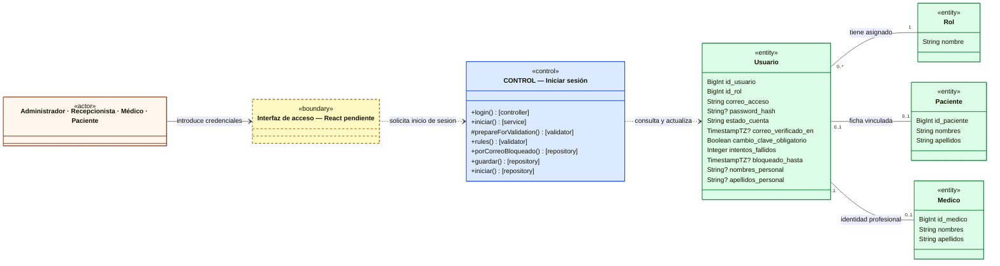
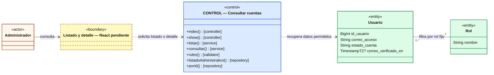
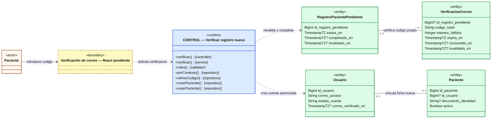
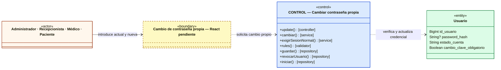

```mermaid
classDiagram
    direction LR
    class Actores["Administrador · Recepcionista · Médico · Paciente"] {
        <<actor>>
    }
    class InterfazCierre["Opción Cerrar sesión — React pendiente"] {
        <<boundary>>
    }
    class ControlCU02["CONTROL — Cerrar sesión"] {
        <<control>>
        +logout() [controller]
        +cerrar() [service]
        +porId() [repository]
        +cerrar() [repository]
        +autenticacion() [repository]
    }
    class Usuario {
        <<entity>>
        BigInt id_usuario
        Boolean cambio_clave_obligatorio
    }
    class Bitacora {
        <<entity>>
        BigInt id_evento
        BigInt? id_usuario_responsable
        String tipo_evento
        String resultado
        TimestampTZ ocurrido_en
    }
    Actores --> InterfazCierre : solicita salir
    InterfazCierre ..> ControlCU02 : solicita cierre
    ControlCU02 ..> Usuario : identifica cuenta
    ControlCU02 ..> Bitacora : registra cierre confirmado
    Usuario "0..1" -- "0..*" Bitacora : responsable
    style Actores fill:#fff7ed,stroke:#9a3412
    style InterfazCierre fill:#fef9c3,stroke:#a16207,stroke-dasharray:5 5
    style ControlCU02 fill:#dbeafe,stroke:#1d4ed8
    style Usuario fill:#dcfce7,stroke:#15803d
    style Bitacora fill:#dcfce7,stroke:#15803d
```

# Análisis de clases — Clínica Vida Salud

## CU-11/CU-12 — frontend fase 5: integración y cierre local (2026-10-22)

**Alcance:** cierre de los flujos administrativos de Consultorios y horarios, solo Administrador normal; RF05/RN08/RN12/RN14 y decisiones aprobadas de asignación/historia/duración. No incorpora búsqueda/reserva/reprogramación ni permisos nuevos. Las clases PHP, tablas y relaciones permanecen como en el cierre backend §17.81; no se requirió modificar código funcional frontend de fases 1–4.

**Colaboración comprobada:** router/ProtectedRoute/RoleRoute/MainLayout → ConsultoriosPage/ConsultorioEditorPage/ConsultorioDetailPage → servicios de consultorios → API real; DoctorDetailPage y rutas administrativas → AsignacionConsultorioPage/ConsultorioSelector/AsignacionImpacto → servicio de asignación → API real; HorariosPage/HorariosMedicoPage/HorarioEditor y ConfiguracionCitasPage/DurationEditor → servicios de horarios/configuración → API real. Los colaboradores ya analizados useCatalogQuery/useConsultorioSubmission/useHorarioSubmission coordinan carga, versiones, diagnóstico/confirmación y errores; no se agregan clases de dominio ni una nueva capa. AuthProvider y api.js participan transversalmente en restauración, revocación, rol, cookies/CSRF y descarte de respuestas de otra sesión.

**Flujo integrado:** catálogo/destino → impacto paginado y consentimiento completo → asignación con 22 traslados reales → horarios/impacto/cobertura y actividad → duración global/impacto/confirmación/reconsulta. Versiones y huella obsoletas por cambios concurrentes reales intercalados rechazan guardado; conservan borrador y exigen revisión explícita. El servidor impide dejar citas sin cobertura, desactivar sala ocupada y aprobar duración incompatible con el intervalo activo del Médico inactivo. Verificación PostgreSQL: 22 IDs/inicios/fines/estados/duraciones conservados, 22 cambios de cita y 30 eventos de bitácora sin contraseña temporal. No revalida aquí toda la matriz de concurrencia backend.

**Pruebas nuevas:** PlanificacionSesion.test.jsx, ubicado en horarios/tests/pages por responsabilidad transversal de la revisión final. Diez casos usan AuthProvider, servicios y Axios reales con adaptador HTTP ficticio: cuatro rutas descartan lecturas pendientes tras logout, cuatro tras /me 401 al recuperar foco, cambio de rol retira borrador/confirmación y PATCH tardío después de logout no publica éxito ni restaura datos. Los arneses Chrome/PHP externos son evidencia de integración desechable, no nuevas clases de aplicación.

**Cierre verificado:** suite frontend **790 pruebas/46 archivos**, build correcto (aviso conocido 635,97 kB); 27 comprobaciones reales de integración, 20 de disposición/legibilidad, 12 auditorías axe sin infracciones detectadas, cero excepciones JS. Base/rol de prueba y esquema propio, 33 migraciones existentes; servidor/esquema/credenciales/perfil Chrome temporales retirados y public sin diferencias en objetos/funciones/cantidades. Backend/base habitual/DER/reglas intactos, sin repetir suite backend. Evidencias y límites en frontend README/contexto §17.86/fichas CU. Módulo frontend cerrado funcionalmente **en local**, producción pendiente; diagrama global y actualización PHP aplazados por decisión expresa.

## CU-12 — frontend fase 4: duración global (2026-10-22)

**Alcance real:** consulta/propuesta/impacto/confirmación de duración global, exclusiva de Administrador con sesión normal. RF05, RN08/RN12/RN14, VS-HOR-03/11. Reutiliza backend cerrado, sin cambios de reglas ni persistencia. Fase 5 mantiene integración real y cierre conjunto; no acredita búsqueda/reserva CU-13/CU-14 ni reprogramación CU-15.

| Participante UI real | Responsabilidad / colaboración |
| --- | --- |
| ConfiguracionCitasPage / DurationEditor (interno) | Carga singleton/version global, borrador de minutos, validación estructural INTEGER/no-op, diagnóstico/confirmación, descarte explícito y reconsulta tras éxito o bloqueo |
| configuracionCitas.service.js | Tres endpoints GET/POST impacto/PATCH con payloads cerrados, versión exacta, CSRF/sessionBound, cancelación y sin reenvío automático |
| useHorarioSubmission | Colaborador de fase 3 ampliado mediante opción de configuración para campos/códigos/mensajes globales, bloqueo de versión obsoleta o escritura incierta y control doble envío |
| HorarioImpacto | Colaborador de fase 3 ampliado para título/alcance de duración; presenta intervalos incompatibles y meta, sin recalcular compatibilidad |
| HorariosPage / router.jsx | Acceso desde Horarios y ruta de configuración bajo guards Administrador/sesión normal |

**Flujo:** consultar configuración → proponer minutos → POST de impacto completo paginado → revisar cambio global antes/después → PATCH con versión de ConfiguracionClinica → reconsultar configuración vigente. No se usa huella ni versión de Médico. Backend determina si cabe en cada intervalo activo (incluye profesionales inactivos), transacción/evento/versiones y conservación de citas previas. Un cambio de borrador cancela lectura e invalida diagnóstico; cada página se consulta por POST y exige nueva confirmación. No hay estado persistente de la propuesta fuera de React.

**Alternativos:** 409 incompatible retira impacto conservando borrador; configuración obsoleta bloquea hasta descarte/reconsulta explícitos, sin sustituir silenciosamente la base. Red/500 de escritura es resultado incierto, no rollback supuesto ni reenvío automático; se consulta estado guardado antes de otra decisión. 401 retira datos, 403/404 bloquean, 419/422/429 seguros/Retry-After. Desmontaje/cambio de entrada descarta impactos tardíos. El servidor recibe solo campos permitidos.

**Cierre local de fase 4:** 37 pruebas nuevas/2 archivos, acumulado Horarios 79/5; suite completa frontend **780 pruebas/45 archivos correctos**, build correcto (aviso conocido bundle 635,97 kB). Chrome/React con HTTP ficticio: 12 comprobaciones responsive y 6 auditorías axe sin incidencias detectadas, cero excepciones JS y capturas revisadas. No integración real Laravel aún; evidencia en frontend README/contexto §17.85/CU-12. Backend/DER/reglas intactos y diagrama global/PHP aplazados.

## CU-12 — frontend fase 3: horarios por Médico (2026-10-22)

**Alcance real:** administración de intervalos semanales/actividad e impacto, exclusiva de Administrador normal. RF05, RN05/RN07/RN08/RN12/RN14, VS-HOR-01–04/09. Duración solo informativa en esta fase; edición global conserva fase 4 e integración real/revisión final conserva fase 5. No nuevas reglas ni cambios de backend.

| Participante UI real | Responsabilidad y colaboración |
| --- | --- |
| HorariosPage | Selección de Médico por lista/búsqueda/actividad/página del servidor, incluye inactivos mediante listarMedicos, useCatalogQuery/CatalogResults |
| HorariosMedicoPage / Load / Schedule (internos) | ID válido, contexto profesional/sala, filtros/página de horarios, versión vigente y duración; adapta data.elementos para presentar sin alterar API, abre una propuesta y reconsulta tras cierre/éxito |
| HorarioEditor | Borrador de alta/edición/estado, formato local con segundos, edición parcial/no-op, diagnóstico previo y confirmación; invalida revisión al cambiar campos y conserva borrador ante errores |
| HorarioImpacto | Proyecta códigos administrativos conocidos, referencias/estado/día/horas/fechas de sede y totales/página; sin JSON ni clínica genéricos, no decide cobertura |
| useHorarioSubmission | Cancelación/secuencia/montaje, exclusión de doble envío, errores seguros/Retry-After, bloqueo de propuesta obsoleta o escritura incierta |
| horario.service.js / horarioFormat.js | Cinco endpoints existentes con payloads cerrados/CSRF/sessionBound y versiones exactas; presentación de días ISO/horas HH:mm:ss/fechas en America/La_Paz sin normalización silenciosa |
| router.jsx / MainLayout / DoctorDetailPage | Dos rutas y navegación/título exclusivos, enlace localizado desde Médico, sin cambiar su gestión profesional |

**Colaboración:** Page/Component → servicio horarios → Axios → HorarioController/Service/Repository existentes. Listado recibe data.elementos/actualizado_en/duracion_turno_minutos y meta, sin calcular capacidad ni disponibilidad. Impacto CREAR/EDITAR/ESTADO comparte propuesta/versión, pagina mediante POST; no huella ni reserva. Campos nuevos cancelan diagnóstico, compatible habilita revisión/confirmación y escritura revalida backend. Estado conserva independencia con cuenta/Médico; React no gestiona citas ni su cobertura.

**Errores:** 409 compatible al consultar pero rechazado al guardar retira revisión y conserva borrador; versión profesional obsoleta bloquea y exige descartar explícitamente/reconsultar antes de nueva propuesta, sin rebase automático. Red/500 de escritura es incierto y sigue el mismo control sin prometer rollback/reenvío. 401 retira vista, 403/404 bloquean, 419/422 seguros y 429 espera. Cambios de filtro/contexto deshabilitados durante editor para no perder borrador implícitamente.

**Cierre fase 3:** 42 pruebas nuevas/3 archivos, suite frontend **743 pruebas/43 archivos correctos**, build correcto con aviso conocido de bundle. Chrome/React con HTTP ficticio: 20 comprobaciones responsive y 10 auditorías axe sin incidencias detectadas, capturas revisadas y cero excepciones JS; no integración Laravel real aún. README/contexto §17.84/CU-12 sincronizados, backend/DER/reglas intactos y diagrama global/PHP aplazados.

## CU-11 — frontend fase 2: asignación e impacto (2026-10-22)

**Alcance real:** consulta y cambio de consultorio fijo con impacto/consentimiento completo, exclusivo de Administrador normal. RF05, RN05/RN07/RN12/RN14, VS-HOR-01/05/06/09; sin cambio de reglas/backend. La interfaz no calcula elegibilidad ni solapamientos; representa el diagnóstico real. Fase 3 horarios, fase 4 duración y fase 5 integración mantienen autorización posterior.

| Participante UI real | Responsabilidad / colaboración |
| --- | --- |
| AsignacionConsultorioPage / Load / Assignment (internos) | ID Médico válido, contexto de Médico/asignación, propuesta en memoria, control de solicitudes/huella/consentimiento/confirmación, refresh explícito y errores/resultados inciertos |
| ConsultorioSelector | Búsqueda/paginación de activos mediante listarConsultorios/useCatalogQuery/CatalogResults; conserva selección fuera de página, sin descarga masiva ni límite ficticio de catálogo |
| AsignacionImpacto | Proyección permitida de conflictos/cambios administrativos, totales/meta del servidor, fechas locales validadas y paginación con callbacks; no interpreta datos clínicos ni HTML/JSON arbitrario |
| asignacionConsultorio.service.js | Tres endpoints existentes con payloads cerrados/ID/versión/huella exactos, CSRF y sessionBound; sin negocio visual ni reintento de PUT |
| DoctorDetailPage / router.jsx | Enlace localizado desde Médico y ruta bajo guards Administrador/sesión normal, sin cambiar administración profesional |

**Flujo:** Médico → consultar contexto → seleccionar destino → POST de impacto → revisar elementos/totales → aceptar conjunto completo si hay traslados → revisar confirmación → PUT con huella/versiones → respuesta de asignación/cantidad persistida. Backend AsignacionConsultorioService conserva autorización, revalidación y transacción, sin duplicar reglas en React. Destino nuevo cancela/descarta impacto; página nueva retira aceptación y huella diferente descarta toda la revisión. Lecturas obsoletas se abortan/ignoran por secuencia y desmontaje. No-op/sin traslados no exige checkbox; cambios con traslados no admiten selección parcial de citas.

**Alternativos:** conflictos en vista previa no habilitan guardado; 409 retira impacto/consentimiento conservando destino. Versión profesional obsoleta y PUT de resultado incierto bloquean hasta consultar base actual, sin reintento automático ni prometer rollback; éxito también exige consulta vigente para otra operación. 401 retira la vista mediante AuthProvider, 403/404 bloquean, 419/422/429 muestran datos seguros y esperan cuando corresponde. No nuevos permisos a Médico/Recepción/Paciente ni retirada de asignación.

**Verificación/cierre fase 2:** 41 pruebas nuevas, 80 acumuladas de Consultorios; suite completa frontend **701 pruebas/40 archivos correctos**, build correcto con aviso de bundle 607,06 kB. Chrome/React con HTTP ficticio: 8 comprobaciones responsive/4 auditorías axe sin incidencias detectadas, cero excepciones JS y captura móvil revisada. No integración real Laravel/PostgreSQL todavía. Frontend README/contexto §17.83/CU-11 sincronizados, backend/DER/reglas intactos y diagrama global/PHP aplazados.

## CU-11 — frontend fase 1: catálogo de consultorios (2026-10-22)

**Alcance real:** listado/filtros/paginación, alta/detalle/edición y actividad del catálogo exclusivos de Administrador normal. RF05/RN12/RN14, VS-HOR-10; backend administrativo ya cerrado en §17.81 del contexto. Frontend CU-11 parcial: asignación/impacto/traslado conserva fase 2. CU-12 frontend pendiente de fases 3/4; integración real/cierre en fase 5.

| Participante UI real (no clase PHP de dominio) | Responsabilidad y colaboración |
| --- | --- |
| ConsultoriosPage | Borrador de filtros y criterios aplicados, listado/página del servidor; reusa useCatalogQuery y CatalogResults sin recalcular totales ni consultar por pulsación |
| ConsultorioEditorPage / ConsultorioEditor | Alta/edición, carga por ID válido, validación de experiencia, lista cerrada de código/nombre, envío/versión; navegación al detalle con nueva consulta tras éxito |
| ConsultorioDetailPage / ConsultorioActivity (componente interno) | Detalle/cantidades, confirmación de actividad, rechazo seguro de asignaciones/obligaciones y reconsulta después de guardar |
| ConsultorioData / ConsultorioFailure | Presentación administrativa permitida y mensajes seguros; no serialización genérica de errores/objetos |
| ConsultorioVersionReview | Consulta independiente sin reenvío; muestra datos actuales antes de descartarse borrador o adoptarse estado explícitamente |
| useConsultorioSubmission | Bloqueo síncrono de doble envío, montaje/desmontaje, errores de campo/códigos conocidos, Retry-After y resultado incierto; no determina permisos ni compatibilidad |
| consultorio.service.js | Cinco endpoints existentes vía api.js/cookies/CSRF/sessionBound; payloads cerrados, IDs textuales, versión intacta, sin reintentos |
| router.jsx / MainLayout | Cuatro rutas bajo RoleRoute Administrador y ProtectedRoute, menú/título localizados; sin alterar módulos existentes |

**Colaboración:** Page/Component → servicio de feature → Axios → endpoints Laravel existentes de ConsultorioController/Service/Repository. Formularios no calculan obligaciones ni deciden desactivación: backend es fuente de verdad. Rechazo 409 por código permite corregir; versión obsoleta conserva borrador bloqueado y exige revisión/adopción antes de reenviar; red/500 inciertos requieren consulta del estado persistido. 401 retira datos mediante mecanismo de sesión compartido, 419 sin reintento automático, 429 respeta espera. Lecturas pendientes se cancelan/descartan. Renombrar no anuncia cambios en ubicaciones históricas; no expone facultad de reprogramar.

**Verificación/cierre local de fase 1:** 39 pruebas nuevas/2 archivos en tests/services y tests/pages de la feature; suite frontend completa 660 pruebas/38 archivos correctos, build correcto (aviso de bundle 592,48 kB). Chrome/React con HTTP ficticio interceptado: 16 tamaños/estados sin desbordamiento y 8 auditorías axe sin infracciones detectadas; capturas revisadas. Skill frontend-design local aplicada conservando tokens/layout/catalogs.css. Sin integración Laravel real en esta fase ni cambios de backend/DER/reglas. Evidencia y límites en frontend/README.md y contexto §17.82. Diagrama global/PHP aplazados.

## CU-11/CU-12 — fase 6: integración backend (2026-10-22)

**Alcance:** backend administrativo de ambos CU terminado, integrado y verificado localmente, fases 1–6 completadas. RF05, RN05/RN07/RN08/RN12/RN14 y VS-HOR-01–11. No nuevas clases de producción: se contrastan colaboraciones reales descritas en fases 2–5. Diagrama global aplazado por solicitud expresa; disponibilidad/reservas/frontend/producción no se acreditan por este cierre.

**Flujos contrastados por PlanificacionIntegracionTest:** tres recorridos, 183 aserciones correctas. Especialidad/MedicoController y sus Services/Repositories crean recursos; ConsultorioController/AsignacionConsultorioController y HorarioController/ConfiguracionCitasController coordinan catálogo/asignación/horario/duración con versiones compartidas, impacto y auditoría. PacienteController registra ficha real por Recepción; citas/avisos posteriores son fixtures. Recordatorio.cita obtiene ubicación vigente sin reescritura del aviso. BitacoraController/Service/Repository y Resources proyectan los ocho productores reales con responsable/referencias seguras. Logout y nuevo login reconstruyen sesión y recuperan estado persistido.

**Historia y estados:** Médico y HorarioAtencion mantienen actividad independiente; liberar franja requiere operación expresa, compartir sala no reactiva intervalos previos. ConsultaMedica existente con inicio desconocido impide traslado; cambio posterior válido de asignación conserva filas históricas de Cita, ConsultaMedica, VersionConsulta, VersionAntecedente, SolicitudLaboratorio, DocumentoLaboratorio, VersionResultado y RevisionResultado. No se crean versiones clínicas ni CambioCita sobre atención histórica. Los endpoints clínicos/documentales no se ejecutan ni se dan por implementados.

**Entorno/evidencia final:** kernel HTTP de Laravel con cookies/CSRF/origen y sesiones PostgreSQL cifradas, guard/Store nuevos por petición; sin actingAs ni mock de autenticación. No equivale a navegador, frontend ni producción. Fixtures de datos de CU pendientes aislados en tests, sin archivos médicos reales. **Suite completa 1188 pruebas/13798 aserciones correctas**; tres pruebas nuevas en esta fase y 201 acumuladas del módulo. Formato/sintaxis/Composer/autoload/rutas/diff correctos. Contrato/evidencia en backend/README.md y contexto §17.81; esquema sin cambios y DER conservado. No quedan funcionalidades administrativas backend pendientes de CU-11/CU-12.

## CU-11/CU-12 — fase 5: garantías transversales y rendimiento (2026-10-21)

**Alcance real:** conserva clases/contratos de fases 2–4 y añade evidencia de seguridad/concurrencia/rendimiento. RF05/RF07, RN05/RN07/RN08/RN12/RN14; operaciones administrativas exclusivas de Administrador normal, semántica funcional sin cambios. Integración/cierre del módulo conserva fase 6 y diagrama global aplazado.

**Clase de producción modificada:** AsignacionConsultorioService agrega conflictosDeTraslado: proyección de ocupación de sala destino/Médico con todas las citas relevantes, mapa de IDs trasladados, conversión UTC una vez e inicios ordenados con conjunto de intervalos abiertos. Comprueba pares que incluyan al menos una cita trasladada y retira fin <= inicio, manteniendo límites semiabiertos y conflictos completos sin consultas por cita. Continúa delegando recuperación/escritura a AsignacionConsultorioRepository y auditoría a BitacoraRepository; sin entidades, relaciones o índices nuevos. La huella sigue vinculada a todos los recursos/actor y no depende de la página.

**Colaboradores existentes contrastados:** AutenticacionService/ContinuidadAdministrativaService/SesionRepository revalidan actor y contexto persistido después de coordinar, antes de negocio; versiones de Médico/configuración se releen bajo locks. Services mantienen orden administración → actor → planificación → recursos; errores GiST reconocidos se traducen centralmente por AppError, fallos SQL inesperados mantienen 500 seguro. La transacción conserva unidad de datos/versiones/historial/bitácora ante rollback posterior al evento.

**Clases exclusivas de prueba:** PlanificacionGarantiasTest (matriz de 16 operaciones, errores reales PostgreSQL, semántica de barrido y medición 30/300 citas); AutenticacionConcurrenteTest (24 revocaciones tras middleware, 12 carreras horario/asignación/duración/versión compartida y 8 traslado/protocolo de reserva/atención); PausarEscrituraPlanificacionRepository deriva de BitacoraRepository solo en el worker de pruebas para detenerse después de auditoría antes de commit/fallo; EscritorPlanificacionSimulado reproduce únicamente coordinación/relectura de futuros CU-14/CU-23 y no define permisos clínicos ni endpoints. Fixtures no se registran en aplicación.

**Resultados/cierre local de fase 5:** revocación de estado/rol/clave/sesión rechaza todas las operaciones probadas tras espera; ambos órdenes/rollback conservan al escritor válido y sus eventos, sin ubicaciones parciales. GiST real → 409 y SQL inesperado → 500, sin detalles internos. Medición local redujo impacto con 300 citas de 12407,93 a 222,49 ms HTTP, manteniendo 24 consultas; dentro de la regresión final dio 238,15 ms HTTP y ocupación SQL 0,131 ms/310 bloques. Barrera era cálculo en PHP, sin índices nuevos ni SLA supuesto. **53 pruebas nuevas (9 garantías/44 concurrentes); suite completa 1185 pruebas/13615 aserciones correctas**, formato/sintaxis/Composer/autoload/rutas/diff correctos; evidencia en contexto §17.80/README. Sin cambios de esquema ni avance acreditado de CU-14/CU-23/CU-28; integración/cierre del módulo mantiene fase 6 y diagrama global/PHP aplazados.

## CU-12 — fase 4: horarios y duración (2026-10-21)

**Implementado:** administración de horarios semanales/actividad, consulta previa de impacto y duración global. Actor Administrador con sesión normal. RF05, RN05/RN07/RN08/RN12/RN14, VS-HOR-01–04/07/09/11. Revisión transversal/integración del módulo conserva fases 5/6; búsqueda/reserva CU-13/CU-14 y scheduler CU-28 siguen sus incrementos. Contrato HTTP real en backend/README.md fase 4.

| Clase real | Responsabilidad y colaboración |
| --- | --- |
| HorarioController | Frontera HTTP de listado, alta, edición, actividad e impacto; delega datos validados/actor implícito/contexto al Service |
| ConfiguracionCitasController | Frontera HTTP de lectura, impacto y cambio de duración global |
| HorarioRequest (deriva de CuentaRequest) | Lista cerrada según operación/acción: ID Médico de ruta, ID horario de ruta o propuesta de impacto, versión, horas/día/actividad y filtros. Rechaza suplantación de ruta y edición vacía |
| ConfiguracionCitasRequest | Entrada cerrada de configuración y límites INTEGER, versión/fechas reales y paginación del impacto |
| PlanificacionResource | Recibe proyecciones administrativas explícitas de los Services; data/links/meta y paginación de listado/diagnósticos completos |
| HorarioService | Control de compatibilidad: versión de Médico, sala activa, duración, franjas propias/compartidas, ocupación real y cobertura de citas vigentes; evalúa también impacto, coordina persistencia/versión/auditoría atómicas |
| ConfiguracionCitasService | Control de versión global, comprueba duración en todos los intervalos activos, coordina escritura/evento; no cambia citas previas |
| HorarioRepository | Consulta/bloqueo de horarios propios y citas relevantes, franjas compartidas, guardado de HorarioAtencion sin reglas de autorización |
| ConfiguracionCitasRepository | Singleton bloqueado, consulta de intervalos activos ordenados y guardado con versión monotónica |
| IntervalosAtencion | Validador existente ampliado con conversión de horas a segundos y cálculo entero de turnos completos; reutiliza solapamiento/cobertura local de fase 3 |
| PlanificacionRepository / MedicoRepository / ConsultorioRepository | Coordinación común, bloqueo y versión monotónica del Médico, lectura/bloqueo de sala. AutenticacionService/ContinuidadAdministrativaService revalidan actor antes de planificación |
| HorarioAtencion / ConfiguracionClinica / Medico / Consultorio / Cita | Entidades existentes, sin columnas nuevas; solo se persisten horario/versión profesional o configuración. Cita aporta intervalo/estado/referencias administrativas mínimos |
| BitacoraRepository / ReferenciasBitacora / BitacoraDetalleResource / RespuestaError | Eventos de horario/duración y proyecciones/filtros explícitos CU-30; errores de edición/conflicto normalizados |

**Colaboración:** Route/middleware → Controller/Request → Service → Repository → Eloquent/PostgreSQL. Coordinación administrativa/actor → planificación → configuración → Médico → sala → horarios → citas. El cambio de duración solo necesita configuración y lecturas protegidas por planificación. Vista previa usa las mismas reglas y devuelve diagnóstico completo paginado; no exige huella para estos cambios y no sustituye revalidación de la escritura. Los cambios efectivos avanzan versión/evento; no-op exige versión vigente y conserva ambas cosas. Rollback posterior a auditoría preserva todo el estado previo.

**Alternativos:** otro Médico inactivo con horario activo sigue reservando franja. Cita de otro Médico ocupa sala aunque su asignación actual sea distinta. Horario propio no puede perder cobertura entera de una Programada/Confirmada con fin futuro, aunque esté transcurriendo; puede desactivarse un intervalo redundante con cobertura alternativa válida. Finales/pasadas/canceladas preservan datos. Duración incompatible con cualquier intervalo activo se rechaza íntegra, incluidos Médicos inactivos; intervalos desactivados no bloquean, pero reactivarlos exige duración vigente. Horas no canónicas/IDs/campos extra → 422; horario ajeno → 404; reglas → 409. Los diagnósticos no contienen datos de Paciente o clínica.

**Verificación/cierre local de fase 4:** **55 pruebas nuevas: 51 funcionales** en HorariosTest y **4 carreras** independientes PostgreSQL. Suite completa **1132 pruebas/12506 aserciones correctas**; formato/sintaxis/Composer/autoload/rutas/diff correctos, evidencia en contexto §17.79/README. Reserva concurrente usa protocolo simulado, sin acreditar CU-14. Sin cambios de esquema; DER conserva 28 entidades/243 atributos/43 relaciones. Fases 5/6 pendientes de revisión ampliada/integración; diagrama global y actualización PHP aplazados.

## CU-11 — fase 3: asignación y traslado administrativo (2026-10-21)

**Estado:** operaciones backend CU-11 implementadas, revisión integrada del módulo en fases 5/6. Actor Administrador normal; RF03/RF05, RN05/RN07/RN12/RN14 y VS-HOR-01/05/06/09/10. No completa CU-12 ni los flujos futuros de citas/atención/avisos. Contrato y efectos exactos en backend/README.md fase 3.

| Clase real | Responsabilidad / relación |
| --- | --- |
| AsignacionConsultorioController | Frontera GET de asignación, POST de impacto y PUT de confirmación; delega sin Eloquent/negocio |
| ImpactoAsignacionConsultorioRequest / ConfirmarAsignacionConsultorioRequest | DTO de entrada derivados de CuentaRequest; propuesta/versión, paginación o huella/consentimiento, campos cerrados |
| AsignacionConsultorioResource / ImpactoAsignacionConsultorioResource | Proyección de asignación/versión y diagnóstico seguro; pagina presentación sin recortar el impacto evaluado |
| AsignacionConsultorioService | Control del CU: actor, versiones, compatibilidad, cálculo/comparación de huella, elegibilidad/consentimiento y transacción de asignación/traslados/auditoría |
| IntervalosAtencion | Validador de negocio puro reutilizable: solapamiento semiabierto, cobertura completa y ocupación de franja semanal local por un intervalo real incluso multidía |
| AsignacionConsultorioRepository | Consultas de horarios/ocupación/solo existencia de consulta, bloqueo de citas, persistencia de ubicación y CambioCita por cita; sin decisión de autorización clínica |
| PlanificacionRepository / MedicoRepository / ConsultorioRepository | Existentes de fases previas: coordinación, filas/versión de Médico y salas bloqueadas en orden |
| Cita / CambioCita / HorarioAtencion / Medico / Consultorio | Entidades existentes; no columnas nuevas. Cita preserva versión temporal y actualiza solo ubicación/actualizada_en; CambioCita añade historia inmutable |
| ConsultaMedica / Recordatorio | Consulta existente deniega traslado sin leer clínica; aviso obtiene ubicación desde Cita sin copiarla ni generar nueva versión/lectura |
| BitacoraRepository / ReferenciasBitacora / BitacoraDetalleResource | Evento MEDICO_CONSULTORIO_CAMBIADO y proyección explícita de referencias/antes/despues/cantidad, sin valores clínicos |

**Flujo principal:** actor → Controller/Request → AsignacionConsultorioService → repositorios/modelos/PostgreSQL. Previsualización y confirmación comparten evaluación bajo coordinación administrativa/actor → planificación → Médico → salas por ID → citas por ID. El diagnóstico puede paginarse, pero su huella incorpora todo el estado relevante y está vinculada al actor/destino. Confirmar exige versión/huella vigentes, ausencia de conflictos y consentimiento si se trasladan citas. Se persisten todos los cambios y el evento juntos; un fallo revierte Médico, ubicaciones, CambioCita y bitácora.

**Alternativos:** destino inactivo/conflictos → diagnóstico 200 no confirmable; escritura 409. Un Médico inactivo conserva horarios activos reservados. Citas de otros médicos ocupan sala incluso si la asignación actual ya es distinta. Cita futura fuera de cobertura o atención iniciada/documentada impide cambio; iniciada_en NULL no autoriza traslado. Pasadas/finales no se modifican. No-op con huella/versión vigentes no avanza versión ni reescribe snapshots por renombrado. Nueva cita/consulta/cambio de sala/horario u otra elegibilidad temporal invalidan la huella. No se registra información clínica en salida, huella o bitácora.

**Verificación/cierre local de fase 3:** 42 pruebas funcionales y 5 carreras PostgreSQL independientes nuevas; cobertura de intervalos contiguos/multidía, páginas, historia/avisos, rollback y límites de autorización. Suite completa **1077 pruebas/11943 aserciones correctas**; formato/sintaxis/autoload/rutas/diff correctos, evidencia en contexto §17.78/README. Reserva y atención concurrentes usan escritores de protocolo simulados, sin acreditar sus endpoints. Sin cambios físicos/DER de atributos; efectos de persistencia documentados. Diagrama global y actualización PHP siguen aplazados.

## CU-11 — fase 2: catálogo administrativo de consultorios (2026-10-21)

**Implementado parcialmente:** Administrador normal mantiene catálogo/estado; asignación/traslado conservan fase 3. RF03/RF05, RN12/RN14, VS-HOR-10. API y límites en backend/README.md fase 2. No se declara CU-11 completo ni CU-12 implementado.

| Clase real | Capa y colaboración |
| --- | --- |
| ConsultorioController | Frontera HTTP; cinco acciones con DI del Service, sin consultas/negocio |
| CrearConsultorioRequest / ListarConsultoriosRequest | DTO/FormRequest; validación estructural y listas cerradas de datos/filtros |
| ActualizarConsultorioRequest / CambiarEstadoConsultorioRequest | DTO derivados de CuentaRequest real de usuarios; ID de ruta, versión original y campos permitidos |
| ConsultorioResource | Proyección explícita de ID textual/código/nombre/activo/versión y cantidades cuando están cargadas; sin expandir entidades clínicas |
| ConsultorioService | Autorización revalidada, transacciones, comparación de versión/no-op, reglas de desactivación, traducción de unicidad conocida y auditoría |
| ConsultorioRepository | Listado literal/paginación, locks, resumen de asignaciones/citas vigentes y guardado con versión monotónica |
| PlanificacionRepository (horarios/) | Coordinación PostgreSQL (736201,2) concreta reutilizable; no implementa reglas de CU-12 |
| Consultorio | Entidad existente con nuevo cast/versionado actualizado_en; relaciones medicos/citas existentes |
| AutenticacionService / ContinuidadAdministrativaService | Se reutilizan desde usuarios para actor/sesión normal y coordinación antes de planificación |
| BitacoraRepository / ReferenciasBitacora / BitacoraDetalleResource / RespuestaError | Colaboradores existentes ampliados para eventos/referencias/campos Consultorio y errores 409 específicos |

**Flujo:** Administrador → Route/middleware → Controller/Request → ConsultorioService → ConsultorioRepository → Consultorio/PostgreSQL. Dentro de DB::transaction: coordinación administrativa → actor bloqueado/revalidado → planificación → consultorio. Versión antigua falla incluso en no-op. Desactivar consulta asignaciones de cualquier Médico y citas Programadas/Confirmadas con fin_at > ahora, incluido intervalo en curso aunque su Médico ya esté asignado a otro consultorio. No basta comprobar medicos.activo ni la asignación actual. Errores centralizados, sin try/catch de reenvío en Controller.

**Efectos:** cambios efectivos avanzan versión/auditoría atómicos; no-op no duplica eventos. Código único exacto, nombre no único. Catálogo no modifica ubicación histórica ni futura de citas, estado de Médico/horario, recordatorios o cuenta; traslado requiere fase 3. Datos de auditoría: responsable/contexto, id_consultorio y nombres de campos, sin texto libre del catálogo. CU-30 filtra/proyecta explícitamente Consultorio.

**Persistencia/verificación:** migración 000033 aditiva, DER §§3.12/6.19 actualizado a 243 atributos. 39 pruebas funcionales y 4 concurrentes nuevas en base/esquemas aislados; suite completa **1030 pruebas/11417 aserciones correctas**, formato/sintaxis/Composer/rutas/diff correctos. Escenarios y resultados finales en README/contexto §17.77; fase 2 cerrada localmente. Sin frontend, despliegue ni aplicación a base habitual. Diagrama global continúa aplazado.

## CU-11/CU-12 — fase 1: análisis de diseño backend (2026-10-21)

**Estado:** participantes y colaboraciones **previstos**, no clases ni endpoints nuevos implementados. Actor Administrador con sesión normal. Objetivo: consultorios/asignación fija compatible, horarios semanales y duración global sin alterar historia ni invalidar citas. RF03/RF05/RF07; RN05/RN07/RN08/RN12/RN14 y VS-HOR-01–11. Contrato técnico completo y fases 1–6 en `backend/README.md`, apartado «Consultorios y horarios CU-11/CU-12 — fase 1».

| Participante | Existencia / responsabilidad |
| --- | --- |
| ConsultorioController y Requests/Resources de consultorios | Previstos: frontera HTTP del catálogo/estado y asignación/impacto; entrada cerrada, datos mínimos |
| ConsultorioService / AsignacionConsultorioService | Previstos: reglas de estado, consulta de impacto y confirmación de ubicación atómica |
| ConsultorioRepository | Previsto: catálogo, bloqueos, asignaciones y persistencia de ubicación/historial administrativo |
| HorarioController / ConfiguracionCitasController y Requests/Resources | Previstos: frontera HTTP de intervalos/actividad/impacto y duración global |
| HorarioService / ConfiguracionCitasService | Previstos: compatibilidad semanal, cobertura de citas vigentes, independencia de actividades y duración compatible con todos los intervalos activos |
| HorarioRepository / ConfiguracionCitasRepository | Previstos: intervalos, configuración singleton, ocupación real y coordinación transaccional de planificación |
| AutenticacionService / ContinuidadAdministrativaService | Existentes: sesión normal, actor revalidado y coordinación administrativa; se reutilizan |
| MedicoRepository / BitacoraRepository / RespuestaError | Existentes: bloqueo/versión del Médico, eventos y errores centralizados. Ampliaciones específicas de eventos/proyecciones/códigos pendientes |
| Consultorio / Medico / HorarioAtencion / ConfiguracionClinica | Modelos existentes: asignación/intervalos y duración; solo Consultorio requiere atributo de versión nuevo previsto |
| Cita / CambioCita / ConsultaMedica / Recordatorio | Modelos existentes: intervalos/ubicación almacenada, historia inmutable, impedimento por atención documentada y avisos ligados a cita |

**CU-11:** Route/middleware → Controller/Request → Service → Repositories → modelos/PostgreSQL. La vista previa pagina cambios/conflictos mínimos pero calcula huella sobre el conjunto completo. Confirmación exige huella/versión y consentimiento de traslados; bajo locks revalida impacto y atención documentada, actualiza asignación/ubicación de citas elegibles, historial y bitácora en una transacción. No devuelve información clínica ni concede reprogramación. Consultorio con cualquier Médico asignado u obligación futura no se desactiva. No-op vigente no duplica eventos.

**CU-12:** Service valida intervalos locales, duración y ocupación de ambos recursos. Un Médico inactivo conserva horarios; todo horario activo reserva franja hasta cambio explícito compatible con citas. Reactivar Médico no reactiva horarios. Las escrituras de horarios avanzan la versión del Médico; duración global usa la versión existente de configuración y debe caber en todos los intervalos activos, sin exigir múltiplos exactos. No modifica duraciones previas. Consultar impacto no modifica datos.

**Coordinación diseñada:** lock administrativo existente → actor → lock compartido de planificación → configuración → Médicos → consultorios → demás recursos ordenados. Complementa exclusiones GiST de citas existentes; los CHECK/índice actuales de HorarioAtencion no protegen ocupación semanal entre médicos. Futuras reservas/reprogramaciones/atenciones deben respetar el mismo protocolo antes de bloquear recursos; se verificarán como integraciones reales al implementarlas. Hoy no se atribuyen esas garantías a endpoints inexistentes.

**Persistencia/avisos:** migración aditiva de consultorios.actualizado_en prevista para fase 2, no creada/aplicada. Horarios usan versión del Médico sin columna extra. Cambio solo de ubicación conserva version_programacion y avisos existentes, cuyos lectores obtendrán ubicación mediante Cita; la tabla Recordatorio no guarda texto de ubicación. Mantiene datos históricos y estados; no implementa scheduler CU-28.

**Cierre de fase 1:** revisión documental/estática, sin pruebas funcionales nuevas porque aún no hay código nuevo. CU-11/CU-12 continúan pendientes de implementación; DER físico sin cambios y diagrama global expresamente aplazado.

> **Ruta canónica:** `docs/ai/analisis-clases.md`  
> **Módulos:** Usuarios y autenticación (`CU-01`–`CU-06`); Pacientes y perfil personal (`CU-07`/`CU-08`); Médicos y especialidades (`CU-09`/`CU-10`, backend administrativo y frontend fases 1–5 implementados con integración local); Bitácora (`CU-30`, backend fases 1–5 completado/verificado localmente, frontend/producción pendientes); Consultorios y horarios (`CU-11`/`CU-12`, backend administrativo fases 1–6 completado, integrado y verificado localmente; frontend/producción pendientes). Agenda posterior y diagrama global aplazado.
> **Avance:** Usuarios backend fases 0–8, incluidas 7A/7B; Pacientes backend/frontend fases 1–6 revisados el 2026-10-20. Plan frontend de gestión administrativa, perfil y correo completado con integración real local. Consulta histórica de citas conserva dependencia de CU-21; no se acredita RF02 íntegro ni producción/Brevo real.
> **Estado:** backend de Usuarios y autenticación cerrado con revisión integrada de fase 8. React fases 1–6 implementadas, revisión del cliente con 213 pruebas y AUT-21 local aprobada en Chrome/Laravel/PostgreSQL reales (§17.34 del contexto). Incluye sesión, contraseñas, cuentas y registro/vinculación con emisión presencial de Recepción. Correo capturado localmente: aceptación/entrega real Brevo y comprobación de producción pendientes. `diagrama-clases.md` aplazado por solicitud expresa del usuario.
> **Presentación aprobada:** ACTOR → BOUNDARY → CONTROL → ENTITY; un bloque CONTROL por diagrama, métodos principales sin clase, parámetros ni retorno, y atributos seleccionados por procedimiento.

## Organización física de las clases por módulo (2026-10-21)

Decisión aprobada posterior al cierre de CU-09/CU-10: Controllers, DTO, Services y Repositories incorporan subcarpetas por módulo dentro de sus capas. No altera responsabilidades, colaboraciones ni flujos de los análisis siguientes. Namespaces y rutas documentadas se corresponden con las ubicaciones nuevas; los nombres simples de clase de los diagramas de análisis mantienen su significado.

| Subcarpeta | Clases y responsabilidad principal |
| --- | --- |
| `usuarios/` en las cuatro carpetas | CU-01–CU-06, cuentas, sesiones, credenciales, invitaciones, registro/activación web y correo de acceso. Incluye RegistroPacienteService/Repository y DTO de registro/vinculación. CuentaRequest/ClaveRequest/RespuestaError se reutilizan desde aquí; errores de toda la API continúan centralizados. |
| `pacientes/` en las cuatro carpetas | CU-07/CU-08, fichas/perfil y emisión presencial del código: CodigoActivacionController/Service/Repository y EmitirCodigoActivacionRequest. |
| `medicos/` en las cuatro carpetas | CU-09/CU-10, Médico y Especialidad. MedicoRepository es importado también por gestión de cuentas. |
| `bitacora/` en las cuatro carpetas | BitacoraRepository registra eventos y consulta listado/detalle; BitacoraController/Service, ListarBitacoraRequest y BitacoraListadoResource/BitacoraDetalleResource implementan CU-30 backend, cerrado localmente en fase 5. CuentaRequest se reutiliza desde usuarios; frontend pendiente. |

Las clases compartidas se importan desde su módulo propietario; no hay copias ni alias antiguos. Se actualizan referencias entre capas, bootstrap/rutas/middlewares y tests/fixtures. Modelos, validadores, rutas, middlewares y migraciones conservan ubicación. DER sin cambios; diagrama global aplazado expresamente. Evidencias de regresión en contexto §17.60 y README.

## CU-30 — frontend fase 4: garantías de las colaboraciones UI (2026-10-21)

**Revisión:** AuthProvider/SessionGate/ProtectedRoute/RoleRoute desmontan las fronteras de Bitácora y su estado local al detectar sesión revocada/no verificable o rol ajeno; useCatalogQuery cancela consultas al desmontar y api.js descarta respuestas de una sesión anterior. Nuevo login no recupera borrador de sesión revocada. Las pruebas verifican estas colaboraciones existentes, sin introducir autorización de negocio en React ni alterar el backend.

**Correcciones:** BitacoraFilters utiliza details nativo y reacciona a errores nuevos para abrir/enfocar; no mantiene un estado controlado que reabra el desplegable o robe foco tras un 422 anterior. bitacoraFormat valida que Date no haya normalizado una fecha imposible antes de presentarla en zona de sede; datos originales conservados. Sin nuevas entidades, contexto global ni persistencia.

**Evidencia/límite:** 9 escenarios nuevos de seguridad/teclado y 5 de fechas, acumulado Bitácora 100/6 archivos, suite completa 621/36 archivos y build correctos. Chrome con respuestas ficticias interceptadas: 72 comprobaciones responsive/18 auditorías axe sin incidencias detectadas, Espacio/Tab/foco, otros roles sin lecturas y retirada de detalle por sesión inválida, sin escrituras/excepciones. No acredita sesiones reales de Laravel/PostgreSQL ni conformidad universal de accesibilidad; cierre integrado en fase 5 pendiente. Backend/DER conservados y diagrama global aplazado.

## CU-30 — frontend fase 3: detalle y estado local de navegación (2026-10-21)

**Participantes/frontera implementados:** BitacoraDetailPage valida ID mediante esIdentificador y coordina consultarEvento/useCatalogQuery, estados de consulta y retorno. BitacoraEventData organiza cabecera/recursos/cambios/metadatos con componentes internos de presentación y etiquetas explícitas: no es una clase de dominio, no consulta perfiles y no expande referencias. bitacoraFormat añade traducciones de causas conocidas, conservando el código seguro. ID de evento relacionado solo se muestra.

**Colaboración real:** detalle → hook → service → Axios central → endpoint backend ya cerrado; respuesta proyectada → BitacoraEventData → secciones semánticas con valores conocidos, fechas de sede/UTC original, roles históricos, nombres de campos sin valores privados, referencias/habilitaciones y estados anteriores/posteriores. Formatos desconocidos y objetos adicionales vacíos no causan una exposición alternativa de JSON. Metadatos de instalación/pruebas explican límites de verificación de correo. 401 sigue invalidación central; ID inválido evita HTTP, 404/422 orientan al listado, otros fallos/429 permiten reintento controlado, cambio de ID descarta respuesta anterior.

**Estado acotado:** BitacoraWorkspace es frontera contenedora de rutas con useState y Outlet context (solo borrador/criterios/página), compartido por listado/detalle. No se introducen Context global, caché de eventos, URL de filtros ni persistencia de navegador. Listado vuelve a solicitar datos al regresar por enlace o historial; estado se descarta al salir del módulo/desmontar la protección. Una llegada directa al detalle no requiere recuperar ni inventar un listado previo.

**Evidencia/límite:** 28 pruebas nuevas de comportamiento, acumulado Bitácora 86/5 archivos y suite frontend completa 607/35 archivos correctos; build correcto. HTTP simulado con Router/AuthProvider/cliente Axios reales. Fases 1–3 frontend implementadas; revisión de interfaz y cierre integrado pendientes de fases 4–5. Backend/DER sin cambios y diagrama global aplazado.

## CU-30 — frontend fase 2: colaboración del listado (2026-10-21)

**Frontera React implementada:** BitacoraPage mantiene borrador y criterios aplicados, coordina servicio/página, reinicia al filtrar/limpiar y delega presentación. BitacoraFilters recibe datos/callbacks/errores, agrupa filtros principales/avanzados y abre/enfoca campos inválidos; BitacoraTable recibe eventos y muestra cabecera, roles históricos/origen/resultado/fecha de sede y enlace al detalle inicial. No son entidades PHP ni conceden acceso clínico.

**Colaboración real:** Page → useCatalogQuery → listarBitacora → api.js → contrato backend existente; respuesta → CatalogResults (carga, fallo, vacío, paginación de meta) → BitacoraTable/bitacoraFormat. El hook compartido cancela/descarta consultas previas y respeta Retry-After; el interceptor/contexto existente retira sesión ante 401. Fields permitidos de 422 llegan a filtros; mensajes generales seguros no imprimen errores técnicos. Borrador no enviado no altera criterios de paginación; no se ordena/filtra/pagina localmente la colección ni se persisten eventos.

**Evidencia/límite:** 14 escenarios nuevos de listado, feature 58/4 archivos y suite completa 579/34 archivos correctos, build correcto. Pruebas mediante Router/AuthProvider y cliente HTTP real con adaptador simulado. Backend/persistencia/DER sin cambios; frontend parcial hasta fases 3–5. Detalle/retorno con filtros en fase 3, revisión de interfaz/integración posteriores; diagrama global aplazado.

## CU-30 — frontend fase 1: fronteras y acceso preparados (2026-10-21)

**Avance parcial:** BitacoraPage y BitacoraDetailPage son fronteras React iniciales, con texto explícito de funcionalidades pendientes; aún no consultan ni presentan eventos. Router las protege con ProtectedRoute/RoleRoute y sesión normal; MainLayout ofrece menú solo a Administrador, título y foco compartidos. destinoSeguro conserva destinos de consulta tras login. La autorización definitiva continúa en Laravel.

**Colaboración preparada:** futuras páginas → listarBitacora/consultarEvento de bitacora.service.js → Axios central (cookies, sessionBound, señal de cancelación) → endpoints existentes → clases backend descritas a continuación. El servicio devuelve el contrato sin procesar reglas de negocio, conserva IDs como cadenas y precisión de fechas; valida ID de detalle mediante esIdentificador de usuarios y limita los parámetros de listado al contrato. bitacoraFormat prepara presentación de fechas en America/La_Paz y etiquetas de origen/resultado; no es una clase de dominio ni modifica eventos persistidos.

**Evidencia/límite:** 44 pruebas nuevas (servicio/navegación/utilidades); suite frontend 565/33 archivos y build correctos con adaptador HTTP simulado, sin integración real aún. Fases 2–5 pendientes; no se declara terminado CU-30 frontend. Diagrama global aplazado y persistencia/DER sin cambios.

## CU-30 — fase 5: análisis de cierre del backend (2026-10-21)

**Actor/objetivo/trazabilidad:** Administrador con cuenta habilitada/sesión normal investiga eventos persistidos sin modificarlos ni obtener permisos clínicos. Ampliación propia CU-30 / VS-AUD-01–06 compatible con RN12/RN14; no crea RF/RN oficiales ni un proceso manual para registrar eventos. Backend completo localmente, frontend/producción pendientes. Las entradas siguientes conservan el análisis incremental de fases anteriores; el estado vigente es este cierre.

| Participante implementado | Responsabilidad y colaboración de cierre |
| --- | --- |
| BitacoraController, ListarBitacoraRequest y CuentaRequest reutilizado | Frontera HTTP de listado/detalle, filtros e ID estrictos, delegación al control y entrega mediante Resources. Rutas con middlewares existentes de sesión/cuenta/rol. |
| BitacoraService | Control del CU: sesión normal/Administrador revalidados con bloqueo de Usuario dentro de transacción; coordinación con AutenticacionService y repositorios de Usuarios/Sesiones para rechazo de acceso revocado; listado o recurso inexistente seguro. |
| BitacoraRepository | Acceso Eloquent/SQL parametrizado para filtros exactos y recursos históricos, orden fijo, período local convertido a UTC y paginación; consulta de evento por ID. Conserva escritura automática de módulos existentes con atomicidad de sus Services. |
| Bitacora | Entidad existente de evento inmutable, responsable/objetivo y roles históricos diferenciados, origen usuario/sistema/anónimo, fechas/resultado/referencias/JSON internos. Sin relaciones clínicas expandidas ni cambios de esquema. |
| BitacoraListadoResource y BitacoraDetalleResource | Frontera de salida con cabecera explícita, BIGINT como cadenas, fechas UTC y cambios/metadatos limitados por familia/versión. JSON bruto, texto libre y secretos no se entregan; evento relacionado solo como ID. |
| ReferenciasBitacora | Mapa compartido de entidades/ubicaciones históricas y validación de IDs/referencias públicas. No consulta perfiles ni decide permisos clínicos. |

**Flujo principal integrado:** actor → frontera HTTP/Request → Service autorizado bajo bloqueo → Repository → Bitacora/PostgreSQL → Resource → listado paginado y detalle. Los productores de Médicos/Especialidades, cuentas y Pacientes/autenticación confirman operación/evento juntos cuando corresponde; intentos fallidos de seguridad conservan origen anónimo seguro. El filtro por recurso no convierte a un responsable en cuenta objetivo ni inventa una identidad de Paciente por CI/correo.

**Alternativos/historia:** otros roles/sesión restringida 403; sesión ausente/revocada 401; validación 422; recurso inexistente 404; fallo inesperado 500 sin datos internos. Conflictos de negocio no generan éxitos falsos. Fallo inyectado tras guardar auditoría demuestra rollback conjunto de catálogo/evento. API y PostgreSQL rechazan escrituras/alteraciones; lecturas conservan todos los eventos y la cabecera entre listado/detalle. Los roles registrados no se sustituyen por valores actuales. Concurrencia e índices documentados en fase 4 y contrato README.

**Evidencia de cierre:** BitacoraIntegracionTest 3 escenarios/206 aserciones con Kernel HTTP, cookies/CSRF/sesiones PostgreSQL y esquemas efímeros, sin suplantar el Repository ni los productores salvo la inyección de fallo del tercer caso; solo entrega de correo simulada. Incluye gestión de Médico/cuenta/invitación, Recepción/Paciente con ambos códigos y acceso, filtros/paginación/detalles y ausencia de secretos. Suite completa **987 pruebas/10910 aserciones correctas** y Pint de 17 PHP del alcance correcto. La integración no acredita navegador React, tráfico de red de producción o entrega real Brevo.

**Límite del cierre:** CU-30 backend local terminado; frontend, aceptación productiva e instrumentación de módulos futuros pendientes. Análisis acumulativo sincronizado sin crear clases ficticias para módulos posteriores. Persistencia/DER sin cambios y diagrama global aplazado expresamente por el usuario.

## CU-30 — fase 4 backend: revisión de colaboraciones y garantías (2026-10-21)

**Estado parcial:** fases 1–4 completadas; integración/cierre del backend pendientes de fase 5. Se conservan clases/capas/contratos de fases 2–3 y persistencia existente; no se agregan entidades de dominio por las pruebas.

**Colaboración verificada:** BitacoraService → AutenticacionService → UsuarioRepository (FOR UPDATE sobre actor) y SesionRepository (huella/contexto/vigencia) → BitacoraRepository (lectura sin bloqueo de eventos). Las barreras de pruebas demuestran que un cambio concurrente de estado/rol/sesión confirmado antes de la lectura impide el acceso; rollback conserva autorización. Si la lectura ya obtuvo el bloqueo del actor, el escritor de revocación espera; la consulta posterior al cambio se rechaza. Los fixtures PausarConsultaBitacora y PausarLecturaBitacoraRepository solo sincronizan procesos de tests; no son clases de negocio ni rutas de aplicación.

**Integridad/solo lectura:** rutas admiten GET/HEAD, escrituras API se rechazan sin alterar eventos. Model/Repository conservan restricciones PostgreSQL existentes: UPDATE/DELETE/TRUNCATE y guardado Eloquent fallan por bitacora_inmutable_ck; después la API lee el evento original. No hay operaciones administrativas de corrección/eliminación. Los casos hostiles de filtros no eligen columnas SQL/rutas JSON del Repository.

**Consultas:** count+página constantes y ausencia de N+1 al pasar de 1 a 100 eventos. Con 5000 eventos ficticios, planes reales utilizan índices de orden/fecha; filtro de recurso histórico recorre las ubicaciones existentes con coste local medido que no justifica otra migración. Ver README/contexto §17.70 para tiempos y límites de la evidencia. Se preservan proyecciones de Resources y la distinción entre JSON interno y salida autorizada.

**Evidencia de fase 4:** 14 casos nuevos de concurrencia y 20 de seguridad; suite completa **984 pruebas/10704 aserciones correctas** con PostgreSQL/sesiones reales y Pint de archivos afectados correcto. No se modifican clases productivas, DER o diagrama global aplazado; no se declara CU-30 completo.

## CU-30 — fase 3 backend: detalle seguro del evento (2026-10-21)

**Estado parcial:** contrato/listado/detalle implementados; fases 4–5 y cierre pendientes. Actor Administrador con sesión normal. CU-30 y VS-AUD-02–06, ampliación compatible con RN12/RN14; contrato README backend y contexto §17.69.

| Participante real | Responsabilidad y colaboración |
| --- | --- |
| `controllers/bitacora/BitacoraController::show` | Frontera HTTP: recibe ID validado, solicita evento al Service y devuelve BitacoraDetalleResource. |
| `dtos/usuarios/CuentaRequest` existente | Valida ID de ruta BIGINT y rechaza query/body extra; el cliente no sustituye el ID de ruta. Se reutiliza sin duplicar DTO ni modificar Usuarios. |
| `services/bitacora/BitacoraService::consultar` | Control: revalida sesión/rol con bloqueo del actor dentro de transacción, antes de consultar; devuelve error de recurso inexistente si el Repository retorna null. Listar y consultar comparten el mismo control privado. |
| `repositories/bitacora/BitacoraRepository::porId` y `models/Bitacora` | Recuperan el evento inmutable por ID; no bloquean/modifican el evento ni expanden sus relaciones. |
| `dtos/bitacora/BitacoraDetalleResource` | Extiende BitacoraListadoResource para conservar cabecera, IDs y roles históricos; agrega metadatos de cabecera y proyecciones estrictas por familia/versión. Valida estructuras/listas/valores, limita listas a 100, deduplica y omite secretos/texto libre. ReferenciasBitacora valida IDs y referencias compartidas. |

**Flujo:** Administrador → GET /bitacora/{id}/middlewares → CuentaRequest → Controller → Service (transacción/actor bloqueado/rol) → Repository → Bitacora → Resource. IDs fuera de rango y parámetros extra 422; ruta que no coincide 404; evento inexistente 404 solo tras autorizar; otros roles/sesión restringida 403; sesión inválida/revocada 401; fallo inesperado 500 seguro. Responsable/objetivo conservan sus roles registrados; origen SISTEMA/ANONIMO no inventa identidad. Evento anterior solo se entrega por ID, sin árbol de relaciones.

**Proyección:** nombres de campos administrativos, booleano sin_documento, listas de IDs de habilitaciones, IDs de Paciente/código de activación, rol/estado/vínculo antes/después y metadatos constantes de instalación/prueba. No se exponen valores personales/clínicos ni motivo administrativo libre. Listas excesivas se omiten completas; entradas desconocidas/estructuras inválidas se descartan sin error ni fallback al JSON bruto. Versiones desconocidas devuelven referencias/cambios/metadatos `{}` con cabecera preservada.

**Evidencia:** 36 casos nuevos de detalle, ejecutados con listado y UsuariosAuditoriaTest: **139 pruebas/1264 aserciones** correctas en PostgreSQL/sesiones reales. Cubren familias, versiones, confidencialidad, IDs e historia, objetos/listas malformados, límites, no mutación/expansión y autorización/errores. Pint de los archivos afectados correcto. Regresión completa previa de fase 2: 914/9988. Sin cambios de persistencia/DER ni cierre CU-30; diagrama global aplazado.

## CU-30 — fase 2 backend: consulta paginada de eventos (2026-10-21)

**Estado al cierre de fase 2:** contrato y listado implementados; detalle pendiente entonces, incorporado en fase 3 descrita arriba. Revisión integral y cierre del CU pendientes. Actor Administrador con cuenta habilitada/sesión normal. Trazabilidad CU-30, VS-AUD-01–06 y compatibilidad RN12/RN14 como ampliación propia; contrato en README backend y avance en contexto §17.68.

| Participante real | Responsabilidad y colaboración |
| --- | --- |
| `src/presentation/routes/bitacora.php` y middlewares existentes | Exponen únicamente GET de listado; autentican, revalidan cuenta y sesión normal y exigen rol Administrador antes de validar filtros/consultar eventos. |
| `controllers/bitacora/BitacoraController` | Frontera HTTP: recibe ListarBitacoraRequest, delega listado y devuelve colección BitacoraListadoResource con enlaces limitados a criterios validados. |
| `dtos/bitacora/ListarBitacoraRequest` | Valida criterios escalares, período, fechas reales, BIGINT, entidad/registro, IP y paginación; rechaza parámetros extra. No comprueba existencia actual de recursos ni decide permisos clínicos. |
| `services/bitacora/BitacoraService` | Control: exige sesión normal con bloqueo de la cuenta y rol Administrador dentro de transacción; delega al Repository. Colabora con AutenticacionService existente para coordinar la lectura con cambios de acceso. |
| `repositories/bitacora/BitacoraRepository` | Conserva productores de eventos y añade consulta filtrada/paginada. Orden fijo, límites UTC de fechas locales y grupo OR de ubicaciones históricas del recurso; acceso Eloquent/SQL parametrizado sin permitir al cliente elegir columnas o claves JSON. |
| `models/Bitacora` | Entidad Eloquent existente con casts de fechas/JSON y metadatos persistidos; no se expanden sus relaciones de Usuario o eventos. Las restricciones PostgreSQL existentes preservan inmutabilidad. |
| `shared/utils/ReferenciasBitacora` | Mapa compartido de entidades, eventos históricos con referencias de Paciente, validación/canonización de IDs y proyección de referencias adicionales por familia; no consulta fichas ni otorga permisos. |
| `dtos/bitacora/BitacoraListadoResource` | Frontera de salida: cabecera permitida, IDs como cadenas, fechas UTC, roles históricos y referencias seguras. Omite relaciones, cambios/metadatos, causas desconocidas y recursos/JSON no permitidos. |

**Flujo:** Administrador → ruta/middlewares → Request → Controller → Service (autenticación/bloqueo/rol) → Repository → Bitacora/PostgreSQL → Resource → colección con `data`, `links`, `meta`. Filtros diferentes AND; recurso OR entre ubicaciones fijas. Fechas filtran ocurrido_en; orden de inserción registrado_en/id_evento. La ausencia de coincidencias o página posterior a la última produce colección vacía, no 404. Filtros inválidos 422; sesión inválida/revocada 401; otro rol o sesión restringida 403; errores inesperados 500 seguros centralizados por RespuestaError.

**Confidencialidad/historia:** cuenta responsable y objetivo se distinguen por IDs y roles capturados, sin nombres/correos/CI actuales ni relaciones clínicas. JSON inválido no provoca cast numérico SQL ni se serializa en bruto; versión desconocida da referencias `{}`. Lectura no inserta ni modifica eventos. La fecha serializada con seis decimales representa la precisión física de segundos de la migración existente, no fracciones recuperadas.

**Evidencia parcial:** BitacoraListadoTest 62 pruebas/682 aserciones con PostgreSQL/sesiones reales; matriz de filtros, acceso, límites temporales, BIGINT, IP, recursos históricos/incorrectos, proyección y error inesperado seguro. Regresión/comprobaciones finales se registran en contexto/README. No cambia persistencia, DER ni el diagrama global expresamente aplazado. No se anticipan clases del detalle ni módulos futuros como implementados.

## CU-09/CU-10 — fase 5 frontend: vínculo CU-03 y cierre integrado (2026-10-21)

**Actor/objetivo/trazabilidad:** Administrador completa gestión administrativa de catálogo/profesionales y accede a creación de cuenta CU-03; RF01/RF03/RF04 y decisiones VS-MED vigentes. Autorización y unicidad del vínculo siguen en Laravel; consultorios/horarios/agenda son posteriores.

| Participante real | Responsabilidad y colaboración |
| --- | --- |
| `DoctorActivity` | Enlaza a CU-03 solo sin cuenta vinculada; no interpreta el booleano como ID/estado de acceso. |
| `NewStaffPage` / `SelectedDoctor` internos | Validan parámetro único BIGINT; consultan por `consultarMedico`/`useCatalogQuery`, descartan respuestas anteriores y bloquean alta con vínculo existente. Son funciones UI, no clases de dominio. |
| `StaffForm` interno | Fija rol/ID consultados y solicita correo de acceso independiente; reutiliza envío, errores e invitación CU-03. Incertidumbre bloquea repetir hasta revisar vínculo. |
| `crearPersonal` / Axios | Conservan POST `/personal`, cookies/CSRF/sessionBound y campos explícitos; sin endpoints nuevos ni reintentos automáticos. |
| `PersonalController` / `InvitacionPersonalService` / repositorios existentes | Validan Administrador y vínculo bajo transacción/locks; crean cuenta pendiente e invitación. Aceptación/login reutilizan clases de Usuarios ya analizadas. |

**Flujo/alternativos:** detalle → reconsulta → formulario fijado → servicio CU-03 → cuenta pendiente/invitación → aceptación → nuevo login Médico. Parámetro inválido/duplicado no consulta; vínculo concurrente 409 no anuncia éxito; incertidumbre bloquea duplicación. Cambiar de Médico descarta consulta previa. Contacto, actividad, cuenta, catálogo y pares históricos siguen independientes.

**Evidencia:** suite React **521 pruebas/30 archivos**, 12 nuevas; build correcto con aviso conocido 556,88 kB. PHPUnit focalizado **2 pruebas/140 aserciones**. Chrome/Laravel/PostgreSQL reales en base/rol/esquema aislados y migraciones completas: 17 comprobaciones funcionales, incluido 409 obsoleto/adopción, retiro/rehabilitación, cita futura/rollback, cuenta/invitación/login, independencia, permisos y CSRF. SQL final: cita/tres pares/25 eventos sin secretos; solo correo capturado localmente. Diez vistas y breakpoints/texto/espaciado: 52 comprobaciones de disposición y 23 auditorías axe sin infracciones; teclado/semántica/capturas revisados. CSS corrige códigos largos y selección móvil; sin excepciones JS/Web Storage. Auxiliares fuera de Git; limpieza de esquema/secretos y servidores al finalizar.

**Estado:** plan administrativo frontend CU-09/CU-10 completado localmente. README/casos/contexto §17.65 sincronizados; DER sin cambios nuevos y diagrama global expresamente aplazado. Producción/Brevo real y módulos posteriores conservan sus pendientes.

## CU-10 — incremento frontend fase 4: actividad y habilitaciones (2026-10-21)

**Actor/objetivo/trazabilidad:** Administrador gestiona actividad profesional y habilitaciones conservando asociaciones históricas, conforme RF03/RF04, VS-MED-01/04/05/06/07. Se consume el backend existente; React no calcula obligaciones futuras ni decide permisos de atención. Sin nuevos actos clínicos o de cancelación/reprogramación.

| Participante real | Responsabilidad y colaboración |
| --- | --- |
| `DoctorActivity` / `DoctorDetailPage` | Presentan registro y coordinan confirmación de actividad; envían estado deseado/versionado por servicio y reconsultan tras éxito. Explican independencia de cuenta/rol/catálogo/sesiones. |
| `DoctorSpecialtiesPage` / `SpecialtyEditor` interno | Consultan base, inicializan pares habilitados, coordinan selección y resumen de adiciones/retiros; validan mínimo una habilitación y envían conjunto completo después de confirmación. El componente interno es UI, no clase PHP. |
| `InitialSpecialties` | Reutilizado con `managing`: presenta catálogo paginado y selección fuera de página; permite opciones inactivas sin reactivarlas ni inferir turnos. |
| `DoctorVersionReview` | Reutilizado para comparar antes de adoptar base vigente. Actividad reinicia confirmación; habilitaciones reemplazan borrador únicamente por acción explícita. |
| `useDoctorSubmission` / `DoctorFailure` | Traducen códigos de citas futuras, conjunto vacío y vínculo incompatible además de obsolescencia/incertidumbre. Conservan borrador, esperan 429, excluyen doble envío y retiran éxito ficticio. |
| `cambiarEstadoMedico` / `cambiarEspecialidadesMedico` | Agregados al servicio existente; validan ID, preparan CSRF y envían respectivamente PATCH estado o PUT conjunto con versión exacta, sin campos de cuenta/datos ni reintentos. |

**Flujo:** guard de Administrador → detalle/gestión → confirmación → Feature Service/Axios → backend de Médicos ya analizado. Laravel comprueba versión, rol/vínculo y obligaciones bajo locks; React representa respuesta. Rehabilitar reutiliza relación histórica por servidor; tras éxito reconsulta detalle que muestra habilitadas/retiradas. Catálogo/profesional/cuenta siguen independientes.

**Alternativos:** 409 por citas futuras conserva selección corregible y comunica que no hubo cambios; nunca cancela o reprograma. Obsolescencia/red incierta bloquean reenvío hasta consultar/adoptar versión. Vínculo incompatible dirige a CU-03 sin asignar roles ni activar cuentas. Mínimo una habilitación/no-op tienen validación visual, además del backend. 419/422/429/403/401 conservan semántica HTTP y no generan reintentos automáticos.

**Evidencia:** 34 pruebas nuevas, suite completa 509 pruebas/29 archivos, build/diff correctos. Transporte HTTP ficticio con servicios/Axios reales: no acredita integridad real PostgreSQL ni carreras de reserva. Cierre integrado/navegador en fase 5; DER sin cambios y diagrama global aplazado expresamente. Contexto §17.64 y README frontend registran alcance.

## CU-10 — incremento frontend fase 3: datos profesionales y alta (2026-10-21)

**Actor/objetivo/trazabilidad:** Administrador registra profesionales con una o varias especialidades y consulta/edita sus datos conforme RF03/RF04, VS-MED-01/06. Avance parcial de interfaz CU-10; actividad/habilitaciones y cierre integrado siguen posteriores. Los elementos React son fronteras/coordinación, no clases PHP de dominio.

| Participante real | Responsabilidad y colaboración |
| --- | --- |
| `DoctorEditorPage` / `DoctorEditor` | Cargan base o inicializan alta; validan formato de cinco campos, coordinan borrador/selección/envío y versión original exacta. Edición no modifica relaciones, código, actividad ni cuenta. |
| `InitialSpecialties` | Consulta catálogo por nombre/página, presenta inactivas, conserva selección como objetos etiquetados entre consultas y comunica conjunto de IDs como texto al alta. No inventa opciones ni disponibilidad. |
| `DoctorDetailPage` / `DoctorData` | Reconsultan tras guardado y presentan datos administrativos, habilitaciones/historia y actividad del catálogo por separado; vínculo de cuenta booleano no acredita estado de acceso. |
| `DoctorVersionReview` | Consulta versión actual por servicio/hook compartido y ofrece comparación/adopción explícita, sin reenviar borrador. |
| `useDoctorSubmission` / `DoctorFailure` | Controlan envío único/lifecycle, errores por campos, 429 y foco; obsolescencia/resultado incierto bloquean nuevos envíos hasta revisión. Mensajes seguros sin cuerpos técnicos. |
| `medico.service.js` | `consultarMedico`, `crearMedico`, `actualizarMedico`: ID validado, CSRF, `sessionBound`, payload permitido, correo normalizado y microsegundos intactos. `camposMedico` declara los cinco campos profesionales permitidos compartidos con formulario. |

**Flujo:** guard Administrador → Page/Component → Feature Service → Axios/CSRF → capas backend de Médicos ya analizadas. Alta envía campos y especialidades existentes; backend genera código/estado y crea pares atómicamente. Edición envía datos profesionales/versiones sin habilitaciones. Éxito navega al detalle que vuelve a consultar. Correo de contacto no cambia acceso; registro profesional y contacto no se tratan como únicos.

**Alternativos:** 422 conserva borrador/selección y agrega errores de índices al conjunto de especialidades; 409 obsoleto exige comparar y adoptar datos vigentes; red/5xx orientan a consultar antes de repetir. Alta incierta bloquea duplicación; 419 no reintenta, 429 respeta espera, 401 invalida sesión privada. Catálogo vacío/fallo no permite escribir IDs arbitrarios; búsqueda con Enter no envía el alta. No-op no escribe.

**Evidencia:** 32 pruebas nuevas; suite completa 475 pruebas/28 archivos, build y diff correctos, con transporte HTTP ficticio y servicios reales. Integración Laravel y revisión visual/accesible pendientes del cierre integrado. Persistencia/DER sin cambios, diagrama global aplazado expresamente. Contexto §17.63 y README frontend registran avance.

## CU-09 — incremento frontend fase 2: gestión del catálogo (2026-10-21)

**Actor/objetivo/trazabilidad:** Administrador normal crea, consulta, edita y cambia el estado del catálogo conforme RF04/VS-MED-02. Interfaz implementada sobre los cinco endpoints existentes de Especialidades; sin ampliar permisos ni cambiar reglas de reserva. Elementos React son frontera/coordinación, no entidades PHP.

| Participante real | Responsabilidad y colaboración |
| --- | --- |
| `SpecialtyEditorPage` / `SpecialtyEditor` | Cargan detalle para edición o inicializan alta; coordinan base/borrador, validación de formato y envío explícito, preservando la versión exacta recibida. Navegan al detalle tras éxito. |
| `SpecialtyDetailPage` / `SpecialtyState` | Consultan datos actuales, explican independencia del catálogo y coordinan confirmación de activación/inactivación; reconsultan después de éxito. |
| `SpecialtyData` / `SpecialtyFailure` | Presentan datos públicos y fallos seguros, sin imprimir cuerpos HTTP técnicos. |
| `SpecialtyVersionReview` | Consulta versión vigente por servicio/hook existente; permite comparar antes de adopción explícita, sin reenviar cambios. En edición descarta borrador solo tras acción del usuario; en estado reinicia confirmación. |
| `useSpecialtySubmission` | Excluye doble envío con ref síncrona, controla ciclo de vida y 429, traduce códigos de duplicado/obsolescencia y detecta resultado incierto sin reintentos. Enfoca campo/alerta. |
| `especialidad.service.js` | Agrega `consultarEspecialidad`, `crearEspecialidad`, `actualizarEspecialidad` y `cambiarEstadoEspecialidad`; verifica formato de ID, prepara CSRF y limita payload, conservando microsegundos y campos nullable. |

**Flujo normal:** guards existentes → página/componente → Feature Service → Axios/CSRF → Controller/Request/Service/Repository de Especialidades ya analizados. Alta no impone activa; estado se envía por endpoint propio con versión y confirmación. Tras respuesta exitosa se consulta nuevamente el detalle. Describir inactivación no concede permisos de cancelación/reprogramación ni modifica citas desde React.

**Alternativos:** 409 duplicado conserva borrador corregible; 409 obsoleto o escritura incierta bloquea envío y permite revisar versión vigente. Alta incierta orienta al catálogo sin repetir POST. 422 conserva datos/errores permitidos; 419 no reenvía automáticamente; 429 impide envío durante espera; 401 vigente limpia sesión por Axios existente. IDs inválidos no consultan HTTP. No-op del formulario no escribe; retirar descripción envía NULL.

**Evidencia:** 34 pruebas nuevas (11 de servicios y 23 de gestión), suite completa 443 pruebas/26 archivos, build y diff correctos. Recorridos con servicios/Axios reales sobre transporte ficticio, no integración Laravel. Integración real y revisión visual/accesible pendientes de cierre integrado. Sin cambio del DER; diagrama global mantiene aplazamiento expreso. Contexto §17.62 y README frontend registran avance.

## CU-09/CU-10 — incremento frontend fase 1: listados administrativos (2026-10-21)

**Actor/objetivo/trazabilidad:** Administrador con sesión normal consulta catálogo y profesionales según RF03/RF04 y VS-MED-01/06. Implementación parcial de interfaz; altas, detalles, ediciones, estados y habilitaciones siguen posteriores. Los elementos React siguientes son fronteras y coordinación de UI, no clases de dominio PHP.

| Participante real | Responsabilidad y colaboración |
| --- | --- |
| `SpecialtiesPage` / `DoctorsPage` | Coordinan borradores/filtros aplicados, consulta y página; presentan descripción/estado del catálogo y actividad/especialidades habilitadas del profesional. |
| `SpecialtyFilter` | Consulta catálogo por nombre y página, incluidas inactivas; conserva ID/etiqueta seleccionados fuera de página y comunica selección sin inferir disponibilidad. |
| `useCatalogQuery` | Ejecuta el servicio recibido con AbortController, descarta respuestas antiguas, mantiene carga/error/revisión manual y espera de 429 sin reintentos automáticos. |
| `CatalogResults` | Presenta carga, error seguro, vacío, total y paginación de servidor; callbacks calculan página desde `meta`, no navegan enlaces HTTP recibidos. |
| `listarMedicos` / `listarEspecialidades` | En servicios de sus features, permiten únicamente filtros del contrato, conservan inactivos e IDs de texto y usan Axios central con `sessionBound`. |
| Router / MainLayout / guards existentes | Restringen ambas vistas a Administrador, esperan restauración y proporcionan navegación, título y destino seguro. La autorización definitiva permanece en Laravel. |

**Flujo:** ruta protegida → Page → hook → Feature Service → Axios → endpoints existentes → Controller/Service/Repository/Resources ya analizados. Cambiar filtro aplicado o página cancela consulta anterior; una respuesta tardía no sustituye resultados nuevos. Fallos 422 muestran campos permitidos; 403/419/429/500/red conservan filtros y permiten reconsulta manual, respetando espera cuando corresponde. Un 401 vigente de Axios invalida sesión y retira contenido privado. Fallo del selector no bloquea búsqueda por nombre/actividad.

**Evidencia:** 30 pruebas nuevas de contratos/pantallas; suite completa 409 pruebas/25 archivos y build correctos. Incluye roles, restauración, navegación, selección paginada/BIGINT, respuestas obsoletas y errores. Integración real Laravel y revisión de las nuevas vistas en navegador pendientes. Sin cambios de persistencia; diagrama global conserva aplazamiento expreso. Detalle del avance en contexto §17.61 y README frontend.

## CU-09/CU-10 — fase 5: integración del módulo administrativo backend (2026-10-21)

**Actor/objetivo/trazabilidad:** Administrador mantiene catálogo/profesionales/habilitaciones y usa CU-03 para cuenta independiente; Médico invitado confirma acceso y conserva permisos según cuenta/rol. RF03/RF04 y VS-MED-01–07. Agenda RF03/CU-20 y frontend específico siguen posteriores; no se atribuye al cierre administrativo cumplimiento integral del requisito ni aceptación de producción.

**Colaboración acumulativa implementada:** EspecialidadController/Requests/Resource → EspecialidadService → EspecialidadRepository → Especialidad; MedicoController/Requests/Resources → MedicoService → MedicoRepository y EspecialidadRepository → Medico/MedicoEspecialidad/Especialidad. Ambos reutilizan AutenticacionService y BitacoraRepository, AppError/RespuestaError. MedicoService coordina CU-03 mediante ContinuidadAdministrativaService/UsuarioRepository. InvitacionPersonalService vincula el profesional existente y coordina invitación con TokenAccesoRepository/CorreoSeguridadService; AdministracionCuentaService conserva responsabilidad de estado/rol y revocación a través de SesionRepository. Se reutilizan clases reales, sin capa/modelo paralelo.

**Pruebas integradas nuevas:** MedicosEspecialidadesIntegracionTest ejecuta todos los componentes en esquemas PostgreSQL efímeros y cookies/CSRF con reinicio de guard por petición; Mail fake, sin envíos externos. Dos recorridos/140 aserciones correctos: catálogo/alta Médico/invitación/aceptación/login/contacto/actividad/habilitaciones/cuentas/sesiones múltiples; y mantenimiento de ficha con ocho tablas de historia clínica/laboratorio conservadas, retiro bloqueado sin alta parcial y posterior retiro/rehabilitación. Comprueba actor/eventos, IDs/credenciales/vínculos independientes, proyecciones y ausencia de contenido clínico/contactos/tokens en eventos administrativos.

**Cierre técnico:** se revisaron las clases/relaciones de las fases inferiores, consumidores de habilitaciones, eventos, reglas CU-03 y contratos de 11 endpoints. Esta fase solo agrega pruebas/documentación; sin nuevas migraciones ni modificaciones de comportamiento. Resultado global final en README/contexto §17.59. DER conserva 28 entidades/242 atributos/43 relaciones; base habitual/Railway pendientes de aplicar 000030–000032. Diagrama de clases global mantiene aplazamiento expreso, no se presenta como actualizado. Las dependencias de agenda, consultorios/horarios y validación de nuevas reservas no se implementan en este módulo.

## CU-10 — fase 4 backend: habilitaciones conservando historia (2026-10-21)

**Actor/objetivo/trazabilidad:** Administrador normal sustituye conjunto habilitado sin borrar pares históricos. RF03/RF04, RN02/RN11 y VS-MED-01/03/06/07; restricción de retiro es decisión aprobada del proyecto, no una nueva regla atribuida al examen.

| Participante real | Responsabilidad y colaboración |
| --- | --- |
| CambiarEspecialidadesMedicoRequest / MedicoController.especialidades | PUT con IDs distintos en lista, versión y campos cerrados; adapta datos/contexto y proyecta detalle mediante MedicoAdministrativoResource |
| MedicoService.cambiarEspecialidades | Revalida actor, compara versión, conserva mínimo uno, verifica relaciones, calcula altas/retiros y corte temporal único después de locks; coordina persistencia y evento |
| MedicoRepository.pares/tieneCitasFuturas/guardarHabilitaciones | Obtiene/bloquea pares ordenados, consulta citas de pares retirables y escribe marcas/pares nuevos sin borrar. guardar avanza versión de Médico |
| EspecialidadRepository.porIdBloqueado | Bloquea especialidades ordenadas y permite verificar existencia sin confundir actividad del catálogo con habilitación |
| Medico/Especialidad/MedicoEspecialidad | N:M histórica con withPivot habilitada y cast booleano. PK/FK compuesta original, sin ID sustituto |
| MedicoListadoResource / MedicoAdministrativoResource | Listado y filtro solo habilitadas; detalle conserva todas con marca. especialidadesVisibles permite reutilizar proyección sin ocultar historia |
| BitacoraRepository.medicoModificado | Extensión opcional de metadatos de habilitación: IDs habilitados/retirados; evento en misma transacción, sin contactos ni clínica |
| AppError / RespuestaError | 409 de mínimo un par, citas futuras y versión; 422 de relaciones/entrada, con salida central segura |

**Flujo y relaciones:** coordinación CU-03 → actor → Médico bloqueado → versión → mínimo uno → IDs de especialidades ordenados → pares bloqueados → diff/corte UTC → consulta de impedimentos → marcas/pares/versión/evento → Resource. La relación histórica se conserva incluso con habilitada=false y citas anteriores referenciando el mismo par. Rehabilitar reutiliza fila; conjunto vigente idéntico, incluido cambio solo de orden, no avanza versión ni emite. Versión antigua falla antes del no-op.

**Alternativos:** Programada/Confirmada con inicio >= corte bloquea únicamente el retiro de su par. Citas anteriores o estados finales no bloquean por VS-MED-07. Conflicto de cualquier retiro rechaza también altas del mismo PUT; fallo de evento revierte pares nuevos, marcas y versión. Actividad de Médico/catálogo permanece independiente; ni una asociación retirada ni catálogo inactivo se reactivan implícitamente por seeders.

**Persistencia/verificación:** migración aditiva 000032 añade habilitada BOOLEAN NOT NULL DEFAULT TRUE y conserva citas/PK/FK existentes; esquema 28 entidades/242 atributos/43 relaciones. Pruebas funcionales y de esquema/seeder: 110 pruebas/1126 aserciones correctas; cinco carreras/70 aserciones correctas en conexiones/procesos independientes prueban retiro vs reserva en ambos órdenes, commit/rollback y dos conjuntos concurrentes. La reserva es un escritor **exclusivo de tests**, no un endpoint CU-14/CU-15; futuros consumidores deberán tomar el mismo bloqueo y revalidar. **Regresión completa: 850 pruebas/9166 aserciones correctas**, con límite de 512 MB solo en el proceso (130 MB consumidos); Pint/sintaxis, Composer/autoload, rutas y documentación/diff correctos. Evidencia en README/contexto §17.58. Migración habitual/Railway y diagrama global mantienen sus pendientes; módulo conserva fase 5 de integración.

## CU-10 — fase 3 backend: actividad profesional e integración CU-03 (2026-10-21)

**Actor/objetivo/trazabilidad:** Administrador normal cambia actividad de la ficha sin confundir cuenta, rol y estado profesional. RF03, RN04/RN11 y VS-MED-04–06; incremento parcial, habilitaciones/agenda siguen posteriores.

**Participantes reales:** CambiarEstadoMedicoRequest extiende CuentaRequest y valida ID, booleano, versión y lista cerrada. MedicoController.estado recibe datos/contexto y devuelve MedicoAdministrativoResource. MedicoService.cambiarEstado coordina transacción, actor y profesional; compara versión antes del no-op y comprueba rol/vínculo mediante UsuarioRepository.porId al activar con cuenta. Reutiliza ContinuidadAdministrativaService/AutenticacionService, MedicoRepository.guardar/cargarEspecialidades y BitacoraRepository.medicoModificado. RespuestaError agrega 409 MEDICO_VINCULO_INCOMPATIBLE, además del conflicto de versión existente.

**Colaboración:** middleware/Request → Controller → Service/transacción → coordinación administrativa → actor → Médico bloqueado → comprobación de cuenta para activación → persistencia/versión/evento → Resource. La cuenta se consulta sin adquirir lock después de Médico; la coordinación compartida con CU-03 serializa cambios de rol/vínculo. Sin cuenta puede activarse; con cuenta se exige rol Médico, mismo vínculo y ausencia de ficha Paciente. Estado Pendiente/Desactivada o bloqueo no son actividad profesional: se conservan sin habilitar acceso.

**Flujos alternativos:** versión antigua 409 antes del no-op; vínculo incompatible 409 sin promoción automática; no-op vigente no guarda ni duplica evento; fallo de auditoría revierte actividad/versión. Inactivar preserva consultas/citas/solicitudes pendientes y sesiones. CU-03 conserva rechazo de retiro de rol cuando hay obligaciones o profesional activo; no se acredita cierre clínico por inactivar. Retornar al rol Médico se realiza explícitamente por CU-03 y luego se puede activar la ficha. Desactivar cuenta sigue revocando sesiones sin alterar ficha.

**Verificación y cierre de fase 3:** MedicosAdministrativosTest incorpora 17 casos (52 acumulados), roles/CSRF/entrada estricta, sesiones múltiples, cuentas y bloqueo, salida/retorno de rol, versión común y rollback. Cuatro carreras nuevas en AutenticacionConcurrenteTest prueban retiro/activación en ambos órdenes, datos vs estado y activación tras desactivar cuenta. Procesos PostgreSQL independientes con bloqueo comprobado; no se declaran implementadas reservas/agenda/atenciones por estas pruebas. **Regresión completa: 821 pruebas/8863 aserciones correctas**, 299,87 s; Pint/sintaxis de 32 PHP afectados acumulados, Composer/autoload estricto, rutas y revisión documental/diff correctos. Sin cambios de esquema ni nuevas entidades; DER conserva 28/241/43. Diagrama global continúa aplazado.

## CU-10 — fase 2 backend: datos y asociaciones iniciales (2026-10-21)

**Actor/objetivo/trazabilidad:** Administrador normal registra/consulta/edita datos profesionales conforme RF03/RF04, RN02/RN04/RN11/RN12/RN14 y VS-MED-01/06. Incremento parcial de CU-10; no acredita estado profesional, retiro de habilitaciones ni agenda.

| Participante real | Responsabilidad y colaboración |
| --- | --- |
| Rutas medicos y middleware compartido | Cuatro endpoints, Sanctum/cuenta habilitada/sesión normal/rol; origen y CSRF mediante configuración existente |
| MedicoController | index/show/store/update adaptan HTTP, entrada validada y contexto; devuelven 200 o 201 |
| CrearMedicoRequest / ActualizarMedicoRequest / ListarMedicosRequest | Datos/tamaños/lista de IDs distintos, PATCH parcial con versión UTC/seis decimales y filtros/paginación limitados; listas cerradas de campos. CuentaRequest valida BIGINT de ruta |
| MedicoListadoResource / MedicoAdministrativoResource | ID/código/nombres/actividad/especialidades; detalle añade registro/contacto/booleano de vínculo/versión, sin serializar Usuario, agenda ni datos clínicos |
| MedicoService | Revalida actor después de ContinuidadAdministrativaService.coordinar y AutenticacionService.exigirSesionNormal. Coordina alta, relaciones existentes, versión, no-op y auditoría; convierte solo colisión de código conocida a 409 |
| MedicoRepository / EspecialidadRepository | Eloquent, filtros literales/AND, paginación, bloqueo de filas, código criptográfico, insert de pares iniciales y versión monotónica. Se amplía el repositorio usado por CU-03 |
| Medico / Especialidad / MedicoEspecialidad | Entidades existentes, N:M con PK/FK compuesta preservada; nuevo cast de fecha inmutable en Medico. Sin columna habilitada todavía |
| BitacoraRepository / Bitacora, AppError / RespuestaError | Eventos MEDICO_CREADO/ACTUALIZADO en la misma transacción, referencias y campos sin contactos; 409 de versión/código y errores centrales seguros |

**Colaboración:** actor → API/Request → Controller → Service/transacción → coordinación CU-03 → actor bloqueado → Médico (si existe) → especialidades ordenadas → persistencia/auditoría → Resource. Alta bloquea/verifica especialidades existentes antes de insertar un profesional nuevo, no accesible por otras operaciones hasta commit. Registro/contacto repetibles; código generado por servidor. PATCH no modifica vínculos, asociaciones, actividad ni ubicación y no reescribe citas.

**Alternativos/concurrencia:** relación inexistente 422 sin altas parciales; borrador obsoleto 409 antes del no-op; no-op vigente conserva fecha/evento. Fallo de evento revierte médico/pares/versión; fallos SQL ajenos a código permanecen 500 seguro. Pérdida de especialidad y revocación del Administrador mientras espera se revalidan. Asociar catálogo inactivo no lo reactiva ni da disponibilidad; todos los pares representan habilitación como antes hasta fase 4.

**Evidencia y cierre de fase 2:** 35 pruebas/436 aserciones correctas de MedicosAdministrativosTest y tres carreras nuevas con procesos/conexiones PostgreSQL independientes. Se actualiza expectativa de columnas de MedicosHorariosTest; pruebas aisladas verifican migración aditiva 000031 sobre filas previas, precisión/default/NOT NULL/cast e integridad. **Regresión completa: 800 pruebas/8613 aserciones correctas**, 286,38 s; Pint/sintaxis de 31 PHP afectados acumulados, Composer/autoload/plataforma, rutas y revisión documental/diff correctos. Esquema con extensión: 28 entidades/241 atributos/43 relaciones; base habitual/Railway pendientes de migrar. Diagrama global continúa aplazado; CU-10 conserva fases 3/4/5 pendientes.

## CU-09 — fase 1 backend: gestión de especialidades implementada (2026-10-21)

**Actor, objetivo y trazabilidad:** Administrador con sesión normal mantiene catálogo sin nombres normalizados duplicados, conservando citas e historia. RF04, RN12/RN14, VS-MED-02/03; no concede permisos a otros roles ni implementa agenda, reserva o reprogramación.

| Participante real | Responsabilidad / colaboración |
| --- | --- |
| Rutas especialidades y middlewares existentes | Auth Sanctum, origen/CSRF, cuenta habilitada, sesión normal y rol Administrador; cinco rutas registradas una sola vez |
| EspecialidadController | Adapta index/show/store/update/estado a HTTP; delega datos validados/contexto al Service |
| ListarEspecialidadesRequest / CrearEspecialidadRequest | Filtros/paginación y datos de alta con lista cerrada, longitudes/formato; nombre recortado y descripción nullable |
| ActualizarEspecialidadRequest / CambiarEstadoEspecialidadRequest | Reutilizan CuentaRequest para BIGINT de ruta, rechazan entradas extra y exigen precondición UTC/seis decimales; separan datos y estado |
| EspecialidadResource | Proyecta solo ID textual/nombre/descripción/activa/versión; no serializa relaciones ni datos de otros módulos |
| EspecialidadService | Revalida sesión/rol a través de AutenticacionService; transacción, fila bloqueada, comparación de versión, no-op y auditoría. Traduce solo violación del índice de nombre conocido a conflicto |
| EspecialidadRepository / Especialidad | Consultas Eloquent paginadas/literales, lock de fila y persistencia; avance monotónico de timestamp administrado por Repository. Modelo representa actividad y fecha inmutable |
| BitacoraRepository / Bitacora | Evento con actor/referencia/campos; pertenece a la misma transacción del cambio, sin copiar descripción ni datos clínicos |
| AppError / RespuestaError | 409 de duplicado/edición obsoleta y contrato central de 401/403/404/419/422/500, sin detalles SQL |

**Colaboración principal:** middleware → Request → Controller → Service/transacción → actor bloqueado → Repository/fila → comparación y cambio → evento → Resource. Alta inicia activa y genera ID en PostgreSQL. Edición de datos no acepta `activa`, ni estado acepta nombre/descripción. Sin diferencias reales y versión vigente no guarda ni emite; versión obsoleta falla antes del no-op. Lecturas también revalidan actor; listado escapa semánticamente comodines mediante strpos y mantiene el orden/paginación acordados.

**Métodos principales comprobados:** index/show/store/update/estado en EspecialidadController; rules en los cuatro Requests; listar/consultar/crear/actualizar en EspecialidadService; listar/porIdBloqueado/crear/guardar en EspecialidadRepository; especialidadModificada en BitacoraRepository; toArray en EspecialidadResource. La colaboración con Usuario/Rol expresa autorización, no modificación de la cuenta. Las asociaciones históricas y citas se preservan y no se incluyen como contenido clínico en la respuesta administrativa.

**Alternativos:** nombre duplicado provoca rollback y 409; recurso ausente 404; versión inválida 422 o ajena/antigua 409; fallos inesperados/auditoría conservan 500 seguro y rollback de datos/versión. Desactivar/reactivar conserva sin modificación médicos/pares/citas, sin borrar filas ni crear turnos. La reserva futura deberá comprobar actividad bajo protocolo compartido al persistir; no se declara implementada en este CU.

**Persistencia y pruebas:** migración aditiva 000030 incorpora actualizado_en TIMESTAMPTZ(6), inicializando filas anteriores y sin tocar migraciones previas. Esquema con ella: 28 entidades/240 atributos/43 relaciones; aplicado solo en pruebas aisladas. EspecialidadesTest: 30 pruebas/329 aserciones correctas; cuatro carreras nuevas en AutenticacionConcurrenteTest: 57 aserciones, procesos/conexiones independientes y distintos Administradores. Comprueban índice ante alta/renombrado, edición/estado y actor revocado mientras espera; fallos no dejan cambios/eventos de éxito. Se actualiza la expectativa de columnas de CatalogosInicialesTest y se comprueban tipo/precisión/default/cast de la extensión; ambas clases suman 57 pruebas/457 aserciones correctas. Regresión global posterior, evidencia final en README/contexto §17.55. Diagrama global aplazado, CU-10 pendiente; la fase 0 inferior conserva el diseño histórico.

**Cierre:** regresión completa **762 pruebas/8143 aserciones correctas**, incluidos Usuarios/Pacientes y carreras PostgreSQL. Pint/sintaxis de 18 PHP, Composer/autoload/plataforma, rutas y documentación/diff correctos. Backend CU-09 verificado; no se acredita interfaz específica ni módulo completo CU-09/CU-10. Migración habitual/Railway y diagrama global conservan sus pendientes explícitos.

## Médicos y especialidades — fase 0: análisis técnico previsto CU-09/CU-10 (2026-10-21)

**Actor/objetivo:** Administrador con sesión normal administra catálogo y profesionales según RF03/RF04, RN02/RN04/RN11/RN12/RN14 y VS-MED-01–07. La política de retiro aprobada impide deshabilitar un par con citas futuras Programadas/Confirmadas, conservando siempre su relación histórica. CU-15 no traslada citas a otro Médico/especialidad; agenda conserva dependencia CU-20. No se declaran CU-09/CU-10 implementados.

**Participantes existentes inspeccionados:** Especialidad, Medico y MedicoEspecialidad representan catálogo/profesional/pivote; Cita referencia la PK compuesta del pivote. MedicoRepository ya bloquea profesionales, vincula usuarios y consulta obligaciones para CU-03; se ampliará, no se duplicará. AutenticacionService y middlewares existentes controlan actor/sesión/rol; BitacoraRepository y RespuestaError/AppError se reutilizarán para auditoría atómica y HTTP seguro.

**Participantes previstos, todavía inexistentes:** EspecialidadController/MedicoController y sus Form Requests/Resources adaptarán HTTP; EspecialidadService/MedicoService decidirán permisos, estado, unicidad, versionado y habilitaciones; EspecialidadRepository y la ampliación de MedicoRepository encapsularán acceso/bloqueos. Las rutas se registrarán en presentación sin consultas ni reglas dentro del Controller. No crear nuevas clases por cada fase ni repetir las de cuentas.

**Colaboración diseñada:** petición autenticada/validada → Service en transacción → revalidación del actor → bloqueos compatibles con CU-03 → entidad/versionado → validación de relaciones/citas futuras → cambios y bitácora → Resource. La sustitución del conjunto habilitado bloquea Médico y especialidades/pares en orden estable, conserva las filas retiradas y avanza la versión del Médico. Nueva reserva/reprogramación futura deberá adquirir el mismo bloqueo y verificar habilitación al guardar; su implementación no se anticipa en este módulo. Auditoría fallida revierte datos/versión/asociaciones.

**Persistencia prevista:** tres columnas aditivas, no aplicadas: actualizado_en de Especialidad/Medico y habilitada del pivote. El DER implementado conserva 28 entidades/239 atributos/43 relaciones. No borrar pares referidos, no agregar ID sustituto, no alterar viejas migraciones ni restricciones ajenas. Contratos, códigos futuros y matriz de pruebas en README backend/contexto §17.54. Evidencia de esta fase: inspección documental/código y versiones locales; pruebas funcionales y carreras se incorporan por fase. Diagrama global ausente y aplazado expresamente.

## Revisión integral de fronteras — fase visual 4 (2026-10-21)

`AuthLayout` y `MainLayout` añaden al ciclo de navegación el restablecimiento del desplazamiento al inicio. `AuthLayout` conserva una referencia al contenido y a la ruta previa: enfoca el contenido al cambiar de pantalla, mientras que en el primer montaje conserva el recorrido de teclado de cabecera. El destino público del enlace «Saltar al contenido» admite foco programático sin incorporarse al orden de Tab. Son responsabilidades de frontera, sin nuevas clases de dominio, servicios ni cambios de contratos HTTP. `Navigation.test.jsx` verifica ambas variantes de navegación, desplazamiento y destino de foco.

Plan visual de cuatro fases completado para las vistas existentes. Regresión final: 379 pruebas correctas/23 archivos, build y revisión de diferencias correctos. Chrome con transporte ficticio: 108 comprobaciones de distribución y 47 auditorías axe sin infracciones automáticas; límites responsive, texto al 200 %, espaciado ampliado, navegación desde páginas largas, salto al contenido, ayuda/menú por teclado y reducción de movimiento revisados. Ver contexto §17.53 y README frontend para alcance y límites. No acredita integración nueva ni cierre de módulos futuros; diagrama global mantiene el aplazamiento expreso.

## Revisión visual de fronteras autenticadas — fase 3 (2026-10-21)

`AccountsTable` conserva su función presentacional y enlaces por ID; las filas se apilan en móvil y las etiquetas visuales duplicadas quedan fuera del árbol accesible. `AccountsPage`, `AccountDetailPage`, `NewStaffPage` y `AccountActions` mantienen sus colaboraciones de servicios/contexto y separan visualmente datos y operaciones. `PatientDetailPage` organiza identidad, contacto, emergencia y estado sin cambiar su orden semántico; edición/perfil conservan `PatientForm`, hooks y revisión explícita de versiones. `ChangeEmailPage` distingue solicitud y verificación en su composición, conservando los dos formularios y el flujo de sesión documentado. `ActivationCodePage` y `CredentialReceiptHost` mantienen entrega única/ocultación en memoria; `HomePage` adapta la presentación según los datos de rol existentes. No son nuevas clases de dominio ni cambian contratos/estados/permisos.

Evidencia en contexto §17.52/README frontend: 377 pruebas correctas, build correcto y revisión Chrome con transporte API ficticio, 100 comprobaciones visuales y 32 auditorías axe sin infracciones automáticas. Tabla accesible y foco por teclado comprobados; prueba previa de login sincroniza la espera del efecto de foco. Sin nueva integración real ni cierre funcional adicional, persistencia/DER conservados y diagrama global aplazado expresamente.

## Pacientes — incremento frontend fase 1: consulta administrativa de CU-07 (2026-10-20)

**Actor/objetivo:** Recepcionista con sesión normal localiza fichas por CI, nombres, apellidos y estado y abre su detalle administrativo; trazabilidad RF02/RN01 y VS-PAC-01/02/05/06. Avance parcial de CU-07: alta, edición, estado e integración de emisión desde ficha siguen en fases posteriores; CU-08 conserva implementación frontend pendiente.

**Frontera y colaboración real:** `PatientsPage` coordina filtros locales, paginación por `meta`, carga/vacío/error y reconsulta; `PatientsTable` presenta la proyección reducida y enlaces por ID textual. `PatientDetailPage` valida el ID BIGINT, consulta identidad/contacto/emergencia y distingue estado de ficha de mera vinculación de cuenta; nacimiento se representa como fecha civil sin conversión UTC. Los componentes React son funciones de interfaz, no nuevas clases PHP de dominio. `PatientFailure` y `describirErrorPaciente` presentan errores seguros, campos permitidos y Retry-After, sin cuerpos técnicos.

`usePatientQuery` coordina consultas, cancela mediante AbortController y descarta respuestas de filtros/rutas anteriores. `paciente.service` usa GET `/pacientes` y `/pacientes/{id}` mediante `api` con `sessionBound`, lista explícita de filtros y cookies existentes; conserva `false`/`0`, IDs y microsegundos sin convertirlos. Reutiliza el validador de identificadores ya consumido por la emisión de activación. Laravel conserva `PacienteController` → `PacienteService` → `PacienteRepository` → Eloquent y sus Resources como fuente de verdad de permisos/proyecciones/paginación. No se agregan escrituras ni reglas de dominio en React.

`router`/`RoleRoute` restringen ambas rutas a Recepción; `MainLayout` y su área de `HomePage` incorporan navegación. `destinoSeguro` admite los destinos internos nuevos tras login; el guard sigue comprobando rol. Un 401 de Axios limpia sesión y retira vistas; 403 mantiene autenticación. `ActivationCodePage` actualiza su indicación histórica sobre catálogo disponible, manteniendo la emisión por ID hasta fase 3. Filtros y datos viven en memoria local, sin Web Storage ni CI/nombres en rutas UI.

**Verificación:** 30 pruebas nuevas (20 interfaz/rutas y 10 contratos HTTP), regresión completa **243 pruebas/16 archivos correctos**, build correcto. Se estabiliza la espera de una prueba previa de invitación para distinguir carga de confirmación. Chrome headless con API simulada: listado → detalle → búsqueda vacía, teclado Tab entre filtros, anchos 1440/768/390/320 sin overflow global; capturas desktop/móvil revisadas, axe sin infracciones automáticas en listado/detalle a 1440/390 y sin excepciones JS. No acredita integración autenticada real de estas nuevas consultas con Laravel/PostgreSQL ni cierre integral de CU-07/CU-08. Persistencia/DER sin cambios; diagrama global aplazado expresamente. Ver contexto §17.41 y README frontend.

## Pacientes — incremento frontend fase 2: alta administrativa de CU-07 (2026-10-20)

**Actor/alcance:** Recepcionista con sesión normal registra ficha por `/recepcion/pacientes/nuevo`, desde el listado. RF02/RN01 y VS-PAC-01/02/06: CI opcional en el alta administrativa (excepción aprobada del proyecto), sin omitir su obligatoriedad en CU-04. Se registran identidad, nacimiento como fecha civil, sexo opcional sin catálogo inventado, teléfono, correo de contacto/dirección opcionales y emergencia completa opcional. La operación no crea Usuario, código web, preferencias ni contenido clínico.

**Fronteras y coordinación:** `NewPatientPage` coordina borrador local, revisión de duplicados, validación de experiencia, envío y confirmación; `PatientForm` recibe datos/errores/callbacks y presenta campos administrativos y emergencia. `PatientDuplicateReview` consulta a través de `usePatientQuery`/`listarPacientes`: CI exacto o nombres/apellidos, sin combinarlos ni filtrar solo fichas activas. Presenta resultados paginados y permite abrir su detalle en otra pestaña sin abandonar el formulario; la semejanza o ausencia de coincidencias no demuestra identidad ni garantiza unicidad. Para registrar sin CI, una consulta exitosa habilita la declaración explícita `posibles_duplicados_revisados`; cambiar CI/nombres/apellidos/nacimiento invalida búsqueda y declaración. Respuestas antiguas se cancelan/descartan. No se fusionan fichas automáticamente.

**Colaboración HTTP:** `usePatientSubmission` bloquea doble envío con ref y estado, muestra errores seguros mediante `PatientFailure`/`describirErrorPaciente`, enfoca campos accesibles y respeta Retry-After. `crearPaciente` proyecta campos permitidos (incluida lista cerrada de emergencia), transforma opcionales vacíos en NULL, renueva CSRF y hace POST `/pacientes` con cookies/sessionBound. Solo 201 con ID textual válido confirma resultado; al éxito limpia borrador, enfoca confirmación y enlaza al detalle que reconsulta la ficha. Conserva fecha sin conversión UTC y BIGINT sin conversión numérica. Laravel mantiene `CrearPacienteRequest` → `PacienteController` → `PacienteService` → repositorios/transacción/Eloquent/bitácora como autoridad de CI, permisos e integridad. No cambian clases PHP ni contratos.

**Alternativos:** 409 por documento/reserva o unicidad orienta al registro sin exponer cuerpos técnicos; 422 conserva campos corregibles, incluidos errores anidados; 419 permite nuevo envío manual con CSRF; 403 conserva sesión y 401 retira formulario/datos mediante interceptor. Un fallo de red/5xx o respuesta de alta no confirmada se trata como resultado incierto: se conserva el borrador y se bloquea otro envío hasta consultar de nuevo fichas; revisar y decidir si corresponde otra alta sigue siendo responsabilidad de Recepción. La consulta no afirma rollback ni descarta automáticamente duplicados, y nunca reenvía escrituras. No hay persistencia en Web Storage ni datos personales en URL UI.

**Verificación:** 28 pruebas nuevas (20 interfaz/integración del cliente y 8 de contrato); suite completa **271 pruebas/17 archivos correctos**, build correcto. Pruebas HTTP reales de Axios con adaptador simulado cubren revisión → CSRF → alta sin CI → detalle y 401 durante POST. Chrome headless simulado completa sin CI/emergencia/revisión/alta/detalle: un POST, Web Storage vacío, sin excepciones JS; formulario y confirmación responsive a 1440/768/390/320 sin overflow global, capturas revisadas y axe sin infracciones automáticas a 1440/390; Tab entre campos correcto. No acredita integración autenticada real con Laravel/PostgreSQL ni cierre completo CU-07/CU-08. Fase 3 pendiente para edición/CI/estado/activación desde ficha; sin cambios DER ni diagrama global, aplazado expresamente. Ver contexto §17.42 y README frontend.

## Pacientes — incremento frontend fase 3: mantenimiento y activación de CU-07 (2026-10-20)

**Actor/alcance:** Recepcionista con sesión normal corrige la misma ficha, administra su estado y emite activación desde su detalle. RF02/RN01 y decisiones aprobadas de identidad, CI y separación ficha/cuenta; permanece pendiente integración real y cierre frontend del módulo.

**Fronteras:** `EditPatientPage` carga la ficha y coordina borrador, cambios parciales, comprobación presencial/motivo de identidad y confirmación; reutiliza `PatientForm`. `patientDraft` prepara valores de formulario y diferencias de campos permitidos, incluido NULL de emergencia y no-op del mismo CI normalizado; no decide unicidad ni vinculaciones. `PatientStateAction` coordina motivo y confirmación de desactivar/reactivar desde `PatientDetailPage`, explica independencia de cuenta/sesiones/citas y reconsulta al guardar. `PatientActivationPage` consulta elegibilidad orientativa por CI/vínculo y reutiliza `ActivationCodePage` con identificador fijo y referencia administrativa visible, sin duplicar emisión. Estas fronteras son funciones React, no clases PHP de dominio.

**Colaboración y alternativos:** `usePatientSubmission` admite contexto de edición/estado, bloqueo de doble envío, errores seguros y Retry-After. `actualizarPaciente`/`cambiarEstadoPaciente` proyectan campos explícitos y consumen PATCH existentes mediante `api`, CSRF/cookies/sessionBound; conservan BIGINT textual y `actualizado_en_original` con seis decimales intactos. `ActualizarPacienteRequest`/`CambiarEstadoPacienteRequest` → `PacienteController` → `PacienteService` → repositorios/transacciones/Eloquent mantienen autorización, concurrencia, reglas y trazabilidad en Laravel. CI informado no se retira; cambio efectivo advierte invalidaciones de códigos/procesos sin alterar identidad vinculada. No se envían estado, cuenta, credenciales, preferencias ni clínica por edición administrativa.

Un 409 obsoleto o red/5xx/resultado no confirmado bloquea otro envío conservando borrador/motivo. `PatientVersionReview` consulta datos actuales sin sobrescribir: la acción explícita descarta borrador y adopta nueva precondición; para estado reinicia motivo y confirmación. La reconsulta no reenvía escrituras. Otros errores conservan campos y usan mensajes seguros; 403 no implica logout y las rutas mantienen guards/interceptor de sesión existentes. Sin persistencia local de fichas ni códigos.

**Verificación:** 35 pruebas nuevas (26 interfaz/integración y 9 contratos), **306 pruebas/18 archivos correctos**, build correcto. Incluye recorrido PATCH obsoleto → revisión explícita → nueva versión → detalle con Axios real/adaptador simulado. Chrome con API simulada verifica CI, conflicto, estado y activación/ocultado; cuatro vistas a 1440/768/390/320 sin overflow global, capturas identidad móvil/conflicto desktop revisadas, axe sin infracciones automáticas a 1440/390 y sin excepciones JS/Web Storage. Integración autenticada real Laravel/PostgreSQL aún pendiente de fase 6. Contexto §17.43 y README sincronizados; sin cambios de persistencia/DER; diagrama global aplazado expresamente.

## Pacientes — incremento frontend fase 4: perfil propio de CU-08 (2026-10-20)

**Actor/objetivo:** Paciente autenticado con sesión normal consulta y actualiza su perfil permitido, incluso con ficha inactiva. Trazabilidad RF01/RF02, RN01/RN12/RN14 y VS-PAC-02/03/05/06/09; la matriz específica es decisión aprobada del proyecto. La fase no cierra el cambio verificado de correo ni la integración real de CU-08.

**Fronteras y colaboración:** `MyProfilePage`/`ProfileEditor` coordinan consulta, borrador local, diferencias, validación de experiencia, confirmación, guardado y reconsulta. Identidad/estado se presentan sin controles editables; fecha civil sin conversión UTC, CI conserva ceros y referencia al código de ficha. Reutiliza `PatientForm` en modo solo contacto/emergencia. Preferencia ausente conserva NULL sin predeterminado; solo una elección explícita envía booleano. Retirar emergencia/deshabilitar avisos requiere confirmación. Correo de contacto y de acceso se distinguen, con enlace al cambio de contraseña CU-05; no se carga clínica ni se ofrecen acciones administrativas. Funciones React de frontera, sin nuevas clases PHP.

`usePatientQuery` consulta ahora también perfil propio mediante `consultarMiPerfil`, con cancelación y descarte de respuestas tardías. `perfil.service` centraliza GET/PATCH `/mi-perfil` sin ID ni filtros de titular, proyecta campos permitidos y emergencia, conserva microsegundos y usa `api` con CSRF/cookies/sessionBound. `MiPerfilRequest`/`MiPerfilResource` → `MiPerfilController` → `MiPerfilService` → `PacienteRepository`/Eloquent y bitácora ya existentes mantienen titularidad, campos, transacción, conflictos y permisos en Laravel. No se modifica backend ni persistencia.

`usePatientSubmission`/`PatientFailure` conservan borrador ante errores corregibles y respetan Retry-After. Conflicto obsoleto o resultado incierto bloquean nuevas escrituras; `PatientVersionReview` en modo perfil reconsulta exclusivamente `/mi-perfil`, muestra identidad/contacto/preferencias/correo actuales y solo adopta versión y descarta borrador por acción explícita. No reenvía PATCH. Interceptor 401 y guards retiran datos privados; 403 no cierra sesión. Sin Web Storage ni ID de paciente manipulable para determinar titularidad.

**Verificación:** 32 pruebas nuevas (23 interfaz/integración y 9 contratos), regresión **338 pruebas/20 archivos correctos**, build correcto. Incluye roles, restauración, nulos, ficha inactiva, campos excluidos, emergencia, confirmaciones, conflictos, incertidumbre, errores/espera/foco y respuestas tardías; Axios real/adaptador simulado para consulta → CSRF/PATCH → reconsulta y 401 en PATCH. Se estabilizan esperas existentes de reconsulta, foco de activación y confirmación de invitación. Chrome simulado verifica edición con ficha inactiva, emergencia/preferencia, conflicto/revisión y retirada/deshabilitación; tres vistas a 1440/768/390/320 sin overflow global, capturas perfil móvil/conflicto desktop revisadas, axe sin infracciones automáticas a 1440/390, Tab correcto, sin consultas administrativas ni Web Storage/excepciones JS. Contexto §17.44 y README sincronizados. Pendientes correo verificado (fase 5) e integración autenticada real/cierre (fase 6); DER sin cambios y diagrama global aplazado expresamente.

## Pacientes — incremento frontend fase 5: correo de acceso verificado CU-08 (2026-10-20)

**Actor/objetivo:** Paciente autenticado solicita/verifica cambio de su correo de acceso sin alterar correo de contacto, contraseña, ficha ni historia. Trazabilidad RF01/RF02 y RN12/RN14, VS-PAC-02/04/10 y política VS-AUT-17. Este circuito específico y sus límites son decisiones aprobadas del proyecto. La integración real y el cierre frontend del módulo siguen pendientes.

**Frontera y colaboración:** `ChangeEmailPage`, enlazada desde `MyProfilePage` y protegida por rol en `/mi-perfil/correo`, coordina nueva solicitud con contraseña/confirmación, verificación de seis dígitos y reenvío de la última solicitud de la cuenta. No presupone destino a partir del formulario editable ni inventa endpoint de consulta de solicitud pendiente: permite retomar manualmente código/reenvío con sesión válida tras recargar o volver a iniciar sesión. Mantiene correo vigente hasta la confirmación y distingue aceptado/simulado/fallido/pendiente de entrega al buzón. Vencimiento se muestra con UTC explícito sin convertirlo en decisión local de vigencia.

`cambioCorreo.service` consume POST `/mi-perfil/correo`, `/reenviar`, `/verificar` con `api`, CSRF/cookies/sessionBound y campos explícitos; preserva contraseña y ceros del código, normaliza solo correo. Solo 202 con contrato reconocido confirma emisión y solo 204 confirma cambio. `useEmailChangeSubmission` bloquea concurrencia local, ignora resultados tardíos de UI, enfoca errores y coordina espera visual de emisión/Retry-After; `describirErrorCambioCorreo` presenta mensajes seguros y campos permitidos. No se modelan componentes React como entidades PHP ni se modifica backend.

**Control/entidades existentes:** `CambioCorreoRequest`/`CambioCorreoController`/`LimitarCambioCorreo` → `CambioCorreoService` → `CambioCorreoRepository`, repositorios de Usuario/registro/sesiones/tokens/bitácora → `Usuario`/`VerificacionCorreo`. Laravel conserva validación de contraseña/titularidad, destino único/reservado, vigencia/consumo/cancelaciones, afterCommit y confirmación de transporte, revocación de sesiones y auditoría. `CorreoSeguridadService` y correo específico permanecen exclusivos de seguridad.

**Sesión y alternativos:** `AuthContext.completeEmailChange` recibe la operación HTTP, invalida comprobaciones anteriores y su generación de sesión y, solo tras éxito confirmado, retira usuario y deja aviso público acotado al login. No mantiene secreto/destino ni autentica automáticamente. Errores 401 siguen el interceptor; 403 no implica cierre. Red/5xx/respuesta no confirmada conservan incertidumbre, bloquean nuevas escrituras y requieren consulta explícita de perfil/sesión; la consulta no acredita cambio ni entrega y nunca reenvía. Código inválido/vencido/agotado usa mensaje común según el código estable del servidor, sin contar errores localmente. Contraseña/código se limpian tras operación y pagehide/salida; sin Web Storage o secretos en URL.

**Verificación:** 39 pruebas nuevas (26 interfaz/integración y 13 contrato); regresión **377 pruebas/22 archivos correctos**, build correcto con aviso de bundle principal ~503 kB minificado. Incluye solicitud/verificación con Axios real/adaptador simulado, 401 real del interceptor, /me previo que no restaura sesión, roles, transporte, espera, reanudación, secretos y resultado incierto. Chrome simulado recorre Mi perfil → solicitud → confirmación → código → login, tres vistas a 1440/768/390/320 sin overflow global; capturas código móvil/confirmación desktop revisadas, axe sin infracciones automáticas a 1440/390, Tab correcto, sin Web Storage/excepciones JS. Contexto §17.45 y README sincronizados. Fase 6 de integración autenticada real/cierre pendiente; Brevo real aplazado al despliegue. Sin cambios DER; diagrama global aplazado expresamente.

## Pacientes — revisión integrada frontend fase 6: CU-07/CU-08 (2026-10-20)

**Alcance y trazabilidad:** cierre del plan frontend aprobado de ficha administrativa CU-07/PN04 y perfil/correo CU-08/PN05, RF01/RF02 y RN01/RN11/RN12/RN14 en sus partes pertinentes, con las políticas propias VS-PAC-01–10. Consulta de citas anteriores conserva dependencia de CU-21: este cierre no acredita RF02 íntegro ni incorpora funciones clínicas de CU-22/CU-27 o generación de avisos CU-28. Se mantiene aplazado el diagrama global por decisión expresa.

**Colaboración contrastada con integración real:** `PatientsPage`/`NewPatientPage`/`PatientDetailPage`/`EditPatientPage`, `PatientDuplicateReview`/`PatientForm`/`PatientStateAction` y `PatientVersionReview` coordinan consulta, alta, cambios parciales y decisión explícita tras conflicto → `paciente.service` → Axios con cookies/CSRF/sessionBound → Controllers/Requests de Paciente → `PacienteService` y repositorios existentes → PostgreSQL. Activación seleccionada reutiliza `PatientActivationPage`/`ActivationCodePage` → servicio/controlador de código, sin crear cuenta. `MyProfilePage` usa `perfil.service` y la proyección propia de `MiPerfilService`; `ChangeEmailPage` usa `cambioCorreo.service`/`CambioCorreoService` y coordina el cierre público con `AuthContext.completeEmailChange`. Se conserva lo diseñado en los incrementos previos, sin nuevas clases, relaciones ni migraciones por esta revisión.

**Evidencia integrada:** Chrome contra React/Laravel/PostgreSQL reales, base/rol aislados y esquema aleatorio, frontend temporal 5174 y backend 8001. Solo transporte de correo capturado localmente; CSRF real habilitado. Recorrido de Recepción: listado/paginación/búsqueda → alta sin CI con revisión → detalle → incorporación CI en misma ficha → activación seleccionada/ocultación → 409 de edición con conservación de borrador y adopción de versión → guardado → desactivar/reactivar con motivo/confirmación. Recorrido del titular: ficha inactiva editable → contacto/emergencia/preferencia → 409 propio/adopción → retirada y deshabilitación confirmadas → recarga/restauración → solicitud correo/código → 204/login → acceso con nuevo correo conservando ID, contraseña y correo de contacto → expiración/retirada de datos. Administrador/Médico rechazados en UI/API sin confundir 403 con logout.

Respuestas reales 200/201/202/204/401/403/409/419/422/429, incluidas peticiones fetch autenticadas para negativos de CSRF/campos/permisos/límites. Cookies HttpOnly/SameSite Lax y CORS con credenciales contrastados; sin Web Storage/excepciones JS. Consulta SQL final confirma identidad/vínculo, estado independiente, correo nuevo y contraseña conservada, sin secretos de la fixture en bitácora. Seis vistas a 1440/768/390/320 sin overflow global, axe sin infracciones automáticas a 1440/390 y Tab correcto en perfil; capturas listado desktop/perfil móvil revisadas.

**Regresión y cierre:** **377 pruebas frontend/22 archivos**, build correcto con aviso conocido ~503 kB; **134 pruebas backend/1272 aserciones** en CambioCorreoTest, MiPerfilTest, PacienteActualizacionTest, PacienteAdministrativoTest, PacientesActivacionTest y PacientesIntegracionTest. No se repitió la suite backend completa de 723 pruebas; se conserva como evidencia de su cierre previo. Servidores temporales, esquema y secretos retirados. README frontend/backend y contexto §17.47 sincronizados; DER sin cambios. Entrega real Brevo y HTTPS/cookies de producción pendientes del despliegue; diagrama global aplazado expresamente, sin declarar cierre documental integral de ese diagrama.

## Incremento frontend — fase 1: frontera de CU-01/CU-02

Implementación parcial, sin declarar cerrados los CU en frontend ni modificar los diagramas existentes. `App`/`router` montan `AuthLayout` y `LoginPage` en `/login`. `AuthLayout` reutiliza `Brand`, `Button`, `Icon` y `Modal` para estructura/ayuda; `LoginPage` coordina el formulario con `FormField`, `Button` y `Alert`. Los componentes React son funciones de presentación, no nuevas entidades/clases PHP del dominio.

`LoginPage` delega en `iniciarSesion()` de `features/auth/services/auth.service.js`: GET CSRF y POST login mediante la instancia común `api`. `consultarSesion()` recupera la proyección pública solo para comprobar un resultado incierto/conflicto; `cerrarSesion()` renueva CSRF y solicita logout para salir de la confirmación. `describirError()` normaliza la presentación segura de HTTP y errores de campos permitidos. No se duplican reglas, contadores de bloqueo, roles editables o autorización del backend.

La respuesta ordinaria se muestra como confirmación con nombre/rol del servidor; la restringida exige cambio obligatorio y no expone un panel normal. No se almacenan secretos ni sesión en localStorage/sessionStorage; la contraseña se limpia tras enviar. El cierre solo retira la confirmación al confirmarse en servidor. El estado público es local transitorio: AuthContext, restauración automática, MainLayout y rutas protegidas son fase 2. No se inventan destinos de panel ni se implementa aún el formulario obligatorio de fase 5.

**Evidencia:** 19 pruebas correctas de servicio/interfaz con roles, restricción, errores, reintentos excluidos, foco, limitación por Retry-After y cierre. Chrome headless revisa desktop/móvil y modal por teclado; axe sin infracciones automáticas en login móvil. Integración real parcial con cookies/CORS/CSRF y rechazo seguro 401/419/401; éxitos por rol simulados, sin credenciales reales. Compilación correcta. Ver `frontend/README.md` y contexto §17.27. Aprobación visual, recorrido exitoso real/AUT-21 y resto del módulo frontend pendientes.

## Incremento frontend — fase 2: sesión y navegación de CU-01/CU-02 (2026-10-20)

El incremento de fase 1 anterior se conserva como evidencia histórica. Ahora `App` envuelve el router con `AuthProvider`; `useAuth` ofrece estado público/login/logout/refreshSession. El contexto coordina los métodos del servicio ya existente, valida la proyección del servidor y distingue loading, anonymous, authenticated, restricted y unavailable. No guarda passwords, tokens, datos clínicos o usuarios en almacenamiento persistente.

`SessionGate` bloquea presentación/redirecciones durante la comprobación inicial y ante fallos operativos; `ProtectedRoute` exige sesión normal o restringida según la rama; `GuestRoute` dirige un login exitoso a una ruta interna permitida y `RoleRoute` restringe las cuatro áreas. `AccessDeniedPage` no desautentica a quien intenta una ruta de otro rol. `RestrictedAccessPage` mantiene la frontera mínima de cambio obligatorio sin navegación normal; su formulario corresponde a fase 5.

`MainLayout` integra `Brand`, `Icon`, `LogoutButton` y `Outlet`; muestra solo Inicio y el área de `AREAS`/`ROLES` del usuario. `HomePage` presenta identidad pública y alcance futuro explícito, sin datos de negocio ficticios ni acciones aún inexistentes. `LogoutButton` confirma el cierre en servidor antes de limpiar; si el servidor devuelve 401, la sesión ya no existe. Los fallos de cierre no se anuncian como éxito.

La instancia Axios marca peticiones protegidas con `sessionBound`; su interceptor notifica 401 mediante suscripción sin dependencia circular de React. 403 conserva autenticación. La generación HTTP y secuencia del contexto evitan resurrección por respuestas antiguas o invalidación de un login nuevo por un 401 tardío. La restauración inicial se comparte bajo StrictMode; al regresar a una pestaña/ventana visible se revalida. Un resultado de red/403/419/500 al consultar sesión oculta el área y ofrece reintento, sin confundirlo con logout.

**Evidencia:** 43 pruebas correctas (24 nuevas de contexto/rutas, 15 adaptadas de login y 4 de servicio); compilación correcta. Chrome con respuestas simuladas comprueba recarga por cuatro roles, URLs manipuladas, logout, acceso restringido, revocación al foco y menú móvil; anchos 1440/768/390/320 sin overflow y capturas revisadas. Axe sin infracciones automáticas en inicio desktop/móvil. Laravel real solo para rechazo anónimo y redirección desde `/inicio`; éxitos autenticados simulados sin cuentas reales. No se cierra AUT-21 ni el módulo completo. Ver contexto §17.28 y README frontend. Backend, reglas, DER y diagramas existentes sin modificaciones.

## Incremento frontend — fase 3: CU-05/CU-06 (2026-10-20)

**CU-05, cuatro roles con sesión normal:** `MainLayout` añade navegación a `/mi-cuenta/contrasena`; `ProtectedRoute` excluye el contexto restringido. `ChangePasswordPage` coordina contraseña actual, nueva y confirmación; `PasswordField`, `Button`, `Alert` y `PasswordFailure` presentan controles accesibles. La frontera delega en `AuthContext.updatePassword` → `password.service.cambiarClave` → Axios → `ClaveController`/`CambiarClaveRequest` → `ClaveService`, con repositorios y entidades del análisis backend de CU-05. El servidor verifica la contraseña actual, guarda y revoca sesiones anteriores, renovando la actual. El contexto reconcilia con `/me` y descarta comprobaciones previas; no replica autorización o persistencia.

**CU-06, titular que solicita recuperar acceso:** `ForgotPasswordPage` llama a `solicitarRecuperacion` con el correo; el servicio obtiene CSRF y llama al Controller/Service de recuperación existentes. La respuesta 202 solo permite informar solicitud recibida con texto genérico, sin confirmar cuenta ni entrega de correo. `capturarEnlaceRecuperacion` retira el fragmento antes del router; `ResetPasswordPage` conserva el token solo localmente y delega el restablecimiento en el contexto/servicio. `RestablecerClaveRequest` y `RecuperacionClaveService` continúan validando vigencia, uso y elegibilidad con sus repositorios/entidades ya documentados. Tras 204 se reconsulta `/me`: no hay autenticación automática y una sesión ajena solo se conserva si el backend la confirma.

**Alternativas y colaboración compartida:** `validarNuevaClave` ayuda con mínimo 12 caracteres/coincidencia; `usePasswordSubmission` impide duplicación, comunica 422/419/429/red/servidor con `describirError`, enfoca errores y representa el Retry-After sin reenviar escrituras. Contraseña actual incorrecta conserva la sesión; enlace inválido/vencido/usado retira el formulario y ofrece otra solicitud. Secretos se limpian tras cada envío; token no persiste ni se entrega al DOM o Router state. Los componentes React son funciones de frontera, no nuevas clases PHP de dominio.

**Evidencia:** 38 pruebas nuevas y 43 de regresión correctas en ejecuciones focalizadas (81 en total); build correcto. Chrome con respuestas simuladas verifica los tres recorridos, limpieza del token, recarga sin token y ausencia de login automático. Capturas revisadas y axe sin infracciones automáticas WCAG 2 A/AA y 2.1 AA en las tres pantallas desktop/móvil; cambio responsive entre 320 y 1440 px. El intento real no completó `/me`; no había escucha PostgreSQL en 5432. Integración real de CU-05/CU-06, Brevo y AUT-21 pendientes. Ver README frontend y contexto §17.29; no se declara cerrado todo el módulo ni se altera el DER o diagrama global aplazado.

## Incremento frontend — fase 4: consulta, alta e invitaciones de CU-03 (2026-10-20)

**Trazabilidad:** CU-03/PN02, RF01, RN12/RN14 y decisiones VS-AUT-06/07; sesión de CU-01/CU-02 y política de primera contraseña separada de CU-05/CU-06. Actor de consulta/alta/reenvío: Administrador con sesión normal; titular del personal para aceptar la invitación. `RoleRoute` protege las rutas UI y `MainLayout` ofrece la navegación administrativa; Laravel mantiene la autorización efectiva.

**Frontera y lectura:** `AccountsPage` coordina filtros locales y paginación autoritativa con `useAccountQuery` → `listarCuentas` → Axios → `CuentaController`/`ListarCuentasRequest` → `AdministracionCuentaService`/repositorios del análisis backend existente. `AccountsTable` presenta filas y enlaces sin seguir URLs externas de `links`. `AccountDetailPage` consulta por ID validado y muestra solo campos administrativos permitidos. La proyección de Paciente se limita a correo, ID, rol, estado y verificación; no ofrece invitación ni datos de ficha o clínica. El hook cancela consultas obsoletas e ignora sus resultados; una clave de consulta/revisión evita mostrar información anterior como vigente.

**Alta:** `NewStaffPage` → `crearPersonal` → `PersonalController`/`CrearPersonalRequest` → `InvitacionPersonalService` → `UsuarioRepository`/`MedicoRepository`/`TokenAccesoRepository` y colaboradores backend ya analizados. El formulario distingue Administrador/Recepcionista (nombres y apellidos) de Médico (referencia profesional existente), sin contraseña ni alta de Paciente. Se conserva BIGINT como texto. No hay catálogo médico HTTP implementado: se solicita el identificador previo y se deja al servidor comprobar disponibilidad/vínculo sin crear otro profesional.

**Invitación:** `InvitationResult` representa los metadatos de envío simulado/aceptado/fallido/pendiente sin prometer entrega. La cuenta creada permanece Pendiente; la UI permite consultar la misma cuenta ante fallo de envío. `AccountDetailPage` ofrece reenvío solo a personal pendiente sin verificación visible, pide confirmación por invalidación del enlace anterior, delega en `reenviarInvitacion` y reconsulta el detalle tras confirmación. `useAccountSubmission` controla doble envío, errores por campo y espera comunicada por el backend; `accountError` limita mensajes a códigos conocidos/campos permitidos. Conflictos o timeout no se convierten en alta exitosa; el resultado incierto orienta a consultar antes de repetir.

**Aceptación por el titular:** captura del fragmento antes del router → `AcceptInvitationPage` con token solo local → `invitation.service.aceptarInvitacion` → Axios/CSRF → `InvitacionPersonalController`/`AceptarInvitacionRequest` → `InvitacionPersonalService`. El backend consume/activa atómicamente y cierra sesiones; React no replica esa lógica. Con sesión normal o restringida muestra cierre mediante `LogoutButton` antes del formulario, conservando token mientras permanezca montado. Contraseñas se limpian tras envío; enlace definitivo inválido retira el formulario; 204 muestra acceso listo y exige login posterior, nunca autentica automáticamente. Componentes de frontera son funciones React, sin nuevas entidades/clases PHP.

**Evidencia:** 131 pruebas correctas en ejecuciones focalizadas, 50 nuevas de esta fase; build y revisión de formato correctos. Chrome con respuestas simuladas verifica consulta/alta/reenvío/aceptación, rechazo de otros roles, mínimo de Paciente y limpieza de token, sin excepciones JS. Capturas desktop/móvil revisadas; cuatro pantallas sin infracciones automáticas axe WCAG 2 A/AA y 2.1 AA a 1440/390 px. Listado/alta/detalle sin overflow global en 1440/768/390/320 px, tabla desplazable local. PostgreSQL sin escucha en 5432: integración real, AUT-21 y entrega Brevo pendientes. CU-03 sigue parcial: estado/roles/temporal en fase 5. Backend, persistencia, DER y diagrama global aplazado sin cambios; ver README y contexto §17.30.

## Incremento frontend — fase 5: acceso, roles y credencial temporal de CU-03/CU-05 (2026-10-20)

**Trazabilidad:** CU-03/PN02, RF01, RN12/RN14 y decisiones VS-AUT-25–27, con login/cierre restringido de CU-01/CU-02 y establecimiento obligatorio de contraseña de CU-05. Actor administrativo: Administrador normal; titular del personal con sesión restringida para completar la contraseña. Laravel sigue decidiendo elegibilidad, continuidad administrativa, identidad y obligaciones médicas.

**Frontera administrativa:** `AccountDetailPage` integra `AccountActions`, controles compartidos y `useAccountSubmission`. Los servicios `cambiarEstadoCuenta`, `cambiarRolCuenta` y `emitirCredencialTemporal` envían campos explícitos mediante Axios con CSRF y sesión vinculada a los Controllers/Requests y Services backend ya analizados. Paciente solo admite estado de acceso previamente verificado; no se ofrece cambio de rol/credencial. Médico conserva ID histórico o exige ID legítimo y declaración presencial para vínculo inicial. El servidor aplica las restricciones de salida de Médico y último Administrador, sin que React reproduzca consultas clínicas o reglas decisivas.

**Sesión y entrega:** `AuthContext.mutateAccount` invalida comprobaciones antiguas, coordina la escritura y reconcilia `/me` tras confirmación. Cambios propios pueden retirar la sesión normal. `CredentialReceiptHost`, frontera por encima de las rutas protegidas, sustituye el Outlet por una entrega aislada antes de reconciliar: conserva la entrega incluso tras revocación propia, sin mostrar el área administrativa. Comparte solo el callback por contexto UI; el secreto permanece local al componente, nunca en AuthContext ni almacenamiento/URL/Router state. Ocultar, navegar o abandonar la página elimina la entrega; no hay reconsulta del secreto.

**Cambio obligatorio:** `RestrictedAccessPage` → `AuthContext.completeTemporaryPassword` → `password.service.completarClaveTemporal` → PUT `/auth/password/temporal` → `CredencialTemporalController`/`CompletarClaveTemporalRequest` → `CredencialTemporalService` y colaboradores backend existentes. El formulario envía solo nueva contraseña/confirmación. Tras 204 el contexto pasa a anónimo con aviso público de éxito; `ProtectedRoute` exige login posterior. No autentica automáticamente. Logout restringido advierte invalidación de la temporal. Claves se limpian tras envío, errores y Retry-After reutilizan `usePasswordSubmission`; la sesión restringida no recibe navegación normal.

**Evidencia:** 167 pruebas correctas en 11 archivos (36 nuevas), build correcto; incluye cambios propios, último Administrador rechazado, obligaciones médicas, identidad inicial/histórica, Paciente limitado, carreras de sesión, entrega tras revocación propia, retirada al navegar, duplicación y errores. Chrome simulado recorre estados/rol/emisión/cambio obligatorio; cinco vistas responsive a 1440/768/390/320 px sin overflow global, capturas revisadas y axe sin infracciones automáticas WCAG 2 A/AA y 2.1 AA a 1440/390 px. Sin excepciones JS. Integración real pendiente por falta de escucha PostgreSQL en 5432; AUT-21/Brevo pendientes. No se cierra todo el módulo frontend. Ver README y contexto §17.31; DER sin cambios y diagrama global aplazado expresamente.

## Incremento frontend — fase 6: CU-04 y emisión parcial de CU-07 (2026-10-20)

**Trazabilidad:** CU-04/PN03 y emisión de CU-07/PN04, RF01/RF02, RN01/RN12/RN14 y decisiones propias VS-AUT-13–22. Actores: Paciente anónimo para Nuevo/Vinculación/verificación y Recepcionista normal para emisión. CI obligatorio web, doble autorización para ficha histórica y límites son políticas aprobadas; React no sustituye la comprobación presencial ni decide unicidad o titularidad.

**Fronteras públicas:** `RegisterPatientPage` presenta dos formularios separados según ruta, compartiendo controles y validación de contraseña; Nuevo incluye perfil/contacto permitido sin código de Recepción, Vinculación solo CI/código/correo/clave. `RegistrationSession` exige cierre previo de una sesión normal/restringida mediante el logout del servidor. `VerifyRegistrationPage` comparte correo/reenvío, mantiene códigos como texto, retira secretos tras envío y anuncia activación solo tras 204. El contexto de reanudación pertenece a la cookie HttpOnly, nunca a IDs de URL o estado de React. Los componentes son funciones de frontera, no nuevas entidades PHP.

**Revisión visual de fronteras (2026-10-21, contexto §17.51):** ambas páginas reutilizan `RegistrationProgress`, componente presentacional que recibe `verification` y señala el paso actual con `aria-current`. No navega, consulta servicios ni determina el avance del proceso en servidor. Registro agrupa campos mediante fieldsets/legends y adapta columnas al ancho disponible; verificación separa código, acciones y condiciones. `AuthLayout` aplica composición orientada a tareas fuera de login, con prioridad al formulario hasta 960 px. Recuperación, invitación y cambio de contraseña comparten la misma base visual. Las colaboraciones de sesión/servicios/validación ya documentadas se conservan. Regresión: 377 pruebas; revisión visual con API ficticia y 16 auditorías axe sin infracciones automáticas. Sin nuevo cierre funcional ni cambio de persistencia; diagrama global aplazado expresamente.

**Colaboración:** páginas → `registration.service` → Axios con cookies/CSRF → `RegistroPacienteController` y `RegistrarPacienteRequest`/`VincularPacienteRequest`/`VerificarRegistroPacienteRequest` → `RegistroPacienteService`, repositorios y entidades ya analizados en backend. Las respuestas 202 conservan privacidad y no acreditan envío; el error genérico de verificación no se transforma en diagnóstico de existencia, vencimiento o agotamiento. `useRegistrationSubmission` coordina duplicación, errores seguros/foco y espera derivada exclusivamente de Retry-After. Tras activación se reconsulta sesión y se ofrece login, sin autenticación automática. Un inicio que termina después de abandonar el formulario no navega otra pantalla.

**Emisión de CU-07:** `RoleRoute`/`MainLayout` ofrecen `/recepcion/activacion-web` solo a Recepcionista normal. `ActivationCodePage` solicita ID interno de la ficha comprobada, declaración presencial y confirmación de reemplazo → `activation.service.emitirCodigoActivacion` → Axios con CSRF/`sessionBound` → `CodigoActivacionController`/`EmitirCodigoActivacionRequest` → `CodigoActivacionService`/Validator/repositorios existentes. No hay catálogo HTTP de fichas: se usa ID textual, sin inventar búsquedas por CI ni CRUD. El servidor decide elegibilidad; 201 entrega un secreto una sola vez en memoria local, con fecha UTC explícita. Ocultar, navegar o abandonar retira el código. La emisión no crea Usuario, no activa ficha ni permite leer clínica.

**Evidencia:** suite completa 201 pruebas/13 archivos, 34 nuevas; build y revisión de formato correctos. Incluye ambos escenarios, CI, ceros iniciales, BIGINT, exclusión de campos, limpieza, sesión normal/restringida, denegación de otros roles, respuestas tardías, duplicación y errores/reenvío/Retry-After. Chrome simulado completa ambos recorridos de activación y emisión; cinco vistas responsive 320–1440 px sin overflow global, capturas revisadas y axe sin infracciones automáticas WCAG 2 A/AA y 2.1 AA desktop/móvil. Sin excepciones JS. Integración real de fases 3–6, AUT-21 y Brevo pendientes por ausencia de escucha PostgreSQL en 5432. CU-07 conserva pendiente su CRUD restante; módulo frontend requiere fase 7 de integración/cierre. Backend/persistencia/DER sin cambios; diagrama global aplazado expresamente. Ver contexto §17.32 y README frontend.

## Revisión integrada frontend — fase 7: CU-01–CU-06 y emisión parcial de CU-07 (2026-10-20)

Se revisan las colaboraciones implementadas de las fases anteriores sin agregar clases, contratos, reglas o capas productivas. `AuthIntegration.test.jsx` monta `AuthProvider` + router + páginas/componentes + servicios + interceptores reales de Axios, sustituyendo solo el transporte HTTP. Doce recorridos verifican la colaboración de las fronteras y el contexto con los servicios: login/remontaje/me/logout para cuatro roles; Nuevo/Vinculación → verificación → login → CU-05 → logout; temporal → cambio obligatorio → nuevo login; 403 frente a 401 protegido; alta/detalle/reenvío del personal; entrega de temporal propia tras revocación; invitación y recuperación con login posterior. Se comprueban payloads, CSRF previo, sesión vinculada, limpieza de secretos y ausencia de elevación automática. El adaptador simulado no prueba Laravel, cookies cross-origin ni PostgreSQL.

**Resultado:** 213 pruebas correctas en 14 archivos (12 nuevas), build y diff-check correctos. La evidencia visual/accesibilidad de las fases anteriores se conserva como histórica; no hubo cambios visuales ni nuevas capturas en esta revisión. Se contrastaron servicios con el inventario consolidado de 20 endpoints API, guards/roles, errores, enlaces secretos y consultas cancelables. No se detectó necesidad de modificar producción, persistencia, reglas ni DER.

**Bloqueo real:** servicio Windows `postgresql-x64-18` detenido, puerto 5432 sin escucha; Vite/Laravel sí escuchan en 5173/8000. El intento de Start-Service no pudo abrir el servicio por falta de permisos. README frontend incluye procedimiento de reanudación y matriz por CU, separando integración simulada, AUT-21 y entrega Brevo. No se ejecutaron pruebas backend ni migraciones en este estado. **Fase 7 revisada en cliente; cierre real del módulo pendiente**, con diagrama global aplazado expresamente. Ver contexto §17.33.

## Integración local real — cierre de AUT-21 y recorridos CU-01–CU-06 (2026-10-20)

El bloqueo anterior se resolvió al iniciar PostgreSQL. Chrome headless/CDP ejecutó páginas, AuthProvider, guards, servicios y Axios reales contra Laravel/PostgreSQL en localhost:5174/8001; base/rol de pruebas y esquema aleatorio exclusivo, sin cambiar clases productivas. Solo CorreoSeguridadService se sustituyó en un auxiliar externo para capturar invitaciones, recuperación y códigos. Se conserva íntegra la colaboración Page/Component → Feature Service → Axios → Middleware/Controller/FormRequest → Service → Repository → Eloquent/PostgreSQL descrita por CU.

**Resultados:** cuatro roles completan login/me/recarga/área propia/logout y rechazan rutas ajenas sin perder sesión; expiración al foco retira datos privados. Cookies HttpOnly/SameSite=Lax, CSRF y CORS exacto con credenciales verificados. Alta/invitación aceptada, estado/rol persistidos, emisión de temporal y cambio restringido, ambos escenarios de registro, emisión presencial, cambio ordinario y recuperación completados. Activación/recuperación/temporal no producen login automático; cambio ordinario conserva sesión actual. La ficha histórica conserva ID/CI y estado inactivo al vincularse. Sin excepciones JS; Web Storage vacío en el recorrido principal. Se comprobó ausencia de contraseña inicial y secretos de correo capturados en bitácora, sin afirmar inspección exhaustiva de todo secreto posible.

**Evidencia:** respuestas reales 200/201/202/204/401/403/409/419/422/429 (algunas mediante fetch en navegador); 429 visual respetado durante automatización antes del login final. Tres pruebas/190 aserciones de UsuariosAutenticacionIntegracionTest correctas complementan con varias sesiones y persistencia. Evidencia previa frontend: 213 pruebas/build correctos, sin repetición en este cierre documental. Detalle de recorridos y resúmenes locales sin secretos en README frontend; esquema, secretos y servidores temporales retirados. AUT-21 local aprobada; Brevo/entrega a buzón y producción pendientes. Sin cambios de clases, relaciones o esquema/DER; diagrama global sigue aplazado expresamente. CU-07 solo comprende emisión autorizada; CRUD restante pendiente. Ver contexto §17.34.

## Pacientes y perfil personal — fase 1: análisis técnico previsto de CU-07/CU-08

**Estado:** especificación/diseño, no implementación ni cierre funcional de los CU. Se integra con Usuarios/autenticación sin sustituir sus clases ni ampliar permisos. Matriz de campos aprobada en CU-07/CU-08 y VS-PAC-06–10; restricciones de identidad/estado son decisiones del proyecto, no textos adicionales del examen.

**Fronteras previstas:** PacienteController y FormRequests/Resources adaptarán listado/detalle/alta/PATCH/estado solo para Recepción; MiPerfilController obtendrá la ficha desde la sesión Paciente y limitará cambios a contacto/emergencia/recordatorios. CambioCorreoController recibirá contraseña/correo, reenvío sin selectores y código según propósito; estas clases no existen todavía. La emisión actual mantiene CodigoActivacionController/Service/Repository y su contrato.

**Control/datos previstos:** PacienteService/Repository coordinarán registro administrativo, identidad y estado; MiPerfilService reutilizará la persistencia de ficha y relaciones, sin leer historia clínica; CambioCorreoService/Repository coordinarán VerificacionCorreo de propósito CambioCorreo y Usuario/SesionRepository/CorreoSeguridadService. Las clases se crearán en sus fases, no como esqueletos. Reutilización de Paciente, ContactoEmergencia y PreferenciaPaciente, con FK únicas reales 1:0..1; Usuario/Paciente conserva vínculo opcional único. BitacoraRepository requiere una operación del módulo PACIENTES con metadatos permitidos y sin datos personales completos ni contenido clínico. CU-21/22/27 mantienen sus responsabilidades y desarrollo posterior.

**Concurrencia diseñada sobre el esquema existente:** Paciente dispone de actualizado_en TIMESTAMPTZ(6) y Eloquent conserva microsegundos. Se utilizará precondición HTTP actualizado_en_original + bloqueo de fila/transacción; comparación completa y avance estrictamente monotónico del timestamp padre por cambios de ficha/emergencia/preferencias, sin columna de versión. Lectura consistente del agregado bajo bloqueo breve; PATCH parcial no sobrescribe campos omitidos. El contacto no tiene timestamp propio: por eso tocar solo ese registro sería insuficiente. Advisory lock de RegistroPacienteRepository antes de actor/ficha y reservas/códigos conserva el protocolo de CU-04 para altas/correcciones de CI. Pruebas concurrentes de fases 2–5 deben acreditar esta solución; no se afirma ya comprobada por leer el modelo.

**Cambio de correo previsto:** la migración 000015 ya contempla Usuario/destino/propósito/hash/intentos/vigencias/consumo/invalidación, sin necesidad identificada de otra entidad. Confirmación revoca sesiones e invalida recuperaciones; CU-03/05/06 deberán invalidar solicitudes pendientes. Transporte externo después de commit, emisión no consumible hasta aceptación y revalidación del ID exacto, última emisión e instantánea de seguridad de Usuario al volver, para impedir respuestas tardías que resuciten solicitudes. Límites agregados sobreviven a sustituciones/fallos. Sin nuevos atributos/DER en fase 1; si las pruebas muestran una limitación real se justificará antes cualquier cambio de esquema.

**Contratos y verificaciones:** métodos/rutas previstos, campos, estados HTTP, validación y pruebas por fase están en README backend, sección Pacientes fase 1. No son endpoints disponibles. No se completan CU-07/CU-08 ni se crean diagramas ficticios en esta entrega; diagrama global continúa aplazado. Contexto §17.35 registra la preparación y siguiente fase 2.

## CU-07 — fase 2 backend: consulta y registro administrativo implementados

**Actor/objetivo:** Recepcionista con sesión normal registra/lista/busca/consulta fichas sin acceso clínico ni crear credenciales. Trazabilidad RF02, RN01/RN11/RN12/RN14; decisiones VS-PAC/VS-AUT y matriz CU-07/CU-08. No completa edición/estado ni consulta de citas de CU-21; CU-08 sigue previsto.

**Fronteras reales:** PacienteController.index/show/store delega en PacienteService y devuelve PacienteListadoResource/PacienteAdministrativoResource. ListarPacientesRequest limita filtros y página, CrearPacienteRequest valida datos/CI opcional/declaración de revisión/contacto de emergencia y rechaza campos ajenos incluso anidados; CuentaRequest ya existente valida ID de detalle. Recursos proyectan claves explícitas: listado mínimo, detalle administrativo/indicador de vínculo sin id_usuario o correo de acceso, relaciones opcionales y timestamp con microsegundos. Middleware exige sesión/cuenta habilitada, sesión normal y rol Recepcionista; origen/cookies/CSRF/no-store siguen la infraestructura existente.

**Control y entidades:** PacienteService revalida actor bajo lock en transacciones y aplica elegibilidad del alta y conflicto de CI definitivo/reservado. PacienteRepository consulta/crea Paciente y ContactoEmergencia; lee PreferenciaPaciente sin modificarla. RegistroPacienteRepository.coordinar/reservasPorDocumento/documentoRegistrado/invalidar reutiliza exclusión de CU-04, comprueba reservas vigentes y retira vencidas atómicamente. BitacoraRepository.pacienteCreado registra módulo PACIENTES, referencia ID y sin_documento; sin datos personales completos ni credenciales. No se genera Usuario, preferencia ficticia ni contenido clínico.

**Flujo:** coordinación global de registro → revalidación de Recepción/sesión → CI/reservas (409 si no disponible) → alta con código aleatorio/estado activo → emergencia opcional → auditoría → commit → 201. PostgreSQL UQ refuerza unicidad y traduce conflicto a 409; errores de auditoría/emergencia revierten todo. Lecturas validan actor en transacción y detalle bloquea padre antes de cargar relaciones. La emisión de activación existente colabora directamente con las fichas nuevas, conservando su contrato. No se añaden tablas ni atributos.

**Pruebas:** 25 nuevas/223 aserciones correctas en ejecuciones focalizadas, permisos de cuatro roles, sesión anónima/restringida/revocada, CSRF real, validación, alta sin CI/revisión, preservación de ceros, datos semejantes sin fusión, consulta/búsqueda/paginación, proyección sin datos clínicos, rollback de auditoría y reservas. AutenticacionConcurrenteTest reutiliza worker con dos carreras HTTP reales de procesos/conexiones PostgreSQL independientes: altas iguales 201/409 con un evento y reserva web visible al revalidar tras lock. Pint/rutas correctos; resultado global de regresión se registra al finalizar. Documentación en README backend y contexto §17.36. DER sin cambios; diagrama global aplazado. La precondición de edición y los flujos CU-08 no se presentan implementados en esta fase.

**Cierre verificado de fase 2:** suite completa `php artisan test --compact --no-ansi` → **642 pruebas/6606 aserciones correctas**, 190,11 s. Confirma la regresión de autenticación/vinculación y nuevas operaciones administrativas; sustituye la espera del resultado global indicada arriba. Sintaxis PHP y comprobaciones documentales correctas. CU-07 continúa parcial y CU-08 pendiente.

## CU-07 — fase 3 backend: actualización administrativa, CI y estado

**Alcance implementado:** Recepción modifica ficha y emergencia autorizadas, incorpora/corrige CI y desactiva/reactiva ficha; no modifica cuenta, vínculo, credenciales ni información clínica. Misma trazabilidad RF02/RN01/RN11/RN12/RN14 y decisiones VS-PAC-06–10. Estado de cuenta, ficha y bloqueo independientes; CU-21 sigue siendo responsable de consultar citas anteriores. CU-08 todavía no implementado.

**Fronteras:** PacienteController.update/estado consume ActualizarPacienteRequest/CambiarEstadoPacienteRequest, ambos derivados de CuentaRequest para ID/clave permitida. ActualizarPacienteRequest reutiliza las reglas de campos de alta como PATCH parcial sin declaración de duplicados; validación estricta de emergencia y precondición UTC con seis decimales. Estado exige booleano/motivo. PacienteAdministrativoResource conserva proyección segura existente.

**Control:** PacienteService.actualizar/cambiarEstado toma coordinación global de RegistroPacienteRepository → revalida Recepción/sesión bajo lock → ficha bloqueada/actualizado_en original → comprueba cambios. Corrección efectiva de identidad exige declaración presencial/motivo, CI no se retira, CI definitivo/reservado ajeno se rechaza. Cambio efectivo de CI invalida códigos con CodigoActivacionRepository y procesos/códigos de correo con RegistroPacienteRepository; conserva cuenta/historia. Escrituras obsoletas devuelven 409 antes de invalidar o persistir. Sin cambios reales no se avanza timestamp ni se duplican eventos; la precondición se exige igualmente.

**Datos:** PacienteRepository.guardar avanza timestamp padre estrictamente (máximo entre reloj actual y anterior + un microsegundo); guardarEmergencia crea/actualiza/elimina solo la relación opcional. Cambios únicamente en emergencia avanzan el padre, lectura/cambios coordinados por ficha. CodigoActivacionRepository recibe PacienteRepository por constructor y vincular reutiliza el mismo avance para preservar coherencia del snapshot ante CU-04. Ninguna columna de versión nueva. BitacoraRepository.pacienteModificado registra tipo permitido, referencia, nombres de campos y motivo administrativo, sin valores personales completos/códigos. Transacción incluye dato, invalidaciones, relaciones y evento; fallar auditoría revierte todo. Motivo de uso administrativo no implica inspección semántica automática de su contenido.

**Verificación:** PacienteActualizacionTest incorpora 21 casos y se añaden cuatro carreras al worker HTTP existente: contacto frente a emergencia, contacto frente a estado, corrección CI frente a confirmación web y dos fichas disputando CI. Pruebas focalizadas 25/284 aserciones correctas; PostgreSQL/procesos independientes y middleware real. Preservación de cuenta, sesión e instantánea de cita; no retirada de CI, corrección de identidad, límites/errores/CSRF/roles, timestamp futuro/rollover, rollback e invalidaciones verificados. Regresión total **667 pruebas/6890 aserciones correctas** en 239,84 s, Pint 12 archivos y seis rutas del módulo comprobados. Sin cambio de esquema/DER o diagrama global aplazado. README backend y contexto §17.37 sincronizados. Próxima fase 4: perfil propio y sus preferencias; las clases futuras de CU-08 no se dan por implementadas.

## CU-08 — fase 4 backend: consulta y actualización del perfil propio

**Actor/objetivo:** Paciente con cuenta activa, sesión normal y ficha vinculada consulta sus datos y modifica solo contacto, emergencia y preferencia de recordatorios. Ficha inactiva no impide estas operaciones. Se aplica la matriz de CU-07/CU-08 y las decisiones VS-PAC; no se conceden edición de identidad, clínica o cuenta. El cambio verificado del correo de acceso sigue pendiente de fase 5; historial administrativo/clínico conserva CU-21/CU-22/CU-27.

**BOUNDARY:** rutas GET/PATCH mi-perfil con middlewares de cuenta/sesión/rol; MiPerfilController.show/update delega a MiPerfilService. MiPerfilRequest diferencia GET sin entradas admitidas de PATCH parcial con lista cerrada, emergencia estricta, booleano y precondición UTC de seis decimales. MiPerfilResource extiende PacienteAdministrativoResource con correo de acceso propio solo lectura; Usuario no se serializa completo.

**CONTROL:** MiPerfilService.fichaPropia exige sesión normal revalidada y rol Paciente, obtiene ficha por usuario autenticado bajo bloqueo y asocia al actor para proyección del correo. consultar ejecuta lectura autorizada en transacción; actualizar compara snapshot, detecta cambios de contacto/emergencia/preferencia y coordina persistencia/auditoría atómicas. No-op conserva timestamp y evento; edición obsoleta falla antes de escribir. No acepta selector de otro titular ni requiere ficha activa.

**ENTITY/datos:** PacienteRepository.porUsuario filtra por vínculo real y bloquea ficha, cargando solo emergencia/preferencia. guardarRecordatorios reutiliza PreferenciaPaciente, conserva privacidad existente y crea objeto vacío solo ante elección explícita si faltaba; ausencia sigue null. guardarEmergencia y guardar reutilizan el avance monotónico del padre, también para cambios solo de relaciones. BitacoraRepository.pacienteModificado registra responsable, referencia y nombres de campos sin contacto completo. La transacción revierte también relaciones si falla auditoría. No cambia esquema/DER.

**Evidencia:** MiPerfilTest (25 casos) y dos carreras de AutenticacionConcurrenteTest/worker HTTP (preferencias frente a emergencia propia y frente a Recepción): **27 pruebas/261 aserciones focalizadas correctas**. Verifica aislamiento, ficha inactiva, proyección segura, cuenta/sesión conservadas, campos prohibidos, permisos/CSRF, conflicto, timestamp futuro/rollover, preferencia ausente/false/true, privacidad conservada, emergencia y rollback. Regresión completa **694 pruebas/7151 aserciones correctas**, 241,65 s. Pint nueve PHP correcto; README/contexto §17.38 sincronizados. Fase 4 cerrada, CU-08 todavía parcial por cambio verificado de correo; diagrama global aplazado expresamente.

## CU-08 — fase 5 backend: cambio verificado de correo de acceso

**Actor/objetivo y trazabilidad:** Paciente con cuenta activa, sesión normal y ficha vinculada (puede estar inactiva) confirma contraseña actual y control del nuevo correo antes de sustituir el acceso. Implementa el flujo alternativo aprobado de CU-08 y depende de CU-01/02/05/06 y de la administración de seguridad de CU-03. No concede este cambio al personal ni modifica la ficha/contacto/clave/rol/historial. Esta entrega completa el flujo de correo en backend, sujeta a revisión integrada de fase 6; no cierra frontend/Brevo real/producción.

**BOUNDARY:** CambioCorreoController.solicitar/reenviar/verificar adapta POST mi-perfil/correo y sus sufijos a CambioCorreoService. CambioCorreoRequest valida listas cerradas por acción (destino/contraseña, sin campos o código textual de seis dígitos). LimitarCambioCorreo → ControlIntentosService aplica límites técnicos de acción/IP/usuario con controles persistidos, más los límites funcionales de emisión en el Service. Contrato 202 data/envio/expira_en o 204 sin cuerpo; RespuestaError centraliza 409/422/429 y errores comunes. CorreoSeguridadService.enviarCambioCorreo → CambioCorreoMail → vista de correo exclusivamente de seguridad.

**CONTROL:** CambioCorreoService adquiere coordinación global de identidades antes de Usuario y última verificación. solicitar revalida actor/contraseña/disponibilidad, reenviar deriva destino de la cuenta, emitir limita 60 segundos/cinco por hora por usuario/destino, invalida anterior y crea secreto/hash separados del resto de propósitos. La solicitud no reserva un correo ajeno. Enviar se difiere a afterCommit y se ejecuta fuera de locks; la finalización vuelve a bloquear y compara ID exacto, vigencia y snapshot HMAC interno de Usuario/vínculo/actualizado_en, evitando resurrecciones por respuestas tardías. verificar exige última emisión habilitada, vigencia, errores y hash; repite disponibilidad, guarda correo/verificación, consume, invalida recuperaciones/otras verificaciones, revoca todas las sesiones y cierra la actual. Un fallo necesario revierte y no anuncia éxito. Logout simple no invalida el proceso.

**ENTITY/datos y convención:** CambioCorreoRepository encapsula VerificacionCorreo (propósito CambioCorreo, FK Usuario; no entidad nueva). Última emisión por ID, historial de hashes y límites por ventana. `invalidado_en = enviado_en` es la marca no consumible de emisión en transporte/fallida; solo el callback vigente puede retirar la marca tras aceptación. Invalidación definitiva escribe un instante al menos enviado_en + un microsegundo, también sobre las emisiones todavía en transporte, impidiendo reenvíos de solicitudes canceladas. Agotamiento exige nuevo inicio con contraseña. UsuarioRepository.guardar avanza timestamp de forma estricta incluso con reloj congelado. ClaveService/RecuperacionClaveService/AdministracionCuentaService/CredencialTemporalService/InvitacionPersonalService reciben CambioCorreoRepository e invalidan en sus transacciones de seguridad; la mera solicitud de recuperación no cancela. RegistroPacienteRepository aporta comprobación de reserva vigente por correo; UsuarioRepository comprueba ocupación definitiva sin bloquear otra identidad. SesionRepository/TokenAccesoRepository conservan revocación/integridad existente. BitacoraRepository.autenticacion registra tipos/resultados y referencias sin secretos/destinos.

**Pruebas:** 21 casos CambioCorreoTest y cinco carreras del worker HTTP/PHP/PostgreSQL: **26 pruebas/321 aserciones focalizadas correctas**. Verifican secreto/vigencia/política de reenvío, identidad/clave/sesiones y ficha conservadas, logout, invalidaciones de seguridad, disponibilidad/reservas, unicidad externa, transporte fallido, rollback, campos/permisos/CSRF y límites. Carreras de transporte vs sustitución/password/desactivación-reactivación, consumo simultáneo de la misma cuenta y dos cuentas por igual destino; código no consumible durante envío y ganador único. Regresión completa **720 pruebas/7472 aserciones correctas**, 264,80 s; Pint 25 PHP correcto. README/contexto §17.39 sincronizados, sin cambios DER ni versión nueva. Próxima fase 6 revisión integrada; diagrama global aplazado expresamente.

## CU-07/CU-08 — fase 6 backend: integración y revisión de cierre

**Estado y alcance:** plan backend de Pacientes fases 1–6 completado para gestión administrativa, vinculación y perfil/correo propios. No acredita por sí solo RF02 completo: consultar citas anteriores mantiene CU-21; CU-22/CU-27 y CU-28 conservan sus operaciones propias. Frontend de Pacientes y aceptación de correo real/producción se verifican en entregas separadas. Diagrama global continúa aplazado expresamente; los análisis incrementales anteriores reflejan las clases efectivamente utilizadas.

**Colaboración integrada revisada:** PacienteController/Requests/Resources → PacienteService → PacienteRepository/RegistroPacienteRepository/CodigoActivacionRepository/BitacoraRepository; CU-04 aporta RegistroPacienteService/CorreoSeguridadService y su confirmación atómica. MiPerfilController/Request/Resource → MiPerfilService → PacienteRepository; CambioCorreoController/Request y LimitarCambioCorreo → CambioCorreoService → CambioCorreoRepository/UsuarioRepository/RegistroPacienteRepository/TokenAccesoRepository/SesionRepository/BitacoraRepository. Reutilizan Paciente, ContactoEmergencia, PreferenciaPaciente, Usuario, RegistroPacientePendiente, CodigoActivacionPaciente y VerificacionCorreo, sin versiones nuevas del esquema. ClaveService/RecuperacionClaveService/AdministracionCuentaService y demás servicios de credenciales conservan invalidaciones de seguridad transaccionales.

**Corrección concreta:** PacienteService.actualizar compara el CI recibido con el histórico normalizado antes de obtener cambios. Si son iguales conserva almacenamiento/snapshot/códigos/procesos; si difieren ejecuta corrección verificada y todas las invalidaciones ya analizadas. Evita el falso conflicto contra la propia ficha con espacios históricos, sin reformatear documentos o historia automáticamente.

**Evidencia de integración:** PacientesIntegracionTest (dos escenarios) usa todas las migraciones existentes en esquema efímero y correo simulado: alta administrativa sin CI → CI → reserva/corrección/reemisión → vinculación de misma ficha → perfil y conflictos bidireccionales con Recepción → inactividad de ficha → nuevo correo/revocación multidispositivo → recuperación al nuevo correo y nuevo login. Segundo escenario conserva filas completas de cita/consulta/antecedentes/solicitud/documento/versiones ficticias. Verifica proyección administrativa y bitácora sin secretos. AutenticacionConcurrenteTest añade respuesta tardía de login, sin restaurar sesión revocada por correo aunque se conserve contraseña. **Tres pruebas nuevas/185 aserciones adicionales; total 723 pruebas/7657 aserciones correctas**, 243,18 s. Pint tres PHP, sintaxis/rutas y documentación/diff revisados al cierre. README/contexto §17.40 sincronizados; regla de citas existentes preservada como explicación de VS-PAC-05/07 para retirar una etiqueta VS-PAC-06 duplicada. DER sin cambios; frontend pendiente.

## Guía de lectura y convenciones

La lectura principal se organiza por caso de uso. Los procedimientos de un mismo CU conservan su identificador y se separan únicamente cuando requieren otro actor, interfaz o flujo. La explicación fuera del diagrama contiene la correspondencia con las clases reales, contratos, alternativas, seguridad y pruebas.

**Fuentes:** los tres `AGENTS.md`; `casos-de-us.md` §4.1; `reglas-negocio.md` §4; `requerimientos.md` §§3–5; `contexto-maestro.md` §§17.17–17.26; diccionario y notas técnicas de `diagrama-entidad-relacion.md`; rutas, Controllers, FormRequests, Services, Validators, Repositories, modelos y pruebas existentes. CADEFAR se emplea como referencia metodológica descrita por el usuario; no se dispone de su documento original para un cotejo nuevo.

- `<<actor>>`: solo los roles participantes; una caja con varios nombres agrupa roles oficiales, no crea otro rol.
- `<<boundary>>`: interfaz conceptual con React pendiente. No contiene funciones inventadas ni afirma una pantalla implementada.
- `<<control>>`: agrupación documental de operaciones; **no es una clase PHP nueva**. `[controller]`, `[service]`, `[validator]` y `[repository]` identifican responsabilidades reales. Los FormRequests se etiquetan como validadores de entrada, sin confundirlos con validadores de negocio.
- Controller primero; después Services, Validators y Repositories. Es orden visual por responsabilidad, **no una secuencia literal**: Laravel valida el FormRequest antes de invocar el Controller y el Service intercala llamadas a repositorios.
- Los paréntesis vacíos abrevian la firma; los parámetros y retornos reales permanecen en el software. Las etiquetas entre corchetes indican responsabilidad, no tipos de retorno, aunque Mermaid inserte visualmente `:` antes de ellas. Los métodos repetidos se desambiguan en la tabla contigua. `+` indica público, `#` protegido y `-` privado.
- `<<entity>>`: modelos existentes; solo se muestran atributos usados o establecidos en ese procedimiento, con nombres y tipos contrastables con el DER y las migraciones. `?` significa nullable. Se usan alias legibles de tipo: `String` incluye los `VARCHAR(n)` del diccionario; `BigInt`/`TimestampTZ` corresponden también a `BIGINT`/`TIMESTAMPTZ`. Longitudes y restricciones exactas permanecen en el DER y el código. No se agregan métodos heredados de Eloquent ni se interpretan los atributos del diagrama como una respuesta pública de la API.
- Las cardinalidades son estructurales; una relación opcional en persistencia puede ser obligatoria para un rol o acción por validación del Service. Las flechas CONTROL → ENTITY resumen acceso mediado por los Repositories incluidos en el bloque.
- Middlewares, Resources, limitadores, correo, utilidades criptográficas y auditoría se explican fuera del diagrama. La sesión usa la tabla nativa `sessions`; no existe un modelo propio `Sesion`.

**Origen de las decisiones:** RF01–RF13 y RN01–RN14 conservan su significado oficial. Políticas como correo como identificador, códigos, plazos, cuatro roles fijos y recuperación son concreciones aprobadas del proyecto. URL, nombres de clases, HMAC, bloqueos y parámetros técnicos no son nuevos RF/RN. El modelo de persistencia conserva **28 entidades, 239 atributos y 43 relaciones**.

### Índice y estado real

| Análisis | Alcance backend actual | Pendientes |
| --- | --- | --- |
| [CU-01 — Iniciar sesión](#analisis-cu-01) | Login normal/restringido y me; AUT-21 local real aprobada por cuatro roles. | Comprobación propia de producción. |
| [CU-02 — Cerrar sesión](#analisis-cu-02) | Cierre/CSRF y expiración comprobados en navegador real; revocación adicional en pruebas backend. | Comprobación propia de producción. |
| [CU-03 — Administrar cuentas de usuario y su acceso](#analisis-cu-03) | Alta/aceptación, consulta, estado/roles y temporal integrados localmente con Laravel/PostgreSQL. | Entrega Brevo; límites aprobados de retiro Médico permanecen vigentes. |
| [CU-04 — Registrar cuenta del Paciente y vincular su registro](#analisis-cu-04) | Escenarios A/B y emisión parcial CU-07 integrados localmente; ficha/vínculo persistidos. | Entrega real de correo. |
| [CU-05 — Cambiar contraseña propia](#analisis-cu-05) | Ordinario y temporal verificados en navegador; varias sesiones en pruebas backend. | Comprobación propia de producción. |
| [CU-06 — Recuperar contraseña mediante correo electrónico](#analisis-cu-06) | Solicitud/enlace/restablecimiento integrados localmente, token capturado sin envío externo. | Entrega real de correo. |

El cierre backend se registra en [fase 8](#cierre-backend-usuarios). Por decisión expresa del usuario, `diagrama-clases.md` se elaborará en otro momento y no forma parte de esta entrega; los diagramas por CU no lo sustituyen. CU-07 tiene aquí únicamente la emisión necesaria para 7B; su gestión administrativa restante y CU-08–CU-30 conservan su desarrollo progresivo.

## Soporte técnico compartido vigente

**Arquitectura:** React previsto → Feature Service/Axios → Route/Middleware Laravel → Controller/FormRequest → Service → Repository → Eloquent → PostgreSQL. Las clases propias conservan `src/presentation/`, `src/business/`, `src/data/` y `src/shared/`, con autoload `Clinica\\`. Laravel 13.37.0/Sanctum 4.3.3 son la línea base inspeccionada. Rutas cargadas una vez por `routes/api.php`: `auth.php`, `personal.php`, `usuarios.php` y `pacientes.php` de presentación.

**HTTP y sesión:** desarrollo con backend `http://localhost:8000` y React previsto `http://localhost:5173`; Sanctum stateful, CORS exacto con credenciales, origen validado por `ExigirOrigenSpa` y CSRF real en escrituras. `GET /sanctum/csrf-cookie` pertenece al framework. Cookie de sesión HttpOnly/host-only/SameSite=Lax, Secure=false solo para HTTP local; 120 minutos de inactividad configurables. Sesiones database cifradas, guard web y huella compatible con AuthenticateSession; sin JWT, remember token ni secretos en almacenamiento web. Producción/topología HTTPS aún requieren su configuración propia.

**Transacciones y autorización:** Services revalidan cuenta/rol/vínculo y fila de sesión tras esperar el bloqueo de Usuario. Sesiones nuevas se guardan en la misma conexión/transacción antes del commit; un guardado tardío nativo no recrea una fila revocada. `SesionRepository::revocarUsuario()` exige transacción coordinada; limpieza de fallos incluye guards web y Sanctum. El middleware no sustituye la autorización transaccional sobre el recurso.

**Validación y errores:** contraseñas nuevas de mínimo 12 caracteres, confirmación, máximo técnico 1024 y, con bcrypt, hasta 72 bytes sin NUL; se conservan espacios, caso y Unicode. Login no impone el mínimo de una contraseña nueva. `RespuestaError::render()` y `AppError` normalizan JSON: `success=false`, `error.code`, `error.message` y `error.details` cuando corresponda. Se distinguen 401, 403, 404, 409, 419, 422, 429/Retry-After y 500 seguro. Respuestas sensibles privadas/no-store; 204 sin cuerpo.

**Límites y auditoría:** `ControlIntentosService`/`ControlIntentosRepository` mantienen ámbitos HMAC persistentes con ventanas no extensibles; son distintos del contador de errores de Usuario. Las pruebas y el expediente conservan sus valores por operación. `BitacoraRepository::autenticacion()` registra responsables/objetivos reales, operación, resultado y referencias seguras; nunca contraseñas, hashes, códigos, cookies, enlaces secretos o contenido clínico. Los éxitos reflejan commits; una denegación esperada confirma su contador/evento antes de producir el error HTTP. La consulta de bitácora continúa siendo CU-30.

**Correo:** `CorreoSeguridadService` usa Mailables de invitación, recuperación y verificación de Paciente; Laravel registra `BrevoHttpTransport` mediante un puente en AppServiceProvider. POST HTTPS fijo, TLS, conexión 3 s/total 10 s, sin redirección/reintento automático. Solo 201 con `messageId` válido acredita aceptación, no entrega. Envío después del commit y auditoría posterior independiente; no hay cola/outbox persistida. Pruebas con Mail/HTTP simulados. Configuración privada habilitada por autorización; entrega real aplazada hasta React. Brevo es exclusivamente de seguridad, nunca avisos de citas o clínica.

<a id="analisis-cu-01"></a>
## CU-01 — Iniciar sesión

### Actores, objetivo y trazabilidad

**Actores:** Administrador, Recepcionista, Médico y Paciente. **Objetivo:** autenticar por correo y contraseña y establecer una sesión autorizada. **Trazabilidad:** RF01, RN12, PN01; RN14 transversal; VS-AUT-01–05/07/08/11. Backend ordinario y restringido implementado; React pendiente.

**Precondición de éxito:** cuenta Activa, verificada, con credencial y vínculo apropiados y sin bloqueo vigente; no requiere sesión previa. **Postcondición:** sesión normal o exclusivamente restringida según la cuenta, sin cambiar identidad/rol. La inactividad de ficha Paciente o profesional Médico no equivale a desactivar su cuenta.

### Boundary y clases participantes

**Boundary:** interfaz de acceso conceptual, pendiente de React; captura credenciales y muestra resultado/validaciones.

| Método del diagrama | Clase real | Responsabilidad |
| --- | --- | --- |
| `login()` [controller] | `AutenticacionController` | Entrada validada/contexto → Service → Resource. |
| `iniciar()` [service] | `AutenticacionService` | Credenciales, bloqueo, habilitación y coordinación de sesión/auditoría. |
| `prepareForValidation()`, `rules()` [validator] | `LoginRequest` | Normalización de correo y validación estructural. |
| `porCorreoBloqueado()`, `guardar()` [repository] | `UsuarioRepository` | Consulta FOR UPDATE y persistencia de contador/bloqueo. |
| `iniciar()` [repository] | `SesionRepository` | Guard web, regeneración y persistencia efectiva de sesión. |

### Diagrama de análisis — flujo principal



### Colaboración, alternativas y contrato

1. Origen/CSRF y `LimitarLogin` preceden negocio; `LoginRequest` normaliza correo con minúsculas/recorte U+0020 exterior, sin transformar contraseña.
2. `login()` delega; `iniciar()` bloquea Usuario y obtiene el instante actual después de esperar. Usa Hash real o ficticio y comprueba habilitación mediante `habilitado()`.
3. Error de clave incrementa contador; al tercero bloquea diez minutos. Bloqueo vigente no se amplía; expiración o éxito reinician contador. Denegación genérica confirma contador/evento y luego produce 401.
4. Éxito guarda sesión, contexto mínimo de rol/vínculo y auditoría en el mismo commit. `UsuarioAutenticadoResource::toArray()` proyecta solo ID string, correo, nombre visible y rol.

**Alternativas fuera del dibujo:** si hay sesión previa, `validarSesion()`/`exigirSesionNormal()` rechazan intercambio de identidad: 409 normal vigente, 403 restringida vigente, 401 incompatible. En temporal, `TokenAccesoRepository::ultimoTemporal()` y `CredencialTemporalValidator::vigente()`/`personalHabilitado()` verifican cuenta, propósito, fechas y HMAC; revocan el dispositivo anterior y establecen solo sesión restringida. Reingreso no amplía plazo ni consume aún el temporal. El hash anterior permanece inhabilitado. Detalle en CU-03, procedimiento de completado, y expediente §20.

| Operación | Entrada | Resultado |
| --- | --- | --- |
| POST `/api/auth/login` | `correo_acceso`, `password`; sin selector de rol/identidad. | 200 usuario público o exclusivamente `data.acceso=cambio_clave` y `cambio_clave_obligatorio=true`. |
| GET `/api/auth/me` | Cookie, sin ID seleccionable. | 200 mismo Resource normal/restringido, previa revalidación; 401 si sesión inválida. |

Correo máximo 254 y password máximo técnico 1024. Credenciales/cuenta inexistente, pendiente, desactivada o bloqueada comparten 401 `AUTH_CREDENCIALES_INVALIDAS`; campos inválidos 422; origen 403; CSRF 419; límite 429; fallo operativo 500 seguro. El 429 técnico no revela el bloqueo de cuenta. Parámetros iniciales: 20 solicitudes/minuto/IP y cinco/minuto/correo+IP, confirmados independientemente del login.

`me()` es soporte de restauración: `VerificarCuentaHabilitada` llama `validarSesion()`, comprueba estado/huella/rol/vínculo y proyecta el actor actual. Desde fase 6 permite restaurar el estado mínimo restringido; operaciones normales aplican `ExigirSesionNormal`. La marca del Administrador de instalación no demuestra control de buzón y no se vuelve a verificar por Brevo al hacer login.

### Pruebas, evidencia y pendientes

`AutenticacionTest` comprueba cuatro roles, entradas, bloqueo 3/10, límites, sesión/CSRF reales, vínculos, errores, auditoría y rollback. `CredencialTemporalTest` verifica el camino restringido. `AutenticacionConcurrenteTest` prueba contador concurrente, serialización, desactivación y guardados tardíos sin resurrección. Evidencia histórica completa: [expediente §13](#expediente-13) y [§20](#expediente-20); matriz AUT-01–21 en [§11](#expediente-11). API y cierre integrado backend verificados en fase 8; AUT-21/React pendientes para la etapa de interfaz.

<a id="analisis-cu-02"></a>
## CU-02 — Cerrar sesión

### Actores, objetivo y trazabilidad

**Actores:** Administrador, Recepcionista, Médico y Paciente. **Objetivo:** invalidar la sesión en servidor y exigir autenticación posterior. **Trazabilidad:** RF01, RN12, PN01; VS-AUT-05/08. **Precondición funcional:** sesión normal o restringida; el endpoint permite limpiar una sesión ya finalizada o cuya cuenta perdió habilitación. **Postcondición:** la sesión anterior no autoriza; cuenta, credencial e historial se conservan.

### Boundary y clases participantes

**Boundary:** opción de cierre y retorno al acceso, conceptual/React pendiente.

| Método del diagrama | Clase real | Responsabilidad |
| --- | --- | --- |
| `logout()` [controller] | `AutenticacionController` | Delegar y responder 204. |
| `cerrar()` [service] | `AutenticacionService` | Identificar actor, coordinar invalidación y auditoría; alternativa restringida. |
| `porId()` [repository] | `UsuarioRepository` | Recuperar/bloquear la cuenta de la sesión. |
| `cerrar()` [repository] | `SesionRepository` | Destruir ID previo, limpiar guards y renovar CSRF. |
| `autenticacion()` [repository] | `BitacoraRepository` | Registrar el cierre con responsable real. |

### Diagrama de análisis



### Colaboración, alternativas y contrato

POST `/api/auth/logout`, sin ID/cuerpo de negocio, exige origen/CSRF y devuelve **204 sin JSON**. No requiere `ExigirSesionNormal` ni cuenta habilitada para poder salir. Service bloquea Usuario si existe, cierra la sesión nativa y confirma auditoría en transacción. No revoca por defecto otros dispositivos ordinarios; puede quedar una sesión anónima nueva, nunca reutilizarse el ID autenticado.

En sesión restringida todavía vigente/persistida, `CredencialTemporalValidator::vigente()`, `TokenAccesoRepository::temporalPorId()`/`invalidarTemporales()` y `SesionRepository::revocarUsuario()` invalidan también la credencial y sus sesiones, manteniendo cambio obligatorio. Un dispositivo ya revocado no invalida una credencial posterior por conocer su cookie antigua. Cerrar pestaña no equivale a logout.

Logout repetido con origen/CSRF válidos sigue siendo 204 sin duplicar evento de usuario. CSRF inválido produce 419; fallo necesario revierte, limpia memoria y no anuncia cierre confirmado. Un error de red deja resultado incierto hasta consultar el servidor; volver atrás no concede autorización.

### Pruebas, evidencia y pendientes

`AutenticacionTest`, `CredencialTemporalTest` y carreras de `AutenticacionConcurrenteTest`: invalidación, otros dispositivos, repetición, tokens restringidos, rollback y guardado tardío. Evidencia en expediente [§13](#expediente-13)/[§20](#expediente-20). Backend implementado; integración de interfaz/caché/navegador pendiente.

<a id="analisis-cu-03"></a>
## CU-03 — Administrar cuentas de usuario y su acceso

### Actores, objetivo y trazabilidad

**Actor iniciador:** Administrador. En aceptación y cambio obligatorio participa el titular Administrador/Recepcionista/Médico; no se introduce un rol Trabajador. Paciente puede ser cuenta objetivo de acceso, **no actor administrador**. **Objetivo:** administrar personal y acceso mínimo de cuentas Paciente verificadas, conservando identidad y permisos fijos. **Trazabilidad:** RF01, RN12/RN14, PN02; VS-AUT-02/04–08/11/12/23–27 y §4.4 de reglas.

**Precondiciones:** Administrador normal con permiso actual; registro profesional compatible cuando corresponda; cuentas Paciente ya verificadas/vinculadas. Aceptación requiere invitación inicial válida y ausencia de sesión autenticada; cambio definitivo requiere sesión restringida vigente. **Postcondiciones:** solo se confirma la operación autorizada, con historia preservada, revocaciones correspondientes y al menos un Administrador normal habilitado.

### Procedimiento: alta y reenvío de invitación del personal

**Boundary:** formulario administrativo de personal/reenvío, conceptual/React pendiente. Actor exclusivo Administrador.

| Método del diagrama | Clase real | Responsabilidad |
| --- | --- | --- |
| `store()`, `reenviar()` [controller] | `PersonalController` | Alta 201 o reenvío 200, con proyección administrativa. |
| `crear()`, `reenviar()` [service] | `InvitacionPersonalService` | Autorizar, crear pendiente o reemitir sobre la misma cuenta. |
| `rules()` [validator] | `CrearPersonalRequest`, `ReenviarInvitacionRequest` | Validar campos por rol o BIGINT de ruta; una operación resumida en el dibujo para sus respectivas solicitudes. |
| `crearPersonal()` [repository] | `UsuarioRepository` | Insertar la cuenta con valores fijados por servidor. |
| `emitir()` [repository] | `TokenAccesoRepository` | Persistir invitación inicial. |


El Service revalida al Administrador bajo bloqueo, obtiene el rol fijo y bloquea Médico libre si aplica con `MedicoRepository::porIdBloqueado()`/`vincular()`. Crea Usuario Pendiente con hash/verificación nulos; su método privado `emitir()` invalida invitaciones anteriores, genera secreto/HMAC y registra envío `afterCommit` mediante `CorreoSeguridadService::enviarInvitacion()`. Vigencia 24 horas/uso único. Reenvío sobre la misma cuenta: espera técnica de 60 segundos y cinco emisiones/hora, con solicitudes 20/minuto/IP y cinco/minuto/ámbito. Fallo SQL revierte; fallo de transporte posterior conserva cuenta/token y permite reemisión controlada. Correo único y bloqueo de Médico protegen concurrencia.

### Procedimiento: aceptar invitación y establecer primera contraseña

**Boundary:** aceptación de invitación, conceptual/React pendiente. Participan únicamente los tres roles del personal como titulares invitados.

| Método del diagrama | Clase real | Responsabilidad |
| --- | --- | --- |
| `aceptar()` [controller] | `InvitacionPersonalController` | Recibir token/clave validados y responder 204. |
| `aceptar()` [service] | `InvitacionPersonalService` | Revalidar pendiente/token, activar y coordinar consumo. |
| `rules()` [validator] | `AceptarInvitacionRequest` | Token y reglas compartidas de `ClaveRequest`. |
| `porHash()`, `consumir()` [repository] | `TokenAccesoRepository` | Consultar invitación por propósito y consumirla. |
| `guardar()` [repository] | `UsuarioRepository` | Persistir hash, correo verificado y estado Activa. |


No exige contraseña anterior inexistente. Orden Usuario→Token, nueva comprobación de `[emitido_en, expira_en)`, estado y vínculo; guarda hash/verificación/Activa, consume e invalida invitaciones hermanas, revoca sesiones y cierra contexto, con auditoría en la misma transacción. **204 y nuevo login**, sin autenticación automática. Token inválido produce 422 genérico tras confirmar denegación; aceptación concurrente solo confirma una vez. Enlace previsto `/activar-personal#token=...`; secreto solo en correo/memoria, no en respuesta administrativa ni logs.

### Procedimiento: listado y consulta administrativa

**Boundary:** listado/detalle administrativo, conceptual/React pendiente. Actor Administrador; el Paciente listado es recurso, no actor.

| Método del diagrama | Clase real | Responsabilidad |
| --- | --- | --- |
| `index()`, `show()` [controller] | `CuentaController` | Listado o detalle mediante Resource. |
| `listar()`, `consultar()` [service] | `AdministracionCuentaService` | Revalidar al Administrador y limitar el objetivo accesible. |
| `rules()` [validator] | `ListarCuentasRequest`, `CuentaRequest` | Filtros/paginación o ID de ruta. |
| `listadoAdministrativo()`, `porId()` [repository] | `UsuarioRepository` | Consultas administrativas; paginación y vínculos. |



El Service revalida sesión normal/Admin dentro de transacción; `CuentaAdministrativaResource` proyecta lista permitida. Pacientes no verificados/sin vínculo se excluyen y su detalle devuelve 404. Filtros rol/estado/correo exacto normalizado, page/per_page; ID descendente fijo, 20 por defecto/100 máximo. Para Paciente solo ID de Usuario, correo, rol, estado y verificación; personal agrega identidad administrativa/profesional autorizada, sin contenido clínico.

### Procedimiento: estado de acceso y rol

**Boundary:** administración de acceso/rol, conceptual/React pendiente. Actor Administrador.

| Método del diagrama | Clase real | Responsabilidad |
| --- | --- | --- |
| `estado()`, `rol()` [controller] | `CuentaController` | Mutación administrativa y Resource. |
| `cambiarEstado()`, `cambiarRol()` [service] | `AdministracionCuentaService` | Transición autorizada, identidad y efectos de revocación. |
| `coordinar()`, `verificar()` [service] | `ContinuidadAdministrativaService` | Exclusión global y último Administrador resultante. |
| `rules()` [validator] | `CambiarEstadoCuentaRequest`, `CambiarRolCuentaRequest` | Campos permitidos, estado/rol y declaración de identidad. |
| `guardar()` [repository] | `UsuarioRepository` | Persistir cambios de cuenta. |
| `revocarUsuario()` [repository] | `SesionRepository` | Invalidar dispositivos de la cuenta. |


`AdministracionCuentaService::modificar()` comparte transacción: global `(736201,1)` → actor → objetivo → tokens; guarda, invalida recuperaciones/temporales, comprueba continuidad, revoca sesiones y registra cambios seguros. Cambio propio cierra contexto. Denegación revierte y registra referencias seguras aparte; fallo necesario revierte también vínculo tentativo y revocación.

- Estado: Activa↔Desactivada con verificación/hash/vínculo legítimos; no habilita Pendiente. Conserva correo, contraseña, identidad, bloqueos, ficha e historia. Reactivación exige login y no activa ficha.
- Paciente: solo acceso de cuenta previamente verificada/vinculada; nunca contraseña/correo/rol/vinculación ni restablecimiento administrativo.
- Rol: Administrador↔Recepcionista; entrada inicial a Médico exige registro libre compatible, `identidad_verificada=true` y nombres normalizados compatibles, sin tomar coincidencia como prueba civil. Vínculo histórico solo mismo Médico.
- Retiro Médico: inactividad profesional expresa y ausencia comprobable de obligaciones; `MedicoRepository::tieneAtencionesSinCierreComprobable()` rechaza citas Programada/Confirmada/Atendida o cualquier consulta. Atendida, consulta o `iniciada_en=NULL` no acreditan cierre documental. No traslada/cancela ni inventa cierres, estados o transiciones pendientes.
- Continuidad: conserva al menos un Administrador Activa/verificado/con hash/sin cambio obligatorio/identidad utilizable. Un bloqueo temporal no lo excluye del cómputo. El advisory precede a los bloqueos de cuentas y se comparte con emisión temporal.

### Procedimiento: emitir credencial temporal excepcional

**Boundary:** restablecimiento administrativo con comprobación presencial, conceptual/React pendiente. Actor Administrador; objetivo exclusivamente personal Activo/verificado.

| Método del diagrama | Clase real | Responsabilidad |
| --- | --- | --- |
| `emitir()` [controller] | `CredencialTemporalController` | Responder 201 con entrega única autorizada. |
| `emitir()` [service] | `CredencialTemporalService` | Elegibilidad, plazo/cupo, restricción y revocación atómicas. |
| `verificar()` [service] | `ContinuidadAdministrativaService` | Proteger último Administrador resultante, tras `coordinar()`. |
| `rules()` [validator] | `EmitirCredencialTemporalRequest` | ID de ruta y comprobación expresa de identidad. |
| `personalHabilitado()` [validator] | `CredencialTemporalValidator` | Validación de negocio de personal elegible. |
| `emitirTemporal()` [repository] | `TokenAccesoRepository` | Persistir HMAC/propósito y fechas del temporal. |
| `revocarUsuario()` [repository] | `SesionRepository` | Retirar sesiones anteriores. |


Credencial aleatoria de **20 caracteres**, visible una sola vez al Administrador para entrega presencial; solo HMAC persistido, sin Brevo. **30 minutos** desde emisión para ingresar/completar, sin extensión. Emisión conserva pero inhabilita hash anterior, marca cambio obligatorio, invalida temporales/recuperaciones y revoca sesiones; preserva bloqueo/intentos. Reemisión: 60 segundos/cinco por hora/cuenta compartidos entre Admin/IP; cada nueva emisión invalida la anterior. Usa protocolo global→actor→objetivo→tokens y continuidad antes de entregar; una restricción propia cierra sesión del Administrador.

### Procedimiento: completar cambio obligatorio del personal

**Boundary:** formulario exclusivo de contraseña definitiva, conceptual/React pendiente. Actores titulares Administrador/Recepcionista/Médico con sesión restringida obtenida por CU-01.

| Método del diagrama | Clase real | Responsabilidad |
| --- | --- | --- |
| `completar()` [controller] | `CredencialTemporalController` | Responder 204 sin convertir la sesión en normal. |
| `completar()` [service] | `CredencialTemporalService` | Actualizar hash, consumir y cerrar atómicamente. |
| `exigirSesionRestringida()` [service] | `AutenticacionService` | Revalidar actor/token/sesión persistida bajo bloqueo. |
| `rules()` [validator] | `ClaveRequest` | Política heredada por `CompletarClaveTemporalRequest`, que no declara métodos propios. |
| `vigente()` [validator] | `CredencialTemporalValidator` | Revalidación del temporal también después del hash. |
| `guardar()` [repository] | `UsuarioRepository` | Definitiva y eliminación de cambio obligatorio. |
| `consumir()` [repository] | `TokenAccesoRepository` | Uso definitivo del temporal. |
| `revocarUsuario()` [repository] | `SesionRepository` | Retirar todas las sesiones, incluida la restringida. |

```mermaid
classDiagram
    direction LR
    class Personal["Administrador · Recepcionista · Médico"] {
        <<actor>>
    }
    class InterfazDefinitiva["Contraseña definitiva — React pendiente"] {
        <<boundary>>
    }
    class ControlDefinitiva["CONTROL — Completar cambio obligatorio"] {
        <<control>>
        +completar() [controller]
        +completar() [service]
        +exigirSesionRestringida() [service]
        +rules() [validator]
        +vigente() [validator]
        +guardar() [repository]
        +consumir() [repository]
        +revocarUsuario() [repository]
    }
    class Usuario {
        <<entity>>
        BigInt id_usuario
        String? password_hash
        Boolean cambio_clave_obligatorio
    }
    class TokenAcceso {
        <<entity>>
        BigInt id_token
        BigInt id_usuario
        TimestampTZ expira_en
        TimestampTZ? consumido_en
        TimestampTZ? invalidado_en
    }
    Personal --> InterfazDefinitiva : establece y confirma
    InterfazDefinitiva ..> ControlDefinitiva : solicita cambio definitivo
    ControlDefinitiva ..> Usuario : actualiza credencial
    Usuario "1" -- "0..*" TokenAcceso : consumo unico
    style Personal fill:#fff7ed,stroke:#9a3412
    style InterfazDefinitiva fill:#fef9c3,stroke:#a16207,stroke-dasharray:5 5
    style ControlDefinitiva fill:#dbeafe,stroke:#1d4ed8
    style Usuario fill:#dcfce7,stroke:#15803d
    style TokenAcceso fill:#dcfce7,stroke:#15803d
```



Login/reingreso mantiene regla 3/10 y solo un dispositivo restringido vigente. Al completar: Usuario→Token, revalidación después de hash, guardar definitiva/quitar marca, consumir e invalidar temporales/recuperaciones, revocar/cerrar y auditar; **nuevo login obligatorio**. Vencer o logout expreso sin completar exige reemisión y no restaura clave anterior. CU-06 no emite ni consume recuperaciones durante cambio obligatorio. Estado/rol/reemisión invalidan temporales y sesiones; reactivar no los resucita. La sesión restringida devuelve solo estado mínimo en login/me; funciones normales responden 403 `AUTH_CAMBIO_CLAVE_OBLIGATORIO`.

### Contratos HTTP y errores de CU-03

| Operación | Entrada principal | Resultado |
| --- | --- | --- |
| POST `/api/personal` | Rol del personal, correo, nombres administrativos o ID de Médico. | 201, cuenta Pendiente y meta de invitación. |
| POST `/api/personal/{id}/invitacion` | ID de ruta. | 200, misma cuenta y meta de nueva invitación. |
| POST `/api/auth/invitaciones/aceptar` | Token hexadecimal de 64 caracteres, password/confirmación. | 204; login posterior. |
| GET `/api/usuarios` y `/api/usuarios/{id}` | Filtros/paginación o BIGINT de ruta. | 200 Resource administrativo limitado. |
| PATCH `/api/usuarios/{id}/estado` | `estado_cuenta` Activa/Desactivada. | 200, acceso actualizado y sesiones revocadas. |
| PATCH `/api/usuarios/{id}/rol` | Rol del personal; Médico requiere `id_medico` y declaración cuando corresponde. | 200, identidad preservada; nuevo login. |
| POST `/api/usuarios/{id}/credencial-temporal` | ID de ruta, `identidad_verificada=true`. | 201, ID string, temporal de entrega única y vencimiento. |
| PUT `/api/auth/password/temporal` | Password/confirmación; titular de sesión restringida. | 204, consumo/cierre y nuevo login. |

Mutaciones administrativas requieren Admin normal; aceptación es pública con origen/CSRF; completado restringido exige su contexto. ID objetivo siempre de ruta o sesión, no de selectores alternativos. 401/403 de acceso, 419 CSRF, 422 de campos o `INVITACION_INVALIDA`, 404 de objetivo no accesible, 409 por transiciones/vínculo/correo/último Admin/temporal no permitido, 429 por límites, 500 seguro con rollback. Meta de invitación distingue simulado/aceptado/fallido/pendiente: aceptación del transporte no acredita buzón. Reemisión fallida a nivel SQL no invalida irrevocablemente el enlace previo; envío externo ya confirmado no se revierte.

**Excepción de instalación:** `AdministradorInicialSeeder` prepara únicamente el primer Administrador Activo, idempotente/local/controlado, con credenciales privadas; no es formulario ni alta general. Su verificación administrativa no demuestra control de buzón. Evidencia previa en contexto §17.12; no se incorpora como actor ni operación de la interfaz ordinaria.

### Pruebas, evidencia y pendientes

`InvitacionPersonalTest`, `AdministracionCuentaTest`, `CredencialTemporalTest` y `AutenticacionConcurrenteTest` cubren permisos, verificación/uso único, identidad, último Admin, revocación, privacidad, rollback y carreras PostgreSQL. `BrevoHttpTransportTest` prueba transporte real con HTTP simulado. Evidencia íntegra en expediente [§15](#expediente-15), [§16](#expediente-16), [§19](#expediente-19) y [§20](#expediente-20). Último cierre previo de fase 6: **538 pruebas/5234 aserciones**; no es una ejecución nueva de esta reorganización. Bloques backend implementados; integración final/React y retiro Médico con cierre clínico no comprobable siguen limitados.

<a id="analisis-cu-04"></a>
## CU-04 — Registrar cuenta del Paciente y vincular su registro

### Actores, objetivo y trazabilidad

**Actor:** Paciente sin sesión autenticada. Recepcionista interviene previamente en escenario B mediante CU-07, no en el alta nueva. **Objetivo:** crear/vincular cuenta propia con CI y única ficha, sin apropiarse de una ficha histórica ni perder su identificador. **Trazabilidad:** RF01/RF02, RN01/RN12/RN14, PN03; VS-AUT-13–22. **Estado:** escenarios A/7A y B/7B implementados en backend, incluida emisión autorizada de Recepción; integración final y React pendientes.

**Precondiciones A:** CI y datos de registro válidos, contraseña aprobada y correo al que accede el solicitante; backend revalida reservas/unicidad. **Postcondición A:** únicamente tras verificar se crean Usuario Activa/rol Paciente y ficha activa vinculada en una transacción; sin login automático. CI obligatorio es decisión del proyecto; CU-07 conserva documento nullable para ficha administrativa excepcional.

### Escenario A — inicio y reenvío

**Boundary:** registro de Paciente nuevo y solicitud de reenvío, conceptual/React pendiente.

| Método del diagrama | Clase real | Responsabilidad |
| --- | --- | --- |
| `iniciar()`, `reenviar()` [controller] | `RegistroPacienteController` | Contexto protegido/cookie y 202 genérico. |
| `iniciar()`, `reenviar()` [service] | `RegistroPacienteService` | Reserva/reanudación y emisión diferida controlada. |
| `rules()` [validator] | `RegistrarPacienteRequest` | CI/datos/clave y campos permitidos. Reenvío usa cookie, no otro formulario de identidad. |
| `crear()`, `emitirCodigo()` [repository] | `RegistroPacienteRepository` | Crear pendiente y código de correo, sin ficha definitiva. |


La cardinalidad 0..1 de VerificacionCorreo→proceso conserva la FK nullable del modelo compartido con CambioCorreo; para `ActivacionPaciente` el CHECK exige exactamente un proceso y ningún Usuario. No se crea otro tipo de verificación.

Inicio genera/reutiliza secreto de contexto aleatorio de 256 bits en cookie cifrada/HttpOnly/host-only `clinica_registro_paciente`, independiente de la sesión de 120 minutos; solo HMAC en `datos_registro._contexto_hash`. Tras hash uniforme, `defer` ejecuta reserva bajo coordinación `(736202,1)`; proceso Nuevo de **24 horas**, sin Usuario/Paciente definitivos. Reintento propio conserva datos/clave/plazo; CI/correo no permiten tomar otro proceso ni transferirlo sin cookie.

`RegistroPacienteService::emitir()` genera código distinto de todos los anteriores del proceso, invalida previos y guarda HMAC ligado al ID mediante `RegistroPacienteContexto::codigo()`. Código de seis dígitos, hasta diez minutos o fin principal si anterior, cinco errores. Reenvío espera 60 segundos y máximo cinco emisiones/hora por proceso **y correo**, incluso entre contextos/IP y fallos de envío; no amplía 24 horas. `CorreoSeguridadService::enviarActivacionPaciente()` actúa después del commit, sin sostener locks durante correo.

### Escenario A — verificación y creación definitiva

**Boundary:** introducción del código de correo del mismo contexto, conceptual/React pendiente.

| Método del diagrama | Clase real | Responsabilidad |
| --- | --- | --- |
| `verificar()` [controller] | `RegistroPacienteController` | Código validado/cookie → Service; 204 y eliminación de cookie. |
| `verificar()` [service] | `RegistroPacienteService` | Vigencia, intentos, unicidad y creación/consumo atómicos. |
| `rules()` [validator] | `VerificarRegistroPacienteRequest` | Exigir código de seis dígitos como texto. |
| `porContexto()`, `ultimoCodigo()` [repository] | `RegistroPacienteRepository` | Recuperar y bloquear proceso/código propios. |
| Primer `crearPaciente()` [repository] | `UsuarioRepository` | Insertar cuenta Activa/verificada con rol fijado por servidor. |
| Segundo `crearPaciente()` [repository] | `RegistroPacienteRepository` | Insertar ficha enlazada con datos administrativos validados. |



Orden global→proceso→código; error incrementa contador y al quinto invalida, confirmando esos efectos antes del 422. Acierto revalida ausencia de ficha/cuenta, obtiene rol Paciente, crea Usuario y ficha con código `PAC-`+UUID, completa/limpia pendiente, consume/invalida código, audita y cierra contexto. Todo confirma junto; sin preferencias ni antecedentes ficticios. UQ finales de CI/correo/cuenta revierten colisiones externas 23505 sin dejar una cuenta/ficha parcial; 422 seguro y pendiente recuperable para revalidación. Conflicto encontrado antes de crear invalida/limpia el proceso sin vincular historia ajena.

### Contratos y seguridad comunes

| Operación | Entrada | Resultado |
| --- | --- | --- |
| POST `/api/auth/registro` | CI, nombres/apellidos, nacimiento, teléfono, correo, password/confirmación; sexo/correo_contacto/dirección opcionales. | 202 genérico y cookie de 24 h. |
| POST `/api/auth/registro/vincular` | CI, `codigo_activacion` de Recepción, correo, password/confirmación; sin ID/ficha/datos demográficos. | Mismo 202 genérico y contexto protegido. |
| POST `/api/auth/registro/reenviar` | Contexto exclusivamente de cookie, sin selector de cuenta/proceso. | Mismo 202 genérico. |
| POST `/api/auth/registro/verificar` | `codigo` y contexto de cookie. | 204 tras crear ficha/cuenta nueva o vincular ficha existente y consumir ambos códigos; nuevo login. |

CI: string hasta 50 sin controles Unicode; recorta solo U+0020 exteriores, conserva caso/signos/ceros/espacios interiores. No se inventa patrón civil. Correo de contacto es independiente del de acceso. `RegistrarPacienteRequest::withValidator()` rechaza campos privilegiados/ajenos. Origen/CSRF obligatorios; autenticado 409, campos 422, verificación 422 `REGISTRO_VERIFICACION_INVALIDA`, límite técnico independiente 429. Hash uniforme y `Content-Length`/`defer` evitan confirmar públicamente reserva/emisión/entrega; el 202 no acredita ninguna de ellas. No hay cola/outbox persistida ni garantía de entrega.

<a id="analisis-cu07-emision"></a>
### CU-07 — emisión de código de Recepción (alcance parcial necesario para 7B)

**Actor:** Recepcionista con sesión normal y cuenta habilitada. **Objetivo:** autorizar presencialmente la vinculación de una ficha existente sin crear la cuenta. **Trazabilidad:** RF02, RN01/RN11/RN12/RN14, PN04; VS-AUT-15/18/19/22. **Precondiciones:** ficha existente con CI válido y sin cuenta, identidad/CI comprobados presencialmente y declaración expresa de Recepción. **Resultado:** código seguro para entrega presencial y evento con responsable, sin datos clínicos. Una ficha inactiva también puede vincular acceso propio; conserva su estado y no obtiene permiso de nuevas reservas.

**Boundary:** formulario de emisión/reemplazo y entrega presencial, conceptual/React pendiente. El CRUD de fichas, incorporación de CI y consulta administrativa de citas de CU-07 siguen fuera de este bloque.

| Método del diagrama | Clase real | Responsabilidad |
| --- | --- | --- |
| `emitir()` [controller] | `CodigoActivacionController` | ID de ruta/declaración → Service → 201 y entrega única. |
| `emitir()` [service] | `CodigoActivacionService` | Revalidar Recepción/ficha, sustituir autorización y auditar en transacción. |
| `exigirSesionNormal()` [service] | `AutenticacionService` | Revalidar cuenta/sesión después de esperar el bloqueo global. |
| `rules()` [validator] | `EmitirCodigoActivacionRequest` | BIGINT de ruta y comprobación presencial expresa; hereda rechazo de campos ajenos de `CuentaRequest`. |
| `documentoValido()` [validator] | `CodigoActivacionValidator` | CI presente, no vacío, máximo 50 y sin controles Unicode. |
| `crear()` [repository] | `CodigoActivacionRepository` | Persistir exclusivamente HMAC, emisor, ficha y vigencias. |


POST `/api/pacientes/{id}/codigo-activacion` recibe solo `identidad_verificada=true`; 201 con `data.id_paciente` string, `codigo_activacion` y `expira_en`. La declaración representa una comprobación humana, no una identificación automática por CI. `ExigirRol:Recepcionista`, cuenta/sesión normal, origen/CSRF y `LimitarCodigoActivacion` preceden al Service. La autorización también se revalida bajo bloqueo transaccional. Administrador no hereda esta facultad.

Protocolo `(736202,1)` → actor → ficha/códigos/reservas. Sustitución invalida autorizaciones anteriores y los procesos pendientes de esa ficha, limpia hash/datos y sus códigos de correo, luego genera **12 caracteres aleatorios entre 62 símbolos**, HMAC-SHA256 separado por propósito y ligado a ID de Paciente, **24 horas** y cinco errores. Se entrega una vez para uso presencial; ni correo ni Bitácora contienen el secreto. Fallo de auditoría/escritura revierte también las invalidaciones, conservando el proceso previo. Datos de ficha, cuenta y clínica no se modifican por emitir.

Errores: 401 de sesión, 403 de rol/restricción/origen, 404 ficha inexistente, 409 `ACTIVACION_NO_PERMITIDA` si no reúne CI/ausencia de cuenta/identidad, 419 CSRF, 422 campos, 429 límite técnico o 500 seguro. Límite técnico reutilizado: 20 solicitudes/minuto/IP y cinco/minuto/Recepcionista, compartido entre dispositivos; no es un nuevo plazo funcional de reemisión. El resto de CU-07 continúa pendiente y no se declara cerrado su módulo.

### Escenario B — reservar la vinculación histórica

**Precondiciones:** código presencial vigente/correspondiente, CI obligatorio, ficha sin cuenta y correo disponible; cookie anónima del solicitante. **Boundary:** formulario «Ya tengo código de activación», conceptual/React pendiente, sin editar identidad ni ficha.

| Método del diagrama | Clase real | Responsabilidad |
| --- | --- | --- |
| `vincular()` [controller] | `RegistroPacienteController` | Datos validados y cookie → Service; 202 uniforme. |
| `vincular()` [service] | `RegistroPacienteService` | Comprobar código/CI y reservar proceso exclusivo sin consumo definitivo. |
| `rules()` [validator] | `VincularPacienteRequest` | CI/correo/código alfanumérico y política compartida de clave; hereda normalización/rechazo de campos ajenos. |
| `vigente()` [validator] | `CodigoActivacionValidator` | Comprobar fechas, contador, invalidación y consumo del código presencial. |
| `pacientePorDocumento()`, `ultimo()` [repository] | `CodigoActivacionRepository` | Bloquear ficha localizada por CI y su autorización más reciente. |
| `crear()` [repository] | `RegistroPacienteRepository` | Guardar reserva Vinculacion, hash temporal y HMAC de contexto. |

```mermaid
classDiagram
    direction LR
    class ActorPaciente["Paciente"] {
        <<actor>>
    }
    class InterfazVincular["Vinculación histórica — React pendiente"] {
        <<boundary>>
    }
    class ControlVincular["CONTROL — Reservar vinculación"] {
        <<control>>
        +vincular() [controller]
        +vincular() [service]
        +rules() [validator]
        +vigente() [validator]
        +pacientePorDocumento() [repository]
        +ultimo() [repository]
        +crear() [repository]
    }
    class Paciente {
        <<entity>>
        BigInt id_paciente
        BigInt? id_usuario
        String? documento_identidad
    }
    class CodigoActivacionPaciente {
        <<entity>>
        BigInt id_codigo_activacion
        String codigo_hash
        Integer intentos_fallidos
        TimestampTZ expira_en
    }
    class RegistroPacientePendiente {
        <<entity>>
        BigInt? id_paciente
        BigInt? id_codigo_activacion
        String tipo_registro
        String correo_propuesto
        TimestampTZ expira_en
    }
    ActorPaciente --> InterfazVincular : presenta CI y autorizacion
    InterfazVincular ..> ControlVincular : solicita vinculo propio
    ControlVincular ..> Paciente : comprueba ficha original
    Paciente "1" -- "0..*" CodigoActivacionPaciente : autoriza inicio
    CodigoActivacionPaciente "0..1" -- "0..*" RegistroPacientePendiente : reserva exclusiva vigente
    style ActorPaciente fill:#fff7ed,stroke:#9a3412
    style InterfazVincular fill:#fef9c3,stroke:#a16207,stroke-dasharray:5 5
    style ControlVincular fill:#dbeafe,stroke:#1d4ed8
    style Paciente fill:#dcfce7,stroke:#15803d
    style CodigoActivacionPaciente fill:#dcfce7,stroke:#15803d
    style RegistroPacientePendiente fill:#dcfce7,stroke:#15803d
```



La multiplicidad permite intentos históricos; las UQ parciales limitan a **un proceso abierto** por ficha/código/CI/correo. Vinculacion exige ambas FK informadas. `datos_registro` almacena únicamente `_contexto_hash`, sin copiar datos demográficos. El plazo del proceso es **el vencimiento original del código de Recepción**, no otras 24 horas desde el inicio. El hash de contraseña y contexto se limpian al finalizar/invalidar.

Tras hash uniforme, el mismo 202 delimitado difiere las consultas/transacción. Reserva de otra cookie rechaza sin transferir el código y sin permitir agotar sus intentos reservados; un reintento propio exige CI/correo y código correctos, conserva hash/datos/plazo y solo intenta reenvío controlado. Error de primer código suma al contador persistido; al quinto lo invalida y retira sus pendientes. Código futuro/vencido/usado/agotado/invalidado no reserva; errores de existencia/correo/autorización mantienen respuesta pública idéntica. No se obtiene historia por CI/correo.

### Escenario B — confirmar correo y vincular atómicamente

**Boundary:** código de correo del contexto reservado, conceptual/React pendiente. **Postcondición:** Usuario Activa/verificada de rol Paciente vinculado a la misma ficha, ambos códigos consumidos; sin login automático ni activación de una ficha inactiva.

| Método del diagrama | Clase real | Responsabilidad |
| --- | --- | --- |
| `verificar()` [controller] | `RegistroPacienteController` | Mismo endpoint de 7A y eliminación de cookie tras 204. |
| `verificar()` [service] | `RegistroPacienteService` | Revalidar contexto/ficha/ambos códigos, crear cuenta y coordinar consumo. |
| `rules()` [validator] | `VerificarRegistroPacienteRequest` | Código numérico de seis dígitos. |
| `vigente()` [validator] | `CodigoActivacionValidator` | Revalidar autorización de Recepción antes del vínculo definitivo. |
| `crearPaciente()` [repository] | `UsuarioRepository` | Crear exclusivamente la cuenta Activa de rol Paciente. |
| `vincular()`, `guardar()` [repository] | `CodigoActivacionRepository` | Asignar id_usuario en ficha y guardar consumo presencial. |
| `guardarCodigo()` [repository] | `RegistroPacienteRepository` | Consumir el código de correo dentro de la misma transacción. |


Cada operación toma global antes de proceso/ficha/códigos; solo emisión añade previamente su actor dentro de ese protocolo. `vigente()` privado del Service comprueba paciente sin cuenta, CI original, FK correcta y autorización vigente. Reenvío comparte 60 segundos/cinco por hora por proceso y correo, con código anterior invalidado y sin ampliar el plazo principal. Agotar el correo permite reenvío dentro de plazo; agotar/vencer el código presencial exige nueva comprobación en Recepción.

Confirmación revalida unicidad de correo, crea la cuenta y vuelve a comprobar **ambas vigencias después de posibles esperas de escritura**; solo entonces asigna id_usuario en la misma ficha, consume ambos códigos, completa/limpia pendiente, audita y cierra el contexto. No modifica nombres, documento, actividad, citas, antecedentes, consultas, solicitudes ni archivos. UQ finales y transacción revierten cuenta/vínculo/consumos ante 23505 o auditoría fallida. Reemplazo y confirmación concurrentes solo permiten un orden íntegro: vínculo confirmado impide reemitir; reemisión previa impide confirmar la versión sustituida.

### Pruebas, evidencia y pendientes

`RegistroPacienteTest`: **31 pruebas/323 aserciones** de 7A, con seis carreras originales y evidencia íntegra en [expediente §21](#expediente-21). Fase 7B añade **31 pruebas** en `VinculacionPacienteTest` y **ocho carreras** a `AutenticacionConcurrenteTest`: permisos/CSRF, privacidad, preservación de ficha inactiva e historia real ficticia (citas, versiones, solicitudes y documentos), reserva exclusiva, intentos/vigencias, reenvíos, reemplazo, revocación de Recepción, UQ externas y rollback. Todas las redes se simulan; PostgreSQL usa base/rol/esquemas aislados. Suite completa de 7B: **614 pruebas/6193 aserciones**, 207,87 s; evidencia en contexto §17.25 y README. Ambos escenarios cuentan además con recorrido integrado de fase 8. CRUD restante de CU-07 y React/entrega real permanecen pendientes.

<a id="analisis-cu-05"></a>
## CU-05 — Cambiar contraseña propia

### Actores, objetivo y trazabilidad

**Actores:** Administrador, Recepcionista, Médico y Paciente. **Objetivo:** cambiar la propia contraseña sin modificar identidad/permisos. **Trazabilidad:** desarrollo de RF01, RN12/RN14; VS-AUT-02/05/09. La ficha no asigna un PN adicional; se conserva la política de seguridad de cuentas.

**Precondiciones:** cuenta habilitada, sesión **normal** vigente y contraseña actual conocida. **Postcondiciones:** hash nuevo, sesiones anteriores revocadas, actual renovada; identidad/rol/vínculo/bloqueo preservados. No es invitación, recuperación ni cambio obligatorio de CU-03.

### Boundary y clases participantes

**Boundary:** formulario de cambio propio, conceptual/React pendiente.

| Método del diagrama | Clase real | Responsabilidad |
| --- | --- | --- |
| `update()` [controller] | `ClaveController` | Delegar datos y responder 204. |
| `cambiar()` [service] | `ClaveService` | Verificar actual y coordinar hash/revocación/renovación. |
| `exigirSesionNormal()` [service] | `AutenticacionService` | Revalidar cuenta y sesión persistida después del bloqueo. |
| `rules()` [validator] | `CambiarClaveRequest` | Añadir actual a la política heredada de `ClaveRequest`. |
| `guardar()` [repository] | `UsuarioRepository` | Persistir hash. |
| `revocarUsuario()`, `iniciar()` [repository] | `SesionRepository` | Revocar IDs anteriores y persistir sesión renovada. |

### Diagrama de análisis



### Colaboración, alternativas y contrato

PUT `/api/auth/password` recibe `current_password`, `password`, `password_confirmation`; no selecciona otra cuenta por ID. Origen/CSRF, sesión normal y `LimitarCambioClave` preceden negocio. Service bloquea Usuario y revalida sesión/huella/rol/vínculo y fila persistida; comprueba actual con Hash, guarda hash nuevo, invalida recuperaciones mediante `TokenAccesoRepository::invalidarRecuperaciones()`, revoca todos los IDs anteriores y persiste sesión renovada antes del commit de auditoría. Devuelve **204**, sin cuerpo, con cookies renovadas.

Actual incorrecta: 422 `AUTH_CLAVE_ACTUAL_INVALIDA`, evento DENEGADO confirmado sin tocar hash/sesiones/intentos de login. Nueva inválida: 422 de campos. Sesión ausente 401, restringida 403, CSRF 419, límite 429, fallo necesario 500/rollback y limpieza de guards. Dos cambios con sesiones originales no confirman ambos: el segundo revalida tras esperar. Revocación entre middleware y Service no puede renovarse como sesión válida. Límites técnicos separados de login: 20/minuto/IP y cinco/minuto/Usuario, compartidos entre dispositivos.

### Pruebas, evidencia y pendientes

`CambioClaveTest`: cuatro roles, contraseña actual, política Unicode/espacios/bcrypt, cuenta ajena, sesiones, bloqueo preservado, errores/auditoría y rollback. `AutenticacionConcurrenteTest`: doble cambio, revocación intermedia y guardados tardíos. [Expediente §14](#expediente-14) conserva evidencia de fase 2 y limitaciones históricas; invalidación de recuperaciones añadida en fase 5 se refleja en el análisis vigente. Backend implementado; UI/React pendiente.

<a id="analisis-cu-06"></a>
## CU-06 — Recuperar contraseña mediante correo electrónico

### Actores, objetivo y trazabilidad

**Actores:** Administrador, Recepcionista, Médico y Paciente, sin requerir sesión. **Objetivo:** recuperar contraseña olvidada sin revelar existencia de cuenta. **Trazabilidad:** desarrollo de RF01, RN12/RN14; VS-AUT-02/05/10–12. La ficha no asigna un PN adicional.

**Precondición para emitir/consumir:** cuenta Activa/verificada, hash e identidad compatibles, sin cambio obligatorio; límites vigentes y acceso al correo. **Postcondición:** nueva clave, token consumido, sesiones anteriores revocadas y nuevo login, sin cambiar identidad/permisos/estado/bloqueo. No exige contraseña anterior.

### Procedimiento: solicitar enlace

**Boundary:** solicitud de recuperación, conceptual/React pendiente.

| Método del diagrama | Clase real | Responsabilidad |
| --- | --- | --- |
| `solicitar()` [controller] | `RecuperacionClaveController` | 202 genérico delimitado, sin confirmar cuenta/envío. |
| `solicitar()` [service] | `RecuperacionClaveService` | Diferir elegibilidad/emisión y coordinar correo post-commit. |
| `rules()` [validator] | `SolicitarRecuperacionRequest` | Correo válido con normalización uniforme. |
| `porCorreoBloqueado()` [repository] | `UsuarioRepository` | Recuperar y bloquear cuenta durante trabajo diferido. |
| `emitirRecuperacion()` [repository] | `TokenAccesoRepository` | Emitir exclusivamente propósito RecuperacionClave. |


POST `/api/auth/password/forgot` recibe `correo_acceso` y devuelve **202** con mensaje genérico/Content-Length, independientemente de la existencia/elegibilidad. `defer` consulta después de responder; `elegible()` exige cuenta y vínculo compatibles, excluyendo cambio obligatorio. Secreto de 256 bits, HMAC y **60 minutos**, invalidando recuperaciones anteriores. `CorreoSeguridadService::enviarRecuperacion()` despacha después del commit mediante enlace previsto `/recuperar-clave#token=...`; únicamente al correo registrado, sin secreto en respuesta/logs. Fallo o interrupción diferida no cambia el 202 ni confirma entrega; se permite solicitar nuevamente dentro de límites.

### Procedimiento: restablecer mediante el enlace

**Boundary:** nueva contraseña desde enlace seguro, conceptual/React pendiente.

| Método del diagrama | Clase real | Responsabilidad |
| --- | --- | --- |
| `restablecer()` [controller] | `RecuperacionClaveController` | Token/clave validados → Service → 204. |
| `restablecer()` [service] | `RecuperacionClaveService` | Revalidar y coordinar cambio/consumo/revocación. |
| `rules()` [validator] | `RestablecerClaveRequest` | Token hexadecimal y política compartida de clave. |
| `recuperacionPorHash()`, `consumir()` [repository] | `TokenAccesoRepository` | Consultar propósito correcto y consumir enlace. |
| `guardar()` [repository] | `UsuarioRepository` | Persistir nueva credencial. |
| `revocarUsuario()` [repository] | `SesionRepository` | Revocar dispositivos del titular. |


POST `/api/auth/password/reset` recibe token hexadecimal de 64 caracteres, password/confirmación; responde **204**, sin login automático. Referencia inicial localiza al titular; la transacción bloquea Usuario→Token y vuelve a comprobar elegibilidad, propósito, uso y fechas `[emitido_en, expira_en)`. Guarda hash, consume, invalida recuperaciones hermanas y revoca sesiones con auditoría atómica. Cierra el contexto del titular o anónimo; si el navegador tenía sesión de otra cuenta, no sustituye ni autentica ese actor como el recuperado.

### Alternativas, seguridad, pruebas y estado

Enlace inválido/vencido/usado/invalidado, otro propósito o cuenta no elegible: **422 `RECUPERACION_INVALIDA`** uniforme. Campos inválidos 422; origen 403; CSRF 419; límites 429. No reactiva Desactivada, no elimina bloqueo 3/10 ni marca obligatoria. Fallo necesario revierte hash/token/sesiones y limpia guards. Emisión/consumo/CU-05/estado/rol se serializan por Usuario; dos consumos no confirman ambos. No adquiere global del último Administrador porque conserva su habilitación. El personal sin correo utiliza CU-03 cuando proceda; la alternativa del Paciente sin acceso al correo sigue sin definición funcional.

Límites técnicos: 20/minuto/IP por acción, cinco/minuto/correo o token y cinco solicitudes/hora/correo entre IP, computados igual para inexistentes. `RecuperacionClaveTest` y `AutenticacionConcurrenteTest` cubren cuatro roles, uso/fechas/propósito, respuesta no enumerativa, sesión propia/ajena, exclusión temporal, carreras y rollback; `BrevoHttpTransportTest` mantiene red simulada. [Expediente §18](#expediente-18)/[§19](#expediente-19) conserva pruebas y resultados, incluida prueba HTTP real de lectura del 202 mientras transporte está bloqueado. Backend implementado; correo a buzón real, buffering productivo y React pendientes.

<a id="cierre-backend-usuarios"></a>
## Fase 8 — cierre integrado del backend de Usuarios y autenticación

**Fecha:** 2026-10-19. **Alcance:** CU-01–CU-06 completos en backend y emisión parcial de CU-07 necesaria para CU-04. **Decisión expresa:** elaborar `diagrama-clases.md` en otro momento; no se crea ni se declara actualizado en este cierre. React, navegador real/AUT-21 y entrega real de Brevo se conservan como etapa posterior.

### Revisión por caso y colaboraciones

| Caso | Colaboración implementada revisada | Evidencia automatizada |
| --- | --- | --- |
| CU-01/CU-02 | `AutenticacionController` → `AutenticacionService` → `UsuarioRepository`/`SesionRepository`/`TokenAccesoRepository`/Bitácora; Resource normal o mínimo restringido. | `AutenticacionTest`, `CredencialTemporalTest`, `AutenticacionConcurrenteTest`; restauración/revocación/cierre en los nuevos recorridos integrados. |
| CU-03 | `PersonalController`/`InvitacionPersonalController` → `InvitacionPersonalService`; `CuentaController` → `AdministracionCuentaService`; `CredencialTemporalController` → `CredencialTemporalService`; continuidad administrativa, validadores y repositorios compartidos. | `InvitacionPersonalTest`, `AdministracionCuentaTest`, `CredencialTemporalTest` y carreras; invitación → temporal → rol → recuperación en integración. |
| CU-04 A/B y emisión CU-07 | `RegistroPacienteController` → `RegistroPacienteService`; `CodigoActivacionController` → `CodigoActivacionService`; repositorios de registro, autorización y Usuario. | `RegistroPacienteTest`, `VinculacionPacienteTest` y carreras; ambos escenarios → CU-01/05/06/03/02 en integración. |
| CU-05 | `ClaveController` → `ClaveService` → Usuario/tokens/sesión/Bitácora. | `CambioClaveTest`, carreras y recorrido que confirma renovación actual, rechazo de otras cookies e invalidación de recuperación previa. |
| CU-06 | `RecuperacionClaveController` → `RecuperacionClaveService` → Usuario/tokens/sesión/Bitácora; correo afterCommit. | `RecuperacionClaveTest`, `BrevoHttpTransportTest`, carreras y recuperación integrada con cuenta creada/vinculada o personal que cambió de rol. |

**Componentes añadidos en esta fase:** únicamente `tests/Feature/UsuariosAutenticacionIntegracionTest.php`; no se necesitan nuevas clases productivas ni cambios de persistencia. Sus tres recorridos utilizan `AutenticacionFixtures` para peticiones reales al Kernel, con cookies/guard/Store restaurados en cada petición, CSRF real, sesiones database cifradas y esquema PostgreSQL aislado. Mail/HTTP se simulan; los límites técnicos se conservan, avanzando el tiempo entre etapas cuando corresponde.

1. **Paciente nuevo** y **Paciente histórico con ficha inactiva** (dos ejecuciones): iniciar pendiente, impedir recuperación prematura, verificar sin login automático, abrir dos sesiones, renovar solo la actual por CU-05 e invalidar la recuperación anterior; recuperar por CU-06 y revocar todas; desactivar/reactivar desde CU-03 sin restaurar cookies ni modificar ficha; nuevo login y logout CU-02. Se conserva el mismo Usuario/Paciente y la ficha histórica íntegra salvo vínculo/timestamp.
2. **Personal** (una ejecución): invitación pendiente no sirve como recuperación; aceptación y login Recepcionista; emitir temporal invalida recuperación y sesión anteriores; sesión restringida no administra ni recupera; completar exige nuevo login; cambio autorizado a Médico revoca sesión y mantiene vínculo/actividad profesional; recuperación posterior conserva el nuevo rol. Un token de recuperación no sirve como invitación y la sesión del Administrador responsable continúa separada.

Estas pruebas comprueban las transiciones **entre** flujos y complementan las pruebas específicas de campos, plazos, reenvíos, bloqueo 3/10, permisos, rollback y concurrencia existentes. Comprobación focalizada: **3 pruebas/190 aserciones correctas**, 1,68 s. Regresión completa final: **617 pruebas/6383 aserciones correctas**, 229,82 s; Composer/plataforma/autoload estrictos, Pint sobre 192 PHP y sintaxis de 193 archivos correctos. Los 16 diagramas pasan nuevamente parser/renderizado, métodos/atributos, 29 anclas/enlaces y conservación íntegra del expediente. UTF-8/cercas/JSON e inventario README/rutas contrastados; git diff --check correcto. Cierre detallado en contexto §17.26 y README, sin correo real ni cambios de persistencia.

### Contratos y límites del cierre

Inventario contrastado con `route:list`: **20 rutas API**, más `/sanctum/csrf-cookie` y `/up`; **22 declaraciones/27 combinaciones método-dominio-URI sin duplicados**. Registro único de `auth.php`, `personal.php`, `usuarios.php` y `pacientes.php`. API sin consultas de negocio en rutas/Controllers; FormRequests y Resources conservan entrada/proyección explícita, Services coordinan autorización/transacciones y Repositories encapsulan Eloquent. Los contratos consolidados para React están en la sección de fase 8 de README.

Revisados origen/CORS stateful exacto con credenciales, CSRF, sesión database cifrada, huella/contexto de rol/vínculo, revocaciones, límites HMAC, errores HTTP/JSON y no-store. La red de Brevo permanece limitada a seguridad mediante transporte HTTPS; la aceptación simulada no prueba llegada a un buzón. Registro y recuperación conservan 202 genérico sin prometer envío; verificaciones/consumos son atómicos, sin login automático. No se declara producción configurada ni despliegue realizado.

**DER revisado:** mismos modelos/migraciones, **28 entidades/239 atributos/43 relaciones**; fase 8 no agrega tablas, atributos, relaciones o restricciones. Se conservan los límites aprobados para retirar Médico con obligaciones sin cierre comprobable; no se inventan indicadores clínicos para habilitar esa transición.

**Resultado funcional del cierre:** backend de CU-01–CU-06 implementado e integrado. Pendientes separados: `diagrama-clases.md` aplazado por decisión del usuario; React/AUT-21; envío/entrega real de Brevo y configuración/finalización HTTP en producción. CRUD restante de CU-07, alternativa del Paciente sin correo y demás módulos no forman parte de este cierre ni se presentan como implementados.

## Evidencias, referencias anteriores y mantenimiento

Los resultados del expediente son **ejecuciones históricas**. Se conserva la línea base, matriz AUT, contratos detallados y cierres originales para mantener su trazabilidad. La reorganización documental fue anterior a 7B y al cierre backend de fase 8; la evidencia vigente se registra en el análisis anterior y contexto §§17.25–17.26. El diagrama global está aplazado expresamente; el cierre del frontend es posterior.

### Equivalencia de las secciones anteriores

Las referencias externas a `analisis-clases.md §N` siguen localizándose en el expediente de abajo, que conserva la numeración **original 1–21**. Los enlaces explícitos `expediente-N` evitan depender del título automático. Dentro del expediente, `§N` sigue aludiendo a esa numeración histórica; el análisis vigente anterior resuelve las menciones de funcionalidades entonces pendientes.

| Sección anterior conservada | Lectura vigente / finalidad |
| --- | --- |
| [§1](#expediente-1), [§2](#expediente-2) | Fuentes y línea base; guía/estado actuales al inicio. |
| [§3](#expediente-3), [§8](#expediente-8), [§9](#expediente-9), [§10](#expediente-10) | Soporte compartido de SPA, concurrencia, auditoría y React previsto. |
| [§4](#expediente-4), [§5](#expediente-5) | Contratos y colaboradores iniciales; CU-01/CU-02 actualizan camino restringido. |
| [§6](#expediente-6), [§7](#expediente-7), [§13](#expediente-13) | CU-01/CU-02 y evidencia ordinaria. |
| [§11](#expediente-11), [§12](#expediente-12) | Matriz AUT y cierre de diseño originales. |
| [§14](#expediente-14) | CU-05; vigente incluye invalidación de recuperaciones añadida después. |
| [§15](#expediente-15), [§16](#expediente-16), [§20](#expediente-20) | Procedimientos de CU-03 y evidencia de fases 3/4/6. |
| [§17](#expediente-17) | Evidencia de reorganización modular de rutas, no un CU adicional. |
| [§18](#expediente-18), [§19](#expediente-19) | CU-06 y adaptación compartida de Brevo HTTP. |
| [§21](#expediente-21) | CU-04 escenario A y pruebas de fase 7A. |

### Verificación de esta reorganización — 2026-10-19

- Se comprobaron los seis análisis y los trece diagramas, cada uno con un CONTROL y Controller primero; métodos resumidos y correspondencia de las tablas con clases/métodos declarados en el código.
- Se contrastaron 136 apariciones de atributos con el diccionario del DER, incluidos tipo y nulabilidad, usando los alias documentados. Las referencias `Clase::metodo()` del análisis vigente existen en el software.
- Mermaid 10.9.5 analizó y renderizó los trece diagramas en Chrome headless con DOM real. Se revisaron sus capturas: flujo horizontal, texto visible y nodos sin superposición. El ancho natural requiere ampliación o desplazamiento horizontal en visores estrechos.
- Se validaron 27 anclas explícitas, enlaces internos, cercas Markdown y diferencias Git sin errores de espacios. Una comparación normalizada confirmó que las secciones históricas 1–21 conservan íntegro el contenido previo; solo cambian su nivel de encabezado y las anclas añadidas.
- Esta comprobación es documental. Los resultados automatizados de Laravel citados conservan sus fechas/fases originales; la suite backend no se volvió a ejecutar como parte de esta edición.

**Mantenimiento:** cada CU futuro conservará Boundary conceptual hasta existir React, un CONTROL resumido por diagrama y correspondencia de métodos/clases fuera de él. Al incorporar implementación se revisarán escenarios, métodos, atributos, permisos, contratos, pruebas y estado. El diagrama global se actualiza al cerrar módulo y el DER solo ante cambios de persistencia; esta reorganización no implementa CU ni cambia requisitos.

## Expediente técnico e histórico — secciones originales 1–21

> **Lectura histórica:** se preserva el contenido técnico previo con sus pruebas y decisiones de cada fase. Afirmaciones como «CU-06 pendiente», «me solo normal», «Brevo sin configurar» o «temporal pendiente de parámetros» describen ese momento y están superadas por el análisis vigente y fases posteriores. No son pendientes nuevos ni instrucciones para revertir código. La estructura previa se conserva aquí para evidencias y referencias, no como un segundo análisis vigente.

<a id="expediente-1"></a>

### 1. Fuentes, alcance y trazabilidad

Fuentes consultadas: AGENTS de raíz/backend/frontend; `requerimientos.md` (RF01, RN12 y ampliaciones de autenticación); `reglas-negocio.md` (§4); `casos-de-us.md` (CU-01/CU-02); `contexto-maestro.md` (§§8, 17.2 y 17.12–17.14); DER (§§3.2–3.5, 5.2–5.3 y 6.15); configuración, modelos, migraciones y código del framework instalado.

| Caso | Módulo / actores | Objetivo y trazabilidad |
| --- | --- | --- |
| CU-01 — Iniciar sesión | Usuarios y autenticación; Administrador, Recepcionista, Médico, Paciente | Autenticar por correo y contraseña, crear sesión segura e identificar permisos. RF01, RN12, PN01; VS-AUT-01–05, VS-AUT-07/08/11. |
| CU-02 — Cerrar sesión | Mismo módulo y cuatro actores | Invalidar la sesión del servidor y exigir autenticación posterior. RF01, RN12, PN01; VS-AUT-05/08. |
| CU-05 — Cambiar contraseña propia | Mismo módulo y cuatro actores | Cambiar credencial propia con contraseña actual y sesión normal, revocar anteriores y renovar la actual. RF01, RN12, RN14; VS-AUT-02/05/09. Análisis efectivo en §14. |
| CU-03 — Administrar cuentas de usuario y su acceso | Usuarios/autenticación; Administrador, trabajador invitado o en cambio obligatorio | Alta/invitación y verificación/primera contraseña (§15); consulta administrativa, acceso, roles y último Administrador (§16); restablecimiento temporal (§20). RF01, RN12, RN14; VS-AUT-02/04/05/06/07/08/11/12/23–27 y §4.4 de reglas. Backend implementado, con límites médicos documentados y React pendiente. |
| CU-06 — Recuperar contraseña mediante correo electrónico | Usuarios/autenticación; Administrador, Recepcionista, Médico y Paciente, sin exigir sesión | Restablecer mediante correo verificado/enlace de 60 minutos, sin enumeración ni clave anterior, con revocación y nuevo login. Desarrollo de RF01/RN12/RN14 por decisión del proyecto; VS-AUT-02/05/10/11/12. Análisis efectivo en §18. |
| CU-04 — Registrar cuenta del Paciente y vincular su registro (parcial) | Usuarios/autenticación; solicitante Paciente sin sesión | Escenario A nuevo: proceso protegido, código y creación atómica de cuenta/ficha. RF01/RF02, RN01/RN12/RN14; VS-AUT-13/14/17/18/20–22. §21; escenario B pendiente de 7B/CU-07. |

**Origen de decisiones:** acceso y cierre seguro pertenecen al examen. Correo como identificador, cuatro roles fijos, tres errores/diez minutos, estados de cuenta, excepción del Administrador inicial y cambio obligatorio son decisiones aprobadas del proyecto. Nombres de clases, URL, contratos JSON, valores del limitador por origen y coordinación técnica de sesiones son diseño de esta fase, no nuevos RF/RN.

El bloque inicial implementó autenticación ordinaria y sus protecciones. Desde fase 6 (§20), `cambio_clave_obligatorio = true` admite únicamente sesión restringida con credencial temporal vigente; nunca permite usar la contraseña anterior o una sesión normal. Las referencias a flujo temporal pendiente de las fases anteriores se conservan como historia y quedan superadas por §20. El resto de CU se analiza progresivamente; CU-04 y cierre integrado del módulo aún están pendientes.

<a id="expediente-2"></a>
### 2. Línea base inspeccionada en fase 0

Esta tabla conserva el punto de partida previo a programar CU-01/CU-02. La implementación posterior de fase 1 se describe en §§4–9 y 13; sus rutas/middlewares ya no están pendientes.

| Elemento existente | Evidencia y consecuencia para el diseño |
| --- | --- |
| PHP / Laravel / Sanctum | PHP 8.5.11, Laravel 13.37.0, Sanctum 4.3.3. Autoload `Clinica\\` → `src/`. |
| Registro HTTP | En fase 0, `routes/api.php` cargaba un archivo único de presentación, todavía sin endpoints de negocio; solo existían `/up` y `/sanctum/csrf-cookie`. La organización modular posterior se documenta en §17. |
| Usuario y guard | `Clinica\data\models\Usuario` extiende Authenticatable; PK `id_usuario`, contraseña `password_hash`, sin remember token. Guard `web`, proveedor `usuarios`. |
| Sesiones | Tabla nativa `sessions`, seis columnas, FK `user_id` → `usuarios.id_usuario`; driver database, payload cifrado, serialización JSON. No existe modelo Sesion propio ni se necesita uno. |
| Bloqueo y límites | Usuario tiene `intentos_fallidos` y `bloqueado_hasta`. `ControlIntentos` tiene clave de ámbito única, ventana, cantidad y bloqueo. Son responsabilidades distintas. |
| Auditoría | `Bitacora` existe; filas inmutables, actores USUARIO/SISTEMA/ANONIMO y resultados EXITO/FALLO/DENEGADO/ERROR. Registrar autenticación no requiere implementar la pantalla CU-30. |
| Activación temporal | TokenAcceso ya admite `CredencialTemporal`; emitirlo, entregarlo y consumirlo sigue pendiente de CU-03. |
| Autenticación SPA | `statefulApi()` activo; `sanctum.middleware.authenticate_session` todavía es null. Hay soporte CSRF/CORS, pero faltan los controles funcionales. |
| Frontend | `frontend/` contiene su AGENTS, sin aplicación React. El plan inicial lo situaba en fase 2; la decisión posterior lo aplaza a la etapa frontend. |
| Correo | Mailer efectivo `array`. Brevo es el proveedor aprobado para correos de seguridad; su integración corresponde ahora a fase 3 y se reutiliza en CU-04/CU-06. CU-01/CU-02/CU-05 no envían correo. |

Los originales PDF/Draw.io no están disponibles para un cotejo nuevo. La trazabilidad se basa en los documentos vigentes del repositorio y las decisiones aprobadas.

<a id="expediente-3"></a>
### 3. Topología SPA y transporte

#### 3.1. Desarrollo confirmado

| Concepto | Configuración efectiva inspeccionada |
| --- | --- |
| Backend | `http://localhost:8000` |
| React previsto | `http://localhost:5173` |
| Stateful Sanctum | `localhost:5173,localhost:8000` |
| CORS | Origen exacto `http://localhost:5173`, credenciales habilitadas; rutas `api/*` y `sanctum/csrf-cookie`. |
| Sesión | Cookie `clinica_vida_salud_session`, HttpOnly, host-only, path `/`, SameSite=Lax, Secure=false para HTTP local. |
| Expiración | 120 minutos de inactividad según configuración existente. Es parámetro técnico, no plazo del examen; la aceptación debe usar el valor configurado. |
| Protección CSRF | Cookie `XSRF-TOKEN`, legible por JavaScript para enviar `X-XSRF-TOKEN`; la cookie de sesión sigue siendo HttpOnly. |

Usar `localhost` coherentemente; `127.0.0.1` no es un origen intercambiable. Los puertos distinguen orígenes, pero las cookies no se aíslan por puerto. La producción requiere concretar dominio/topología, HTTPS y Secure=true antes de desplegar; no se da por configurada.

#### 3.2. Peticiones y comprobación de origen

1. React obtiene CSRF con `GET http://localhost:8000/sanctum/csrf-cookie`.
2. Axios utiliza una sola instancia con credenciales, `withXSRFToken`, `Accept: application/json` y la base de API acordada. La URL de CSRF se resuelve contra la raíz del backend, **no** como `/api/sanctum/csrf-cookie`.
3. Las escrituras de autenticación envían JSON y cabecera XSRF. No llevan secretos en URL ni credenciales del backend.
4. Las rutas del bloque exigirán contexto SPA y sesión de servidor. Un middleware propio comprobará el origen completo permitido; CORS por sí solo no rechaza peticiones manuales ni sustituye autenticación.
5. `Origin`, cuando exista, tiene prioridad y se valida exactamente (esquema/host/puerto). Sin Origin se admite Referer del origen permitido. Si aparecen ambos, deben ser coherentes; rechazar discrepancias antes de depender de la detección stateful de Sanctum, que consulta Referer primero. Los contextos locales admitidos son el frontend configurado y el propio backend. Sin procedencia válida, denegar con 403; no habilitar un camino de login sin CSRF para clientes ajenos.
6. Las respuestas privadas y de credenciales usarán `Cache-Control: no-store, private`. React deberá limpiar el estado y contenido privado al detectar una sesión inválida.

No se emiten bearer tokens, JWT ni cookies de autenticación accesibles a JavaScript. No hay opción «recordarme» en este bloque. El cierre y la expiración se resuelven en el servidor, no mediante almacenamiento del navegador.

<a id="expediente-4"></a>
### 4. Contrato HTTP para la fase 1

**Estado de las rutas `/api/auth/*` siguientes: implementadas en fase 1.** El endpoint CSRF pertenece al framework. No son pantallas React.

| Método y URL | Entrada | Resultado | Acceso |
| --- | --- | --- | --- |
| GET `/sanctum/csrf-cookie` | Sin cuerpo | 204 y cookies; sin JSON | Infraestructura pública web/CSRF. |
| POST `/api/auth/login` | `correo_acceso`, `password` | 200, usuario público y sesión regenerada | SPA permitida, CSRF y límites; no requiere autenticación previa. |
| GET `/api/auth/me` | Sin cuerpo ni ID de usuario | 200, el mismo usuario público | Sesión normal, cuenta habilitada y contexto SPA permitido. |
| POST `/api/auth/logout` | Sin cuerpo ni ID de usuario | 204 sin JSON, sesión invalidada y CSRF renovado | SPA permitida y CSRF; debe poder cerrar incluso una sesión restringida o de cuenta que perdió habilitación. |

#### 4.1. Entrada de login

```json
{
  "correo_acceso": "persona@example.test",
  "password": "frase ficticia de acceso"
}
```

- Correo obligatorio, string, formato email y máximo 254 caracteres. Normalizar conforme al modelo/índice existentes: espacios ASCII exteriores y minúsculas uniformes; buscar con la misma expresión `lower(btrim(correo_acceso))`, incluso ante una fila insertada sin el mutator Eloquent.
- Password obligatorio, string y límite técnico inicial de 1024 caracteres para la petición; **no** recortarlo, cambiar mayúsculas o normalizarlo. No exigir longitud mínima en login como si se estuviera estableciendo contraseña nueva: una contraseña enviada incorrecta debe recorrer la comprobación correspondiente.
- `validated()` suministra exclusivamente esos dos campos. Ningún rol, estado, identificador o «recordarme» recibido modifica la cuenta o sesión.
- Correo/clave ausentes o formato inválido producen 422 sin consultar públicamente si existe la cuenta. No incluir valores enviados en mensajes, trazas o contexto de logs.

#### 4.2. Usuario público uniforme

Login y me devolverán el mismo Resource, con envoltura `data`:

```json
{
  "data": {
    "id_usuario": "123",
    "correo_acceso": "persona@example.test",
    "nombre_visible": "Persona Ficticia",
    "rol": "Administrador"
  }
}
```

El ejemplo es ficticio y no identifica una cuenta instalada. El ID se representa como cadena decimal para preservar BIGINT en JavaScript. `rol` utiliza exactamente Administrador, Recepcionista, Médico o Paciente; React no necesita adivinar sus IDs. `nombre_visible` usa nombres/apellidos personales para Administrador/Recepcionista, la ficha profesional para Médico y la ficha propia para Paciente. Un vínculo profesional histórico no convierte al Administrador/Recepcionista en Médico ni le concede permisos clínicos.

El Resource proyecta estos campos expresamente: no serializa el modelo completo, hash, contadores, bloqueo, tokens, sesiones, CI, antecedentes o relaciones clínicas. Los IDs de recursos operativos se derivarán y autorizarán en sus propios CU.

#### 4.3. Errores y precedencia

```json
{
  "success": false,
  "error": {
    "code": "AUTH_CREDENCIALES_INVALIDAS",
    "message": "No se pudo iniciar sesión. Verifica tus datos o inténtalo más tarde."
  }
}
```

| HTTP | Código previsto | Uso |
| --- | --- | --- |
| 401 | `AUTH_CREDENCIALES_INVALIDAS` | Login denegado: correo inexistente, contraseña incorrecta, cuenta pendiente/desactivada, bloqueo vigente o condición que impida acceso normal. Mismo mensaje y estructura, sin revelar causa/tiempo de bloqueo de una cuenta. |
| 401 | `AUTH_NO_AUTENTICADO` | Me u operación protegida sin sesión válida, expirada o revocada. |
| 403 | `ORIGEN_NO_PERMITIDO` | Contexto SPA/origen no autorizado. |
| 403 | `ACCESO_DENEGADO` | Sesión válida sin permiso para una clase de acción; no convertirlo en ausencia de sesión. |
| 409 | `AUTH_SESION_EXISTENTE` | Login desde una sesión normal válida: no sustituir silenciosamente al actor por otra cuenta. |
| 419 | `CSRF_INVALIDO` | Escritura con CSRF ausente o vencido. |
| 422 | `VALIDACION_ERROR` | Entrada estructural inválida; `error.details` agrupa mensajes seguros por campo. |
| 429 | `AUTH_LIMITE_SOLICITUDES` | Limitador técnico por origen/solicitud, aplicado también a correos inexistentes; `Retry-After` expresa la espera de ese ámbito. |
| 500 | `ERROR_INTERNO` | Fallo inesperado, mensaje seguro y registro técnico mínimo. |

**Decisión técnica contra enumeración:** el bloqueo de la cuenta se cumple internamente pero no se distingue del resto de denegaciones de login por status, código, mensaje o contador público. El 429 se reserva aquí al limitador independiente, cuyo resultado no depende de que exista la cuenta. No se cambia la regla de tres errores/diez minutos. Realizar una comprobación criptográfica equivalente con un hash ficticio seguro cuando no procede verificar un hash real; esto reduce diferencias obvias, no promete indistinguibilidad temporal absoluta.

Origen y CSRF se comprueban antes de operar sobre credenciales. Una sesión expirada puede producir 419 en una escritura y 401 en me. Logout repetido con contexto SPA/CSRF válidos devuelve 204 también si ya no hay actor: no inventar otro evento de cierre exitoso ni restablecer autenticación. Si falta CSRF, corresponde 419; el cliente obtiene CSRF de nuevo sin reintentar escrituras automáticamente.

Los errores propios usarán `AppError` con código estable y mensaje seguro; `bootstrap/app.php` mapeará centralmente códigos a HTTP y normalizará excepciones de validación, autenticación, autorización, CSRF y errores inesperados. No usar try/catch genérico por Controller. Una respuesta 204 nunca contiene JSON.

<a id="expediente-5"></a>
### 5. Clases y responsabilidades implementadas

Las clases PHP de §§5.1–5.2 existen en fase 1. Se conserva PSR-4 y minúsculas exactas de las carpetas. La frontera React de §10 sigue prevista para la etapa frontend posterior al backend; las adiciones de CU-05 están en §14.

#### 5.1. Presentación y controles transversales

| Ubicación / clase | Responsabilidad |
| --- | --- |
| `src/presentation/controllers/usuarios/AutenticacionController.php` | Adaptar login/me/logout a HTTP; recibir entrada validada, delegar al Service, producir Resource o 204. Sin consultas Eloquent, hashes o decisiones de bloqueo. |
| `src/presentation/dtos/usuarios/LoginRequest.php` | FormRequest de entrada: formato, normalización del correo y lista de campos válidos; no contar intentos ni decidir estados. |
| `src/presentation/dtos/usuarios/UsuarioAutenticadoResource.php` | JsonResource con la proyección pública definida en §4.2. |
| `src/presentation/dtos/usuarios/RespuestaError.php` | Proyección central de excepciones a código HTTP/JSON seguro; la registra bootstrap/app.php. No expone mensajes internos. |
| `src/presentation/middlewares/ExigirOrigenSpa.php` | Verificar procedencia permitida/contexto de sesión; coordinar su posición con el pipeline stateful/CSRF. |
| `src/presentation/middlewares/LimitarLogin.php` | Obtener IP real conforme a proxies confiables, pedir evaluación al Service de límites y traducir denegación mediante el manejo central. No decidir el bloqueo de cuenta. |
| `src/presentation/middlewares/VerificarCuentaHabilitada.php` | Pedir al Service revalidación de la cuenta/actor actual; invalidar el contexto cuando perdió habilitación. |
| `src/presentation/middlewares/ExigirSesionNormal.php` | Impedir acceso ordinario con cambio obligatorio/contexto restringido. Logout no usa esta barrera. |
| `src/presentation/middlewares/ExigirRol.php` | Permiso preliminar con lista fija de roles; los Services de cada recurso seguirán autorizando titularidad. |
| `src/presentation/routes/auth.php` | Declarar métodos, URL, Controller y middleware de autenticación/contraseñas. `routes/api.php` carga este archivo y los módulos de personal/usuarios una sola vez; organización vigente en §17. |

El middleware `auth:sanctum` es la barrera de autenticación de me. Se integró el `AuthenticateSession` oficial de Sanctum para detectar cambios de contraseña. No se crean endpoints de administración/diagnóstico solo para probar roles: las pruebas registran rutas temporales exclusivas de testing. ExigirOrigenSpa se antepone al pipeline stateful de API y produce contexto seguro de IP/procedencia/correlación; también establece no-store en respuestas. Los errores se normalizan mediante RespuestaError y el bootstrap.

#### 5.2. Negocio, persistencia y errores

| Ubicación / clase | Responsabilidad |
| --- | --- |
| `src/business/services/usuarios/AutenticacionService.php` | Verificar credenciales mediante Hash, estados/vínculos, contador y bloqueo; coordinar transacciones, apertura/revalidación/cierre de sesión y auditoría. Recibe datos permitidos y contexto seguro, nunca Request/Response. |
| `src/business/services/usuarios/ControlIntentosService.php` | Decidir límites por ámbito, ventanas y espera; reutilizable por otros flujos al diseñarlos, sin sustituir el contador de Usuario. |
| `src/data/repositories/usuarios/UsuarioRepository.php` | Búsqueda normalizada, recuperación por ID con rol/vínculos y bloqueo `FOR UPDATE`, escritura de contador/bloqueo. No decide si se permite login. |
| `src/data/repositories/usuarios/SesionRepository.php` | Adaptador concreto del guard web/contrato Session de Laravel y de consultas sobre sessions: crear/guardar/destruir sesión e invalidar varias por user_id. Ejecuta decisiones del Service; no incorpora políticas de acceso. |
| `src/data/repositories/usuarios/ControlIntentosRepository.php` | Crear de forma segura el ámbito único y recuperarlo con bloqueo; persistir ventana/cantidad sin decidir límites. |
| `src/data/repositories/bitacora/BitacoraRepository.php` | Insertar metadatos explícitos de eventos de autenticación; no admitir cuerpos completos ni permitir mutaciones. |
| `src/shared/errors/AppError.php` | Excepción de negocio con código y mensaje seguro, sin Request/Response ni SQL público; traducción HTTP en el manejador central. |

SesionRepository utiliza AuthManager/SessionManager nativos y resuelve el guard `web` y Store actual en cada operación. Son dependencias de infraestructura, no Request/Response dentro del Service. No se añade una interfaz vacía por Repository ni un BaseRepository. La composición concreta se resuelve por el contenedor sin bindings propios adicionales.

#### 5.3. Entidades y clases del framework existentes

- **Usuario → Rol:** cada Usuario tiene un rol; Rol admite muchos usuarios. Usuario contiene estado, verificación, hash y bloqueo independientes.
- **Usuario → Paciente/Medico:** vínculos opcionales únicos; el Service exige ficha propia cuando el rol actual es Paciente/Médico. La inactividad de la ficha no impide por sí sola login ni lectura autorizada. Administrador/Recepcionista pueden conservar vínculo médico histórico.
- **Usuario → sessions:** 0..* sesiones nativas, cada sesión 0..1 Usuario; no se crea un modelo Sesion por obligación metodológica.
- **ControlIntentos:** ámbito técnico sin relación de identidad que autorice acceso.
- **Bitacora:** referencias opcionales al Usuario responsable/objetivo, con semánticas distintas. Identificar el objetivo no acredita que sea el actor autenticado.
- **Laravel/Sanctum:** SessionGuard, Store, DatabaseSessionHandler, middleware stateful/CSRF/AuthenticateSession y Hash se reutilizan como infraestructura. Las entidades son Models Eloquent; Controllers/Services/Repositories son clases de aplicación.

<a id="expediente-6"></a>
### 6. Colaboración de CU-01

1. Presentación valida origen/contexto SPA y CSRF. El limitador técnico registra/evalúa la solicitud independientemente de la existencia de la cuenta; LoginRequest valida la entrada. No registrar contraseñas en logs de validación.
2. El Controller entrega correo/password validados y contexto seguro (IP, procedencia y correlación) al AutenticacionService. Una sesión normal ya válida produce 409 sin intercambiar identidades.
3. El Service abre transacción y UsuarioRepository busca por correo normalizado con `FOR UPDATE`. Usa el tiempo UTC actual **después** de adquirir el bloqueo para no decidir con una hora previa a la espera.
4. Si `bloqueado_hasta` ya venció, reinicia contador y bloqueo. Si sigue vigente, deniega sin incrementarlos ni extender la fecha. La denegación exterior es genérica.
5. Verifica la contraseña con Hash o realiza una comprobación ficticia cuando no hay credencial real utilizable. Ante contraseña incorrecta de una cuenta con hash, incrementa el contador bajo el mismo bloqueo; el tercer error fija `bloqueado_hasta = ahora + 10 minutos`. No confundir un límite por IP con contraseñas incorrectas de una cuenta.
6. Con contraseña correcta revalida Activa, correo verificado aplicable, rol fijo, vínculo legítimo y ausencia de cambio obligatorio para el acceso normal. El Administrador de instalación utiliza su autorización existente; no se le exige una nueva verificación Brevo por este login. Una ficha inactiva no se confunde con cuenta desactivada.
7. Si admite acceso, reinicia contador/bloqueo, inicia mediante el guard web sin remember y regenera identificador de sesión. Conserva en el payload cifrado la huella de credenciales compatible con AuthenticateSession y una instantánea mínima del contexto de rol/identidad; nunca datos clínicos ni contraseña legible.
8. Coordina el guard y el guardado **efectivo** de la sesión nativa con la transacción antes de informar éxito (§8). Guarda el evento EXITO dentro de la misma transacción. Un fallo necesario revierte la operación y limpia cualquier autenticación residual en memoria.
9. En una denegación esperada devuelve un resultado interno de fallo desde la transacción para confirmar contador/bloqueo y evento reales. **No lanzar dentro de la transacción una excepción que revierta precisamente el tercer error o su auditoría.** Después del commit traduce el resultado a AppError/401.
10. El Controller devuelve el Resource público 200 únicamente tras el éxito confirmado. Los errores inesperados se traducen centralmente a 500 seguro; nunca a credenciales inválidas para ocultar un fallo operativo.

#### 6.1. Límites técnicos iniciales para fase 1

Diseño técnico configurable, no límites del examen: **20 solicitudes/minuto por IP** y **5 solicitudes/minuto por correo normalizado + IP**, con ventana fija de 60 segundos. Aplicar las mismas reglas a correos existentes e inexistentes, independientemente de contraseña correcta/incorrecta. El exceso devuelve 429 y Retry-After del ámbito, sin alargar la ventana por nuevos intentos ni modificar el bloqueo de Usuario. El éxito no borra el consumo del limitador por origen.

Usar ControlIntentos persistente, con claves HMAC-SHA-256 separadas por propósito/ámbito y secreto de servidor: no guardar correo legible ni usar un simple hash enumerable. Crear el ámbito por inserción segura ante conflicto y bloquear filas antes de contar; orden de bloqueo consistente entre ámbitos. Confirmar esa evaluación independientemente del posterior resultado de login para no perder el límite por rollback. No confiar en X-Forwarded-For salvo proxy explícitamente confiable.

Estos valores deben verificarse con pruebas de frontera y pueden ajustarse como configuración técnica; no cambian tres errores/diez minutos ni los límites aprobados de códigos futuros. No garantizan impedir por completo un bloqueo malicioso de cuenta desde orígenes distribuidos. La política de limpieza de ámbitos antiguos se concreta con su operación, sin inventar una retención exigida por el examen.

<a id="expediente-7"></a>
### 7. Consulta de sesión y colaboración de CU-02

#### 7.1. Me y peticiones protegidas

La sesión se restaura en servidor. AuthenticateSession comprueba la huella de credenciales; el Service obtiene otra vez Usuario/rol/vínculo desde Repository, no desde datos enviados por React. Estado/rol/identidad o contexto ya incompatibles invalidan la sesión y producen 401. Una sesión vigente sin permiso para una acción produce 403.

El bloqueo temporal es una condición del intento de autenticación: no convertirlo silenciosamente en desactivación ni en revocación de todas las sesiones normales ya establecidas. Desactivación, cambio de rol y cambios/recuperaciones de contraseña sí tienen sus efectos de revocación aprobados. La inactividad de Paciente/Medico no elimina el acceso histórico autorizado.

#### 7.2. Logout

1. La petición SPA supera origen y CSRF; no requiere sesión normal ni estado de cuenta habilitado para poder salir.
2. AutenticacionService identifica el contexto de sesión desde infraestructura confiable. Si hay actor, coordina destrucción de la sesión actual y evento seguro; no elimina por defecto sesiones de otros dispositivos.
3. SesionRepository ejecuta logout del guard, invalida/destruye el ID anterior y regenera el token CSRF. Puede quedar una sesión anónima nueva propia del framework; la anterior ya no autentica.
4. Confirma la invalidación y auditoría coordinadas antes del 204. Si la operación no se confirma, no responder éxito ni restaurar la autenticación en memoria. La sesión anterior nunca se reutiliza como una nueva sesión autenticada.
5. Si la sesión ya no tiene actor, la operación es idempotente con CSRF válido; no duplica un evento de logout de usuario. Fallo de red implica resultado incierto: React debe consultar estado o permitir un nuevo intento consciente, no afirmar rollback.

<a id="expediente-8"></a>
### 8. Revocación, persistencia y concurrencia de sesiones

**Mecanismo implementado:** tabla nativa database + cifrado + AuthenticateSession + comprobación actual de cuenta/rol/vínculo + primitiva de borrado por user_id para operaciones que revocan varios dispositivos. Los endpoints administrativos/contraseñas que la consumirán pertenecen a fases posteriores. No confiar en que `Auth::logout()` elimine otras sesiones.

- Login y futuras operaciones de desactivación/rol/contraseña tomarán el bloqueo de la misma fila Usuario para coordinar la emisión/revocación. Tras esperar, revalidar; no crear sesión a partir de una lectura anterior a la desactivación.
- Guardar la sesión recién autenticada en la **misma conexión PostgreSQL y transacción** antes de liberar ese bloqueo. StartSession guarda normalmente al salir del pipeline HTTP, después del Controller; una transacción limitada a verificar contraseña, seguida de un guardado tardío, no cumple este diseño.
- El adaptador de sesiones comprobará el resultado persistente. La sesión recién guardada debe quedar marcada como existente en el manejador nativo. Si el framework vuelve a guardarla al terminar la respuesta y ya fue revocada, debe efectuar UPDATE sin recrear la fila autenticada. Probarlo: no basta darlo por supuesto por usar database.
- El código instalado de DatabaseSessionHandler distingue escritura UPDATE/INSERT mediante su indicador `exists`. La fase 1 debe verificar ese comportamiento con el ciclo HTTP real, incluidas regeneración, logout y peticiones simultáneas. Una regeneración posterior que requiera insertar un nuevo ID debe coordinarse otra vez con la cuenta, no escapar al protocolo.
- No añadir una versión de sesión a Usuario ni otra tabla por previsión. Si las pruebas muestran que el mecanismo nativo no cumple la revocación, resolverlo antes de cerrar fase 1 y documentar cualquier cambio de diseño necesario.
- La huella para AuthenticateSession se inicializa antes del primer guardado autenticado; no dejar una primera petición posterior al cambio de contraseña capaz de aceptar una sesión sin huella. Reutilizar la generación HMAC del guard instalado; nunca entregar la huella al cliente.
- Al desactivar o cambiar rol, la operación futura debe modificar la cuenta y eliminar sesiones en la misma transacción coordinada. Reactivar no restaura filas borradas. El rol se revalida, no se conserva como autorización irrevocable del payload.
- CU-05 revocará sesiones anteriores preservando/renovando solo la actual según su regla; CU-06 revocará todas y exigirá login; CU-03 temporal finalizará su contexto restringido. Son consumidores futuros del mecanismo, no endpoints implementados en este bloque.
- Una petición clínica ya iniciada requiere además la autorización y coordinación transaccional de su Service; el middleware de sesión no sustituye esa validación de recurso. No prometer cancelar retroactivamente una operación que ya fue confirmada.

<a id="expediente-9"></a>
### 9. Auditoría y fallos

Eventos iniciales previstos: `AUTENTICACION_LOGIN` (EXITO/FALLO/DENEGADO), `AUTENTICACION_LOGOUT` (EXITO) y `AUTENTICACION_LIMITADA` (DENEGADO). Módulo `AUTENTICACION`, operación y causa estables dentro de las longitudes del esquema. No auditar cada me como nuevo login.

- Login exitoso y logout con actor: USUARIO con ID/rol reales. Denegación de credenciales o límite público: ANONIMO, sin convertir el correo presentado en responsable autenticado; el objetivo puede referirse internamente solo si se resolvió legítimamente, nunca en la respuesta pública.
- Admitir únicamente correlación generada/controlada en servidor, IP/procedencia confiables, fecha UTC, operación, resultado, causa segura e identificadores pertinentes. No registrar correo/CI enviados, contraseñas, hashes, cookies, IDs de sesión, tokens, cabeceras completas ni Request::all().
- Fallos de login esperados confirman sus cambios permitidos y evento antes de producir la excepción HTTP. Los éxitos se registran en la transacción que efectivamente conserva la sesión/cuenta. Si no puede guardarse un evento necesario, no anunciar la operación como completada.
- El log técnico de un fallo inesperado usa contexto mínimo/correlación y mensaje público genérico. No copiar bindings SQL o cuerpos sensibles a la respuesta. La consulta de Bitácora sigue siendo CU-30, solo Administrador.

<a id="expediente-10"></a>
### 10. Frontera React prevista para la etapa frontend posterior

React seguirá Page → Feature Service → Axios. `features/auth/` contendrá la página de login, servicio HTTP y contexto; `src/hooks/useAuth.js` expondrá el estado público. `src/app/router.jsx`, ProtectedRoute, RoleRoute y los layouts coordinarán navegación y carga. Son componentes funcionales de interfaz, **no clases de dominio PHP**.

- Restaurar por me antes de decidir redirección. Un objeto guardado localmente no autentica.
- Guardar en Context solo usuario público/estado de carga y acciones; no credenciales, tokens o datos clínicos persistentes.
- Logout espera confirmación del servidor. 401 limpia estado; 403 no implica por sí mismo logout; 419 permite renovar CSRF sin reenviar automáticamente escrituras; 422 muestra campos; 429 respeta Retry-After.
- Login genérico no muestra si el correo existe ni un temporizador específico de bloqueo de cuenta. El limitador independiente sí puede informar su espera segura.
- Probar teclado, etiquetas, foco, mensajes y responsive al construir la interfaz. Los paneles iniciales muestran identidad/navegación autorizada sin simular módulos clínicos terminados.

<a id="expediente-11"></a>
### 11. Matriz de aceptación prevista

**Estado de esta matriz:** AUT-01–AUT-20 cuentan con pruebas de backend en fase 1, incluidos Kernel HTTP/cookies, PostgreSQL y procesos independientes; cobertura concreta en §13. AUT-21 sigue pendiente de React/navegador en la etapa frontend. CU-05 tiene pruebas propias en §14; CU-03/CU-04/CU-06 siguen pendientes.

| ID local | Comportamiento que debe demostrarse |
| --- | --- |
| AUT-01 | Login correcto de cada uno de los cuatro roles, con vínculo propio cuando corresponde; Resource exacto y sin secretos. |
| AUT-02 | Correo normalizado coincide con índice/modelo; contraseña conserva espacios/caso y no se acepta nombre de usuario. |
| AUT-03 | Entrada inválida devuelve 422 uniforme sin consultar existencia; campos privilegiados no alteran cuenta/rol. |
| AUT-04 | Inexistente, password incorrecto, Pendiente, Desactivada y bloqueo vigente producen la misma denegación pública. La excepción de instalación permite al Administrador habilitado autenticarse sin correo nuevo. |
| AUT-05 | Primer/segundo error incrementan; tercero fija exactamente diez minutos. La respuesta de error no revierte el contador, bloqueo o evento. |
| AUT-06 | Intentos durante bloqueo no incrementan ni prolongan. En el límite exacto de expiración se reinicia antes de procesar otro intento; un éxito reinicia contador. |
| AUT-07 | Solicitudes incorrectas concurrentes no pierden incrementos; éxito y fallo simultáneos obedecen un orden transaccional verificable. |
| AUT-08 | Límites por IP y correo+IP se aplican igual a existentes/inexistentes; frontera, ventana, Retry-After, clave no legible y concurrencia comprobados. |
| AUT-09 | ID de sesión cambia al login; ID anónimo anterior no autoriza y no hay remember token/bearer token emitido. Sesión cifrada y cookies con atributos correctos. |
| AUT-10 | Me rechaza ausencia, expiración o revocación, restaura sesión válida y no permite seleccionar un usuario mediante ID del cliente. |
| AUT-11 | Rol/vínculo incompatible o cambio obligatorio impiden sesión normal; ficha inactiva con cuenta habilitada mantiene acceso autorizado. Rol administrativo con vínculo médico histórico no gana permisos clínicos. |
| AUT-12 | Un bloqueo de login no desactiva cuenta/ficha ni revoca por sí solo sesiones normales anteriores. |
| AUT-13 | Logout devuelve 204 sin cuerpo, destruye ID previo, renueva CSRF y deja otros dispositivos ordinarios según su alcance. Logout repetido no duplica eventos. |
| AUT-14 | Desactivar y revocar varias sesiones impide usarlas; reactivar no las recupera. En fase 1, simular la operación futura de forma coordinada desde el entorno de prueba. |
| AUT-15 | Cambio de hash invalida la huella anterior incluso antes de la primera visita a me; rol cambiado no conserva permisos anteriores. |
| AUT-16 | Login frente a desactivación/revocación, y escritura tardía de una petición frente a logout/revocación, no recrean sesiones autenticadas. Probar con conexiones/procesos independientes y barreras de sincronización. |
| AUT-17 | Fallo de escritura de sesión o auditoría no anuncia éxito ni deja guard autenticado en memoria. No se confunde fallo operativo con credencial inválida. |
| AUT-18 | Origen ajeno, procedencia ausente o discrepancia Origin/Referer se rechazan; escrituras SPA sin CSRF devuelven 419 y con CSRF válido alcanzan la lógica. |
| AUT-19 | Sesión válida sin rol permitido devuelve 403; sin autenticación, 401. Ninguna ruta de negocio omite su control por ocultar un botón. |
| AUT-20 | Resource, errores y eventos no contienen password/hash/códigos/tokens/cookies/SQL/traza/contenido clínico. Cache-Control privado/no-store en respuestas sensibles. |
| AUT-21 | Navegador real: obtener CSRF, login, recarga/me, rutas por rol, logout, errores y expiración; comprobar comportamiento cross-origin con cookies. |

Las pruebas PHP usarán `tests/TestCase.php` y la base/rol aislados `clinica_vida_salud_test`. Las de concurrencia necesitan PostgreSQL real y datos ficticios. Las pruebas de CSRF deben ejercitar el middleware real: Laravel lo omite por defecto en testing; reutilizar el patrón ya comprobado por InfrastructureTest sin abandonar la conexión de pruebas. No usar actingAs como única evidencia de login o revocación.

<a id="expediente-12"></a>
### 12. Cierre de fase 0 y siguiente entrega

**Entregable de diseño:** contratos HTTP/JSON, topología, colaboradores por capas, flujo de bloqueo/auditoría, revocación coordinada y matriz de aceptación. La fase 1 implementó/verificó ese diseño. El plan inicial incluía React en fase 2; contexto §17.17 sustituye ese orden por backend primero y CU-05 en fase 2.

**Comprobaciones ejecutadas en fase 0:** versiones CLI/framework, listado real de rutas y lectura selectiva de configuración efectiva sin secretos. `InfrastructureTest`: **4 pruebas y 23 aserciones correctas** sobre el entorno aislado; comprueban health, cookies/CSRF y CORS existentes, no login/logout funcionales. Validación documental de ejemplos JSON, criterios y referencias a clases previstas; `git diff --check` correcto.

No se modifica persistencia por esta fase; el DER vigente sigue siendo la referencia. `diagrama-clases.md` se elaborará como diagrama global acumulativo al cerrar el módulo, según la cadencia aprobada. Este análisis se actualizará al implementar, distinguiendo qué clases y pruebas se materializaron y qué queda pendiente.

Pendientes posteriores: parámetros de credencial temporal (fase 6 vigente), topología de producción, integración/credenciales privadas de Brevo (fase 3) y emisión de códigos de Recepción requerida por CU-04/07 (fase 7B). Brevo conserva exclusivamente invitación, verificación y recuperación de seguridad; no recordatorios ni documentos clínicos. Estas dependencias se concretan en sus fases sin inventar flujos alternativos.

<a id="expediente-13"></a>
### 13. Fase 1 — implementación del backend ordinario de CU-01/CU-02

#### 13.1. Colaboración efectiva

- `AutenticacionController` recibe LoginRequest y delega en AutenticacionService; me proyecta el actor que verificó el middleware y logout devuelve 204. `UsuarioAutenticadoResource` mantiene los cuatro campos de §4.2 con ID decimal string y rol fijo.
- AutenticacionService coordina UsuarioRepository, SesionRepository y BitacoraRepository. Comprobar Hash y reglas pertenece al Service; el Repository bloquea, consulta y escribe. Un fallo esperado de login sale de la transacción como resultado nulo y solo entonces se convierte en AppError, conservando contador/bloqueo/evento.
- LimitarLogin entrega correo normalizado/contexto seguro a ControlIntentosService. Este confirma ventanas/contadores con ControlIntentosRepository en una transacción independiente del resultado posterior de autenticación. `config/seguridad.php` define los valores técnicos 20/5 solicitudes y 60 segundos del diseño.
- Me utiliza auth:sanctum, VerificarCuentaHabilitada y ExigirSesionNormal. Un cambio de estado/rol/vínculo/huella o cambio obligatorio ya incompatible invalida el contexto. El contador temporal de login no revoca sesiones normales anteriores.
- El guard nativo de Laravel 13.37 **ya regenera ID/CSRF e inicializa password_hash_web mediante HMAC dentro de login**; se reutiliza ese comportamiento. SesionRepository agrega el contexto mínimo de rol/vínculo y guarda/verifica la fila en la misma conexión y transacción del Usuario, antes de confirmar auditoría/éxito.
- revocarUsuario exige una transacción del llamador; la operación de negocio futura debe bloquear la misma cuenta. Logout destruye solo la sesión actual y registra actor real; no usa las barreras de estado/sesión normal para impedir salir. Un fallo necesario limpia guard/Store en memoria y no anuncia éxito.
- RespuestaError y bootstrap normalizan excepciones. Los fallos inesperados se registran con tipo y correlación, sin imprimir SQL/bindings/credenciales o Request completo. CORS expone Retry-After para que el futuro cliente cross-origin pueda leer la espera del limitador.

No se agregan tablas, columnas, FK, modelos duplicados ni migraciones. El DER físico conserva su estructura. Los parámetros temporales, invitaciones/recuperación y autorización de recursos de otros módulos siguen en sus fases.

#### 13.2. Pruebas efectivas y alcance

`AutenticacionTest` utiliza sesiones database cifradas y el middleware CSRF real sobre la base aislada. Su navegador de prueba conserva cookies, pero reconstruye guard, binding auth.driver y Store entre peticiones para evitar un falso positivo por autenticación en memoria. El reloj de pruebas controla también la expiración de cookies del simulador.

Cobertura: login/me/logout de los cuatro roles, perfiles inactivos, normalización, contraseña sin recortes, campos privilegiados, respuesta uniforme de denegación, invitación pendiente/cambio obligatorio, vínculos, tres errores/diez minutos y frontera exacta de vencimiento, límites/ventanas/IP sin confiar en cabeceras ajenas, 401/403/409/419/422/429/500, regeneración, expiración/revocación, cambio de hash antes del primer me, ausencia de contexto inicial, varios dispositivos, auditoría segura y fallos SQL/auditoría con rollback.

`AutenticacionConcurrenteTest` ejecuta Kernel HTTP en procesos PHP y conexiones PostgreSQL independientes. Las barreras de inicio/respuesta y pg_stat_activity comprueban espera real del bloqueo. Verifica errores simultáneos sin pérdida, éxito/fallo serializados, revalidación tras desactivación, límite compartido atómico y guardado tardío del framework después de revocar la sesión ya confirmada. El resultado 200 de un login ya confirmado no promete revertir una revocación posterior; su siguiente me devuelve 401 y no se recrea la fila autenticada.

Las pruebas concurrentes crean únicamente esquemas efímeros de la base aislada. La función de bitácora fija public en producción; su search_path se adapta solo dentro del esquema de prueba. Se elimina ese esquema al terminar; no se modifica la función ni datos de desarrollo.

**Cierre:** API ordinaria implementada y comprobada; resultados numéricos y comandos finales en contexto §17.16 y README. AUT-21, frontend y recorrido en navegador real siguen pendientes de la etapa frontend posterior. El módulo backend de Usuarios/autenticación continúa en desarrollo; diagrama global acumulativo al cierre backend del módulo, según contexto §17.17.

<a id="expediente-14"></a>
### 14. Fase 2 backend — CU-05 Cambiar contraseña propia

#### 14.1. Objetivo, actores y contrato

Fuentes: CU-05, requerimientos §5.1, reglas VS-AUT-02/05/09, plan vigente en contexto §17.17 y configuración Laravel/Hash/sesiones. Aplica a Administrador, Recepcionista, Médico y Paciente con cuenta habilitada y sesión normal válida. No es primera contraseña por invitación, recuperación ni cambio obligatorio temporal. Preserva identidad y permisos. Las reglas funcionales proceden del proyecto; URL, nombres de campos, límite compatible con bcrypt y parámetros del limitador son decisiones técnicas.

**PUT `/api/auth/password`** recibe JSON `current_password`, `password`, `password_confirmation`. No recibe un ID de cuenta seleccionable. Requiere origen SPA permitido, cookies de sesión y cabecera CSRF; devuelve **204 sin cuerpo** y cookies renovadas después del COMMIT. Contraseña actual incorrecta: **422** con `AUTH_CLAVE_ACTUAL_INVALIDA`. Errores de campos: **422** `VALIDACION_ERROR`/details; ausencia de sesión: 401; origen: 403; CSRF: 419; límite: 429/Retry-After; fallo necesario: 500 seguro. Una cookie expirada/revocada puede producir 419 antes de autenticación si se intenta escribir sin renovar CSRF.

Se mantienen espacios y mayúsculas de los tres campos mediante las exclusiones nativas de TrimStrings. Nueva contraseña de mínimo 12 caracteres, confirmación exacta y máximo técnico de 1024 caracteres; con bcrypt instalado, máximo adicional de **72 bytes sin NUL** para no truncar silenciosamente ni fallar al hashear. Unicode válido dentro del límite. No se cambia el algoritmo ni se modifica la contraseña del Administrador mediante seeders.

#### 14.2. Clases, colaboraciones y transacción

| Clase real | Responsabilidad y colaboración |
| --- | --- |
| `src/presentation/dtos/usuarios/CambiarClaveRequest.php` | Tipo, presencia, longitudes, confirmación y compatibilidad con bcrypt. `validated()` limita la entrada utilizada. |
| `src/presentation/controllers/usuarios/ClaveController.php` | Adapta HTTP, entrega contraseñas/contexto a ClaveService y responde 204. No recibe ni selecciona otra cuenta. |
| `src/presentation/middlewares/LimitarCambioClave.php` | Tras auth/cuenta/sesión normal, delega límite de solicitudes al Service reutilizado. |
| `src/business/services/usuarios/ClaveService.php` | Orquesta autorización actual bajo bloqueo, verificación de contraseña actual, Hash, persistencia, revocación, renovación y auditoría atómicas. |
| `AutenticacionService` | `exigirSesionNormal(bloquear: true)` devuelve el actor actual tras consultar UsuarioRepository con FOR UPDATE y comprobar de nuevo cuenta/rol/vínculo/huella/cambio obligatorio. |
| `UsuarioRepository` / `Usuario` | Reutilizan consulta bloqueada y guardado del único hash en Usuario. |
| `SesionRepository` | `vigente()` comprueba fila del ID actual, titular y expiración; `revocarUsuario()` elimina sesiones previas e `iniciar()` guarda la renovada con huella nueva. Limpieza/invalidación retiran actor cacheado tanto de web como de Sanctum. |
| `BitacoraRepository` / `Bitacora` | Evento AUTENTICACION_CAMBIO_CLAVE con actor/rol/resultado y causa segura; sin claves, hashes, cookies, correo ni contenido clínico. |
| `ControlIntentosService` / `ControlIntentosRepository` / `ControlIntentos` | Reutilizan ventanas atómicas y claves HMAC; ámbitos de cambio distintos de login. |
| `RespuestaError` / `AppError` | Traducción central del error de contraseña actual a 422 sin introducir HTTP en el Service. |

Flujo: ruta protegida → middlewares → Request → Controller → ClaveService → transacción/bloqueo de Usuario → revalidación actual, incluida fila persistida de sesión → Hash::check → Hash::make/guardar → revocar todos los IDs previos → iniciar/persistir sesión renovada → evento EXITO → COMMIT/204.

La comprobación persistida después del bloqueo es necesaria incluso si la huella no cambió: una revocación de sesión entre middleware y Service no puede convertirse en una sesión nueva. Dos cambios con sesiones originales no confirman ambos: el segundo revalida después del primero y recibe 401. Login y futuras revocaciones comparten el bloqueo de cuenta. AuthenticateSession conserva la nueva huella mediante guard web actualizado; un guardado tardío no recrea filas eliminadas. Desde fase 3, CambiarClaveRequest hereda la política estructural de ClaveRequest compartida con la primera contraseña; no cambia este flujo ordinario.

Si la contraseña actual falla, el Service confirma DENEGADO antes de lanzar el AppError, conserva sesión/contraseña y no toca los intentos de login. Un fallo SQL/auditoría revierte hash, sesiones y evento de éxito; se limpian guard/Store en memoria. Esta limpieza incluye Sanctum, cuyo actor cacheado podía rellenar user_id en una sesión sin credencial de autenticación. Los límites se confirman independientemente antes del cambio.

Límite inicial de diseño en `config/seguridad.php`: **20 solicitudes/minuto/IP y 5/minuto/Usuario**, compartido entre dispositivos/IP del mismo usuario, mediante ámbitos HMAC separados de login. No prolonga ventana ni modifica bloqueo de cuenta; 429 no elimina la sesión normal. No son nuevos RF/RN. No se invalida ni implementa emisión/consumo de TokenAcceso en esta fase; la coordinación con invitaciones, recuperación y temporales se desarrolla al implementar esos CU.

#### 14.3. Verificación y cierre backend del CU

`tests/Feature/CambioClaveTest.php` usa cookies/CSRF reales, reconstrucción por petición y PostgreSQL aislado. Cubre cuatro roles, fichas inactivas con cuenta activa, preservación de identidad/rol/bloqueo, renovación de ID/CSRF/huella, revocación de varios dispositivos e IDs previos, login con clave nueva y rechazo de anterior, entradas inválidas y límites ASCII/Unicode/bcrypt, cuenta ajena ignorada, estados/sesiones no permitidos, CSRF/origen, límites compartidos con reloj controlado, eventos sin secretos y fallos de hash/sesión/auditoría con rollback.

`tests/Feature/AutenticacionConcurrenteTest.php` añade procesos PostgreSQL independientes para dos cambios simultáneos (solo uno confirma), revocación después de los middlewares, login en guardado tardío frente a un cambio real y guardado tardío de sesión renovada frente a revocación posterior. Los workers de cambio también ejercitan CSRF real tras validar su base/rol aislados. PausarCambioClave y PausarRespuestaAutenticacion son barreras exclusivas de fixtures, sin rutas productivas adicionales.

**Estado:** backend de CU-05 implementado; resultados finales en contexto §17.17/README. API CU-01/CU-02 conservada. CU-03/CU-04/CU-06 y cierre completo del módulo siguen pendientes. DER sin cambios de persistencia; diagrama global se incorporará en fase 8 al cerrar backend. La interfaz y pruebas React pertenecen a la etapa frontend posterior.

<a id="expediente-15"></a>
### 15. Fase 3 backend — CU-03 parcial: alta e invitación del personal

#### 15.1. Objetivo, actores y límites

Se implementan pasos 3–5 de CU-03 y su excepción de reenvío, con autorización/bitácora pertinentes: el Administrador prepara una cuenta Pendiente con rol Administrador/Recepcionista/Médico; el titular prueba control del correo por invitación de 24 horas y uso único y establece su primera contraseña. No requiere una contraseña anterior inexistente ni concede login automático. Reutiliza TokenAcceso/Usuario/Rol/Medico/Bitacora existentes. No implementa todavía listado/edición/estados/roles/último Administrador ni restablecimiento temporal de las fases 4/6. No aplica a Pacientes ni sustituye CU-04/CU-06. La excepción de instalación no se ejecuta ni modifica.

Fuentes: CU-03, requerimientos §5.1, reglas §4 (VS-AUT-02/05/06/07/11/12), DER de cuentas/tokens y plan backend de contexto §§17.17–17.18. Entrega de correo real, secretos/remitente Brevo y frontend de aceptación siguen sin comprobar; pruebas exclusivamente simuladas. Crear/invitar/aceptar solo agrega habilitaciones y no deshabilita administradores existentes; no anticipa el restablecimiento que sí necesitará el control del último Administrador.

#### 15.2. Contratos HTTP implementados

| Método/URL | Entrada validada | Acceso/resultado |
| --- | --- | --- |
| POST `/api/personal` | rol fijo del personal, correo_acceso; nombres_personal/apellidos_personal para Administrador/Recepcionista; para Médico id_medico existente sin cuenta y sin nombres sustitutos. | Admin normal, origen/CSRF y límites. 201 con data.id_usuario (string), correo_acceso, rol, estado_cuenta=Pendiente; meta.invitacion.envio y expira_en. |
| POST `/api/personal/{id}/invitacion` | BIGINT positivo de la ruta; no selecciona objetivo por cuerpo. | Mismo actor; solo pendiente inicial del personal, sin hash/verificación y con vínculo válido. 200 con mismo contrato y mismo Usuario; nueva emisión invalida anterior. |
| POST `/api/auth/invitaciones/aceptar` | token hexadecimal de 64 caracteres, password, password_confirmation. | Anónimo con origen/CSRF/límites. 204, sin autenticación automática; login posterior. |

El token se entrega solo por correo, no por API ni logs. El enlace usa FRONTEND_URL configurado y fragmento `/activar-personal#token=...`; esa pantalla aún no existe. No se envía por query/GET al backend. Campos privilegiados no validados no alteran estado/hash/rol/objetivo. La nueva clave comparte mínimo 12 caracteres, confirmación y límites compatibles con bcrypt de CU-05.

`envio` diferencia simulado (array), aceptado (transporte, no confirmación de buzón), fallido (cuenta pendiente recuperable) y pendiente (afterCommit diferido por transacción exterior). 201 confirma creación pendiente, no activación ni entrega garantizada. Reenvío de una nueva invitación reinicia la vigencia propia de 24 horas; no hereda el plazo fijo del registro de Paciente.

Errores: 401/403 para sesión/rol; 419 CSRF; 422 de campos o INVITACION_INVALIDA genérica para inexistente/futura/vencida/usada/invalidada/estado o vínculo incompatible; 409 por correo/vínculo o cuenta que no admite invitación, y por aceptación con sesión autenticada; 404 para objetivo inexistente de reenvío autorizado; 429/Retry-After para límites; 500 seguro ante fallo necesario. Ningún error público confirma correo/identidad de la invitación.

#### 15.3. Clases efectivas y colaboraciones

| Clase/archivo real | Responsabilidad |
| --- | --- |
| `src/presentation/controllers/usuarios/PersonalController.php` | Alta y reenvío autorizados; proyección administrativa explícita/segura y meta de envío, códigos 201/200. |
| `src/presentation/controllers/usuarios/InvitacionPersonalController.php` | Aceptación con datos validados y contexto; delega al Service y devuelve 204. |
| `src/presentation/dtos/usuarios/CrearPersonalRequest.php` | Normaliza correo y valida rol, nombres o ID profesional según rol; no consulta persistencia. |
| `src/presentation/dtos/usuarios/ReenviarInvitacionRequest.php` | Valida el BIGINT de la ruta dentro del rango real de PostgreSQL; ignora selector del cuerpo. |
| `src/presentation/dtos/usuarios/ClaveRequest.php` | Base abstracta reutilizable de validación de clave/confirmación; la heredan CambiarClaveRequest y AceptarInvitacionRequest. |
| `src/presentation/dtos/usuarios/AceptarInvitacionRequest.php` | Añade formato/presencia del token sin alterar reglas de primera contraseña. |
| `src/presentation/middlewares/LimitarInvitaciones.php` | Límites por acción administrativa o aceptación, antes de procesar los datos sensibles; deriva ámbito de sesión o token acotado. |
| `src/business/services/usuarios/InvitacionPersonalService.php` | Autorización actual bajo bloqueo, cuenta pendiente, vínculo, generación/HMAC, reemisión/vigencia, transacciones, consumo y despacho post-commit. |
| `src/business/services/usuarios/CorreoSeguridadService.php` | Adaptador de correo de seguridad mediante Laravel: solo array local/testing o Brevo HTTP (§19), validación de configuración/destino y enlace de invitación. No envía mensajes de citas o clínica. |
| `src/data/repositories/medicos/MedicoRepository.php` | Obtiene registro profesional bloqueado y persiste vínculo; no determina permisos ni crea identidad clínica. |
| `src/data/repositories/usuarios/TokenAccesoRepository.php` | Consultas de invitaciones por hash, emisión, consumo, invalidación y recuento/ventanas; no envía correo ni decide activación. |
| `UsuarioRepository` / `Usuario` / `Rol` / `Medico` | Reutiliza consultas bloqueadas; obtiene catálogo fijo y crea la cuenta mediante campos fijados por el Service. |
| `BitacoraRepository` / `Bitacora` | Añade objetivo y rol objetivo conjuntamente, según CHECK existente; registra creación/emisión/envío/aceptación y responsables reales, sin secreto/hash/enlace. |
| `AutenticacionService` / `SesionRepository` | Revalida Admin bajo bloqueo y sesión persistida; aceptación revoca posibles sesiones anteriores y renueva contexto anónimo sin login. |
| `ControlIntentosService` / `ControlIntentosRepository` / `ControlIntentos` | Reutiliza límites persistentes atómicos/HMAC por acción/ámbito; no registra tokens en claro. |
| `src/shared/utils/InvitacionPersonalMail.php` | Mailable síncrono de seguridad; secreto solo en memoria del mensaje, no en un job/cola/log. |
| `resources/views/emails/invitacion-personal.blade.php` | Plantilla escapada de correo; no es frontend funcional. |
| `config/mail.php`, `config/seguridad.php`, `.env.example` | Transporte y parámetros técnicos; variables privadas solo declaradas sin valores secretos. |

#### 15.4. Flujos y concurrencia

**Alta:** route/admin middlewares → CrearPersonalRequest → PersonalController → Service/transacción → revalidar y bloquear Admin/sesión → catálogo → bloquear Médico libre si corresponde → crear Usuario Pendiente con hash/verificación nulos → vincular sin cambiar identidad/actividad → evento PERSONAL_CREADO → invalidar invitaciones anteriores/emitir HMAC de secreto de 256 bits con 24 horas → evento INVITACION_EMITIDA → registrar callback afterCommit → COMMIT exterior → enviar y registrar INVITACION_ENVIO en transacción independiente → respuesta administrativa sin secreto.

**Reenvío:** misma autorización → bloquear objetivo → verificar pendiente inicial y vínculo → comprobar espera/hora → invalidar anterior/emitir nuevo → COMMIT/envío. Un error de emisión/auditoría revierte la invalidación: el enlace anterior sigue usable. Un fallo de transporte posterior al commit no borra cuenta ni token; el Administrador reemite de forma controlada sobre la misma cuenta. No hay reintentos SMTP automáticos ni cola/outbox nueva. Un cierre del proceso posterior al commit se recupera por reemisión; un error de auditoría del envío puede producir 500 sin revertir un correo ya aceptado por el transporte.

**Aceptación:** AceptarInvitacionRequest → Service → rechazar sesión autenticada → resumir token y localizar referencia → transacción/bloquear Usuario → bloquear y revalidar token/vigencia `[emitido_en, expira_en)`/estado/vínculo → Hash de primera contraseña/verificación/Activa → consumir token e invalidar hermanos → revocar sesiones previas/renovar contexto anónimo → evento INVITACION_ACEPTADA con actor titular y objetivo → COMMIT/204. No cambia otros usuarios ni convierte bloqueo temporal o ficha inactiva en actividad. Denegación de token válido en formato confirma solo evento anónimo genérico, luego lanza 422 fuera de la transacción.

El índice de correo soporta altas concurrentes; el bloqueo de Médico evita dos vínculos y cuentas huérfanas. Reenvío y aceptación se serializan por Usuario antes del token; solo una de dos aceptaciones confirma y una reemisión ganadora invalida el enlace antiguo. La comprobación del Admin dentro de la transacción reutiliza el protocolo de sesión de CU-05 para impedir autorizaciones obsoletas. Los efectos externos ocurren después del commit exterior, nunca como parte de un rollback SQL.

Parámetros técnicos iniciales, no RF/RN: espera 60 segundos, cinco emisiones por hora/cuenta (iniciales y fallidas incluidas), solicitudes por acción de 20/minuto/IP y cinco/minuto/ámbito (Admin o token) mediante HMAC; configurar en seguridad.invitaciones. La ventana no se prolonga por un rechazo. Son independientes de credencial temporal y de los códigos del Paciente.

#### 15.5. Correo y pruebas

Integración actual: mailer Laravel brevo con BrevoHttpTransport (§19), API key en services.brevo.key, POST HTTPS fijo, conexión 3 s/total 10 s y remitente MAIL_FROM_ADDRESS autorizado. Sustituye al SMTP de la fase 3 histórica. SEGURIDAD_MAILER=array predeterminado solo en local/testing; brevo habilita transporte real configurado. No se admiten log/failover de seguridad ni array en producción. El origen del enlace viene solo de configuración; en producción exige HTTPS. No se cambiaron `.env`, credenciales existentes, migraciones o datos de desarrollo. Entrega real a buzón y configuración privada siguen sin verificar.

`tests/Feature/InvitacionPersonalTest.php`: HTTP/cookies/CSRF real, esquema efímero de PostgreSQL aislado y Mail::fake. Cubre los tres roles del personal, exclusión de Paciente, hash pendiente nulo/verificación posterior, nombres/vínculo profesional, correo normalizado único, no login automático, secreto solo en correo, auditoría segura, reenvío/espera/hora/vigencias/uso único, validación BIGINT, configuración Brevo sin red, transporte no admitido/producción, fallos SQL/auditoría/SMTP, callback solo tras commit exterior y rollback sin envío.

`AutenticacionConcurrenteTest` añade procesos/conexiones independientes para doble consumo, correo concurrente único, dos cuentas compitiendo por un Médico y reenvío frente a aceptación. Workers con correo simulado, CSRF real y barreras/locks comprobados; no se envían correos reales. Regresión conjunta de fases 1–3: **124 pruebas y 1519 aserciones correctas**; resultado completo y comprobaciones finales en contexto §17.18/README.

**Cierre:** bloque backend de alta/invitación de CU-03 implementado; CU-03 completo sigue pendiente de fases 4/6, CU-04/CU-06 pendientes y frontend posterior. El DER estructural sigue vigente, sin nuevas entidades/columnas/FK; diagrama global acumulativo en fase 8 al completar el backend del módulo.

<a id="expediente-16"></a>
### 16. Fase 4 backend — CU-03 parcial: acceso, roles y último Administrador

#### 16.1. Objetivo y contratos

El Administrador con sesión normal consulta/lista datos administrativos y administra acceso de cuentas verificadas del personal y de Pacientes; cambia roles del personal conservando identidad y vínculos y mantiene al menos un Administrador habilitado. Fuentes: CU-03 pasos 1/2/6/8 y alternativa Paciente; RF01, RN12/RN14; requerimientos §5.1, VS-AUT-04/05/23–27 y DER Usuario/Sesión/Médico/Bitácora. Completa fase 4, no todo CU-03: el flujo temporal de fase 6 sigue sin parámetros aprobados; CU-06/CU-04 pendientes. Las decisiones funcionales se conservan; URL, validación/Resource y bloqueo advisory son diseño técnico.

| Método/URL | Entrada / salida |
| --- | --- |
| GET `/api/usuarios` | Filtros opcionales rol de los cuatro fijos, estado_cuenta, correo_acceso exacto normalizado, page y per_page. Orden ID descendente fijo; 20 por defecto/100 máximo. 200 data/links/meta nativos. |
| GET `/api/usuarios/{id}` | ID BIGINT positivo de ruta. 200 data administrativa o 404; no se exponen Pacientes sin previa verificación o sin vínculo. |
| PATCH `/api/usuarios/{id}/estado` | Solo estado_cuenta Activa/Desactivada. Transición desde estado opuesto con credencial/verificación y relación legítimos; 200 data. No habilita ni cancela invitaciones Pendiente. |
| PATCH `/api/usuarios/{id}/rol` | rol Administrador/Recepcionista/Médico; para Médico id_medico. Vínculo inicial exige identidad_verificada=true; vínculo histórico debe ser exactamente el mismo. 200 data, sin sesión automática. |

Todas requieren Admin normal, origen permitido, sesión persistida revalidada y CSRF para PATCH. Los Requests por cuenta toman el objetivo solo de la ruta y rechazan campos ajenos (incluidos credenciales/correo/ficha y selectores alternativos). Sobre Pacientes solo se modifica el estado: no rol/identidad/vínculo. Resource: Paciente devuelve ID de Usuario/correo de acceso/rol/estado/fecha de verificación; personal agrega nombres administrativos, nombre visible e ID profesional cuando existe, sin datos clínicos o secretos. No se permite ordenamiento SQL arbitrario.

401/403 de acceso; 419 CSRF; 422 de validación/rangos/roles externos/campos ajenos; 404 de objetivo ausente/no accesible; 409 CUENTA_TRANSICION_INVALIDA, CUENTA_ROL_NO_PERMITIDO, PERSONAL_VINCULO_INVALIDO, PERSONAL_IDENTIDAD_INCOMPATIBLE, MEDICO_OBLIGACIONES_NO_RESUELTAS o ULTIMO_ADMINISTRADOR según causa. 500 seguro ante fallo necesario, con rollback. Respuesta no-cache mediante middleware existente.

#### 16.2. Clases participantes

| Clase/archivo | Responsabilidad y colaboración |
| --- | --- |
| `src/presentation/controllers/usuarios/CuentaController.php` | Adapta listado/detalle/estado/rol; delega datos validados al Service y responde Resource. Sin reglas ni Eloquent. |
| `src/presentation/dtos/usuarios/CuentaRequest.php` | Valida BIGINT de ruta y rechaza campos ajenos; base del detalle y solicitudes de mutación. |
| `src/presentation/dtos/usuarios/CambiarEstadoCuentaRequest.php` | Hereda CuentaRequest y acepta solo Activa/Desactivada. |
| `src/presentation/dtos/usuarios/CambiarRolCuentaRequest.php` | Hereda CuentaRequest; roles del personal y correspondencia estructural de ID profesional/declaración de identidad. |
| `src/presentation/dtos/usuarios/ListarCuentasRequest.php` | Valida filtros/paginación y normaliza filtro de correo; no consulta datos. |
| `src/presentation/dtos/usuarios/CuentaAdministrativaResource.php` | Lista permitida de respuesta, diferente para Paciente y personal; IDs como cadenas. |
| `src/business/services/usuarios/AdministracionCuentaService.php` | Revalida Admin/objetivo; aplica estados, identidad/roles/obligaciones, transacciones, sesiones y auditoría. |
| `src/business/services/usuarios/ContinuidadAdministrativaService.php` | Coordina exclusión transaccional y comprueba Admin normal en estado resultante; reutilizable por fase 6. |
| `UsuarioRepository` / `Usuario` / `Rol` | Consulta administrativa/paginación y persistencia; bloqueo PostgreSQL de continuidad y consulta de habilitación administrativa. |
| `MedicoRepository` / `Medico` | Bloqueo/vínculo profesional existente; consulta de citas y consultas que impiden comprobar cierre asistencial. |
| `SesionRepository` / infraestructura sessions | Revoca todas las filas del titular y cierra contexto propio al mutarse; garantías existentes frente a guardados tardíos. |
| `BitacoraRepository` / `Bitacora` | Responsable/objetivo/roles y cambios_seguros antes/después de rol, estado e ID profesional; resultados reales sin contenido clínico. |
| `AutenticacionService` / middlewares de sesión/rol/origen | Autorización transversal más revalidación de actor, huella, contexto y fila de sesión bajo bloqueo dentro del Service. |
| `RespuestaError` / `AppError` | Traducción central de conflictos/rechazos al contrato HTTP/JSON. |

Se reutilizan modelos/migraciones, sin entidades/columnas/FK nuevas. La coordinación es un bloqueo transaccional, no una tabla ni permiso editable.

#### 16.3. Colaboraciones y flujo transaccional

**Lectura:** route/admin middlewares → Request → Controller → Service/transacción → bloquear/revalidar actor Admin y sesión persistida → Repository/filtros u objetivo → Resource mínimo. Paciente no verificado/sin vínculo se excluye del listado y devuelve 404 en detalle.

**Mutación:** route/admin middlewares → Request ruta/cuerpo → Controller → Service/transacción → ContinuidadAdministrativaService/Repository adquiere pg_advisory_xact_lock(736201,1) → bloquear/revalidar Admin/sesión vigente → bloquear objetivo → capturar valores administrativos anteriores → comprobar cambio/identidad/obligaciones y modificar → guardar → verificar Admin normal resultante → revocar sesiones → si es cuenta propia, cerrar contexto actual → evento EXITO con snapshot seguro → COMMIT → Resource. Un fallo revierte cambio, vínculo tentativo, sesiones y evento; los guards se limpian ante fallo inesperado. Denegaciones esperadas tras autorización registran causa/objetivo después de revertir, sin anunciar éxito.

**Continuidad:** llave advisory obligatoria ANTES de bloquear cuentas en operaciones que puedan retirar un Admin normal. Conteo resultante: Administrador/Activa/verificación/hash/sin cambio obligatorio/nombres administrativos utilizables; ignora bloqueo temporal según política. El orden global→actor→objetivo evita retiros paralelos de últimos accesos y bloqueos cruzados entre estas operaciones. El segundo revalida actor/sesión después de esperar. El futuro restablecimiento de fase 6 debe incorporar el protocolo; no garantiza SQL directo ni disponibilidad ante olvido/bloqueos. Login/cambio ordinario/activación no retiran habilitaciones administrativas y mantienen los bloqueos de Usuario existentes.

**Estado:** Activa→Desactivada o Desactivada→Activa, sin estado nuevo y con hash/verificación/relación legítimos. Conserva credenciales/identidad/correo/ficha/bloqueo/intentos/historial. No habilita Pendiente ni sustituye verificación/recuperación. Ambas transiciones revocan sesiones; reactivar exige login. Cambios propios no conservan permisos por memoria de web/Sanctum. Estado de ficha/Médico independiente.

#### 16.4. Roles, identidad y límite clínico

- Administrador↔Recepcionista conserva ID, identidad y credenciales; revoca sesiones/nuevo login.
- Entrada inicial a Médico: registro existente/libre/bloqueado y compatible; el Administrador comprueba identidad y lo declara con identidad_verificada=true. Como barrera adicional se comparan nombres/apellidos tras normalizar espacios/caso, sin corregir/fusionar diferencias automáticamente. Los nombres por sí solos no prueban identidad civil; no se crea un registro profesional ni identidad nueva.
- Vínculo histórico: solo mismo ID de Médico, nunca Médico A→B aunque A esté inactivo o la cuenta tenga otro rol. Al salir conserva vínculo y toma nombres administrativos de la misma identidad profesional, sin alterar autores/versiones/citas/solicitudes.
- Salida de Médico: requiere inactividad expresa previa por CU-10, sin inactivarlo aquí; bloquea Médico y exige ausencia de citas Programada/Confirmada/Atendida y de consultas en cualquier cita. Consulta/Atendida/iniciada_en=NULL no acreditan cierre; solicitudes de laboratorio implican consulta y quedan cubiertas por ese rechazo. Ante resolución no verificable devuelve 409, sin cerrar/trasladar/cancelar automáticamente. Solo ausencia de atenciones, o Cancelada/Inasistencia sin consulta, permite comprobar que no existe esa obligación con el modelo actual.
- El bloqueo de Médico debe compartirse con futuros flujos de actividad/reservas/atenciones, todavía pendientes. No se afirma comprobada una integración inexistente. No cambia actividad, horario, consultorio, especialidad o disponibilidad por asignar/retirar rol.
- Paciente↔personal y reasignación de identidad excluidos. Reactivar no modifica vínculo ni concede permisos adicionales.

#### 16.5. Evidencia y cierre

`tests/Feature/AdministracionCuentaTest.php`: HTTP/cookies/CSRF real en esquema efímero PostgreSQL aislado. Cuatro roles, múltiples sesiones y bloqueo preservado, último Admin propio/otros pendientes/desactivados/restringidos, rol del responsable al mutarse, consulta mínima, validación/filtros/paginación, identidad profesional/vínculo histórico y rechazo por atenciones/consulta/laboratorio sin cierre comprobable. Fallos de auditoría o DELETE de sesiones revierten rol/estado/vínculo y revocación. Prueba adicional último Admin→Médico verifica rollback de vínculo tentativo y conservación de sesión.

`AutenticacionConcurrenteTest`: procesos independientes para desactivaciones simultáneas, roles simultáneos y combinación sobre dos últimos Admin, retiros cruzados/actor obsoleto, revocación mientras espera coordinación, respuesta tardía de login frente a desactivación y dos asignaciones compitiendo por mismo Médico. Barreras/esperas comprobadas en pg_stat_activity, sin SQLite.

Regresión focalizada conjunta: **157 pruebas y 2053 aserciones correctas**, más prueba adicional vínculo/último Admin (**1 prueba/9 aserciones**). **Suite completa: 438 pruebas y 3834 aserciones correctas** (135,66 s). Verificaciones finales en contexto §17.19/README. Sin cambios estructurales del DER: 28 entidades, 239 atributos, 43 relaciones. Contexto/análisis/README sincronizados; diagrama global pendiente de fase 8, módulo backend incompleto. CU-03 requiere fase 6; siguiente entrega fase 5, CU-06.

<a id="expediente-17"></a>
### 17. Organización modular de rutas — refactorización estructural

La carga central `routes/api.php` incluye, en el mismo orden de registro previo, los archivos siguientes:

| Archivo | Responsabilidad y colaboración |
| --- | --- |
| `src/presentation/routes/auth.php` | Cuatro rutas de CU-01/CU-02/CU-05: login, me, logout y contraseña; conserva Controllers/middlewares de §§5/13/14. |
| `src/presentation/routes/personal.php` | Tres rutas de invitaciones de CU-03 (§15): aceptación pública bajo prefijo auth y URL original, más alta/reenvío bajo el grupo administrativo personal. |
| `src/presentation/routes/usuarios.php` | Cuatro rutas administrativas de CU-03 (§16): listado, detalle, estado y rol, con la autorización original de Administrador. |

Estos archivos sustituyen al anterior archivo api.php de presentación. No crean clases ni cambian colaboraciones Controller→Service→Repository→Model; solo distribuyen declaraciones. El prefijo `/api` y grupo api continúan aplicados por Laravel desde bootstrap, sin repetirse en el cargador ni en los módulos. No hay otros módulos con rutas funcionales definidas. Las rutas de infraestructura mantienen su registro existente.

Capturas antes/después idénticas del registro completo: 13 declaraciones, sin duplicados, incluyendo orden, métodos, URL, acciones, nombres, dominios, prefijos, middleware declarado/resuelto, parámetros, restricciones where y valores predeterminados. La captura contabiliza declaraciones antes de la deduplicación de Laravel. Sintaxis/Pint de los cuatro PHP y route:list correctos; resultados de regresión en contexto §17.20. Contratos y análisis de los CU previos se conservan; DER sin cambios y diagrama global pendiente del cierre del módulo.

Regresión de las cinco clases de pruebas existentes de autenticación, cambio de clave, invitación, cuentas y concurrencia: **158 pruebas y 2062 aserciones correctas** (50,39 s), sin modificar esas pruebas ni la lógica funcional.

<a id="expediente-18"></a>
### 18. Fase 5 backend — CU-06 Recuperar contraseña mediante correo electrónico

#### 18.1. Objetivo, actores y contrato

Cuatro roles; recuperar el acceso sin conocer la contraseña anterior ni revelar si un correo tiene cuenta. Fuentes: ficha CU-06, VS-AUT-02/05/10/11/12, requerimientos §5.1 y contexto §§8/17.14/17.17. El enlace seguro y sus 60 minutos/uso único son decisión aprobada del proyecto; rutas/clases/HMAC/límites concretos son diseño técnico.

| Operación | Entrada | Resultado |
| --- | --- | --- |
| POST `/api/auth/password/forgot` | correo_acceso, normalizado por espacios externos/caso | 202 data.message genérico, privado/no-store y cuerpo delimitado con Content-Length; no acredita existencia, emisión o entrega. |
| POST `/api/auth/password/reset` | token hexadecimal de 64 caracteres, password, password_confirmation | 204 sin cuerpo; no login automático y se exige nuevo acceso. |

Ambas en auth.php; origen permitido y CSRF preceden negocio, sin exigir sesión. Formato/clave inválidos: 422 VALIDACION_ERROR. Enlace vencido/usado/invalidado/de otro propósito o cuenta no elegible: 422 RECUPERACION_INVALIDA con un solo mensaje. 403/419/429 y 500 conservan el contrato existente. Identidad procede del token, no de campos adicionales; no se permite modificar rol/estado/vínculos por recuperación.

#### 18.2. Clases participantes y relaciones

| Capa / clase efectiva | Responsabilidad y colaboración |
| --- | --- |
| Rutas auth.php | Dos declaraciones nuevas hacia RecuperacionClaveController con LimitarRecuperacion; se conserva el cargador central modular. |
| LimitarRecuperacion → ControlIntentosService | Normalización y ámbitos separados por acción; repositorio ControlIntentos/HMAC con contadores persistentes para todo solicitante, sin consultar cuentas. |
| SolicitarRecuperacionRequest | Validación estructural y normalización del correo conforme al login. |
| RestablecerClaveRequest → ClaveRequest | Formato de secreto y política compartida de contraseña/confirmación, sin recortar contraseña ni cambiar el hash vigente. |
| RecuperacionClaveController | Entrada validada/contexto seguro → Service; construye 202 genérico delimitado o 204, sin consultas ni decisiones de elegibilidad. |
| RecuperacionClaveService | Emisión diferida, elegibilidad, transacciones, fechas, secuencia Usuario→Token, hash/consumo/revocación y despacho después del commit. |
| UsuarioRepository | Obtención por correo/ID con bloqueo de fila y guardado del hash. |
| TokenAccesoRepository → TokenAcceso | recuperacionPorHash, emitirRecuperacion e invalidarRecuperaciones filtran exclusivamente RecuperacionClave; consumir se comparte con invitación. |
| SesionRepository | Revocación por Usuario dentro de transacción; cierre del contexto del titular y limpieza en fallo, sin autenticación automática. |
| BitacoraRepository → Bitacora | Emisión, intento no aplicable, consumo/denegación y resultado posterior de envío; solo actores/referencias/metadatos seguros. |
| CorreoSeguridadService → RecuperacionClaveMail | Construcción con FRONTEND_URL validado y fragmento /recuperar-clave#token=...; transporte validado compartido con InvitacionPersonalMail. Plantilla emails.recuperacion-clave exclusiva de seguridad. |
| Mailer brevo → BrevoHttpTransport | Adaptador HTTP compartido por los Mailable de seguridad; configuración y pruebas de adaptación en §19. |
| ClaveService / AdministracionCuentaService → TokenAccesoRepository | Invalidación de recuperaciones anteriores al cambiar clave, estado o rol, dentro de las transacciones existentes. |
| RespuestaError / AppError | Traducción central de RECUPERACION_INVALIDA a 422 seguro. |

Se reutilizan Usuario/Rol/Paciente/Médico para comprobar identidad, sin modificar sus relaciones o actividad. Laravel proporciona defer/terminación, DB::transaction/afterCommit, Hash, Mailable y sesiones; no se crean clases paralelas ni broker adicional.

#### 18.3. Colaboración de solicitud y respuesta no enumerativa

1. Origen/CSRF y límites por IP/correo operan igual para correos existentes/inexistentes. El Request valida y Controller registra el trabajo con Service; no consulta Usuario antes del 202.
2. defer ejecuta consulta/bloqueo de Usuario en terminación de respuesta. Solo cuenta Activa, verificada, con hash/vínculo compatible puede recibir enlace. Actividad clínica/profesional y bloqueo temporal no impiden recuperar ni se alteran. Cambio obligatorio permanece excluido mientras se define coordinación de fase 6: no se elimina ni se consume CredencialTemporal por este flujo.
3. Genera secreto de 256 bits, almacena HMAC-SHA256 y 60 minutos, invalida recuperaciones anteriores; token y auditoría de emisión confirman juntos. Enlace solo al correo registrado, nunca al destino/ID enviado por el cliente.
4. DB::afterCommit despacha el correo. Resultado se registra en otra transacción. Fallo de envío conserva el token confirmado, no modifica la contraseña ni el 202; admite otra solicitud dentro del límite. Una interrupción puede perder el callback: no existe garantía de entrega ni cola/outbox persistida. Logs solo tipo/correlación.

Content-Length permite terminar de leer el cuerpo sin esperar al cierre de conexión. Prueba de kernel verifica ausencia de consultas a Usuario/token/correo antes de terminar; prueba HTTP real con servidor loopback y barrera de transporte verifica cliente completado mientras envío sigue bloqueado. Producción deberá verificar su buffering/proxy/finalización, no se afirma un análisis temporal universal de una topología aún no desplegada.

#### 18.4. Consumo, sesiones y concurrencia

La lectura inicial del hash localiza el Usuario; dentro de la transacción se bloquea primero Usuario, después token y se revalida todo, incluidas fechas [emitido_en, expira_en), uso/invalidación/propósito. Se guarda nuevo hash, consume enlace, invalida otras recuperaciones y revoca todas las sesiones en el mismo commit del evento EXITO. No se cambia identidad, estado, rol, vínculos ni contador/bloqueo; al recuperar durante bloqueo el login sigue denegado hasta expirar. La contraseña nueva mantiene la política compartida de CU-05 (mínimo 12, confirmación, máximo bcrypt de 72 bytes y sin NUL).

El navegador del titular queda anónimo, incluso si ya tenía sesión; si conserva la sesión de otra cuenta, no se autentica como recuperada ni se reemplaza ese actor. Fallos necesarios de auditoría/persistencia revierten hash/token/revocación y limpian memoria de guards; no se informa éxito. Denegación por enlace inválido confirma un evento seguro sin cambiar contraseña/sesiones.

Mismo bloqueo Usuario serializa emisión, consumo, CU-05 y cambios administrativos; esas operaciones invalidan recuperaciones anteriores. No se adquiere coordinación global de continuidad porque CU-06 conserva habilitación administrativa y no activa/restringe cuentas; administración mantiene su orden global→actor→objetivo y después tokens. Se verifican doble consumo (solo un 204), emisiones (solo un token vigente), emisión frente a consumo, CU-05 desde credenciales previas (no confirman ambos), desactivación (nunca reactiva) y login con guardado tardío (no restaura sesión revocada). InvitacionPersonal y CredencialTemporal no se invalidan por filtrar RecuperacionClave.

Límites técnicos configurables: 20/minuto/IP por acción, cinco/minuto/correo o token y cinco solicitudes/hora/correo entre IP; igualdad de cómputo para correos inexistentes. Sin secretos legibles en ControlIntentos; Retry-After decreciente, sin extender bloqueo o ventana ni afectar intentos de login. No fija límites de futura credencial temporal.

#### 18.5. Evidencia y estado del CU

RecuperacionClaveTest cubre cuatro roles y múltiples dispositivos, normalización/privacidad, vínculos/fichas inactivas, bloqueo preservado, vigencia/uso/propósito/reemisión, validación/CSRF/origen, límites, fallos SMTP/auditoría con rollback y reintento, CU-05/estado/rol, sesión propia/ajena y plantilla/Brevo simulado. AutenticacionConcurrenteTest usa procesos PHP/PostgreSQL independientes y barreras/pg_stat_activity; fixtures de HTTP y workers verifican identidad de base/rol aislados, sin correos reales.

Regresión funcional inicial de CU-06 más autenticación/cambio/invitación/cuentas/concurrencia: **199 pruebas y 2662 aserciones correctas** (58,38 s), antes de añadir la prueba HTTP real (**1 prueba y 11 aserciones**, 1,60 s). Resultados de la suite completa y comprobaciones finales se registran en contexto §17.21/README.

**Suite completa de cierre de fase 5: 480 pruebas y 4445 aserciones correctas** (152,40 s). Incluye 36 pruebas de RecuperacionClaveTest y seis carreras nuevas en AutenticacionConcurrenteTest. Composer validate/autoload PSR-4 estrictos, Pint/sintaxis del alcance, registro efectivo sin duplicados y validación documental correctos; detalle en contexto §17.21.

CU-06 implementado en backend ordinario con correo simulado; entrega real e integración React pendientes. No se completa módulo ni flujo temporal de CU-03. Contexto/análisis/README sincronizados; DER revisado sin cambio estructural (28 entidades, 239 atributos, 43 relaciones), y diagrama global pendiente del cierre backend de fase 8.

<a id="expediente-19"></a>
### 19. Adaptación del transporte de seguridad a Brevo HTTP (CU-03/CU-06)

**Decisión aprobada posterior a fase 5:** utilizar la API HTTP con BREVO_API_KEY en lugar de SMTP. Conserva reglas/contratos de los CU, envío posterior al commit y respuesta de recuperación no enumerativa. No implementa nuevos CU ni modifica el orden del plan backend.

| Clase / infraestructura efectiva | Responsabilidad y colaboración |
| --- | --- |
| CorreoSeguridadService | Conserva validación de destino y transporte array/brevo; para brevo exige services.brevo.key en lugar de usuario/clave SMTP. Delega envío a Laravel Mail con los Mailable existentes. |
| AppServiceProvider | Puente mínimo: registra brevo-http mediante Mail::extend, resuelve el Factory HTTP instalado y proporciona clave privada de configuración. No incorpora negocio. |
| config/mail.php / config/services.php | Mailer brevo usa transporte brevo-http; services.brevo.key lee BREVO_API_KEY. Configuración de from centralizada y sin duplicados. |
| BrevoHttpTransport → AbstractTransport | Implementa doSend/__toString; adapta Email/SentMessage de Symfony a JSON de Brevo y devuelve messageId del proveedor como identificación de aceptación. Sin reglas de cuenta, consultas o transacciones propias. |
| BrevoHttpTransport → Illuminate\Http\Client\Factory | POST HTTPS fijo /v3/smtp/email, api-key en cabecera, sender/to/subject/htmlContent; conexión 3 s/total 10 s, verificación TLS, sin redirección o retry automático. |
| InvitacionPersonalMail / RecuperacionClaveMail | Conservan asunto/vista/fragmento. Laravel renderiza y entrega el mismo Email al nuevo transporte. |

El adaptador admite un remitente/un destinatario y contenido HTML, sin copias o adjuntos, conforme al alcance de los mensajes actuales. Solo 201 con messageId textual válido confirma aceptación, no entrega al buzón. Rechazos HTTP y respuestas incompletas producen TransportException con mensaje seguro; la excepción de conexión/timeout se sustituye sin previous para evitar arrastrar petición/clave/enlace. No se invoca throw() con el cuerpo externo ni se registran respuestas/cabeceras del proveedor. El secreto solo vive en configuración privada y memoria de envío; no se entrega al navegador.

Services del CU siguen coordinando emisión/commit/dispatch/auditoría. No se agrega transporte failover, cola, outbox, reintento automático ni mensajes de clínica/citas. Token/estado confirmado se preservan ante rechazo o timeout; reemisión controlada reemplaza el enlace anterior. Correo aceptado o timeout ambiguo no se deshacen mediante rollback SQL.

**Pruebas:** BrevoHttpTransportTest ejercita Mail real y Http::fake (Mail::fake por sí solo no ejecuta transportes). Verifica cuerpo/autenticación/HTTPS/timeouts, messageId y saneamiento ante rechazo, limitación, redirección, estado inesperado, respuesta inválida o fallo de conexión. InvitacionPersonalTest/RecuperacionClaveTest agregan aceptación/rechazo real del adaptador HTTP simulado, auditoría y reemisión posterior, manteniendo 202 genérico. TestCase y workers previenen peticiones externas sin fake; pruebas aisladas sin credenciales reales. Regresión focalizada: **94 pruebas y 1103 aserciones correctas** (14,84 s); resultado de suite completa en contexto §17.22/README.

README y contexto §17.22 sincronizados. Sin dependencias, esquema/modelos/migraciones nuevos: DER sin cambios (28 entidades, 239 atributos, 43 relaciones), diagrama global pendiente del cierre backend. Configuración privada y entrega real continúan pendientes; no se reutilizó la clave compartida en conversación ni se modificó `.env`.

**Cierre de la adaptación:** suite completa **501 pruebas y 4575 aserciones correctas** (145,67 s), incluidas 19 pruebas del transporte y dos nuevas de rechazo/reemisión en los CU. Composer validate/autoload PSR-4 estrictos, sintaxis/Pint de 14 PHP, formato/JSON documentales y git diff --check correctos. Desarrollo mantiene array/API key sin configurar y sus cuentas/eventos/tokens/migraciones previos; entrega externa no verificada.

<a id="expediente-20"></a>
### 20. CU-03 — restablecimiento administrativo temporal del personal (fase 6 backend)

#### 20.1. Alcance aprobado y actores

Completa el bloque backend de restablecimiento de CU-03 / PN02, con integración en CU-01/CU-02 y coordinación con CU-05/CU-06. Actores: Administrador con sesión normal válida y trabajador Administrador/Recepcionista/Médico con cuenta Activa, verificada y vínculo legítimo, incluso con ficha profesional inactiva. Fuentes: RF01, RN12/RN14, requerimientos §5.1, reglas VS-AUT-02–05/08–11/27 y §4.4, CU-03 y aprobación expresa de los parámetros de fase 6. No se aplica a Pacientes ni se usa para primera contraseña o verificación pendiente.

Política aprobada: 20 caracteres aleatorios, entrega presencial por Administrador con visualización única; 30 minutos desde emisión para ingresar/completar; tres errores/diez minutos y bloqueo vigente respetados; un cambio definitivo, reingreso dentro del plazo con una sola sesión restringida vigente; reemisión tras 60 segundos y máximo cinco/hora/cuenta. Se conserva pero inhabilita la clave anterior. Vencimiento o logout expreso sin completar mantiene cambio obligatorio y exige reemisión; CU-06 no lo elimina. Los nombres de endpoints/clases, HMAC con separación de propósito, payload de sesión y limitadores técnicos son decisiones de implementación, no nuevos RF/RN.

#### 20.2. Contratos HTTP efectivos

| Operación | Entrada / acceso | Resultado |
| --- | --- | --- |
| POST `/api/usuarios/{id}/credencial-temporal` | Administrador normal; BIGINT de ruta e identidad_verificada=true, sin campos adicionales; origen/CSRF y límites. | 201, data.id_usuario (string), credencial_temporal y expira_en. Única respuesta que entrega el secreto; no se recupera por listado/detalle. Cache-Control no-store, private. |
| POST `/api/auth/login` | correo_acceso/password existentes; contraseña temporal se verifica solo si cambio_clave_obligatorio=true y token vigente de esa cuenta. | 200 data.acceso=cambio_clave y cambio_clave_obligatorio=true. No devuelve identidad, rol ni información clínica; login ordinario mantiene su Resource previo. |
| GET `/api/auth/me` | Sesión válida normal o restringida. | Mantiene usuario público en normal; en restringida devuelve exclusivamente el mismo estado mínimo del cambio. No concede permisos normales. |
| PUT `/api/auth/password/temporal` | Sesión restringida válida, password/password_confirmation con política compartida de ClaveRequest; identidad derivada de sesión, datos privilegiados adicionales no se usan. | 204 sin cuerpo; consume, revoca/cierra y exige login con definitiva. Sesión normal recibe 403. |
| POST `/api/auth/logout` | Contrato de origen/CSRF existente. | 204; si contexto restringido sigue vigente/persistido, invalida también credencial y revoca sesiones de la cuenta, sin quitar cambio obligatorio. |

Cambiar contraseña por CU-05, administrar cuentas y acceder a las demás funciones normales requiere ExigirSesionNormal: una sesión restringida vigente recibe **403 AUTH_CAMBIO_CLAVE_OBLIGATORIO** sin convertirse en normal. Las cuentas/tokens inexistentes, vencidos, consumidos o incompatibles mantienen denegación genérica de login; validación de campos 422, objetivo inexistente 404, cuenta no elegible 409 CREDENCIAL_TEMPORAL_NO_PERMITIDA, último Admin 409 ULTIMO_ADMINISTRADOR, origen 403, CSRF 419 y límites 429/Retry-After. Una cookie cuya sesión fue eliminada puede recibir 419 antes de la autenticación en escrituras; restaurar CSRF no restaura acceso. Me devuelve 401 para esa cookie.

#### 20.3. Clases reales y responsabilidades

| Capa / clase | Responsabilidad / colaboración |
| --- | --- |
| `CredencialTemporalController` | Adapta emisión HTTP a 201 y cambio definitivo a 204; delega datos validados/contexto al Service. |
| `EmitirCredencialTemporalRequest` → `CuentaRequest` | Valida BIGINT de ruta, comprobación explícita de identidad y rechazo de campos adicionales; no comprueba identidad por semejanza. |
| `CompletarClaveTemporalRequest` → `ClaveRequest` | Reutiliza mínimo 12, confirmación, Unicode/espacios/caso y límites técnicos vigentes de bcrypt sin contraseña anterior. |
| `ExigirSesionRestringida` / `LimitarCredencialTemporal` | Comprobación transversal del tipo de sesión y limitador técnico de emisión/completado. Reutilizan AutenticacionService/ControlIntentosService. |
| `UsuarioAutenticadoResource` | Proyecta exclusivamente estado del cambio en login/me restringidos; conserva respuesta ordinaria. |
| `CredencialTemporalService` | Decide elegibilidad, emisión/reemisión, continuidad, invalidaciones, entrega única y cambio definitivo; coordina transacciones/repositorios/auditoría. No depende de Request/Response. |
| `CredencialTemporalValidator` | Validador de negocio sin HTTP: personal habilitado y compatibilidad de Usuario/Token, propósito, no consumo/invalidación y vigencia `[emitido_en, expira_en)`. Lo comparten emisión, autenticación y completado. |
| `ContinuidadAdministrativaService` | Reutiliza coordinación global y comprobación del Administrador habilitado resultante antes de emitir. |
| `AutenticacionService` | Distingue clave normal/temporal, conserva bloqueo 3/10 y contador, revalida contexto/token/sesión persistida y deniega funciones ordinarias; logout restringido invalidante. |
| `TokenAccesoRepository` | Consulta por ID/último temporal, cuenta emisiones en hora móvil, emite/invalida por propósito y consume mediante operación existente. Eloquent exclusivamente en Repository. |
| `SesionRepository` | Payload cifrado con normal=false y credencial_temporal_id; huella/rol/vínculo existentes, persistencia antes de commit, revocación por Usuario y cierre/limpieza web/Sanctum. |
| `UsuarioRepository` / `BitacoraRepository` | Bloqueo/guardado de cuenta y eventos seguros, usando repositorios existentes sin modelos paralelos. |
| `CredencialTemporal` | Utilidad criptográfica: random_int sobre alfabeto alfanumérico legible, 20 caracteres y HMAC-SHA256 con prefijo de propósito y clave privada de aplicación. No guarda ni envía el secreto. |
| `AdministracionCuentaService` | Integra invalidarTemporales al cambio administrativo de estado/rol, junto a recuperaciones y sesiones ya revocadas. |
| `ControlIntentosService` / `config/seguridad.php` | Ámbitos independientes por acción: 20 solicitudes/minuto/IP y cinco/minuto/actor, HMAC/ControlIntentos/ventanas no extensibles. Emisiones por cuenta se verifican con TokenAcceso bajo bloqueo, compartidas entre actores/orígenes. |

Modelos reutilizados: Usuario, Rol, Medico, TokenAcceso, ControlIntentos y Bitacora; relación Paciente solo para rechazar incompatibilidad, sin alterar fichas. No se crean clases de entidad, tabla o columna para el contexto restringido; sesiones nativas contienen el estado técnico.

#### 20.4. Flujos y garantías transaccionales

**Emisión:** rutas/middlewares → FormRequest → Controller → Service → transacción → coordinación global `(736201, 1)` → revalidar/bloquear Administrador y sesión persistida → bloquear objetivo → validar personal/identidad y límites de cuenta → marcar cambio obligatorio conservando hash → verificar último Administrador → invalidar anteriores temporales/recuperaciones → emitir HMAC con 30 minutos → revocar sesiones → cerrar propia sesión si corresponde → evento CREDENCIAL_TEMPORAL_EMITIDA/EXITO → COMMIT → devolver secreto solo al Administrador. Si falla continuidad o una escritura/auditoría necesaria, rollback sin entrega ni token parcial. Denegaciones de negocio se registran después de rollback mediante metadatos seguros del actor/objetivo.

**Login restringido:** bloqueo Usuario → token temporal más reciente con bloqueo → HMAC/vigencia/estado y regla de intentos → revocar cualquier dispositivo restringido anterior → regenerar/persistir sesión cifrada con normal=false e ID de token → AUTENTICACION_LOGIN_RESTRINGIDO/EXITO → COMMIT → Resource mínimo. No consume aún la credencial y no aumenta vigencia. Un intento con contraseña anterior no entra por conservar su hash; se verifica temporal como única credencial admitida mientras exista la marca.

**Completar:** middleware de cuenta/contexto restringido → validación de nueva clave → transacción → bloquear Usuario → revalidar rol/vínculo/huella/token y fila persistida de sesión → bloquear token → hash y revalidación de vigencia tras calcularlo → guardar definitiva y quitar marca → consumir token e invalidar restantes temporales/recuperaciones → revocar todas las sesiones/cerrar actual → CREDENCIAL_TEMPORAL_COMPLETADA/EXITO → COMMIT/204. No reinicia bloqueos ni cambia identidad, actividad profesional, permisos o correo verificado. Fallos revierten cambios y limpian actores en memoria; una fila antigua cuyo token venció durante la transacción fallida sigue sin autorizar y se retira al consultar de nuevo.

Emisión comparte orden **global → actor → objetivo → tokens** con estado/rol. Login/completado/CU-05/CU-06 mantienen **Usuario → Token** sin tomar el global después; no crean ciclo inverso. El completado solo añade habilitación normal, por lo que no requiere retirar otro Admin. CU-06 queda excluido de emisión/consumo mientras exista cambio obligatorio; una recuperación iniciada antes se invalida al emitir, o se confirma antes dejando el hash nuevo también inhabilitado por la emisión posterior. Un CU-05 ya validado debe revalidarse al adquirir el bloqueo y falla si entretanto se restringió su cuenta. Cambios de estado/rol y reemisión invalidan sesiones/tokens; reactivar no los resucita.

No hay correo para este procedimiento; no interviene Brevo, cola o proceso externo. La entrega presencial es responsabilidad del Administrador que declaró la comprobación. El secreto no se persiste legible ni aparece en Bitácora, respuestas ordinarias o logs. El payload cifrado almacena referencia de token, no el secreto.

#### 20.5. Evidencia y cierre del bloque

`CredencialTemporalTest` ejercita cookies, PostgreSQL, CSRF/origen, tres roles del personal, exclusión de Paciente/otros actores/pendientes/desactivadas, identidad/ID de ruta, entrega única, hash anterior inhabilitado, login/me mínimos, cambio único y nuevo login, expiración no ampliada, reemisión/espera/cupo compartido entre Admin/IP y frontera horaria, sesión única/reingreso/logout, bloqueo 3/10 y bloqueo previo preservados, CU-06 excluido, invalidación por estado/rol, rollback por auditoría, límites técnicos y ausencia de secretos en auditoría.

`AutenticacionConcurrenteTest` agrega procesos PHP/conexiones PostgreSQL independientes: emisiones dobles, restricciones simultáneas del último Admin (temporal/estado/rol), emisiones cruzadas con revalidación del actor, completado doble y contra reemisión, CU-05 ya validado contra emisión, CU-06 contra emisión, cambios tras middleware (estado/rol/reemisión/logout/expiración) y guardados tardíos normales/restringidos que no recrean sesiones. Los workers validan base/rol/esquema aislados; no se utiliza SQLite ni envío externo.

Comprobación focalizada: **67 pruebas y 1042 aserciones correctas**, 36,42 s (21 específicas de temporal y 46 de concurrencia, incluida regresión). Resultado de suite completa/comprobaciones finales en contexto §17.23 y README. El bloque backend de CU-03 queda implementado con los límites médicos ya documentados; CU-04, integración final backend y React siguen pendientes. Reglas/requerimientos/CU/contexto/README sincronizados; DER revisado sin cambio estructural, 28 entidades/239 atributos/43 relaciones. Diagrama global aún no existe y corresponde a fase 8, al cerrar el módulo.

**Estado privado de Brevo posterior a §19:** por autorización del usuario ya se configuraron API key/remitente/nombre en `.env` ignorado y se habilitó el mailer brevo; no se reproducen secretos. Se comprobó carga de configuración, no entrega ni verificación externa del remitente. El usuario aplazó esa comprobación al recorrido integrado con React. Todas las pruebas de este bloque usan correo simulado y bloquean peticiones externas.

**Cierre verificado:** suite completa **538 pruebas/5234 aserciones correctas** (161,61 s); Composer validate y autoload optimizado PSR-4 estrictos, Pint/sintaxis de 21 PHP y 17 rutas/22 combinaciones método/dominio/URI sin duplicados. Formato/JSON/referencias documentales y git diff --check revisados al finalizar; fase 6 completada con los límites e integración posterior indicados.

<a id="expediente-21"></a>
### 21. CU-04 — registro y verificación de Paciente nuevo (fase 7A backend)

#### 21.1. Alcance y trazabilidad

Implementa exclusivamente el escenario A de CU-04 / PN03, con solicitante sin sesión autenticada. Fuentes: RF01/RF02, RN01/RN12/RN14, requerimientos §5.2, VS-AUT-13/14/17/18/20–22, CU-04 y modelo de RegistroPacientePendiente/VerificacionCorreo/Paciente/Usuario. CI obligatorio en web es decisión del proyecto; la nulabilidad administrativa de CU-07 se conserva. No equivale a validar identidad civil ni autoriza vincular una ficha histórica mediante CI/correo. Escenario B y emisión de código de Recepción siguen pendientes de 7B.

#### 21.2. Contratos HTTP y entrada

| Endpoint | Entrada / resultado |
| --- | --- |
| POST `/api/auth/registro` | CI documento_identidad, nombres, apellidos, fecha_nacimiento YYYY-MM-DD no futura, telefono, correo_acceso, password/password_confirmation; sexo, correo_contacto y direccion opcionales según nulabilidad existente. 202 genérico con cookie de contexto cifrada/HttpOnly de 24 h. Campos adicionales, como rol/estado/id/datos_registro, se rechazan. |
| POST `/api/auth/registro/reenviar` | Contexto exclusivamente de cookie; no acepta un ID/correo para tomar otro proceso. 202 con idéntico mensaje genérico; no confirma emisión ni entrega. |
| POST `/api/auth/registro/verificar` | codigo como texto de seis dígitos y contexto de cookie. 204 sin cuerpo al crear cuenta/ficha; sin login automático y con cierre del contexto anónimo/borrado de cookie. Identificadores y privilegios enviados no se usan. |

Todos exigen origen SPA autorizado y CSRF; sesiones autenticadas reciben 409 AUTH_SESION_EXISTENTE. Falta/formato de entrada: 422 VALIDACION_ERROR. Verificación ausente, ajena, vencida, agotada, usada o conflictiva: 422 REGISTRO_VERIFICACION_INVALIDA genérico. 429/Retry-After pertenece al límite técnico independiente de que exista CI/correo; origen 403 y CSRF 419 conservan semántica.

Inicio/reenvío devuelven el mismo texto seguro: solicitud recibida, posible código, ausencia de confirmación de envío y orientación a reenvío/Recepción/acceso/vinculación. No devuelven ID, datos de ficha, secreto de contexto, código ni estado de envío condicionado a existencia. Hash de contraseña uniforme antes de responder; consulta de unicidad/reserva/código/correo mediante defer en terminación. Content-Length delimita el cuerpo antes de terminar la conexión; se reutiliza el mecanismo de fase 5 y su limitación de buffering/productivo documentada. 202 no promete haber reservado, emitido o entregado; si el proceso se interrumpe, reintentar conserva el proceso válido. No hay cola/outbox persistida ni reintentos externos automáticos.

CI: recortar solo espacios U+0020 exteriores, preservar caso, signos, espacios interiores y ceros; string hasta 50 sin controles Unicode. TrimStrings excluye documento_identidad para no transformarlo antes de esa normalización. No se inventa patrón civil ni catálogo de sexo/edad/país/teléfono. Límites técnicos existentes de nombres 120, teléfono 40, sexo 32 y correo 254; dirección HTTP hasta 2000. Comparte política de contraseña ClaveRequest, incluidos espacios/caso/Unicode y límites bcrypt.

#### 21.3. Clases efectivas y colaboraciones

| Clase / capa | Responsabilidad |
| --- | --- |
| `RegistrarPacienteRequest` → `ClaveRequest` | Normaliza CI/correo, valida datos administrativos/contraseña y rechaza campos no permitidos. No decide unicidad ni hace consultas. |
| `VerificarRegistroPacienteRequest` | Valida exclusivamente formato del código; identidad del proceso no viene de campos HTTP. |
| `RegistroPacienteController` | Obtiene/genera contexto opaco, delega al Service, adjunta cookie y adapta 202 genérico/204. Cookie host-only, ruta /, HttpOnly, cifrada por EncryptCookies de Sanctum, Secure/SameSite según configuración; 24 h independientes de los 120 minutos de sesión de login. |
| `LimitarRegistroPaciente` / `ControlIntentosService` | Ámbitos HMAC por acción, 20/minuto/IP y cinco/minuto/correo en inicio o contexto en verificar/reenviar; ventanas no extensibles de 60 s y sin bloquear cuentas normales. |
| `RegistroPacienteService` | Rechaza sesiones autenticadas; decide reservas/reanudación, vigencias/límites, código, verificación, creación atómica y coordinación de afterCommit/auditoría. No depende de HTTP. |
| `RegistroPacienteRepository` | Eloquent de procesos/códigos y fichas: coordinación global, consultas con lock, reservas normalizadas, cuenta de emisiones, inserción/invalidación/consumo, limpieza y creación de Paciente. |
| `UsuarioRepository` | Reutiliza consulta por correo/rol e incorpora crearPaciente con campos de cuenta fijados por servidor, sin confundirla con alta de personal. |
| `RegistroPacienteContexto` | Nombre de cookie, formato opaco, HMAC con separación de propósito del contexto y del código ligado a id_registro_pendiente. Secreto de contexto de 256 bits, no derivado de CI/correo. |
| `CorreoSeguridadService` / `VerificacionPacienteMail` | Envía código después de commit mediante transporte array/brevo ya validado y plantilla `emails.verificacion-paciente`. Solo seguridad; ningún dato clínico o CI. |
| `BitacoraRepository` / `SesionRepository` | Eventos mínimos sin datos administrativos/secretos y cierre/limpieza de contexto al completar o ante rollback. |

Modelos ya existentes: RegistroPacientePendiente → verificacionesCorreo (1:N), VerificacionCorreo → registroPendiente, Usuario → Paciente (máximo 1:1), Rol → Usuario (1:N), Bitacora y ControlIntentos. `datos_registro` mantiene datos demográficos validados y metadato técnico `_contexto_hash`; no es una nueva columna/entidad ni permiso de acceso. No se crea un Model Sesion ni un objeto/formulario por tabla.

#### 21.4. Flujos, secretos y concurrencia

**Inicio:** validación → Service/anonimato → hash seguro uniforme → defer → transacción → advisory global `(736202, 1)` → buscar contexto propio con lock → reanudar sin modificar identidad/clave/24 h, o comprobar reservas CI/correo y cerrar vencidas → rechazar genéricamente ficha/cuenta previa → crear solo pendiente Nuevo con hash temporal/datos/contexto HMAC/24 h → código/bitácora → COMMIT → afterCommit/envío/auditoría independiente. Una petición con CI/correo de otra reserva no la toma; el solicitante conserva únicamente el contexto que le corresponde. Un contexto válido no permite reemplazar sus datos iniciales; pérdida de cookie no se resuelve con CI/correo ni transfiriendo identidad a otro navegador.

**Código/reenvío:** máximo cinco emisiones/hora por proceso **y correo** entre contextos/IP, incluyendo intentos de envío fallidos; espera 60 s desde última emisión. Nuevo código criptográfico de seis dígitos distinto de todos los anteriores del mismo proceso; solo HMAC-SHA256 ligado al ID. Invalida previos y vence en min(emisión+10 min, fin de las 24 h). Emisiones fuera de límites se auditan sin código/entrega y conservan 202 público. Reenviar no reinicia registro, espera, contador del código antiguo ni ventana horaria; solo el código nuevo tiene sus cinco errores. Se permite reenviar tras agotar o vencer el código dentro del plazo principal.

**Verificar:** contexto/código → transacción → global → proceso con lock → vigencia/estado → último código con lock → HMAC/vigencia/intentos. Código incorrecto incrementa contador; al quinto invalida y confirma contador/evento antes de lanzar 422 fuera de la transacción. Código correcto revalida ausencia de ficha/cuenta, obtiene rol Paciente ya sembrado, inserta Usuario Activa/verificado con hash temporal y Paciente activo/código UUID generado sin MAX+1, completa pendiente y limpia hash/datos, consume código/invalida hermanos y registra activación → cierre anónimo → COMMIT/204 → login posterior. Correo de contacto permanece opcional e independiente del correo de acceso; no hay preferencias ni antecedentes ficticios.

Conflicto descubierto al revalidar invalida proceso/códigos y limpia secretos, sin vincular ficha ajena. Las UQ PostgreSQL de CI/correo/cuenta son la última barrera frente a altas de otros módulos que todavía no usen la coordinación; una colisión 23505 revierte cuenta/ficha/consumo y devuelve 422 seguro, preservando el pendiente para revalidación posterior. Fallo necesario de auditoría/escritura revierte todo. El envío externo posterior al commit no se deshace con rollback y un timeout no prueba ausencia de aceptación; no se promete entrega. Logs solo clase/correlación, sin errores externos/SQL/formularios/códigos.

Inicio/reenvío/completado comparten orden global→proceso→código; nunca mantienen locks durante el correo. El protocolo deberá reutilizarse al implementar 7B y altas administrativas que compitan por reservas, además de las restricciones existentes. TokenAcceso no se usa para este código: es VerificacionCorreo/ActivacionPaciente. El contexto opaco no es una sesión normal y no permite consultar perfil o información clínica. Los datos/hash temporales se limpian al completar/invalidar/vencer al acceder; no se borran registros históricos.

#### 21.5. Evidencia y pendientes

`RegistroPacienteTest`: **31 pruebas y 323 aserciones correctas**. Cubre estado pendiente sin Usuario/Paciente definitivos, normalización/validación y campos privilegiados, cookie cifrada/HttpOnly/24 h, código/fechas/HMAC, activación única y nuevo login, equivalencia pública de CI/correo ocupado, proceso ajeno y reintento propio inmutable, diez minutos/24 h y frontera exacta de 60 s, cinco errores, cupos por proceso/correo incluso con contexto nuevo, reemplazo y recorte de vigencia del código, sesión anónima expirada, CSRF/origen/autenticado, conflictos posteriores, rollback de creación/activación por auditoría, ausencia de ejecución previa a terminación y rechazo Brevo HTTP simulado.

`AutenticacionConcurrenteTest` agrega **seis pruebas** con procesos/conexiones PostgreSQL independientes y barreras observadas: doble reserva, doble consumo, cinco errores simultáneos, reenvío contra verificación, CI con alta administrativa no confirmada y correo con alta de personal no confirmada. Prueba que las UQ bloquean y revierten escrituras parciales cuando la otra transacción confirma. Se ejecutaron con las 46 carreras previas; ejecución focalizada inicial conjunta: **80 pruebas/993 aserciones correctas**, antes de las tres últimas pruebas de fronteras/rollback incluidas en las 31 específicas. Todos los correos son simulados y workers bloquean tráfico externo.

Resultado de suite completa y comprobaciones finales en contexto §17.24/README. Contexto, análisis, README y nota funcional del DER sincronizados; corrección de la referencia documental antigua a parámetros temporales ya resueltos, sin modificar RF/RN. Sin esquema/modelos/migraciones nuevos: 28 entidades/239 atributos/43 relaciones. Diagrama global pendiente de fase 8. CU-04 sigue parcial hasta 7B; React y entrega real Brevo permanecen para la integración posterior acordada.

**Cierre de fase 7A verificado:** suite completa **575 pruebas y 5648 aserciones correctas** (178,35 s), con PostgreSQL aislado y correo simulado. Composer validate/autoload optimizado PSR-4 estrictos, Pint de 18 PHP y sintaxis de 19 PHP/Blade correctos; 20 rutas/25 combinaciones método/dominio/URI sin duplicados. UTF-8/cercas Markdown/JSON/referencias y git diff --check comprobados; `.env` sigue ignorado. Sin migraciones/seeders de desarrollo ni envíos reales.
