# Diagrama global de clases — Clínica Vida Salud

## 1. Alcance y estado

**Fases 1–5 completadas documentalmente, 2026-10-23.** UML global editable en **19 vistas integradas**, con sintaxis comprobada, renderizado local SVG/PNG y revisión visual registrados en §11. §8–§9 distinguen código existente de diseño no implementado; **cerrar este diagrama no implementa los CU pendientes ni resuelve sus decisiones funcionales abiertas**. La actualización de PHP sigue aplazada.

Objetivo aprobado: modelo global **solo backend**, completo para **CU-01–CU-30**, incluidos los no implementados, con la siguiente representación selectiva UML:

| Categoría incluida | Compartimento visible | Compartimento omitido |
| --- | --- | --- |
| Modelos | Todos los atributos del modelo con tipos; identificar persistidos/derivados cuando corresponda | Métodos, relaciones escritas como métodos y configuración interna de Eloquent |
| Controllers | Todos los métodos propios con visibilidad, parámetros y retorno | Atributos |
| Services | Todos los métodos propios con visibilidad, parámetros y retorno | Atributos |
| Repositories | Todos los métodos propios con visibilidad, parámetros y retorno | Atributos |

Las asociaciones entre modelos se dibujarán como relaciones UML con multiplicidades, no como métodos dentro de las cajas. Los métodos públicos/protegidos/privados y constructores propios de las otras tres categorías se especifican en §9 (fase 3). Ocultar un compartimento no implica que esos miembros no existan en PHP. No se copian todos los métodos heredados del framework.

**Exclusiones expresas:** actores UML, frontend, DTO/FormRequest/Resource, middlewares, validadores auxiliares, utilidades, correos, transportes, errores auxiliares, seeders, providers, funciones libres/closures, infraestructura/dependencias externas. Usuario, Rol, Paciente y Medico **sí se incluyen** porque son modelos, no figuras de actores. No se inventan clases Administrador/Recepcionista ni herencia de Usuario por rol.

Se conservarán las capas `presentation → business → data`, con módulos en sus ubicaciones reales. No habrá una clase/tabla por CU ni clases artificiales para completar capas. Las dependencias excluidas pueden mencionarse como tipos en una firma real, pero no tendrán caja propia ni se contarán como participantes seleccionados. Archivos de rutas/configuración/bootstrap son artefactos, no clases. Tests/fixtures/vendor/archivos generados quedan fuera.

**Límite de edición:** solo se modifica `docs/ai/diagrama-clases.md`. Código, otras documentaciones y diagramas se consultan sin actualizarse. Sus referencias históricas a un alcance más amplio o a un diagrama aplazado no prevalecen sobre esta decisión actual; no se reescriben por esta tarea.

### 1.1. Fases autorizables por separado

| Fase | Entrega | Estado |
| --- | --- | --- |
| 1 | Inventario filtrado de modelos/Controllers/Services/Repositories y cobertura de los 30 CU, con necesidades pendientes | Completada con alcance definitivo |
| 2 | Diseñar participantes faltantes, responsabilidades, operaciones y colaboraciones de CU pendientes | Completada documentalmente; diseño en §8, no implementación |
| 3 | Especificar atributos/tipos de modelos y métodos/firmas de las otras tres categorías, existentes y previstos | Completada documentalmente en §9; no implementación |
| 4 | Construir global UML editable, relaciones/multiplicidades y vistas complementarias de las clases seleccionadas | Completada en §10; ajustes y renderizado de fase 5 en §11 |
| 5 | Validación global de cobertura/relaciones/legibilidad/sintaxis y cierre documental | Completada en §11; 19/19 vistas renderizadas y revisadas |

### 1.2. Estados que no deben confundirse

- **E — clase existente:** declaración PHP comprobada. No significa que todos los CU donde participará estén implementados.
- **P — clase prevista:** participante diseñado en fase 2, con nombre y responsabilidad definidos en §8, pero sin archivo PHP implementado. En la evidencia histórica de fase 1 significaba necesidad todavía por diseñar.
- **E + ampliación P:** clase existente que requiere operaciones o colaboraciones nuevas para CU pendientes; no se duplica su caja ni se presentan esas ampliaciones como implementadas.
- **R — entidad representada:** concepto del DER incluido en el modelo; si no existe Model propio, se declara expresamente su representación conceptual, no implementada como clase PHP propia.
- **Excluido:** tipo/artefacto existente fuera de las cuatro categorías elegidas. No se convierte en clase prevista ni en actor por excluir su caja.

El estado de implementación de un CU y el de sus clases se documentan separadamente. Un Model con relaciones/casts no acredita Controller/Service/Repository, autorización, versionado funcional o descarga segura terminados.

## 2. Fuentes contrastadas

- AGENTS de raíz, backend y frontend (este último solo para confirmar exclusión y límite de alcance).
- `contexto-maestro.md`, cierres backend y frontend de CU-20/CU-21 y decisiones vigentes; §17.113 conserva evidencia previa, no es fuente de clases PHP de React.
- `requerimientos.md`: catálogo RF01–RF13/RN01–RN14, especialmente RF08–RF13 y siete reportes RF13.
- `reglas-negocio.md`: cuentas/ficha/profesional independientes, permisos, estados, conservación, historia clínica, laboratorio y recordatorios.
- `casos-de-us.md`: catálogo continuo y flujos aprobados CU-01–CU-30, incluidos los pendientes.
- `diagrama-entidad-relacion.md` §2 y diccionario: 28 entidades; inventario vigente 28/244/43. No se modifica el DER.
- `analisis-clases.md`: participantes y colaboraciones documentados, separando análisis previstos/históricos de entregas efectivas.
- Código real: declaraciones/namespaces/imports en `backend/src/` y `backend/app/`, rutas de presentación, repositorios/servicios, modelos, migraciones, arranque y Composer. Autoload propio `Clinica\\ → src/`, `App\\ → app/`.

No se revisan Word/PDF ni se modifican especificaciones oficiales en esta fase. No se presume haber cotejado fuentes externas adicionales a los Markdown disponibles.

## 3. Inventario filtrado de clases existentes

### 3.1. Recuento reproducible

Censo anterior de referencia: 197 clases nombradas propias. **La selección definitiva incluye 96 clases existentes: 27 modelos, 24 Controllers, 26 Services y 19 Repositories.** Se excluyen 101 declaraciones por categoría, sin borrar ni modificar sus archivos. Fase 2 añade **27 clases previstas** (§8): 10 Controllers, 10 Services y 7 Repositories, sin modelos nuevos. Resultado diseñado: **123 clases E/P y Sesion conceptual**, es decir, 124 participantes para la futura representación; no 124 clases PHP existentes.

| Familia | Ubicación relativa a backend/ | Cantidad | Tratamiento |
| --- | --- | ---: | --- |
| Controllers | src/presentation/controllers/ | 24 | E |
| Services | src/business/services/ | 26 | E |
| Models | src/data/models/ | 27 | E; no confundir con 28 entidades |
| Repositories | src/data/repositories/ | 19 | E |
| **Total seleccionado** | **Cuatro familias en src/** | **96** | **E** |

Las listas siguientes y los modelos de §4 son exhaustivos para esta selección. Dentro de cada familia/módulo, cada nombre corresponde a `<Nombre>.php`, namespace `Clinica\<familia>\<modulo>`; models conserva su carpeta sin submódulos. Se usan nombres simples por legibilidad, no alias ni nuevas ubicaciones. CorreoSeguridadService se conserva por ser un Service propio que orquesta seguridad transaccional; sus Mail/transportes auxiliares no se incluyen.

### 3.2. Controllers — 24

| Subcarpeta de src/presentation/controllers/ | Clases E |
| --- | --- |
| usuarios/ | AutenticacionController, CambioCorreoController, ClaveController, CredencialTemporalController, CuentaController, InvitacionPersonalController, PersonalController, RecuperacionClaveController, RegistroPacienteController |
| pacientes/ | CodigoActivacionController, MiPerfilController, PacienteController |
| medicos/ | EspecialidadController, MedicoController |
| consultorios/ | AsignacionConsultorioController, ConsultorioController |
| horarios/ | ConfiguracionCitasController, HorarioController |
| citas/ | DisponibilidadController, ReservaController |
| agenda/ | AgendaController, ConsultaCitaController, HistorialCitasController |
| bitacora/ | BitacoraController |

### 3.3. Services — 26

| Subcarpeta de src/business/services/ | Clases E |
| --- | --- |
| usuarios/ (11) | AdministracionCuentaService, AutenticacionService, CambioCorreoService, ClaveService, ContinuidadAdministrativaService, ControlIntentosService, CorreoSeguridadService, CredencialTemporalService, InvitacionPersonalService, RecuperacionClaveService, RegistroPacienteService |
| pacientes/ (3) | CodigoActivacionService, MiPerfilService, PacienteService |
| medicos/ (2) | EspecialidadService, MedicoService |
| consultorios/ (2) | AsignacionConsultorioService, ConsultorioService |
| horarios/ (2) | ConfiguracionCitasService, HorarioService |
| citas/ (2) | DisponibilidadService, ReservaService |
| agenda/ (3) | AgendaService, ConsultaCitaService, HistorialCitasService |
| bitacora/ (1) | BitacoraService |

### 3.4. Repositories — 19

| Subcarpeta de src/data/repositories/ | Clases E |
| --- | --- |
| usuarios/ (6) | CambioCorreoRepository, ControlIntentosRepository, RegistroPacienteRepository, SesionRepository, TokenAccesoRepository, UsuarioRepository |
| pacientes/ (2) | CodigoActivacionRepository, PacienteRepository |
| medicos/ (2) | EspecialidadRepository, MedicoRepository |
| consultorios/ (2) | AsignacionConsultorioRepository, ConsultorioRepository |
| horarios/ (3) | ConfiguracionCitasRepository, HorarioRepository, PlanificacionRepository |
| citas/ (2) | CitaRepository, DisponibilidadRepository |
| agenda/ (1) | AgendaRepository |
| bitacora/ (1) | BitacoraRepository |

### 3.5. Exclusiones del censo anterior — 101

| Familia excluida del diagrama | Cantidad existente | Motivo |
| --- | ---: | --- |
| DTO/FormRequest/Resource/error de presentación | 66 | Exclusión expresa de DTO y auxiliares |
| Middlewares | 13 | Infraestructura transversal, fuera de las cuatro categorías |
| Validadores auxiliares | 3 | Auxiliares excluidos |
| Errores auxiliares | 1 | Auxiliares excluidos |
| Utilidades/correo/transporte | 9 | Auxiliares excluidos |
| Seeders | 8 | Instalación, no modelo funcional seleccionado |
| Providers | 1 | Arranque del framework |
| **Total excluido** | **101** | **96 seleccionadas + 101 excluidas = 197 del censo anterior** |

No se añadirá una vista UML separada para estas clases excluidas. Excluir su representación no elimina validación, autorización, auditoría, almacenamiento privado o scheduler del software: sus responsabilidades necesarias se reflejarán en la colaboración de los Services/Repositories seleccionados sin inventar cajas auxiliares. Las funciones privadas declaradas como métodos de una clase seleccionada sí pertenecen a su compartimento de operaciones; no son funciones libres.

Los atributos que representen secretos se documentarán como nombres/tipos, nunca con valores reales de contraseñas, claves, hashes o tokens.

## 4. Cobertura de las 28 entidades

Todos los nombres de esta tabla deberán quedar representados en el modelo global final. Para 27 existe el archivo `src/data/models/<Nombre>.php` y namespace `Clinica\data\models`; para Sesion se indica su tratamiento explícito. Las 28 tablas de creación se encuentran en migraciones 000001–000028; existen cambios posteriores de esquema ya documentados, no migraciones nuevas de esta tarea.

| Entidad R | Clase propia E / representación | CU principales o consumo previsto | Alcance real actual |
| --- | --- | --- | --- |
| Rol | Rol | 01–06, autorización transversal | Cuatro roles fijos, no clases hijas de Usuario por rol |
| Usuario | Usuario | 01–08, 10 y actor transversal | Cuenta, distinta de ficha/profesional |
| Sesion | **Representación conceptual R; sin Model propio Sesion**; tabla sessions gestionada por SesionRepository | 01–06, 08 y sesión protegida | Incluir entidad con atributos para cobertura del DER, marcada conceptual/no Model PHP; sin cajas de infraestructura Laravel |
| TokenAcceso | TokenAcceso | 03, 05, 06, 08 | Enlaces/credencial temporal y finalidades existentes, no JWT |
| ControlIntentos | ControlIntentos | 01, 03, 04, 06, 07, 08 según límites | Control transversal de intentos |
| Paciente | Paciente | 04, 07, 08, 13–29 según rol | Ficha con máximo una cuenta; antecedente versionado por relación |
| ContactoEmergencia | ContactoEmergencia | 04, 07, 08 | Contacto separado de la cuenta |
| PreferenciaPaciente | PreferenciaPaciente | 08, 28 | Preferencia existente; generación CU-28 pendiente |
| CodigoActivacionPaciente | CodigoActivacionPaciente | 04, 07 | Código presencial/vinculación |
| RegistroPacientePendiente | RegistroPacientePendiente | 04, coordinación 07/08 | Proceso pendiente, no ficha definitiva duplicada |
| VerificacionCorreo | VerificacionCorreo | 04, 08 | Verificación transaccional |
| Consultorio | Consultorio | 11–21, 28–29 | Ubicación actual; Cita guarda ubicación efectiva |
| Medico | Medico | 03, 10–29 según relación | Profesional distinto de Usuario |
| Especialidad | Especialidad | 09–21, 28–29 | Conservación de referencias históricas |
| MedicoEspecialidad | MedicoEspecialidad (extends Pivot) | 10, 13–15 | Clase asociativa existente, no relación duplicada |
| HorarioAtencion | HorarioAtencion | 12–15 | Intervalos habilitados |
| ConfiguracionClinica | ConfiguracionClinica | 12–15, 28 | Duración vigente no cambia duración histórica |
| Cita | Cita | 13–29 según operación | Reserva/consulta existentes; cambios/asistencia pendientes |
| CambioCita | CambioCita | 15–19 | Model/tabla existentes, flujos pendientes; no sexto estado |
| Recordatorio | Recordatorio | 15–19, 28 | Model/tabla existentes; generación/consulta funcional pendientes |
| ConsultaMedica | ConsultaMedica | 19, 22–27 | Model/tabla/relaciones existentes; flujo clínico pendiente |
| VersionConsulta | VersionConsulta | 22–23 | Model/tabla existentes; participantes de escritura/consulta versionada diseñados en §8.4, flujo no implementado |
| VersionAntecedente | VersionAntecedente | 22–23 | Model/tabla existentes, antecedente ligado a atención real |
| SolicitudLaboratorio | SolicitudLaboratorio | 22, 24–27 | Model/tabla existentes; proceso pendiente |
| VersionResultado | VersionResultado | 22, 25–27 | Model/tabla existentes; publicación/versiones pendientes |
| DocumentoLaboratorio | DocumentoLaboratorio | 25–27 | Model/tabla existentes; almacenamiento/entrega protegida pendientes |
| RevisionResultado | RevisionResultado | 25–27 | Model/tabla existentes; autorización/devolución pendientes |
| Bitacora | Bitacora | 30 y escrituras transversales | Consulta/registro existente; eventos de operaciones futuras aún pendientes |

No añadir una entidad HistoriaClinica o Reporte persistida solo para representar la consulta de CU-22/CU-29. No introducir Paciente/Medico como subclases de Usuario: el código expresa vínculos opcionales y estados independientes. Una FK o una relación Eloquent no demuestra composición UML ni borrado en cascada; las multiplicidades/composición se construirán y contrastarán en fase 4. Ninguno de estos modelos mostrará métodos en el diagrama.

## 5. Matriz CU → participantes

**17 CU con operación backend implementada localmente:** 01–14, 20–21 y 30; **13 pendientes funcionalmente:** 15–19 y 22–29. La matriz solo incluye las cuatro categorías seleccionadas. Fase 2 define participantes P para todos los pendientes, detallados en §8; su diseño no cambia el estado funcional ni supone que las clases existentes cubran por sí solas esos flujos.

Las dependencias se contrastarán con operaciones reales: no todo import significa llamada en todos los caminos. Se mantiene autenticación/autorización en el servidor y auditoría de escrituras aunque sus piezas auxiliares estén excluidas del dibujo; AutenticacionService, SesionRepository, BitacoraRepository y Bitacora sí son participantes seleccionados.

| CU | Estado funcional backend | Controllers / Services E o P | Repositories / modelos participantes E o P | Resolución de diseño / límite conservado |
| --- | --- | --- | --- | --- |
| CU-01 Iniciar sesión | Implementado local | AutenticacionController; AutenticacionService, ControlIntentosService | UsuarioRepository, SesionRepository, ControlIntentosRepository, TokenAccesoRepository; Usuario/Rol/ControlIntentos/TokenAcceso/Sesion conceptual | Conservar participantes existentes, no duplicar clases de login |
| CU-02 Cerrar sesión | Implementado local | AutenticacionController; AutenticacionService | SesionRepository, BitacoraRepository; Sesion conceptual/Usuario/Bitacora | No inventar Controller de logout independiente |
| CU-03 Administrar cuentas/acceso | Implementado local con límites documentados | CuentaController, PersonalController, InvitacionPersonalController, CredencialTemporalController; AdministracionCuentaService, InvitacionPersonalService, CredencialTemporalService, ContinuidadAdministrativaService, CorreoSeguridadService | UsuarioRepository, MedicoRepository, SesionRepository, TokenAccesoRepository, CambioCorreoRepository; Usuario/Rol/Medico/Paciente/TokenAcceso/Bitacora | Revisar colaboración futura de obligaciones clínicas al retirar rol; no nueva recuperación de Paciente sin correo |
| CU-04 Registrar/vincular Paciente | Implementado local | RegistroPacienteController; RegistroPacienteService, CorreoSeguridadService | RegistroPacienteRepository, CodigoActivacionRepository, UsuarioRepository, SesionRepository; Paciente/Usuario/RegistroPacientePendiente/VerificacionCorreo/CodigoActivacionPaciente/ContactoEmergencia | Mantener ambos caminos de registro y verificación, sin ficha duplicada |
| CU-05 Cambiar contraseña | Implementado local | ClaveController, CredencialTemporalController; ClaveService, CredencialTemporalService | UsuarioRepository, SesionRepository, TokenAccesoRepository, CambioCorreoRepository, BitacoraRepository; Usuario/TokenAcceso | Sesión restringida/normal diferenciadas |
| CU-06 Recuperar contraseña | Implementado local | RecuperacionClaveController; RecuperacionClaveService, CorreoSeguridadService | UsuarioRepository, TokenAccesoRepository, SesionRepository, CambioCorreoRepository; Usuario/TokenAcceso/Bitacora | Enlace de recuperación y posterior login, no código numérico sustituto |
| CU-07 Registro administrativo | Implementado local | PacienteController, CodigoActivacionController; PacienteService, CodigoActivacionService | PacienteRepository, CodigoActivacionRepository, RegistroPacienteRepository; Paciente/ContactoEmergencia/PreferenciaPaciente/CodigoActivacionPaciente/RegistroPacientePendiente/Bitacora | Historial separado por CU-21, sin acceso clínico |
| CU-08 Perfil personal | Implementado local | MiPerfilController, CambioCorreoController; MiPerfilService, CambioCorreoService, CorreoSeguridadService | PacienteRepository, CambioCorreoRepository, RegistroPacienteRepository, UsuarioRepository, TokenAccesoRepository, SesionRepository; Paciente/ContactoEmergencia/PreferenciaPaciente/Usuario/VerificacionCorreo/TokenAcceso/Bitacora | No permitir editar antecedentes clínicos por este CU |
| CU-09 Especialidades | Implementado local | EspecialidadController; EspecialidadService | EspecialidadRepository, BitacoraRepository; Especialidad/MedicoEspecialidad | Numeración 09 especialidades, 10 médicos |
| CU-10 Médicos/especialidades | Implementado local | MedicoController; MedicoService, ContinuidadAdministrativaService | MedicoRepository, EspecialidadRepository, UsuarioRepository; Medico/Especialidad/MedicoEspecialidad/Usuario/Bitacora | No entidad por cada rol/estado |
| CU-11 Consultorios/asignación | Implementado local | ConsultorioController, AsignacionConsultorioController; ConsultorioService, AsignacionConsultorioService | ConsultorioRepository, AsignacionConsultorioRepository, MedicoRepository, PlanificacionRepository; Consultorio/Medico/Cita/Bitacora | Traslados compatibles no conceden reprogramación al Admin |
| CU-12 Horarios/duración | Implementado local | HorarioController, ConfiguracionCitasController; HorarioService, ConfiguracionCitasService | HorarioRepository, ConfiguracionCitasRepository, PlanificacionRepository, MedicoRepository, ConsultorioRepository; HorarioAtencion/ConfiguracionClinica/Medico/Consultorio/Cita/Bitacora | Duración histórica conservada |
| CU-13 Buscar/disponibilidad | Implementado local | DisponibilidadController; DisponibilidadService | DisponibilidadRepository, ConfiguracionCitasRepository, PlanificacionRepository; Medico/Especialidad/MedicoEspecialidad/Consultorio/HorarioAtencion/Paciente/Cita | Futuro CU-15 con misma cita/ficha inactiva, sin abrir reservas nuevas |
| CU-14 Reservar/programar | Implementado local | ReservaController; ReservaService | CitaRepository, DisponibilidadRepository, PlanificacionRepository, ConfiguracionCitasRepository, BitacoraRepository; Cita/Paciente/Medico/Especialidad/Consultorio/Usuario/Bitacora | No confundir guardado con llegada ni con CU-28 completo |
| CU-15 Reprogramar | Pendiente | P: GestionCitaController, GestionCitaService, RecordatorioService; E + ampliación P: DisponibilidadService | E + ampliación P: CitaRepository, DisponibilidadRepository, BitacoraRepository; E: PlanificacionRepository, ConfiguracionCitasRepository; P: RecordatorioRepository; Cita/CambioCita/Recordatorio | Participantes definidos en §8.3; transacción de la misma cita, sin nuevas reservas para ficha inactiva |
| CU-16 Cancelar | Pendiente | P: GestionCitaController, GestionCitaService, RecordatorioService | E + ampliación P: CitaRepository, BitacoraRepository; P: RecordatorioRepository; Cita/CambioCita/Recordatorio/Bitacora | §8.3; motivo opcional, conservación y retiro de avisos |
| CU-17 Confirmar llegada | Pendiente | P: AsistenciaController, AsistenciaService | E + ampliación P: CitaRepository, BitacoraRepository; Cita/CambioCita/Usuario/Bitacora | §8.3; mismo día local y turno no finalizado, sin consulta automática |
| CU-18 Registrar inasistencia | Pendiente | P: AsistenciaController, AsistenciaService, RecordatorioService | E + ampliación P: CitaRepository, BitacoraRepository; P: RecordatorioRepository; Cita/CambioCita/Recordatorio/Bitacora | §8.3; Programada y ausencia comprobada tras fin de turno |
| CU-19 Marcar Atendida | Pendiente | P: AsistenciaController, AsistenciaService, RecordatorioService | E + ampliación P: CitaRepository, BitacoraRepository; E: MedicoRepository; P: RecordatorioRepository; Cita/Medico/ConsultaMedica/CambioCita/Recordatorio/Bitacora | §8.3; Médico responsable, sin exigir crear consulta ni cierre documental implícito |
| CU-20 Agenda | Implementado local | AgendaController, ConsultaCitaController; AgendaService, ConsultaCitaService, AutenticacionService | AgendaRepository; Cita/Medico/Paciente/Especialidad/Usuario | No entidad Agenda persistida |
| CU-21 Historial | Implementado local | HistorialCitasController, ConsultaCitaController; HistorialCitasService, ConsultaCitaService | AgendaRepository; Cita/Paciente/Medico/Especialidad/Usuario | No entidad Historial ni mutación por consultar |
| CU-22 Historia clínica | Pendiente | P: HistoriaClinicaController, HistoriaClinicaService, ResultadoLaboratorioService | P: HistoriaClinicaRepository, SolicitudLaboratorioRepository, ResultadoLaboratorioRepository; Paciente/Cita/ConsultaMedica/VersionConsulta/VersionAntecedente/SolicitudLaboratorio/VersionResultado/DocumentoLaboratorio | §8.4–8.5; consulta autorizada sin entidad HistoriaClinica; archivos por controles de CU-27 |
| CU-23 Consulta/antecedentes | Pendiente | P: ConsultaMedicaController, ConsultaMedicaService | P: HistoriaClinicaRepository, ConsultaMedicaRepository; E + ampliación P: CitaRepository, BitacoraRepository; ConsultaMedica/VersionConsulta/VersionAntecedente/Paciente/Cita/Medico/Usuario/Bitacora | §8.4; consulta única y versiones de consulta/antecedentes, sin Atendida automático |
| CU-24 Solicitar estudio | Pendiente | P: SolicitudLaboratorioController, SolicitudLaboratorioService | P: ConsultaMedicaRepository, SolicitudLaboratorioRepository; E + ampliación P: BitacoraRepository; SolicitudLaboratorio/ConsultaMedica/Cita/Medico/Paciente/Bitacora | §8.5; varias solicitudes desde consulta existente y propia |
| CU-25 Incorporar/corregir documento | Pendiente | P: DocumentoLaboratorioController, DocumentoLaboratorioService | P: SolicitudLaboratorioRepository, ResultadoLaboratorioRepository, DocumentoLaboratorioRepository; E + ampliación P: BitacoraRepository; SolicitudLaboratorio/DocumentoLaboratorio/VersionResultado/RevisionResultado/Usuario/Bitacora | §8.5; coordinación de SQL/archivo privado y correcciones solo previas a publicación |
| CU-26 Revisar/publicar | Pendiente | P: RevisionResultadoController, RevisionResultadoService, DocumentoLaboratorioService | P: SolicitudLaboratorioRepository, ResultadoLaboratorioRepository, DocumentoLaboratorioRepository; E + ampliación P: BitacoraRepository; SolicitudLaboratorio/VersionResultado/DocumentoLaboratorio/RevisionResultado/Medico/Bitacora | §8.5; publicación o devolución por solicitante sobre versión vigente |
| CU-27 Consultar/descargar | Pendiente | P: ResultadoLaboratorioController, ResultadoLaboratorioService, DocumentoLaboratorioService | P: SolicitudLaboratorioRepository, ResultadoLaboratorioRepository, DocumentoLaboratorioRepository; SolicitudLaboratorio/VersionResultado/DocumentoLaboratorio/RevisionResultado/Paciente/Medico | §8.5; proyección por rol y entrega protegida, sin URL pública |
| CU-28 Recordatorios | Pendiente | P: RecordatorioController, RecordatorioService | P: RecordatorioRepository; Recordatorio/Cita/Paciente/PreferenciaPaciente/Medico/Especialidad/ConfiguracionClinica | §8.6; generación interna automática e idempotente y consulta propia; sin frecuencia inventada |
| CU-29 Reportes | Pendiente | P: ReporteController, ReporteService; E: AgendaService | P: ReporteRepository; E: AgendaRepository por AgendaService; Cita/Paciente/Medico/Especialidad/Consultorio | §8.7; siete mínimos RF13, sin tabla Reporte ni exportación obligatoria |
| CU-30 Bitácora | Implementado local | BitacoraController; BitacoraService, AutenticacionService | BitacoraRepository; Bitacora | Eventos futuros previstos; sin edición/eliminación o clínica |

## 6. Discrepancias y precisiones para fases posteriores

| Hallazgo | Evidencia | Tratamiento del modelo global |
| --- | --- | --- |
| 28 entidades pero 27 Models propios | DER §2; carpeta models; migración sessions y SesionRepository | Representar Sesion como entidad conceptual R con atributos de persistencia; marcar que no existe Model PHP propio. Sin caja de infraestructura externa ni crear PHP por el dibujo |
| Modelos de módulos pendientes ya existen | ConsultaMedica/VersionConsulta/VersionAntecedente/SolicitudLaboratorio/DocumentoLaboratorio/VersionResultado/RevisionResultado/Recordatorio/CambioCita y migraciones | Marcar clase E y operación CU P por separado; no presentar sus flujos completos como implementados |
| CitasCollection fue prevista pero no creada | Análisis fase 1 de agenda vs fases 2–6 y carpetas actuales | Excluida; además de no existir, una colección/DTO no pertenece al alcance seleccionado |
| CU-09/CU-10 pueden aparecer invertidos en resúmenes genéricos | Catálogo vigente: 09 especialidades; 10 médicos | Mantener identificadores del catálogo aprobado, no renumerar ni copiar una atribución antigua |
| Funciones React y expedientes históricos conviven en análisis | Encabezados de fases frontend y backend | Inventariar PHP real; no convertir funciones/componentes de frontend en clases del backend |
| Texto histórico de CU-30 aún indica frontend pendiente | Ficha CU-30 y entradas antiguas de análisis, frente a cierres posteriores de interfaz | Para este diagrama importa operación backend existente. Registrar desactualización puntual, no reescribir ficha completa ni concluir que falta backend |
| Administrador/Recepcionista son roles, no entidades personales | Rol/Usuario; nombres_personal en Usuario | No inventar entidades de personal ni herencia por rol; Medico/Paciente se vinculan a cuenta opcional |
| Autorización clínica detallada y entrega documental aún sin implementación | CU-22–CU-27, reglas y Models base | §8.4–8.5 asigna responsabilidades de autorización y entrega; no concede lectura clínica general ni acceso a versiones históricas por conservarlas |
| Recordatorios no tienen generador funcional propio | Model Recordatorio, console.php sin scheduler clínico | RecordatorioService/Repository P diseñados en §8.6; no caja de job/auxiliar ni frecuencia/envío externo inventados |
| Existen siete reportes mínimos pero ninguna familia reportes en código | RF13, CU-29, inventario por módulos | ReporteController/Service/Repository P diseñados en §8.7, reutilizando agenda; no entidad persistida nueva ni exportación obligatoria |

Las discrepancias son de representación/avance, no autorización para cambiar backend, DER, RF/RN o reglas clínicas. La recuperación alternativa de Paciente sin correo sigue fuera de diseño funcional aprobado y no se incorpora como flujo adicional.

## 7. Criterios de representación y verificaciones pendientes

- El global final incluirá modelos y Controllers/Services/Repositories E/P de los 30 CU, con paquetes/capas y vistas complementarias; no sustituirlo por diagramas inconexos. Este inventario no es todavía un diagrama.
- Infraestructura/DTO/auxiliares/actores/frontend excluidos no se dibujan en vistas paralelas para eludir el límite. Clases reales externas citadas por firmas no se convierten en participantes propios.
- Fase 2 resuelve los participantes P y justifica reutilizaciones/ampliaciones en §8: no existe una terna nueva por CU. Todos esos CU quedan incluidos aunque sus operaciones no estén implementadas.
- Fase 3 contrasta atributos/tipos de modelos con migraciones/Models/diccionario, excluyendo configuración ORM (§9). En las otras tres categorías detalla todos los métodos propios: públicos/protegidos/privados, constructores, parámetros/retornos y carácter estático/abstracto cuando corresponda. No atributos en estas clases ni métodos en modelos. Ningún valor secreto real.
- Fase 4 construirá global y relaciones: dependencias entre capas, asociaciones entre modelos/multiplicidades y herencias entre clases incluidas cuando existan. No convertir imports de DTO/auxiliares en cajas excluidas; explicar la omisión fuera del dibujo si una firma la necesita. No inferir composición de cada FK o inyección de dependencia.
- Fase 5 comprueba sintaxis/renderizado/legibilidad y cobertura del origen PlantUML construido en fase 4; resultados y límites en §11. No se confunde comprobación documental con ejecución de los flujos previstos.

### 7.1. Evidencia de fase 1 reajustada

Inspección estática de las cuatro carpetas seleccionadas: **96/96 clases propias existentes** inventariadas (24 Controllers + 26 Services + 19 Repositories + 27 Models). Conciliación con 197 del censo anterior y 101 exclusiones por categoría. Cobertura de **28 entidades**, incluida Sesion conceptual sin Model PHP, y **30 filas CU-01–CU-30** sin omitir pendientes. Se contrastan catálogo aprobado, DER, código de sesión y carpetas actuales; se reutiliza evidencia estática anterior donde no cambió.

La fase 1 no extrajo todos los miembros, no diseñó nombres de clases pendientes ni escribió UML final. Su cierre verificó nombres/recuentos/continuidad de CU/exclusiones, UTF-8 y `git diff --check`. Sin aplicación, migraciones, acceso a base de datos, suites funcionales o renderizado UML: no hubo código funcional modificado ni dibujo final que probar. El diseño posterior de participantes se registra por separado en §8.

**Único archivo modificado en esta fase: `docs/ai/diagrama-clases.md`.** Otras documentaciones/código/DER se mantienen sin cambios de esta tarea; sus cambios previos no se revierten ni sobrescriben. No se crean archivos de plan, scripts, modelos PHP o recursos gráficos adicionales.

**Cierre histórico de fase 1 reajustada:** se detuvo antes de diseñar clases nuevas. Las autorizaciones posteriores de fases 2–5 se desarrollan en §8–§11.

## 8. Fase 2 — Diseño de participantes pendientes

### 8.1. Alcance y recuento del diseño

Diseño documental de CU-15–CU-19 y CU-22–CU-29, basado en sus fichas vigentes, VS-CIT/EST/CLI/LAB/NOT/REP/INT, RF13, DER §5.6–§5.9 y código consultado. Los nombres siguientes son **los elegidos para el diseño**, no clases ni endpoints implementados. No se crean archivos/carpetas PHP ni se modifica persistencia. Los 17 CU existentes mantienen los participantes de §3–§5, con las integraciones previstas expresamente indicadas en §8.8.

| Categoría | Existentes E | Nuevas P | Total diseñado |
| --- | ---: | ---: | ---: |
| Controllers | 24 | 10 | 34 |
| Services | 26 | 10 | 36 |
| Repositories | 19 | 7 | 26 |
| Models PHP | 27 | 0 | 27 |
| **Clases propias** | **96** | **27** | **123** |
| Sesion conceptual, sin Model PHP | — | — | 1 representación adicional |

No hacen falta entidades nuevas: Cita/CambioCita/Recordatorio, ConsultaMedica/VersionConsulta/VersionAntecedente y las cuatro entidades de laboratorio ya existen. Sesion conserva su tratamiento R; no se propone crear un Model Sesion. No se añaden HistoriaClinica, Historial, Agenda, Reporte persistidos, clases por rol, interfaces genéricas ni cajas auxiliares.

### 8.2. Catálogo de clases nuevas P y responsabilidad única

Ubicaciones **previstas**, relativas a `backend/src/`: `C` = `presentation/controllers/`, `S` = `business/services/`, `R` = `data/repositories/`. Cada fila corresponde a un solo `<Nombre>.php` y namespace `Clinica\<ruta sin archivo, separada por barras inversas>`. No se modifica la organización de clases existentes. `historia-clinica` es una feature frontend, no un namespace PHP: para estas clases backend se diseña `historia_clinica/`, válido en PSR-4, sin crear la carpeta en esta fase.

| Clase P | Ruta prevista | CU | Responsabilidad y colaboradores directos diseñados |
| --- | --- | --- | --- |
| GestionCitaController | C/citas/ | 15–16 | Adaptar solicitudes de reprogramación/cancelación; delegar en GestionCitaService, sin reglas ni escrituras HTTP propias |
| GestionCitaService | S/citas/ | 15–16 | Autorizar Recepción y coordinar cambio de la misma cita, transacción y trazabilidad; AutenticacionService, ContinuidadAdministrativaService, PlanificacionRepository, CitaRepository, DisponibilidadService, ConfiguracionCitasRepository, RecordatorioService, BitacoraRepository |
| AsistenciaController | C/citas/ | 17–19 | Entradas separadas de llegada, inasistencia y Atendida; delegar en AsistenciaService, sin conceder todas las operaciones a todos los roles |
| AsistenciaService | S/citas/ | 17–19 | Validar rol/vínculo/estado/tiempo y coordinar transición; AutenticacionService, ContinuidadAdministrativaService, PlanificacionRepository, CitaRepository, MedicoRepository, RecordatorioService, BitacoraRepository |
| HistoriaClinicaController | C/historia_clinica/ | 22 | Adaptar lectura de historia, no edición; HistoriaClinicaService |
| HistoriaClinicaService | S/historia_clinica/ | 22 | Comprobar titularidad o relación asistencial y ensamblar lectura autorizada de antecedentes/consultas; AutenticacionService, HistoriaClinicaRepository, ResultadoLaboratorioService para estudios/resultados permitidos |
| ConsultaMedicaController | C/historia_clinica/ | 23 | Adaptar apertura, registro y actualización clínica; ConsultaMedicaService; no confundir con ConsultaCitaController de detalle administrativo |
| ConsultaMedicaService | S/historia_clinica/ | 23 | Validar atención real y Médico responsable, coordinar consulta única y versiones clínicas; AutenticacionService, ContinuidadAdministrativaService, PlanificacionRepository, CitaRepository, HistoriaClinicaRepository, ConsultaMedicaRepository, BitacoraRepository |
| HistoriaClinicaRepository | R/historia_clinica/ | 22–23 | Lecturas delimitadas de relación cita–Médico–Paciente, antecedentes y versiones pertinentes; no decide permisos ni escribe antecedentes; Models Paciente/Cita/Medico/ConsultaMedica/VersionConsulta/VersionAntecedente |
| ConsultaMedicaRepository | R/historia_clinica/ | 23–24 | Obtener/bloquear consulta y padre, crear consulta única y anexar versiones de consulta/antecedentes bajo coordinación del Service; Models Cita/ConsultaMedica/VersionConsulta/VersionAntecedente/Paciente |
| SolicitudLaboratorioController | C/laboratorio/ | 24 | Adaptar creación de estudios desde consulta; SolicitudLaboratorioService |
| SolicitudLaboratorioService | S/laboratorio/ | 24 | Validar consulta propia, Médico solicitante y datos; crear varias solicitudes independientes Pendientes; AutenticacionService, ContinuidadAdministrativaService, ConsultaMedicaRepository, SolicitudLaboratorioRepository, BitacoraRepository |
| DocumentoLaboratorioController | C/laboratorio/ | 25 | Adaptar carga, corrección y acceso documental administrativo mínimo; DocumentoLaboratorioService; nunca publicar |
| DocumentoLaboratorioService | S/laboratorio/ | 25–27 | Coordinar validación de bytes, escritura privada/versionado y entrega autorizada; AutenticacionService, SolicitudLaboratorioRepository, ResultadoLaboratorioRepository, DocumentoLaboratorioRepository, BitacoraRepository. Revalidar permisos también al abrir el archivo, sin depender solo del Service llamador |
| RevisionResultadoController | C/laboratorio/ | 26 | Adaptar revisión, autorización o devolución; RevisionResultadoService |
| RevisionResultadoService | S/laboratorio/ | 26 | Médico solicitante y versión vigente, publicación o devolución motivada; AutenticacionService, ContinuidadAdministrativaService, SolicitudLaboratorioRepository, ResultadoLaboratorioRepository, DocumentoLaboratorioService, BitacoraRepository |
| ResultadoLaboratorioController | C/laboratorio/ | 27 | Adaptar seguimiento y solicitud de lectura/descarga; ResultadoLaboratorioService |
| ResultadoLaboratorioService | S/laboratorio/ | 22, 27 | Proyectar seguimiento autorizado por rol y solicitar entrega protegida; AutenticacionService, SolicitudLaboratorioRepository, ResultadoLaboratorioRepository, DocumentoLaboratorioService; reutilizado por HistoriaClinicaService sin ciclo inverso |
| SolicitudLaboratorioRepository | R/laboratorio/ | 24–27 | Consultas delimitadas por relación y datos de contexto, creación/bloqueo/actualización de solicitud y punteros coherentes; Models SolicitudLaboratorio/ConsultaMedica/Cita/Medico/Paciente |
| ResultadoLaboratorioRepository | R/laboratorio/ | 25–27 | Recuperar versión vigente y revisión, anexar VersionResultado/RevisionResultado y conservar origen; no decide publicación; Models VersionResultado/RevisionResultado/SolicitudLaboratorio |
| DocumentoLaboratorioRepository | R/laboratorio/ | 25–27 | Persistir/recuperar metadatos inmutables de DocumentoLaboratorio, no permisos ni HTTP; no almacenar los bytes en PostgreSQL ni exponer ruta privada |
| RecordatorioController | C/recordatorios/ | 28 | Consulta propia de próximos avisos; RecordatorioService; sin entrada pública/manual de generación |
| RecordatorioService | S/recordatorios/ | 28, integración 15–19 | Generación automática, cálculo de pertinencia/24 h/preferencias, consulta propia y coordinación de invalidaciones; RecordatorioRepository y AutenticacionService solo en la rama de consulta autenticada |
| RecordatorioRepository | R/recordatorios/ | 28, integración 15–19 | Seleccionar citas candidatas y preferencias, bloquear/releer cita, insertar aviso único por programación, invalidar anteriores y consultar proyección vigente; Models Recordatorio/Cita/Paciente/PreferenciaPaciente/Medico/Especialidad/Consultorio/ConfiguracionClinica |
| ReporteController | C/reportes/ | 29 | Adaptar selección/filtros de los siete reportes; ReporteService |
| ReporteService | S/reportes/ | 29 | Exigir Administrador, validar filtros/agrupaciones y coordinar resultados/totales; AutenticacionService, ReporteRepository y AgendaService para agenda diaria ya autorizada |
| ReporteRepository | R/reportes/ | 29 | Consultas y agregados administrativos RF13, sin contenido clínico ni escrituras; Models Cita/Paciente/Medico/Especialidad/Consultorio; agenda diaria reutiliza AgendaService → AgendaRepository |

Se agrupan CU-15/16 y CU-17/18/19 por responsabilidad, no se crean cinco ternas. Los dos repositorios clínicos separan proyección de historia y escritura versionada; no se crea repositorio por cada tabla de versiones. Laboratorio separa solicitud, versión/revisión y metadatos documentales; no duplica repositorios por cada Controller. RecordatorioService reúne generación y consulta del mismo módulo con ramas de autorización distintas, no un Service HTTP para el scheduler.

### 8.3. Colaboraciones de citas y asistencia — CU-15–CU-19

1. **CU-15:** GestionCitaController → GestionCitaService. Este exige Recepción y cita elegible; usa coordinación administrativa y PlanificacionRepository antes de bloquear recursos, compatible con el orden de reservas/horarios existente. Obtiene la misma Cita mediante ampliación de CitaRepository y solicita a DisponibilidadService una consulta específica de reprogramación. Esta deriva Paciente/Médico/especialidad desde la cita, excluye su propio intervalo y permite ficha inactiva solo para ese registro; revalida Médico/especialidad/par habilitado, consultorio, horario y duración vigente. Incluye la prohibición aprobada de superposición del Paciente, además de Médico/consultorio, con intervalos `[inicio, fin)`.
2. GestionCitaService revalida la selección al guardar; CitaRepository actualiza la misma fila y agrega CambioCita con programación anterior/nueva, responsable y momento. Conserva ID/código/Paciente/Médico/especialidad, incrementa `version_programacion` y lleva Confirmada a Programada. RecordatorioService invalida/recalcula avisos mediante RecordatorioRepository en la misma coordinación SQL; BitacoraRepository registra metadatos seguros. Un conflicto conserva programación/ocupación anteriores; no se cancela ni reinserta otra cita. La consulta orientativa no reserva recursos.
3. **CU-16:** mismo Controller/Service, operación distinta; solo Recepción, Programada/Confirmada y sin atención realizada. Motivo opcional; guardar Cancelada, CambioCita, invalidación de avisos y auditoría de forma atómica, sin eliminación física. No invocar ReservaService ni crear permisos de cancelación para otros roles.
4. **CU-17:** AsistenciaController → AsistenciaService → CitaRepository. Solo Recepción, presencia/identidad comprobada, Programada, mismo día `America/La_Paz` e instante anterior al fin del intervalo. Admite anticipación dentro del día; registra Confirmada/autor/momento y CambioCita/auditoría, sin consulta ni Atendida automáticas. Confirmada puede conservar avisos vigentes; no se invalida como si fuera un estado final.
5. **CU-18:** misma colaboración de asistencia, operación distinta: Recepción acredita ausencia, solo Programada tras finalizar el intervalo y sin atención/presencia registradas. Guarda Inasistencia, cambio y auditoría e invalida próximos avisos; no desde Confirmada ni con tolerancias nuevas.
6. **CU-19:** AsistenciaService exige Médico legítimamente vinculado y responsable de esa Cita, atención real y estado Programada/Confirmada; usa MedicoRepository y datos persistidos de la cita, no un Médico elegido por el cliente. Guarda Atendida/cambio/auditoría e invalida avisos. No exige crear ConsultaMedica, ni usa su mera existencia como prueba automática de atención, ni modifica versiones clínicas.

**Ampliaciones P, no métodos existentes:** CitaRepository incorporará lectura por ID/bloqueo, actualización controlada, comprobación de atención documentada y escritura de CambioCita para estos flujos. DisponibilidadService/DisponibilidadRepository incorporarán la modalidad de reprogramación y exclusión de la propia cita, sin relajar el camino de nuevas reservas; DisponibilidadController adaptará esa consulta autorizada. El chequeo de superposición de CitaRepository también necesitará excluir la cita propia. Se mantienen las restricciones PostgreSQL existentes como última barrera y el orden compatible de coordinación; una transacción sin revalidación/bloqueo no basta. No se crea un repositorio de transiciones ni una clase por estado. AsignacionConsultorioRepository conserva su escritura existente de CambioCita por traslado de ubicación de CU-11; no se mueve ni se atribuye esa operación a los nuevos CU.

### 8.4. Colaboraciones clínicas — CU-22–CU-23

- **Lectura CU-22:** HistoriaClinicaController → HistoriaClinicaService → HistoriaClinicaRepository. El Service identifica al titular desde la sesión o comprueba relación asistencial del Médico contra citas/consultas persistidas antes de recuperar contenido. La proyección incluye solo antecedentes y atenciones pertinentes; no acceso por conocer un ID, por gestionar reservas o por ser Administrador. HistoriaClinicaService obtiene estudios/resultados permitidos de ResultadoLaboratorioService; la entrega de documentos vuelve a aplicar CU-27. No lee archivos desde un listado ni modifica datos por consultar.
- **Escritura CU-23:** ConsultaMedicaController → ConsultaMedicaService. Coordina sesión/rol/relación y cambios administrativos concurrentes, obtiene/bloquea cita y consulta con CitaRepository/ConsultaMedicaRepository y consulta antecedentes mediante HistoriaClinicaRepository. Solo documenta una atención real propia en Programada/Confirmada/Atendida; rechaza Cancelada/Inasistencia y consultas ficticias. La inactividad profesional no impide completar atenciones anteriores si cuenta/rol/vínculo siguen autorizados.
- ConsultaMedicaRepository crea como máximo una ConsultaMedica por cita; la restricción única existente resiste concurrencia. La corrección reutiliza esa consulta y anexa VersionConsulta. Los antecedentes se anexan como VersionAntecedente del mismo Paciente con consulta de origen real, sin columnas clínicas añadidas a MiPerfil ni al registro administrativo. Bloquear la ficha/los padres pertinentes coordina también cambios simultáneos de antecedentes desde distintas atenciones; numerar versiones bajo bloqueo, no mediante un `MAX + 1` sin coordinación.
- Consulta, versiones de consulta/antecedentes y evento seguro se confirman íntegramente; preservar anterior/nueva, autor, fecha y motivo cuando corresponda. BitacoraRepository no recibe el contenido clínico. No invocar AsistenciaService para marcar Atendida al guardar; CU-19 es independiente. Conservar versiones no concede por sí solo permiso de listar todo el historial de revisiones a cualquier usuario.

**Límite de autorización:** las fuentes fijan titularidad/relación asistencial, no una política universal de lectura de todas las versiones ni un plazo automático de acceso por una cita futura/pasada. Se asigna aquí quién comprueba y consulta la relación; no se inventa ese permiso temporal/granular. Su concreción funcional deberá aprobarse antes de implementar el alcance detallado que no esté resuelto, sin impedir identificar estas clases. No se añade un Service genérico de permisos para suplir la decisión.

### 8.5. Colaboraciones de laboratorio — CU-24–CU-27

1. **CU-24:** SolicitudLaboratorioController → SolicitudLaboratorioService → ConsultaMedicaRepository/SolicitudLaboratorioRepository. Revalida Médico responsable, consulta existente, Paciente y relaciones; crea cada SolicitudLaboratorio Pendiente con punteros iniciales nulos, sin duplicar la consulta ni limitarla a un único estudio. BitacoraRepository registra referencia/operación sin contenido médico.
2. **CU-25:** DocumentoLaboratorioController → DocumentoLaboratorioService. Exige Administrador y solicitud Pendiente para carga inicial o devolución médica vigente En revisión para corrección. Consulta/bloquea solicitud, versión y devolución mediante SolicitudLaboratorioRepository/ResultadoLaboratorioRepository. Valida tipo real/tamaño/formato y asociación, sin presumir comprobación automática de legibilidad clínica ni interpretación del documento. Los límites técnicos exactos de archivos se concretarán al implementar, no se inventan en este UML.
3. DocumentoLaboratorioService usa almacenamiento privado del framework como dependencia externa sin caja nueva. DocumentoLaboratorioRepository guarda metadatos inmutables; ResultadoLaboratorioRepository anexa versión inmutable/origen; SolicitudLaboratorioRepository actualiza punteros y estado En revisión; BitacoraRepository guarda metadatos seguros. Coordina bytes y SQL: archivo nuevo con identidad/ruta privada propia antes de confirmar referencias, y compensación de archivos nuevos no referenciados si falla SQL; no supone rollback SQL de los bytes ni borra documentos históricos. Un fallo de limpieza exige recuperación técnica segura, no una confirmación ficticia. No devolver rutas privadas al cliente.
4. Corregir asociación antes de publicar conserva versión de origen, puede enlazar el documento protegido a una nueva versión y actualiza las solicitudes afectadas conjuntamente bajo bloqueo ordenado; revalida que ninguna esté Disponible. No mover versiones históricas sobrescribiendo su pertenencia ni exponer el documento equivocado al Paciente. Disponible no admite por estos CU devolución, sustitución, reasociación ni retiro de publicación.
5. **CU-26:** RevisionResultadoController → RevisionResultadoService. Solo Médico solicitante; solicita apertura protegida a DocumentoLaboratorioService, que revalida actor/relación/versión vigente. Al autorizar, bloquea y compara solicitud/versión revisada; ResultadoLaboratorioRepository agrega RevisionResultado y SolicitudLaboratorioRepository enlaza la revisión exacta/version actual y Disponible en la misma transacción con auditoría. Si devuelve, guarda revisión con motivo y conserva En revisión; la corrección por CU-25 requiere nueva revisión. Una sustitución concurrente invalida la decisión anterior, no publica otra versión.
6. **CU-27:** ResultadoLaboratorioController → ResultadoLaboratorioService → SolicitudLaboratorioRepository/ResultadoLaboratorioRepository. Aplica relación por solicitud; para Paciente deriva ficha de sesión, proyecta Pendiente para los dos estados no publicados y omite enlaces/rutas/datos de revisiones privadas. Médico accede solo a estudios correspondientes; la revisión de En revisión sigue CU-26. Para bytes delega en DocumentoLaboratorioService, que vuelve a comprobar sesión, vínculo y versión/publicación y usa DocumentoLaboratorioRepository para resolver metadatos privados. El Controller adapta el flujo de bytes a HTTP; el Service no depende de Request/Response.

**Sin puerta trasera documental:** las operaciones internas de lectura para carga/corrección administrativa, revisión del solicitante y descarga publicada distinguen propósitos y revalidan sus reglas en DocumentoLaboratorioService. No admiten una bandera enviada por el cliente que omita publicación/autorización, ni una ruta de almacenamiento como entrada confiable. No se incorpora acceso general del Administrador al expediente ni descarga de versiones erróneas/anteriores por Paciente. ResultadoLaboratorioService y RevisionResultadoService dependen de DocumentoLaboratorioService, no a la inversa; este consulta repositorios para comprobar la autorización y evita ciclos entre Services.

### 8.6. Colaboraciones de recordatorios — CU-28

- **Entrada automática interna:** el programador del framework, excluido como caja, invocará la generación de RecordatorioService sin sesión ni Controller HTTP. RecordatorioRepository selecciona candidatas persistidas y relee/bloquea cita/preferencia antes de guardar. El Service calcula 24 h en zona clínica, valida Programada/Confirmada, intervalo no finalizado y preferencias; puede procesar reservas guardadas con menos de 24 h en la siguiente ejecución. Esa alternativa está aprobada; no requiere despachar desde ReservaService ni depende de una pestaña abierta. La frecuencia de ejecución queda sin fijar.
- **Idempotencia y destinatario:** RecordatorioRepository inserta por `(id_cita, version_programacion)` con la unicidad existente y coordina reintentos; el Paciente se deriva de Cita, sin añadir FK duplicada ni exigir Usuario/cuenta. Los reintentos no recrean avisos inválidos sin comprobar programación, estado y preferencia actuales. El Service no llama CorreoSeguridadService ni transportes externos y no altera el estado de la cita.
- **Cambios:** GestionCitaService y AsistenciaService coordinan invalidación/recalculo SQL mediante RecordatorioService/RecordatorioRepository en su transacción, antes de informar éxito; este camino interno no exige sesión de Paciente. La generación automática posterior verifica el estado confirmado en base de datos. Confirmar llegada no retira por sí solo avisos; Cancelada/Atendida/Inasistencia/turno finalizado impiden generación y retiran de próximos. El programador también retira los caducados; la consulta nunca presenta uno desactualizado mientras espera esa ejecución.
- **Ubicación y preferencias:** avisos no materializan texto de ubicación: se lee la Cita vigente, conforme al traslado ya implementado de CU-11, conservando su versión en traslado exclusivamente de consultorio. Reprogramación incrementa versión e invalida anterior. El generador consulta la preferencia persistida de CU-08 en cada ejecución; al rehabilitarla aplica reglas a citas aún pertinentes sin duplicar. No se necesita ampliar MiPerfilService para disparar el generador ni inventar lectura/edición de preferencias por Recepción.
- **Consulta propia:** RecordatorioController → RecordatorioService → RecordatorioRepository, con AutenticacionService en esta rama. Exige cuenta activa vinculada y proyecta solo próximos avisos propios de citas futuras vigentes, con especialidad/Médico/fecha/hora/modalidad/sede/consultorio. Sin cuenta se conservan relaciones sin exponerlas; cuenta activa con ficha inactiva no pierde información propia autorizada. No se añade una operación de marcar leído solo porque exista `leido_en`: CU-28 aprobado aquí es consulta, no nuevos comandos manuales.

### 8.7. Colaboraciones de reportes — CU-29

ReporteController → ReporteService: exigir Administrador, validar tipo/filtros/fechas/estados, pedir proyección administrativa y responder con totales/paginación apropiados. ReporteRepository ejecuta consultas y agregados sobre datos existentes sin diagnosticar, mutar registros o leer versiones clínicas. Para agenda diaria ReporteService reutiliza AgendaService → AgendaRepository, conservando permisos/proyección de CU-20; no amplía acceso de Recepción/Médico a reportes generales.

| Mínimo RF13 | Participantes y resultado diseñado |
| --- | --- |
| 1. Citas Programadas para una fecha | ReporteRepository: filtro Programada y fecha local solicitada, sin reinterpretar otros estados |
| 2. Citas por Médico | ReporteRepository: selección del Médico y fecha/rango, listado/totales pertinentes |
| 3. Citas por Especialidad | ReporteRepository: especialidad histórica de Cita y fecha/rango |
| 4. Citas por estado | ReporteRepository: uno de los cinco estados vigentes, fecha/rango y totales |
| 5. Pacientes registrados | ReporteRepository: datos administrativos autorizados de fichas registradas, sin exigir cuenta web ni acceso clínico; filtros aplicables |
| 6. Cantidades por período | ReporteRepository: agregados diferenciados de Atendida, Cancelada e Inasistencia, no contadores calculados en React |
| 7. Agenda diaria de cada Médico | AgendaService/AgendaRepository existentes, invocados por ReporteService con la fecha local y el Médico elegidos, datos mínimos de Administrador |

Rangos vacíos producen lista vacía/total cero cuando corresponda. Las firmas de operaciones/filtros se especifican en §9; el contrato exacto de período deberá distinguir fecha de atención de fecha de registro/evento según reporte antes de implementar, sin asumir columnas o definiciones no aprobadas. No se crea entidad/tabla Reporte ni se vuelve obligatoria la exportación CSV/PDF; esta fase no diseña clases adicionales para esa mejora opcional.

### 8.8. Reutilizaciones transversales y límites conservados

| Participante E | Uso previsto / ampliación P, sin duplicar clase |
| --- | --- |
| AutenticacionService y SesionRepository | Reutilizar sesión normal/cuenta/rol/vínculos en ramas autenticadas. SesionRepository sigue accedido por autenticación; no crear sesión clínica alternativa. Generación CU-28 no exige sesión |
| ContinuidadAdministrativaService | Reutilizar coordinación administrativa donde los escritores deban serializarse con cambios de cuenta/rol. Su `verificar()` preserva último Administrador: no es un verificador clínico y no se le atribuye ese permiso |
| PlanificacionRepository | Reutilizar coordinación compartida para cambios de cita/atención que compiten con horarios, asignaciones y reservas; mantener orden consistente, no locks privados incompatibles por módulo |
| CitaRepository | Ampliación P para lectura/escritura/bloqueo y CambioCita de CU-15–CU-19, y lectura clínica coordinada; conservar creación/propuesta de CU-14 |
| DisponibilidadController, DisponibilidadService, DisponibilidadRepository | Ampliación P de selección de CU-15 bajo cita autorizada y exclusión del registro propio. Nueva reserva conserva prohibición para ficha inactiva |
| ConfiguracionCitasRepository, MedicoRepository | Reutilizar configuración vigente y vínculo profesional, respectivamente; no nueva tabla de duración ni Service por rol |
| AgendaService y AgendaRepository | Reutilizar agenda diaria en CU-29; no trasladar reportes generales a la agenda operativa |
| BitacoraRepository y Bitacora | Ampliación P de eventos de cambios/asistencia/consulta/solicitudes/cargas/revisión/publicación según operación. Éxitos vinculados a commit real; solo referencias y metadatos seguros, sin versiones clínicas, bytes ni motivos médicos en la bitácora general |
| AdministracionCuentaService y MedicoRepository | Conservar el rechazo preventivo al retirar rol Médico cuando no pueda comprobarse resolución de obligaciones. Atendida, una consulta guardada o un resultado Disponible no acreditan por sí solos cierre asistencial/documental. No se diseña cierre nuevo ni reasignación automática |
| AsignacionConsultorioService/Repository, MiPerfilService/PacienteRepository y ReservaService | Reutilizar ubicación referenciada, preferencia persistida y reserva confirmada en base de datos para CU-28. El generador relee esos datos; no se exige añadir despacho inmediato desde estos Services ni se declara integración ya implementada |

Los Services deciden permisos/transiciones/pertinencia; Repositories consultan/escriben/bloquean; Models conservan datos y relaciones, no estos flujos. Los Controllers adaptan HTTP sin consultas Eloquent. No se diseña dependencia Repository → Service ni ciclos Service → Service; se mantiene la exclusión de actores, frontend, DTO y auxiliares, aun cuando intervengan en la implementación futura.

### 8.9. Verificación y cierre de fase 2

- Los **13 CU pendientes** tienen Controller, Service y acceso a datos concretos, con participantes compartidos cuando corresponde (§5 y §8.2–§8.7). Los **17 CU existentes** conservan inventario y cobertura; las ampliaciones P se distinguen de sus operaciones E.
- **27 clases P** sin colisión con las 96 E: 10 Controllers + 10 Services + 7 Repositories. Se reutilizan los 27 Models; las 28 entidades del DER siguen cubiertas, incluida Sesion conceptual. Total futuro: 123 clases propias y 1 representación conceptual.
- Contraste estático de nombres, rutas previstas, cobertura CU-01–CU-30, siete reportes, estados/permisos, versionado, archivo protegido, generación automática/idempotencia y ausencia de cajas excluidas. UTF-8 y espacios/diff comprobados al cierre. No se afirma renderizado ni ejecución de flujos previstos.
- Quedan identificadas, **no decididas por este diseño**, las concreciones de autorización clínica granular/temporal, criterios de cierre asistencial para retiro de rol, semántica exacta de períodos por reporte, límites técnicos de archivos y frecuencia del scheduler. No impiden asignar participantes; cualquier regla funcional faltante requiere aprobación antes de implementar. No se introducen permisos, estados, plazos, atributos o tablas para resolverlas silenciosamente.
- **Único archivo editado en fase 2: `docs/ai/diagrama-clases.md`.** Código, DER y otras documentaciones permanecen de consulta; cambios locales previos se preservan. No se cierran nuevos CU funcionales ni se ejecutan suites PHP/React o migraciones por esta tarea documental.

**Cierre histórico de fase 2:** se detuvo antes de extraer/especificar miembros. La fase 3 autorizada posteriormente se registra en §9; construcción UML y validación/renderizado siguen pendientes.

## 9. Fase 3 — Atributos y firmas

### 9.1. Convenciones y evidencia

Especificación textual para construir el UML en fase 4, **no un diagrama ya renderizado**. E se extrae de declaraciones propias PHP mediante reflexión sin arrancar Laravel, ejecutar constructores de negocio ni consultar base de datos; atributos contrastados con las 35 migraciones disponibles, casts y diccionario DER. P es diseño de §8, no firma disponible en el código. No se agregan clases a las 123 E/P ni se cambia PHP.

- Operaciones: `+` pública, `#` protegida, `-` privada; `static` solo si declarado. Se incluyen constructores propios; `__construct(...)` **no tiene retorno PHP**, no se inventa `void`. No hay métodos protegidos/estáticos/abstractos propios en las 69 clases operativas E de este corte. Métodos heredados, closures y funciones libres no se copian. Parámetros promovidos de constructor aparecen solo como parámetros, no como atributos.
- Tipos de firmas E conservan los tipos PHP, nulabilidad, nombres y valores predeterminados; `int|string` equivale a `string|int`, `null` a `NULL`. Se omiten anotaciones como `SensitiveParameter`, no sus parámetros; no se documentan valores de secretos. La visibilidad no autoriza por sí misma el acceso funcional.
- Nombres cortos E se resuelven por el namespace/imports del archivo exacto en §3. `Request` = `Illuminate\Http\Request`; `Response` = `Symfony\Component\HttpFoundation\Response`; `JsonResponse` = `Illuminate\Http\JsonResponse`; `JsonResource`/`AnonymousResourceCollection` pertenecen a `Illuminate\Http\Resources\Json`. `Collection` = `Illuminate\Database\Eloquent\Collection`; `Builder` = `Illuminate\Database\Query\Builder` en AgendaRepository y `Illuminate\Database\Eloquent\Builder` en BitacoraRepository. `LengthAwarePaginator` es `Illuminate\Pagination\LengthAwarePaginator` en AgendaService y AgendaRepository; en las demás firmas E es `Illuminate\Contracts\Pagination\LengthAwarePaginator`. DTO y auxiliares citados como tipos no adquieren caja UML.
- Otros tipos externos: `CarbonImmutable` = `Carbon\CarbonImmutable`, `QueryException` = `Illuminate\Database\QueryException`, `Closure` global, `Mailable` = `Illuminate\Mail\Mailable`, `AuthManager` = `Illuminate\Auth\AuthManager`, `SessionGuard` = `Illuminate\Auth\SessionGuard`, `SessionManager`/`Store` = `Illuminate\Session\SessionManager`/`Store`. Clases propias mantienen las rutas de §3/§8; IntervalosAtencion y CredencialTemporalValidator son tipos auxiliares de `business/validators`, PropuestaReserva de `shared/utils`, sin cajas.
- Atributos: tipos **lógicos persistidos**, no una promesa del tipo escalar que PDO devuelve para BIGINT. `BigInt`, `Integer`, `SmallInt`, `String`, `Text`, `Boolean`, `Date`, `Time`, `TimestampTZ`, `UUID`, `Inet` y `JSONB`; `?` permite NULL persistido. Visibilidad `+` expresa acceso dinámico por Eloquent, no propiedad PHP pública declarada ni serialización autorizada. Casts temporales producen CarbonImmutable; JSONB se castea a objeto en estos Models. No se incluyen configuración ORM, constantes de timestamps, relaciones como atributos duplicados ni métodos de Models.
- PK/FK, restricciones y multiplicidades permanecen en DER y se integrarán como relaciones UML en fase 4. Las tablas siguientes incluyen columnas ocultas/sensibles **solo por nombre/tipo**, nunca valores. No se añaden atributos futuros: los modelos necesarios ya existen.

### 9.2. Atributos persistidos E y Sesion conceptual R

Cada bloque muestra exclusivamente atributos de la entidad indicada. **244 atributos persistidos** en 28 entidades, incluidas adiciones 000030–000034; 238 en los 27 Models PHP y 6 en Sesion R. La nulabilidad se toma de migraciones, no de estados transitorios de objetos aún no guardados. Ejemplo: fecha_nacimiento de Paciente es NOT NULL aunque una proyección API pueda omitirla.

#### Rol — E
```text
+ id_rol: BigInt
+ nombre: String
```

#### Usuario — E
```text
+ id_usuario: BigInt
+ id_rol: BigInt
+ correo_acceso: String
+ password_hash: ?String
+ estado_cuenta: String
+ correo_verificado_en: ?TimestampTZ
+ cambio_clave_obligatorio: Boolean
+ intentos_fallidos: Integer
+ bloqueado_hasta: ?TimestampTZ
+ creado_en: TimestampTZ
+ actualizado_en: TimestampTZ
+ nombres_personal: ?String
+ apellidos_personal: ?String
```

#### Sesion — R, sin Model PHP
```text
+ id: String
+ user_id: ?BigInt
+ ip_address: ?String
+ user_agent: ?Text
+ payload: Text
+ last_activity: Integer
```

#### TokenAcceso — E
```text
+ id_token: BigInt
+ id_usuario: BigInt
+ proposito: String
+ token_hash: String
+ emitido_en: TimestampTZ
+ expira_en: TimestampTZ
+ consumido_en: ?TimestampTZ
+ invalidado_en: ?TimestampTZ
```

#### ControlIntentos — E
```text
+ id_control: BigInt
+ clave_ambito_hash: String
+ inicio_ventana: TimestampTZ
+ cantidad_intentos: Integer
+ bloqueado_hasta: ?TimestampTZ
+ actualizado_en: TimestampTZ
```

#### Paciente — E
```text
+ id_paciente: BigInt
+ id_usuario: ?BigInt
+ codigo_paciente: String
+ documento_identidad: ?String
+ nombres: String
+ apellidos: String
+ fecha_nacimiento: Date
+ sexo: ?String
+ telefono: String
+ correo_contacto: ?String
+ direccion: ?Text
+ activo: Boolean
+ creado_en: TimestampTZ
+ actualizado_en: TimestampTZ
```

#### ContactoEmergencia — E
```text
+ id_contacto: BigInt
+ id_paciente: BigInt
+ nombre: String
+ parentesco: String
+ telefono: String
```

#### PreferenciaPaciente — E
```text
+ id_preferencia: BigInt
+ id_paciente: BigInt
+ recordatorios_habilitados: Boolean
+ preferencias_privacidad: JSONB
+ actualizado_en: TimestampTZ
```

#### CodigoActivacionPaciente — E
```text
+ id_codigo_activacion: BigInt
+ id_paciente: BigInt
+ id_recepcionista: BigInt
+ codigo_hash: String
+ emitido_en: TimestampTZ
+ expira_en: TimestampTZ
+ intentos_fallidos: Integer
+ consumido_en: ?TimestampTZ
+ invalidado_en: ?TimestampTZ
```

#### RegistroPacientePendiente — E
```text
+ id_registro_pendiente: BigInt
+ id_paciente: ?BigInt
+ id_codigo_activacion: ?BigInt
+ tipo_registro: String
+ documento_identidad: ?String
+ correo_propuesto: String
+ password_hash_temporal: ?String
+ datos_registro: ?JSONB
+ iniciado_en: TimestampTZ
+ expira_en: TimestampTZ
+ completado_en: ?TimestampTZ
+ invalidado_en: ?TimestampTZ
```

#### VerificacionCorreo — E
```text
+ id_verificacion: BigInt
+ id_registro_pendiente: ?BigInt
+ id_usuario: ?BigInt
+ proposito: String
+ correo_destino: String
+ codigo_hash: String
+ enviado_en: TimestampTZ
+ expira_en: TimestampTZ
+ intentos_fallidos: Integer
+ consumido_en: ?TimestampTZ
+ invalidado_en: ?TimestampTZ
```

#### Consultorio — E
```text
+ id_consultorio: BigInt
+ codigo_consultorio: String
+ nombre: String
+ activo: Boolean
+ actualizado_en: TimestampTZ
```

#### Medico — E
```text
+ id_medico: BigInt
+ id_usuario: ?BigInt
+ id_consultorio: ?BigInt
+ codigo_medico: String
+ registro_profesional: String
+ nombres: String
+ apellidos: String
+ telefono: String
+ correo_contacto: String
+ activo: Boolean
+ actualizado_en: TimestampTZ
```

#### Especialidad — E
```text
+ id_especialidad: BigInt
+ nombre: String
+ descripcion: ?Text
+ activa: Boolean
+ actualizado_en: TimestampTZ
```

#### MedicoEspecialidad — E
```text
+ id_medico: BigInt
+ id_especialidad: BigInt
+ habilitada: Boolean
```

#### HorarioAtencion — E
```text
+ id_horario: BigInt
+ id_medico: BigInt
+ dia_semana: Integer
+ hora_inicio: Time
+ hora_fin: Time
+ activo: Boolean
```

#### ConfiguracionClinica — E
```text
+ id_configuracion: Integer
+ nombre_sede: String
+ direccion_sede: ?Text
+ zona_horaria: String
+ duracion_turno_minutos: Integer
+ actualizado_en: TimestampTZ
```

#### Cita — E
```text
+ id_cita: BigInt
+ codigo_cita: String
+ id_propuesta_reserva: ?UUID
+ id_paciente: BigInt
+ id_medico: BigInt
+ id_especialidad: BigInt
+ id_consultorio: BigInt
+ creada_por: BigInt
+ inicio_at: TimestampTZ
+ fin_at: TimestampTZ
+ duracion_minutos: Integer
+ estado: String
+ motivo_breve: ?Text
+ modalidad: String
+ sede_atencion: String
+ consultorio_atencion: String
+ version_programacion: Integer
+ creada_en: TimestampTZ
+ actualizada_en: TimestampTZ
```

#### CambioCita — E
```text
+ id_cambio_cita: BigInt
+ id_cita: BigInt
+ id_actor: BigInt
+ operacion: String
+ realizado_en: TimestampTZ
+ estado_anterior: ?String
+ estado_nuevo: String
+ datos_anteriores: ?JSONB
+ datos_nuevos: JSONB
+ motivo: ?Text
```

#### Recordatorio — E
```text
+ id_recordatorio: BigInt
+ id_cita: BigInt
+ version_programacion: Integer
+ generado_en: TimestampTZ
+ leido_en: ?TimestampTZ
+ invalidado_en: ?TimestampTZ
```

#### ConsultaMedica — E
```text
+ id_consulta: BigInt
+ codigo_consulta: String
+ id_cita: BigInt
+ iniciada_en: ?TimestampTZ
+ creada_en: TimestampTZ
```

#### VersionConsulta — E
```text
+ id_version_consulta: BigInt
+ id_consulta: BigInt
+ numero_version: Integer
+ id_autor: BigInt
+ registrada_en: TimestampTZ
+ motivo_cambio: ?Text
+ tipo_consulta: String
+ motivo_consulta: Text
+ sintomas: ?Text
+ observaciones: ?Text
+ diagnostico: ?Text
+ indicaciones_tratamiento: ?Text
```

#### VersionAntecedente — E
```text
+ id_version_antecedente: BigInt
+ id_paciente: BigInt
+ numero_version: Integer
+ id_autor: BigInt
+ registrada_en: TimestampTZ
+ motivo_cambio: ?Text
+ tipo_sangre: ?String
+ alergias: ?Text
+ enfermedades_cronicas: ?Text
+ medicamentos: ?Text
+ enfermedades_familiares: ?Text
+ antecedentes_relevantes: ?Text
+ id_consulta_origen: BigInt
```

#### SolicitudLaboratorio — E
```text
+ id_solicitud: BigInt
+ id_consulta: BigInt
+ estudio_solicitado: String
+ solicitada_en: TimestampTZ
+ estado_interno: String
+ id_version_actual: ?BigInt
+ id_revision_publicada: ?BigInt
```

#### DocumentoLaboratorio — E
```text
+ id_documento: BigInt
+ cargado_por: BigInt
+ ruta_privada: String
+ nombre_original: String
+ tipo_mime: String
+ tamano_bytes: BigInt
+ sha256: String
+ cargado_en: TimestampTZ
```

#### VersionResultado — E
```text
+ id_version_resultado: BigInt
+ id_solicitud: BigInt
+ id_documento: BigInt
+ numero_version: Integer
+ id_version_origen: ?BigInt
+ id_autor: BigInt
+ registrada_en: TimestampTZ
+ motivo_cambio: ?Text
```

#### RevisionResultado — E
```text
+ id_revision: BigInt
+ id_version_resultado: BigInt
+ id_medico: BigInt
+ decision: String
+ motivo: ?Text
+ revisada_en: TimestampTZ
```

#### Bitacora — E
```text
+ id_evento: BigInt
+ tipo_evento: String
+ tipo_actor: String
+ id_usuario_responsable: ?BigInt
+ rol_responsable: ?String
+ id_usuario_objetivo: ?BigInt
+ rol_objetivo: ?String
+ modulo: String
+ operacion: String
+ resultado: String
+ causa_codigo: ?String
+ ocurrido_en: TimestampTZ
+ registrado_en: TimestampTZ
+ direccion_ip: ?Inet
+ procedencia_ip: ?String
+ entidad_referida: ?String
+ registro_referido: ?String
+ correlacion: UUID
+ id_evento_relacionado: ?BigInt
+ version_formato: SmallInt
+ cambios_seguros: ?JSONB
+ metadatos_seguros: ?JSONB
+ referencias: ?JSONB
```

**Atributos derivados E, no columnas adicionales:** Consultorio recibe `medicos_count: Integer` y `obligaciones_count: Integer` al ejecutar ConsultorioRepository.resumen mediante loadCount; Cita recibe `consulta_exists: Boolean` al consultar traslados con AsignacionConsultorioRepository. Para fase 4 se anotarán `/medicos_count`, `/obligaciones_count` y `/consulta_exists` como derivados y opcionalmente cargados, no campos persistidos NULL. No hay accessors calculados adicionales propios: los Attribute de CI/correos son normalizadores de columnas ya enumeradas. El destino de Recordatorio se deriva por relación con Cita, no se inventa otro `id_paciente`.

### 9.3. Operaciones existentes E — Controllers (24 clases, 75 métodos)

Bloques exclusivamente de métodos, con tipos resueltos según §9.1 y rutas exactas de §3. Sin constructor inventado cuando PHP no declara uno.

#### AgendaController — E
```text
+ medicos(AgendaRequest $request, AgendaService $service): AnonymousResourceCollection
+ index(AgendaRequest $request, AgendaService $service): AnonymousResourceCollection
```
#### ConsultaCitaController — E
```text
+ show(ConsultaCitaRequest $request, ConsultaCitaService $service): CitaDetalleResource
```
#### HistorialCitasController — E
```text
+ propias(HistorialCitasRequest $request, HistorialCitasService $service): AnonymousResourceCollection
+ paciente(HistorialCitasRequest $request, HistorialCitasService $service): AnonymousResourceCollection
- respuesta(HistorialCitasRequest $request, array $result): AnonymousResourceCollection
```
#### BitacoraController — E
```text
+ show(CuentaRequest $request, BitacoraService $service): BitacoraDetalleResource
+ index(ListarBitacoraRequest $request, BitacoraService $service): AnonymousResourceCollection
```
#### DisponibilidadController — E
```text
+ especialidades(DisponibilidadRequest $request, DisponibilidadService $service): AnonymousResourceCollection
+ medicos(DisponibilidadRequest $request, DisponibilidadService $service): AnonymousResourceCollection
+ turnos(DisponibilidadRequest $request, DisponibilidadService $service): DisponibilidadResource
```
#### ReservaController — E
```text
+ propuesta(ReservaRequest $request, ReservaService $service): JsonResource
+ store(ReservaRequest $request, ReservaService $service): JsonResponse
+ resultado(ReservaRequest $request, ReservaService $service): JsonResource
```
#### AsignacionConsultorioController — E
```text
+ show(CuentaRequest $request, AsignacionConsultorioService $service): AsignacionConsultorioResource
+ impacto(ImpactoAsignacionConsultorioRequest $request, AsignacionConsultorioService $service): ImpactoAsignacionConsultorioResource
+ update(ConfirmarAsignacionConsultorioRequest $request, AsignacionConsultorioService $service): AsignacionConsultorioResource
```
#### ConsultorioController — E
```text
+ index(ListarConsultoriosRequest $request, ConsultorioService $service): AnonymousResourceCollection
+ show(CuentaRequest $request, ConsultorioService $service): ConsultorioResource
+ store(CrearConsultorioRequest $request, ConsultorioService $service): JsonResponse
+ update(ActualizarConsultorioRequest $request, ConsultorioService $service): ConsultorioResource
+ estado(CambiarEstadoConsultorioRequest $request, ConsultorioService $service): ConsultorioResource
```
#### ConfiguracionCitasController — E
```text
+ show(ConfiguracionCitasRequest $request, ConfiguracionCitasService $service): PlanificacionResource
+ impacto(ConfiguracionCitasRequest $request, ConfiguracionCitasService $service): PlanificacionResource
+ update(ConfiguracionCitasRequest $request, ConfiguracionCitasService $service): PlanificacionResource
```
#### HorarioController — E
```text
+ index(HorarioRequest $request, HorarioService $service): PlanificacionResource
+ impacto(HorarioRequest $request, HorarioService $service): PlanificacionResource
+ store(HorarioRequest $request, HorarioService $service): JsonResponse
+ update(HorarioRequest $request, HorarioService $service): PlanificacionResource
+ estado(HorarioRequest $request, HorarioService $service): PlanificacionResource
- guardar(HorarioRequest $request, HorarioService $service, string $accion): PlanificacionResource
```
#### EspecialidadController — E
```text
+ index(ListarEspecialidadesRequest $request, EspecialidadService $service): AnonymousResourceCollection
+ show(CuentaRequest $request, EspecialidadService $service): EspecialidadResource
+ store(CrearEspecialidadRequest $request, EspecialidadService $service): JsonResponse
+ update(ActualizarEspecialidadRequest $request, EspecialidadService $service): EspecialidadResource
+ estado(CambiarEstadoEspecialidadRequest $request, EspecialidadService $service): EspecialidadResource
```
#### MedicoController — E
```text
+ especialidades(CambiarEspecialidadesMedicoRequest $request, MedicoService $service): MedicoAdministrativoResource
+ estado(CambiarEstadoMedicoRequest $request, MedicoService $service): MedicoAdministrativoResource
+ index(ListarMedicosRequest $request, MedicoService $service): AnonymousResourceCollection
+ show(CuentaRequest $request, MedicoService $service): MedicoAdministrativoResource
+ store(CrearMedicoRequest $request, MedicoService $service): JsonResponse
+ update(ActualizarMedicoRequest $request, MedicoService $service): MedicoAdministrativoResource
```
#### CodigoActivacionController — E
```text
+ emitir(EmitirCodigoActivacionRequest $request, CodigoActivacionService $service): JsonResponse
```
#### MiPerfilController — E
```text
+ show(MiPerfilRequest $request, MiPerfilService $service): MiPerfilResource
+ update(MiPerfilRequest $request, MiPerfilService $service): MiPerfilResource
```
#### PacienteController — E
```text
+ update(ActualizarPacienteRequest $request, PacienteService $service): PacienteAdministrativoResource
+ estado(CambiarEstadoPacienteRequest $request, PacienteService $service): PacienteAdministrativoResource
+ index(ListarPacientesRequest $request, PacienteService $service): AnonymousResourceCollection
+ show(CuentaRequest $request, PacienteService $service): PacienteAdministrativoResource
+ store(CrearPacienteRequest $request, PacienteService $service): JsonResponse
```
#### AutenticacionController — E
```text
+ login(LoginRequest $request, AutenticacionService $service): UsuarioAutenticadoResource
+ me(Request $request): UsuarioAutenticadoResource
+ logout(Request $request, AutenticacionService $service): Response
```
#### CambioCorreoController — E
```text
+ solicitar(CambioCorreoRequest $request, CambioCorreoService $service): JsonResponse
+ reenviar(CambioCorreoRequest $request, CambioCorreoService $service): JsonResponse
+ verificar(CambioCorreoRequest $request, CambioCorreoService $service): Response
```
#### ClaveController — E
```text
+ update(CambiarClaveRequest $request, ClaveService $service): Response
```
#### CredencialTemporalController — E
```text
+ emitir(EmitirCredencialTemporalRequest $request, CredencialTemporalService $service): JsonResponse
+ completar(CompletarClaveTemporalRequest $request, CredencialTemporalService $service): Response
```
#### CuentaController — E
```text
+ index(ListarCuentasRequest $request, AdministracionCuentaService $service): AnonymousResourceCollection
+ show(CuentaRequest $request, AdministracionCuentaService $service): CuentaAdministrativaResource
+ estado(CambiarEstadoCuentaRequest $request, AdministracionCuentaService $service): CuentaAdministrativaResource
+ rol(CambiarRolCuentaRequest $request, AdministracionCuentaService $service): CuentaAdministrativaResource
```
#### InvitacionPersonalController — E
```text
+ aceptar(AceptarInvitacionRequest $request, InvitacionPersonalService $service): Response
```
#### PersonalController — E
```text
+ store(CrearPersonalRequest $request, InvitacionPersonalService $service): JsonResponse
+ reenviar(ReenviarInvitacionRequest $request, InvitacionPersonalService $service): JsonResponse
- respuesta(array $resultado, int $status): JsonResponse
```
#### RecuperacionClaveController — E
```text
+ solicitar(SolicitarRecuperacionRequest $request, RecuperacionClaveService $service): JsonResponse
+ restablecer(RestablecerClaveRequest $request, RecuperacionClaveService $service): Response
```
#### RegistroPacienteController — E
```text
- contexto(Request $request): string
- recibida(): JsonResponse
+ iniciar(RegistrarPacienteRequest $request, RegistroPacienteService $service): JsonResponse
+ reenviar(Request $request, RegistroPacienteService $service): JsonResponse
+ vincular(VincularPacienteRequest $request, RegistroPacienteService $service): JsonResponse
+ verificar(VerificarRegistroPacienteRequest $request, RegistroPacienteService $service): Response
```

### 9.4. Operaciones existentes E — Services (26 clases, 160 métodos)

#### AgendaService — E
```text
+ __construct(AutenticacionService $autenticacion, AgendaRepository $agenda)
- actor(array $roles): Usuario
+ medicos(array $filtros): LengthAwarePaginator
+ consultar(array $filtros): array
```
#### ConsultaCitaService — E
```text
+ __construct(AutenticacionService $autenticacion, AgendaRepository $agenda)
+ consultar(string $id): array
```
#### HistorialCitasService — E
```text
+ __construct(AutenticacionService $autenticacion, AgendaRepository $agenda)
+ consultar(array $filtros, ?string $idPaciente = null): array
```
#### BitacoraService — E
```text
+ __construct(AutenticacionService $autenticacion, BitacoraRepository $bitacora)
- administrador(): void
+ listar(array $filtros): LengthAwarePaginator
+ consultar(int|string $id): Bitacora
```
#### DisponibilidadService — E
```text
+ __construct(AutenticacionService $autenticacion, ContinuidadAdministrativaService $continuidad, PlanificacionRepository $planificacion, ConfiguracionCitasRepository $configuraciones, DisponibilidadRepository $datos, IntervalosAtencion $intervalos, PropuestaReserva $propuestas)
- actor(): Usuario
+ especialidades(array $filtros): LengthAwarePaginator
+ medicos(array $filtros): LengthAwarePaginator
+ turnos(array $filtros): array
```
#### ReservaService — E
```text
+ __construct(AutenticacionService $autenticacion, ContinuidadAdministrativaService $continuidad, PlanificacionRepository $planificacion, DisponibilidadService $disponibilidad, DisponibilidadRepository $recursos, ConfiguracionCitasRepository $configuraciones, CitaRepository $citas, PropuestaReserva $propuestas, BitacoraRepository $bitacora)
- actor(): Usuario
- ficha(Usuario $actor, ?string $id): Paciente
+ proponer(array $datos): array
- seleccionar(array $datos, string $revision, ?array $anterior = null): array
- resumen(array $vista, Paciente $paciente): array
+ confirmar(array $datos, array $contexto): array
+ resultado(string $propuesta): array
- operar(string $token, bool $guardar, ?string $motivo = null, array $contexto = []): array
- insertar(array $campos): Cita
- detalle(Cita $cita): array
- normalizarMotivo(?string $motivo): ?string
- obsoleta(array $cambios = ['DISPONIBILIDAD']): never
```
#### AsignacionConsultorioService — E
```text
+ __construct(AutenticacionService $autenticacion, ContinuidadAdministrativaService $continuidad, PlanificacionRepository $planificacion, MedicoRepository $medicos, ConsultorioRepository $consultorios, AsignacionConsultorioRepository $asignaciones, IntervalosAtencion $intervalos, BitacoraRepository $bitacora)
- administrador(): Usuario
- medico(int|string $id, ?string $version = null): Medico
- salas(Medico $medico, int|string|null $destino): array
- resultado(Medico $medico, ?Consultorio $consultorio): array
+ consultar(int|string $id): array
+ impacto(int|string $id, array $datos): array
+ confirmar(int|string $id, array $datos, array $contexto): array
- evaluar(Medico $medico, array $salas, int|string $idDestino, Usuario $actor): array
- conflictosDeTraslado(iterable $citas, array $idsTraslados, string $destino, string $medico): array
- elemento(object $cita, string $codigo): array
- publicar(array $impacto): array
```
#### ConsultorioService — E
```text
+ __construct(AutenticacionService $autenticacion, ContinuidadAdministrativaService $continuidad, PlanificacionRepository $planificacion, ConsultorioRepository $consultorios, BitacoraRepository $bitacora)
- administrador(): Usuario
- consultorio(int|string $id): Consultorio
+ listar(array $filtros): LengthAwarePaginator
+ consultar(int|string $id): Consultorio
+ crear(array $datos, array $contexto): Consultorio
+ actualizar(int|string $id, array $datos, array $contexto, bool $estado = false): Consultorio
- rechazarDuplicado(QueryException $error): never
```
#### ConfiguracionCitasService — E
```text
+ __construct(AutenticacionService $autenticacion, ContinuidadAdministrativaService $continuidad, PlanificacionRepository $planificacion, ConfiguracionCitasRepository $configuraciones, IntervalosAtencion $intervalos, BitacoraRepository $bitacora)
+ ejecutar(array $datos = [], bool $guardar = false, array $contexto = []): array
- resultado(ConfiguracionClinica $configuracion): array
```
#### HorarioService — E
```text
+ __construct(AutenticacionService $autenticacion, ContinuidadAdministrativaService $continuidad, PlanificacionRepository $planificacion, ConfiguracionCitasRepository $configuraciones, MedicoRepository $medicos, ConsultorioRepository $consultorios, HorarioRepository $horarios, IntervalosAtencion $intervalos, BitacoraRepository $bitacora)
+ ejecutar(int|string $id, string $accion, array $datos, bool $guardar = false, array $contexto = []): array
- version(Medico $medico): string
- resultado(HorarioAtencion $horario, Medico $medico, int $duracion): array
```
#### EspecialidadService — E
```text
+ __construct(AutenticacionService $autenticacion, EspecialidadRepository $especialidades, BitacoraRepository $bitacora)
- administrador(): Usuario
+ listar(array $filtros): LengthAwarePaginator
+ consultar(int|string $id): Especialidad
+ crear(array $datos, array $contexto): Especialidad
+ actualizar(int|string $id, array $datos, array $contexto, bool $estado = false): Especialidad
- rechazarDuplicado(QueryException $error): never
```
#### MedicoService — E
```text
+ __construct(AutenticacionService $autenticacion, ContinuidadAdministrativaService $continuidad, MedicoRepository $medicos, EspecialidadRepository $especialidades, BitacoraRepository $bitacora, UsuarioRepository $usuarios)
- administrador(): Usuario
- profesional(int|string $id): Medico
+ listar(array $filtros): LengthAwarePaginator
+ consultar(int|string $id): Medico
+ crear(array $datos, array $contexto): Medico
+ actualizar(int|string $id, array $datos, array $contexto): Medico
+ cambiarEstado(int|string $id, array $datos, array $contexto): Medico
+ cambiarEspecialidades(int|string $id, array $datos, array $contexto): Medico
- rechazarConflicto(QueryException $error): never
```
#### CodigoActivacionService — E
```text
+ __construct(AutenticacionService $autenticacion, CodigoActivacionRepository $codigos, RegistroPacienteRepository $registros, BitacoraRepository $bitacora)
+ emitir(int|string $id, bool $identidadVerificada, array $contexto): array
```
#### MiPerfilService — E
```text
+ __construct(AutenticacionService $autenticacion, PacienteRepository $pacientes, BitacoraRepository $bitacora)
- fichaPropia(): Paciente
+ consultar(): Paciente
+ actualizar(array $datos, array $contexto): Paciente
```
#### PacienteService — E
```text
+ __construct(AutenticacionService $autenticacion, PacienteRepository $pacientes, RegistroPacienteRepository $registros, BitacoraRepository $bitacora, CodigoActivacionRepository $activaciones)
- recepcionista(): Usuario
+ listar(array $filtros): LengthAwarePaginator
+ consultar(int|string $id): Paciente
+ crear(array $datos, array $contexto): Paciente
- fichaVigente(int|string $id, string $original): Paciente
+ actualizar(int|string $id, array $datos, array $contexto): Paciente
+ cambiarEstado(int|string $id, array $datos, array $contexto): Paciente
```
#### AdministracionCuentaService — E
```text
+ __construct(AutenticacionService $autenticacion, ContinuidadAdministrativaService $continuidad, UsuarioRepository $usuarios, MedicoRepository $medicos, SesionRepository $sesiones, BitacoraRepository $bitacora, TokenAccesoRepository $tokens, CambioCorreoRepository $cambiosCorreo)
- administrador(): Usuario
- objetivo(int|string $id, bool $bloquear = false): Usuario
+ listar(array $filtros): LengthAwarePaginator
+ consultar(int|string $id): Usuario
- modificar(int|string $id, string $evento, array $contexto, Closure $cambio): Usuario
- valoresAdministrativos(Usuario $usuario): array
+ cambiarEstado(int|string $id, string $estado, array $contexto): Usuario
+ cambiarRol(int|string $id, array $datos, array $contexto): Usuario
```
#### AutenticacionService — E
```text
+ __construct(UsuarioRepository $usuarios, SesionRepository $sesiones, BitacoraRepository $bitacora, TokenAccesoRepository $tokens, CredencialTemporalValidator $temporales)
- habilitado(Usuario $usuario): bool
+ iniciar(string $correo, string $password, array $contexto): Usuario
+ validarSesion(bool $bloquear = false): Usuario
+ exigirSesionNormal(bool $bloquear = false): Usuario
+ exigirSesionRestringida(bool $bloquear = false): Usuario
+ cerrar(array $contexto): void
```
#### CambioCorreoService — E
```text
+ __construct(AutenticacionService $autenticacion, UsuarioRepository $usuarios, CambioCorreoRepository $cambios, RegistroPacienteRepository $registros, TokenAccesoRepository $tokens, SesionRepository $sesiones, BitacoraRepository $bitacora, CorreoSeguridadService $correo)
- titular(): Usuario
- resumen(int|string $usuario, string $codigo): string
- instantanea(Usuario $usuario): string
- disponible(Usuario $usuario, string $correo): bool
- limitar(Usuario $usuario, string $correo, ?VerificacionCorreo $ultimo): void
- enTransporte(VerificacionCorreo $codigo): bool
- emitir(Usuario $usuario, string $destino, array $contexto): array
+ solicitar(string $destino, string $password, array $contexto): array
+ reenviar(array $contexto): array
+ verificar(string $valor, array $contexto): void
```
#### ClaveService — E
```text
+ __construct(AutenticacionService $autenticacion, UsuarioRepository $usuarios, SesionRepository $sesiones, BitacoraRepository $bitacora, TokenAccesoRepository $tokens, CambioCorreoRepository $cambiosCorreo)
+ cambiar(string $actual, string $nueva, array $contexto): void
```
#### ContinuidadAdministrativaService — E
```text
+ __construct(UsuarioRepository $usuarios)
+ coordinar(): void
+ verificar(): void
```
#### ControlIntentosService — E
```text
+ __construct(ControlIntentosRepository $controles, BitacoraRepository $bitacora)
+ evaluarLogin(string $correo, array $contexto): void
+ evaluarCambioClave(int|string $id, array $contexto): void
+ evaluarInvitacion(string $accion, string $ambito, array $contexto): void
- evaluar(array $ambitos, int $ventana, array $contexto, string $evento): void
+ evaluarRecuperacion(string $accion, string $ambito, array $contexto): void
+ evaluarCredencialTemporal(string $accion, int|string $id, array $contexto): void
+ evaluarRegistroPaciente(string $accion, string $ambito, array $contexto): void
+ evaluarCambioCorreo(string $accion, int|string $id, array $contexto): void
```
#### CorreoSeguridadService — E
```text
+ enviarCambioCorreo(string $correo, string $codigo): string
+ enviarInvitacion(string $correo, string $token): string
+ enviarRecuperacion(string $correo, string $token): string
+ enviarActivacionPaciente(string $correo, string $codigo): string
- enviar(string $correo, Mailable $mensaje): string
- frontend(): string
```
#### CredencialTemporalService — E
```text
+ __construct(AutenticacionService $autenticacion, ContinuidadAdministrativaService $continuidad, CredencialTemporalValidator $validator, UsuarioRepository $usuarios, TokenAccesoRepository $tokens, SesionRepository $sesiones, BitacoraRepository $bitacora, CambioCorreoRepository $cambiosCorreo)
+ emitir(int|string $id, bool $identidadVerificada, array $contexto): array
+ completar(string $password, array $contexto): void
```
#### InvitacionPersonalService — E
```text
+ __construct(AutenticacionService $autenticacion, UsuarioRepository $usuarios, MedicoRepository $medicos, TokenAccesoRepository $tokens, SesionRepository $sesiones, BitacoraRepository $bitacora, CorreoSeguridadService $correo, CambioCorreoRepository $cambiosCorreo)
- administrador(): Usuario
- pendiente(?Usuario $usuario): bool
- hashToken(string $token): string
- emitir(Usuario $usuario, Usuario $actor, array $contexto): array
+ crear(array $datos, array $contexto): array
+ reenviar(int|string $id, array $contexto): array
+ aceptar(string $secreto, string $password, array $contexto): void
```
#### RecuperacionClaveService — E
```text
+ __construct(UsuarioRepository $usuarios, TokenAccesoRepository $tokens, SesionRepository $sesiones, BitacoraRepository $bitacora, CorreoSeguridadService $correo, CambioCorreoRepository $cambiosCorreo)
- elegible(?Usuario $usuario): bool
- hashToken(string $token): string
+ solicitar(string $correo, array $contexto): void
+ restablecer(string $secreto, string $password, array $contexto): void
```
#### RegistroPacienteService — E
```text
+ __construct(RegistroPacienteRepository $registros, UsuarioRepository $usuarios, SesionRepository $sesiones, BitacoraRepository $bitacora, CorreoSeguridadService $correo, CodigoActivacionRepository $activaciones)
- anonimo(): void
+ iniciar(array $datos, string $contexto, array $seguridad): void
- vigente(RegistroPacientePendiente $registro): bool
+ vincular(array $datos, string $contexto, array $seguridad): void
- diferir(callable $operacion, array $seguridad): void
+ reenviar(string $contexto, array $seguridad): void
- emitir(RegistroPacientePendiente $registro, array $seguridad): void
+ verificar(string $contexto, string $valor, array $seguridad): void
```

### 9.5. Operaciones existentes E — Repositories (19 clases, 146 métodos)

#### AgendaRepository — E
```text
+ medico(string $id): ?array
+ medicos(array $filtros): LengthAwarePaginator
+ citas(string $medico, CarbonImmutable $inicio, CarbonImmutable $fin, array $filtros): LengthAwarePaginator
+ paciente(string $id): ?array
+ historial(string $paciente, CarbonImmutable $ahora, array $filtros): LengthAwarePaginator
+ detalle(string $id, array $ambito, array $campos): ?array
- citasProyectadas(): Builder
- paginar(Builder $query, array $filtros, string $orden, string $clave): LengthAwarePaginator
```
#### BitacoraRepository — E
```text
+ porId(int|string $id): ?Bitacora
+ listar(array $filtros): LengthAwarePaginator
- filtrarRecurso(Builder $query, string $entidad, ?string $registro): void
- compararReferencia(Builder $query, string $valor, ?string $registro): void
- idSql(string $expresion): string
+ medicoModificado(Medico $medico, Usuario $actor, array $contexto, string $tipo, array $campos, array $habilitaciones = []): void
+ planificacionModificada(Usuario $actor, array $contexto, string $tipo, array $referencias, array $cambios): void
+ citaProgramada(Cita $cita, Usuario $actor, array $contexto): void
+ asignacionConsultorio(Medico $medico, Usuario $actor, array $contexto, ?string $anterior, int $trasladadas): void
+ consultorioModificado(Consultorio $consultorio, Usuario $actor, array $contexto, string $tipo, array $campos): void
+ especialidadModificada(Especialidad $especialidad, Usuario $actor, array $contexto, string $tipo, array $campos): void
+ pacienteCreado(Paciente $paciente, Usuario $actor, array $contexto): void
+ pacienteModificado(Paciente $paciente, Usuario $actor, array $contexto, array $campos, ?string $motivo, bool $estado = false): void
+ autenticacion(string $tipo, string $resultado, array $contexto, ?Usuario $actor = null, ?string $causa = null, ?Usuario $objetivo = null, ?array $cambios = null): void
```
#### CitaRepository — E
```text
+ porPropuesta(string $uuid, bool $bloquear = false): ?Cita
+ pacienteSolapado(string $paciente, CarbonImmutable $inicio, CarbonImmutable $fin): bool
+ crear(array $datos): Cita
```
#### DisponibilidadRepository — E
```text
+ especialidades(array $filtros): LengthAwarePaginator
+ medicos(array $filtros): LengthAwarePaginator
+ medico(string $id): ?Medico
+ especialidad(string $id): ?Especialidad
+ habilitado(string $medico, string $especialidad): bool
+ consultorio(string $id): ?Consultorio
+ horarios(string $medico, string $consultorio): Collection
+ paciente(string $actor, ?string $id): ?Paciente
+ ocupacion(string $medico, string $consultorio, string $paciente, CarbonImmutable $desde, CarbonImmutable $hasta): Collection
```
#### AsignacionConsultorioRepository — E
```text
+ horarios(int|string $medico): Collection
+ compartidos(int|string $medico, int|string $consultorio): Collection
+ citas(int|string $medico, array $consultorios, CarbonImmutable $ahora): Collection
+ trasladar(Cita $cita, Consultorio $destino, int|string $actor, CarbonImmutable $ahora): void
```
#### ConsultorioRepository — E
```text
+ listar(array $filtros): LengthAwarePaginator
+ porIdBloqueado(int|string $id): ?Consultorio
+ resumen(Consultorio $consultorio, CarbonImmutable $ahora): Consultorio
+ crear(array $datos): Consultorio
+ guardar(Consultorio $consultorio): void
```
#### ConfiguracionCitasRepository — E
```text
+ bloqueada(): ConfiguracionClinica
+ horariosActivos(): Collection
+ guardar(ConfiguracionClinica $configuracion, int $duracion): void
```
#### HorarioRepository — E
```text
+ propios(int|string $medico): Collection
+ compartidos(int|string $medico, int|string $consultorio): Collection
+ ocupacion(int|string $medico, int|string|null $consultorio, CarbonImmutable $ahora): Collection
+ guardar(HorarioAtencion $horario): void
```
#### PlanificacionRepository — E
```text
+ coordinar(): void
```
#### EspecialidadRepository — E
```text
+ listar(array $filtros): LengthAwarePaginator
+ porIdBloqueado(int|string $id): ?Especialidad
+ crear(array $datos): Especialidad
+ guardar(Especialidad $especialidad): void
```
#### MedicoRepository — E
```text
+ listar(array $filtros): LengthAwarePaginator
+ crear(array $datos, array $especialidades): Medico
+ guardar(Medico $medico): void
+ cargarEspecialidades(Medico $medico): Medico
+ porIdBloqueado(int|string $id): ?Medico
+ pares(int|string $id, bool $bloquear = false): array
+ tieneCitasFuturas(int|string $id, array $especialidades, CarbonImmutable $ahora): bool
+ guardarHabilitaciones(Medico $medico, array $habilitar, array $retirar, array $existentes): void
+ vincular(Medico $medico, int|string $idUsuario): void
+ tieneAtencionesSinCierreComprobable(int|string $id): bool
```
#### CodigoActivacionRepository — E
```text
+ __construct(PacienteRepository $pacientes)
+ pacientePorId(int|string $id): ?Paciente
+ pacientePorDocumento(string $ci): ?Paciente
+ ultimo(int|string $paciente): ?CodigoActivacionPaciente
+ porId(int|string $id): ?CodigoActivacionPaciente
+ invalidarAnteriores(int|string $paciente, CarbonImmutable $ahora): void
+ crear(array $datos): CodigoActivacionPaciente
+ guardar(CodigoActivacionPaciente $codigo): void
+ vincular(Paciente $paciente, int|string $usuario): void
```
#### PacienteRepository — E
```text
+ listar(array $filtros): LengthAwarePaginator
+ consultar(int|string $id): ?Paciente
+ porUsuario(int|string $id): ?Paciente
+ crear(array $datos, ?array $emergencia): Paciente
+ guardar(Paciente $paciente): void
+ guardarEmergencia(Paciente $paciente, ?array $datos): void
+ guardarRecordatorios(Paciente $paciente, bool $habilitados): void
```
#### CambioCorreoRepository — E
```text
+ ultimo(int|string $usuario): ?VerificacionCorreo
+ ultimoPorCorreo(string $correo): ?VerificacionCorreo
+ invalidar(int|string $usuario, CarbonImmutable $ahora): void
+ crear(int|string $usuario, string $correo, string $hash, CarbonImmutable $ahora): VerificacionCorreo
+ guardar(VerificacionCorreo $codigo): void
+ codigoUtilizado(int|string $usuario, string $hash): bool
+ emisionesHora(int|string $usuario, string $correo, CarbonImmutable $desde): iterable
```
#### ControlIntentosRepository — E
```text
+ obtenerBloqueado(string $clave): ControlIntentos
+ guardar(ControlIntentos $control): void
```
#### RegistroPacienteRepository — E
```text
+ coordinar(): void
+ porContexto(string $hash): ?RegistroPacientePendiente
+ porPaciente(int|string $id): iterable
+ reservas(string $ci, string $correo): iterable
+ documentoRegistrado(string $ci): bool
+ reservasPorDocumento(string $ci): iterable
+ correoReservado(string $correo, CarbonImmutable $ahora): bool
+ crear(array $datos): RegistroPacientePendiente
+ guardar(RegistroPacientePendiente $registro): void
+ invalidar(RegistroPacientePendiente $registro, CarbonImmutable $ahora): void
+ ultimoCodigo(int|string $id): ?VerificacionCorreo
+ invalidarCodigos(int|string $id, CarbonImmutable $ahora): void
+ guardarCodigo(VerificacionCorreo $codigo): void
+ codigoUtilizado(int|string $id, string $hash): bool
+ emitirCodigo(int|string $id, string $correo, string $hash, CarbonImmutable $ahora, CarbonImmutable $expira): void
+ emisionesHora(int|string $id, string $correo, CarbonImmutable $desde): bool
+ crearPaciente(array $datos): Paciente
```
#### SesionRepository — E
```text
+ __construct(AuthManager $auth, SessionManager $sessions)
- guard(): SessionGuard
- store(): Store
+ usuarioId(): int|string|null
- contexto(Usuario $usuario, bool $normal = true): array
+ coincide(Usuario $usuario): bool
+ credencialTemporalId(): int|string|null
+ vigente(Usuario $usuario): bool
+ actualizarActor(Usuario $usuario): void
+ iniciar(Usuario $usuario, ?TokenAcceso $credencial = null): void
+ cerrar(): void
+ limpiarTrasFallo(): void
+ revocarUsuario(int|string $id, ?string $excepto = null): void
```
#### TokenAccesoRepository — E
```text
+ porHash(string $hash, bool $bloquear = false): ?TokenAcceso
+ ultimo(int|string $id): ?TokenAcceso
+ emisionesDesde(int|string $id, CarbonImmutable $desde): int
+ primeraEmisionDesde(int|string $id, CarbonImmutable $desde): ?TokenAcceso
+ invalidarInvitaciones(int|string $id, CarbonImmutable $ahora): void
+ emitir(int|string $id, string $hash, CarbonImmutable $ahora): TokenAcceso
+ consumir(TokenAcceso $token, CarbonImmutable $ahora): void
+ recuperacionPorHash(string $hash, bool $bloquear = false): ?TokenAcceso
+ invalidarRecuperaciones(int|string $id, CarbonImmutable $ahora): void
+ emitirRecuperacion(int|string $id, string $hash, CarbonImmutable $ahora): TokenAcceso
+ temporalPorId(int|string|null $id, bool $bloquear = false): ?TokenAcceso
+ ultimoTemporal(int|string $id, bool $bloquear = false): ?TokenAcceso
+ emisionesTemporalesDesde(int|string $id, CarbonImmutable $desde): int
+ primeraTemporalDesde(int|string $id, CarbonImmutable $desde): ?TokenAcceso
+ invalidarTemporales(int|string $id, CarbonImmutable $ahora): void
+ emitirTemporal(int|string $id, string $hash, CarbonImmutable $ahora): TokenAcceso
```
#### UsuarioRepository — E
```text
+ porCorreoBloqueado(string $correo): ?Usuario
+ porId(int|string $id, bool $bloquear = false): ?Usuario
+ guardar(Usuario $usuario): void
+ existeCorreo(string $correo): bool
+ rolPorNombre(string $nombre): ?Rol
+ crearPersonal(array $datos): Usuario
+ crearPaciente(int|string $rol, string $correo, string $hash, CarbonImmutable $ahora): Usuario
+ coordinarAdministracion(): void
+ existeAdministradorNormal(): bool
+ listadoAdministrativo(array $filtros): LengthAwarePaginator
```

### 9.6. Operaciones P — Diez Controllers previstos

Todas las firmas de §9.6–§9.9 son **diseño no implementado**, incluidos métodos privados/constructores. Se usa `Request` existente del framework con validación explícita en presentación para no inventar DTO dentro del alcance; no significa aceptar `request->all()`. El ID de ruta no concede acceso, y actor/ficha propia se derivan de sesión. Controllers previstos usan inyección por método, como los existentes; no requieren constructor propio. `JsonResponse` es de Illuminate; `StreamedResponse` es de Symfony y solo aparece en Controllers, no en Services. No se declaran rutas ni códigos HTTP finales por anticipado.

#### GestionCitaController — P
```text
+ reprogramar(Request $request, string $id, GestionCitaService $service): JsonResponse
+ cancelar(Request $request, string $id, GestionCitaService $service): JsonResponse
```
#### AsistenciaController — P
```text
+ confirmarLlegada(Request $request, string $id, AsistenciaService $service): JsonResponse
+ registrarInasistencia(Request $request, string $id, AsistenciaService $service): JsonResponse
+ marcarAtendida(Request $request, string $id, AsistenciaService $service): JsonResponse
```
#### HistoriaClinicaController — P
```text
+ show(Request $request, string $idPaciente, HistoriaClinicaService $service): JsonResponse
```
#### ConsultaMedicaController — P
```text
+ abrir(Request $request, string $idCita, ConsultaMedicaService $service): JsonResponse
+ guardar(Request $request, string $idCita, ConsultaMedicaService $service): JsonResponse
```
#### SolicitudLaboratorioController — P
```text
+ store(Request $request, string $idConsulta, SolicitudLaboratorioService $service): JsonResponse
```
#### DocumentoLaboratorioController — P
```text
+ cargar(Request $request, string $idSolicitud, DocumentoLaboratorioService $service): JsonResponse
+ corregir(Request $request, string $idSolicitud, DocumentoLaboratorioService $service): JsonResponse
+ visualizar(Request $request, string $idSolicitud, DocumentoLaboratorioService $service): StreamedResponse
```
#### RevisionResultadoController — P
```text
+ abrir(Request $request, string $idSolicitud, RevisionResultadoService $service): StreamedResponse
+ autorizar(Request $request, string $idSolicitud, RevisionResultadoService $service): JsonResponse
+ devolver(Request $request, string $idSolicitud, RevisionResultadoService $service): JsonResponse
```
#### ResultadoLaboratorioController — P
```text
+ index(Request $request, ResultadoLaboratorioService $service): JsonResponse
+ show(Request $request, string $idSolicitud, ResultadoLaboratorioService $service): JsonResponse
+ descargar(Request $request, string $idSolicitud, ResultadoLaboratorioService $service): StreamedResponse
```
#### RecordatorioController — P
```text
+ index(Request $request, RecordatorioService $service): JsonResponse
```
#### ReporteController — P
```text
+ generar(Request $request, ReporteService $service): JsonResponse
```

### 9.7. Operaciones P — Diez Services previstos

IDs de nuevas firmas usan `string` para ser compatibles con el transporte de BIGINT sin redondeo; no altera las firmas E. `LengthAwarePaginator` en P es el contrato `Illuminate\Contracts\Pagination\LengthAwarePaginator`. `SplFileInfo` global representa archivo temporal obtenido **por el servidor** de una carga validada, no una ruta enviada por el cliente ni un Request. Contratos P de arrays se delimitan en §9.10; sus reglas pendientes conservan los límites de §8, no se resuelven con una bandera del cliente.

#### GestionCitaService — P
```text
+ __construct(AutenticacionService $autenticacion, ContinuidadAdministrativaService $continuidad, PlanificacionRepository $planificacion, CitaRepository $citas, DisponibilidadService $disponibilidad, ConfiguracionCitasRepository $configuraciones, RecordatorioService $recordatorios, BitacoraRepository $bitacora)
+ reprogramar(string $idCita, array $datos, array $contexto): array
+ cancelar(string $idCita, ?string $motivo, array $contexto): array
- recepcionista(): Usuario
- citaElegible(string $idCita): Cita
- validarSeleccion(Cita $cita, array $datos): array
- registrarCambio(Cita $cita, Usuario $actor, array $anteriores, string $operacion, ?string $motivo, CarbonImmutable $ahora, array $contexto): void
```
#### AsistenciaService — P
```text
+ __construct(AutenticacionService $autenticacion, ContinuidadAdministrativaService $continuidad, PlanificacionRepository $planificacion, CitaRepository $citas, MedicoRepository $medicos, RecordatorioService $recordatorios, BitacoraRepository $bitacora)
+ confirmarLlegada(string $idCita, bool $presenciaVerificada, array $contexto): array
+ registrarInasistencia(string $idCita, bool $ausenciaVerificada, array $contexto): array
+ marcarAtendida(string $idCita, bool $atencionRealizada, array $contexto): array
- actor(array $roles): Usuario
- validarTransicion(Cita $cita, Usuario $actor, string $operacion, bool $hechoVerificado, CarbonImmutable $ahora): void
- transicionar(string $idCita, string $operacion, bool $hechoVerificado, array $contexto): array
```
#### HistoriaClinicaService — P
```text
+ __construct(AutenticacionService $autenticacion, HistoriaClinicaRepository $historias, ResultadoLaboratorioService $resultados)
+ consultar(string $idPaciente, array $filtros): array
- ambito(Usuario $actor, string $idPaciente): array
- proyectarAntecedentes(?VersionAntecedente $version, array $ambito): array
```
#### ConsultaMedicaService — P
```text
+ __construct(AutenticacionService $autenticacion, ContinuidadAdministrativaService $continuidad, PlanificacionRepository $planificacion, CitaRepository $citas, HistoriaClinicaRepository $historias, ConsultaMedicaRepository $consultas, BitacoraRepository $bitacora)
+ abrir(string $idCita): array
+ guardar(string $idCita, array $datos, array $contexto): array
- responsable(Cita $cita, Usuario $actor): void
- validarAtencion(Cita $cita, array $datos, CarbonImmutable $ahora): void
- anexarVersiones(ConsultaMedica $consulta, Paciente $paciente, Usuario $actor, array $datos, CarbonImmutable $ahora): array
- proyectar(ConsultaMedica $consulta, array $ambito): array
```
#### SolicitudLaboratorioService — P
```text
+ __construct(AutenticacionService $autenticacion, ContinuidadAdministrativaService $continuidad, ConsultaMedicaRepository $consultas, SolicitudLaboratorioRepository $solicitudes, BitacoraRepository $bitacora)
+ crear(string $idConsulta, array $datos, array $contexto): array
- responsable(ConsultaMedica $consulta, Usuario $actor): void
```
#### DocumentoLaboratorioService — P
```text
+ __construct(AutenticacionService $autenticacion, SolicitudLaboratorioRepository $solicitudes, ResultadoLaboratorioRepository $resultados, DocumentoLaboratorioRepository $documentos, BitacoraRepository $bitacora)
+ cargar(string $idSolicitud, SplFileInfo $archivoTemporal, array $datos, array $contexto): array
+ corregir(string $idSolicitud, ?SplFileInfo $archivoTemporal, array $datos, array $contexto): array
+ abrirAdministrativo(string $idSolicitud, string $idVersion): array
+ abrirRevision(string $idSolicitud, string $idVersion): array
+ abrirPublicado(string $idSolicitud, string $idVersion): array
- validarArchivo(SplFileInfo $archivoTemporal, array $datos): array
- guardarPrivado(SplFileInfo $archivoTemporal): array
- compensarArchivoNuevo(string $rutaInterna): void
- validarCorreccion(SolicitudLaboratorio $solicitud, ?RevisionResultado $revision, array $datos): void
- entregar(string $idSolicitud, string $idVersion, string $propositoInterno): array
```
#### RevisionResultadoService — P
```text
+ __construct(AutenticacionService $autenticacion, ContinuidadAdministrativaService $continuidad, SolicitudLaboratorioRepository $solicitudes, ResultadoLaboratorioRepository $resultados, DocumentoLaboratorioService $documentos, BitacoraRepository $bitacora)
+ abrir(string $idSolicitud, string $idVersion): array
+ autorizar(string $idSolicitud, string $idVersionRevisada, array $contexto): array
+ devolver(string $idSolicitud, string $idVersionRevisada, string $motivo, array $contexto): array
- solicitante(SolicitudLaboratorio $solicitud, Usuario $actor): void
- decidir(string $idSolicitud, string $idVersionRevisada, string $decision, ?string $motivo, array $contexto): array
```
#### ResultadoLaboratorioService — P
```text
+ __construct(AutenticacionService $autenticacion, SolicitudLaboratorioRepository $solicitudes, ResultadoLaboratorioRepository $resultados, DocumentoLaboratorioService $documentos)
+ listar(array $filtros): LengthAwarePaginator
+ consultar(string $idSolicitud): array
+ descargar(string $idSolicitud, string $idVersion): array
+ porPaciente(string $idPaciente, array $filtros): LengthAwarePaginator
- ambito(Usuario $actor, ?string $idPaciente = null): array
- proyectar(SolicitudLaboratorio $solicitud, array $ambito): array
```
#### RecordatorioService — P
```text
+ __construct(RecordatorioRepository $recordatorios, AutenticacionService $autenticacion)
+ generarPendientes(CarbonImmutable $ahora, int $limite): array
+ sincronizar(Cita $cita, CarbonImmutable $ahora): void
+ propios(array $filtros): LengthAwarePaginator
- pertinente(Cita $cita, bool $habilitados, CarbonImmutable $ahora): bool
- generarPara(Cita $cita, CarbonImmutable $ahora): ?Recordatorio
- instanteAviso(Cita $cita): CarbonImmutable
```
#### ReporteService — P
```text
+ __construct(AutenticacionService $autenticacion, ReporteRepository $reportes, AgendaService $agenda)
+ generar(string $tipo, array $filtros): array
- administrador(): Usuario
- validarFiltros(string $tipo, array $filtros): array
- periodo(string $tipo, array $filtros): array
```

**Hechos presenciales/clínicos:** los booleanos de AsistenciaService son declaraciones del actor autorizado sobre presencia/ausencia/atención, no prueba automática del servidor ni alternativa al control de rol, cita, tiempo, consulta/estado y vínculo. `validarAtencion` de CU-23 requiere la declaración de atención real en datos validados y las comprobaciones persistidas; no inventa un método para comprobar físicamente lo ocurrido. Operaciones internas como transicionar/decidir/entregar son privadas: no se publica un cambio de estado arbitrario ni se acepta el propósito interno del cliente.

### 9.8. Operaciones P — Siete Repositories previstos

Las consultas devuelven datos relacionales/contexto; quien toma la decisión de permiso sigue siendo el Service. `array $ambito` se construye en el servidor y limita SQL antes de recuperar contenido; no es un filtro de autorización controlable por el cliente. Lecturas bajo bloqueo se usan dentro de la transacción del Service; no bastan por sí mismas para resolver permisos o atomicidad de archivos.

#### HistoriaClinicaRepository — P
```text
+ paciente(string $idPaciente): ?Paciente
+ relacionMedica(string $idMedico, string $idPaciente): ?array
+ antecedentes(string $idPaciente, array $ambito): ?VersionAntecedente
+ consultas(string $idPaciente, array $ambito, array $filtros): LengthAwarePaginator
+ versionConsulta(string $idConsulta, array $ambito): ?VersionConsulta
```
#### ConsultaMedicaRepository — P
```text
+ porCita(string $idCita, bool $bloquear = false): ?ConsultaMedica
+ porId(string $idConsulta, bool $bloquear = false): ?ConsultaMedica
+ contexto(ConsultaMedica $consulta): array
+ pacienteBloqueado(string $idPaciente): ?Paciente
+ crear(array $datos): ConsultaMedica
+ ultimaVersion(string $idConsulta): ?VersionConsulta
+ ultimoAntecedente(string $idPaciente): ?VersionAntecedente
+ anexarVersion(ConsultaMedica $consulta, array $datos): VersionConsulta
+ anexarAntecedente(Paciente $paciente, ConsultaMedica $consultaOrigen, array $datos): VersionAntecedente
```
#### SolicitudLaboratorioRepository — P
```text
+ porId(string $idSolicitud, bool $bloquear = false): ?SolicitudLaboratorio
+ bloquearOrdenadas(array $idsSolicitudes): Collection
+ contexto(SolicitudLaboratorio $solicitud): array
+ listar(array $ambito, array $filtros): LengthAwarePaginator
+ consultar(string $idSolicitud, array $ambito): ?SolicitudLaboratorio
+ crear(array $datos): SolicitudLaboratorio
+ guardar(SolicitudLaboratorio $solicitud): void
```
#### ResultadoLaboratorioRepository — P
```text
+ versionActual(SolicitudLaboratorio $solicitud): ?VersionResultado
+ versionPorId(string $idVersion, bool $bloquear = false): ?VersionResultado
+ ultimaRevision(string $idVersion): ?RevisionResultado
+ revisionPublicada(SolicitudLaboratorio $solicitud): ?RevisionResultado
+ anexarVersion(SolicitudLaboratorio $solicitud, DocumentoLaboratorio $documento, array $datos): VersionResultado
+ anexarRevision(VersionResultado $version, array $datos): RevisionResultado
```
#### DocumentoLaboratorioRepository — P
```text
+ porId(string $idDocumento): ?DocumentoLaboratorio
+ crear(array $datos): DocumentoLaboratorio
+ rutaReferenciada(string $rutaInterna): bool
```
#### RecordatorioRepository — P
```text
+ candidatas(CarbonImmutable $ahora, int $limite): Collection
+ citaBloqueada(string $idCita): ?Cita
+ preferenciaBloqueada(string $idPaciente): ?PreferenciaPaciente
+ porProgramacion(string $idCita, int $version): ?Recordatorio
+ crearSiAusente(Cita $cita, CarbonImmutable $ahora): Recordatorio
+ invalidarAnteriores(string $idCita, int $versionVigente, CarbonImmutable $ahora): void
+ invalidarCita(string $idCita, CarbonImmutable $ahora): void
+ retirarFinalizados(CarbonImmutable $ahora): int
+ propios(string $idPaciente, CarbonImmutable $ahora, array $filtros): LengthAwarePaginator
```
#### ReporteRepository — P
```text
+ programadasPorFecha(CarbonImmutable $inicio, CarbonImmutable $fin, array $filtros): LengthAwarePaginator
+ porMedico(string $idMedico, CarbonImmutable $inicio, CarbonImmutable $fin, array $filtros): LengthAwarePaginator
+ porEspecialidad(string $idEspecialidad, CarbonImmutable $inicio, CarbonImmutable $fin, array $filtros): LengthAwarePaginator
+ porEstado(string $estado, CarbonImmutable $inicio, CarbonImmutable $fin, array $filtros): LengthAwarePaginator
+ pacientesRegistrados(array $filtros): LengthAwarePaginator
+ cantidadesPorPeriodo(CarbonImmutable $inicio, CarbonImmutable $fin, array $filtros): array
```

ReporteRepository no duplica un séptimo acceso a agenda: ReporteService lo delega a AgendaService.consultar con filtros propios del Administrador; AgendaRepository conserva sus firmas E. `pacientesRegistrados` recibe los filtros aplicables sin fijar todavía una semántica no aprobada de fecha de inscripción. Los agregados de cantidades no añaden un Model Reporte.

### 9.9. Ampliaciones P de clases E — Sin duplicar cajas

Estas firmas se agregarían al compartimento existente, **etiquetadas P por operación**. Los métodos E de §9.3–§9.5 permanecen exactos, incluidos sus constructores. No se inventan constructores nuevos de clases E ni se reemplazan sus miembros como si el cambio ya hubiera sucedido.

#### DisponibilidadController — ampliación P
```text
+ reprogramacion(Request $request, string $idCita, DisponibilidadService $service): JsonResponse
```
#### DisponibilidadService — ampliación P
```text
+ turnosReprogramacion(Cita $cita, array $filtros): array
- calcularTurnosReprogramacion(Cita $cita, array $filtros, Usuario $actor): array
```
Esta operación vuelve a validar Recepción y elegibilidad/identidad persistida de la cita; recibir un objeto Cita no autoriza su modificación. Su constructor E se ampliaría con CitaRepository para releerla, conservando todas las dependencias E actuales: `+ __construct(AutenticacionService $autenticacion, ContinuidadAdministrativaService $continuidad, PlanificacionRepository $planificacion, ConfiguracionCitasRepository $configuraciones, DisponibilidadRepository $datos, IntervalosAtencion $intervalos, PropuestaReserva $propuestas, CitaRepository $citas)` **P como sustitución futura**, no segundo constructor sobrecargado. No se incorpora RecordatorioService en disponibilidad ni se usa ReservaService para reprogramar.

#### CitaRepository — ampliaciones P
```text
+ porId(string $idCita, bool $bloquear = false): ?Cita
+ guardar(Cita $cita): void
+ tieneAtencionDocumentada(string $idCita): bool
+ agregarCambio(Cita $cita, Usuario $actor, string $operacion, array $anteriores, array $nuevos, ?string $motivo, CarbonImmutable $ahora): CambioCita
+ pacienteSolapadoExcepto(string $idPaciente, CarbonImmutable $inicio, CarbonImmutable $fin, string $idCitaExcluida): bool
```
`pacienteSolapadoExcepto` es operación nueva para CU-15: conserva la firma y semántica E de pacienteSolapado usada por reservas. `tieneAtencionDocumentada` comprueba datos persistidos pertinentes —no una consulta ficticia ni exclusivamente un campo temporal no nulo—; no equivale a probar cierre documental o realización física de atención.

#### DisponibilidadRepository — ampliación P
```text
+ ocupacionExcepto(string $medico, string $consultorio, string $paciente, CarbonImmutable $desde, CarbonImmutable $hasta, string $idCitaExcluida): Collection
```
Excluye la misma cita en consulta de ocupación para CU-15 y mantiene exclusiones de Médico/consultorio y del Paciente con su semántica vigente. La consulta de reservas nuevas conserva ocupacion E.

#### BitacoraRepository — ampliaciones P
```text
+ citaModificada(Cita $cita, Usuario $actor, string $operacion, array $referencias, array $contexto): void
+ consultaRegistrada(ConsultaMedica $consulta, Usuario $actor, array $referencias, array $contexto): void
+ solicitudLaboratorioRegistrada(SolicitudLaboratorio $solicitud, Usuario $actor, array $contexto): void
+ resultadoLaboratorioModificado(SolicitudLaboratorio $solicitud, Usuario $actor, string $operacion, array $referencias, array $contexto): void
```
Los arrays de referencias son una lista permitida de IDs/números de versión y códigos de operación; no admiten snapshots clínicos, documentos, motivos médicos ni request completo. Registrar metadatos seguros no vuelve públicos los contenidos de VersionConsulta/VersionAntecedente/RevisionResultado. Se mantienen los métodos de consulta de Bitacora E sin editar/eliminar eventos.

### 9.10. Contratos de los miembros P y decisiones no inventadas

- **Entrada de Services:** datos ya validados y permitidos, `contexto` de seguridad/auditoría obtenido por servidor, IDs comprobados contra sesión/relaciones. Un array no representa un DTO nuevo ni admite mass assignment irrestricto. Los filtros de listados incluyen únicamente filtros/orden/paginación autorizados del CU, con límites a concretar al implementar.
- **Cambios de cita:** reprogramar recibe fecha/hora y revisión de la selección/versión original; deriva Paciente/Médico/especialidad desde la cita y toma configuración vigente. Cancelar recibe motivo nullable, no lo vuelve obligatorio. Las respuestas array contienen proyección autorizada de la misma cita/resultado, no modelos completos ni contenido clínico. La comparación de versión evita aplicar una selección revisada sobre otra programación; no se especifica aquí un nuevo token/tabla de propuestas.
- **Clínica:** guardar recibe contenido permitido de consulta y cambios de antecedentes, referencia de versión conocida para detectar ediciones concurrentes, declaración de atención real y motivo cuando corresponda. `anexarVersiones` devuelve referencias a versiones guardadas; los Repositories numeran bajo bloqueo del padre. `proyectar`/`ambito` no conceden acceso universal a revisiones históricas: antes de implementar se requiere la concreción de autorización granular/temporal identificada en §8.4. Las firmas permiten pasar el ámbito autorizado sin decidir un permiso nuevo.
- **Laboratorio:** cargar recibe archivo temporal confiable y metadatos permitidos; corregir admite archivo nullable cuando se corrige asociación sin sustituir bytes. `datos` identifica solicitud destino/versión observada/motivo de corrección aplicables; no admite cambiar Médico/Paciente a voluntad, punteros de publicación ni ruta privada del cliente. `idVersionRevisada` y `idVersion` son referencias a revalidar frente a versión vigente/solicitud, no evidencia de autorización. La corrección bloquea origen/destino ordenados y conserva historial. No se especifica corrección posterior a Disponible.
- **Entrega de bytes:** abrirAdministrativo/abrirRevision/abrirPublicado y sus delegadores devuelven un array interno diseñado `array{flujo: resource, nombre_seguro: string, tipo_mime: string, tamano_bytes: int}`. `resource` describe el recurso de stream de PHP dentro del array, **no un tipo nativo permitido en una firma PHP** ni una clase nueva; por eso el retorno declarado es `array`. El Controller transmite y cierra el recurso sin serializarlo a JSON. No hay ruta privada en ese resultado. Revalidar antes de abrir/entregar; propósitos administrativos/revisión/publicado definidos en servidor y métodos públicos distintos evitan bandera de bypass. Límites de archivo/recuperación de huérfanos y detalle del streaming deberán probarse al implementar.
- **Almacenamiento:** guardarPrivado devuelve datos internos de ruta/huella/tamaño/MIME, sin responderlos al cliente. compensarArchivoNuevo solo actúa sobre archivo nuevo no referenciado, comprobándolo con DocumentoLaboratorioRepository; no borra documentos/versiones previas. Resultado incierto de almacenamiento requiere recuperación segura, nunca se simula rollback físico. Los repositorios P documentales conservan acceso Eloquent a metadatos; los bytes se coordinan en el Service con almacenamiento externo al UML.
- **Recordatorios:** generarPendientes devuelve conteos operativos seguros de generación/omisiones/invalidaciones, no datos de pacientes; `limite` es lote técnico por definir, no frecuencia ni plazo de negocio. sincronizar usa la transacción exterior cuando hay cambio de cita; generarPara relee/bloquea estado/preferencia y registra solo programación vigente. `propios` deriva el Paciente de la sesión. Preferencia ausente requiere respetar la semántica existente de configuración del perfil, no asumir consentimiento por un null; el Service decide tras leer persistencia. No se añade marcarLeido ni envío externo.
- **Reportes:** generar acepta uno de los siete tipos de RF13 y devuelve resultado/tablas/totales/contexto autorizados. periodo devuelve límites temporales normalizados en zona clínica; la fecha base pertinente de cada reporte debe aprobarse/concretarse antes de implementar si no está definida, sin escoger silenciosamente creado_en en vez de inicio_at. cantidadesPorPeriodo devuelve `array{atendidas: int, canceladas: int, inasistencias: int}`; cero es legítimo. La agenda usa el resultado E de AgendaService sin campos clínicos añadidos. Exportación opcional sigue sin firmas obligatorias.

No se diseñan métodos heredados, getters/setters masivos, CRUD de tablas de versiones, autorización configurable, cierre clínico no aprobado, retiro de publicaciones ni reapertura de estados finales. La especificación es completa **para las responsabilidades diseñadas**, no una afirmación de que futuros detalles internos PHP sean inmutables; cualquier cambio posterior deberá mantener sincronizado el UML y marcar implementación real.

### 9.11. Verificación y cierre de fase 3

- Atributos: 28 bloques de entidades, con las 244 columnas contrastadas por nombre/tipo lógico/nulabilidad contra migraciones; 3 atributos derivados E identificados aparte, no añadidos al esquema. Models sin métodos ni configuración ORM en sus bloques.
- Operaciones E: **381 firmas propias** en **69 clases** (75 de Controllers, 160 de Services, 146 de Repositories), comparadas con reflexión PHP, incluidos privados y constructores; sin ejecutar sus operaciones ni heredados.
- Operaciones P: **129 firmas en las 27 clases previstas y 13 métodos adicionales en cinco clases E**; sustitución futura del constructor de DisponibilidadService señalada por separado, no sobrecarga ni cambio ejecutado. Sintaxis de firmas P comprobada con el parser PHP sin ejecutar cuerpos. Parámetros, retornos y límites de arrays/streams definidos sin DTO/cajas auxiliares nuevas.
- Cobertura: 123 clases propias E/P y Sesion conceptual conservadas, 30 CU y siete reportes cubiertos. UTF-8, estructura de bloques, unicidad de nombres/miembros, espacios finales y diff-check correctos; hashes de análisis/contexto previamente modificados intactos. Al cierre de fase 3 todavía no se acreditaba sintaxis/renderizado UML; su comprobación posterior se registra en §11.
- **Solo se edita `docs/ai/diagrama-clases.md`.** Se preservan cambios anteriores de otros archivos; código, DER, análisis/contexto, base de datos y documentos externos no se modifican. No corresponde repetir suites funcionales, iniciar servicios, ejecutar migraciones ni presentar CU pendientes como implementados por añadir firmas documentales.

**Cierre histórico de fase 3:** se detuvo antes de construir UML. La fase 4 autorizada posteriormente se desarrolla en §10 y la validación/renderizado final de fase 5 en §11.

## 10. Fase 4 — UML global editable y vistas complementarias

### 10.1. Lectura del modelo integrado

Formato de origen: **PlantUML**, embebido en este único Markdown, sin includes ni dependencias de archivos gráficos versionados. Cada bloque `@startuml` es extraíble y editable de forma independiente. GitHub no garantiza renderizar PlantUML directamente. La fase 5 comprueba el origen mediante recursos generados **solo en almacenamiento temporal local**, sin enviar el documento a servicios de renderizado (§11).

Es **un único modelo lógico presentado mediante vistas**: §10.2 es el índice global de sus 124 participantes; §10.3 contiene los atributos y asociaciones de las 28 entidades; §10.4–§10.12 contienen los miembros de las 96 clases operativas; §10.13 reúne las dependencias transversales; §11.1 amplía por áreas las asociaciones para facilitar su lectura. El identificador de cada clase es siempre su nombre exacto, también en las vistas que la repiten como contexto. No son implementaciones distintas ni diagramas de módulos desconectados. Las firmas/tipos conservan las convenciones de §9; esta separación evita forzar los 124 compartimentos completos dentro de una sola imagen ilegible.

- `<<E>>`: clase existente. `<<P>>`: clase prevista. `<<R>>`: entidad conceptual Sesion, sin Model PHP. `<<E_P>>`: clase E con ampliaciones P. Métodos previstos de una clase E llevan `[P]`; constructor futuro de DisponibilidadService aparece como `[P reemplazo]` y no como sobrecarga ejecutable.
- Las vistas de detalle muestran **atributos solo en modelos y métodos solo en las otras categorías**. `+`/`-` expresan visibilidad; `/` identifica atributo derivado no persistido. Tipos PHP externos/DTO citados dentro de firmas no crean cajas.
- `..>` expresa dependencia de uso, inyección o tipo; no propiedad ni multiplicidad de objetos. Enlaces P se rotulan `P`. Líneas continuas entre entidades son asociaciones con multiplicidades de persistencia justificadas. Una FK compuesta se representa una vez; el pivote MedicoEspecialidad es clase asociativa explícita, sin añadir otra asociación N:M redundante.
- No se dibujan actores, frontend, DTO, infraestructura ni herencias hacia Laravel. Entre las clases propias incluidas no hay generalización E comprobada ni herencia P diseñada. La herencia externa de Models/Pivot/Authenticatable se omite por el alcance, no se sustituye por herencia de Usuario por rol. No se infiere composición/agregación de una FK ni de inyección de constructor: conservación histórica y FK restrictivas no acreditan destrucción del dependiente con su dueño.
- En índices y vistas transversales los compartimentos se ocultan **solo para navegación**. Su contenido completo está en la vista de detalle indicada y en §9. Referencias de contexto son clases del mismo inventario, no participantes nuevos; las flechas abreviadas no conceden permisos ni afirman que todo colaborador se use en todos los caminos.

### 10.2. Índice global por capas — 123 clases E/P y Sesion R

El índice muestra todos los nombres/estados y la dirección arquitectónica; no pretende mostrar cada colaboración en esta misma imagen. Las dependencias concretas se dibujan en los detalles y §10.13. Nombres de paquetes son agrupaciones UML de carpetas, no clases auxiliares.

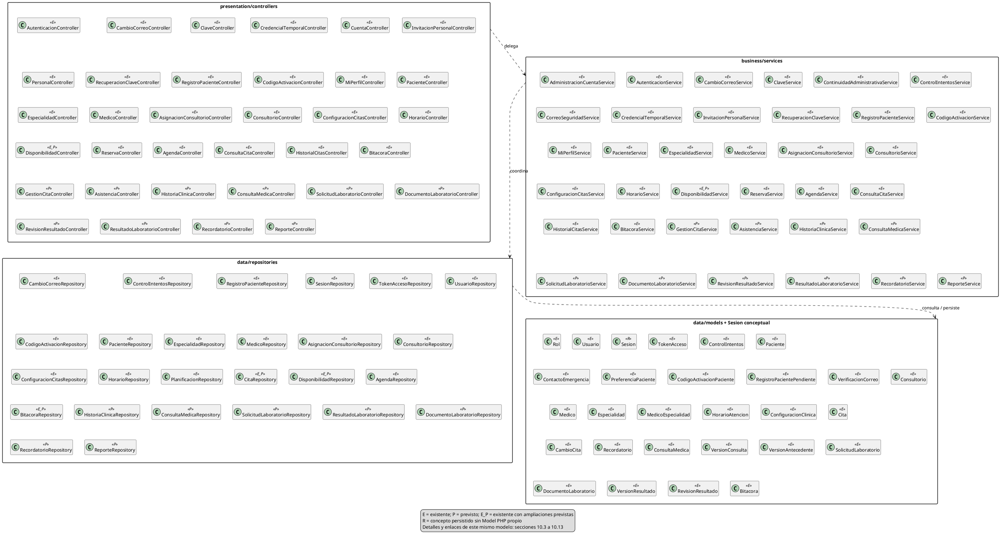

### 10.3. Vista de entidades — Atributos y 43 asociaciones persistidas

Los 244 atributos persistidos y 3 derivados se muestran sin métodos. El número mínimo de versiones/solicitudes es cero en persistencia; exigir una versión durante un flujo válido es responsabilidad del Service, no una cardinalidad mínima inventada para todo instante SQL. Clases E clínicas/avisos no acreditan operaciones implementadas.

```plantuml
@startuml CVS_entidades
skinparam classAttributeIconSize 0
hide empty methods
class Rol <<E>> {
  + id_rol: BigInt
  + nombre: String
}
class Usuario <<E>> {
  + id_usuario: BigInt
  + id_rol: BigInt
  + correo_acceso: String
  + password_hash: ?String
  + estado_cuenta: String
  + correo_verificado_en: ?TimestampTZ
  + cambio_clave_obligatorio: Boolean
  + intentos_fallidos: Integer
  + bloqueado_hasta: ?TimestampTZ
  + creado_en: TimestampTZ
  + actualizado_en: TimestampTZ
  + nombres_personal: ?String
  + apellidos_personal: ?String
}
class Sesion <<R>> {
  + id: String
  + user_id: ?BigInt
  + ip_address: ?String
  + user_agent: ?Text
  + payload: Text
  + last_activity: Integer
}
class TokenAcceso <<E>> {
  + id_token: BigInt
  + id_usuario: BigInt
  + proposito: String
  + token_hash: String
  + emitido_en: TimestampTZ
  + expira_en: TimestampTZ
  + consumido_en: ?TimestampTZ
  + invalidado_en: ?TimestampTZ
}
class ControlIntentos <<E>> {
  + id_control: BigInt
  + clave_ambito_hash: String
  + inicio_ventana: TimestampTZ
  + cantidad_intentos: Integer
  + bloqueado_hasta: ?TimestampTZ
  + actualizado_en: TimestampTZ
}
class Paciente <<E>> {
  + id_paciente: BigInt
  + id_usuario: ?BigInt
  + codigo_paciente: String
  + documento_identidad: ?String
  + nombres: String
  + apellidos: String
  + fecha_nacimiento: Date
  + sexo: ?String
  + telefono: String
  + correo_contacto: ?String
  + direccion: ?Text
  + activo: Boolean
  + creado_en: TimestampTZ
  + actualizado_en: TimestampTZ
}
class ContactoEmergencia <<E>> {
  + id_contacto: BigInt
  + id_paciente: BigInt
  + nombre: String
  + parentesco: String
  + telefono: String
}
class PreferenciaPaciente <<E>> {
  + id_preferencia: BigInt
  + id_paciente: BigInt
  + recordatorios_habilitados: Boolean
  + preferencias_privacidad: JSONB
  + actualizado_en: TimestampTZ
}
class CodigoActivacionPaciente <<E>> {
  + id_codigo_activacion: BigInt
  + id_paciente: BigInt
  + id_recepcionista: BigInt
  + codigo_hash: String
  + emitido_en: TimestampTZ
  + expira_en: TimestampTZ
  + intentos_fallidos: Integer
  + consumido_en: ?TimestampTZ
  + invalidado_en: ?TimestampTZ
}
class RegistroPacientePendiente <<E>> {
  + id_registro_pendiente: BigInt
  + id_paciente: ?BigInt
  + id_codigo_activacion: ?BigInt
  + tipo_registro: String
  + documento_identidad: ?String
  + correo_propuesto: String
  + password_hash_temporal: ?String
  + datos_registro: ?JSONB
  + iniciado_en: TimestampTZ
  + expira_en: TimestampTZ
  + completado_en: ?TimestampTZ
  + invalidado_en: ?TimestampTZ
}
class VerificacionCorreo <<E>> {
  + id_verificacion: BigInt
  + id_registro_pendiente: ?BigInt
  + id_usuario: ?BigInt
  + proposito: String
  + correo_destino: String
  + codigo_hash: String
  + enviado_en: TimestampTZ
  + expira_en: TimestampTZ
  + intentos_fallidos: Integer
  + consumido_en: ?TimestampTZ
  + invalidado_en: ?TimestampTZ
}
class Consultorio <<E>> {
  + id_consultorio: BigInt
  + codigo_consultorio: String
  + nombre: String
  + activo: Boolean
  + actualizado_en: TimestampTZ
  + /medicos_count: Integer
  + /obligaciones_count: Integer
}
class Medico <<E>> {
  + id_medico: BigInt
  + id_usuario: ?BigInt
  + id_consultorio: ?BigInt
  + codigo_medico: String
  + registro_profesional: String
  + nombres: String
  + apellidos: String
  + telefono: String
  + correo_contacto: String
  + activo: Boolean
  + actualizado_en: TimestampTZ
}
class Especialidad <<E>> {
  + id_especialidad: BigInt
  + nombre: String
  + descripcion: ?Text
  + activa: Boolean
  + actualizado_en: TimestampTZ
}
class MedicoEspecialidad <<E>> {
  + id_medico: BigInt
  + id_especialidad: BigInt
  + habilitada: Boolean
}
class HorarioAtencion <<E>> {
  + id_horario: BigInt
  + id_medico: BigInt
  + dia_semana: Integer
  + hora_inicio: Time
  + hora_fin: Time
  + activo: Boolean
}
class ConfiguracionClinica <<E>> {
  + id_configuracion: Integer
  + nombre_sede: String
  + direccion_sede: ?Text
  + zona_horaria: String
  + duracion_turno_minutos: Integer
  + actualizado_en: TimestampTZ
}
class Cita <<E>> {
  + id_cita: BigInt
  + codigo_cita: String
  + id_propuesta_reserva: ?UUID
  + id_paciente: BigInt
  + id_medico: BigInt
  + id_especialidad: BigInt
  + id_consultorio: BigInt
  + creada_por: BigInt
  + inicio_at: TimestampTZ
  + fin_at: TimestampTZ
  + duracion_minutos: Integer
  + estado: String
  + motivo_breve: ?Text
  + modalidad: String
  + sede_atencion: String
  + consultorio_atencion: String
  + version_programacion: Integer
  + creada_en: TimestampTZ
  + actualizada_en: TimestampTZ
  + /consulta_exists: Boolean
}
class CambioCita <<E>> {
  + id_cambio_cita: BigInt
  + id_cita: BigInt
  + id_actor: BigInt
  + operacion: String
  + realizado_en: TimestampTZ
  + estado_anterior: ?String
  + estado_nuevo: String
  + datos_anteriores: ?JSONB
  + datos_nuevos: JSONB
  + motivo: ?Text
}
class Recordatorio <<E>> {
  + id_recordatorio: BigInt
  + id_cita: BigInt
  + version_programacion: Integer
  + generado_en: TimestampTZ
  + leido_en: ?TimestampTZ
  + invalidado_en: ?TimestampTZ
}
class ConsultaMedica <<E>> {
  + id_consulta: BigInt
  + codigo_consulta: String
  + id_cita: BigInt
  + iniciada_en: ?TimestampTZ
  + creada_en: TimestampTZ
}
class VersionConsulta <<E>> {
  + id_version_consulta: BigInt
  + id_consulta: BigInt
  + numero_version: Integer
  + id_autor: BigInt
  + registrada_en: TimestampTZ
  + motivo_cambio: ?Text
  + tipo_consulta: String
  + motivo_consulta: Text
  + sintomas: ?Text
  + observaciones: ?Text
  + diagnostico: ?Text
  + indicaciones_tratamiento: ?Text
}
class VersionAntecedente <<E>> {
  + id_version_antecedente: BigInt
  + id_paciente: BigInt
  + numero_version: Integer
  + id_autor: BigInt
  + registrada_en: TimestampTZ
  + motivo_cambio: ?Text
  + tipo_sangre: ?String
  + alergias: ?Text
  + enfermedades_cronicas: ?Text
  + medicamentos: ?Text
  + enfermedades_familiares: ?Text
  + antecedentes_relevantes: ?Text
  + id_consulta_origen: BigInt
}
class SolicitudLaboratorio <<E>> {
  + id_solicitud: BigInt
  + id_consulta: BigInt
  + estudio_solicitado: String
  + solicitada_en: TimestampTZ
  + estado_interno: String
  + id_version_actual: ?BigInt
  + id_revision_publicada: ?BigInt
}
class DocumentoLaboratorio <<E>> {
  + id_documento: BigInt
  + cargado_por: BigInt
  + ruta_privada: String
  + nombre_original: String
  + tipo_mime: String
  + tamano_bytes: BigInt
  + sha256: String
  + cargado_en: TimestampTZ
}
class VersionResultado <<E>> {
  + id_version_resultado: BigInt
  + id_solicitud: BigInt
  + id_documento: BigInt
  + numero_version: Integer
  + id_version_origen: ?BigInt
  + id_autor: BigInt
  + registrada_en: TimestampTZ
  + motivo_cambio: ?Text
}
class RevisionResultado <<E>> {
  + id_revision: BigInt
  + id_version_resultado: BigInt
  + id_medico: BigInt
  + decision: String
  + motivo: ?Text
  + revisada_en: TimestampTZ
}
class Bitacora <<E>> {
  + id_evento: BigInt
  + tipo_evento: String
  + tipo_actor: String
  + id_usuario_responsable: ?BigInt
  + rol_responsable: ?String
  + id_usuario_objetivo: ?BigInt
  + rol_objetivo: ?String
  + modulo: String
  + operacion: String
  + resultado: String
  + causa_codigo: ?String
  + ocurrido_en: TimestampTZ
  + registrado_en: TimestampTZ
  + direccion_ip: ?Inet
  + procedencia_ip: ?String
  + entidad_referida: ?String
  + registro_referido: ?String
  + correlacion: UUID
  + id_evento_relacionado: ?BigInt
  + version_formato: SmallInt
  + cambios_seguros: ?JSONB
  + metadatos_seguros: ?JSONB
  + referencias: ?JSONB
}
Rol "1" -- "0..*" Usuario : rol
Usuario "0..1" -- "0..*" Sesion : cuenta de sesion
Usuario "1" -- "0..*" TokenAcceso : titular
Usuario "0..1" -- "0..1" Paciente : cuenta / ficha
Paciente "1" -- "0..1" ContactoEmergencia : contacto
Paciente "1" -- "0..1" PreferenciaPaciente : preferencia
Paciente "1" -- "0..*" CodigoActivacionPaciente : ficha
Usuario "1" -- "0..*" CodigoActivacionPaciente : emisor
Paciente "0..1" -- "0..*" RegistroPacientePendiente : vinculacion
CodigoActivacionPaciente "0..1" -- "0..*" RegistroPacientePendiente : codigo reservado
RegistroPacientePendiente "0..1" -- "0..*" VerificacionCorreo : proceso
Usuario "0..1" -- "0..*" VerificacionCorreo : cambio de correo
Usuario "0..1" -- "0..1" Medico : cuenta / profesional
Consultorio "0..1" -- "0..*" Medico : asignacion fija
Medico "1" -- "0..*" MedicoEspecialidad : profesional
Especialidad "1" -- "0..*" MedicoEspecialidad : especialidad
Medico "1" -- "0..*" HorarioAtencion : horario
Paciente "1" -- "0..*" Cita : paciente
Consultorio "1" -- "0..*" Cita : consultorio efectivo
Usuario "1" -- "0..*" Cita : creada por
MedicoEspecialidad "1" -- "0..*" Cita : par historico / FK compuesta
Cita "1" -- "0..*" CambioCita : cambios
Usuario "1" -- "0..*" CambioCita : responsable
Cita "1" -- "0..*" Recordatorio : programaciones / UQ cita-version
Usuario "0..1" -- "0..*" Bitacora : responsable
Cita "1" -- "0..1" ConsultaMedica : consulta unica
ConsultaMedica "1" -- "0..*" VersionConsulta : versiones
Usuario "1" -- "0..*" VersionConsulta : autor
Paciente "1" -- "0..*" VersionAntecedente : antecedentes
Usuario "1" -- "0..*" VersionAntecedente : autor
ConsultaMedica "1" -- "0..*" SolicitudLaboratorio : estudios
VersionResultado "0..1" -- "0..1" SolicitudLaboratorio : version actual / FK compuesta
RevisionResultado "0..1" -- "0..1" SolicitudLaboratorio : revision publicada / FK compuesta
SolicitudLaboratorio "1" -- "0..*" VersionResultado : versiones pertenecientes
DocumentoLaboratorio "1" -- "0..*" VersionResultado : archivo privado
VersionResultado "0..1" -- "0..*" VersionResultado : origen / derivadas
Usuario "1" -- "0..*" VersionResultado : autor
Usuario "1" -- "0..*" DocumentoLaboratorio : cargado por
VersionResultado "1" -- "0..*" RevisionResultado : revisiones
Medico "1" -- "0..*" RevisionResultado : revisor solicitante
Usuario "0..1" -- "0..*" Bitacora : cuenta objetivo
Bitacora "0..1" -- "0..*" Bitacora : anterior / posteriores
ConsultaMedica "1" -- "0..*" VersionAntecedente : consulta de origen real
note bottom of SolicitudLaboratorio
  Version actual pertenece a la misma solicitud.
  Revision publicada autoriza esa version exacta.
  Disponible exige ambos punteros coherentes.
  No se deducen correcciones posteriores a publicacion.
end note
note bottom of VerificacionCorreo
  Proceso o Usuario segun proposito, no ambos.
  Nulabilidad no habilita verificacion sin titular valido.
end note
note bottom of Sesion
  Concepto de sessions; sin Model PHP propio.
  Atributos sensibles no se serializan por dibujarlos.
end note
@enduml
```

**Justificación de multiplicidades:** FK NOT NULL implica un padre por dependiente; FK nullable permite 0..1 padre; UQ en la FK reduce el lado de dependientes a 0..1. Sin UQ se conserva 0..*. Las reservas exclusivas de códigos/procesos abiertos no vuelven únicas todas sus relaciones históricas. La UQ de Recordatorio es por cita y versión, no una sola fila histórica por cita. Las dos asociaciones de Usuario–Bitacora tienen roles distintos. ControlIntentos y ConfiguracionClinica no reciben FK ficticias: se consumen mediante dependencias operativas. Relaciones derivadas Médico/Paciente de una solicitud se recorren por ConsultaMedica–Cita; no añaden columnas/FK inexistentes.

### 10.4. Usuarios y seguridad — CU-01–CU-06, correo de acceso de CU-08

Miembros E completos; las dependencias hacia pacientes/médicos/auditoría se integran en §10.13. CorreoSeguridadService no tiene dependencia con recordatorios.

```plantuml
@startuml CVS_usuarios
skinparam classAttributeIconSize 0
skinparam wrapWidth 350
left to right direction
hide empty attributes
package "controllers/usuarios" {
class AutenticacionController <<E>> {
  + login(LoginRequest $request, AutenticacionService $service): UsuarioAutenticadoResource
  + me(Request $request): UsuarioAutenticadoResource
  + logout(Request $request, AutenticacionService $service): Response
}
class CambioCorreoController <<E>> {
  + solicitar(CambioCorreoRequest $request, CambioCorreoService $service): JsonResponse
  + reenviar(CambioCorreoRequest $request, CambioCorreoService $service): JsonResponse
  + verificar(CambioCorreoRequest $request, CambioCorreoService $service): Response
}
class ClaveController <<E>> {
  + update(CambiarClaveRequest $request, ClaveService $service): Response
}
class CredencialTemporalController <<E>> {
  + emitir(EmitirCredencialTemporalRequest $request, CredencialTemporalService $service): JsonResponse
  + completar(CompletarClaveTemporalRequest $request, CredencialTemporalService $service): Response
}
class CuentaController <<E>> {
  + index(ListarCuentasRequest $request, AdministracionCuentaService $service): AnonymousResourceCollection
  + show(CuentaRequest $request, AdministracionCuentaService $service): CuentaAdministrativaResource
  + estado(CambiarEstadoCuentaRequest $request, AdministracionCuentaService $service): CuentaAdministrativaResource
  + rol(CambiarRolCuentaRequest $request, AdministracionCuentaService $service): CuentaAdministrativaResource
}
class InvitacionPersonalController <<E>> {
  + aceptar(AceptarInvitacionRequest $request, InvitacionPersonalService $service): Response
}
class PersonalController <<E>> {
  + store(CrearPersonalRequest $request, InvitacionPersonalService $service): JsonResponse
  + reenviar(ReenviarInvitacionRequest $request, InvitacionPersonalService $service): JsonResponse
  - respuesta(array $resultado, int $status): JsonResponse
}
class RecuperacionClaveController <<E>> {
  + solicitar(SolicitarRecuperacionRequest $request, RecuperacionClaveService $service): JsonResponse
  + restablecer(RestablecerClaveRequest $request, RecuperacionClaveService $service): Response
}
class RegistroPacienteController <<E>> {
  - contexto(Request $request): string
  - recibida(): JsonResponse
  + iniciar(RegistrarPacienteRequest $request, RegistroPacienteService $service): JsonResponse
  + reenviar(Request $request, RegistroPacienteService $service): JsonResponse
  + vincular(VincularPacienteRequest $request, RegistroPacienteService $service): JsonResponse
  + verificar(VerificarRegistroPacienteRequest $request, RegistroPacienteService $service): Response
}
}
package "services/usuarios" {
class AdministracionCuentaService <<E>> {
  + __construct(AutenticacionService $autenticacion, ContinuidadAdministrativaService $continuidad, UsuarioRepository $usuarios, MedicoRepository $medicos, SesionRepository $sesiones, BitacoraRepository $bitacora, TokenAccesoRepository $tokens, CambioCorreoRepository $cambiosCorreo)
  - administrador(): Usuario
  - objetivo(int|string $id, bool $bloquear = false): Usuario
  + listar(array $filtros): LengthAwarePaginator
  + consultar(int|string $id): Usuario
  - modificar(int|string $id, string $evento, array $contexto, Closure $cambio): Usuario
  - valoresAdministrativos(Usuario $usuario): array
  + cambiarEstado(int|string $id, string $estado, array $contexto): Usuario
  + cambiarRol(int|string $id, array $datos, array $contexto): Usuario
}
class AutenticacionService <<E>> {
  + __construct(UsuarioRepository $usuarios, SesionRepository $sesiones, BitacoraRepository $bitacora, TokenAccesoRepository $tokens, CredencialTemporalValidator $temporales)
  - habilitado(Usuario $usuario): bool
  + iniciar(string $correo, string $password, array $contexto): Usuario
  + validarSesion(bool $bloquear = false): Usuario
  + exigirSesionNormal(bool $bloquear = false): Usuario
  + exigirSesionRestringida(bool $bloquear = false): Usuario
  + cerrar(array $contexto): void
}
class CambioCorreoService <<E>> {
  + __construct(AutenticacionService $autenticacion, UsuarioRepository $usuarios, CambioCorreoRepository $cambios, RegistroPacienteRepository $registros, TokenAccesoRepository $tokens, SesionRepository $sesiones, BitacoraRepository $bitacora, CorreoSeguridadService $correo)
  - titular(): Usuario
  - resumen(int|string $usuario, string $codigo): string
  - instantanea(Usuario $usuario): string
  - disponible(Usuario $usuario, string $correo): bool
  - limitar(Usuario $usuario, string $correo, ?VerificacionCorreo $ultimo): void
  - enTransporte(VerificacionCorreo $codigo): bool
  - emitir(Usuario $usuario, string $destino, array $contexto): array
  + solicitar(string $destino, string $password, array $contexto): array
  + reenviar(array $contexto): array
  + verificar(string $valor, array $contexto): void
}
class ClaveService <<E>> {
  + __construct(AutenticacionService $autenticacion, UsuarioRepository $usuarios, SesionRepository $sesiones, BitacoraRepository $bitacora, TokenAccesoRepository $tokens, CambioCorreoRepository $cambiosCorreo)
  + cambiar(string $actual, string $nueva, array $contexto): void
}
class ContinuidadAdministrativaService <<E>> {
  + __construct(UsuarioRepository $usuarios)
  + coordinar(): void
  + verificar(): void
}
class ControlIntentosService <<E>> {
  + __construct(ControlIntentosRepository $controles, BitacoraRepository $bitacora)
  + evaluarLogin(string $correo, array $contexto): void
  + evaluarCambioClave(int|string $id, array $contexto): void
  + evaluarInvitacion(string $accion, string $ambito, array $contexto): void
  - evaluar(array $ambitos, int $ventana, array $contexto, string $evento): void
  + evaluarRecuperacion(string $accion, string $ambito, array $contexto): void
  + evaluarCredencialTemporal(string $accion, int|string $id, array $contexto): void
  + evaluarRegistroPaciente(string $accion, string $ambito, array $contexto): void
  + evaluarCambioCorreo(string $accion, int|string $id, array $contexto): void
}
class CorreoSeguridadService <<E>> {
  + enviarCambioCorreo(string $correo, string $codigo): string
  + enviarInvitacion(string $correo, string $token): string
  + enviarRecuperacion(string $correo, string $token): string
  + enviarActivacionPaciente(string $correo, string $codigo): string
  - enviar(string $correo, Mailable $mensaje): string
  - frontend(): string
}
class CredencialTemporalService <<E>> {
  + __construct(AutenticacionService $autenticacion, ContinuidadAdministrativaService $continuidad, CredencialTemporalValidator $validator, UsuarioRepository $usuarios, TokenAccesoRepository $tokens, SesionRepository $sesiones, BitacoraRepository $bitacora, CambioCorreoRepository $cambiosCorreo)
  + emitir(int|string $id, bool $identidadVerificada, array $contexto): array
  + completar(string $password, array $contexto): void
}
class InvitacionPersonalService <<E>> {
  + __construct(AutenticacionService $autenticacion, UsuarioRepository $usuarios, MedicoRepository $medicos, TokenAccesoRepository $tokens, SesionRepository $sesiones, BitacoraRepository $bitacora, CorreoSeguridadService $correo, CambioCorreoRepository $cambiosCorreo)
  - administrador(): Usuario
  - pendiente(?Usuario $usuario): bool
  - hashToken(string $token): string
  - emitir(Usuario $usuario, Usuario $actor, array $contexto): array
  + crear(array $datos, array $contexto): array
  + reenviar(int|string $id, array $contexto): array
  + aceptar(string $secreto, string $password, array $contexto): void
}
class RecuperacionClaveService <<E>> {
  + __construct(UsuarioRepository $usuarios, TokenAccesoRepository $tokens, SesionRepository $sesiones, BitacoraRepository $bitacora, CorreoSeguridadService $correo, CambioCorreoRepository $cambiosCorreo)
  - elegible(?Usuario $usuario): bool
  - hashToken(string $token): string
  + solicitar(string $correo, array $contexto): void
  + restablecer(string $secreto, string $password, array $contexto): void
}
class RegistroPacienteService <<E>> {
  + __construct(RegistroPacienteRepository $registros, UsuarioRepository $usuarios, SesionRepository $sesiones, BitacoraRepository $bitacora, CorreoSeguridadService $correo, CodigoActivacionRepository $activaciones)
  - anonimo(): void
  + iniciar(array $datos, string $contexto, array $seguridad): void
  - vigente(RegistroPacientePendiente $registro): bool
  + vincular(array $datos, string $contexto, array $seguridad): void
  - diferir(callable $operacion, array $seguridad): void
  + reenviar(string $contexto, array $seguridad): void
  - emitir(RegistroPacientePendiente $registro, array $seguridad): void
  + verificar(string $contexto, string $valor, array $seguridad): void
}
}
package "repositories/usuarios" {
class CambioCorreoRepository <<E>> {
  + ultimo(int|string $usuario): ?VerificacionCorreo
  + ultimoPorCorreo(string $correo): ?VerificacionCorreo
  + invalidar(int|string $usuario, CarbonImmutable $ahora): void
  + crear(int|string $usuario, string $correo, string $hash, CarbonImmutable $ahora): VerificacionCorreo
  + guardar(VerificacionCorreo $codigo): void
  + codigoUtilizado(int|string $usuario, string $hash): bool
  + emisionesHora(int|string $usuario, string $correo, CarbonImmutable $desde): iterable
}
class ControlIntentosRepository <<E>> {
  + obtenerBloqueado(string $clave): ControlIntentos
  + guardar(ControlIntentos $control): void
}
class RegistroPacienteRepository <<E>> {
  + coordinar(): void
  + porContexto(string $hash): ?RegistroPacientePendiente
  + porPaciente(int|string $id): iterable
  + reservas(string $ci, string $correo): iterable
  + documentoRegistrado(string $ci): bool
  + reservasPorDocumento(string $ci): iterable
  + correoReservado(string $correo, CarbonImmutable $ahora): bool
  + crear(array $datos): RegistroPacientePendiente
  + guardar(RegistroPacientePendiente $registro): void
  + invalidar(RegistroPacientePendiente $registro, CarbonImmutable $ahora): void
  + ultimoCodigo(int|string $id): ?VerificacionCorreo
  + invalidarCodigos(int|string $id, CarbonImmutable $ahora): void
  + guardarCodigo(VerificacionCorreo $codigo): void
  + codigoUtilizado(int|string $id, string $hash): bool
  + emitirCodigo(int|string $id, string $correo, string $hash, CarbonImmutable $ahora, CarbonImmutable $expira): void
  + emisionesHora(int|string $id, string $correo, CarbonImmutable $desde): bool
  + crearPaciente(array $datos): Paciente
}
class SesionRepository <<E>> {
  + __construct(AuthManager $auth, SessionManager $sessions)
  - guard(): SessionGuard
  - store(): Store
  + usuarioId(): int|string|null
  - contexto(Usuario $usuario, bool $normal = true): array
  + coincide(Usuario $usuario): bool
  + credencialTemporalId(): int|string|null
  + vigente(Usuario $usuario): bool
  + actualizarActor(Usuario $usuario): void
  + iniciar(Usuario $usuario, ?TokenAcceso $credencial = null): void
  + cerrar(): void
  + limpiarTrasFallo(): void
  + revocarUsuario(int|string $id, ?string $excepto = null): void
}
class TokenAccesoRepository <<E>> {
  + porHash(string $hash, bool $bloquear = false): ?TokenAcceso
  + ultimo(int|string $id): ?TokenAcceso
  + emisionesDesde(int|string $id, CarbonImmutable $desde): int
  + primeraEmisionDesde(int|string $id, CarbonImmutable $desde): ?TokenAcceso
  + invalidarInvitaciones(int|string $id, CarbonImmutable $ahora): void
  + emitir(int|string $id, string $hash, CarbonImmutable $ahora): TokenAcceso
  + consumir(TokenAcceso $token, CarbonImmutable $ahora): void
  + recuperacionPorHash(string $hash, bool $bloquear = false): ?TokenAcceso
  + invalidarRecuperaciones(int|string $id, CarbonImmutable $ahora): void
  + emitirRecuperacion(int|string $id, string $hash, CarbonImmutable $ahora): TokenAcceso
  + temporalPorId(int|string|null $id, bool $bloquear = false): ?TokenAcceso
  + ultimoTemporal(int|string $id, bool $bloquear = false): ?TokenAcceso
  + emisionesTemporalesDesde(int|string $id, CarbonImmutable $desde): int
  + primeraTemporalDesde(int|string $id, CarbonImmutable $desde): ?TokenAcceso
  + invalidarTemporales(int|string $id, CarbonImmutable $ahora): void
  + emitirTemporal(int|string $id, string $hash, CarbonImmutable $ahora): TokenAcceso
}
class UsuarioRepository <<E>> {
  + porCorreoBloqueado(string $correo): ?Usuario
  + porId(int|string $id, bool $bloquear = false): ?Usuario
  + guardar(Usuario $usuario): void
  + existeCorreo(string $correo): bool
  + rolPorNombre(string $nombre): ?Rol
  + crearPersonal(array $datos): Usuario
  + crearPaciente(int|string $rol, string $correo, string $hash, CarbonImmutable $ahora): Usuario
  + coordinarAdministracion(): void
  + existeAdministradorNormal(): bool
  + listadoAdministrativo(array $filtros): LengthAwarePaginator
}
}
AutenticacionController ..> AutenticacionService
CambioCorreoController ..> CambioCorreoService
ClaveController ..> ClaveService
CredencialTemporalController ..> CredencialTemporalService
CuentaController ..> AdministracionCuentaService
InvitacionPersonalController ..> InvitacionPersonalService
PersonalController ..> InvitacionPersonalService
RecuperacionClaveController ..> RecuperacionClaveService
RegistroPacienteController ..> RegistroPacienteService
AdministracionCuentaService ..> AutenticacionService
AdministracionCuentaService ..> ContinuidadAdministrativaService
AdministracionCuentaService ..> UsuarioRepository
AdministracionCuentaService ..> SesionRepository
AdministracionCuentaService ..> TokenAccesoRepository
AdministracionCuentaService ..> CambioCorreoRepository
AutenticacionService ..> UsuarioRepository
AutenticacionService ..> SesionRepository
AutenticacionService ..> TokenAccesoRepository
CambioCorreoService ..> AutenticacionService
CambioCorreoService ..> UsuarioRepository
CambioCorreoService ..> CambioCorreoRepository
CambioCorreoService ..> RegistroPacienteRepository
CambioCorreoService ..> TokenAccesoRepository
CambioCorreoService ..> SesionRepository
CambioCorreoService ..> CorreoSeguridadService
ClaveService ..> AutenticacionService
ClaveService ..> UsuarioRepository
ClaveService ..> SesionRepository
ClaveService ..> TokenAccesoRepository
ClaveService ..> CambioCorreoRepository
ContinuidadAdministrativaService ..> UsuarioRepository
ControlIntentosService ..> ControlIntentosRepository
CredencialTemporalService ..> AutenticacionService
CredencialTemporalService ..> ContinuidadAdministrativaService
CredencialTemporalService ..> UsuarioRepository
CredencialTemporalService ..> TokenAccesoRepository
CredencialTemporalService ..> SesionRepository
CredencialTemporalService ..> CambioCorreoRepository
InvitacionPersonalService ..> AutenticacionService
InvitacionPersonalService ..> UsuarioRepository
InvitacionPersonalService ..> TokenAccesoRepository
InvitacionPersonalService ..> SesionRepository
InvitacionPersonalService ..> CambioCorreoRepository
InvitacionPersonalService ..> CorreoSeguridadService
RecuperacionClaveService ..> UsuarioRepository
RecuperacionClaveService ..> TokenAccesoRepository
RecuperacionClaveService ..> SesionRepository
RecuperacionClaveService ..> CambioCorreoRepository
RecuperacionClaveService ..> CorreoSeguridadService
RegistroPacienteService ..> UsuarioRepository
RegistroPacienteService ..> SesionRepository
RegistroPacienteService ..> RegistroPacienteRepository
RegistroPacienteService ..> CorreoSeguridadService
@enduml
```

### 10.5. Pacientes y perfil — CU-07–CU-08

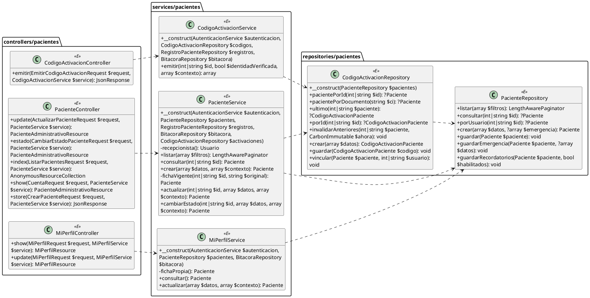

### 10.6. Especialidades y médicos — CU-09–CU-10

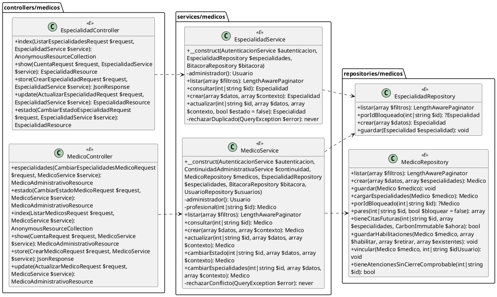

### 10.7. Consultorios y planificación — CU-11–CU-12

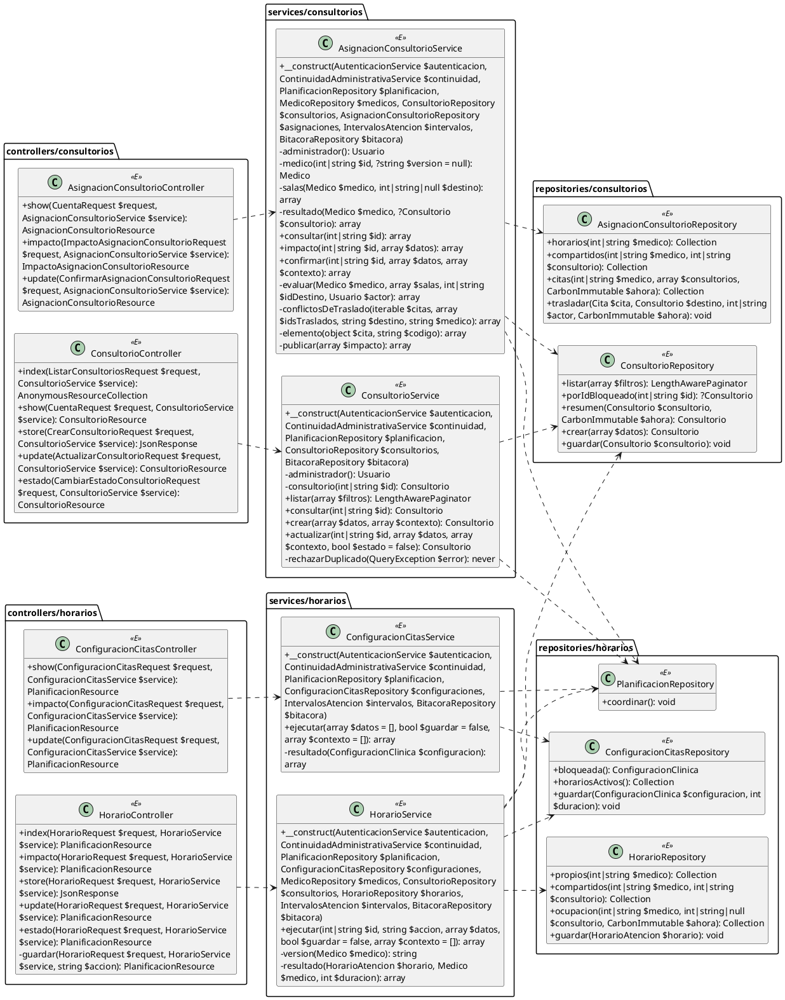

### 10.8. Citas, reprogramación y asistencia — CU-13–CU-19

Clases E de reserva/disponibilidad conviven con operaciones y clases P. No se representa cancelación/reprogramación como permiso del Paciente ni Atendida como permiso de Recepción. Las dos firmas de constructor de DisponibilidadService muestran **alternativas temporales E/P**, no sobrecarga; se conserva la actual para trazabilidad y se rotula el reemplazo futuro.

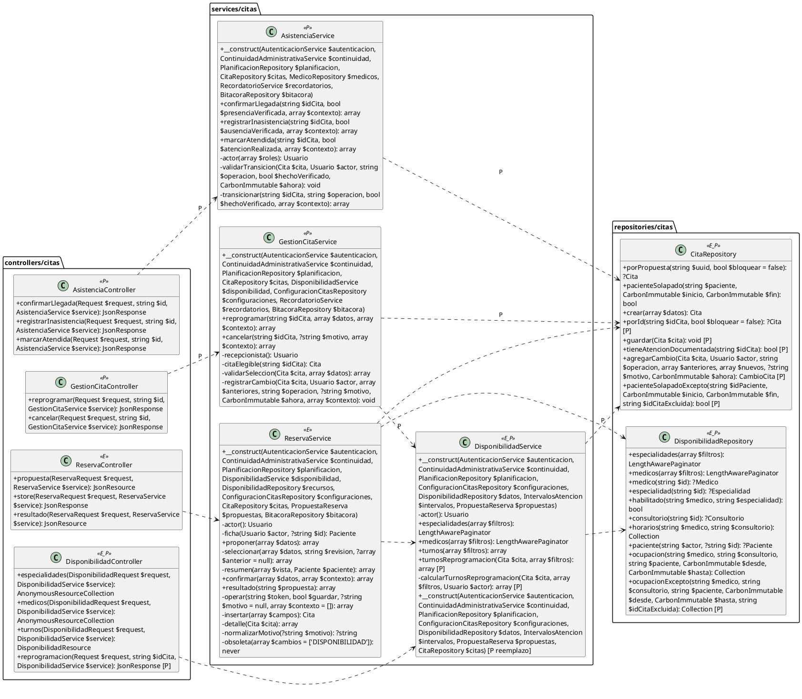

### 10.9. Agenda, historial y bitácora — CU-20–CU-21 y CU-30

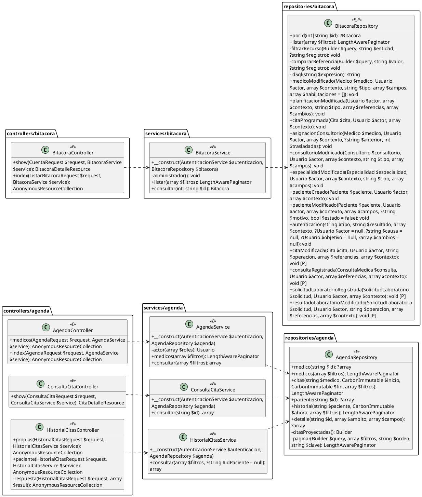

### 10.10. Historia clínica y consultas — CU-22–CU-23

Todas las clases de esta vista son P; los modelos de su persistencia ya son E (§10.3). CU-22 no edita; CU-23 no llama AsistenciaService para marcar Atendida. El alcance granular de lectura sigue pendiente de concreción funcional, no se decide mediante una flecha UML.

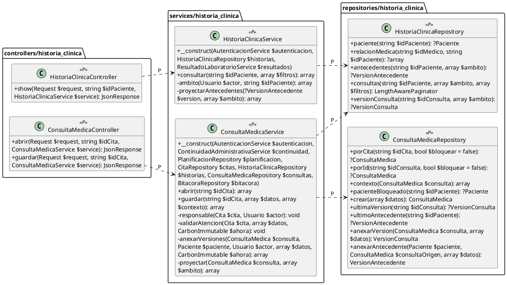

### 10.11. Laboratorio digital — CU-24–CU-27

Clases operativas P, modelos E. Las operaciones de entrega privada devuelven el stream interno tipado en §9.10, nunca ruta pública. La devolución/corrección exige nueva revisión; no hay transición ordinaria de regreso desde Disponible.

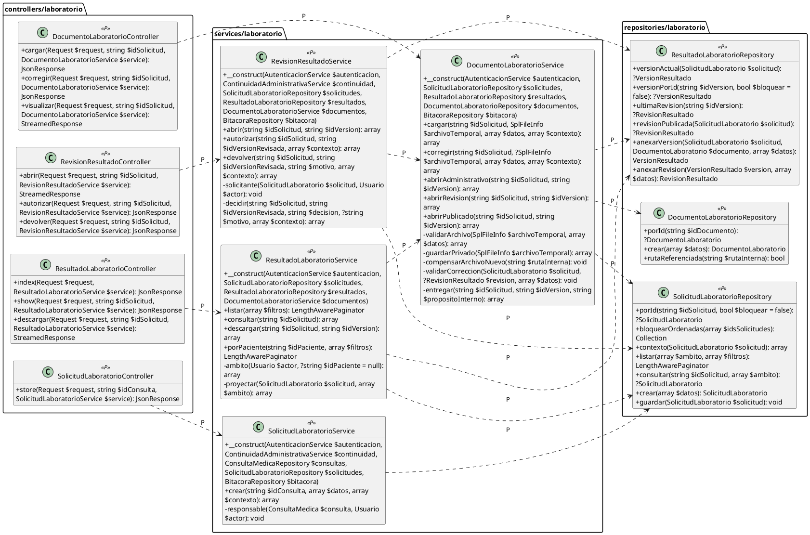

### 10.12. Recordatorios y reportes — CU-28–CU-29

No hay Controller de generación manual de avisos: la invocación automática es infraestructura excluida. La consulta autenticada y la generación sin sesión son ramas distintas del mismo Service. El séptimo reporte reutiliza AgendaService de §10.9.

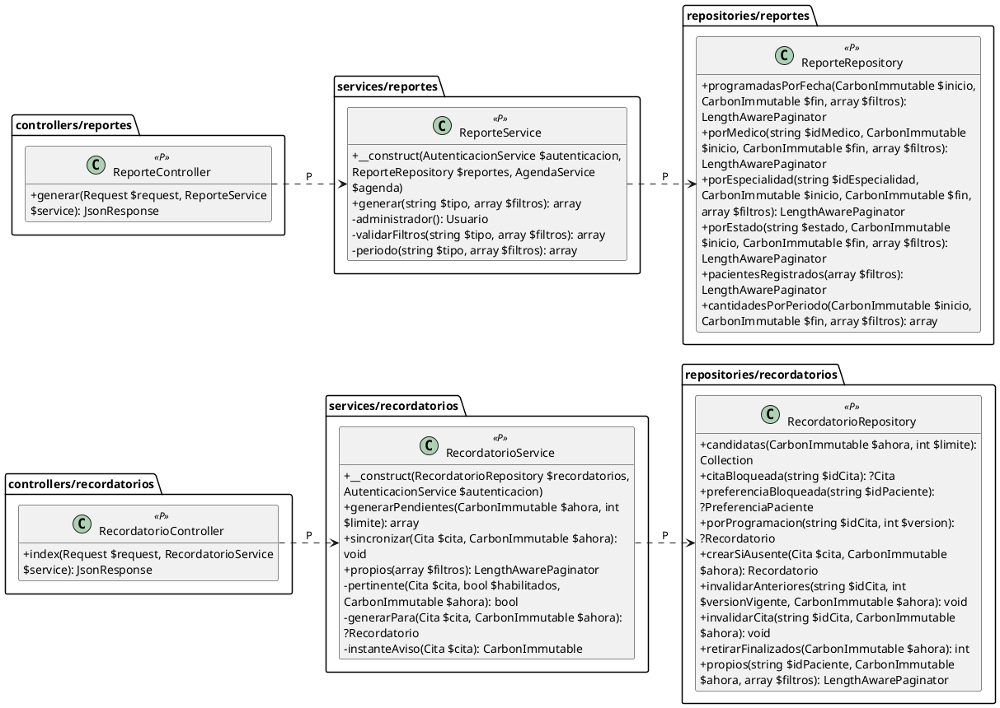

### 10.13. Integración entre vistas — Dependencias transversales

Estas vistas repiten **referencias** del mismo catálogo y ocultan miembros ya mostrados. No agregan clases. Se separan de los detalles para no repetir autenticación/auditoría y todos los modelos alrededor de cada operación. Flechas sin P se contrastan con inyección, parámetros/retornos o uso real de repositorios; flechas P son colaboraciones diseñadas. La dependencia hacia una entidad puede ser consulta de su tabla/relación o un tipo de entrada/salida, no necesariamente instanciación directa.

#### 10.13.1. Autenticación, coordinación, auditoría y colaboración entre módulos

```plantuml
@startuml CVS_integracion_servicios
hide members
skinparam classAttributeIconSize 0
skinparam wrapWidth 350
left to right direction
class AutenticacionService <<E>>
class ContinuidadAdministrativaService <<E>>
class CorreoSeguridadService <<E>>
class AdministracionCuentaService <<E>>
class CambioCorreoService <<E>>
class ClaveService <<E>>
class ControlIntentosService <<E>>
class CredencialTemporalService <<E>>
class InvitacionPersonalService <<E>>
class RecuperacionClaveService <<E>>
class RegistroPacienteService <<E>>
class CodigoActivacionService <<E>>
class MiPerfilService <<E>>
class PacienteService <<E>>
class EspecialidadService <<E>>
class MedicoService <<E>>
class AsignacionConsultorioService <<E>>
class ConsultorioService <<E>>
class ConfiguracionCitasService <<E>>
class HorarioService <<E>>
class DisponibilidadService <<E_P>>
class ReservaService <<E>>
class AgendaService <<E>>
class ConsultaCitaService <<E>>
class HistorialCitasService <<E>>
class BitacoraService <<E>>
class GestionCitaService <<P>>
class AsistenciaService <<P>>
class HistoriaClinicaService <<P>>
class ConsultaMedicaService <<P>>
class SolicitudLaboratorioService <<P>>
class DocumentoLaboratorioService <<P>>
class RevisionResultadoService <<P>>
class ResultadoLaboratorioService <<P>>
class RecordatorioService <<P>>
class ReporteService <<P>>
class BitacoraRepository <<E_P>>
class PlanificacionRepository <<E>>
class ConfiguracionCitasRepository <<E>>
class MedicoRepository <<E>>
class ConsultorioRepository <<E>>
class UsuarioRepository <<E>>
class RegistroPacienteRepository <<E>>
class CodigoActivacionRepository <<E>>
class ConsultaMedicaRepository <<P>>
class CitaRepository <<E_P>>
CodigoActivacionService ..> AutenticacionService
CodigoActivacionService ..> RegistroPacienteRepository
MiPerfilService ..> AutenticacionService
PacienteService ..> AutenticacionService
PacienteService ..> RegistroPacienteRepository
EspecialidadService ..> AutenticacionService
MedicoService ..> AutenticacionService
MedicoService ..> ContinuidadAdministrativaService
MedicoService ..> UsuarioRepository
AdministracionCuentaService ..> MedicoRepository
InvitacionPersonalService ..> MedicoRepository
RegistroPacienteService ..> CodigoActivacionRepository
AsignacionConsultorioService ..> AutenticacionService
AsignacionConsultorioService ..> ContinuidadAdministrativaService
AsignacionConsultorioService ..> MedicoRepository
ConsultorioService ..> AutenticacionService
ConsultorioService ..> ContinuidadAdministrativaService
ConfiguracionCitasService ..> AutenticacionService
ConfiguracionCitasService ..> ContinuidadAdministrativaService
HorarioService ..> AutenticacionService
HorarioService ..> ContinuidadAdministrativaService
HorarioService ..> MedicoRepository
DisponibilidadService ..> AutenticacionService
DisponibilidadService ..> ContinuidadAdministrativaService
DisponibilidadService ..> PlanificacionRepository
DisponibilidadService ..> ConfiguracionCitasRepository
ReservaService ..> AutenticacionService
ReservaService ..> ContinuidadAdministrativaService
ReservaService ..> PlanificacionRepository
ReservaService ..> ConfiguracionCitasRepository
AgendaService ..> AutenticacionService
ConsultaCitaService ..> AutenticacionService
HistorialCitasService ..> AutenticacionService
BitacoraService ..> AutenticacionService
AutenticacionService ..> BitacoraRepository
AdministracionCuentaService ..> BitacoraRepository
CambioCorreoService ..> BitacoraRepository
ClaveService ..> BitacoraRepository
ControlIntentosService ..> BitacoraRepository
CredencialTemporalService ..> BitacoraRepository
InvitacionPersonalService ..> BitacoraRepository
RecuperacionClaveService ..> BitacoraRepository
RegistroPacienteService ..> BitacoraRepository
CodigoActivacionService ..> BitacoraRepository
MiPerfilService ..> BitacoraRepository
PacienteService ..> BitacoraRepository
EspecialidadService ..> BitacoraRepository
MedicoService ..> BitacoraRepository
AsignacionConsultorioService ..> BitacoraRepository
ConsultorioService ..> BitacoraRepository
ConfiguracionCitasService ..> BitacoraRepository
HorarioService ..> BitacoraRepository
ReservaService ..> BitacoraRepository
GestionCitaService ..> AutenticacionService : P
GestionCitaService ..> ContinuidadAdministrativaService : P
GestionCitaService ..> PlanificacionRepository : P
GestionCitaService ..> ConfiguracionCitasRepository : P
GestionCitaService ..> RecordatorioService : P
GestionCitaService ..> BitacoraRepository : P
AsistenciaService ..> AutenticacionService : P
AsistenciaService ..> ContinuidadAdministrativaService : P
AsistenciaService ..> PlanificacionRepository : P
AsistenciaService ..> MedicoRepository : P
AsistenciaService ..> RecordatorioService : P
AsistenciaService ..> BitacoraRepository : P
HistoriaClinicaService ..> AutenticacionService : P
HistoriaClinicaService ..> ResultadoLaboratorioService : P
ConsultaMedicaService ..> AutenticacionService : P
ConsultaMedicaService ..> ContinuidadAdministrativaService : P
ConsultaMedicaService ..> PlanificacionRepository : P
ConsultaMedicaService ..> CitaRepository : P
ConsultaMedicaService ..> BitacoraRepository : P
SolicitudLaboratorioService ..> AutenticacionService : P
SolicitudLaboratorioService ..> ContinuidadAdministrativaService : P
SolicitudLaboratorioService ..> ConsultaMedicaRepository : P
SolicitudLaboratorioService ..> BitacoraRepository : P
DocumentoLaboratorioService ..> AutenticacionService : P
DocumentoLaboratorioService ..> BitacoraRepository : P
RevisionResultadoService ..> AutenticacionService : P
RevisionResultadoService ..> ContinuidadAdministrativaService : P
RevisionResultadoService ..> BitacoraRepository : P
ResultadoLaboratorioService ..> AutenticacionService : P
RecordatorioService ..> AutenticacionService : P / solo consulta propia
ReporteService ..> AutenticacionService : P
ReporteService ..> AgendaService : P / septimo reporte RF13
@enduml
```

#### 10.13.2. Repositories y datos de acceso, pacientes y auditoría

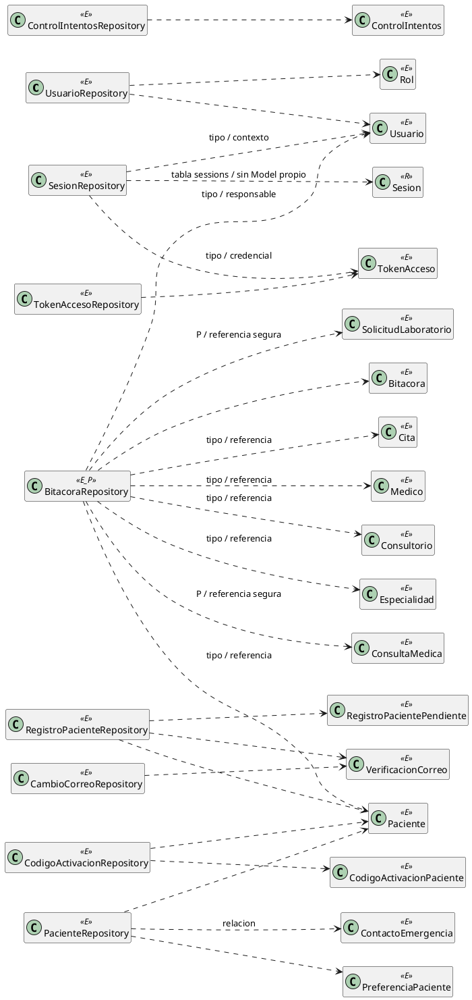

#### 10.13.3. Repositories y datos médicos, citas, clínica, laboratorio y reportes

```plantuml
@startuml CVS_datos_atencion
hide members
skinparam classAttributeIconSize 0
skinparam wrapWidth 350
left to right direction
class EspecialidadRepository <<E>>
class MedicoRepository <<E>>
class ConsultorioRepository <<E>>
class AsignacionConsultorioRepository <<E>>
class ConfiguracionCitasRepository <<E>>
class HorarioRepository <<E>>
class CitaRepository <<E_P>>
class DisponibilidadRepository <<E_P>>
class AgendaRepository <<E>>
class HistoriaClinicaRepository <<P>>
class ConsultaMedicaRepository <<P>>
class SolicitudLaboratorioRepository <<P>>
class ResultadoLaboratorioRepository <<P>>
class DocumentoLaboratorioRepository <<P>>
class RecordatorioRepository <<P>>
class ReporteRepository <<P>>
class Paciente <<E>>
class Usuario <<E>>
class PreferenciaPaciente <<E>>
class Medico <<E>>
class Especialidad <<E>>
class MedicoEspecialidad <<E>>
class Consultorio <<E>>
class HorarioAtencion <<E>>
class ConfiguracionClinica <<E>>
class Cita <<E>>
class CambioCita <<E>>
class Recordatorio <<E>>
class ConsultaMedica <<E>>
class VersionConsulta <<E>>
class VersionAntecedente <<E>>
class SolicitudLaboratorio <<E>>
class VersionResultado <<E>>
class RevisionResultado <<E>>
class DocumentoLaboratorio <<E>>
EspecialidadRepository ..> Especialidad
MedicoRepository ..> Medico
MedicoRepository ..> MedicoEspecialidad : tabla / habilitaciones
MedicoRepository ..> Cita : tabla / obligaciones
MedicoRepository ..> ConsultaMedica : tabla / cierre no comprobable
ConsultorioRepository ..> Consultorio
ConsultorioRepository ..> Medico : relacion / conteo
ConsultorioRepository ..> Cita : relacion / obligaciones
AsignacionConsultorioRepository ..> HorarioAtencion
AsignacionConsultorioRepository ..> Cita
AsignacionConsultorioRepository ..> CambioCita
AsignacionConsultorioRepository ..> Consultorio : tipo
AsignacionConsultorioRepository ..> ConsultaMedica : relacion / exists
ConfiguracionCitasRepository ..> ConfiguracionClinica
ConfiguracionCitasRepository ..> HorarioAtencion
HorarioRepository ..> HorarioAtencion
HorarioRepository ..> Cita
CitaRepository ..> Cita
CitaRepository ..> CambioCita : P
CitaRepository ..> ConsultaMedica : P / atencion documentada
CitaRepository ..> Usuario : P / responsable del cambio
DisponibilidadRepository ..> Medico
DisponibilidadRepository ..> Especialidad
DisponibilidadRepository ..> MedicoEspecialidad : tabla / habilitada
DisponibilidadRepository ..> Consultorio
DisponibilidadRepository ..> HorarioAtencion
DisponibilidadRepository ..> Paciente
DisponibilidadRepository ..> Cita
AgendaRepository ..> Medico : modelo / tabla
AgendaRepository ..> Paciente : modelo / tabla
AgendaRepository ..> Cita : modelo / tabla
AgendaRepository ..> Especialidad : tabla
HistoriaClinicaRepository ..> Paciente : P
HistoriaClinicaRepository ..> Cita : P / relacion
HistoriaClinicaRepository ..> Medico : P / relacion
HistoriaClinicaRepository ..> ConsultaMedica : P
HistoriaClinicaRepository ..> VersionConsulta : P
HistoriaClinicaRepository ..> VersionAntecedente : P
ConsultaMedicaRepository ..> Cita : P / contexto
ConsultaMedicaRepository ..> Paciente : P / bloqueo
ConsultaMedicaRepository ..> ConsultaMedica : P
ConsultaMedicaRepository ..> VersionConsulta : P
ConsultaMedicaRepository ..> VersionAntecedente : P
SolicitudLaboratorioRepository ..> SolicitudLaboratorio : P
SolicitudLaboratorioRepository ..> ConsultaMedica : P / contexto
SolicitudLaboratorioRepository ..> Cita : P / contexto
SolicitudLaboratorioRepository ..> Medico : P / contexto
SolicitudLaboratorioRepository ..> Paciente : P / contexto
ResultadoLaboratorioRepository ..> SolicitudLaboratorio : P / punteros
ResultadoLaboratorioRepository ..> VersionResultado : P
ResultadoLaboratorioRepository ..> RevisionResultado : P
ResultadoLaboratorioRepository ..> DocumentoLaboratorio : P / tipo
DocumentoLaboratorioRepository ..> DocumentoLaboratorio : P
RecordatorioRepository ..> Recordatorio : P
RecordatorioRepository ..> Cita : P
RecordatorioRepository ..> Paciente : P / destinatario derivado
RecordatorioRepository ..> PreferenciaPaciente : P
RecordatorioRepository ..> Medico : P / proyeccion
RecordatorioRepository ..> Especialidad : P / proyeccion
RecordatorioRepository ..> Consultorio : P / proyeccion
RecordatorioRepository ..> ConfiguracionClinica : P / sede
ReporteRepository ..> Cita : P
ReporteRepository ..> Paciente : P
ReporteRepository ..> Medico : P
ReporteRepository ..> Especialidad : P
ReporteRepository ..> Consultorio : P
@enduml
```

No se dibuja PlanificacionRepository → un Model artificial: su coordinación usa un bloqueo transaccional de PostgreSQL. Tampoco se inventa ControlIntentos → Usuario como FK: el ámbito hash puede ser correo/origen/proceso. Las referencias seguras de bitácora no equivalen a un FK para cada recurso ni dan acceso a contenido clínico. Dependencias de tipo Service → Model ya son visibles en firmas; no se duplican todas como flechas de acceso a datos, pues no significan que el Service consulte Eloquent saltándose Repositories.

### 10.14. Cobertura, consistencia de construcción y límite de fase

| Vista | Contenido canónico / CU |
| --- | --- |
| CVS_global | Índice de 124 participantes, 34 Controllers + 36 Services + 26 Repositories + 27 Models + Sesion R |
| CVS_entidades | 28 entidades, 244 atributos persistidos + 3 derivados; 43 asociaciones con multiplicidades |
| CVS_usuarios | 26 clases operativas E; CU-01–CU-06 y cambio de correo de CU-08 |
| CVS_pacientes | 8 clases operativas E; CU-07–CU-08 |
| CVS_medicos | 6 clases operativas E; CU-09–CU-10 |
| CVS_planificacion | 13 clases operativas E; CU-11–CU-12 |
| CVS_citas | 10 clases operativas E/P; CU-13–CU-19 |
| CVS_agenda_bitacora | 10 clases operativas E, con ampliación P de eventos; CU-20–CU-21 y CU-30 |
| CVS_clinica | 6 clases operativas P; CU-22–CU-23 |
| CVS_laboratorio | 11 clases operativas P; CU-24–CU-27 |
| CVS_recordatorios_reportes | 6 clases operativas P; CU-28–CU-29 y coordinación con cambios de citas |
| CVS_integracion_servicios, CVS_datos_acceso, CVS_datos_atencion | Referencias al mismo catálogo, dependencias entre módulos/capas y persistencia; no clases adicionales |

La construcción se contrasta estáticamente contra §9: **124/124 participantes con un solo compartimento de detalle canónico**; las vistas de índice/integración repiten únicamente referencias. Se conservan exactamente **244 atributos persistidos, 3 derivados y 523 métodos** (381 E + 129 de nuevas clases P + 13 ampliaciones P), más la alternativa futura del constructor de DisponibilidadService claramente rotulada. Las **43 asociaciones** muestran multiplicidades; las **300 dependencias entre clases** de las vistas usan exclusivamente extremos del catálogo y cubren las dependencias de parámetros operativos de §9. Los tres enlaces entre paquetes del índice son resúmenes arquitectónicos, no se cuentan como dependencias de clases. No se reescriben firmas ni atributos de §9 para justificar un dibujo. Se conserva la cobertura CU-01–CU-30 y los límites funcionales pendientes descritos en §8–§9.

Al cierre de fase 4, la comprobación de construcción usó lectura estática de bloques, nombres/estados, firmas, extremos y recuentos; no sustituyó al parser UML ni a la inspección visual. Entonces no se habían ejecutado PlantUML/Java/Graphviz para renderizar. La validación posterior de fase 5, incluidos UTF-8/espacios/diff del archivo todavía no rastreado por Git, se registra en §11.

**Entrega de fase 4:** origen editable del UML integrado en 14 vistas, organizado por capas/módulos; asociaciones/multiplicidades justificadas y dependencias E/P explícitas. Solo cambia `docs/ai/diagrama-clases.md`; PHP, DER, análisis/contexto y demás documentos quedan sin modificaciones de esta fase. No se ejecutan aplicación, migraciones ni suites funcionales por un cambio documental.

**Cierre histórico de fase 4:** entregó 14 bloques sin renderizar. La fase 5 autorizada posteriormente se registra en §11; sus ajustes visuales no cambian los miembros o reglas diseñados.

## 11. Fase 5 — Validación, renderizado y cierre

### 11.1. Ajustes de lectura y vistas focales de asociaciones

El primer render correcto de las 14 vistas mostró firmas largas y panoramas excesivamente anchos: usuarios medía 12.349 × 1.209 px. Se aplican `skinparam wrapWidth 350` y disposición izquierda–derecha en las nueve vistas operativas y tres transversales, **sin cortar, abreviar ni modificar firmas**. Usuarios pasa a 1.656 × 2.876 px; las nueve vistas operativas quedan entre 1.223 y 1.708 px de ancho, consultables a tamaño natural mediante desplazamiento vertical.

El índice global y la vista completa de entidades conservan su papel de navegación. La concentración de asociaciones alrededor de Usuario y Cita hace incómoda la lectura de sus multiplicidades en una única imagen, por lo que se añaden **cinco ampliaciones focales** de las mismas 43 asociaciones, repartidas sin omisiones. No agregan entidades, atributos, métodos ni relaciones; sus clases de contexto ocultan miembros que ya están completos en §10.3. Resultado: **19 vistas del mismo modelo**, no 19 diagramas de dominio independientes.

Para lectura se recomienda SVG con zoom y las vistas focales siguientes; no reducir el global a una sola hoja A4 ni interpretar un índice sin miembros como el detalle completo. Los diagramas transversales concentran muchas dependencias y deben usarse como mapa de consulta junto con §8–§9 y las vistas operativas, no como lámina de presentación de todos los flujos simultáneos.

#### 11.1.1. Cuentas, roles y auditoría — 8 asociaciones

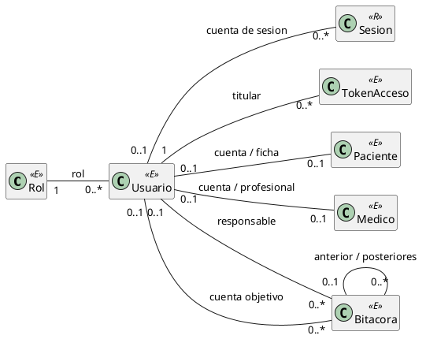

#### 11.1.2. Pacientes y activación — 8 asociaciones

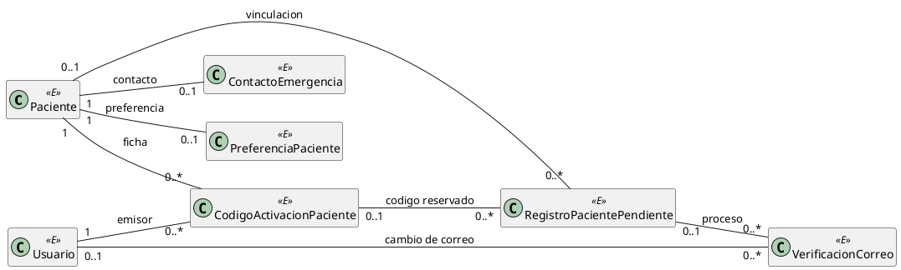

#### 11.1.3. Organización y citas — 12 asociaciones

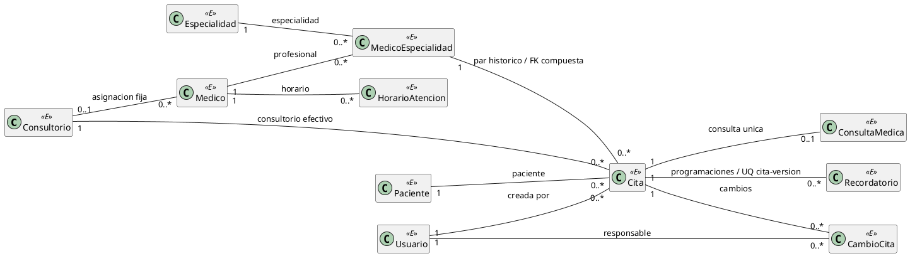

#### 11.1.4. Consulta y versiones clínicas — 6 asociaciones

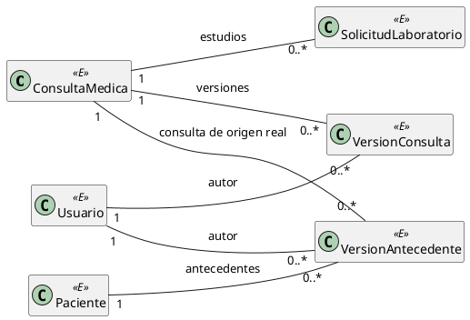

#### 11.1.5. Versiones, documentos y publicación de laboratorio — 9 asociaciones

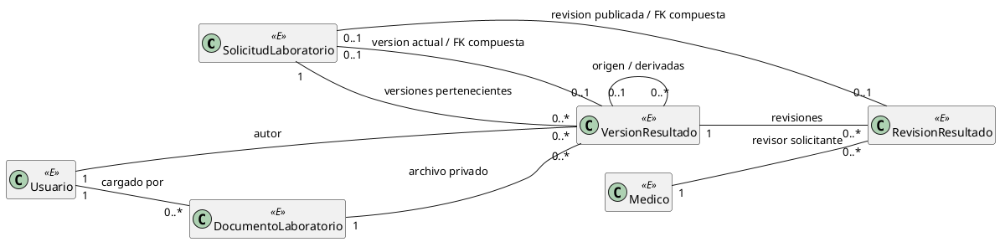

### 11.2. Herramientas, ejecución y evidencia de renderizado

Verificación local del 2026-10-23 con **PlantUML 1.2026.9**, distribución Java 8 oficial, **Java 1.8.0_111** disponible y **Graphviz 2.44.1** resuelto por PlantUML. `-testdot` confirmó disponibilidad y generación. Se descargó únicamente la herramienta desde la release oficial `plantuml/plantuml` de GitHub; **ningún contenido del proyecto se envió a un renderizador remoto**. JAR temporal, sin instalación ni dependencia nueva del proyecto; su SHA-256 coincide con el publicado en esa release:

```text
plantuml-java8-1.2026.9.jar
9de63b51b10517b783253e0964d1db9b574506b70ea2aa8c3fa107ac17db8f06
```

Comandos ejecutados con `-charset UTF-8` y `-DPLANTUML_LIMIT_SIZE=32768` para evitar depender de Cp1252/límites predeterminados. Extracción mecánica de los bloques a `.puml` temporales; `-checkonly`, generación `-tsvg` y `-tpng` completadas sin errores para **19/19 vistas**. Se abrieron las 19 imágenes PNG para revisar cuadros, texto, etiquetas E/P/R, flechas y multiplicidades. La comprobación XML de los SVG confirmó:

- Número de cajas de clase igual al origen en cada vista; las tres notas de entidades se distinguen de clases y no aumentan el inventario.
- Todos los enlaces del origen presentes: 300 dependencias de clases, tres enlaces-resumen de paquetes y 43 asociaciones originales, con sus 43 reproducciones focales verificadas por separado. Las referencias repetidas de una clase no cuentan como clases nuevas.
- **771 miembros textuales conservados en sus cajas**, incluso tras el ajuste de línea: 244 atributos persistidos + 3 derivados + 523 métodos + la alternativa futura rotulada del constructor. Cero diferencias de contenido detectadas entre miembros de origen y texto del SVG.

| Vista | Dimensiones SVG finales (px) |
| --- | ---: |
| CVS_global | 2915 × 1582 |
| CVS_entidades | 2765 × 3196 |
| CVS_usuarios | 1656 × 2876 |
| CVS_pacientes | 1605 × 753 |
| CVS_medicos | 1251 × 686 |
| CVS_planificacion | 1238 × 1427 |
| CVS_citas | 1708 × 1362 |
| CVS_agenda_bitacora | 1223 × 1349 |
| CVS_clinica | 1230 × 650 |
| CVS_laboratorio | 1705 × 1030 |
| CVS_recordatorios_reportes | 1270 × 813 |
| CVS_integracion_servicios | 1341 × 3886 |
| CVS_datos_acceso | 680 × 1449 |
| CVS_datos_atencion | 667 × 3554 |
| CVS_relaciones_acceso | 530 × 427 |
| CVS_relaciones_pacientes | 1049 × 324 |
| CVS_relaciones_citas | 1396 × 409 |
| CVS_relaciones_clinica | 505 × 353 |
| CVS_relaciones_laboratorio | 1153 × 290 |

**Alcance de legibilidad comprobado:** texto íntegro en los SVG, cuadros legibles a tamaño natural y asociaciones consultables en sus vistas focales. No se promete que la totalidad del global sea legible ajustada a cualquier pantalla o impresa en una única hoja; las vistas grandes requieren zoom/desplazamiento. El raster PNG se usó para revisión, no como sustituto del origen vectorial editable.

### 11.3. Auditoría de cobertura y coherencia

| Comprobación ejecutada | Resultado |
| --- | --- |
| Inventario de las cuatro familias PHP | 96 clases E: 27 Models, 24 Controllers, 26 Services, 19 Repositories; sin colisión con 27 P |
| Catálogo global y detalles canónicos | 124/124 participantes: 123 clases E/P + Sesion R; una sola definición completa de miembros por participante |
| Métodos E contra reflexión PHP | 381/381 firmas coincidentes en 69 clases operativas: visibilidad, parámetros, tipos, defaults y retornos; sin heredados |
| Columnas contra migraciones | 244/244 atributos coincidentes en 28 entidades, por nombre/tipo lógico/nulabilidad; 35 migraciones inspeccionadas, sin ejecutarlas |
| Miembros del UML contra §9 | 244 persistidos + 3 derivados, 381 métodos E + 129 de clases P + 13 ampliaciones P; reemplazo de constructor separado, no sobrecarga implementada |
| Identidad y estados entre vistas | Nombres/estereotipos consistentes, cinco clases E_P, Sesion R y 27 P; ningún actor/DTO/auxiliar/infraestructura convertido en caja |
| Asociaciones y multiplicidades | 43 relaciones del DER conservadas; FK opcional/obligatoria y UQ justifican 0..1/1 y 0..1/0..*; las cinco vistas focales reproducen exactamente las mismas 43 líneas y etiquetas |
| Dependencias | 300 enlaces de clase con extremos del catálogo; parámetros propios entre clases operativas cubiertos; sin ciclos Service → Service |
| Cobertura funcional documental | CU-01–CU-30 continuos; 17 con operación backend existente y 13 pendientes, sin cambiar su estado por dibujarlos |
| RF13 | Siete mínimos conservados; seis operaciones de ReporteRepository y agenda diaria mediante AgendaService/AgendaRepository; exportación no obligatoria |
| Confidencialidad y permisos representados | Sin valores de secretos/datos reales; antecedente/consulta solo por relación asistencial; archivo privado/reautorizado; Administrador no publica ni atiende; Paciente no cancela/reprograma |
| Formato y alcance de edición | UTF-8, bloques Markdown/PlantUML cerrados, espacios finales y diff-check correctos; hashes de DER/análisis/contexto intactos frente al inicio de fase 5 |

La auditoría del código usa autoload/reflexión y lectura de migraciones, **sin arrancar Laravel, ejecutar constructores de negocio, conectar PostgreSQL o simular que las clases P existen**. La verificación del UML es documental/estructural, no ejecución de casos de uso ni prueba de integración de la aplicación.

### 11.4. Reproducción y recursos temporales

La evidencia local de esta sesión queda fuera del repositorio, en `%LOCALAPPDATA%\Temp\opencode\cvs-uml-fase5\`: JAR verificado, fuentes extraídas y SVG/PNG. Su conservación es temporal y **el Markdown no depende de ellos**; no se añaden imágenes, JAR, scripts ni paquetes al proyecto.

Ejemplo para volver a extraer/renderizar **desde la raíz del repositorio**, disponiendo del JAR oficial verificado en esa carpeta temporal. La salida se limita al directorio temporal:

```powershell
$dir = Join-Path $env:LOCALAPPDATA 'Temp/opencode/cvs-uml-fase5'
$jar = Join-Path $dir 'plantuml-java8-1.2026.9.jar'
$doc = [IO.File]::ReadAllText((Resolve-Path 'docs/ai/diagrama-clases.md'))
$utf8 = [Text.UTF8Encoding]::new($false)
foreach ($b in [regex]::Matches($doc, '(?ms)^```plantuml\r?\n(.*?)^```')) {
    $uml = $b.Groups[1].Value
    $name = [regex]::Match($uml, '@startuml\s+(\w+)').Groups[1].Value
    [IO.File]::WriteAllText((Join-Path $dir "$name.puml"), $uml, $utf8)
}
java -DPLANTUML_LIMIT_SIZE=32768 -jar $jar -charset UTF-8 -checkonly "$dir/CVS_*.puml"
if ($LASTEXITCODE -ne 0) { throw 'Error de sintaxis PlantUML' }
java -Xmx1536m -DPLANTUML_LIMIT_SIZE=32768 -jar $jar -charset UTF-8 -tsvg "$dir/CVS_*.puml"
if ($LASTEXITCODE -ne 0) { throw 'Error de renderizado SVG' }
java -Xmx1536m -DPLANTUML_LIMIT_SIZE=32768 -jar $jar -charset UTF-8 -tpng "$dir/CVS_*.puml"
if ($LASTEXITCODE -ne 0) { throw 'Error de renderizado PNG' }
```

### 11.5. Cierre y pendientes funcionales conservados

**Diagrama global completado y validado dentro del alcance aprobado. Fases 1–5 cerradas documentalmente.** Se cubren los 30 CU, pero **no se cierra ningún CU funcional nuevo**: CU-15–CU-19 y CU-22–CU-29 siguen pendientes de implementación. Las clases/métodos P continúan siendo diseño, y los Models E de esos módulos no acreditan sus flujos terminados.

Antes de implementar deberán concretarse o aprobarse, donde sigan sin resolver, el alcance clínico granular/temporal, los criterios comprobables de cierre asistencial para retirar el rol Médico, la semántica exacta de períodos de cada reporte, límites técnicos de archivos y frecuencia del scheduler. No se crean permisos, estados, tablas, atributos ni plazos para suplir esas decisiones. La conservación de versiones no habilita corrección de resultados ya publicados ni acceso general a versiones privadas.

**Único archivo del proyecto editado durante esta fase: `docs/ai/diagrama-clases.md`.** Código PHP/React, base de datos, DER, análisis/contexto y documentos Word/PDF no se modifican; los cambios locales anteriores se conservan. No se ejecutan suites funcionales, migraciones, commits, push ni despliegues. La actualización de PHP y cualquier desarrollo funcional posterior requieren su autorización y alcance propios.
