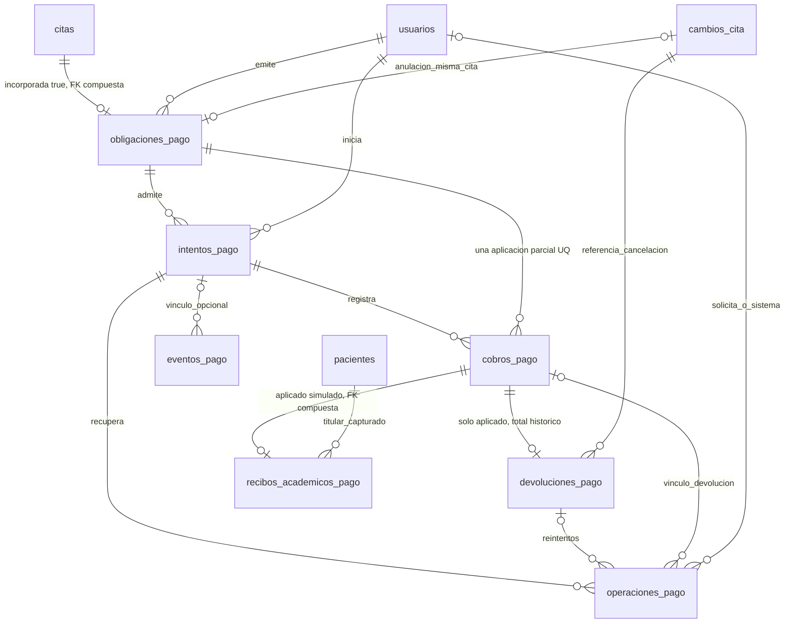

# Diagrama entidad-relación — Clínica Vida Salud

## Incremento Pagos — Persistencia acumulada 000040–000042 (2026-11-07)

**Esquema definido por el código, no inspección de una base desplegada:** contraste estático de las 42 migraciones propias en `backend/src/data/database/migrations/` y los 36 modelos de `backend/src/data/models/` (sessions usa el manejador nativo). Acumulado: **37 tablas, 386 columnas y 70 FK SQL**, incluidas las compuestas como una restricción cada una. Se conserva el alcance técnico anterior: sessions, controles de acceso, bitácora y outboxes sí; repositorio Artisan `migrations` y fixture `infrastructure_probe` no. No tablas de tarifas, liquidaciones, historia clínica ni reportes; no estado persistido Vencida ni columnas calculadas del API.

**000040** crea seis tablas financieras, añade `citas.incorporada_finanzas` y UQ de soporte en citas/cambios_cita. **000041** añade origen/modalidad/escenario/aprobación de intentos y modifica restricciones de simulación/operaciones/cobros. **000042** amplía el contexto simulado a local/academic, añade UQ compuesta en cobros y crea recibos académicos inmutables. Diccionario integrado en §§3.31–3.37; FK exactas en §4. Las cifras inferiores fechadas son antecedentes, no censos vigentes. [pagos-fase2-modelo.md](pagos-fase2-modelo.md) conserva el detalle histórico de 000040, no sustituye las dos migraciones posteriores.

Marca default false e inmutable: NoIncorporada y PendienteAsignacion son proyecciones, no columnas. UQ obligación/cita; FK compuesta exige incorporación true, pero una cita incorporada puede no tener obligación. Precio/tasa/autoría históricos inmutables; centavos/tasa 7:1/monedas validados en SQL. Slots parciales de intento y operación por obligación; UQ contextual de referencias/eventos; un cobro aplicado admite otros con incidencia; devolución total única del aplicado. El extremo 0..1 de obligación por cambio de anulación deriva de la FK a la misma cita más UQ(id_cita), no de una UQ aislada en id_cambio_anulacion. El dibujo agrupa FK coincidentes entre tablas; §4 cuenta cada restricción real. Los estados asistenciales permanecen intactos. La persistencia no acredita por sí sola autorización, firma ni entrega/recuperación externa.

**Evidencia histórica de Fase 2:** 74 pruebas/728 aserciones, según el cierre anterior; no reejecutadas en esta revisión documental ni extrapoladas a 000041/000042. Esta actualización no ejecuta migraciones, pruebas con base de datos ni operaciones de proveedores, y no acredita aplicación habitual/remota.

**CU-28 Fase3 (2026-10-31), sin cambio de esquema:** generación usa Recordatorio/UQ(cita,version_programacion) y prepara envios_recordatorio_push/UQ(aviso,suscripción) de000039; conserva destinatario/versiones capturados y estado Pendiente/intentos0 sin inferir entrega. Cambios de estado/preferencia/vigencia/programación invalidan aviso o descartan Pendientes según reglas, sin borrar historia/reabrir terminales. Solo se relaciona cita/ubicación vigente, no se agregan columnas clínicas/snapshots de ubicación ni tabla jobs. Aviso/auditoría/outbox inicial atómicos; barrido recupera faltantes autorizados. Continúa30 entidades/272 atributos/51 FK, fuentes gráficas/000038/000039 intactas;79/950 dirigidas con SQL aislado/inventario pre/post idéntico, contexto §17.186/README/análisis. No base habitual migrada, dispatcher o entrega acreditados.

## Incremento efectivo CU-28 Fase2 — Suscripciones y outbox (2026-10-31)

**Migraciones000038/000039 implementadas y probadas solo en esquemas de tests aislados:**30 entidades/272 atributos/51 FK al aplicar completo, frente a28/246/45 de000037. Dos tablas/26 atributos/seis FK nuevos; no modificar Draw.io histórico ni declarar base habitual/remota migrada. Especificación prevista F1 inferior conserva cronología; esta sección es el diccionario efectivo de las dos tablas añadidas. No generador/dispatcher operativo por existir outbox.

| Tabla | Columnas efectivas |
| --- | --- |
| suscripciones_push (12) | id_suscripcion BIGINT PK secuencia; instalacion_hash VARCHAR64 UQ NOT NULL; endpoint_hash VARCHAR64 UQ NOT NULL; datos_cifrados TEXT NOT NULL; id_usuario BIGINT FK NOT NULL; id_paciente BIGINT FK NOT NULL; version_autorizacion INTEGER NOT NULL; huella_cuenta VARCHAR64 NOT NULL; autorizada_en/actualizada_en/expira_en TIMESTAMPTZ6 NOT NULL; revocada_en TIMESTAMPTZ6 NULL. |
| envios_recordatorio_push (14) | id_envio BIGINT PK secuencia; id_recordatorio/id_suscripcion/id_usuario/id_paciente BIGINT FK NOT NULL; version_autorizacion INTEGER NOT NULL; estado VARCHAR16 NOT NULL default Pendiente; intentos INTEGER NOT NULL default0; proximo_intento_en/creado_en/actualizado_en TIMESTAMPTZ6 NOT NULL; reclamado_hasta TIMESTAMPTZ6 NULL; codigo_reclamo UUID NULL; resultado_seguro VARCHAR64 NULL. |

**Claves y relaciones:** SuscripcionPush N:1 Usuario y N:1 Paciente; EnvioRecordatorioPush N:1 Recordatorio/SuscripcionPush/Usuario/Paciente (seis FK restrictOnDelete/restrictOnUpdate). Destinatario Usuario/Paciente y versión de autorización del envío son snapshots, no derivados del nuevo propietario de una suscripción tras cambio autorizado. UQ(instalacion_hash),UQ(endpoint_hash),UQ(id_recordatorio,id_suscripcion); no notificación nueva por cada repetición. Índices usuario+id_suscripcion y estado+proximo_intento_en+id_envio. Huellas no autenticantes, endpoint/keys solo en datos_cifrados protegido por cast encrypted:array, nunca en bitácora o URL pública.

**CHECK efectivos:** versión de autorización>0, hashes hex64; expira_en>autorizada_en,actualizada_en>=autorizada_en,revocada_en NULL o>=autorizada_en. Envío: estado en Pendiente/Procesando/Aceptado/Descartado/Fallido/Incierto,intentos0–3,version>0; Procesando exige lease/token no NULL e intentos>0, los demás estados ambos NULL; actualizado_en>=creado_en. Son estados de infraestructura, no Cita/laboratorio. Relación coherente cuenta/Paciente/consentimiento se valida en Service, no se deduce de FK. F3/F5 deberán revalidar snapshots/vigencia antes de crear/despachar; la tabla sola no certifica entrega, lectura ni prevención de SSRF de conexión.

**Verificación:** unicidad/FK/checks, down/up en orden000039→000038 y000038→000039 preservando tablas previas, cifrado/privacidad y destinatarios anteriores tras reasignar probados en SuscripcionesPushTest. Aviso Recordatorio/preferencia/esquema anterior intactos, ningún cambio de datos habituales; inventario PostgreSQL inicial/final idéntico. Contexto §17.185/README/análisis registran selección187/2861 y límites. Aplicación real habitual y reconciliación operativa futuras requieren autorización.

> **Ruta de destino:** `docs/ai/diagrama-entidad-relacion.md`  
> **Proyecto:** Sistema Web para la Gestión de Citas Médicas para la Clínica Vida Salud  
> **Fuente estructural primaria:** `DER_Clinica_Vida_Salud_Reorganizado_Corregido(2).drawio` (archivo recibido, **dos pestañas**, **28 entidades**, **239 atributos** y **43 relaciones gráficas**)  
> **Referencia académica:** `Clinica_Vida_Salud_Coherencia_Actualizada(2).pdf` (117 páginas) y enunciado oficial del Segundo Parcial de Ingeniería de Requisitos  
> **Alcance vigente:** persistencia implementada en las definiciones acumuladas de migraciones hasta 000042, contrastada con Eloquent. Inventario/diccionario/FK de §§2–4 describen ese código; las guías y evidencias fechadas de §§5–7 se conservan como antecedentes y no añaden entidades previstas al esquema. **No acredita aplicación ni inspección de una base desplegada.** La fuente Draw.io de 28 entidades/239 atributos/43 conectores se conserva como antecedente, no como censo actual.

> **Incremento de laboratorio Fase 2 (2026-10-30, §6.23):** migración aditiva 000036 diseñada/implementada para autor de solicitud: **28 entidades, 245 atributos y 44 FK** contando la nueva creada_por → Usuario. Aplicación/verificación solo en tests aislados; no se afirma migrada la base habitual. Las cifras anteriores conservan su referencia histórica a 000035.

## 1. Propósito, precedencia y reglas de uso

Este documento conserva la organización del **DER corregido** y representa el esquema físico acumulado definido en el software, sin inventar requisitos. El diccionario integra las adiciones efectivas y precisa las unicidades normalizadas, nulabilidades y FK de las migraciones; los tipos lógicos originales se concretan en los apartados físicos de §6. Las guías históricas no prueban ejecución actual ni incorporan persistencia futura. La ampliación de `TokenAcceso.proposito` se distingue en §§3.4 y 6.15.

**Orden de autoridad:** (1) enunciado oficial del examen para RF01–RF13 y RN01–RN14; (2) decisiones funcionales aprobadas más recientes; (3) documento académico vigente; (4) DER corregido para el esquema lógico; (5) documentación técnica interna; (6) implementación existente, que es evidencia del estado del código, pero no autoriza cambiar los requisitos. Las decisiones aprobadas recogidas en los documentos funcionales `docs/ai/` conservan la prioridad de su fuente; no quedan subordinadas al DER por su ubicación. Ante una contradicción, **detener el cambio afectado, documentar el conflicto y pedir una decisión**. No inventar tablas, relaciones, reglas ni permisos para solucionarlo unilateralmente.

Esta revisión consolida las aclaraciones del modelo lógico sin aprobar decisiones físicas pendientes. Los archivos `.drawio` y PDF citados no están disponibles en el repositorio para este contraste: las cifras y referencias de origen se conservan como antecedente documental, sin afirmar una nueva comprobación contra esos originales ni la precedencia entre versiones académicas no disponibles.

El examen requiere PHP y PostgreSQL, con conexión por PDO/`pdo_pgsql` o equivalente aprobado. La solución del proyecto utilizará Laravel (Eloquent y migraciones), React y notificaciones internas. **No se permite añadir nuevos roles, estados de citas, RF/RN oficiales ni CU.** Los módulos de consulta clínica, laboratorio, seguridad ampliada y recordatorios son decisiones aprobadas del proyecto, no nuevos requisitos literales del enunciado.

**Alcance excluido:** pagos reales/producción, farmacia, inventario, telemedicina, múltiples sedes y recordatorios por correo, SMS o WhatsApp. **Ampliaciones aprobadas:** Pagos académicos CU-31–34 (2026-11-05), simulación persistente e instalación academic/recibo (2026-11-06; `pasarela-pagos.md`, notas iniciales), con persistencia 000040–000042; Web Push opcional CU-28 (2026-10-30), con persistencia 000038/000039. No se acredita activación operativa por documentar tablas. La clínica atiende presencialmente en una sede con varios consultorios.

**CU-28/Web Push, persistencia efectiva:** `suscripciones_push` y `envios_recordatorio_push` están definidos por 000038/000039; §§3.29–3.30 y §4 integran sus columnas/FK. Sustituyen las notas de diseño pendiente de F1. Recordatorio no equivale a suscripción ni a recepción push; los estados del outbox no son estados de Cita/laboratorio. La cookie de instalación no autentica. No se modelan como columnas el scheduler, el consentimiento de interfaz ni la entrega al dispositivo.

### 1.1. Convenciones

- **PK** = clave primaria; **FK** = clave foránea; **UQ** = unicidad; **IDX** = índice. Una marca compuesta significa ambas propiedades; donde un par constituye la FK o UQ, se indica explícitamente.
- **Obligatorio / NULL No** = NOT NULL en las migraciones acumuladas; **NULL Sí** admite NULL. **Admitir NULL no elimina condiciones de CHECK o de aplicación por estado/rol.** Una UQ parcial no convierte una relación histórica N en 1.
- Los nombres de entidades y atributos se copian del DER, incluidos `inicio_at`, `fin_at`, `password_hash`, `id_version_actual` y `id_revision_publicada`. No renombrarlos silenciosamente para ajustarlos a convenciones Laravel.
- `String`, `Text`, `BigInt`, `TimestampTZ`, `Date`, `Time`, `Integer`, `Boolean`, `JSONB` representan tipos lógicos del DER. Sus conversiones concretas a columnas PostgreSQL y longitudes no indicadas deben acordarse en el **diseño físico**. Los tipos nativos explícitos (`VARCHAR(120)`, `INET`, `UUID`, `SMALLINT`, `TIMESTAMPTZ`, etc.) sí son parte del modelo indicado.
- Campos temporales: almacenar instantes con referencia inequívoca y presentarlos en **`America/La_Paz`**. En especial, no reemplazar `TIMESTAMPTZ` por fechas locales ambiguas.
- Los estados y listas de valores del DER son **listas cerradas** cuando así se expresan. No crear categorías adicionales por conveniencia de implementación.
- Ninguna FK, CHECK o índice representa automáticamente las autorizaciones de rol, consistencia entre múltiples tablas, vigencias de códigos o concurrencia. Se requerirán validaciones de servidor, transacciones y restricciones de PostgreSQL específicas.

## 2. Inventario completo (37 tablas)

| Área | Entidades del DER |
|---|---|
| Acceso y seguridad | `Rol`, `Usuario`, `Sesion`, `TokenAcceso`, `ControlIntentos` |
| Pacientes y activación | `Paciente`, `ContactoEmergencia`, `PreferenciaPaciente`, `CodigoActivacionPaciente`, `RegistroPacientePendiente`, `VerificacionCorreo` |
| Organización médica | `Consultorio`, `Medico`, `Especialidad`, `MedicoEspecialidad`, `HorarioAtencion`, `ConfiguracionClinica` |
| Citas y seguimiento | `Cita`, `CambioCita`, `Recordatorio`, `SuscripcionPush`, `EnvioRecordatorioPush` |
| Registro clínico | `ConsultaMedica`, `VersionConsulta`, `VersionAntecedente` |
| Laboratorio digital | `SolicitudLaboratorio`, `VersionResultado`, `DocumentoLaboratorio`, `RevisionResultado` |
| Auditoría transversal | `Bitacora` |
| Pagos académicos | `ObligacionPago`, `IntentoPago`, `CobroPago`, `DevolucionPago`, `OperacionPago`, `EventoPago`, `ReciboAcademicoPago` |

**Importante:** no crear una entidad `HistoriaClinica` duplicada ni una tabla de reportes por defecto. La historia clínica se obtiene mediante Paciente, antecedentes versionados, consultas y laboratorio; los reportes RF13 se calculan a partir de las tablas pertinentes.

## 3. Diccionario de datos exacto del DER

El diccionario original se conserva y se completa con las migraciones implementadas. Las 28 correspondencias físicas están en §6.6.1; las nueve nuevas usan su nombre físico en §§3.29–3.37. `String`, `TimestampTZ`, etc. conservan la notación original, con longitudes/defaults físicos en §§6.6–6.13 y ampliaciones posteriores; no son propiedades del API. PK/FK/UQ y NULL se contrastan con DDL, no solo con relaciones Eloquent. Una marca UQ compuesta/parcial se desarrolla en el texto, sin afirmar unicidad individual de sus componentes.

### 3.1. `Rol`

Cuatro filas fijas; sin CRUD de tipos de roles ni permisos configurables.

**Restricciones únicas declaradas:** `(nombre)`.

| Marca | Atributo exacto | Tipo del DER | NULL | Referencia | Condición / valores / notas |
|---|---|---|---|---|---|
| PK | `id_rol` | `BigInt` | No | — | — |
| UQ | `nombre` | `String` | No | — | Valores: `Administrador`, `Recepcionista`, `Médico`, `Paciente` |

### 3.2. `Usuario`

Contraseña NULL solo durante invitación pendiente; obligatoria para una cuenta activa.

**Equivalencia de estado:** el valor persistido `Pendiente` de `Usuario.estado_cuenta` corresponde a la condición funcional **Pendiente de verificación**. Es la misma condición, no un estado adicional ni una autorización de acceso protegido; se conserva la lista cerrada del diccionario.

**Unicidad física:** índice `usuarios_correo_normalizado_uq` sobre `lower(btrim(correo_acceso))` (000006), no una UQ simple de columna.

| Marca | Atributo exacto | Tipo del DER | NULL | Referencia | Condición / valores / notas |
|---|---|---|---|---|---|
| PK | `id_usuario` | `BigInt` | No | — | — |
| FK | `id_rol` | `BigInt` | No | `Rol` | — |
| UQ | `correo_acceso` | `String` | No | — | Índice único sobre lower(btrim(correo_acceso)); VARCHAR(254). |
| — | `password_hash` | `String` | Sí | — | — |
| — | `estado_cuenta` | `String` | No | — | Valores: `Pendiente`, `Activa`, `Desactivada` |
| — | `correo_verificado_en` | `TimestampTZ` | Sí | — | — |
| — | `cambio_clave_obligatorio` | `Boolean` | No | — | — |
| — | `intentos_fallidos` | `Integer` | No | — | — |
| — | `bloqueado_hasta` | `TimestampTZ` | Sí | — | — |
| — | `creado_en` | `TimestampTZ` | No | — | — |
| — | `actualizado_en` | `TimestampTZ` | No | — | — |
| — | `nombres_personal` | `VARCHAR(120)` | Sí | — | Obligatorio cuando: Rol Administrador o Recepcionista sin entidad personal propia; Obligatorio y no vacío para personal administrativo; no duplica los nombres de Medico o Paciente. |
| — | `apellidos_personal` | `VARCHAR(120)` | Sí | — | Obligatorio cuando: Rol Administrador o Recepcionista sin entidad personal propia; Obligatorio y no vacío para personal administrativo; no duplica los nombres de Medico o Paciente. |

### 3.3. `Sesion`

Único almacén nativo de sesiones Laravel; tabla física sessions. Admite sesiones anónimas. Revocación por eliminación/invalidación y autorización del servidor, sin un segundo mecanismo.

| Marca | Atributo exacto | Tipo del DER | NULL | Referencia | Condición / valores / notas |
|---|---|---|---|---|---|
| PK | `id` | `VARCHAR(255)` | No | — | — |
| FK | `user_id` | `BIGINT` | Sí | `Usuario` | — |
| — | `ip_address` | `VARCHAR(45)` | Sí | — | — |
| — | `user_agent` | `TEXT` | Sí | — | — |
| — | `payload` | `TEXT` | No | — | — |
| IDX | `last_activity` | `INTEGER` | No | — | Segundos Unix de última actividad; índice nativo de Laravel. |

**Nombre físico obligado por el DER:** `sessions`. No crear una segunda tabla de sesiones ni cambiar estos nombres nativos para adaptarlos al idioma del resto de las tablas.

### 3.4. `TokenAcceso`

**Ampliación aprobada posterior al Draw.io:** el catálogo original de dos propósitos se amplía con `CredencialTemporal` por decisión expresa para CU-03. No cambia nombres, tipos, nulabilidades, número de atributos ni relaciones. El `.drawio` original no se modifica; la migración y evidencia actual se registran en §6.15.

**Uso funcional desde fase 6:** `CredencialTemporal` conserva un HMAC-SHA256 separado por propósito y los instantes existentes; se consume solo al confirmar el cambio definitivo y se invalida al reemitir, cerrar expresamente sin completar o cambiar estado/rol. El hash anterior de Usuario permanece inhabilitado por `cambio_clave_obligatorio` hasta guardar el definitivo. El identificador del token y el tipo restringido se guardan en el payload cifrado de la sesión nativa, sin atributos nuevos del dominio. La exclusividad de sesión y la emisión/consumo se coordinan bajo bloqueo de Usuario; continuidad global antes de emitir. Plazos y pruebas en reglas §4.4/análisis §20/contexto §17.23; no se añaden tablas, columnas, FK o migraciones.

**Restricciones únicas declaradas:** `(token_hash)`.

| Marca | Atributo exacto | Tipo del DER | NULL | Referencia | Condición / valores / notas |
|---|---|---|---|---|---|
| PK | `id_token` | `BigInt` | No | — | — |
| FK | `id_usuario` | `BigInt` | No | `Usuario` | — |
| — | `proposito` | `String` | No | — | Valores: `InvitacionPersonal`, `RecuperacionClave`, `CredencialTemporal` (ampliación aprobada, §6.15) |
| UQ | `token_hash` | `String` | No | — | — |
| — | `emitido_en` | `TimestampTZ` | No | — | — |
| — | `expira_en` | `TimestampTZ` | No | — | — |
| — | `consumido_en` | `TimestampTZ` | Sí | — | — |
| — | `invalidado_en` | `TimestampTZ` | Sí | — | — |

### 3.5. `ControlIntentos`

Control técnico por proceso/correo/origen; sin códigos, contraseñas ni datos clínicos.

**Restricciones únicas declaradas:** `(clave_ambito_hash)`.

| Marca | Atributo exacto | Tipo del DER | NULL | Referencia | Condición / valores / notas |
|---|---|---|---|---|---|
| PK | `id_control` | `BigInt` | No | — | — |
| UQ | `clave_ambito_hash` | `String` | No | — | — |
| — | `inicio_ventana` | `TimestampTZ` | No | — | — |
| — | `cantidad_intentos` | `Integer` | No | — | — |
| — | `bloqueado_hasta` | `TimestampTZ` | Sí | — | — |
| — | `actualizado_en` | `TimestampTZ` | No | — | — |

### 3.6. `Paciente`

Sin credenciales. CI único cuando exista; cuenta opcional y como máximo una.

**Restricciones únicas declaradas:** `(id_usuario)`, `(codigo_paciente)`, `(documento_identidad)`.

| Marca | Atributo exacto | Tipo del DER | NULL | Referencia | Condición / valores / notas |
|---|---|---|---|---|---|
| PK | `id_paciente` | `BigInt` | No | — | — |
| FK/UQ | `id_usuario` | `BigInt` | Sí | `Usuario` | UNIQUE ordinario con NULL distintos, no índice parcial. |
| UQ | `codigo_paciente` | `String` | No | — | — |
| UQ | `documento_identidad` | `String` | Sí | — | Índice único parcial sobre btrim(documento_identidad) WHERE documento_identidad IS NOT NULL; varios NULL permitidos. |
| — | `nombres` | `String` | No | — | — |
| — | `apellidos` | `String` | No | — | — |
| — | `fecha_nacimiento` | `Date` | No | — | — |
| — | `sexo` | `String` | Sí | — | — |
| — | `telefono` | `String` | No | — | — |
| — | `correo_contacto` | `String` | Sí | — | — |
| — | `direccion` | `Text` | Sí | — | — |
| — | `activo` | `Boolean` | No | — | — |
| — | `creado_en` | `TimestampTZ` | No | — | — |
| — | `actualizado_en` | `TimestampTZ` | No | — | — |

### 3.7. `ContactoEmergencia`

**Restricciones únicas declaradas:** `(id_paciente)`.

| Marca | Atributo exacto | Tipo del DER | NULL | Referencia | Condición / valores / notas |
|---|---|---|---|---|---|
| PK | `id_contacto` | `BigInt` | No | — | — |
| FK/UQ | `id_paciente` | `BigInt` | No | `Paciente` | — |
| — | `nombre` | `String` | No | — | — |
| — | `parentesco` | `String` | No | — | — |
| — | `telefono` | `String` | No | — | — |

### 3.8. `PreferenciaPaciente`

Preferencias internas ya definidas; no alteran roles ni autorizaciones clínicas.

**Restricciones únicas declaradas:** `(id_paciente)`.

| Marca | Atributo exacto | Tipo del DER | NULL | Referencia | Condición / valores / notas |
|---|---|---|---|---|---|
| PK | `id_preferencia` | `BigInt` | No | — | — |
| FK/UQ | `id_paciente` | `BigInt` | No | `Paciente` | — |
| — | `recordatorios_habilitados` | `Boolean` | No | — | — |
| — | `preferencias_privacidad` | `JSONB` | No | — | — |
| — | `actualizado_en` | `TimestampTZ` | No | — | — |

### 3.9. `CodigoActivacionPaciente`

**Restricciones únicas declaradas:** `(codigo_hash)`.

| Marca | Atributo exacto | Tipo del DER | NULL | Referencia | Condición / valores / notas |
|---|---|---|---|---|---|
| PK | `id_codigo_activacion` | `BigInt` | No | — | — |
| FK | `id_paciente` | `BigInt` | No | `Paciente` | — |
| FK | `id_recepcionista` | `BigInt` | No | `Usuario` | — |
| UQ | `codigo_hash` | `String` | No | — | — |
| — | `emitido_en` | `TimestampTZ` | No | — | — |
| — | `expira_en` | `TimestampTZ` | No | — | — |
| — | `intentos_fallidos` | `Integer` | No | — | — |
| — | `consumido_en` | `TimestampTZ` | Sí | — | — |
| — | `invalidado_en` | `TimestampTZ` | Sí | — | — |

### 3.10. `RegistroPacientePendiente`

Reserva temporal de activación; no constituye una segunda cuenta ni una segunda ficha.

**Exclusividad física (000014, §6.9):** cuatro índices únicos parciales sobre id_paciente, id_codigo_activacion, btrim(documento_identidad) y lower(btrim(correo_propuesto)), WHERE completado_en IS NULL AND invalidado_en IS NULL; los tres primeros excluyen además NULL. No son UQ globales: cada Paciente/código puede tener muchos procesos históricos y a lo sumo uno abierto. El vencimiento no libera el índice por el mero paso del tiempo; el servidor invalida el proceso. Los reintentos autorizados reutilizan contexto protegido; §5.3 conserva el contrato funcional.

**Implementación Nuevo sin cambios estructurales:** `datos_registro` contiene solo los datos administrativos validados y `_contexto_hash`, HMAC de un secreto aleatorio de 256 bits guardado únicamente en cookie cifrada/HttpOnly de 24 horas. No es un atributo adicional de la entidad ni una credencial de sesión normal. El código de correo de seis dígitos se almacena en VerificacionCorreo como HMAC ligado al identificador del proceso. Inicio/reintento/reenvío/completado coordinan la llave PostgreSQL `(736202, 1)` antes de bloquear proceso/código; vinculación de 7B reutiliza esa llave y las futuras altas administrativas deberán compartirla para coordinar reservas, sin sustituir las UQ finales de CI/correo/cuenta. Al completar o invalidar se borran hash temporal y datos_registro; se conservan fechas/relaciones/metadatos y no se eliminan fichas/historia. No se crean Usuario o Paciente definitivos antes de verificar. Sin columnas, tablas o migraciones nuevas: 28 entidades, 239 atributos y 43 relaciones.

**Implementación Vinculacion/7B sin cambios estructurales:** `CodigoActivacionService` emite bajo sesión normal de Recepcionista/identidad presencial, ligado a ficha con CI y sin cuenta. Doce caracteres criptográficos alfanuméricos, 24 h/cinco errores/uso único; `codigo_hash` guarda HMAC separado por propósito y ligado al ID de Paciente. Sustitución invalida anteriores, sus reservas y verificaciones de correo en la misma transacción. `RegistroPacienteService` reutiliza `(736202,1)` y `porContexto()` para ambos tipos: Vinculacion guarda las FK existentes y solo `_contexto_hash` en datos_registro, con vencimiento igual al código presencial original. Las UQ parciales reservan ficha/código/CI/correo; otro contexto no toma la reserva. Confirmación revalida ficha/CI/ausencia de cuenta y ambos códigos vigentes, crea Usuario, modifica solo id_usuario y timestamp de la ficha original, consume ambos códigos y limpia el proceso atómicamente. Conserva actividad e historia; no duplica ficha ni autentica automáticamente. Error/UQ/auditoría revierten cuenta, vínculo y consumos. Alta administrativa futura debe compartir coordinación; el CRUD de CU-07 todavía no está implementado. Se conservan las 28 entidades/239 atributos/43 relaciones y las migraciones existentes.

| Marca | Atributo exacto | Tipo del DER | NULL | Referencia | Condición / valores / notas |
|---|---|---|---|---|---|
| PK | `id_registro_pendiente` | `BigInt` | No | — | — |
| FK | `id_paciente` | `BigInt` | Sí | `Paciente` | — |
| FK | `id_codigo_activacion` | `BigInt` | Sí | `CodigoActivacionPaciente` | — |
| — | `tipo_registro` | `String` | No | — | Valores: `Nuevo`, `Vinculacion` |
| — | `documento_identidad` | `String` | Sí | — | — |
| — | `correo_propuesto` | `String` | No | — | — |
| — | `password_hash_temporal` | `String` | Sí | — | Obligatorio cuando: Proceso pendiente y vigente |
| — | `datos_registro` | `JSONB` | Sí | — | Obligatorio cuando: Registro Nuevo pendiente |
| — | `iniciado_en` | `TimestampTZ` | No | — | — |
| — | `expira_en` | `TimestampTZ` | No | — | — |
| — | `completado_en` | `TimestampTZ` | Sí | — | — |
| — | `invalidado_en` | `TimestampTZ` | Sí | — | — |

### 3.11. `VerificacionCorreo`

Exactamente uno, compatible con `proposito`: `ActivacionPaciente` exige `id_registro_pendiente` informado e `id_usuario` NULL; `CambioCorreo` exige `id_usuario` informado e `id_registro_pendiente` NULL. Rechazar ambos presentes, ambos ausentes o una combinación incompatible con el propósito. Esta exclusividad XOR no cambia la nulabilidad individual de las FK.

| Marca | Atributo exacto | Tipo del DER | NULL | Referencia | Condición / valores / notas |
|---|---|---|---|---|---|
| PK | `id_verificacion` | `BigInt` | No | — | — |
| FK | `id_registro_pendiente` | `BigInt` | Sí | `RegistroPacientePendiente` | — |
| FK | `id_usuario` | `BigInt` | Sí | `Usuario` | — |
| — | `proposito` | `String` | No | — | Valores: `ActivacionPaciente`, `CambioCorreo` |
| — | `correo_destino` | `String` | No | — | — |
| — | `codigo_hash` | `String` | No | — | — |
| — | `enviado_en` | `TimestampTZ` | No | — | — |
| — | `expira_en` | `TimestampTZ` | No | — | — |
| — | `intentos_fallidos` | `Integer` | No | — | — |
| — | `consumido_en` | `TimestampTZ` | Sí | — | — |
| — | `invalidado_en` | `TimestampTZ` | Sí | — | — |

### 3.12. `Consultorio`

**Restricciones únicas declaradas:** `(codigo_consultorio)`.

| Marca | Atributo exacto | Tipo del DER | NULL | Referencia | Condición / valores / notas |
|---|---|---|---|---|---|
| PK | `id_consultorio` | `BigInt` | No | — | — |
| UQ | `codigo_consultorio` | `String` | No | — | — |
| — | `nombre` | `String` | No | — | — |
| — | `activo` | `Boolean` | No | — | — |
| — | `actualizado_en` | `TimestampTZ(6)` | No | — | Extensión técnica CU-11 fase 2, migración 000033: versión de edición con avance monotónico; no modifica ubicación de citas. |

### 3.13. `Medico`

Alta sin consultorio permitida. Un consultorio fijo válido es obligatorio para horarios reservables y nuevas citas; compartible solo con horarios compatibles.

**Restricciones únicas declaradas:** `(id_usuario)`, `(codigo_medico)`.

| Marca | Atributo exacto | Tipo del DER | NULL | Referencia | Condición / valores / notas |
|---|---|---|---|---|---|
| PK | `id_medico` | `BigInt` | No | — | — |
| FK/UQ | `id_usuario` | `BigInt` | Sí | `Usuario` | UNIQUE ordinario con NULL distintos, no índice parcial. |
| FK | `id_consultorio` | `BigInt` | Sí | `Consultorio` | Obligatorio cuando: Antes de configurar horarios reservables o registrar nuevas citas; Opcional al registrar el Médico por CU-10; asignación fija mediante CU-11. |
| UQ | `codigo_medico` | `String` | No | — | — |
| — | `registro_profesional` | `String` | No | — | — |
| — | `nombres` | `String` | No | — | — |
| — | `apellidos` | `String` | No | — | — |
| — | `telefono` | `String` | No | — | — |
| — | `correo_contacto` | `String` | No | — | — |
| — | `activo` | `Boolean` | No | — | — |

**Extensión técnica de CU-10 implementada (fuera de los 239 atributos originales):**

| Marca | Atributo exacto | Tipo físico | NULL | Referencia | Condición / valores / notas |
|---|---|---|---|---|---|
| — | `actualizado_en` | `TIMESTAMPTZ(6)` | No | — | Migración aditiva 000031, DEFAULT CURRENT_TIMESTAMP para filas existentes/nuevas. Versión monotónica y precondición bajo lock en edición administrativa de datos. |

### 3.14. `Especialidad`

**Unicidad física:** índice `especialidades_nombre_normalizado_uq` sobre `lower(btrim(nombre))` (000004), no una UQ simple de columna.

| Marca | Atributo exacto | Tipo del DER | NULL | Referencia | Condición / valores / notas |
|---|---|---|---|---|---|
| PK | `id_especialidad` | `BigInt` | No | — | — |
| UQ | `nombre` | `String` | No | — | — |
| — | `descripcion` | `Text` | Sí | — | — |
| — | `activa` | `Boolean` | No | — | — |

**Extensión técnica de CU-09 implementada (fuera de los 239 atributos del Draw.io original):**

| Marca | Atributo exacto | Tipo físico | NULL | Referencia | Condición / valores / notas |
|---|---|---|---|---|---|
| — | `actualizado_en` | `TIMESTAMPTZ(6)` | No | — | Migración aditiva 000030, DEFAULT CURRENT_TIMESTAMP para filas existentes/nuevas; Repository avanza de forma monotónica, Service compara precondición bajo lock. |

### 3.15. `MedicoEspecialidad`

Clave primaria compuesta; relación muchos a muchos.

**Restricciones únicas declaradas:** `(id_medico, id_especialidad)`.

| Marca | Atributo exacto | Tipo del DER | NULL | Referencia | Condición / valores / notas |
|---|---|---|---|---|---|
| PK/FK | `id_medico` | `BigInt` | No | `Medico` | — |
| PK/FK | `id_especialidad` | `BigInt` | No | `Especialidad` | — |

**Claves:** PK compuesta (`id_medico`, `id_especialidad`). Eloquent no ofrece una PK compuesta nativa equivalente a una PK simple; conservar la PK compuesta en PostgreSQL y tratar la relación como pivote con operaciones compatibles. No introducir un ID sustituto sin aprobación.

**Extensión técnica implementada en fase 4 (fuera de los 239 atributos originales):**

| Marca | Atributo exacto | Tipo físico | NULL | Referencia | Condición / valores / notas |
|---|---|---|---|---|---|
| — | `habilitada` | `BOOLEAN` | No | — | Migración aditiva 000032, DEFAULT TRUE e inicialización de pares previos; retirada false conserva PK/FK e historia, rehabilitación reutiliza el mismo par. |

**Decisión aprobada — retiro de habilitación futura (2026-10-21), implementada fase 4:** conservar la asociación y rechazar su retiro mientras tenga citas futuras Programadas/Confirmadas con inicio >= corte UTC capturado después de locks; ver VS-MED-07 y CU-10. Mantiene PK/FK y relaciones existentes. Nuevas reservas/reprogramaciones deberán comprobar habilitada bajo el mismo bloqueo de Médico, además de actividad de profesional/catálogo; no basta la FK. Retirar/rehabilitar cambia la marca, sin DELETE ni reescritura de citas. Se conserva al menos un par habilitado mediante Service/transacción; no se confunde con actividad del catálogo.

**Versionado administrativo:** fases 1/2 incorporan actualizado_en a Especialidad/Medico mediante 000030/000031 (§§6.16–6.17); fase 4 incorpora MedicoEspecialidad.habilitada mediante 000032 (§6.18). Esquema con las tres: 242 atributos. Los cambios reales de habilitación avanzan también la versión del Médico, con auditoría atómica. Se distingue aplicación en pruebas de aplicación en base habitual/Railway.

### 3.16. `HorarioAtencion`

Varios intervalos por Médico; consultorio derivado de su asignación fija.

| Marca | Atributo exacto | Tipo del DER | NULL | Referencia | Condición / valores / notas |
|---|---|---|---|---|---|
| PK | `id_horario` | `BigInt` | No | — | — |
| FK | `id_medico` | `BigInt` | No | `Medico` | — |
| — | `dia_semana` | `Integer` | No | — | — |
| — | `hora_inicio` | `Time` | No | — | — |
| — | `hora_fin` | `Time` | No | — | — |
| — | `activo` | `Boolean` | No | — | — |

### 3.17. `ConfiguracionClinica`

Una sola sede y una configuración vigente; no incorpora administración de múltiples sedes.

| Marca | Atributo exacto | Tipo del DER | NULL | Referencia | Condición / valores / notas |
|---|---|---|---|---|---|
| PK | `id_configuracion` | `Integer` | No | — | — |
| — | `nombre_sede` | `String` | No | — | — |
| — | `direccion_sede` | `Text` | Sí | — | — |
| — | `zona_horaria` | `String` | No | — | Valores: `America/La_Paz` |
| — | `duracion_turno_minutos` | `Integer` | No | — | — |
| — | `actualizado_en` | `TimestampTZ` | No | — | — |

### 3.18. `Cita`

FK compuesta (id_medico,id_especialidad) hacia MedicoEspecialidad. Duración y ubicación conservadas por atención.

**Unicidades físicas:** codigo_cita; id_propuesta_reserva (UNIQUE ordinario nullable, varios NULL); par (id_cita, incorporada_finanzas), añadido por 000040 para la FK financiera. No unicidad individual de incorporada_finanzas.

**Persistencia efectiva CU-13/CU-14:** UUID/UQ implementados por 000034 (§6.20); no tabla de turnos ni reservas pendientes. La propuesta no guardada no ocupa una fila. Las exclusiones de Médico/consultorio de 000019 se conservan y 000035 añade la de Paciente.

**Actualización efectiva fase 4, 2026-10-22:** exclusión `citas_paciente_no_solapado_excl` implementada por 000035, por Paciente e intersección de `tstzrange(inicio_at,fin_at,'[)')` solo en Programada/Confirmada (§6.21). La indicación pendiente anterior describe el estado histórico de fase 3. Médico/sala conservan sus exclusiones no Canceladas. Instalación verifica conflictos previos bajo lock exclusivo y aborta sin corregir datos. No atributos/relaciones nuevos ni aplicación a base habitual/Railway.

| Marca | Atributo exacto | Tipo del DER | NULL | Referencia | Condición / valores / notas |
|---|---|---|---|---|---|
| PK | `id_cita` | `BigInt` | No | — | — |
| UQ | `codigo_cita` | `String` | No | — | — |
| UQ | `id_propuesta_reserva` | `UUID` | Sí | — | Extensión técnica CU-14 fase 3, 000034; deduplicación durable, único si no NULL; generado por servidor y oculto en serialización genérica. |
| FK | `id_paciente` | `BigInt` | No | `Paciente` | — |
| FK | `id_medico` | `BigInt` | No | `MedicoEspecialidad(id_medico,id_especialidad)` | — |
| FK | `id_especialidad` | `BigInt` | No | `MedicoEspecialidad(id_medico,id_especialidad)` | — |
| FK | `id_consultorio` | `BigInt` | No | `Consultorio` | — |
| FK | `creada_por` | `BigInt` | No | `Usuario` | — |
| — | `inicio_at` | `TimestampTZ` | No | — | — |
| — | `fin_at` | `TimestampTZ` | No | — | — |
| — | `duracion_minutos` | `Integer` | No | — | — |
| — | `estado` | `String` | No | — | Valores: `Programada`, `Confirmada`, `Atendida`, `Cancelada`, `Inasistencia` |
| — | `motivo_breve` | `Text` | Sí | — | — |
| — | `modalidad` | `String` | No | — | Valores: `Presencial` |
| — | `sede_atencion` | `String` | No | — | — |
| — | `consultorio_atencion` | `String` | No | — | — |
| — | `version_programacion` | `Integer` | No | — | — |
| — | `creada_en` | `TimestampTZ` | No | — | — |
| — | `actualizada_en` | `TimestampTZ` | No | — | — |
| — | `incorporada_finanzas` | `BOOLEAN` | No | — | 000040; DEFAULT false; trigger impide cambiar la marca en UPDATE. UQ compuesta (id_cita, incorporada_finanzas); no obliga a emitir obligación. |

### 3.19. `CambioCita`

Historial administrativo inmutable: programación, intervalos, duración, ubicación y estados; sin contenido clínico. 000040 añade UQ(id_cambio_cita, id_cita) para la FK de anulación de obligaciones; no añade columnas ni una UQ individual de id_cita.

| Marca | Atributo exacto | Tipo del DER | NULL | Referencia | Condición / valores / notas |
|---|---|---|---|---|---|
| PK | `id_cambio_cita` | `BigInt` | No | — | — |
| FK | `id_cita` | `BigInt` | No | `Cita` | — |
| FK | `id_actor` | `BigInt` | No | `Usuario` | — |
| — | `operacion` | `String` | No | — | — |
| — | `realizado_en` | `TimestampTZ` | No | — | — |
| — | `estado_anterior` | `String` | Sí | — | — |
| — | `estado_nuevo` | `String` | No | — | — |
| — | `datos_anteriores` | `JSONB` | Sí | — | — |
| — | `datos_nuevos` | `JSONB` | No | — | — |
| — | `motivo` | `Text` | Sí | — | — |

### 3.20. `Recordatorio`

Destinatario derivado de Cita.id_paciente, incluso sin cuenta. Ampliación aprobada 2026-11-07/000050: un automático y como máximo un manual por cita/versión. No nueva entidad: cinco atributos y una FK opcional adicionales. Aplicación autorizada solo en pruebas aisladas; cifras/notas históricas conservan su fecha.

**Restricciones únicas declaradas:** `(id_cita, version_programacion, origen)` y `operacion_manual` nullable/única. CHECK exige metadatos manuales completos solo para Manual y nulos para Automatico. La UQ del outbox `(id_recordatorio,id_suscripcion)` no cambia.

| Marca | Atributo exacto | Tipo del DER | NULL | Referencia | Condición / valores / notas |
|---|---|---|---|---|---|
| PK | `id_recordatorio` | `BigInt` | No | — | — |
| FK | `id_cita` | `BigInt` | No | `Cita` | — |
| — | `version_programacion` | `Integer` | No | — | — |
| — | `generado_en` | `TimestampTZ` | No | — | — |
| — | `leido_en` | `TimestampTZ` | Sí | — | — |
| — | `invalidado_en` | `TimestampTZ` | Sí | — | — |
| — | `origen` | `VARCHAR(12)` | No | — | Automatico por defecto; Manual. |
| FK | `id_administrador` | `BIGINT` | Sí | `Usuario.id_usuario` | N:1, RESTRICT; obligatorio en Manual, rol verificado en servidor. |
| UQ | `operacion_manual` | `UUID` | Sí | — | Identificador idempotente, obligatorio en Manual. |
| — | `revision_manual` | `CHAR(64)` | Sí | — | HMAC de revisión, obligatorio en Manual. |
| — | `resultado_push` | `VARCHAR(32)` | Sí | — | Resultado inicial: Pendiente/Sin_dispositivos/No_disponible; no entrega. |

### 3.21. `Bitacora`

Nombre físico: bitacora. CU-30: consulta exclusiva del Administrador. Auditoría automática transversal, solo inserción y lectura ordinarias; sin secretos ni contenido clínico. Usuario responsable y cuenta objetivo son relaciones distintas y opcionales. Ampliación propia compatible con RN12 y RN14.

| Marca | Atributo exacto | Tipo del DER | NULL | Referencia | Condición / valores / notas |
|---|---|---|---|---|---|
| PK | `id_evento` | `BIGINT` | No | — | Identificador único generado en PostgreSQL. |
| — | `tipo_evento` | `VARCHAR(80)` | No | — | Clasificación técnica controlada en constantes del backend; no representa un nuevo CU. |
| — | `tipo_actor` | `VARCHAR(12)` | No | — | Valores: `USUARIO`, `SISTEMA`, `ANONIMO`; Origen del evento; no crea roles funcionales. |
| FK | `id_usuario_responsable` | `BIGINT` | Sí | `Usuario` | Obligatorio cuando: tipo_actor = USUARIO; Responsable autenticado; NULL para SISTEMA o ANONIMO. |
| — | `rol_responsable` | `VARCHAR(24)` | Sí | — | Valores: `Administrador`, `Recepcionista`, `Médico`, `Paciente`; Obligatorio cuando: tipo_actor = USUARIO; Rol histórico al ocurrir el evento; no se actualiza retroactivamente. |
| FK | `id_usuario_objetivo` | `BIGINT` | Sí | `Usuario` | Cuenta afectada, distinta o igual al responsable. Una identidad inferida en login fallido nunca se atribuye como responsable. |
| — | `rol_objetivo` | `VARCHAR(24)` | Sí | — | Valores: `Administrador`, `Recepcionista`, `Médico`, `Paciente`; Obligatorio cuando: id_usuario_objetivo IS NOT NULL; Rol histórico de la cuenta objetivo; NULL cuando no existe cuenta objetivo. |
| — | `modulo` | `VARCHAR(40)` | No | — | Módulo existente relacionado con el evento; valores controlados. |
| — | `operacion` | `VARCHAR(60)` | No | — | Acción ejecutada o intentada; nomenclatura consistente. |
| — | `resultado` | `VARCHAR(16)` | No | — | Valores: `EXITO`, `FALLO`, `DENEGADO`, `ERROR`; EXITO: confirmada; FALLO: objetivo no alcanzado; DENEGADO: seguridad; ERROR: fallo técnico inesperado. |
| — | `causa_codigo` | `VARCHAR(64)` | Sí | — | Código seguro como CREDENCIALES_INVALIDAS, SIN_PERMISO, CUENTA_INACTIVA, CODIGO_EXPIRADO o TURNO_OCUPADO; sin SQL ni trazas. |
| — | `ocurrido_en` | `TIMESTAMPTZ` | No | — | Instante real del evento, originado en backend confiable. Campo del filtro por fecha; presentación America/La_Paz. |
| — | `registrado_en` | `TIMESTAMPTZ` | No | — | Predeterminado documentado: `clock_timestamp()`; Instante de inserción asignado por PostgreSQL. Orden principal junto con id_evento; no es fecha de modificación. |
| — | `direccion_ip` | `INET` | Sí | — | IPv4/IPv6 derivada de la petición en Laravel y proxies confiables; NULL si no está disponible. |
| — | `procedencia_ip` | `VARCHAR(24)` | Sí | — | Valores: `DIRECTA`, `PROXY_CONFIABLE`; Forma de obtención de la IP; no geolocalización. NULL cuando no puede determinarse. |
| — | `entidad_referida` | `VARCHAR(64)` | Sí | — | Entidad principal en lista permitida. Referencia documental heterogénea, sin FK universal. |
| — | `registro_referido` | `VARCHAR(64)` | Sí | — | Identificador interno del recurso principal. Requiere entidad_referida; validación del servicio. |
| — | `correlacion` | `UUID` | No | — | UUID generado por el backend por petición/operación o tarea. Compartido por sus eventos; NO UNIQUE. |
| FK | `id_evento_relacionado` | `BIGINT` | Sí | `Bitacora` | Evento anterior opcional, previamente persistido. FK inmediata y vínculo inmutable; sin autorreferencia directa ni ciclos. |
| — | `version_formato` | `SMALLINT` | No | — | Predeterminado documentado: `1`; Versión positiva del formato de auditoría; valor inicial 1. |
| — | `cambios_seguros` | `JSONB` | Sí | — | Objeto con cambios administrativos expresamente permitidos; no versiones clínicas ni datos secretos. |
| — | `metadatos_seguros` | `JSONB` | Sí | — | Objeto con metadatos operativos mínimos, claves permitidas, límites de tamaño y valores validados; nunca request/respuesta completa. |
| — | `referencias` | `JSONB` | Sí | — | Objeto de referencias adicionales a recursos internos autorizados; sin URLs firmadas, credenciales, documentos ni duplicación contradictoria de FK. |

**Nombre físico en el DER:** `bitacora` (no `bitacoras`). Efectuar escrituras automáticas y lecturas autorizadas; no exponer edición ni eliminación ordinarias.

### 3.22. `ConsultaMedica`

Paciente y Médico responsable derivados de Cita; no se duplican sus identificadores.

**Restricciones únicas declaradas:** `(codigo_consulta)`, `(id_cita)`.

| Marca | Atributo exacto | Tipo del DER | NULL | Referencia | Condición / valores / notas |
|---|---|---|---|---|---|
| PK | `id_consulta` | `BigInt` | No | — | — |
| UQ | `codigo_consulta` | `String` | No | — | — |
| FK/UQ | `id_cita` | `BigInt` | No | `Cita` | — |
| — | `iniciada_en` | `TimestampTZ` | Sí | — | Instante real de inicio si se conoce; NULL no demuestra ausencia de atención ni habilita cambios administrativos. |
| — | `creada_en` | `TimestampTZ` | No | — | Creación obligatoria del registro; no sustituye ni completa automáticamente iniciada_en. |

### 3.23. `VersionConsulta`

Versiones completas e inmutables en almacenamiento clínico protegido; la mayor versión es la vigente.

**Restricciones únicas declaradas:** `(id_consulta, numero_version)`.

| Marca | Atributo exacto | Tipo del DER | NULL | Referencia | Condición / valores / notas |
|---|---|---|---|---|---|
| PK | `id_version_consulta` | `BigInt` | No | — | — |
| FK | `id_consulta` | `BigInt` | No | `ConsultaMedica` | — |
| — | `numero_version` | `Integer` | No | — | — |
| FK | `id_autor` | `BigInt` | No | `Usuario` | — |
| — | `registrada_en` | `TimestampTZ` | No | — | — |
| — | `motivo_cambio` | `Text` | Sí | — | — |
| — | `tipo_consulta` | `String` | No | — | Valores: `Control`, `Enfermedad` |
| — | `motivo_consulta` | `Text` | No | — | — |
| — | `sintomas` | `Text` | Sí | — | — |
| — | `observaciones` | `Text` | Sí | — | — |
| — | `diagnostico` | `Text` | Sí | — | — |
| — | `indicaciones_tratamiento` | `Text` | Sí | — | — |

### 3.24. `VersionAntecedente`

Versiones clínicas inmutables con autor, fecha y consulta de origen obligatoria. El Paciente debe coincidir con ConsultaMedica → Cita; la bitácora general conserva solo referencias.

**Restricciones únicas declaradas:** `(id_paciente, numero_version)`.

| Marca | Atributo exacto | Tipo del DER | NULL | Referencia | Condición / valores / notas |
|---|---|---|---|---|---|
| PK | `id_version_antecedente` | `BigInt` | No | — | — |
| FK | `id_paciente` | `BigInt` | No | `Paciente` | — |
| — | `numero_version` | `Integer` | No | — | — |
| FK | `id_autor` | `BigInt` | No | `Usuario` | — |
| — | `registrada_en` | `TimestampTZ` | No | — | — |
| — | `motivo_cambio` | `Text` | Sí | — | — |
| — | `tipo_sangre` | `String` | Sí | — | — |
| — | `alergias` | `Text` | Sí | — | — |
| — | `enfermedades_cronicas` | `Text` | Sí | — | — |
| — | `medicamentos` | `Text` | Sí | — | — |
| — | `enfermedades_familiares` | `Text` | Sí | — | — |
| — | `antecedentes_relevantes` | `Text` | Sí | — | — |
| FK | `id_consulta_origen` | `BigInt` | No | `ConsultaMedica` | Obligatorio cuando: Toda nueva versión creada mediante CU-23; Consulta real del mismo Paciente y del Médico responsable; no se prevén excepciones de migración no existentes. |

### 3.25. `SolicitudLaboratorio`

Paciente y Médico solicitante se derivan de ConsultaMedica y Cita. Los dos punteros deben pertenecer a esta solicitud.

**Restricciones únicas declaradas:** `(id_version_actual)`, `(id_revision_publicada)`.

| Marca | Atributo exacto | Tipo del DER | NULL | Referencia | Condición / valores / notas |
|---|---|---|---|---|---|
| PK/FK | `id_solicitud` | `BigInt` | No | `VersionResultado(id_solicitud,id_version_resultado)` | Parte de FK compuesta con id_version_actual; MATCH SIMPLE permite el puntero NULL. |
| FK | `id_consulta` | `BigInt` | No | `ConsultaMedica` | — |
| — | `estudio_solicitado` | `String` | No | — | — |
| — | `solicitada_en` | `TimestampTZ` | No | — | — |
| — | `estado_interno` | `String` | No | — | Valores: `Pendiente`, `En revisión`, `Disponible` |
| FK/UQ | `id_version_actual` | `BigInt` | Sí | `VersionResultado`, `RevisionResultado` | UNIQUE ordinario con NULL distintos; participa en ambas FK compuestas. |
| FK/UQ | `id_revision_publicada` | `BigInt` | Sí | `RevisionResultado(id_revision,id_version_resultado)` | UNIQUE ordinario con NULL distintos; FK con id_version_actual. |
| FK | `creada_por` | `BIGINT` | Sí | `usuarios(id_usuario)` | 000036; creador ejecutor acreditado, no Médico responsable; índice propio. |

**Adición posterior al Draw.io, Fase 2 CU-24:** FK `solicitudes_laboratorio_creador_fk` ON DELETE/UPDATE RESTRICT e índice `solicitudes_laboratorio_creador_idx` (000036). Una solicitud tiene 0..1 Usuario creador acreditado y Usuario 0..* solicitudes creadas; NULL conserva legado desconocido. El API de alta exige actor autenticado real; la nulabilidad no acredita autoría de SQL externo. No derivar autor de Médico/cuenta vinculada actual ni actualizar solicitudes Disponible. Médico/Paciente responsables siguen derivados de ConsultaMedica→Cita; 000037 añade separadamente el revisor ejecutor.

### 3.26. `VersionResultado`

En el circuito ordinario previo a publicación (§5.8), cada asociación o sustitución crea una versión; la versión de origen conserva la trazabilidad, incluso entre solicitudes.

**Restricciones únicas declaradas:** `(id_solicitud, numero_version)`, `(id_solicitud, id_version_resultado)`.

| Marca | Atributo exacto | Tipo del DER | NULL | Referencia | Condición / valores / notas |
|---|---|---|---|---|---|
| PK | `id_version_resultado` | `BigInt` | No | — | — |
| FK | `id_solicitud` | `BigInt` | No | `SolicitudLaboratorio` | — |
| FK | `id_documento` | `BigInt` | No | `DocumentoLaboratorio` | — |
| — | `numero_version` | `Integer` | No | — | — |
| FK | `id_version_origen` | `BigInt` | Sí | `VersionResultado` | — |
| FK | `id_autor` | `BigInt` | No | `Usuario` | — |
| — | `registrada_en` | `TimestampTZ` | No | — | — |
| — | `motivo_cambio` | `Text` | Sí | — | — |

### 3.27. `DocumentoLaboratorio`

Archivo inmutable PDF o imagen; ruta privada y acceso autorizado, nunca enlace público directo.

**Restricciones únicas declaradas:** `(ruta_privada)`.

| Marca | Atributo exacto | Tipo del DER | NULL | Referencia | Condición / valores / notas |
|---|---|---|---|---|---|
| PK | `id_documento` | `BigInt` | No | — | — |
| FK | `cargado_por` | `BigInt` | No | `Usuario` | — |
| UQ | `ruta_privada` | `String` | No | — | — |
| — | `nombre_original` | `String` | No | — | — |
| — | `tipo_mime` | `String` | No | — | — |
| — | `tamano_bytes` | `BigInt` | No | — | — |
| — | `sha256` | `String` | No | — | — |
| — | `cargado_en` | `TimestampTZ` | No | — | — |

### 3.28. `RevisionResultado`

La decisión es un acto de revisión, no un cuarto estado de laboratorio. Devolver exige motivo.

**Restricciones únicas declaradas:** `(id_revision, id_version_resultado)`.

| Marca | Atributo exacto | Tipo del DER | NULL | Referencia | Condición / valores / notas |
|---|---|---|---|---|---|
| PK | `id_revision` | `BigInt` | No | — | — |
| FK | `id_version_resultado` | `BigInt` | No | `VersionResultado` | — |
| FK | `id_medico` | `BigInt` | No | `Medico` | — |
| — | `decision` | `String` | No | — | Valores: `Autorizar`, `Devolver` |
| — | `motivo` | `Text` | Sí | — | — |
| — | `revisada_en` | `TimestampTZ` | No | — | — |
| FK | `revisada_por` | `BIGINT` | Sí | `usuarios(id_usuario)` | 000037; ejecutor real opcional para legado, separado de id_medico; índice propio. |

### 3.29. `SuscripcionPush` — `suscripciones_push`

Fuente: 000038; modelo SuscripcionPush. Doce columnas; PK BIGSERIAL, sin timestamps convencionales. UQ individuales de instalacion_hash y endpoint_hash. Dos FK RESTRICT en ambas acciones.

| Marca | Atributo exacto | Tipo físico | NULL | Referencia | Condición / valores / notas |
|---|---|---|---|---|---|
| PK | `id_suscripcion` | `BIGINT` | No | — | Secuencia. |
| UQ | `instalacion_hash` | `VARCHAR(64)` | No | — | Hexadecimal minúsculo de 64 caracteres. |
| UQ | `endpoint_hash` | `VARCHAR(64)` | No | — | Hexadecimal minúsculo de 64 caracteres. |
| — | `datos_cifrados` | `TEXT` | No | — | Cast encrypted:array; endpoint/keys no son columnas separadas. |
| FK | `id_usuario` | `BIGINT` | No | `usuarios(id_usuario)` | — |
| FK | `id_paciente` | `BIGINT` | No | `pacientes(id_paciente)` | — |
| — | `version_autorizacion` | `INTEGER` | No | — | > 0. |
| — | `huella_cuenta` | `VARCHAR(64)` | No | — | Hexadecimal minúsculo de 64 caracteres. |
| — | `autorizada_en` | `TIMESTAMPTZ(6)` | No | — | Sin default. |
| — | `actualizada_en` | `TIMESTAMPTZ(6)` | No | — | >= autorizada_en. |
| — | `revocada_en` | `TIMESTAMPTZ(6)` | Sí | — | NULL o >= autorizada_en. |
| — | `expira_en` | `TIMESTAMPTZ(6)` | No | — | > autorizada_en. |

### 3.30. `EnvioRecordatorioPush` — `envios_recordatorio_push`

Fuente: 000039; modelo EnvioRecordatorioPush. Catorce columnas; UQ(id_recordatorio, id_suscripcion). Cuatro FK RESTRICT; ninguna FK individual es única. Destinatario y versión capturados no cambian de titular por reasignar una suscripción.

| Marca | Atributo exacto | Tipo físico | NULL | Referencia | Condición / valores / notas |
|---|---|---|---|---|---|
| PK | `id_envio` | `BIGINT` | No | — | Secuencia. |
| FK | `id_recordatorio` | `BIGINT` | No | `recordatorios(id_recordatorio)` | Parte de UQ compuesta. |
| FK | `id_suscripcion` | `BIGINT` | No | `suscripciones_push(id_suscripcion)` | Parte de UQ compuesta. |
| FK | `id_usuario` | `BIGINT` | No | `usuarios(id_usuario)` | Destinatario capturado. |
| FK | `id_paciente` | `BIGINT` | No | `pacientes(id_paciente)` | Destinatario capturado. |
| — | `version_autorizacion` | `INTEGER` | No | — | > 0. |
| — | `estado` | `VARCHAR(16)` | No | — | DEFAULT Pendiente; Pendiente/Procesando/Aceptado/Descartado/Fallido/Incierto. |
| — | `intentos` | `INTEGER` | No | — | DEFAULT 0; 0–3. |
| — | `proximo_intento_en` | `TIMESTAMPTZ(6)` | No | — | Sin default. |
| — | `reclamado_hasta` | `TIMESTAMPTZ(6)` | Sí | — | Lease. |
| — | `codigo_reclamo` | `UUID` | Sí | — | Token técnico, no UQ. |
| — | `resultado_seguro` | `VARCHAR(64)` | Sí | — | — |
| — | `creado_en` | `TIMESTAMPTZ(6)` | No | — | Sin default. |
| — | `actualizado_en` | `TIMESTAMPTZ(6)` | No | — | >= creado_en. |

CHECK exige lease/token presentes e intentos > 0 solo en Procesando; en los demás estados ambos NULL. No prueba entrega al dispositivo. Índices efectivos de ambas tablas detallados en el incremento CU-28 superior.

### 3.31. `ObligacionPago` — `obligaciones_pago`

Fuente: 000040; modelo ObligacionPago. Quince columnas. PK UUID sin default SQL/secuencia; regla común a los siete identificadores financieros, incluido id_cobro del recibo. Todas las FK financieras usan UPDATE/DELETE RESTRICT, MATCH SIMPLE inmediato. UQ(id_cita) y UQ(id_obligacion, centavos_usd).

| Marca | Atributo exacto | Tipo físico | NULL | Referencia | Condición / valores / notas |
|---|---|---|---|---|---|
| PK | `id_obligacion` | `UUID` | No | — | Asignado por el servidor. |
| FK/UQ | `id_cita` | `BIGINT` | No | `citas(id_cita,incorporada_finanzas)` | FK compuesta con incorporada_finanzas. |
| FK | `incorporada_finanzas` | `BOOLEAN` | No | `citas(id_cita,incorporada_finanzas)` | DEFAULT true; CHECK true. |
| — | `centavos_bob` | `INTEGER` | No | — | 700–700000. |
| — | `centavos_usd` | `INTEGER` | No | — | 100–100000; parte de UQ compuesta. |
| — | `tasa_numerador` | `INTEGER` | No | — | DEFAULT 7; CHECK = 7. |
| — | `tasa_denominador` | `INTEGER` | No | — | DEFAULT 1; CHECK = 1. |
| — | `moneda_original` | `VARCHAR(3)` | No | — | DEFAULT BOB; CHECK = BOB. |
| — | `moneda_cobro` | `VARCHAR(3)` | No | — | DEFAULT USD; CHECK = USD. |
| FK | `emitida_por` | `BIGINT` | No | `usuarios(id_usuario)` | Ejecutor real. |
| — | `emitida_en` | `TIMESTAMPTZ(6)` | No | — | Sin default. |
| — | `vencimiento_at` | `TIMESTAMPTZ(6)` | No | — | Persistido; Vencida no es columna/estado SQL. |
| — | `exigible` | `BOOLEAN` | No | — | DEFAULT true. |
| — | `anulada_en` | `TIMESTAMPTZ(6)` | Sí | — | Si no exigible, obligatoria y >= emitida_en. |
| FK | `id_cambio_anulacion` | `BIGINT` | Sí | `cambios_cita(id_cambio_cita,id_cita)` | FK compuesta con id_cita; obligatoria si no exigible. |

CHECK de conversión entera HALF_UP: centavos_usd = (2 * centavos_bob + 7) / 14. Exigible exige ambos datos de anulación NULL; no exigible exige ambos presentes. Trigger preserva ID/cita/incorporación/precio/tasa/monedas/emisor/emisión; vencimiento y exigibilidad no se declaran inmutables. La FK de anulación exige la misma cita, no comprueba por sí sola operacion/estado Cancelada del cambio.

### 3.32. `IntentoPago` — `intentos_pago`

Fuentes: 000040, 000041 y reemplazo de intentos_contexto_ck en 000042; modelo IntentoPago. Dieciocho columnas.

| Marca | Atributo exacto | Tipo físico | NULL | Referencia | Condición / valores / notas |
|---|---|---|---|---|---|
| PK | `id_intento` | `UUID` | No | — | Sin default. |
| FK | `id_obligacion` | `UUID` | No | `obligaciones_pago(id_obligacion)` | UQ parcial de intento activo, no global. |
| FK | `iniciado_por` | `BIGINT` | No | `usuarios(id_usuario)` | — |
| — | `proveedor` | `VARCHAR(8)` | No | — | stripe/paypal/simulado según contexto. |
| — | `entorno` | `VARCHAR(8)` | No | — | test/sandbox/local/academic según contexto. |
| — | `cuenta_contexto` | `VARCHAR(128)` | No | — | btrim no vacío. |
| — | `estado` | `VARCHAR(20)` | No | — | DEFAULT Preparando; Preparando/RequiereAccion/Procesando/Exitoso/Fallido/Cerrado/Incierto. |
| — | `captura_permitida` | `BOOLEAN` | No | — | DEFAULT false. True solo paypal y estado Preparando/RequiereAccion/Procesando/Incierto. |
| — | `referencia_inicio` | `VARCHAR(255)` | Sí | — | Si presente, btrim no vacío; UQ contextual. |
| — | `referencia_pago` | `VARCHAR(255)` | Sí | — | Si presente, btrim no vacío; UQ contextual. |
| — | `creado_en` | `TIMESTAMPTZ(6)` | No | — | Sin default. |
| — | `actualizado_en` | `TIMESTAMPTZ(6)` | No | — | >= creado_en. |
| — | `proxima_revision_en` | `TIMESTAMPTZ(6)` | Sí | — | — |
| — | `revisado_en` | `TIMESTAMPTZ(6)` | Sí | — | — |
| — | `origen` | `VARCHAR(16)` | No | — | 000041; DEFAULT Externo; Externo/Simulado. |
| — | `modalidad` | `VARCHAR(8)` | Sí | — | 000041; stripe/paypal en Simulado, NULL en Externo. |
| — | `escenario` | `VARCHAR(16)` | Sí | — | 000041; completado/pendiente en Simulado, NULL en Externo. |
| — | `aprobada_en` | `TIMESTAMPTZ(6)` | Sí | — | 000041; si presente, Simulado/paypal y >= creado_en. |

Contexto final: Externo admite stripe/test o paypal/sandbox, con modalidad/escenario/aprobada_en NULL. Simulado exige simulado, entorno local o academic, cuenta_contexto academico, modalidad/escenario presentes, referencias NULL y captura_permitida false. Trigger preserva origen/modalidad/escenario/proveedor/entorno/cuenta y una aprobación ya informada; no se atribuye esa inmovilidad a las demás columnas.

UQ de soporte (id_intento,id_obligacion) y (id_intento,proveedor,entorno,cuenta_contexto); UQ de (proveedor,entorno,cuenta_contexto,referencia_inicio) y análoga referencia_pago, con NULL distintos. Índice único parcial id_obligacion WHERE estado IN (Preparando,RequiereAccion,Procesando,Incierto): muchos intentos históricos, máximo uno activo.

### 3.33. `CobroPago` — `cobros_pago`

Fuentes: 000040; CHECK simulado de 000041 y UQ de soporte del recibo en 000042; modelo CobroPago. Trece columnas. No tabla aparte de liquidación: aplicado es una marca persistida de cobro.

| Marca | Atributo exacto | Tipo físico | NULL | Referencia | Condición / valores / notas |
|---|---|---|---|---|---|
| PK | `id_cobro` | `UUID` | No | — | Sin default. |
| FK | `id_intento` | `UUID` | No | `intentos_pago` | Dos FK compuestas: obligación y contexto (§4). |
| FK | `id_obligacion` | `UUID` | No | `intentos_pago`, `obligaciones_pago` | FK con id_intento y FK de importe. |
| FK | `proveedor` | `VARCHAR(8)` | No | `intentos_pago` | Parte de FK de contexto. |
| FK | `entorno` | `VARCHAR(8)` | No | `intentos_pago` | Parte de FK de contexto. |
| FK | `cuenta_contexto` | `VARCHAR(128)` | No | `intentos_pago` | Parte de FK de contexto. |
| — | `referencia_cobro` | `VARCHAR(255)` | No | — | btrim no vacío; simulado exige 'SIM-' || id_cobro::text. |
| FK | `centavos_usd` | `INTEGER` | No | `obligaciones_pago(id_obligacion,centavos_usd)` | Mismo importe de obligación. |
| — | `moneda` | `VARCHAR(3)` | No | — | DEFAULT USD; CHECK = USD. |
| — | `aplicado` | `BOOLEAN` | No | — | Sin default; unicidad parcial por obligación si true. |
| — | `incidencia_codigo` | `VARCHAR(64)` | Sí | — | Aplicado exige NULL; no aplicado exige código ^[A-Z][A-Z0-9_]{0,63}$. |
| — | `confirmado_en` | `TIMESTAMPTZ(6)` | No | — | Sin default. |
| — | `registrado_en` | `TIMESTAMPTZ(6)` | No | — | Sin default. |

UQ(proveedor,entorno,cuenta_contexto,referencia_cobro); UQ de soporte (id_cobro,aplicado), (id_cobro,centavos_usd), (id_cobro,id_intento) y, desde 000042, (id_cobro,aplicado,proveedor,id_obligacion,centavos_usd). Índice único parcial id_obligacion WHERE aplicado: máximo un aplicado, no máximo un cobro histórico. Trigger rechaza cualquier UPDATE de cobros.

### 3.34. `DevolucionPago` — `devoluciones_pago`

Fuente: 000040; modelo DevolucionPago. Nueve columnas. UQ(id_cobro) y UQ de soporte (id_devolucion,id_cobro). Las dos FK hacia cobros exigen aplicado true y el total exacto, sin duplicar proveedor/obligación.

| Marca | Atributo exacto | Tipo físico | NULL | Referencia | Condición / valores / notas |
|---|---|---|---|---|---|
| PK | `id_devolucion` | `UUID` | No | — | Sin default. |
| FK/UQ | `id_cobro` | `UUID` | No | `cobros_pago` | Parte de ambas FK compuestas. |
| FK | `cobro_aplicado` | `BOOLEAN` | No | `cobros_pago(id_cobro,aplicado)` | DEFAULT true; CHECK true. |
| FK | `centavos_usd` | `INTEGER` | No | `cobros_pago(id_cobro,centavos_usd)` | Total del cobro, no devolución parcial. |
| FK | `id_cambio_cancelacion` | `BIGINT` | No | `cambios_cita(id_cambio_cita)` | FK simple; SQL no demuestra misma cita ni tipo Cancelacion. |
| — | `motivo` | `VARCHAR(32)` | No | — | DEFAULT Cancelacion; CHECK = Cancelacion. |
| — | `estado` | `VARCHAR(16)` | No | — | DEFAULT Pendiente; Pendiente/Procesando/Exitosa/Fallida/Incierta. |
| — | `creada_en` | `TIMESTAMPTZ(6)` | No | — | Sin default. |
| — | `actualizada_en` | `TIMESTAMPTZ(6)` | No | — | >= creada_en. |

### 3.35. `OperacionPago` — `operaciones_pago`

Fuentes: 000040 y sustitución de CHECK tipo/clave externa en 000041; modelo OperacionPago. Veintitrés columnas. No FK directa a obligaciones: la pertenencia se garantiza por el par del intento (§4).

| Marca | Atributo exacto | Tipo físico | NULL | Referencia | Condición / valores / notas |
|---|---|---|---|---|---|
| PK | `id_operacion` | `UUID` | No | — | Sin default. |
| FK | `id_intento` | `UUID` | No | `intentos_pago` | Contexto y obligación mediante dos FK. |
| FK | `id_obligacion` | `UUID` | No | `intentos_pago(id_intento,id_obligacion)` | Índice parcial de exclusión de escritura. |
| FK | `id_devolucion` | `UUID` | Sí | `devoluciones_pago(id_devolucion,id_cobro)` | Presente exclusivamente para Devolver. |
| FK | `id_cobro` | `UUID` | Sí | `devoluciones_pago`, `cobros_pago` | Devolución y pertenencia al intento. |
| FK | `proveedor` | `VARCHAR(8)` | No | `intentos_pago` | Contexto. |
| FK | `entorno` | `VARCHAR(8)` | No | `intentos_pago` | Contexto. |
| FK | `cuenta_contexto` | `VARCHAR(128)` | No | `intentos_pago` | Contexto. |
| — | `tipo` | `VARCHAR(16)` | No | — | Crear/Capturar/Cerrar/Consultar/Devolver/Aprobar/Confirmar. |
| FK | `solicitada_por` | `BIGINT` | Sí | `usuarios(id_usuario)` | Usuario o sistema. |
| — | `clave_solicitud` | `UUID` | Sí | — | NULL si y solo si solicitada_por NULL. |
| — | `huella_solicitud` | `VARCHAR(64)` | No | — | Hexadecimal minúsculo de 64 caracteres. |
| — | `datos_solicitud_cifrados` | `TEXT` | Sí | — | Cast encrypted:array, no columnas por clave del JSON. |
| UQ | `clave_externa` | `UUID` | Sí | — | UNIQUE ordinario con NULL distintos. |
| — | `referencia_externa` | `VARCHAR(255)` | Sí | — | Si presente, btrim no vacío; UQ contextual. |
| — | `estado` | `VARCHAR(16)` | No | — | DEFAULT Pendiente; Pendiente/Procesando/Exitosa/Fallida/Incierta. |
| — | `ejecuciones` | `INTEGER` | No | — | DEFAULT 0; >= 0. |
| — | `proxima_ejecucion_en` | `TIMESTAMPTZ(6)` | No | — | Sin default. |
| — | `reclamado_hasta` | `TIMESTAMPTZ(6)` | Sí | — | Lease. |
| — | `codigo_reclamo` | `UUID` | Sí | — | No UQ. |
| — | `resultado_codigo` | `VARCHAR(64)` | Sí | — | NULL o código ^[A-Z][A-Z0-9_]{0,63}$. |
| — | `creada_en` | `TIMESTAMPTZ(6)` | No | — | Sin default. |
| — | `actualizada_en` | `TIMESTAMPTZ(6)` | No | — | >= creada_en. |

CHECK: Devolver exige ambos vínculos a devolución/cobro presentes; los demás tipos, ambos NULL. Procesando exige lease/token y ejecuciones > 0; otros estados, ambos NULL. Contexto simulado exige claves/referencias externas NULL; contexto stripe/paypal permite solo los cinco tipos externos y exige clave_externa salvo Consultar.

UQ(solicitada_por,tipo,id_intento,clave_solicitud) y UQ(proveedor,entorno,cuenta_contexto,tipo,referencia_externa), ambas con NULL distintos. Índices únicos parciales: id_obligacion WHERE tipo <> Consultar AND estado IN (Pendiente,Procesando,Incierta); (solicitada_por,id_obligacion,clave_solicitud) WHERE tipo = Crear; id_devolucion WHERE tipo = Devolver AND estado = Exitosa. No se deduce de ellos una sola operación histórica por intento/devolución/cobro.

### 3.36. `EventoPago` — `eventos_pago`

Fuente: 000040; modelo EventoPago. Dieciocho columnas. UQ(proveedor,entorno,cuenta_contexto,id_externo); id_externo no es único globalmente. Conserva solo contexto externo stripe/test o paypal/sandbox: 000041/000042 no amplían eventos a simulado.

| Marca | Atributo exacto | Tipo físico | NULL | Referencia | Condición / valores / notas |
|---|---|---|---|---|---|
| PK | `id_evento` | `UUID` | No | — | Sin default; distinto de bitacora.id_evento BIGINT. |
| FK | `proveedor` | `VARCHAR(8)` | No | `intentos_pago` | Parte de FK opcional compuesta. |
| FK | `entorno` | `VARCHAR(8)` | No | `intentos_pago` | Parte de FK opcional compuesta. |
| FK | `cuenta_contexto` | `VARCHAR(128)` | No | `intentos_pago` | btrim no vacío. |
| — | `id_externo` | `VARCHAR(255)` | No | — | btrim no vacío. |
| — | `tipo` | `VARCHAR(128)` | No | — | btrim no vacío; no catálogo de tipos SQL. |
| — | `huella_contenido` | `VARCHAR(64)` | No | — | Hexadecimal minúsculo de 64 caracteres. |
| — | `referencias` | `JSONB` | No | — | CHECK objeto; no son FK universales. |
| FK | `id_intento` | `UUID` | Sí | `intentos_pago(id_intento,proveedor,entorno,cuenta_contexto)` | MATCH SIMPLE permite evento aún sin vínculo. |
| — | `evidencia_cifrada` | `TEXT` | Sí | — | Cast encrypted:array. |
| — | `estado` | `VARCHAR(20)` | No | — | DEFAULT Pendiente; Pendiente/PendienteVinculo/Procesando/Aplicado/Ignorado/Cuarentena/Incierto. |
| — | `recepcion_en` | `TIMESTAMPTZ(6)` | No | — | Sin default. |
| — | `procesado_en` | `TIMESTAMPTZ(6)` | Sí | — | — |
| — | `proxima_ejecucion_en` | `TIMESTAMPTZ(6)` | No | — | Sin default. |
| — | `ejecuciones` | `INTEGER` | No | — | DEFAULT 0; >= 0. |
| — | `reclamado_hasta` | `TIMESTAMPTZ(6)` | Sí | — | Lease. |
| — | `codigo_reclamo` | `UUID` | Sí | — | No UQ. |
| — | `incidencia_codigo` | `VARCHAR(64)` | Sí | — | NULL o código ^[A-Z][A-Z0-9_]{0,63}$. |

Procesando exige lease/token y ejecuciones > 0; demás estados, ambos NULL. Trigger preserva recepción original: ID/contexto/identidad/tipo/huella/referencias/evidencia/recepcion_en; permite vincular intento y actualizar procesamiento. Las seis tablas de 000040 rechazan DELETE y TRUNCATE; no se afirma que todas rechacen cualquier UPDATE.

### 3.37. `ReciboAcademicoPago` — `recibos_academicos_pago`

Fuente: 000042; modelo ReciboAcademicoPago, sin relaciones Eloquent propias; CobroPago.recibo es lectura hasOne. Diecisiete columnas. FK compuesta al cobro aplicado simulado y FK simple al Paciente; no FK directa adicional a obligación/cita. Recibo opcional por cobro: PK compartida no obliga a emitir uno para cada cobro.

| Marca | Atributo exacto | Tipo físico | NULL | Referencia | Condición / valores / notas |
|---|---|---|---|---|---|
| PK/FK | `id_cobro` | `UUID` | No | `cobros_pago` | PK compartida; parte de FK de cinco columnas. |
| UQ | `numero` | `VARCHAR(44)` | No | — | CHECK = 'REC-ACA-' || id_cobro::text. |
| FK | `aplicado` | `BOOLEAN` | No | `cobros_pago` | DEFAULT true; CHECK true. |
| FK | `proveedor` | `VARCHAR(8)` | No | `cobros_pago` | DEFAULT simulado; CHECK = simulado. |
| FK | `id_obligacion` | `UUID` | No | `cobros_pago` | Snapshot coherente con cobro, no FK directa a obligaciones. |
| FK | `centavos_usd` | `INTEGER` | No | `cobros_pago` | Snapshot coherente con cobro. |
| — | `centavos_bob` | `INTEGER` | No | — | 700–700000; conversión entera (2 * centavos_bob + 7) / 14 = centavos_usd. |
| — | `tasa_numerador` | `INTEGER` | No | — | CHECK = 7; sin default. |
| — | `tasa_denominador` | `INTEGER` | No | — | CHECK = 1; sin default. |
| FK | `id_paciente` | `BIGINT` | No | `pacientes(id_paciente)` | FK independiente; no prueba titularidad respecto de la cita. |
| — | `codigo_paciente` | `VARCHAR(100)` | No | — | Snapshot, no UQ ni FK de código. |
| — | `nombre_titular` | `TEXT` | No | — | Longitud de btrim 1–500. |
| — | `codigo_cita` | `VARCHAR(100)` | No | — | Snapshot, no UQ ni FK de código. |
| — | `modalidad` | `VARCHAR(8)` | No | — | stripe/paypal; no modalidad asistencial. |
| — | `pagado_en` | `TIMESTAMPTZ(6)` | No | — | Sin default. |
| — | `emitido_en` | `TIMESTAMPTZ(6)` | No | — | CHECK = pagado_en. |
| — | `version_formato` | `SMALLINT` | No | — | DEFAULT 1; CHECK = 1. |

Trigger rechaza UPDATE/DELETE de recibos; 000042 no instala trigger contra TRUNCATE en esta tabla. No ruta PDF, bytes, MIME ni hash de archivo persistidos: el PDF se genera desde el snapshot. SQL no compara por sí solo nombre/códigos/importe BOB/tasa/modalidad/fechas con las tablas de origen; esa coherencia adicional corresponde al servidor. No se inventan FK para suplirla.

## 4. Relaciones gráficas y claves foráneas (70 FK implementadas)

Las filas 1–43 conservan orden y correspondencias del Draw.io y coinciden con las FK de 000001–000028; 44–70 integran adiciones efectivas. Cada fila es una FK SQL, incluidas las compuestas como una sola restricción. Nombres lógicos originales se resuelven con §6.6.1; las adiciones usan nombres físicos. Cardinalidades derivadas de NOT NULL, PK/UQ, predicados y MATCH SIMPLE, no de métodos Eloquent ni de mínimos funcionales. Todas usan ON UPDATE/DELETE RESTRICT y no son diferidas.

| Nº | Entidad referida | Entidad con FK | Atributo(s) del lado dependiente | Condición especial |
|---:|---|---|---|---|
| 1 | `Rol` | `Usuario` | `id_rol` | — |
| 2 | `Usuario` | `Sesion` | `user_id` | — |
| 3 | `Usuario` | `TokenAcceso` | `id_usuario` | — |
| 4 | `Usuario` | `Paciente` | `id_usuario` | — |
| 5 | `Paciente` | `ContactoEmergencia` | `id_paciente` | — |
| 6 | `Paciente` | `PreferenciaPaciente` | `id_paciente` | — |
| 7 | `Paciente` | `CodigoActivacionPaciente` | `id_paciente` | — |
| 8 | `Usuario` | `CodigoActivacionPaciente` | `id_recepcionista` | — |
| 9 | `Paciente` | `RegistroPacientePendiente` | `id_paciente` | — |
| 10 | `CodigoActivacionPaciente` | `RegistroPacientePendiente` | `id_codigo_activacion` | — |
| 11 | `RegistroPacientePendiente` | `VerificacionCorreo` | `id_registro_pendiente` | — |
| 12 | `Usuario` | `VerificacionCorreo` | `id_usuario` | — |
| 13 | `Usuario` | `Medico` | `id_usuario` | — |
| 14 | `Consultorio` | `Medico` | `id_consultorio` | — |
| 15 | `Medico` | `MedicoEspecialidad` | `id_medico` | — |
| 16 | `Especialidad` | `MedicoEspecialidad` | `id_especialidad` | — |
| 17 | `Medico` | `HorarioAtencion` | `id_medico` | — |
| 18 | `Paciente` | `Cita` | `id_paciente` | — |
| 19 | `Consultorio` | `Cita` | `id_consultorio` | — |
| 20 | `Usuario` | `Cita` | `creada_por` | — |
| 21 | `MedicoEspecialidad` | `Cita` | `id_medico,id_especialidad` | FK compuesta |
| 22 | `Cita` | `CambioCita` | `id_cita` | — |
| 23 | `Usuario` | `CambioCita` | `id_actor` | — |
| 24 | `Cita` | `Recordatorio` | `id_cita` | — |
| 25 | `Usuario` | `Bitacora` | `id_usuario_responsable` | — |
| 26 | `Cita` | `ConsultaMedica` | `id_cita` | — |
| 27 | `ConsultaMedica` | `VersionConsulta` | `id_consulta` | — |
| 28 | `Usuario` | `VersionConsulta` | `id_autor` | — |
| 29 | `Paciente` | `VersionAntecedente` | `id_paciente` | — |
| 30 | `Usuario` | `VersionAntecedente` | `id_autor` | — |
| 31 | `ConsultaMedica` | `SolicitudLaboratorio` | `id_consulta` | — |
| 32 | `VersionResultado` | `SolicitudLaboratorio` | `id_solicitud,id_version_actual` | FK compuesta |
| 33 | `RevisionResultado` | `SolicitudLaboratorio` | `id_revision_publicada,id_version_actual` | FK compuesta |
| 34 | `SolicitudLaboratorio` | `VersionResultado` | `id_solicitud` | — |
| 35 | `DocumentoLaboratorio` | `VersionResultado` | `id_documento` | — |
| 36 | `VersionResultado` | `VersionResultado` | `id_version_origen` | — |
| 37 | `Usuario` | `VersionResultado` | `id_autor` | — |
| 38 | `Usuario` | `DocumentoLaboratorio` | `cargado_por` | — |
| 39 | `VersionResultado` | `RevisionResultado` | `id_version_resultado` | — |
| 40 | `Medico` | `RevisionResultado` | `id_medico` | — |
| 41 | `Usuario` | `Bitacora` | `id_usuario_objetivo` | — |
| 42 | `Bitacora` | `Bitacora` | `id_evento_relacionado` | Un evento tiene 0..1 evento anterior; un evento previo puede ser referido por 0..* eventos posteriores. Vínculo inmutable, sin ciclos. |
| 43 | `ConsultaMedica` | `VersionAntecedente` | `id_consulta_origen` | Cada versión deriva de una ConsultaMedica; una consulta origina cero o muchas versiones de antecedentes. |
| 44 | `usuarios` | `solicitudes_laboratorio` | `creada_por` | 000036; solicitudes_laboratorio_creador_fk; opcional/N. |
| 45 | `usuarios` | `revisiones_resultado` | `revisada_por` | 000037; revisiones_resultado_revisor_fk; opcional/N. |
| 46 | `usuarios` | `suscripciones_push` | `id_usuario` | 000038; suscripciones_push_usuario_fk; obligatorio/N. |
| 47 | `pacientes` | `suscripciones_push` | `id_paciente` | 000038; suscripciones_push_paciente_fk; obligatorio/N. |
| 48 | `recordatorios` | `envios_recordatorio_push` | `id_recordatorio` | 000039; envios_push_recordatorio_fk; obligatorio/N. |
| 49 | `suscripciones_push` | `envios_recordatorio_push` | `id_suscripcion` | 000039; envios_push_suscripcion_fk; obligatorio/N. |
| 50 | `usuarios` | `envios_recordatorio_push` | `id_usuario` | 000039; envios_push_usuario_fk; obligatorio/N. |
| 51 | `pacientes` | `envios_recordatorio_push` | `id_paciente` | 000039; envios_push_paciente_fk; obligatorio/N. |
| 52 | `usuarios` | `obligaciones_pago` | `emitida_por` | 000040; FK inline; obligatorio/N. |
| 53 | `citas` | `obligaciones_pago` | `id_cita,incorporada_finanzas` | obligaciones_cita_fk; obligatorio/0..1 por UQ(id_cita), CHECK incorporación true. |
| 54 | `cambios_cita` | `obligaciones_pago` | `id_cambio_anulacion,id_cita` | obligaciones_anulacion_fk; opcional/0..1 por misma cita y UQ(id_cita). |
| 55 | `obligaciones_pago` | `intentos_pago` | `id_obligacion` | 000040; FK inline; obligatorio/N histórico, máximo un activo por índice parcial. |
| 56 | `usuarios` | `intentos_pago` | `iniciado_por` | 000040; FK inline; obligatorio/N. |
| 57 | `intentos_pago` | `cobros_pago` | `id_intento,id_obligacion` | cobros_intento_fk; obligatorio/N. |
| 58 | `intentos_pago` | `cobros_pago` | `id_intento,proveedor,entorno,cuenta_contexto` | cobros_contexto_fk; obligatorio/N; mismo intento que fila 57. |
| 59 | `obligaciones_pago` | `cobros_pago` | `id_obligacion,centavos_usd` | cobros_importe_fk; obligatorio/N, máximo un aplicado por índice parcial. |
| 60 | `cambios_cita` | `devoluciones_pago` | `id_cambio_cancelacion` | 000040; FK inline; obligatorio/N; no compuesta con cita. |
| 61 | `cobros_pago` | `devoluciones_pago` | `id_cobro,cobro_aplicado` | devoluciones_aplicado_fk; obligatorio/0..1 por UQ(id_cobro), CHECK aplicado true. |
| 62 | `cobros_pago` | `devoluciones_pago` | `id_cobro,centavos_usd` | devoluciones_total_fk; obligatorio/0..1; mismo cobro que fila 61. |
| 63 | `usuarios` | `operaciones_pago` | `solicitada_por` | 000040; FK inline; opcional/N. |
| 64 | `intentos_pago` | `operaciones_pago` | `id_intento,proveedor,entorno,cuenta_contexto` | operaciones_contexto_fk; obligatorio/N. |
| 65 | `intentos_pago` | `operaciones_pago` | `id_intento,id_obligacion` | operaciones_obligacion_fk; obligatorio/N; mismo intento que fila 64, no FK directa a obligación. |
| 66 | `devoluciones_pago` | `operaciones_pago` | `id_devolucion,id_cobro` | operaciones_devolucion_fk; opcional/N; presentes solo para tipo Devolver. |
| 67 | `cobros_pago` | `operaciones_pago` | `id_cobro,id_intento` | operaciones_cobro_fk; opcional/N, mismo intento del cobro. |
| 68 | `intentos_pago` | `eventos_pago` | `id_intento,proveedor,entorno,cuenta_contexto` | eventos_intento_fk; opcional/N por MATCH SIMPLE con id_intento NULL. |
| 69 | `pacientes` | `recibos_academicos_pago` | `id_paciente` | 000042; FK inline; obligatorio/N. |
| 70 | `cobros_pago` | `recibos_academicos_pago` | `id_cobro,aplicado,proveedor,id_obligacion,centavos_usd` | recibo_cobro_fk; obligatorio/0..1 por PK(id_cobro); CHECK aplicado true/proveedor simulado. |

### 4.1. Cardinalidades y restricciones especialmente sensibles

- **Lectura de todos los extremos:** en filas 1–43, cada dependiente tiene exactamente un padre salvo 2, 4, 9, 10, 11, 12, 13, 14, 25, 32, 33, 36, 41 y 42, que permiten 0..1. Cada padre admite 0..N dependientes salvo 4, 5, 6, 13, 26, 32 y 33, limitadas a 0..1 por PK/UQ. En 9/10 el índice parcial solo limita procesos abiertos, no todo el historial. En 32/33 las FK compuestas MATCH SIMPLE son opcionales por sus punteros NULL. Los CHECK de estado pueden exigirlos conjuntamente; ningún padre está obligado a tener hijos por estas FK. Para filas 44–70, obligatorio/opcional se refiere al padre de cada dependiente y N/0..1 al máximo de hijos del padre (mínimo siempre cero).

- `Paciente.id_usuario` y `Medico.id_usuario`: FK opcionales y UQ. Un Paciente o Médico puede existir sin cuenta web; una cuenta vinculada no puede relacionarse con dos fichas del mismo tipo. Verificar además compatibilidad del **rol** con la entidad (no se deduce de una FK).
- `ContactoEmergencia.id_paciente` y `PreferenciaPaciente.id_paciente`: FK y UQ; máximo un registro de cada clase por Paciente.
- `MedicoEspecialidad`: N:M con PK compuesta (`id_medico`, `id_especialidad`). `Cita` referencia **ambos campos a la vez**, evitando seleccionar una especialidad ajena al Médico.
- `ConsultaMedica.id_cita`: FK/UQ; cada Cita tiene **0..1 consulta**. Una consulta puede dar origen a varias versiones clínicas y varias solicitudes de laboratorio.
- `VersionConsulta`: UQ (`id_consulta`, `numero_version`). `VersionAntecedente`: UQ (`id_paciente`, `numero_version`) y `id_consulta_origen` obligatorio.
- `Recordatorio`: UQ (`id_cita`, `version_programacion`, `origen`) desde000050; un automático y un manual como máximo, no una fila por Paciente/cuenta. El destinatario se deriva de `Cita.id_paciente`; Administrador solicitante opcional→Usuario, separado del titular.
- `SolicitudLaboratorio`: mantener las referencias circulares **opcionales** `id_version_actual` e `id_revision_publicada`, resolviendo la pertenencia con **dos FK compuestas** y unicidades respaldadas: `VersionResultado(id_solicitud, id_version_resultado)` y `RevisionResultado(id_revision, id_version_resultado)`.
- `Bitacora`: dos FK diferentes hacia `Usuario`: actor responsable y cuenta objetivo. Ambas son opcionales; otra FK opcional refiere un evento anterior de la propia `Bitacora`.
- **Diferencias de representación Eloquent/DDL:** las relaciones de lectura simples de Cita→Medico/Especialidad no son dos FK SQL adicionales: la FK real es el par a medico_especialidad. SolicitudLaboratorio y los modelos financieros leen por IDs simples, pero la escritura queda restringida por todas las columnas de las FK compuestas anteriores. ReciboAcademicoPago no declara métodos de relación propios; sus dos FK existen igualmente. Casts encrypted:array persisten TEXT, no columnas JSON adicionales. No se halló discrepancia de nombre de tabla/PK entre esos mapeos y migraciones; el pivote declara primaryKey null en Eloquent pero conserva PK compuesta SQL. Las reglas de titularidad de recibo y cancelación de devolución no están completas en las FK: no se inventa una restricción para presentarlas como garantizadas por SQL.

## 5. Reglas de integridad y funcionamiento extraídas de la segunda pestaña

Se conserva el antecedente de la pestaña **«Reglas de integridad»**, dividido por tema, sin reproducir referencias rotas. No es un inventario de columnas adicionales ni una certificación de reglas de aplicación. Los permisos y avances funcionales fechados pueden estar superados por decisiones posteriores; para esta revisión de persistencia mandan las definiciones acumuladas reflejadas en §§2–4. No se modifican RF/RN ni se resuelven discrepancias funcionales inventando DDL.

### 5.1. ALCANCE DEL MODELO Y CONVENCIONES

- Modelo lógico propuesto basado en Clinica_Vida_Salud_Coherencia_Actualizada(2).pdf (117 páginas), el examen oficial y PN01–PN24 / CU-01–CU-30. No representa migraciones ejecutadas.
- PK: clave primaria. FK: clave foránea. UQ: unicidad. IDX: índice. Cardinalidades mínimas y máximas junto a los extremos; se conserva la notación numérica del modelo.
- Los tipos, valores admitidos, nulabilidad y restricciones también se conservan como datos editables de las filas y tablas de Draw.io.
- Los tipos lógicos se conservan; los campos nativos de Sesion y los tipos PostgreSQL indicados son decisiones de diseño. Longitudes restantes y migraciones se precisarán en el diseño físico.
- Los campos no marcados como opcionales en sus metadatos son obligatorios. Las unicidades opcionales admiten varios NULL y evitan repetir valores presentes.
- Las tablas de códigos, procesos pendientes, sesiones y límites son soporte técnico de los casos de uso existentes; no incorporan nuevas funciones.
- Una sede, varios consultorios y modalidad Presencial. Pagos académicos se incorpora por ampliaciones aprobadas de noviembre y 000040–000042; siguen excluidos pagos reales, telemedicina, farmacia, inventario y múltiples sedes.
- RF01–RF13 y RN01–RN14 se conservan. Los módulos clínico, documental y de seguridad adicionales corresponden a decisiones propias del proyecto.

### 5.2. USUARIOS, IDENTIDAD Y ROLES FIJOS

- Rol contiene únicamente Administrador, Recepcionista, Médico y Paciente. Los permisos se definen en el código; no existen tablas ni pantallas para configurarlos.
- Usuario.correo_acceso tiene índice único lower(btrim(correo_acceso)) en 000006, sin columna normalizada auxiliar. El correo de contacto no autentica ni cambia el de acceso.
- Paciente.id_usuario es FK opcional y única: cada paciente tiene cero o una cuenta y una cuenta vinculada identifica un solo paciente. Su rol debe ser Paciente.
- Medico.id_usuario es FK opcional y única. El acceso profesional exige una cuenta habilitada con rol Médico y vinculación al registro profesional correspondiente.
- CU-03 conserva el vínculo histórico Medico–Usuario al retirar el rol Médico; ese vínculo no concede acceso clínico con otro rol. Administrador ↔ Recepcionista y paso a Médico con identidad profesional legítima se rigen por VS-AUT-25/26. Retirar Médico exige resolver citas futuras/obligaciones incompatibles; si el modelo no permite comprobar su resolución, rechazar e informar, sin inventar cierre clínico. Rol, cuenta y actividad profesional son independientes; la inactivación necesaria se realiza expresamente por CU-10 y se coordina con nuevas reservas. No trasladar citas ni reasignar identidades/historia.
- El Administrador asigna exclusivamente roles del personal compatibles. No convierte cuentas de Paciente en personal ni modifica su rol, contraseña, correo de acceso o vinculación.
- Paciente conserva identificador interno y código únicos; el CI es `Paciente.documento_identidad`, no un atributo adicional llamado `ci` ni una PK. Su nulabilidad y unicidad cuando se informa se conservan: CU-07 admite excepcionalmente fichas administrativas sin CI, con NULL, nunca un documento ficticio o ajeno. Pueden mantener citas presenciales autorizadas e historial. Recepción revisa posibles fichas previas sin asumir que semejanza de nombres prueba identidad ni fusionarlas automáticamente; resolver identidades dudosas queda pendiente de diseño administrativo. Cuando el Paciente obtiene CI, Recepción comprueba identidad/documento y el servidor valida formato y unicidad conforme a la normalización vigente; se actualiza la misma ficha con trazabilidad, conservando identificador y todas sus relaciones, sin modificar contenido clínico ni crear otra ficha o cuenta. Ficha administrativa, cuenta web y bloqueo temporal son condiciones independientes.
- **Obligatoriedad funcional, no cambio estructural:** CU-04 exige CI para crear o vincular una cuenta web de Paciente. No cambiar `Paciente.documento_identidad` a NOT NULL por esta condición del procedimiento ni añadir CI a Usuario. Sin CI se rechaza CU-04 y se orienta a Recepción, sin alternativa de vinculación web. Es una decisión del proyecto, no exigencia literal universal de RF02; la vinculación posterior a incorporar CI conserva todos los controles ordinarios.
- Usuario conserva exclusivamente el hash de la contraseña. password_hash solo admite NULL durante una invitación pendiente; una cuenta activa exige hash y correo verificado.
- Pendiente, Activa y Desactivada son condiciones de la cuenta; el valor persistido Pendiente equivale funcionalmente a Pendiente de verificación (§3.2), sin crear otro estado. El bloqueo temporal se registra aparte. No son estados de cita ni de laboratorio.
- Tres contraseñas incorrectas consecutivas bloquean diez minutos; los intentos durante el bloqueo no lo extienden. El éxito o vencimiento reinicia el contador.
- Las contraseñas tienen al menos doce caracteres y se procesan con los mecanismos de hash de Laravel. La desactivación de cuenta impide también usar sesiones anteriores.
- CU-03: Administrador solo desactiva/reactiva cuentas de Pacientes existentes y verificadas por CU-04; conserva identificador, rol, credenciales, vínculo y todos sus registros. No activa cuentas pendientes omitiendo verificaciones.
- Desactivar invalida sesiones; reactivar exige nuevo inicio de sesión, no restaura sesiones ni elimina bloqueos vigentes y no activa la ficha. Ficha inactiva impide nuevas reservas, pero una cuenta activa puede consultar su historial autorizado.
- Usuario.nombres_personal y apellidos_personal (VARCHAR(120)) son obligatorios y no vacíos para Administrador/Recepcionista sin entidad personal propia; opcionales en general. No se duplican nombres de Medico o Paciente.
- Desactivaciones, cambios de rol y restablecimientos administrativos deben conservar al menos un Administrador Activo con activación/verificación completada, hash y acceso normal sin cambio obligatorio exclusivo, incluida la propia cuenta. Un bloqueo pasajero no equivale a desactivación ni excluye del cómputo, sin autorizar login mientras dure. Es una validación de conjunto transaccional de Services/PostgreSQL; las FK/CHECK existentes no implementan esa protección ni bastan conteos sin coordinación.
- **Primer Administrador:** la estructura actual de Usuario/Rol permite crearlo Activo por instalación local controlada, con correo único, hash seguro y marca de correo verificado por autorización administrativa, sin tabla, rol o estado especial. Esa marca no prueba control técnico del buzón ni implica envío Brevo; no aplica a cuentas ordinarias ni a Pacientes. Creación idempotente, sin credenciales predeterminadas ni sobrescritura de cuentas existentes y sin reutilizarla como alta general; véase contexto §17.12. No acredita CU-01 implementado. Los registros históricos posteriores de este documento conservan la decisión Pendiente original como antecedente, sustituida por la actualización de §6.14.

### 5.3. ACTIVACIÓN, CORREO Y RECUPERACIÓN

- Paciente nuevo: un RegistroPacientePendiente de tipo Nuevo conserva los datos administrativos exigidos en datos_registro; el Service debe exigir CI no vacío y válido, verificar su unicidad y ausencia de ficha previa y correo único antes de iniciar y revalidar al confirmar. No requiere código de Recepción. La nulabilidad lógica de documento_identidad en entidades persistidas no autoriza iniciar/completar CU-04 sin CI; no se modifica por ello el diccionario de §§2–4 ni el esquema físico.
- Vinculación: RegistroPacientePendiente exige id_paciente e id_codigo_activacion del mismo paciente y CI válido correspondiente a esa ficha. Antes, Recepción verifica presencialmente identidad y CI y comprueba ausencia de cuenta; si la ficha no tenía documento, debe incorporarlo primero por CU-07 conservando su identificador. No basta conocer el CI o id_paciente para vincular.
- La validación y reserva del código de Recepción deben ser atómicas: solo un proceso pendiente vigente puede reservarlo para ese Paciente. Mientras esté reservado, otro proceso independiente no puede utilizarlo. Reanudar exige el contexto protegido del mismo proceso, no solo conocer CI o correo.
- Para Nuevo y Vinculacion, impedir procesos independientes vigentes que compitan por el mismo CI cuando exista o correo propuesto, con normalización uniforme; para Vinculacion, también por el mismo Paciente o código de Recepción. Un reintento reutiliza el proceso válido sin reiniciar su vigencia ni sus límites; no expone datos de otro proceso ni crea una ficha definitiva anticipada.
- El código de Recepción tiene doce caracteres aleatorios criptográficos, vigencia de 24 horas, cinco errores y uso único. Solo se conserva su hash.
- Emitir otro código invalida el anterior y el proceso pendiente que lo utilice. La reserva del proceso no prolonga el vencimiento del código original.
- El registro nuevo pendiente vence a las 24 horas; la vinculación vence junto con el código de Recepción. Los datos temporales no se convierten en fichas duplicadas.
- VerificacionCorreo aplica la exclusividad XOR de §3.11: ActivacionPaciente → id_registro_pendiente informado e id_usuario NULL; CambioCorreo → id_usuario informado e id_registro_pendiente NULL. Ambos presentes, ambos ausentes y propósito incompatible son inválidos.
- El código de correo tiene seis dígitos, vigencia de diez minutos, cinco errores y uso único. Un reenvío invalida el anterior y no extiende las 24 horas del proceso.
- Los reenvíos respetan al menos sesenta segundos y un máximo de cinco por hora, por proceso y correo, además del control por origen en ControlIntentos.
- La activación revalida proceso, reserva, vigencias, intentos, unicidades y ausencia de cuenta vinculada dentro de la operación protegida; crea la cuenta y ficha nueva o vincula la ficha existente, marca el proceso completado y consume el código de correo y, en Vinculacion, también el de Recepción, en una misma transacción. Un fallo revierte esos cambios, sin vínculos parciales ni doble uso concurrente.
- PostgreSQL debe respaldar las unicidades y la exclusividad concurrente con restricciones adecuadas, coordinadas con transacciones y bloqueos Laravel. No basta consultar antes de insertar ni comprobar solo las FK opcionales. El diseño físico debe resolver la vigencia y el vencimiento sin asumir que un índice temporal se actualiza por el mero paso del tiempo; la estrategia concreta y sus pruebas siguen pendientes, sin añadir atributos al modelo lógico.
- Un fallo de envío no confirma una entrega inexistente ni habilita la cuenta; el proceso válido se conserva recuperable. Un reintento tras interrupción o respuesta incierta comprueba el estado persistido antes de repetir la confirmación y no crea otra cuenta ni consume otra vez los códigos. El correo externo se coordina tras confirmar la transacción correspondiente; no se trata como reversible mediante rollback SQL.
- El hash temporal se elimina al completar o caducar el proceso conforme a la política técnica; nunca se copia como credencial dentro de Paciente.
- Cambio de correo: exige sesión y contraseña actual; conserva el correo anterior hasta verificar el nuevo. Revalida unicidad al confirmar y no crea otra cuenta.
- El cambio de correo invalida las recuperaciones pendientes emitidas para el correo anterior. Verificar el correo no acredita por sí solo identidad civil.
- Invitación al personal: token de uso único, 24 horas, confirmación de correo y establecimiento de contraseña. Una reemisión invalida la anterior.
- Recuperación: token de uso único, sesenta minutos y cuenta activa con correo verificado. No inicia sesión ni reactiva cuentas; invalida sesiones anteriores al completarse.
- El cambio ordinario de contraseña invalida sesiones anteriores y renueva la actual. Las credenciales temporales excepcionales obligan al cambio antes del acceso normal.
- Procedimientos separados: CU-05 exige sesión normal y contraseña actual; la invitación inicial de CU-03 no exige una anterior inexistente; CU-06 mantiene enlace de 60 minutos/uso único y nuevo login, sin contraseña anterior. CU-03 restablece exclusivamente al personal previa identidad mediante credencial temporal: sesión restringida a formulario/envío de contraseña definitiva y cierre, nunca operaciones ordinarias. Al completar guarda hash, invalida credencial, elimina cambio obligatorio, revoca sesiones incompatibles, registra metadatos seguros y cierra la restringida con nuevo login obligatorio.
- `CredencialTemporal` reutiliza TokenAcceso con propósito propio (§3.4), no invitación o recuperación disfrazadas; emisión y expiración obligatorias, consumo e invalidación existentes. Duración, intentos, entrega, reemisión/usos, momento de consumo, tratamiento de contraseña anterior y concurrencia siguen pendientes del diseño técnico. La ampliación física de §6.15 no implementa ese ciclo ni permite omitir cuenta activa, verificaciones o bloqueos.
- Brevo se utiliza solo para correos de seguridad. Los límites y respuestas genéricas no revelan si una persona o una ficha existe.
- Sesion representa exclusivamente la tabla nativa sessions de Laravel: id PK VARCHAR(255), user_id FK BIGINT opcional, ip_address VARCHAR(45) opcional, user_agent TEXT opcional, payload TEXT obligatorio y last_activity INTEGER obligatorio.
- user_id → Usuario.id_usuario; índices en user_id y last_activity. Se conservan los nombres esperados por el manejador nativo. Un Usuario tiene 0..* sesiones; cada sesión tiene 0..1 Usuario y puede ser anónima.
- Se usa un único almacén de sesiones, sin tabla paralela. La expiración usa last_activity y la configuración de Laravel; invalidación/eliminación y comprobaciones del servidor aplican CU-01, CU-02, CU-03, CU-05 y CU-06, sin persistir secretos en bitácora.
- La recuperación administrativa excepcional es exclusiva del personal. Los cuatro roles recuperan su contraseña por correo verificado mediante CU-06. Reactivar una cuenta no sustituye recuperación ni verificaciones de identidad.

### 5.4. ORGANIZACIÓN MÉDICA Y CONFIGURACIÓN

- MedicoEspecialidad tiene PK compuesta (id_medico, id_especialidad). Una especialidad puede relacionarse con varios médicos; cada Médico se registra con una o más especialidades.
- Conservar asociaciones referidas por citas históricas. Su habilitación independiente está persistida en medico_especialidad.habilitada desde 000032 (§3.15); no elimina el par ni equivale a actividad del Médico/catálogo. La FK no impone por sí sola comprobar la habilitación.
- Especialidad.nombre es único tras normalización; se incluyen inicialmente Pediatría, Medicina General y Geriatría. Su inactivación conserva las relaciones históricas.
- Medico.id_consultorio admite NULL durante el alta por CU-10. CU-11 asigna un consultorio fijo válido antes de horarios reservables o nuevas citas. Varios Médicos pueden compartirlo solo con horarios compatibles.
- HorarioAtencion admite varios intervalos por Médico; dia_semana utiliza 1=lunes a 7=domingo y hora_fin debe ser posterior a hora_inicio.
- ConfiguracionClinica permite como máximo una fila por PK y CHECK(id_configuracion=1); SQL no exige que exista. Zona America/La_Paz y duración default quince minutos, siempre positiva; existencia inicial depende del seeder.
- **Concreción aprobada 2026-10-21 (CU-11/CU-12):** Medico.activo y HorarioAtencion.activo son independientes. Inactivar al profesional no altera horarios; cada horario activo sigue reservando franja administrativa hasta modificación/desactivación expresa compatible con citas vigentes. Desactivarlo no libera ocupación de citas existentes; reactivar al Médico no reactiva horarios. Desactivar Consultorio se rechaza con Médicos asignados u obligaciones futuras. La duración global debe caber en todos los intervalos activos, sin exigir múltiplo exacto y sin cambiar citas existentes. Reglas a implementar en Services/transacciones; las columnas booleanas existentes no garantizan su cumplimiento.
- **Persistencia CU-11/CU-12:** consultorios.actualizado_en TIMESTAMPTZ(6) NOT NULL implementado en fase 2 mediante migración aditiva 000033 con inicialización de existentes (§6.19). Horarios/asignaciones usarán medicos.actualizado_en y duración usará configuracion_clinica.actualizado_en ya existentes. No se añade versión a cada horario ni se duplica consultorio en él. El inventario con 000033 tiene 28 entidades/243 atributos/43 relaciones.
- No se inventa una dirección física: direccion_sede es opcional hasta contar con información real. No existe un catálogo de sedes múltiples.
- Un cambio de horario se rechaza íntegramente si perjudica citas futuras. No reprograma ni cancela citas automáticamente.
- Cambiar consultorio fijo valida horarios compartidos y citas futuras. Solo actualiza ubicación de Programadas o Confirmadas sin atención iniciada, en una operación atómica. Una ConsultaMedica que documenta atención real impide ese cambio aunque iniciada_en sea NULL; aplicar §5.7, sin inferir ausencia de atención del estado de Cita.
- El cambio de ubicación conserva código, paciente, Médico, especialidad, fechas, duración y estado; registra CambioCita y actualiza el mismo recordatorio.
- Las citas históricas y sus ubicaciones no cambian. Cualquier conflicto impide aplicar parcialmente la modificación de consultorio.

### 5.5. CITAS, CONCURRENCIA Y TRAZABILIDAD ADMINISTRATIVA

- Cita tiene código único, paciente válido y FK compuesta (id_medico,id_especialidad) hacia MedicoEspecialidad; se mantiene el vínculo aun al inactivar un catálogo.
- Antes de reservar: Paciente, Médico y especialidad activos; pertenencia Médico–especialidad y consultorio fijo válido. El servidor revalida los datos y almacena el consultorio en Cita, preservando la ubicación histórica.
- inicio_at y fin_at se almacenan con referencia temporal inequívoca y se presentan en America/La_Paz; fin_at = inicio_at + duracion_minutos.
- No se reservan fechas pasadas ni intervalos fuera del horario habilitado. Se verifica el intervalo completo, no solo la igualdad de las horas iniciales.
- La duración y la ubicación de cada cita son instantáneas de esa programación; cambiar la configuración no altera retroactivamente las reservas existentes.
- Solo Paciente para sí mismo y Recepción reservan. Solo Recepción reprograma o cancela. El Administrador no obtiene esas operaciones por gestionar la configuración.
- La reprogramación conserva id y código, paciente, Médico y especialidad. Aplica la duración vigente y el consultorio válido, y aumenta version_programacion.
- Paciente inactivo no recibe nuevas citas, pero Recepción puede reprogramar una cita existente. Médico o especialidad inactivos impiden asignarles un nuevo intervalo.
- La reprogramación confirma el nuevo intervalo y libera el anterior atómicamente. La validación del servidor se coordina con protección de concurrencia en PostgreSQL.
- No se permiten intervalos superpuestos para un mismo Médico o consultorio, incluso con solicitudes simultáneas. Los intervalos contiguos sí son compatibles.
- Cancelada no ocupa disponibilidad. Los registros Atendida e Inasistencia no se reutilizan para reservar su intervalo; no se elimina ni altera su atención histórica.
- Exclusiones implementadas: Médico/consultorio para estado <> Cancelada (000019) y Paciente para Programada/Confirmada (000035), con rangos [inicio,fin). No sustituyen validación/coordinación transaccional del servidor.
- CambioCita conserva autor, fecha, operación, estados y valores administrativos anteriores/nuevos. No guarda diagnósticos ni sustituye las versiones clínicas.
- **Implementado en CU-11 fase 3 (2026-10-21):** el traslado de ubicación actualiza id_consultorio/consultorio_atencion/actualizada_en de citas elegibles y añade CambioCita sin cambiar sus tiempos/estado. Conserva version_programacion en este cambio exclusivamente de ubicación; Recordatorio referencia Cita sin texto materializado de ubicación, por lo que el lector obtiene ubicación vigente desde esa relación, sin duplicar avisos. Contrato y revalidación concurrente en backend/README.md; esquema sin cambios adicionales.
- No se eliminan pacientes, médicos, especialidades, consultorios ni horarios referidos por historia; se desactivan y se restringen eliminaciones en cascada.
- Las tres exclusiones usan GiST/btree_gist; no hay columna de rango persistida ni predicado now(). Horario completo, vigencia de catálogos y autorización no se deducen de ellas.

### 5.6. CINCO ESTADOS Y CONTROL DE ASISTENCIA

- Estados exclusivos de Cita: Programada, Confirmada, Atendida, Cancelada e Inasistencia. Reprogramada no es un estado.
- Recepción: Programada → Confirmada con presencia e identidad verificadas, el mismo día local y antes del fin del intervalo. Se permite llegada anticipada ese día.
- Después del fin no se confirma ese turno; si sigue Programada y no hubo atención, Recepción puede reprogramar la misma cita y confirmar el nuevo turno válido.
- Recepción: Programada → Inasistencia solo tras finalizar el intervalo y comprobar ausencia. No se aplica desde Confirmada.
- Médico responsable: Programada o Confirmada → Atendida tras realizar la atención. Es un permiso fijo; no requiere confirmación previa de Recepción.
- Recepción puede cancelar Programada o Confirmada antes de la atención. Una cita con atención iniciada no se cancela ni reprograma por los procesos ordinarios. Si ConsultaMedica documenta atención real, la prohibición se mantiene aunque iniciada_en sea NULL y Cita aún figure Programada o Confirmada.
- Reprogramar Programada mantiene Programada; reprogramar Confirmada la devuelve a Programada. Atendida, Cancelada e Inasistencia son finales en las operaciones ordinarias.
- Consultar o completar una consulta y marcar Atendida son operaciones independientes; guardar el registro clínico no cambia automáticamente el estado de Cita.

### 5.7. HISTORIA CLÍNICA Y VERSIONES PROTEGIDAS

- La historia clínica es la vista integrada de Paciente, VersionAntecedente, ConsultaMedica y laboratorio. No se crea una tabla duplicada de historia ni de reportes.
- ConsultaMedica.id_cita es FK única: cada cita admite cero o una consulta y cada consulta pertenece exactamente a una cita.
- Paciente y Médico se derivan de la cita; el servidor valida al profesional responsable, sin duplicar identificadores que puedan contradecirse.
- La consulta puede empezar durante la atención con cita Programada o Confirmada, o registrarse/completarse después de Atendida. Nunca para Cancelada o Inasistencia.
- VersionConsulta conserva tipo Control/Enfermedad, motivo, síntomas, observaciones, diagnóstico e indicaciones según corresponda; los campos clínicos se completan progresivamente.
- VersionAntecedente conserva tipo de sangre, alergias, enfermedades crónicas, medicamentos y antecedentes personales y familiares, representados por antecedentes_relevantes y enfermedades_familiares. Paciente y Recepción no los editan; Administrador o Médico responsable lo hacen exclusivamente por CU-23 en atención real/autorizada, no por CU-07/CU-08. Corrección textual de exclusión administrativa antigua conforme a política aprobada, sin cambio de esquema.
- Las versiones (id_consulta,numero_version) y (id_paciente,numero_version) son únicas. Se inserta una versión completa por cambio, sin sobrescribir la anterior.
- La mayor versión confirmada es la vigente. La numeración y escritura se protegen frente a actualizaciones concurrentes para no perder cambios.
- Las correcciones conservan autor, fecha, motivo cuando corresponda y datos previos/nuevos en almacenamiento clínico protegido. La bitácora general solo guarda referencias.
- Cada nueva VersionAntecedente exige id_consulta_origen → ConsultaMedica.id_consulta. La consulta y su Cita deben corresponder al mismo Paciente de la versión; id_autor es el Usuario ejecutor real, Administrador o Médico responsable autorizado, con cuenta activa y sesión válida. Médico responsable se deriva de la Cita y no se sustituye por el ejecutor administrativo. La FK existente a Usuario ya permite esa autoría, sin nueva columna ni migración.
- Médico profesionalmente inactivo con cuenta activa puede completar atenciones y revisiones ya asignadas; una cuenta desactivada impide todo acceso protegido.
- El Paciente consulta solo su información autorizada. Las preferencias de privacidad no conceden acceso a terceros ni modifican los permisos fijos.
- Una consulta origina 0..* versiones de antecedentes y cada nueva versión tiene exactamente una consulta real. El alta o corrección se guarda íntegramente por CU-23, sin consultas ficticias, cambios de estado de Cita ni sobrescritura de versiones anteriores.
- ConsultaMedica.creada_en es obligatoria; iniciada_en admite NULL si se desconoce el inicio real. No se copia automáticamente creada_en ni se inventan horas. NULL no prueba que no hubo atención: una consulta que documenta atención real impide reprogramar, cancelar o cambiar ordinariamente su ubicación de forma incompatible, aunque Cita siga Programada o Confirmada. El servidor comprueba la atención documentada y las precondiciones bajo coordinación transaccional; no autoriza esas operaciones únicamente por iniciada_en IS NULL ni cambia automáticamente el estado de Cita.
- La pertenencia Paciente–consulta–Cita y la autorización del autor se verifican transaccionalmente en el servidor; una FK aislada no las demuestra. No se prevén registros migrados sin origen: cualquier migración real exigirá una política explícita sin excepciones para nuevas versiones.

### 5.8. LABORATORIO, CORRECCIÓN Y PUBLICACIÓN

**Nota incremental Fase 1 backend laboratorio (2026-10-29, contexto §17.171):** esquema físico y diagramas anteriores **sin cambios**. Se detectó ausencia de usuario ejecutor de solicitud y revisión: se diseñan adiciones futuras `solicitudes_laboratorio.creada_por` → Usuario en Fase 2 y `revisiones_resultado.revisada_por` → Usuario en Fase 4, con índices/relaciones y autor obligatorio para nuevas operaciones; legado sin prueba mantiene NULL, sin backfill por suposición ni mutar snapshots protegidos. No se cuentan aún columnas/FK nuevas en inventario. Paciente/Médico se derivan de ConsultaMedica/Cita; id_medico de revisión conserva responsable y el ejecutor se separa sin cambiar el significado de publicación que CU-22 ya compara. Revisar migración aditiva/fixtures/compatibilidad antes de implementar, no editar migraciones históricas ni quitar triggers de inmutabilidad para atribuir autorías.

**Alcance aprobado actual que complementa/supera exclusiones antiguas de §5.8:** Administrador también revisa/devuelve/autoriza por CU-26 con su Usuario real, nunca como Médico ficticio. Reasociación aprobada a destino Pendiente sin versiones/documento, incluso de otro Paciente verificado: nueva versión de destino apunta a versión de origen, fuente En revisión queda sin puntero vigente pero conserva historia y permite nueva carga con numeración acumulada. Ambos extremos se coordinan atómicamente y ninguno puede ser Disponible. Las FK/triggers existentes admiten ese origen cruzado y En revisión sin vigente; no autorizan por sí solos la operación ni permiten al Médico de destino acceder a información del origen. Archivo máximo/formato aprobados pertenecen a validación de CU-25, no a nuevas columnas. Diseño detallado/contratos en backend README; nuevas garantías de archivos/Services **no implementadas por esta nota**.

**Nota de lectura de §5.7 — Fase 1 clínica 2026-10-28:** VS-CLI-09–12 concretan versiones vigentes para Paciente (también consultas guardadas incompletas, sin versiones/motivos internos), relación médica por cita propia válida incluso futura, alta desde inicio con declaración de atención real y corrección efectiva con motivo/no-op validado. No publicación de consulta ni cambio físico del DER; UQ/FK/triggers/tablas/atributos/cardinalidades anteriores intactos. Las correcciones de autoría administrativa de §5.7 resuelven texto superado, no una migración. Laboratorio mantiene su publicación independiente descrita a continuación.

**Límite del circuito ordinario (CU-25 y CU-26):** la carga inicial parte de Pendiente; la devolución, corrección de asociación y sustitución se realizan en En revisión, antes de publicar. Disponible no admite por estos CU retiro de publicación, devolución, sustitución, reasociación ni modificación del resultado ya publicado. Cualquier procedimiento posterior a la publicación requiere definición funcional y autorización adicionales; no se deduce de conservar versiones ni se incorpora una transición de retorno.

- Una consulta puede originar cero o varias solicitudes; cada solicitud corresponde a un estudio y deriva paciente/Médico de la consulta y la cita.
- Estados internos exclusivos: Pendiente, En revisión y Disponible. Autorizar/Devolver son decisiones de revisión y no agregan estados.
- DocumentoLaboratorio contiene metadatos del archivo privado; VersionResultado conserva su asociación, número de versión, autor, fecha, origen y motivo de cambio.
- Cada nueva asociación o sustitución agrega una versión inmutable. Los documentos anteriores permanecen protegidos; nunca se sobrescribe el archivo para ocultar el cambio.
- FK compuesta implementada en 000028: SolicitudLaboratorio(id_solicitud,id_version_actual) → VersionResultado(id_solicitud,id_version_resultado), con UQ del par referenciado. La versión actual pertenece necesariamente a la misma solicitud; admite NULL antes de la carga.
- Una corrección de asociación previa a publicación conserva la versión de origen, crea la asociación corregida y actualiza las solicitudes afectadas en una transacción trazable, revalidando que ninguna esté Disponible. No reasigna ni altera resultados publicados.
- La solicitud devuelta permanece En revisión durante la corrección. El documento incorrecto no se publica ni queda disponible al Paciente.
- RevisionResultado siempre refiere una versión exacta. Solo el Médico solicitante puede Autorizar o Devolver un resultado En revisión; Devolver exige motivo, autor y fecha y mantiene En revisión, sin retirar publicaciones existentes.
- FK compuesta implementada en 000028: SolicitudLaboratorio(id_revision_publicada,id_version_actual) → RevisionResultado(id_revision,id_version_resultado), con UQ del par. La revisión publicada corresponde a la versión actual y, por la otra FK, a la misma solicitud.
- La publicación revalida simultáneamente versión, estado y autorización; si la versión cambió desde la revisión, se rechaza y exige revisar la nueva.
- El Administrador carga inicialmente en Pendiente o corrige asociaciones o sustituye documentos devueltos en En revisión, pero no interpreta, modifica contenido clínico ni autoriza la publicación; CU-25 no le permite modificar un resultado Disponible.
- La corrección de un documento devuelto no autoriza automáticamente su publicación. El Médico debe revisar nuevamente la versión corregida.
- El Paciente ve Pendiente para los estados internos Pendiente y En revisión; solo ve Disponible y descarga la versión vigente con autorización de publicación válida.
- Las versiones equivocadas o no publicadas nunca se sirven al Paciente. Toda consulta o descarga comprueba sesión, rol y relación; las rutas no son públicas.
- La publicación exige además decisión Autorizar del Médico solicitante, versión vigente y revisión finalizada. Es una validación transaccional de autorización y estado; las FK o un CHECK de una fila no verifican por sí solos estas condiciones entre tablas.
- Insertar primero la solicitud Pendiente con ambos punteros NULL; después documento y versión, y asignar versión actual en En revisión. Crear la revisión de esa versión; solo al autorizar se asigna revisión publicada y Disponible en una misma transacción.
- Disponible exige ambos punteros no nulos; una revisión publicada exige versión actual. Pendiente y En revisión mantienen id_revision_publicada NULL. Devolver y corregir antes de publicar conserva las revisiones anteriores y mantiene En revisión sin publicación; la versión corregida exige una nueva revisión médica. Esta regla no autoriza retirar una publicación ni regresar desde Disponible.

### 5.9. RECORDATORIOS, REPORTES Y BITÁCORA

- Recordatorio pertenece a Cita y su destinatario se deriva de Cita.id_paciente: puede generarse aunque el paciente aún no tenga cuenta web.
- UQ(id_cita,version_programacion) asegura idempotencia: como máximo un recordatorio por cita y programación. Leer o regenerar no duplica el aviso.
- Generación automática 24 horas antes del inicio. Con menos anticipación, después del guardado exitoso de la reserva o en la siguiente ejecución del programador, mientras sea pertinente y antes del fin del turno. Nunca por una reserva fallida.
- La reserva inicia Programada; generar el aviso no exige Confirmada. Confirmada significa exclusivamente llegada presencial verificada por Recepción (CU-17). Cancelada, Atendida e Inasistencia no generan nuevos avisos de asistencia.
- La reprogramación aumenta version_programacion, invalida el aviso anterior y recalcula el nuevo. El cambio autorizado de consultorio actualiza el mismo aviso.
- Cancelación, Atendida, Inasistencia o fin del turno retiran el aviso de próximas atenciones, conservando registros históricos. Solo se muestran avisos vigentes y pertinentes.
- PreferenciaPaciente controla recordatorios internos; su ausencia utiliza el valor predeterminado definido en la aplicación. Deshabilitar impide nuevas emisiones.
- Al habilitar de nuevo solo se consideran citas futuras pertinentes y se respeta la unicidad. No hay recordatorios por correo, WhatsApp o SMS; Web Push opcional tiene suscripciones/outbox persistidos por 000038/000039 (§§3.29–3.30). La UQ del aviso y la UQ aviso/suscripción evitan sus respectivos duplicados, sin certificar recepción.
- Los reportes RF13, agenda e historial se obtienen mediante consultas de las tablas existentes; no se duplican resultados en tablas de reportes o historial de citas.
- Bitacora registra automáticamente eventos de los módulos existentes. Se conserva una sola entidad, ampliada para CU-30, sin nuevos RF, RN, casos de uso ni roles.
- id_usuario se renombra a id_usuario_responsable. USUARIO exige responsable autenticado; SISTEMA y ANONIMO lo dejan NULL. Cuenta objetivo es una segunda FK independiente.
- CU-30 es exclusivo del Administrador: consulta, filtros, paginación y detalle de eventos; sin edición ni eliminación, ni permisos clínicos adicionales.
- cambios_seguros, metadatos_seguros y referencias excluyen secretos y contenido clínico; las versiones de consultas, antecedentes y documentos permanecen en sus entidades protegidas.
- Las reglas entre varias tablas, roles, transiciones y vencimientos requieren validación del servidor y transacciones; el dibujo no las implementa automáticamente.
- Los avisos se generan y conservan sin sesión activa ni acción manual; solo se consultan con cuenta y titularidad válidas. No usan correo ni canales externos. La frecuencia del programador se definirá durante el diseño técnico.

## 6. Contrato para el diseño físico PostgreSQL

Las secciones 6.1–6.5 son **guía histórica de ejecución**, no persistencia prevista que deba agregarse al inventario; §6.6 registra decisiones de fase 0 y las siguientes su materialización fechada. Los nombres y restricciones ya concretados en §§2–4 no siguen pendientes por conservar esa guía. Antes de generar código, consultar fuentes aplicables mediante búsquedas y fragmentos según AGENTS.md, nunca leer íntegros los documentos extensos. Esta revisión no crea código ni certifica las ejecuciones históricas narradas.

### 6.1. Convenciones y decisiones a documentar antes de migrar

1. Elegir y registrar el **nombre físico de las 26 tablas cuyo nombre físico no está fijado** en el DER. Son 28 entidades en total; **`Sesion` → `sessions`** y **`Bitacora` → `bitacora`** sí están fijados. No permitir pluralizaciones automáticas distintas de las escogidas.
2. Preservar nombres de **columnas** del diccionario. Si se requiere cualquier transformación de nombre, consignar explícitamente una tabla de correspondencia y actualizar documentación antes de migrar; no renombrar por convención implícita.
3. Acordar el tamaño máximo de cada `String` y el tipo entero de los ID; no deducir tamaños del nombre. Respetar las longitudes literales `VARCHAR(...)` declaradas. Seleccionar tipos PostgreSQL apropiados (`BIGINT`, `DATE`, `TIME`, `TIMESTAMPTZ`, `TEXT`, `JSONB`, `UUID`, `INET`, etc.).
4. PostgreSQL debe mantener el **mismo tipo** entre FK y columna referida y disponer de PK/UQ real para cada referencia. Para PostgreSQL `BOOLEAN` y `CHECK`/tipos restringidos, usar los valores indicados en la sección 3; no crear enum o estado diferente.
5. Definir índices de consulta para FK y filtros frecuentes, sin tratar todos los índices hipotéticos como ya aprobados. Especificar `UNIQUE`, `CHECK`, índices únicos normalizados y, cuando corresponda, índices parciales.
6. Registrar decisiones de `ON DELETE` y `ON UPDATE` sin aplicar cascadas destructivas al historial. La intención del DER es conservación histórica, desactivación administrativa y trazabilidad; no borrar citas, consultas, documentos ni bitácoras por desactivar usuarios.
7. Los timestamps propios (`creado_en`, `actualizado_en`, `registrada_en`, `ocurrido_en`, etc.) **no son** los `created_at`/`updated_at` convencionales de Laravel. Definir explícitamente en cada modelo si se desactivan timestamps automáticos o se mapean a los nombres del DER.
8. Cuando una restricción no pueda imponerse con una sola FK/CHECK (por ejemplo, roles, estado activo, Médico responsable, misma cita/solicitud o intervalos solapados), especificar cómo la garantiza el backend y cómo se prueba bajo concurrencia. No afirmar que una migración crea una regla que en realidad solo se verifica en el servicio.

### 6.2. Orden de dependencias sugerido para las migraciones

**Secuencia orientativa, no lista de migraciones ejecutadas:**

1. **Identidad y configuración sin dependencias de negocio:** `Rol`, `ControlIntentos`, `Consultorio`, `Especialidad`, `ConfiguracionClinica`.
2. **Usuarios e infraestructura:** `Usuario`, `Sesion` (tabla nativa), `TokenAcceso`; y después estructuras que dependen de Usuario/Paciente.
3. **Pacientes y activación:** `Paciente`, `ContactoEmergencia`, `PreferenciaPaciente`, `CodigoActivacionPaciente`, `RegistroPacientePendiente`, `VerificacionCorreo`.
4. **Médicos y horarios:** `Medico`, `MedicoEspecialidad`, `HorarioAtencion`.
5. **Citas y seguimiento:** `Cita` (incluida FK compuesta a `MedicoEspecialidad`), `CambioCita`, `Recordatorio`.
6. **Registro clínico:** `ConsultaMedica`, `VersionConsulta`, `VersionAntecedente`.
7. **Laboratorio en varias fases:** crear `SolicitudLaboratorio` con los campos `id_version_actual`/`id_revision_publicada` **nulos** y, si es necesario, diferir sus FK; crear `DocumentoLaboratorio`, `VersionResultado`, `RevisionResultado`; crear UQ compuestas e incorporar después las FK compuestas y condiciones entre columnas. El orden exacto dependerá del motor de migraciones y restricciones elegidas.
8. **Auditoría:** `Bitacora`, con ambas FK hacia Usuario y la autorreferencia de evento anterior. Su creación estructural no implica que las operaciones ya registren eventos.
9. **Restricciones finales y verificación:** índices normalizados, restricciones de horario y estados, integridad de laboratorio, reglas de concurrencia para citas, verificación de índices/FK/NOT NULL, así como la protección de datos clínicos y auditoría.

En un repositorio existente, **inspeccionar primero las migraciones aplicadas** y `migrations` en PostgreSQL; nunca borrar, reiniciar o recrear una base con datos sin autorización. La secuencia anterior no autoriza crear tablas de negocio antes de aprobar el diseño físico.

### 6.3. Restricciones compuestas y transacciones obligatorias

- **Cita ↔ MédicoEspecialidad:** `FOREIGN KEY (id_medico, id_especialidad) REFERENCES MedicoEspecialidad(id_medico, id_especialidad)` (nombres físicos reales según convención acordada). Verificar además Médico y Especialidad activos en el momento de una nueva reserva.
- **Retiro de asociación profesional:** preservar el par referenciado por citas; resolver la política pendiente de §3.15 antes de implementar el retiro de su habilitación futura. Esta revisión no añade columnas ni un mecanismo de vigencia.
- **Solicitud ↔ versión actual:** `FOREIGN KEY (id_solicitud, id_version_actual) REFERENCES VersionResultado(id_solicitud, id_version_resultado)`, con `UNIQUE(id_solicitud, id_version_resultado)` en la tabla referida.
- **Solicitud ↔ revisión publicada:** `FOREIGN KEY (id_revision_publicada, id_version_actual) REFERENCES RevisionResultado(id_revision, id_version_resultado)`, con `UNIQUE(id_revision, id_version_resultado)` en la tabla referida. La relación con la misma solicitud se obtiene conjuntamente con la FK de versión actual y la referencia de la revisión a esa versión.
- **Ciclo de laboratorio:** insertar solicitud en `Pendiente` con ambos punteros NULL, cargar Documento, crear Versión y apuntar la versión actual en `En revisión`, crear Revisión y, solo tras `Autorizar` por el Médico correspondiente, establecer `id_revision_publicada` y `Disponible` en una transacción. `Devolver` exige motivo y mantiene `En revisión` con `id_revision_publicada` NULL; la corrección exige nueva revisión. Revalidar estado y versión bajo protección concurrente para impedir que una devolución o sustitución compita con una publicación ya confirmada. CU-25 y CU-26 no autorizan retirar ni modificar un resultado `Disponible` (§5.8).
- **Reservas simultáneas:** transacción más protección de PostgreSQL ante superposiciones del Médico **y** consultorio. Con rangos `[inicio_at, fin_at)` los turnos contiguos son compatibles. Examinar exclusión de rangos y estrategia para cambios de horario; omitir Cancelada de la ocupación. **No considerar resuelto RF07/RN13 solo por consultar disponibilidad antes de insertar.**
- **Versiones clínicas:** controlar transaccionalmente `numero_version`, autor, Médico responsable y pertenencia a la Cita. Nunca sobrescribir versiones previas ni poner contenido clínico en `Bitacora`.
- **Códigos y tokens:** hash seguro, expiración, consumo de un solo uso e invalidación ante reemisiones, con protección de carreras entre verificaciones concurrentes.
- **Activaciones y XOR:** garantizar la reserva exclusiva y la confirmación atómica de §5.3 mediante restricciones PostgreSQL y coordinación transaccional Laravel; reutilizar el proceso válido ante reintentos. La condición de VerificacionCorreo debe comprobar tanto exactamente una FK presente como su correspondencia con proposito (§3.11), sin cambiar las nulabilidades del diccionario.
- **Unicidad normalizada:** correos de acceso y nombres de especialidad únicos después de normalización consistente; CI único cuando exista; múltiples NULL permitidos donde el DER lo autoriza. La aplicación y PostgreSQL deben aplicar exactamente la misma normalización.

### 6.4. Integración con Laravel 13 y modelos Eloquent

**Guía propuesta:** crear, al implementarse cada fase, un modelo Eloquent para cada entidad persistente necesaria, a excepción de `Sesion` si se administra íntegramente con el controlador nativo de sesiones. La ubicación de modelos y migraciones debe seguir la arquitectura `backend/src/` y los `AGENTS.md` del repositorio; no asumir que los directorios estándar de Laravel sustituyen esa arquitectura.

- Configurar `protected $table`, `protected $primaryKey`, autoincremento, `casts` y `timestamps` con los nombres exactos del DER. `TIMESTAMPTZ` y `JSONB` deben tener conversiones seguras.
- **Modelo Usuario:** integrar la autenticación Laravel con `correo_acceso` y `password_hash`; adaptar cómo el proveedor de autenticación obtiene el hash (no asumir una columna `password`). La cuenta activa debe estar verificada; proteger la cuenta de pacientes del CRUD del personal. `Sesion` corresponde a la **única tabla `sessions`** nativa y usa `user_id` nullable.
- **Relaciones de identidad:** `Usuario` pertenece a `Rol`; `Paciente`/`Medico` pertenecen opcionalmente a `Usuario`, y sus FK únicas preservan vínculos de identidad. Paciente mantiene rol Paciente; Medico conserva el vínculo histórico aunque el rol actual del personal cambie por CU-03, sin permisos clínicos hasta cumplir rol Médico y demás condiciones de acceso. No se convierte una cuenta Paciente en personal ni se reasigna su identidad. `ContactoEmergencia` y `PreferenciaPaciente` son relaciones 1:0..1 con Paciente.
- **Profesionales y agenda:** `Medico` pertenece opcionalmente a `Consultorio`, N:M con `Especialidad` por `MedicoEspecialidad`, y 1:N con `HorarioAtencion`. La clave primaria compuesta del pivote se mantiene en la base, aunque las operaciones Eloquent sobre pivotes exijan tratamiento específico.
- **Citas:** `Cita` pertenece a `Paciente`, `Consultorio` y un par válido Médico–Especialidad; posee muchos `CambioCita`, posibles recordatorios por versión y a lo sumo una `ConsultaMedica`. Respetar `Cita.inicio_at`/`fin_at`, `version_programacion` y los estados.
- **Clínica:** `ConsultaMedica` pertenece a `Cita`; tiene varias `VersionConsulta` y `SolicitudLaboratorio`. `VersionAntecedente` pertenece a `Paciente`, `Usuario` autor y a su `ConsultaMedica` origen; los datos de Médico/Paciente de la consulta se derivan de Cita.
- **Laboratorio:** `SolicitudLaboratorio` pertenece a ConsultaMedica; puede tener varias `VersionResultado`; cada versión apunta a `DocumentoLaboratorio`, autor y, opcionalmente, versión de origen. Cada `RevisionResultado` pertenece a la versión y al Médico revisor. Las dos referencias circulares de solicitud deben gestionarse sin asignaciones inconsistentes ni publicar versiones anteriores.
- **Recordatorios:** `Recordatorio` pertenece a Cita y **no necesita** FK adicional a Usuario ni Paciente. Consulta por Paciente significa unirse a Cita con el identificador vinculado; el generador automático no depende de una sesión web.
- **Bitácora:** `Bitacora` pertenece opcionalmente a Usuario responsable y Usuario objetivo, y opcionalmente al evento anterior. Configurar protección contra actualización/eliminación ordinarias, campos seguros permitidos y consulta restringida a Administrador mediante CU-30.
- `TokenAcceso` y `VerificacionCorreo` deben integrarse con los flujos aprobados, evitando crear almacenes redundantes por scaffolding predeterminado de Laravel (por ejemplo, otra tabla `password_reset_tokens` con lógica paralela).

**No se deben autogenerar todas las entidades mediante convenciones o factories sin revisar los nombres físicos y los campos especiales.** El uso de `belongsToMany`, `belongsTo`, `hasMany`, `hasOne` depende de las FK reales. Las relaciones basadas en dos columnas y las validaciones de rol/estado requerirán consultas o servicios explícitos cuando Eloquent no las represente directamente.

### 6.5. Seeders: datos mínimos y límites

La definición exacta de seeders es una **propuesta para el futuro**. No se ejecuta desde este documento y no permite eludir verificación de cuentas ni generar identidades reales sin permiso.

| Seeder o conjunto | Datos admisibles | Precauciones |
|---|---|---|
| Roles | Exactamente cuatro: **Administrador, Recepcionista, Médico, Paciente** | Idempotente (no duplicar, renumerar arbitrariamente o agregar permisos configurables). |
| Configuración de clínica | Una fila `id_configuracion=1`, sede `Clínica Vida Salud`, zona `America/La_Paz`, `duracion_turno_minutos=15` | No inventar dirección física. Cambios de duración no modifican citas históricas. |
| Especialidades iniciales | **Pediatría, Medicina General, Geriatría** según reglas del DER | La lista puede ampliarse mediante el catálogo normal, pero nunca duplicar nombres normalizados. |
| Consultorios | Solo los aprobados o datos de ejemplo **identificados inequívocamente como ficticios** para desarrollo | No inventar una cantidad obligatoria de consultorios, ni una sede extra. |
| Usuario inicial de administración | Únicamente si se aprueba el procedimiento seguro de inicialización | No guardar cuentas/contraseñas reales en seeders versionados; no dejar claves conocidas en producción. |
| Datos demo de médicos, pacientes, citas, clínicos y laboratorio | Opcionales en entorno de pruebas, mediante factories o seeds delimitados | Nunca en producción por defecto; no simular historias médicas reales, aprobaciones clínicas ni acciones de un usuario sin mecanismos acordados. |

Probar que volver a ejecutar los seeders no duplique catálogos ni altere claves utilizadas por registros históricos. No crear recordatorios mediante seeders como sustituto del programador de tareas.

### 6.6. Fase 0 — decisiones físicas e infraestructura (2026-10-19)

**Estado al cerrar fase 0:** preparación técnica verificada, todavía sin tablas ni modelos de dominio. Las convenciones siguientes concretan el diseño lógico para el desarrollo por fases; son decisiones técnicas de este trabajo, no nuevas exigencias del examen. Las longitudes aquí indicadas se aplican al primer bloque; las de los bloques restantes se precisarán antes de sus migraciones. La implementación posterior del primer bloque se registra en §6.7.

#### 6.6.1. Mapeo de las 37 entidades a tablas físicas

Nombres explícitos en minúsculas, sin tildes y con palabras separadas por guion bajo. Los modelos declararán `$table` y `$primaryKey`; no dependerán de la pluralización automática en inglés. Se mantienen las excepciones `sessions` y `bitacora`, el pivote `medico_especialidad` y la configuración única `configuracion_clinica`.

| Entidad lógica | Tabla física | Fase de datos |
|---|---|---|
| `Rol` | `roles` | 1 |
| `ControlIntentos` | `controles_intentos` | 1 |
| `Consultorio` | `consultorios` | 1 |
| `Especialidad` | `especialidades` | 1 |
| `ConfiguracionClinica` | `configuracion_clinica` | 1 |
| `Usuario` | `usuarios` | 2 |
| `Sesion` | `sessions` | 2 |
| `TokenAcceso` | `tokens_acceso` | 2 |
| `Bitacora` | `bitacora` | 2 |
| `Paciente` | `pacientes` | 3 |
| `ContactoEmergencia` | `contactos_emergencia` | 3 |
| `PreferenciaPaciente` | `preferencias_paciente` | 3 |
| `CodigoActivacionPaciente` | `codigos_activacion_paciente` | 3 |
| `RegistroPacientePendiente` | `registros_paciente_pendientes` | 3 |
| `VerificacionCorreo` | `verificaciones_correo` | 3 |
| `Medico` | `medicos` | 4 |
| `MedicoEspecialidad` | `medico_especialidad` | 4 |
| `HorarioAtencion` | `horarios_atencion` | 4 |
| `Cita` | `citas` | 5 |
| `CambioCita` | `cambios_cita` | 5 |
| `Recordatorio` | `recordatorios` | 5 |
| `ConsultaMedica` | `consultas_medicas` | 6 |
| `VersionConsulta` | `versiones_consulta` | 6 |
| `VersionAntecedente` | `versiones_antecedente` | 6 |
| `SolicitudLaboratorio` | `solicitudes_laboratorio` | 7 |
| `DocumentoLaboratorio` | `documentos_laboratorio` | 7 |
| `VersionResultado` | `versiones_resultado` | 7 |
| `RevisionResultado` | `revisiones_resultado` | 7 |
| `SuscripcionPush` | `suscripciones_push` | CU-28, 000038 |
| `EnvioRecordatorioPush` | `envios_recordatorio_push` | CU-28, 000039 |
| `ObligacionPago` | `obligaciones_pago` | Pagos, 000040 |
| `IntentoPago` | `intentos_pago` | Pagos, 000040/000041/000042 |
| `CobroPago` | `cobros_pago` | Pagos, 000040/000041/000042 |
| `DevolucionPago` | `devoluciones_pago` | Pagos, 000040 |
| `OperacionPago` | `operaciones_pago` | Pagos, 000040/000041 |
| `EventoPago` | `eventos_pago` | Pagos, 000040 |
| `ReciboAcademicoPago` | `recibos_academicos_pago` | Pagos, 000042 |

`migrations` es el repositorio de infraestructura de Artisan, no una entidad adicional del dominio. La auditoría puede crearse en fase 2 porque sus únicas dependencias externas son Usuario; su existencia no implementa los eventos de otros módulos.

#### 6.6.2. Convenciones comunes para las migraciones y modelos

- **Identificadores:** PK simples `BigInt` generadas por PostgreSQL mediante `$table->bigIncrements(...)` (`BIGSERIAL` en Laravel). FK correspondientes con `BIGINT`, sin `UNSIGNED`. Excepciones: PK compuesta del pivote, ID textual de sessions, INTEGER fijo sin secuencia de configuracion_clinica y siete PK financieras UUID sin default SQL/secuencia (recibo comparte id_cobro). No asignar IDs de roles por posición ni calcular MAX(id)+1.
- **Tipos:** `Text` → `TEXT`, `Integer` → `INTEGER`, `Boolean` → `BOOLEAN`, `Date` → `DATE`, `Time` → `TIME(0)`, `JSONB` → `JSONB`. `String` se concretará como `VARCHAR(n)` por bloque; no se aplica silenciosamente un límite global de 255. Se mantienen los tipos y longitudes nativos ya explícitos en el diccionario.
- **Instantes:** `TimestampTZ` → `TIMESTAMPTZ(6)`; conservar los tipos nativos `TIMESTAMPTZ`. La conexión PostgreSQL usa zona `UTC`; las reglas y presentación locales mantienen `America/La_Paz`. Al escribir instantes desde Eloquent, conservar el desplazamiento y la precisión, por ejemplo con `$dateFormat = 'Y-m-d H:i:s.uP'`; no enviar una hora local sin zona como si fuera UTC.
- **Timestamps de modelos:** declarar los nombres propios mediante `CREATED_AT` / `UPDATED_AT`; usar `null` para el timestamp inexistente o `$timestamps = false` para registros controlados explícitamente. No crear `created_at`, `updated_at` ni `deleted_at` adicionales. Las versiones y eventos inmutables no adquieren una fecha de actualización automática.
- **Valores cerrados:** columnas de texto y restricciones `CHECK` con los valores exactos del DER, en lugar de tipos enum PostgreSQL nuevos. Las condiciones de varias tablas y permisos se resolverán además en los Services y sus transacciones.
- **Integridad referencial:** criterio inicial `ON DELETE RESTRICT` / `ON UPDATE RESTRICT` para preservar referencias e identificadores. Toda excepción debe justificarse en su fase antes de migrar. La desactivación se representa con los campos existentes; no activa borrado lógico o cascadas automáticas. Revocar una sesión elimina/invalida esa sesión, no su Usuario.
- **Unicidad opcional:** `UNIQUE` ordinario con NULL distintos cuando corresponda; varias filas pueden carecer de valor. Elegir índices parciales solo si una condición lo requiere. Las FK de consulta frecuente tendrán índices explícitos cuando PK/UQ existentes no cubran ya el acceso; PostgreSQL no los crea automáticamente en el lado dependiente.
- **Nombres de restricciones e índices:** explícitos, deterministas y de hasta 63 bytes; usar sufijos `_pk`, `_fk`, `_uq`, `_ck`, `_idx`. Abreviar nombres largos por bloque y documentarlos, evitando truncamientos o colisiones de PostgreSQL.
- **Valores predeterminados:** únicamente los concretados para cada bloque o explícitos en el DER. Las fechas de consumo, invalidación y verificación siguen NULL hasta el evento correspondiente; no reciben `now()` por conveniencia.

#### 6.6.3. Tipos y valores predeterminados del primer bloque

Esta tabla complementa §3 sin cambiar sus atributos, nulabilidades o catálogos. El contrato se definió en fase 0 y se materializó en las migraciones de fase 1 (§6.7). «Sin default» exige un valor explícito; «secuencia» representa la PK generada por PostgreSQL.

| Tabla | Columna(s) | Tipo físico | Default |
|---|---|---|---|
| `roles` | `id_rol` | `BIGSERIAL`, PK | Secuencia |
| `roles` | `nombre` | `VARCHAR(24)` | Sin default |
| `controles_intentos` | `id_control` | `BIGSERIAL`, PK | Secuencia |
| `controles_intentos` | `clave_ambito_hash` | `VARCHAR(255)` | Sin default |
| `controles_intentos` | `inicio_ventana` | `TIMESTAMPTZ(6)` | Sin default; lo determina el control de intentos |
| `controles_intentos` | `cantidad_intentos` | `INTEGER` | `0` |
| `controles_intentos` | `bloqueado_hasta` | `TIMESTAMPTZ(6)`, NULL | NULL |
| `controles_intentos` | `actualizado_en` | `TIMESTAMPTZ(6)` | `CURRENT_TIMESTAMP` al insertar |
| `consultorios` | `id_consultorio` | `BIGSERIAL`, PK | Secuencia |
| `consultorios` | `codigo_consultorio` | `VARCHAR(50)` | Sin default |
| `consultorios` | `nombre` | `VARCHAR(120)` | Sin default |
| `consultorios` | `activo` | `BOOLEAN` | `true` |
| `especialidades` | `id_especialidad` | `BIGSERIAL`, PK | Secuencia |
| `especialidades` | `nombre` | `VARCHAR(120)` | Sin default |
| `especialidades` | `descripcion` | `TEXT`, NULL | NULL |
| `especialidades` | `activa` | `BOOLEAN` | `true` |
| `configuracion_clinica` | `id_configuracion` | `INTEGER`, PK, sin secuencia | `1` |
| `configuracion_clinica` | `nombre_sede` | `VARCHAR(120)` | Sin default |
| `configuracion_clinica` | `direccion_sede` | `TEXT`, NULL | NULL |
| `configuracion_clinica` | `zona_horaria` | `VARCHAR(64)` | `'America/La_Paz'` |
| `configuracion_clinica` | `duracion_turno_minutos` | `INTEGER` | `15` |
| `configuracion_clinica` | `actualizado_en` | `TIMESTAMPTZ(6)` | `CURRENT_TIMESTAMP` al insertar |

`actualizado_en` deberá actualizarse en cada escritura posterior desde Eloquent/Repository, también en operaciones masivas; el default no es un trigger. Las longitudes son elecciones técnicas revisables antes de implementar sus consumidores; no se atribuyen al examen.

#### 6.6.4. Restricciones y carga inicial definidas para fase 1

Especificación acordada en fase 0; su implementación y evidencia de ejecución se detallan en §6.7.

- `roles`: PK, UQ de nombre y `CHECK` de pertenencia a los cuatro valores exactos. Los cuatro registros se cargan mediante seeder; el CHECK impide un quinto nombre y la UQ impide repetirlo, pero no garantiza por sí solo que estén presentes las cuatro filas.
- `controles_intentos`: UQ de clave y `CHECK (cantidad_intentos >= 0)`. La clave es un resumen opaco; su algoritmo, ámbitos y coordinación concurrente se concretarán con autenticación. El tipo de columna no decide por sí solo ese algoritmo.
- `consultorios`: UQ exacta de código y comprobaciones de texto no vacío para código y nombre. No se impone una unicidad de nombre no prevista por el DER ni una normalización insensible a mayúsculas del código.
- `especialidades`: la UQ lógica de nombre se materializará mediante un índice único de expresión `lower(btrim(nombre))`, sin columna auxiliar. Nombre no vacío después de `btrim`. La aplicación recortará espacios U+0020 de los extremos y convertirá a minúsculas para comparar de forma consistente; se conservarán tildes y la presentación del nombre. Probar equivalencia con PostgreSQL antes de implementar el catálogo; no eliminar acentos ni fusionar especialidades distintas por una normalización no acordada.
- `configuracion_clinica`: `CHECK (id_configuracion = 1)`, zona horaria fija, duración positiva y nombre de sede no vacío. La PK y el CHECK permiten como máximo una fila; el seeder garantiza su existencia inicial. No se inventa una duración máxima ni dirección física obligatoria.
- El primer bloque no tiene FK. Los índices adicionales se incorporarán cuando un acceso real los justifique; no se crearán índices duplicados de los aportados por PK/UQ.
- Seeders previstos: roles fijos, Pediatría/Medicina General/Geriatría y configuración inicial. Serán idempotentes y conservarán claves y configuración ya existente. Los consultorios concretos y el primer Administrador requieren sus datos/procedimiento; no se insertan identidades o credenciales de ejemplo como datos reales.

#### 6.6.5. Integración y entorno verificados en fase 0

- `composer.json`: autoload PSR-4 `Clinica\` → `src/` comprobado en modo estricto. El seeder raíz es `Clinica\data\database\seeders\DatabaseSeeder`, ubicado en `src/data/database/seeders/`; `composer seed` invoca `db:seed` con esa clase explícita. En esta fase su ejecución no inserta datos. El comando Laravel sin `--class` conserva su nombre predeterminado y no es el punto de entrada configurado para el proyecto.
- `AppServiceProvider` registra `src/data/database/migrations/` mediante `loadMigrationsFrom`. Generar futuras migraciones con `php artisan make:migration <nombre> --path=src/data/database/migrations`; `php artisan migrate` las descubre mediante el proveedor. No duplicarlas en `database/migrations/`.
- Se preparó `clinica_vida_salud_test` con rol propietario independiente del mismo nombre, sin superusuario, creación de bases/roles, replicación, bypass RLS ni membresías. Se retiró el acceso público a esa base. La credencial aleatoria y la clave de aplicación se guardan únicamente en `.env.testing`, ignorado por Git; `.env.testing.example` no contiene secretos.
- PHPUnit fija `testing`, PostgreSQL y la base de pruebas. `Tests\TestCase` rechaza configuración cacheada o una conexión predeterminada con base/usuario/URL incompatibles antes de ejecutar los hooks de pruebas. Las credenciales se leen del entorno privado de pruebas, no de valores vacíos impuestos en XML.
- Se verificaron conexión, propietario, privilegios y zona UTC, así como migración Artisan, escritura de un instante con microsegundos y desplazamiento y ejecución del seeder raíz. La migración auxiliar vive exclusivamente en `tests/Fixtures/`, se registra solo durante la prueba y se ejecuta dentro de una transacción revertida; no forma parte de las migraciones del dominio.
- Resultado de PHPUnit: **6 pruebas, 39 aserciones correctas**, incluidas las cuatro pruebas HTTP previas. La base de desarrollo conserva cero tablas; la prueba de DDL no deja tablas en la base aislada. Esta evidencia no acredita concurrencia de citas, activaciones ni publicación, que se verificarán en sus fases y CU.

**Pendientes por bloque:** longitudes y defaults de fases 2–7; normalización de correo/CI y ámbitos de activación; revocación real de sesiones; mecanismo de exclusión/bloqueo de citas y cambios de horarios; secuencias de versiones y publicación concurrente; conservación técnica de datos. Se mantienen además pendientes el retiro de habilitación de Médico–Especialidad (§3.15) y cualquier procedimiento posterior a publicación (§5.8). Ninguna de estas decisiones se considera implementada por completar fase 0.

### 6.7. Fase 1 — catálogos y configuración implementados (2026-10-19)

**Estado:** bloque de persistencia implementado y verificado sobre PostgreSQL 18.6 con Laravel 13.37.0. Se crearon cinco migraciones, cinco modelos y tres seeders de datos coordinados por el seeder raíz. Se aplicaron las migraciones en la base local de desarrollo `clinica_vida_salud`, previamente inspeccionada y vacía. La carga inicial se ejecutó y se repitió sin modificar los registros existentes.

#### 6.7.1. Tablas, modelos y objetos de integridad

Las migraciones `2026_10_19_000001` a `2026_10_19_000005` residen únicamente en `backend/src/data/database/migrations/`. Los cinco modelos usan el namespace `Clinica\data\models` y sus nombres físicos explícitos.

| Tabla / modelo | Migración | Restricciones e índices propios |
|---|---|---|
| `roles` / `Rol` | `2026_10_19_000001_create_roles_table.php` | `roles_pk`, `roles_nombre_uq`, `roles_nombre_ck` |
| `controles_intentos` / `ControlIntentos` | `2026_10_19_000002_create_controles_intentos_table.php` | `controles_intentos_pk`, `controles_intentos_clave_ambito_hash_uq`, `controles_intentos_cantidad_ck` |
| `consultorios` / `Consultorio` | `2026_10_19_000003_create_consultorios_table.php` | `consultorios_pk`, `consultorios_codigo_uq`, `consultorios_codigo_ck`, `consultorios_nombre_ck` |
| `especialidades` / `Especialidad` | `2026_10_19_000004_create_especialidades_table.php` | `especialidades_pk`, `especialidades_nombre_ck`, índice único `especialidades_nombre_normalizado_uq` sobre `lower(btrim(nombre))` |
| `configuracion_clinica` / `ConfiguracionClinica` | `2026_10_19_000005_create_configuracion_clinica_table.php` | `configuracion_clinica_pk`, `configuracion_clinica_unica_ck`, `configuracion_clinica_zona_ck`, `configuracion_clinica_duracion_ck`, `configuracion_clinica_nombre_ck` |

- Las columnas, tipos, nulabilidades, defaults y condiciones corresponden a §3 y §6.6.3–§6.6.4: **22 columnas de dominio** en este bloque. No se agregaron timestamps convencionales ni atributos auxiliares de normalización.
- El bloque no contiene FK: las **43 relaciones del modelo global** siguen documentadas y se incorporarán al desarrollar sus entidades dependientes. El repositorio `migrations` es infraestructura adicional de Laravel, no una entidad del DER.
- Laravel genera el nombre de PK nativo `_pkey` en PostgreSQL; cada migración lo renombra explícitamente a `_pk` para conservar el criterio de nombres acordado. El cambio forma parte de la misma migración transaccional.
- Los modelos tienen listas de asignación masiva limitadas: no admiten IDs ni estados de actividad desde `fill`/`create`; ControlIntentos tampoco admite contadores o bloqueo por esa vía. Esos campos se modifican mediante asignación explícita del servidor cuando corresponda al flujo autorizado. Esto no sustituye autorización de endpoints.
- `Rol`, `Consultorio` y `Especialidad` no generan timestamps. ControlIntentos y ConfiguracionClinica usan solo `actualizado_en`, con instantes inmutables, zona y microsegundos. Los booleanos y contadores se convierten a sus tipos PHP; el resumen de ámbito de intentos se oculta de la serialización del modelo.
- El nombre de Especialidad conserva su presentación; la barrera de unicidad se aplica en PostgreSQL incluso ante escrituras directas. Se comprobó coincidencia entre `lower(btrim(...))` y `mb_strtolower(trim(..., ' '), 'UTF-8')` para los nombres iniciales, sin eliminar tildes. El catálogo admite nuevas especialidades diferentes, no solo las iniciales.

#### 6.7.2. Seeders y carga real

`Clinica\data\database\seeders\DatabaseSeeder` coordina, en una transacción, `RolSeeder`, `EspecialidadSeeder` y `ConfiguracionClinicaSeeder`. Los seeders utilizan Query Builder como infraestructura de carga, con `insertOrIgnore`/`ON CONFLICT DO NOTHING`: insertan los valores ausentes y conservan claves, descripciones, estados y configuración ya existentes. El índice normalizado también protege la reejecución si una especialidad existente tiene otra presentación de mayúsculas o espacios.

| Tabla | Resultado de la carga local |
|---|---|
| `roles` | 4 filas: Administrador, Recepcionista, Médico, Paciente |
| `especialidades` | 3 filas: Pediatría, Medicina General, Geriatría |
| `configuracion_clinica` | 1 fila: ID 1, Clínica Vida Salud, America/La_Paz, duración 15 minutos y dirección NULL |
| `consultorios` | 0 filas; datos concretos pendientes |
| `controles_intentos` | 0 filas; las generará el control técnico correspondiente |

No se fijan IDs numéricos de roles o especialidades ni se reinician secuencias. Los intentos de inserción ignorados pueden avanzar una secuencia sin crear filas: los saltos de IDs son válidos y no representan pérdida de datos. No se crearon cuentas, personal ni pacientes.

#### 6.7.3. Evidencia de verificación y límites

- `composer test -- --compact`: **33 pruebas, 166 aserciones correctas** sobre el entorno PostgreSQL aislado. Incluye las pruebas previas y `tests/Feature/CatalogosInicialesTest.php`.
- Se verificaron columnas exactas y PK nombradas, defaults SQL sin Eloquent, CHECK/UQ/NOT NULL/longitudes mediante escrituras directas, normalización, singleton de configuración, modelos/casts/timestamps y protección de asignación masiva.
- La reejecución conserva filas e IDs, una especialidad inactiva con descripción y una configuración modificada. Un fallo provocado al final del seeder raíz revierte también la carga de roles y especialidades, sin un catálogo parcial.
- Se probó rollback y reaplicación de las cinco migraciones **solo dentro de una transacción de la base de pruebas**, posteriormente revertida. Cada prueba de este bloque migra dentro de su propia transacción; la base aislada termina sin tablas persistidas. No se utilizó `migrate:fresh` ni se ejecutó rollback sobre desarrollo.
- `php artisan migrate` y `migrate:status`: las cinco migraciones aplicadas en desarrollo, lote 1. `composer seed` y comprobación posterior: filas e identificadores sin cambios al repetir la carga.
- Autoload PSR-4 estricto y Pint correctos. La comparación documental conserva **28 entidades, 239 atributos y 43 relaciones** del modelo lógico.

**Alcance funcional:** esta fase proporciona datos y modelos para RF01, RF04, RF05 y los CU relacionados; no completa CU-01, CU-09, CU-11 ni CU-12. Autenticación, autorización administrativa, APIs, repositorios y Services de esos flujos se incorporarán con sus casos de uso. No existen todavía citas o referencias históricas sobre las que verificar cambios de horarios, consultorios o duración. El siguiente bloque de datos es Usuario, Sesion, TokenAcceso y Bitacora (fase 2).

### 6.8. Fase 2 — usuarios, sesiones, tokens y bitácora (2026-10-19)

**Estado:** persistencia e integración técnica implementadas y verificadas. Se aplicaron las migraciones `2026_10_19_000006` a `000009` como lote 2, conservando todos los datos del primer bloque. El esquema local comprende **9 tablas de dominio, 72 columnas y 6 FK**, además de `migrations`. Este bloque incorpora 4 entidades y 50 columnas del diccionario, sin alterar el modelo global de 28 entidades, 239 atributos y 43 relaciones.

#### 6.8.1. Diseño físico concretado

| Tabla | Tipos y defaults de fase 2 |
|---|---|
| `usuarios` | ID BIGSERIAL; rol BIGINT obligatorio; correo VARCHAR(254); hash VARCHAR(255) opcional; estado VARCHAR(16), default Pendiente; nombres/apellidos VARCHAR(120) opcionales; contador INTEGER default 0; cambio obligatorio BOOLEAN default false; instantes TIMESTAMPTZ(6). Creación/actualización default CURRENT_TIMESTAMP; verificación y bloqueo inician NULL. |
| `sessions` | Exactamente los seis nombres/tipos/nulabilidades nativos de §3.3. ID VARCHAR(255) PK; `user_id` BIGINT opcional; `last_activity` INTEGER, asignado por el manejador Laravel. Sin atributos adicionales. |
| `tokens_acceso` | ID BIGSERIAL, usuario BIGINT obligatorio, propósito VARCHAR(24), hash VARCHAR(255); cuatro instantes TIMESTAMPTZ(6). Emisión/expiración obligatorias y explícitas; consumo/invalidación opcionales, inicialmente NULL. |
| `bitacora` | Tipos/longitudes nativos exactos de §3.21: VARCHAR, INET, UUID, SMALLINT, JSONB y TIMESTAMPTZ. ID BIGSERIAL; `registrado_en` default `clock_timestamp()` y versión de formato default 1. Fecha de ocurrencia, correlación y campos obligatorios explícitos; campos opcionales inicialmente NULL. |

Son decisiones técnicas, no límites nuevos del examen. PK nombradas `usuarios_pk`, `sessions_pk`, `tokens_acceso_pk`, `bitacora_pk`. Las seis FK usan `ON DELETE RESTRICT` y `ON UPDATE RESTRICT`.

- **Usuario:** FK `usuarios_rol_fk`, índice `usuarios_rol_idx` e índice único `usuarios_correo_normalizado_uq` sobre `lower(btrim(correo_acceso))`. Los CHECK limitan estados, contador no negativo, textos informados no vacíos, hash NULL solo en Pendiente y cuenta Activa con hash/correo verificado. El modelo recorta espacios U+0020 extremos y aplica minúsculas UTF-8; otras escrituras y búsquedas del servidor deberán mantener ese criterio.
- La FK y los CHECK no demuestran invitación válida, compatibilidad de rol/vínculo ni nombres administrativos obligatorios por rol. Formato del correo y política de contraseña se validarán en los Services de sus CU; no se deducen del hash almacenado.
- **Sesion:** FK `sessions_usuario_fk`; índices `sessions_usuario_idx` y `sessions_actividad_idx`. Admite sesiones anónimas y varias por Usuario. Expira según `last_activity` y configuración Laravel, sin añadir columnas de estado o vencimiento.
- **TokenAcceso:** FK `tokens_acceso_usuario_fk`, UQ `tokens_acceso_hash_uq`, índice `tokens_acceso_usuario_proposito_idx`. CHECK de los dos propósitos originales en esta fase (ampliado posteriormente por §6.15), hash no vacío y expiración posterior a emisión. Plazos de 24 horas/60 minutos, reemisión, consumo único y revocación de sesiones se coordinarán con sus CU; no quedan implementados por esas restricciones.
- **Bitacora:** FK `bitacora_responsable_fk`, `bitacora_objetivo_fk`, `bitacora_evento_relacionado_fk`. CHECK de origen/identidad, cuatro roles históricos, objetivo/rol ambos presentes o ausentes, resultados, procedencia IP, recurso con entidad, versión positiva, clasificación no vacía y JSONB opcionales de tipo objeto. La correlación **no es única**.
- Índices de Bitacora: `bitacora_orden_idx` (`registrado_en`, `id_evento`), `bitacora_fecha_idx`, `bitacora_responsable_idx`, `bitacora_objetivo_idx`, `bitacora_evento_relacionado_idx`. Los índices de otros filtros se ajustarán a las consultas reales de CU-30.

#### 6.8.2. Inmutabilidad y referencias anteriores

La migración crea las funciones `bitacora_rechazar_mutacion()` y `bitacora_validar_evento_anterior()`, con search_path `public, pg_temp`, y tres triggers:

- `bitacora_inmutable_trg`: rechaza UPDATE/DELETE de filas, tanto desde Eloquent como desde SQL directo.
- `bitacora_no_truncate_trg`: rechaza TRUNCATE como sentencia.
- `bitacora_evento_anterior_trg`: antes de insertar exige un evento relacionado ya existente. `bitacora_evento_no_auto_ck` rechaza autorreferencia directa. Las referencias adelantadas y las modificaciones posteriores se rechazan, impidiendo construir ciclos mediante inserciones múltiples o actualizaciones.

La protección cubre operaciones ordinarias de aplicación; no se presenta como defensa frente a un operador autorizado a cambiar el esquema o deshabilitar triggers. La migración inversa elimina tabla y funciones al revertirse expresamente; esa reversibilidad se probó en la base aislada.

#### 6.8.3. Modelos e integración con Laravel

- `Usuario` extiende el autenticable de Laravel, mapea `id_usuario`, `password_hash`, `creado_en`/`actualizado_en`, oculta hash/contador/bloqueo y limita asignación masiva a correo y nombres administrativos. No agrega columna ni mecanismo de «recordarme».
- `Rol::usuarios()` y `Usuario::rol()` implementan su relación. Usuario relaciona tokens y eventos como responsable/objetivo. `TokenAcceso::usuario()` y las relaciones de Bitacora conservan los actores separados y el evento anterior/posteriores.
- TokenAcceso oculta el hash y convierte fechas; Bitacora convierte instantes, versión y objetos JSON. Ambos protegen la asignación masiva; sus futuras escrituras se harán con datos explícitos del servidor. La respuesta HTTP requerirá Resources/DTO y autorización.
- `config/auth.php` registra guard de sesión `web` y proveedor Eloquent `usuarios` con el modelo aprobado; Sanctum consulta ese guard. Se verificó el proveedor con sus columnas reales. No se configura un broker paralelo de recuperación. Comprobar contraseña mediante el proveedor no sustituye el flujo de bloqueo o rechazo de cuentas desactivadas de CU-01.
- Sesion se administra mediante el manejador nativo, sin modelo Eloquent adicional. Después de crear la tabla, el driver local y default/ejemplo pasan de archivo a `database`, conservando el cifrado. PHPUnit usa `array` en general y habilita `database` expresamente para probar sesiones.
- Se probaron sesión anónima cifrada, vinculación a Usuario, lectura, expiración, destrucción nativa y eliminación por Usuario de varias sesiones. Esto verifica el soporte persistente; la revocación automática y coordinación concurrente en desactivación/cambio/recuperación se completarán con los Services/middlewares. `AuthenticateSession` sigue pendiente de esa integración.

#### 6.8.4. Evidencia y pendientes

- **68 pruebas, 335 aserciones correctas**, incluidas `tests/Feature/UsuariosAuditoriaTest.php` y las pruebas anteriores. Se verificaron columnas, defaults, FK restrictivas, correo y hash de token únicos, serialización, relaciones, sesiones y rechazo SQL de mutaciones, ciclos y referencias adelantadas de bitácora.
- Nueve migraciones aplicadas: cinco en lote 1, cuatro en lote 2. Las tablas nuevas quedaron sin carga inicial; no se añadieron seeders de cuentas, tokens, sesiones o eventos. Se compararon los registros del primer bloque antes/después sin diferencias.
- Comprobación adicional con el kernel HTTP local: CSRF respondió 204 y persistió sesión anónima mediante EncryptedStore/database. La sesión auxiliar se destruyó por su ID exacto, sin mostrar cookies ni contenido. Las pruebas automatizadas revierten su DDL/datos; no dejan cuentas ficticias en desarrollo.
- Autoload PSR-4 estricto, Pint y sintaxis PHP comprobados; definición lógica de entidades, atributos, nulabilidades y relaciones conservada.

**Pendientes funcionales:** CU-01–CU-06 y CU-30 sin completar. Faltan identidad/rol/vínculo y nombres administrativos obligatorios por rol, login/logout/bloqueo, emisión/consumo seguro de tokens, correo Brevo, revocación automática, generación de eventos con autor auténtico, listas permitidas de tipos/claves/valores/tamaños seguros y consulta autorizada con filtros/paginación. JSON de tipo objeto y FK no validan ausencia de secretos/contenido clínico ni legitimidad del actor. El primer Administrador mantiene pendiente su procedimiento seguro. La siguiente fase de datos comprende Paciente, ContactoEmergencia, PreferenciaPaciente, CodigoActivacionPaciente, RegistroPacientePendiente y VerificacionCorreo (fase 3).

### 6.9. Fase 3 — pacientes y activación (2026-10-19)

**Estado: persistencia implementada y verificada.** El diseño físico siguiente se concretó antes de migrar. Se mantienen las seis entidades y sus 56 atributos de §3.6–§3.11, sus nulabilidades y relaciones. Sin catálogos nuevos de sexo, parentesco o privacidad, ni columnas auxiliares. Las seis migraciones se aplicaron como lote 3, conservando los registros de las nueve tablas previas. El acumulado local es **15 tablas de dominio, 128 columnas y 15 FK**, además de `migrations`.

#### 6.9.1. Tipos, defaults y condiciones

- PK simples BIGSERIAL, FK BIGINT y política RESTRICT en ambas acciones. Instantes TIMESTAMPTZ(6), nacimiento DATE, datos/preferencias JSONB, dirección TEXT. Nombres/apellidos VARCHAR(120), nombre de emergencia VARCHAR(240), parentesco VARCHAR(80), teléfono VARCHAR(40), sexo VARCHAR(32), CI VARCHAR(50), código de paciente VARCHAR(50), correos VARCHAR(254), hashes VARCHAR(255), tipo de registro VARCHAR(16), propósito VARCHAR(24). Son límites técnicos, no requisitos del examen.
- Paciente: activo default true; creación/actualización CURRENT_TIMESTAMP. UQ de cuenta opcional, código exacto y CI con `btrim(documento_identidad)` cuando no sea NULL; se permiten varios NULL. Se recortan solo espacios U+0020 exteriores del CI, sin quitar signos, letras, espacios interiores o ceros iniciales ni convertir mayúsculas. No se imponen formato civil, edad o catálogo de sexo desde SQL.
- Contacto y preferencia: una fila como máximo por Paciente mediante UQ de FK. Preferencia exige booleano y objeto JSONB explícitos, sin defaults funcionales; actualización default CURRENT_TIMESTAMP. Las claves de privacidad permitidas se definirán con CU-08, sin otorgar permisos mediante el JSON.
- Código de Recepción: hash único, contador INTEGER default 0 entre 0 y 5, expiración posterior a emisión; consumo e invalidación inicialmente NULL. Índice por Paciente. Reemisión, duración de 24 horas, rol/identidad y agotamiento se coordinan con sus CU.
- Registro pendiente: tipo Nuevo con ambas FK NULL, Vinculacion con ambas presentes. Expiración posterior al inicio; contador no existe en esta entidad. Hash temporal obligatorio mientras no esté completado ni invalidado; datos de Nuevo obligatorios en esa misma condición y, cuando se informen, de tipo objeto. Sin default para inicio/expiración, correo, tipo o datos.
- Exclusividad: cuatro índices únicos parciales sobre Paciente, código de Recepción, CI recortado y correo `lower(btrim(...))`, con predicado `completado_en IS NULL AND invalidado_en IS NULL`. Protegen también escrituras concurrentes. Un proceso expirado sigue ocupando su reserva hasta invalidarse explícitamente; el Service deberá bloquear/revalidar, invalidar el vencido y crear o reanudar el proceso dentro de una transacción. No se usa `now()` en predicados de índice ni se presenta la exclusividad como consumo atómico implementado.
- Verificación: CHECK de propósito y XOR compatible con §3.11; contador 0–5, expiración posterior al envío, hash/correo no vacíos. Índices de las dos FK, sin unicidad global del hash de códigos de seis dígitos. Reemisión invalida el anterior mediante el flujo autorizado; plazos de 10 minutos, límites de envío y consumo conjunto quedan para los Services.
- Los modelos normalizarán correo propuesto/destino con el criterio de Usuario y CI con `trim(..., ' ')`. SQL directo conserva barreras normalizadas de unicidad. Campos secretos, datos temporales e intentos se ocultan; asignación masiva restringida. No se cargan pacientes, procesos, preferencias ni códigos mediante seeders.

Las condiciones entre tablas (mismo Paciente del código, rol de cuenta y emisor, ausencia de cuenta, igualdad del correo destino y el propuesto) se revalidarán con bloqueos en los CU. Los CHECK no verifican identidad, contenido permitido del JSON, hash criptográfico, reglas civiles de nacimiento ni autorización. No se declara implementado CU-04, CU-07 o CU-08 por crear persistencia.

#### 6.9.2. Archivos y relaciones implementados

Las migraciones residen en `backend/src/data/database/migrations/` y los modelos en `backend/src/data/models/`, sin duplicados convencionales.

| Tabla / modelo | Migración `2026_10_19_…` | FK |
|---|---|---|
| `pacientes` / `Paciente` | `000010_create_pacientes_table.php` | `pacientes_usuario_fk` |
| `contactos_emergencia` / `ContactoEmergencia` | `000011_create_contactos_emergencia_table.php` | `contactos_emergencia_paciente_fk` |
| `preferencias_paciente` / `PreferenciaPaciente` | `000012_create_preferencias_paciente_table.php` | `preferencias_paciente_paciente_fk` |
| `codigos_activacion_paciente` / `CodigoActivacionPaciente` | `000013_create_codigos_activacion_paciente_table.php` | `codigos_activacion_paciente_fk`, `codigos_activacion_recepcionista_fk` |
| `registros_paciente_pendientes` / `RegistroPacientePendiente` | `000014_create_registros_paciente_pendientes_table.php` | `registros_pendientes_paciente_fk`, `registros_pendientes_codigo_fk` |
| `verificaciones_correo` / `VerificacionCorreo` | `000015_create_verificaciones_correo_table.php` | `verificaciones_correo_registro_fk`, `verificaciones_correo_usuario_fk` |

- PK con nombre `<tabla>_pk`. UQ `pacientes_usuario_uq`, `pacientes_codigo_uq`, `pacientes_documento_uq`, `contactos_emergencia_paciente_uq`, `preferencias_paciente_paciente_uq` y `codigos_activacion_hash_uq`.
- Índices parciales `registros_pendientes_paciente_abierto_uq`, `registros_pendientes_codigo_abierto_uq`, `registros_pendientes_documento_abierto_uq`, `registros_pendientes_correo_abierto_uq`. Los opcionales excluyen NULL y los cuatro excluyen completados/invalidados.
- Índices ordinarios por Paciente/emisor en códigos, Paciente/código en registros y registro/Usuario en verificaciones; permiten consultar historia y FK aunque el proceso esté cerrado. Las UQ de contacto, preferencia y cuenta ya cubren sus FK.
- Paciente tiene relaciones opcionales `usuario`, `contactoEmergencia`, `preferencia`, y colecciones `codigosActivacion`/`registrosPendientes`. Usuario incorpora `paciente`, `codigosActivacionEmitidos` y `verificacionesCorreo`. Código vincula Paciente/emisor y sus registros; Registro vincula Paciente/código y verificaciones; Verificacion vincula exclusivamente registro o Usuario según propósito.
- Paciente usa timestamps propios y nacimiento `immutable_date:Y-m-d`, con serialización de fecha sin hora; Preferencia solo actualiza `actualizado_en`. Los demás modelos no generan timestamps. Fechas/contadores/booleanos/objetos JSON tienen casts explícitos. No se anticipan relaciones hacia entidades de fases posteriores.
- Paciente permite asignación masiva solo de datos administrativos, nunca ID, código generado, cuenta o actividad. Contacto permite sus tres datos, sin FK. Preferencias y procesos tienen asignación masiva totalmente protegida; se escribirán tras validación explícita del servidor. Código/verificación ocultan hash e intentos; Registro oculta hash temporal y datos temporales. Estas medidas no sustituyen autorización ni Resources públicos.

#### 6.9.3. Evidencia, concurrencia y límites

- **111 pruebas, 585 aserciones correctas** en PostgreSQL. `PacientesActivacionTest` verifica columnas/PK, ausencia de carga inicial, múltiples NULL permitidos, unicidad de código/CI/cuenta, contacto/preferencia únicos, normalización, fechas con microsegundos y zona, relaciones y serialización protegida. SQL directo inválido es rechazado para tipos de proceso, datos requeridos, XOR compatible, FK, intervalos y contadores.
- `ReservaActivacionConcurrenteTest` usa dos conexiones y PID PostgreSQL distintos en un esquema desechable de la base aislada de pruebas. Ejecuta las migraciones reales necesarias en ese esquema; no modifica `public` ni usa datos de desarrollo. Para cada una de las cuatro claves de reserva comprueba espera ante una escritura sin confirmar, rechazo UNIQUE tras COMMIT y posibilidad de insertar tras ROLLBACK. La espera se acota con `lock_timeout` para que una falla no cuelgue la suite. El esquema auxiliar se elimina en `finally`.
- Se prueban liberación explícita de reservas vencidas, conservación del historial al completar/invalidar, posibilidad de limpiar secretos al cerrar y rollback de vínculos/cierre ante fallo. Son pruebas de persistencia, no un Service de activación completo. La prueba general de migraciones revierte y reaplica las quince migraciones dentro de una transacción aislada.
- Desarrollo: quince migraciones aplicadas (5/4/6 en lotes 1/2/3). Las seis tablas nuevas permanecen vacías; se comparó el contenido de las nueve anteriores antes/después sin diferencias. No se introdujeron seeders de pacientes, cuentas, preferencias, procesos o códigos.
- Autoload PSR-4 estricto, Pint y sintaxis PHP comprobados. El modelo lógico se conserva en **28 entidades, 239 atributos y 43 relaciones**. La base de pruebas termina sin tablas ni esquemas auxiliares persistidos.

**Pendientes funcionales:** emisión criptográfica/entrega presencial, reemisión e invalidaciones vinculadas, contexto protegido para reintentos, cierre oportuno de vencidos y limpieza de secretos, roles/vínculos, validaciones de datos y preferencias, envío Brevo con reintentos, límites de envío/intentos y confirmación transaccional de ambos códigos/cuenta/ficha. Las pruebas de unicidad concurrente no certifican todavía el consumo único ni la ausencia de duplicados entre registro web y alta administrativa simultáneos: esos flujos deberán coordinar la escritura definitiva y la reserva desde sus Services. No existen endpoints de CU-04, CU-07 o CU-08. Análisis/diagrama de clases siguen pendientes del desarrollo funcional; la siguiente fase de datos es Médico, MedicoEspecialidad y HorarioAtencion.

### 6.10. Fase 4 — médicos, especialidades del médico y horarios (2026-10-19)

**Estado: persistencia implementada y verificada.** El diseño físico siguiente se concretó antes de migrar. Tres entidades y 18 atributos de §3.13, §3.15 y §3.16, sin cambios de nulabilidad, catálogos ni nuevas columnas. Las migraciones `2026_10_19_000016`–`000018` se aplicaron como lote 4; el acumulado local es **18 tablas de dominio, 146 columnas y 20 FK**, además de `migrations`.

#### 6.10.1. Tipos, defaults y condiciones

- `medicos`: PK BIGSERIAL, cuenta/consultorio BIGINT opcionales, código VARCHAR(50), registro profesional VARCHAR(80), nombres/apellidos VARCHAR(120), teléfono VARCHAR(40), correo de contacto VARCHAR(254), actividad BOOLEAN default true. Sin timestamps. Código único exacto y cuenta única cuando exista, permitiendo varios NULL; consultorio no es único porque puede compartirse. No se añade unicidad al registro profesional ni al correo de contacto, no declarada en el DER.
- `medico_especialidad`: solo dos BIGINT obligatorios; PK compuesta `(id_medico, id_especialidad)`. No tiene ID sustituto, actividad, vigencias ni timestamps. Índice inverso por especialidad para FK/consulta N:M.
- `horarios_atencion`: PK BIGSERIAL, Médico BIGINT obligatorio, día INTEGER entre 1=lunes y 7=domingo, inicio/fin TIME(0), actividad BOOLEAN default true. CHECK de fin posterior al inicio; no representa intervalos que cruzan medianoche. Sin timestamps ni consultorio duplicado. Índice compuesto `(id_medico, dia_semana)` para recuperar intervalos de un profesional/día, incluidos los inactivos.
- Cinco FK con ON DELETE RESTRICT y ON UPDATE RESTRICT. CHECK de textos médicos obligatorios no vacíos. Los únicos defaults son secuencias y actividad; los datos profesionales y horarios se proporcionan explícitamente.
- Modelos `Medico`, `HorarioAtencion` y pivote `MedicoEspecialidad` en `src/data/models/`. N:M mediante `belongsToMany()->using(...)` con las dos claves explícitas; operaciones del pivote por la relación o por ambas columnas, sin fingir soporte nativo de PK compuesta en `find(id)`. Modelos sin timestamps, estados/FK/códigos fuera de asignación masiva y actividad con cast booleano; horas como cadenas HH:mm:ss sin conversión a fecha ni zona.
- No se crean seeders de médicos, asignaciones o horarios. Las relaciones se agregan a Usuario, Consultorio y Especialidad existentes. Actividad profesional y de cuenta permanecen independientes.

**Límite del bloque:** las FK no comprueban rol Médico ni exclusividad de identidad entre roles; el Service comprobará rol/vínculo y al menos una especialidad al registrar al profesional. Un horario reservable requiere consultorio válido y duración compatible. La exclusión de solapamientos de Médico/consultorio, coordinación concurrente de cambios con citas y conservación de ubicaciones históricas se implementarán con CU-11/CU-12 y las entidades de citas; no se consideran garantizadas por el índice de horario ni por su CHECK. La política de retiro del par Médico–Especialidad sigue pendiente (§3.15); esta fase no la define ni añade atributos para suplirla. No se completan CU-09–CU-12.

#### 6.10.2. Archivos, restricciones y relaciones

Migraciones propias únicamente en `backend/src/data/database/migrations/`; modelos en `backend/src/data/models/`.

| Tabla / modelo | Migración `2026_10_19_…` | Claves e índices |
|---|---|---|
| `medicos` / `Medico` | `000016_create_medicos_table.php` | PK `medicos_pk`; FK `medicos_usuario_fk`, `medicos_consultorio_fk`; UQ `medicos_usuario_uq`, `medicos_codigo_uq`; índice `medicos_consultorio_idx` |
| `medico_especialidad` / pivote `MedicoEspecialidad` | `000017_create_medico_especialidad_table.php` | PK compuesta `medico_especialidad_pk`; FK `medico_especialidad_medico_fk`, `medico_especialidad_especialidad_fk`; índice `medico_especialidad_especialidad_idx` |
| `horarios_atencion` / `HorarioAtencion` | `000018_create_horarios_atencion_table.php` | PK `horarios_atencion_pk`; FK `horarios_atencion_medico_fk`; índice `horarios_atencion_medico_dia_idx` |

- CHECK `medicos_codigo_ck`, `medicos_registro_ck`, `medicos_nombres_ck`, `medicos_apellidos_ck`, `medicos_telefono_ck`, `medicos_correo_ck`: texto obligatorio no vacío. `horarios_atencion_dia_ck` y `horarios_atencion_intervalo_ck`: día 1–7 y fin posterior al inicio. TIME(0) permite `24:00:00` como extremo final, sin convertirlo en un intervalo nocturno que cruza de día.
- `Medico` pertenece opcionalmente a Usuario/Consultorio; tiene `especialidades` N:M y `horarios` 1:N. Usuario incorpora `medico` 1:0..1; Consultorio `medicos` 1:N; Especialidad la relación N:M inversa. Las relaciones no filtran implícitamente inactivos, para conservar acceso autorizado al historial; los futuros Services filtrarán nuevas disponibilidades.
- `MedicoEspecialidad` extiende `Pivot`, sin autoincremento ni clave simple. Se hidrata desde las relaciones con sus dos claves; se comprobaron lectura y escrituras técnicas acotadas por ambas columnas en las dos direcciones. No usar APIs de clave simple como `find(id)` para este pivote. Las pruebas con pares sin referencias históricas no autorizan un flujo de retiro funcional pendiente.
- Médico admite asignación masiva solo de datos profesionales/contacto; Horario solo de día/horas. ID, vínculos, código y actividad requieren asignación explícita del servidor tras autorización. Pivote completamente protegido frente a asignación masiva ordinaria; la relación N:M es el adaptador técnico autorizado para sus claves.

#### 6.10.3. Evidencia y pendientes

- **140 pruebas, 752 aserciones correctas** sobre PostgreSQL. `MedicosHorariosTest` comprueba columnas/PK/tipos de hora, ausencia de carga inicial, NULL opcionales, código/cuenta únicos, relaciones y pivote en ambas direcciones, ausencia de ID/timestamps añadidos, estados independientes, día/horas, protección de campos y rollback conjunto.
- SQL directo inválido rechazado para textos vacíos, NULL obligatorios, FK inexistentes, días fuera de rango, intervalos vacíos/invertidos y hora inválida. Se verificaron DELETE/UPDATE restrictivos en las cinco FK; no se borra historial mediante cascadas.
- La suite anterior permanece correcta, incluida concurrencia de reservas de activación. La prueba general revierte y reaplica las dieciocho migraciones únicamente dentro de la transacción de la base aislada; no se revirtieron migraciones de desarrollo.
- Desarrollo: dieciocho migraciones en lotes 1/2/3/4 con 5/4/6/3 migraciones respectivamente. Se comparó el contenido de las quince tablas anteriores antes/después, sin diferencias. Las tres nuevas quedaron vacías y no se añadieron seeders de profesionales o horarios.
- Autoload PSR-4 estricto, Pint, sintaxis PHP y diff comprobados. Modelo lógico conservado: **28 entidades, 239 atributos y 43 relaciones**. Base aislada de pruebas sin tablas ni esquemas auxiliares persistidos.

**Pendientes funcionales:** CU-09–CU-12, autorización administrativa, rol/vínculo de cuenta, al menos una especialidad por alta, datos profesionales válidos, compatibilidad de duración, consultorio válido antes de ofrecer turnos, protección concurrente de horarios/asignaciones y cambios que afecten citas y avisos. No se probó ni implementó exclusión de solapamientos de atención por este bloque. El retiro de habilitación específica del par requiere la decisión de §3.15. No se completó un CU o módulo funcional; análisis y diagrama de clases siguen pendientes de ese desarrollo. La siguiente fase de datos es Cita, CambioCita y Recordatorio.

### 6.11. Fase 5 — citas, cambios y recordatorios (2026-10-19)

**Estado: persistencia implementada y verificada.** El diseño físico siguiente se concretó antes de migrar. Tres entidades y 34 atributos de §3.18–§3.20, conservando sus nulabilidades y relaciones. Las migraciones `2026_10_19_000019`–`000021` se aplicaron como lote 5. Acumulado local: **21 tablas de dominio, 180 columnas y 27 FK**, además de `migrations`, con dos exclusiones de solapamiento.

#### 6.11.1. Tipos, defaults y condiciones

- Cita: PK BIGSERIAL, FK BIGINT, código VARCHAR(50), estado/modalidad VARCHAR(16), sede VARCHAR(120), consultorio histórico VARCHAR(200), motivo TEXT opcional, duración/versión INTEGER, instantes TIMESTAMPTZ(6). Defaults Programada, Presencial, versión 1 y CURRENT_TIMESTAMP para creación/actualización. Duración efectiva, sede e identificación histórica del consultorio son explícitas, sin derivación automática desde la configuración actual.
- CHECK de cinco estados, modalidad única, duración/versión positivas, fin posterior a inicio y `fin_at = inicio_at + duracion_minutos * interval '1 minute'`; textos obligatorios no vacíos. UQ exacta de código. FK compuesta hacia `(id_medico,id_especialidad)` del pivote, además de Paciente, Consultorio y Usuario creador; todas RESTRICT en DELETE/UPDATE.
- Dos exclusiones GiST sobre `tstzrange(inicio_at, fin_at, '[)')`, una por Médico y otra por consultorio, con predicado `estado <> 'Cancelada'`. Incluyen Atendida e Inasistencia para conservar ocupación histórica. Verifican INSERT/UPDATE y concurrencia, sin añadir columnas de rango. Requieren `btree_gist`, inspeccionada como disponible/confiable y con privilegio CREATE en desarrollo/pruebas. La migración instala la extensión en public si falta; la inversa conserva esa infraestructura compartida y elimina solo las tablas propias. Una extensión preexistente en otro esquema requerirá ajuste explícito antes de migrar, no se reubica automáticamente.
- CambioCita: PK BIGSERIAL, dos FK BIGINT, operación VARCHAR(60), estados VARCHAR(16), fecha TIMESTAMPTZ(6), snapshots JSONB y motivo TEXT. Todos los campos obligatorios son explícitos. CHECK de estados válidos y objetos JSON; anterior opcional. Triggers rechazan UPDATE/DELETE/TRUNCATE, como historial administrativo inmutable. No se inventa un catálogo cerrado de operaciones; listas de claves, contenido y permisos se validarán en el Service.
- Recordatorio: PK BIGSERIAL, Cita BIGINT, versión INTEGER positiva, tres instantes TIMESTAMPTZ(6); generado explícito, lectura/invalidación inicialmente NULL. UQ `(id_cita,version_programacion)` y FK restrictiva solo a Cita, sin FK duplicadas de destinatario ni dependencia de cuenta web. Se conservan versiones antiguas; no se liga la versión mediante FK a la programación actual mutable de la cita.
- Modelos con tablas/claves y casts explícitos, asignación masiva protegida. Cita mapea `creada_en`/`actualizada_en`; los otros dos no generan timestamps. Se ocultan motivo breve y snapshots/motivo de cambios en serialización genérica; Resources autorizados determinarán salidas públicas. Relaciones con las entidades ya implementadas, sin anticipar consultas clínicas.

**Límite del bloque:** no completa CU-13–CU-21 ni CU-28. La exclusión comprueba ocupación escrita, no roles, estados de fichas, horario habilitado, fecha no pasada, duración configurada, consultorio fijo actual ni atención clínica real. Los Services coordinarán transiciones/reprogramación/versiones, historial y avisos atómicos, cambios de horarios/asignaciones y manejo de conflictos `23P01`. La generación automática de recordatorios, 24 horas, preferencias y consulta autorizada siguen pendientes; no se fija la frecuencia del programador ni una preferencia predeterminada ausente.

#### 6.11.2. Archivos, claves e integración

Migraciones únicamente en `backend/src/data/database/migrations/`; modelos `Cita`, `CambioCita` y `Recordatorio` en `backend/src/data/models/`.

| Tabla | Migración `2026_10_19_…` | Claves |
|---|---|---|
| `citas` | `000019_create_citas_table.php` | PK `citas_pk`, UQ `citas_codigo_uq`; FK `citas_paciente_fk`, `citas_medico_especialidad_fk` (compuesta), `citas_consultorio_fk`, `citas_creador_fk` |
| `cambios_cita` | `000020_create_cambios_cita_table.php` | PK `cambios_cita_pk`; FK `cambios_cita_cita_fk`, `cambios_cita_actor_fk` |
| `recordatorios` | `000021_create_recordatorios_table.php` | PK `recordatorios_pk`, UQ `recordatorios_cita_version_uq`; FK `recordatorios_cita_fk` |

- Exclusiones `citas_medico_no_solapado_excl` y `citas_consultorio_no_solapado_excl`. Usan explícitamente la clase `public.gist_int8_ops` de `btree_gist` para BIGINT y la clase nativa de rangos para el intervalo; no incorporan un rango persistido ni duplican identificadores.
- Índices de Cita por `(id_paciente,inicio_at)`, `(id_medico,id_especialidad)`, consultorio, creador e inicio. Las FK conservan acceso indexado también a citas canceladas, excluidas de los GiST parciales. CambioCita indexa `(id_cita,realizado_en,id_cambio_cita)` y actor; la UQ de Recordatorio cubre la FK y versión.
- Función `cambios_cita_rechazar_mutacion()` y triggers `cambios_cita_inmutable_trg`/`cambios_cita_no_truncate_trg` rechazan escrituras ordinarias que alterarían historia, incluso por SQL directo. La inversa elimina tabla y función; no protege frente a un operador autorizado a cambiar el esquema o deshabilitar triggers.
- Cita pertenece a Paciente, Médico, Especialidad, Consultorio y Usuario creador. Eloquent representa Médico/Especialidad como relaciones de lectura individuales; PostgreSQL garantiza conjuntamente el par mediante la FK compuesta. Cita tiene muchos cambios/recordatorios. Los modelos relacionados incorporan las colecciones inversas; Usuario distingue citas creadas de cambios realizados.
- `btree_gist` queda instalada en desarrollo como infraestructura compartida, sin entidades ni filas de dominio nuevas. Revertir la migración de Cita no elimina esa extensión, que puede ser usada por otras restricciones. Las pruebas transaccionales revierten su instalación junto con el DDL; las pruebas concurrentes retiran la extensión sin CASCADE únicamente si la crearon ellas mismas.

#### 6.11.3. Evidencia y pendientes

- **178 pruebas, 976 aserciones correctas** en PostgreSQL. `CitasRecordatoriosTest` comprueba esquema, FK compuesta, defaults, relaciones, precisión/zona temporal, asignación protegida y serialización, cinco estados, duración efectiva, snapshots históricos, historial inmutable y avisos únicos por versión, incluso sin cuenta de Paciente.
- Se verificó rechazo de solapamientos parciales y de contención, por Médico y consultorio, en los cuatro estados no cancelados. Intervalos contiguos y recursos distintos se aceptan; cancelar conserva el registro y libera ocupación. Una reprogramación SQL fallida mantiene intervalo/versión originales y su ocupación.
- `CitasConcurrentesTest` utiliza dos conexiones/PID PostgreSQL distintos y esquemas desechables de la base aislada. Para cada recurso comprueba espera mientras la primera reserva no se confirma, rechazo `23P01` tras COMMIT y aceptación tras ROLLBACK. También comprueba dos reprogramaciones al mismo destino: rechaza la segunda conservando íntegramente su registro anterior. La UQ de recordatorio serializa emisiones simultáneas y rechaza el duplicado confirmado.
- Se probó rollback conjunto de intervalo/versión, cambio histórico e invalidación de avisos si falla un paso posterior. Las pruebas ejercitan operaciones de persistencia, no Services o endpoints terminados. No se envían correos ni se ejecuta un programador de recordatorios.
- Desarrollo: 21 migraciones en lotes 1/2/3/4/5 con 5/4/6/3/3 migraciones. Se compararon los registros de las dieciocho tablas anteriores antes/después sin diferencias; las tres nuevas quedaron vacías y no se añadieron seeders de reservas, cambios ni avisos.
- La suite general revierte y reaplica las veintiuna migraciones dentro de una transacción aislada. Pruebas sin tablas, esquemas auxiliares ni extensión auxiliar persistidos; autoload PSR-4 estricto, Pint, sintaxis PHP y diff comprobados. DER lógico conservado: **28 entidades, 239 atributos y 43 relaciones**.

**Pendientes funcionales:** permisos y titularidad, fechas/horarios/estados activos, transiciones por actor, invariantes de identidad y versión al reprogramar, atención efectivamente realizada, auditoría y cambios/avisos coordinados, modificación concurrente de horarios/consultorios, consulta de agenda/historial y generación automática con preferencias de CU-28. El código de exclusión deberá traducirse centralmente a conflicto HTTP 409 al implementar los endpoints. No se completan CU-13–CU-21 ni CU-28, y análisis/diagrama de clases siguen pendientes del desarrollo funcional. La siguiente fase de datos es ConsultaMedica, VersionConsulta y VersionAntecedente.

### 6.12. Fase 6 — consultas y versiones clínicas (2026-10-19)

**Estado: persistencia implementada y verificada.** El diseño físico se concretó antes de migrar. Tres entidades y 30 atributos de §3.22–§3.24, con las nulabilidades y relaciones del diccionario intactas. Migraciones `2026_10_19_000022`–`000024` aplicadas en desarrollo como lote 6; acumulado de **24 tablas de dominio, 210 columnas y 33 FK**, además de `migrations` y las dos exclusiones de Cita.

- ConsultaMedica: PK BIGSERIAL; código VARCHAR(50) único y FK BIGINT de Cita única, ambas obligatorias; dos instantes TIMESTAMPTZ(6). `creada_en` default CURRENT_TIMESTAMP; `iniciada_en` inicialmente NULL, sin deducirla ni copiarla. No se agregan IDs de Paciente/Médico, contenido clínico, estado ni timestamp de actualización.
- VersionConsulta: PK BIGSERIAL, Consulta/autor BIGINT, número INTEGER positivo, registro TIMESTAMPTZ(6) explícito, tipo VARCHAR(16) limitado a Control/Enfermedad, motivo de consulta TEXT obligatorio no vacío y restantes textos según nulabilidad del DER. Número sin default: la UQ `(id_consulta,numero_version)` impide dos versiones con el mismo número, pero no los asigna ni reintenta. El mayor número confirmado determina la versión vigente.
- VersionAntecedente: PK BIGSERIAL, Paciente/autor/consulta de origen BIGINT obligatorios, número INTEGER positivo, registro TIMESTAMPTZ(6) explícito, tipo de sangre VARCHAR(16) opcional y restantes textos TEXT opcionales. No se inventa un catálogo cerrado de sangre ni se sustituyen desconocidos por antecedentes ficticios. UQ `(id_paciente,numero_version)`.
- Seis FK, todas ON DELETE RESTRICT y ON UPDATE RESTRICT. Las UQ cubren las FK de consulta/paciente; índices adicionales por autor en ambas versiones y consulta de origen en antecedentes. Los campos de versión, fechas de registro y contenido se proporcionan explícitamente; no hay seeders clínicos.
- Cada tabla de versiones dispone de función/trigger contra UPDATE/DELETE y trigger contra TRUNCATE, preservando también autor, número, origen, fecha y motivos. La migración inversa elimina solo la tabla y su función al revertirse expresamente, sin modificar la infraestructura de citas.
- Modelos `ConsultaMedica`, `VersionConsulta` y `VersionAntecedente` con tablas/claves explícitas, asignación masiva totalmente protegida y fechas inmutables con zona/microsegundos. Consulta solo usa `creada_en`; las versiones no generan timestamps. Los atributos clínicos y motivos de cambio se ocultan en serialización genérica, sin convertir esa medida en autorización de acceso.
- Relaciones Cita–Consulta 1:0..1, Consulta–VersionConsulta 1:N, Paciente–VersionAntecedente 1:N, Consulta origen–VersionAntecedente 1:N y Usuario autor–versiones 1:N. No se crean tablas duplicadas de historia ni relaciones hacia laboratorio todavía no implementado.

**Límite del bloque:** CU-22/CU-23 siguen pendientes. Los Services revalidarán cuenta, rol y relación asistencial, coincidencia Paciente–Consulta–Cita y autor Médico responsable bajo protección transaccional. Bloquearán el registro para Cancelada/Inasistencia y cambios administrativos incompatibles con atención real aunque `iniciada_en` sea NULL. Para nuevas versiones deberán coordinar la lectura de la vigente y la asignación de número bloqueando su entidad padre; las UQ no evitan por sí solas pérdidas lógicas si se reintenta sin revalidar. Guardar consulta/antecedentes no cambia automáticamente el estado de Cita. Lectura autorizada, validación de contenido, motivo de corrección y auditoría con metadatos seguros se incorporarán en esos CU; no se copia contenido clínico a Bitácora.

#### 6.12.1. Archivos y claves

Migraciones en `backend/src/data/database/migrations/`; modelos en `backend/src/data/models/`, con relaciones inversas en Cita, Paciente y Usuario.

| Tabla | Migración `2026_10_19_…` | Claves |
|---|---|---|
| `consultas_medicas` | `000022_create_consultas_medicas_table.php` | PK `consultas_medicas_pk`; UQ `consultas_medicas_codigo_uq`, `consultas_medicas_cita_uq`; FK `consultas_medicas_cita_fk` |
| `versiones_consulta` | `000023_create_versiones_consulta_table.php` | PK `versiones_consulta_pk`; UQ `versiones_consulta_numero_uq`; FK `versiones_consulta_consulta_fk`, `versiones_consulta_autor_fk` |
| `versiones_antecedente` | `000024_create_versiones_antecedente_table.php` | PK `versiones_antecedente_pk`; UQ `versiones_antecedente_numero_uq`; FK `versiones_antecedente_paciente_fk`, `versiones_antecedente_autor_fk`, `versiones_antecedente_consulta_fk` |

CHECK de código no vacío, número de versión positivo, tipo de consulta cerrado y motivo de consulta obligatorio no vacío. Funciones `versiones_consulta_rechazar_mutacion()` y `versiones_antecedente_rechazar_mutacion()`, con search_path `public, pg_temp`; triggers `<tabla>_inmutable_trg` y `<tabla>_no_truncate_trg`. Protegen escrituras ordinarias, no a un operador autorizado a modificar el esquema o deshabilitar triggers.

#### 6.12.2. Evidencia y pendientes

- **210 pruebas, 1214 aserciones correctas**, con `ConsultasVersionesTest`, `ConsultasConcurrentesTest` y suite anterior. Verifican las 30 columnas exactas, PK/UQ/FK/CHECK/NOT NULL, relaciones/casts, instantes con zona/microsegundos, asignación protegida y ocultación de contenido en serialización genérica.
- Consulta única por cita y código; versiones completas conservadas, vigente por mayor número; opcionales desconocidos siguen NULL. SQL directo y Eloquent rechazan modificar versiones. Un fallo revierte conjuntamente consulta, versión de consulta y versión de antecedentes.
- Dos conexiones/PID distintos en esquemas aislados verifican contención de consulta por cita y numeración por consulta/Paciente: espera con transacción abierta, rechazo UQ tras COMMIT y aceptación tras ROLLBACK. Para antecedentes se usan consultas de origen distintas del mismo Paciente; el ámbito de unicidad sigue siendo el Paciente.
- Guardar versiones no marca Atendida, no completa inicio desconocido y no escribe contenido clínico en Bitácora. Las pruebas no afirman autorización ni numeración automática implementadas.
- Desarrollo: 24 migraciones, lotes 1–6 con 5/4/6/3/3/3 archivos. Los registros de las veintiuna tablas anteriores se compararon antes/después sin diferencias; las tres nuevas quedaron vacías. Sin seeders de consultas o versiones.
- Reversión/reaplicación de las veinticuatro migraciones solo en transacción de pruebas; base aislada posteriormente sin tablas public, esquemas auxiliares ni extensión auxiliar. Autoload PSR-4 estricto, Pint, sintaxis de doce PHP afectados y diff correctos. Secciones lógicas 2–4 idénticas a HEAD en comparación UTF-8 directa: **28 entidades, 239 atributos y 43 relaciones**.

Análisis/diagrama de clases pendientes de CU/módulos funcionales. El siguiente bloque de datos comprende SolicitudLaboratorio, VersionResultado, DocumentoLaboratorio y RevisionResultado (fase 7); las restricciones de pertenencia de versiones/revisiones y publicación se concretarán antes de sus migraciones.

### 6.13. Fase 7 — laboratorio digital (2026-10-19)

**Estado: persistencia implementada y verificada.** El diseño físico se concretó antes de migrar. Cuatro entidades y 29 atributos de §3.25–§3.28; sin cambiar diccionario ni conectores. Migraciones `2026_10_19_000025`–`000028` aplicadas como lote 7. Acumulado final: **28 tablas de dominio, 239 columnas y 43 FK**, además de `migrations` y las dos exclusiones de citas.

- Solicitud: PK BIGSERIAL, Consulta y punteros BIGINT; estudio VARCHAR(255) no vacío; solicitud TIMESTAMPTZ(6) explícita; estado VARCHAR(16), default Pendiente. CHECK de tres estados y coherencia: Pendiente sin punteros; En revisión sin revisión publicada (versión opcional para permitir corregir asociación); Disponible con ambos punteros. UQ individuales de punteros opcionales, admitiendo varios NULL. Índice de Consulta.
- Documento: PK BIGSERIAL, cargador BIGINT, ruta VARCHAR(1024) única, nombre VARCHAR(255), MIME VARCHAR(127), tamaño BIGINT positivo, SHA-256 VARCHAR(64) con exactamente 64 dígitos hexadecimales, carga TIMESTAMPTZ(6) explícita. Textos obligatorios no vacíos. El SHA no es único: documentos distintos pueden tener iguales bytes. Sin límite funcional de tamaño ni catálogo MIME inventado; formato real, legibilidad, ruta generada del disco privado y protección de bytes se validarán en CU-25/CU-27.
- Versión: PK BIGSERIAL, Solicitud/documento/origen/autor BIGINT; número INTEGER positivo sin default; registro TIMESTAMPTZ(6) explícito y motivo TEXT opcional. UQ `(id_solicitud,numero_version)` y `(id_solicitud,id_version_resultado)`. Origen opcional, existente antes de insertar y distinto de sí misma; puede pertenecer a otra solicitud para conservar corrección de asociación. Inmutabilidad y existencia previa evitan ciclos sin deducir antigüedad de los IDs. Índices de documento, origen y autor.
- Revisión: PK BIGSERIAL, versión y Médico BIGINT, decisión VARCHAR(16) Autorizar/Devolver, motivo TEXT opcional salvo Devolver (obligatorio no vacío), revisión TIMESTAMPTZ(6) explícita. UQ `(id_revision,id_version_resultado)` e índices de versión y Médico. No se impone una sola revisión por versión ni se confunde decisión con estado.
- Diez FK RESTRICT en DELETE/UPDATE, incluidas las dos compuestas circulares de Solicitud. Orden: Solicitud (`000025`), Documento (`000026`), Versión (`000027`), Revisión (`000028`); al terminar la última se añaden las FK compuestas inmediatas, con MATCH SIMPLE para punteros opcionales. Su inversa retira primero esas dos FK y después Revisión; el resto se revierte en orden inverso sin CASCADE destructivo.
- Documento, Versión y Revisión rechazan UPDATE/DELETE/TRUNCATE mediante funciones/triggers propios. Solicitud rechaza UPDATE/DELETE si el estado anterior es Disponible; protege estudio, consulta y punteros publicados, incluso ante escrituras SQL concurrentes. No se habilitan retiro, sustitución o reasociación después de publicar. Las protecciones no sustituyen las validaciones de autorización al publicar ni protegen de un operador autorizado a alterar el esquema o archivos.
- Cuatro modelos con tabla/PK explícitas, sin timestamps automáticos, asignación masiva protegida, instantes inmutables con zona/microsegundos y contenido/ruta/nombre/hash ocultos en serialización genérica. Relaciones con Consulta, Usuario, Médico, Documento, versiones/origen/derivadas y revisiones. Eloquent usa los IDs simples para lectura; PostgreSQL garantiza la pertenencia compuesta al escribir.

**Límite del bloque:** CU-24–CU-27 siguen pendientes. FK/CHECK no demuestran Médico solicitante, sesión/cuenta/rol, decisión Autorizar del puntero publicado, versión aún vigente al confirmar, devolución previa que habilite sustitución, asignación del siguiente número, ni validez de bytes. Los Services coordinarán bloqueos de solicitudes afectadas, revalidación de versión revisada, correcciones y publicación atómicas, escritura/compensación de archivos privados y auditoría segura. No se crea carga/descarga pública ni se fija tamaño máximo o formatos de imagen sin el diseño de CU-25. El Paciente verá Pendiente hasta publicación mediante Resources autorizados, no por serializar directamente el estado interno.

#### 6.13.1. Archivos y claves implementados

Migraciones únicamente en `backend/src/data/database/migrations/`; cuatro modelos en `backend/src/data/models/`, con relaciones inversas en ConsultaMedica, Usuario y Medico.

| Tabla | Migración `2026_10_19_…` | Claves |
|---|---|---|
| `solicitudes_laboratorio` | `000025_create_solicitudes_laboratorio_table.php` | PK `solicitudes_laboratorio_pk`; UQ `solicitudes_laboratorio_version_uq`, `solicitudes_laboratorio_revision_uq`; FK `solicitudes_laboratorio_consulta_fk` y compuestas `solicitudes_laboratorio_version_fk`, `solicitudes_laboratorio_revision_fk` (añadidas en `000028`) |
| `documentos_laboratorio` | `000026_create_documentos_laboratorio_table.php` | PK `documentos_laboratorio_pk`; UQ `documentos_laboratorio_ruta_uq`; FK `documentos_laboratorio_cargador_fk` |
| `versiones_resultado` | `000027_create_versiones_resultado_table.php` | PK `versiones_resultado_pk`; UQ `versiones_resultado_numero_uq`, `versiones_resultado_solicitud_id_uq`; FK `versiones_resultado_solicitud_fk`, `versiones_resultado_documento_fk`, `versiones_resultado_origen_fk`, `versiones_resultado_autor_fk` |
| `revisiones_resultado` | `000028_create_revisiones_resultado_table.php` | PK `revisiones_resultado_pk`; UQ `revisiones_resultado_revision_version_uq`; FK `revisiones_resultado_version_fk`, `revisiones_resultado_medico_fk` |

- Funciones `<tabla>_rechazar_mutacion()` y triggers `<tabla>_inmutable_trg`/`<tabla>_no_truncate_trg` en documentos, versiones y revisiones. `solicitudes_laboratorio_proteger_publicada()` y `solicitudes_laboratorio_publicada_trg` comprueban el estado anterior a UPDATE/DELETE.
- `versiones_resultado_validar_origen()` y `versiones_resultado_origen_trg` exigen origen ya existente; CHECK impide autorreferencia. La función consulta la tabla del esquema del trigger usando `TG_TABLE_SCHEMA` e identificador escapado, sin asumir `public` en las pruebas aisladas. Todas las funciones fijan search_path `public, pg_temp`.
- Modelos explicitan IDs simples para relaciones de lectura, sin simular soporte de claves compuestas de Eloquent. Las dos FK SQL garantizan la coherencia de escritura; la UQ de número de versión no asigna el siguiente automáticamente.

#### 6.13.2. Evidencia y cierre de datos

- **259 pruebas, 1609 aserciones correctas**, con `LaboratorioPersistenciaTest`, `LaboratorioConcurrenteTest` y suite anterior. Columnas/tipos, PK/UQ/CHECK/NOT NULL, diez FK RESTRICT, claves compuestas exactas, relaciones/casts, precisión temporal y serialización/asignación protegidas verificados.
- Escrituras de persistencia para publicación directa, devolución/sustitución/nueva revisión y corrección de asociación entre solicitudes conservan documentos/versiones/revisiones anteriores. Se rechazan versión ajena, revisión de versión sustituida, datos inválidos, autorreferencia/ciclos y modificaciones de registros inmutables o solicitudes publicadas.
- Dos conexiones/PID PostgreSQL distintos comprueban contención de ruta y número de versión: espera, rechazo UQ tras COMMIT y aceptación tras ROLLBACK. Cuatro carreras corrección/publicación prueban ambos órdenes y ambos desenlaces transaccionales; escrituras condicionadas a estado/versión no aplican una decisión basada en lectura desactualizada. Incluso sin esa condición, las FK rechazan revisión no correspondiente y el trigger rechaza alterar Disponible. El Service deberá incorporar el protocolo y sus errores; no se afirma autorización clínica implementada.
- Fallos provocados revierten conjuntamente metadatos de documento, versión y puntero de corrección, o revisión/publicación. No se escriben bytes ni se atribuye rollback SQL a archivos externos.
- Veintiocho migraciones en lotes 1–7 con 5/4/6/3/3/3/4 archivos. Los registros de las veinticuatro tablas previas se compararon antes/después sin diferencias; las cuatro nuevas quedaron vacías. Sin seeders o archivos clínicos nuevos en desarrollo.
- Reversión/reaplicación de las veintiocho migraciones solo en transacción de pruebas; base aislada posteriormente sin tablas public, esquemas auxiliares ni btree_gist residual. Autoload PSR-4 estricto, Pint (77 archivos), sintaxis de catorce PHP afectados y diff correctos. Secciones lógicas 2–4 idénticas a HEAD en comparación UTF-8 directa.

**Preparación de datos 0–7 completada:** el inventario físico corresponde a **28 entidades, 239 atributos y 43 relaciones**. Reglas entre recursos, roles, archivos y transiciones se completarán en los CU; no se da por finalizado ningún CU/módulo funcional ni el análisis/diagrama de clases. El siguiente trabajo es negocio/API, priorizando usuarios y autenticación.

### 6.14. Población de datos mediante seeders (2026-10-19)

**Estado: implementada y aplicada en desarrollo.** Sin cambios de tablas, columnas, relaciones ni restricciones: 28 entidades, 239 atributos y 43 relaciones; las 28 migraciones siguen aplicadas.

- `DatabaseSeeder` coordina roles, especialidades, configuración y el nuevo `ConsultorioSeeder`: tres consultorios iniciales CONS-01–CONS-03, sin sobreescritura de registros existentes. `composer seed` no carga cuentas ni escenarios clínicos.
- Decisión explícita del usuario: primer Administrador **Pendiente**. `AdministradorInicialSeeder` usa correo/nombres del entorno privado, valida/normaliza, crea sin hash/verificación y registra instalación como SISTEMA con referencia segura; reejecución conserva cuentas y rechaza promoción de otro rol u otra identidad de instalación. `composer seed:admin` separado; faltan datos privados para ejecutarlo en desarrollo e invitación/verificación para habilitarlo. En local/testing el correo demo reservado no cuenta como Administrador de instalación.
- `DemostracionSeeder` es optativo mediante `composer seed:demo`, limitado por entorno e identidad real de base/rol PostgreSQL. Bloqueo transaccional compartido con instalación, códigos estables DEMO-VS y correos example.test. Las claves reservadas con vínculos incompatibles se rechazan. No se modifican filas previamente pobladas, estados finales ni hashes al repetir.
- Se aplicó un dataset ficticio: seis cuentas de los cuatro roles; tres médicos, tres consultorios demo y 21 horarios; cinco pacientes y cinco citas en los estados permitidos, con nueve cambios y autores de rol adecuado. Una consulta Atendida deriva dos versiones de consulta y dos de antecedentes del mismo Paciente/Médico. Tres solicitudes cubren Pendiente, En revisión con devolución/sustitución y Disponible con autorización de la versión exacta; tres documentos/versiones y dos revisiones conservadas. No se añaden preferencias, sesiones, tokens, códigos o recordatorios ficticios.
- Las seis cuentas demo simulan estado Activa/correo verificado dentro de este dataset local, sin verificación real ni envío de mensajes. Hash Laravel de contraseña privada opcional (mínimo 12), o de secreto aleatorio no divulgado si se omite. Nunca se resetean contraseñas mediante reejecución. El Administrador real de instalación es una identidad distinta, pendiente de configurar.
- Tres PDF ficticios legibles en `storage/app/private/demo-seeders/`, sin publicación de rutas. Tamaño/hash coinciden con bytes; archivos previos de otro contenido se conservan y provocan rechazo. Los nuevos se compensan ante fallo dentro de la transacción de carga antes de liberar el bloqueo. Un evento SISTEMA marca el dataset sin secretos o contenido clínico.
- Se compararon filas previas antes/después, sin pérdidas ni cambios. Segunda ejecución idéntica en filas, IDs, fechas, hashes y bytes. Total local: seis consultorios (tres iniciales y tres demo), seis usuarios ficticios, tres médicos, cinco pacientes y cinco citas; la distribución detallada está en `backend/README.md`.
- **270 pruebas, 1716 aserciones correctas**, con verificaciones de repetición tras avanzar fechas, conservación de ediciones, coherencia clínica/administrativa, PDF y metadatos, instalación pendiente, usos rechazados y rollback/compensación. Composer, autoload PSR-4 estricto, Pint, sintaxis y diff correctos. No se acredita un CU por poblar ejemplos; Services, API, invitaciones y descarga autorizada siguen pendientes.

**Actualización posterior de instalación (2026-10-19):** la decisión Pendiente descrita en esta fase queda sustituida por autorización explícita del usuario para provisionar al primer Administrador **Activo**, con contraseña privada del entorno y hash Laravel, `correo_verificado_en` de instalación y sin cambio obligatorio. No utiliza código/invitación ni acredita comprobación del buzón. `AdministradorInicialSeeder` conserva cuenta y credenciales al repetir y registra `INSTALACION_ADMIN_INICIAL` como SISTEMA, con metadatos de autorización de instalación sin secretos. Aplicado y repetido en desarrollo: datos previos intactos, **7 usuarios y 2 eventos de bitácora**; ningún token emitido. Las otras cuentas del personal mantienen invitación ordinaria. Es una decisión de instalación: **sin cambios en tablas, columnas, FK ni modelo lógico**. Detalle vigente en contexto §17.12 y README.

Verificación posterior de la excepción: **274 pruebas, 1738 aserciones correctas**; activación/hash, origen explícito de verificación, auditoría sin secretos, credenciales ausentes/cortas, conservación al repetir y rollback de la cuenta si falla el evento. Pint y sintaxis correctos. Los resultados de 270 pruebas anteriores corresponden al cierre original de población.

### 6.15. Ampliación aprobada de TokenAcceso y reglas de CU-03/CU-05 — 2026-10-19

**Cambio autorizado:** `CredencialTemporal` es el tercer propósito de TokenAcceso para el restablecimiento administrativo del personal. Se reutilizan los ocho atributos existentes; no se añaden tablas, columnas, FK, roles o estados. El inventario conserva **28 entidades, 239 atributos y 43 relaciones**. La única variación del diccionario lógico de §§2–4 respecto al cierre anterior es la ampliación explícita del catálogo en §3.4, con procedencia distinguida del Draw.io original.

**Migración incremental:** `2026_10_19_000029_allow_temporary_credentials_in_tokens_acceso.php` sustituye `tokens_acceso_proposito_ck` mediante una sola sentencia ALTER TABLE y acepta los dos propósitos anteriores más `CredencialTemporal`. Conserva VARCHAR(24), FK, UQ de hash, índice, NOT NULL y CHECK de expiración posterior a emisión. No modifica la migración original ni filas. PostgreSQL hace atómica la sustitución; el `down` restaura el catálogo anterior y rechaza la operación si existe cualquier credencial temporal, incluso consumida/invalidada, en lugar de borrarla o cambiar su propósito. Reversión/reaplicación probadas solo en PostgreSQL aislado.

**Modelo y alcance:** TokenAcceso Eloquent ya protege hash/asignación masiva y convierte las fechas existentes; no requiere cambios para persistir el nuevo valor. Admitir el propósito no demuestra rol del destinatario, identidad comprobada, vigencia al utilizarlo, consumo exclusivo o revocación de sesiones. Esas decisiones pertenecen a Services/autorización/transacciones todavía pendientes; no se emiten credenciales ni correos por esta ampliación.

**Políticas funcionales aprobadas, sin nuevas estructuras:** reglas VS-AUT-08/09/10 y VS-AUT-25/26/27 separan contraseñas, cierran sesión restringida con nuevo login, conservan vínculos profesionales y protegen al último Administrador. Las FK/UQ ayudan a conservar integridad, pero no implementan la autorización ni la protección del conjunto de administradores. No existe un indicador de cierre documental clínico: si no puede comprobarse que no hay obligaciones incompatibles, se rechaza el cambio de rol sin crear estados o trasladar la responsabilidad clínica. La inactivación profesional necesaria es expresa por CU-10 y se coordina con reservas concurrentes.

**Aplicación local verificada:** migración `000029` aplicada como **lote 8**. Comparación antes/después de huellas de todas las filas y definiciones de columnas de las 28 tablas: sin diferencias; siguen **239 columnas, 43 FK, 7 usuarios, 2 eventos de Bitácora y cero tokens**. Solo cambia el CHECK y se registra la migración; no se ejecutan seeders ni se emiten credenciales o correos.

**Pruebas ejecutadas:** suite completa de **280 pruebas, 1772 aserciones correctas**, sobre PostgreSQL aislado. `UsuariosAuditoriaTest` cubre catálogo anterior/nuevo, conservación de tokens existentes y columnas, reversión/reaplicación, rechazo de reversión con credenciales temporales sin consumir/consumidas/invalidadas, UQ del hash entre propósitos, expiración obligatoria y posterior a emisión, relación Eloquent, casts y ocultación del hash. Pint y sintaxis de migración/pruebas correctos. La reversión no se ejecuta sobre desarrollo ni borra historial.

**Pendientes técnicos:** mecanismo y entrega de credencial, duración, intentos/reemisión/usos, momento de consumo, contraseña anterior al emitir y coordinación con recuperación/cambio/sesiones. No hereda los plazos de invitación/recuperación. Ningún CU queda implementado por este soporte; CU-01/CU-02 pueden desarrollarse con sus controles definidos, denegando acceso normal ante cambio obligatorio.

### 6.16. CU-09 — versionado administrativo de Especialidad (2026-10-21)

**Implementado y probado en PostgreSQL aislado:** migración aditiva `2026_10_21_000030_add_actualizado_en_to_especialidades.php`. Añade actualizado_en TIMESTAMPTZ(6) NOT NULL DEFAULT CURRENT_TIMESTAMP e inicializa filas existentes sin cambiar su nombre, descripción, actividad, identificador, asociaciones o citas. No cambia PK/FK, índice lower(btrim(nombre)) ni restricciones anteriores; esquema resultante: **28 entidades, 240 atributos, 43 relaciones**. La base habitual y Railway no se migraron en esta entrega.

Especialidad convierte la fecha a immutable_datetime y conserva seis decimales; Eloquent no administra timestamps automáticamente. EspecialidadRepository avanza al mayor entre reloj UTC y fecha anterior + 1 microsegundo. Service compara actualizado_en_original con fila bloqueada antes de determinar no-op, y confirma cambio/versión/bitácora en una transacción. La aplicación permite controlar edición/estado sin sobrescribir borradores obsoletos; no añade reglas de negocio al modelo.

Treinta pruebas funcionales y cuatro carreras correctas (386 aserciones focalizadas) incluyen preservación de filas anteriores al aplicar/revertir la extensión solo dentro de transacciones de pruebas, tipo/precisión/NOT NULL/default, FK/historia intactas, versión monotónica/obsoleta y unicidad normalizada con escritores independientes. Se sincroniza la expectativa original de columnas de CatalogosInicialesTest con esta extensión y se comprueba su cast; junto con EspecialidadesTest suma 57 pruebas/457 aserciones correctas. No se aplicó migración ni reversión en datos habituales; no se ejecutaron seeders. Medico.actualizado_en y habilitación independiente del pivote conservan su estado previsto para fases siguientes. Regresión completa registrada al cierre en contexto §17.55/README backend.

### 6.17. CU-10 fase 2 — versionado de Médico y alta administrativa (2026-10-21)

Migración aditiva `2026_10_21_000031_add_actualizado_en_to_medicos.php`: TIMESTAMPTZ(6) NOT NULL DEFAULT CURRENT_TIMESTAMP, inicializa filas previas conservando todos sus datos/relaciones. Medico incorpora cast immutable_datetime/formato con microsegundos, timestamps Eloquent deshabilitados. MedicoRepository genera código MED- con 128 bits aleatorios y guarda médico/pares iniciales bajo transacción de MedicoService; avance monotónico al cambiar datos y auditoría atómica. No se añade unicidad a registro profesional/correo de contacto.

Los pares aún no tienen habilitada: se preserva PK/FK compuesta, sin borrado/sustitución de asociaciones por PATCH de datos. Las especialidades iniciales se bloquean en orden ascendente y se comprueba existencia; actividad del catálogo es independiente, asociar no genera disponibilidad. No se crean cuentas, consultorios ni horarios automáticos. CU-03 sigue siendo responsable de cuentas/vínculos.

**Esquema con 000030/000031: 28 entidades, 241 atributos, 43 relaciones**. Treinta y cinco pruebas funcionales correctas (436 aserciones) incluyen migración sobre filas anteriores, tipo/precisión/default/NOT NULL/cast y preservación de citas/cuentas; tres carreras nuevas verifican borradores simultáneos, desaparición de especialidad y actor revocado durante espera. MedicosHorariosTest actualiza su diccionario esperado. Migración/reversión solo en base aislada; base habitual y Railway pendientes. No se añaden tablas/FK, ni se declara completo CU-10; habilitación del pivote conserva fase 4. Evidencia global final en contexto §17.56/README.

**CU-10 fase 3 (2026-10-21), sin cambio estructural:** PATCH de actividad reutiliza Medico.activo/actualizado_en y Bitacora. Cambio/versión/evento atómicos; conserva cuenta, sesiones, rol y relaciones clínicas/administrativas. Coordinación compartida con CU-03 protege comprobación de rol y vínculo al reactivar; no convierte actividad profesional en estado de cuenta. No se crean columnas/tablas ni se modifican restricciones; esquema permanece 28 entidades/241 atributos/43 relaciones. Evidencia de pruebas en contexto §17.57 y README; habilitada del pivote continúa prevista para fase 4.

### 6.18. CU-10 fase 4 — habilitación independiente del par (2026-10-21)

Migración aditiva `2026_10_21_000032_add_habilitada_to_medico_especialidad.php`, BOOLEAN NOT NULL DEFAULT TRUE, inicializa pares existentes sin cambiar PK compuesta, FK de citas ni identificadores históricos. MedicoEspecialidad castea booleano; N:M histórica en Medico/Especialidad incluye atributo pivot. Listados/filtros administrativos consultan explícitamente habilitadas; detalle muestra habilitadas y retiradas. Seeders usan default para altas e insertOrIgnore conserva marcas previas, sin rehabilitar al repetir.

Service conserva mínimo un par habilitado y compara versión bajo lock de Médico. Especialidades y pares se bloquean ordenados, corte UTC capturado después de locks. Repository consulta solo Programada/Confirmada cuyo inicio >= corte para los pares a retirar. Cambios/pares nuevos/versión/evento confirman o revierten juntos. Rehabilitar actualiza fila; retiro nunca DELETE. La FK protege historia, **no sustituye comprobación de habilitación**: los futuros CU-14/CU-15 deberán revalidarla bajo el mismo protocolo.

**Esquema con 000030–000032: 28 entidades/242 atributos/43 relaciones**, una columna nueva respecto de fase 3. Migración/reversión probadas sobre pares/citas previos únicamente en base aislada; base habitual/Railway pendientes. Verificación focalizada: 110 pruebas/1126 aserciones de datos/esquema/seeder y cinco carreras/70 aserciones; protocolo de reserva simulado exclusivamente en tests, ambos órdenes con commit/rollback y última habilitación ante sustituciones concurrentes. Evidencia global final en contexto §17.58/README. No se acredita reserva/reprogramación funcional por estas pruebas.

**Integración fase 5 (2026-10-21), sin cambios estructurales:** MedicosEspecialidadesIntegracionTest verifica alta administrativa con asociaciones y vinculación posterior por invitación CU-03 sin duplicar Médico, y mantenimiento de ficha con cita/consulta/versiones/antecedentes/laboratorio conservados. Dos recorridos/140 aserciones correctos con todas las migraciones en esquemas aislados; no se migró base habitual/Railway. Se confirma separación de Usuario/Medico/Especialidad/MedicoEspecialidad y preservación de pares/FK al retirar/rehabilitar. Esquema final de este backend: 28 entidades/242 atributos/43 relaciones. Evidencia global final en contexto §17.59/README; agenda/reserva mantienen sus desarrollos posteriores.

### 6.19. Consultorios CU-11 — catálogo/versionado, fase 2 (2026-10-21)

Migración `2026_10_21_000033_add_actualizado_en_to_consultorios.php`: agrega actualizado_en TIMESTAMPTZ(6) NOT NULL DEFAULT CURRENT_TIMESTAMP, conserva PK/UQ exacta de código, atributos/FK y asignaciones/instantáneas de citas existentes. Verificada inicialización de filas previas y precisión/default/nullabilidad en PostgreSQL aislado. Modelo Consultorio conserva timestamps=false y añade cast immutable_datetime/formato de microsegundos; el Repository actualiza versión explícita y monotónicamente.

Catálogo/estado exclusivos de Administrador normal implementados: rechazo atómico por cualquier Médico asignado (activo o inactivo) o cita Programada/Confirmada con fin_at posterior al instante del servidor. ConsultorioRepository consulta cantidades sin expandir clínica. Código/nombre editables no reescriben citas/historial/avisos. Bitácora almacena referencia y campos modificados, no valores libres; consulta CU-30 incorpora Consultorio en sus listas permitidas. PlanificacionRepository usa advisory lock transaccional compartido (736201,2), después de actor/coordinación administrativa y antes de consultorio.

Esquema con 000033: **28 entidades/243 atributos/43 relaciones**. No se creó tabla, relación ni índice extra. Migración probada solo en base/esquemas aislados; aplicación en base habitual/Railway pendiente. Asignación/traslados de CU-11, horarios/duración CU-12 y consumidores futuros conservan sus fases posteriores; no se acredita módulo completo.

**CU-11 fase 3 (2026-10-21), sin cambios estructurales adicionales:** AsignacionConsultorioService/Repository reutilizan filas/relaciones existentes y coordinación de planificación para GET/impacto/confirmación. Validan horarios activos y citas reales no Canceladas con fin_at > ahora; consulta existente bloquea traslado incluso con inicio desconocido. Confirmación actualiza asignación/versión de Médico y ubicación/actualizada_en de todas las citas futuras elegibles, preserva version_programacion y recordatorios, y añade CambioCita/bitácora atómicos. Huella del impacto completo detecta cambios entre consulta/confirmación sin tabla de reserva. Historia final/pasada conservada. Pruebas de preservación/rollback y procesos independientes; reserva/consulta concurrentes son simulaciones del protocolo de futuros CU-14/CU-23. Continúan 28 entidades/243 atributos/43 relaciones; evidencia final en contexto §17.78.

### 6.20. Reserva CU-14 — identidad durable de propuesta, fase 3 (2026-10-22)

Migración aditiva `2026_10_22_000034_add_id_propuesta_reserva_to_citas.php`: columna UUID nullable id_propuesta_reserva y unicidad citas_propuesta_reserva_uq. Preserva filas anteriores/NULL, PK/código/FK y restricciones de ocupación; no incorpora tabla de turnos, proceso de reserva pendiente ni relación nueva. Modelo Cita mantiene mass assignment cerrado y oculta el UUID. Esquema con 000034: **28 entidades/244 atributos/43 relaciones**.

ReservaService coordina planificación/ficha/recursos, revalida propuesta cifrada/actor y guarda Cita + evento CITA_PROGRAMADA en una transacción. Repetición propia o consulta de resultado encuentra la misma cita actual por UUID, sin restaurar estado/duplicar evento. La propuesta sin guardar no persiste ninguna fila ni reserva intervalos. Instantes, duración y ubicación efectivos se almacenan en los atributos anteriores; no CambioCita inicial ni recordatorio automático. Colisión de código aleatorio se maneja acotadamente mediante savepoints; UUID concurrente permite reconciliación después de rollback. Las exclusiones GiST existentes siguen reforzando Médico/consultorio; el Paciente se protege por protocolo aplicativo, con exclusión SQL adicional todavía pendiente de fase 4.

Pruebas de migración/reversión con fila anterior, conservación de atributos/NULL y rechazo 23505 de UUID duplicado; rollback después de auditoría y exclusión real 23P01, repetición/resultado sin más escrituras. Verificación dirigida de fase 3: 56 pruebas/678 aserciones correctas, sin aplicación a base habitual/Railway; regresión final y límites en backend README/contexto §17.89/análisis CU-14. No acredita todavía carreras nuevas multiproceso, scheduler ni frontend.

**Verificación final de fase 3:** suite completa 1300 pruebas/14957 aserciones correctas; inventario de columnas en CitasRecordatoriosTest actualizado a 000034 sin reducir las garantías anteriores. Pico 158 MB y límite CLI 512 MB solo en el proceso de pruebas. Esquema habitual/remoto no modificado; GiST del Paciente sigue pendiente de fase 4. Cierre y verificaciones técnicas en contexto §17.89/README.

### 6.21. Reserva CU-13/CU-14 — exclusión de Paciente y concurrencia, fase 4 (2026-10-22)

000035 añade exclusivamente `citas_paciente_no_solapado_excl EXCLUDE USING gist (id_paciente public.gist_int8_ops WITH =, tstzrange(inicio_at,fin_at,'[)') WITH &&) WHERE (estado IN ('Programada','Confirmada'))`. Usa btree_gist ya requerido por Médico/sala, sin nueva extensión/columna de rango ni predicado temporal now(). Otros estados no ocupan el Paciente según la ampliación aprobada; los predicados anteriores de Médico/sala no cambian. Inventario estable 28/244/43.

Up inicia transacción, bloquea citas ACCESS EXCLUSIVE y comprueba pares conflictivos antes de ALTER; si encuentra alguno, lanza CITAS_PACIENTE_CONFLICTO_PREVIO sin IDs/identidad/clínica, sin modificar filas ni instalar parcialmente la barrera. Requiere revisión administrativa autorizada, no saneamiento implícito. Espera una escritura pendiente anterior y considera su resultado confirmado; rollback de esa escritura permite instalar. Down retira solo la nueva restricción, preservando UUID/UQ, FK, datos y exclusiones Médico/sala. No se aplica a entornos habituales/remotos por esta tarea.

PacienteSolapamientoTest verifica matriz de estados, contiguas/otros pacientes/cancelación, actualización/reentrada, preservación/reversión y conflictos previos. ReservaService traduce 23P01 conocido a CITA_PACIENTE_SOLAPADO sin filtrar SQL. ReservaConcurrenteTest comprueba SQL concurrente que omite el protocolo para los tres recursos y migración esperando un escritor previo, además de reservas reales/cambios administrativos/revocaciones (62/1218 correcto). Conjunto dirigido de persistencia/API 107/929 correcto; regresión final 1377/16232 y cierre técnico en contexto §17.90/README. Fase 5 sigue pendiente; no nuevos CU de gestión de citas ni recordatorios.

**Cierre de fase 4:** regresión final **1377 pruebas/16232 aserciones correctas**, 10 min 15,366 s/178 MB. Dos fixtures antiguos de planificación ajustados a otro Paciente ficticio para conservar la prueba de conflicto de sala, verificados previamente con 9/429. Se preserva el inventario 28/244/43 y las tres exclusiones; no migración habitual/remota, nuevos estados ni funcionalidades de fase 5. Evidencia técnica en contexto §17.90/README/análisis. Diagrama global continúa aplazado.

### 6.22. CU-13/CU-14 fase 5 — cierre backend local sin cambio de esquema (2026-10-22)

Integración de seis operaciones con Cita/evento únicos, duración/ubicación efectivas, revisión sin filas, consulta/replay tras nuevo login y permisos de CU-30. Preparación administrativa por API y ficha presencial sin CI/cuenta creada con revisión de duplicados; identidad previamente activada del Paciente es fixture. No tabla de turnos, reserva temporal, CambioCita inicial ni avisos automáticos.

Esquema efectivo permanece con 000034/000035: **28 entidades/244 atributos/43 relaciones**, UUID nullable/único y tres exclusiones según §6.20/§6.21. Sin migración/índice/FK nuevos en fase 5. Medición de disponibilidad con 30/300 citas ficticias: 31 consultas HTTP constantes, sin evidencia para índices nuevos ni SLA. Suite completa final **1380 pruebas/16361 aserciones correctas**; 3 pruebas nuevas de integración/129 aserciones. Contexto §17.91/README/análisis/CU/reglas sincronizados. Backend cerrado localmente; producción y aplicación habitual/remota de migraciones no verificadas. Frontend separado y diagrama global/PHP aplazados.

### 6.23. Incremento de persistencia CU-24 — Fase 2 laboratorio (2026-10-30)

La numeración 6.23 identifica el incremento posterior a los cierres clínicos; esta nota se añade sin reemplazar diagramas/atributos originales. Una columna y FK/índice de autor en solicitud, sin tablas/estados nuevos ni cambio de punteros/UNIQUE/CHECK/triggers anteriores. Relaciones Eloquent SolicitudLaboratorio.creadaPor y Usuario.solicitudesLaboratorioCreadas; atributo/relación de autor ocultos en serialización automática, Resources lo permiten solo a Admin/Médico autorizado. Los documentos/versiones/revisiones siguen inmutables, Disponible no se modifica y revisada_por permanece previsto.

Prueba específica prepara publicación de legado, revierte/reaplica solo 000036 y compara snapshots completos de once tablas, con autor NULL intacto; comprueba FK restrictiva y rechazo de creador inexistente. LaboratorioPersistenciaTest conserva los casos previos y actualiza diccionario físico a ocho columnas de solicitud y once FK en las cuatro tablas de laboratorio. Matriz/resultado final de pruebas en contexto §17.172/backend README; ninguna migración de base habitual/remota ni archivos reales. Aplicar la migración al entorno habitual requiere una operación posterior autorizada, no se deduce de pruebas.

### 6.24. Incremento de persistencia CU-26 — Fase 4 laboratorio (2026-10-30)

Migración aditiva **2026_10_30_000037_add_revisada_por_to_revisiones_resultado.php**: `revisiones_resultado.revisada_por BIGINT NULL`, FK `revisiones_resultado_revisor_fk` → `usuarios.id_usuario` con UPDATE/DELETE RESTRICT e índice `revisiones_resultado_revisor_idx`. **28 entidades/246 atributos/45 FK** acumulados; las cuatro tablas de laboratorio reúnen doce FK. Sin tabla/estado nuevo ni cambio de punteros, CHECK, unicidades o triggers previos. No modificar Draw.io ni diagramas históricos para aparentar que ya tenían el campo.

| Adición efectiva | Cardinalidad/semántica |
| --- | --- |
| Usuario → RevisionResultado por revisada_por | Usuario 1 a 0..N revisiones; una revisión tiene 0..1 Usuario acreditado. NULL reserva legado no demostrable, nuevas operaciones API siempre asignan sesión real. |
| Medico → RevisionResultado por id_medico (existente) | Mantiene responsable clínico, no se convierte en Usuario ejecutor ni se cambia al actuar Admin. |

Relaciones Eloquent `RevisionResultado.revisadaPor`/`Usuario.revisionesResultados`. La migración añade columna sin UPDATE/backfill ni desactivar inmutabilidad; la prueba prepara revisión/publicación antigua, retira/reaplica solo 000037 y coteja atributos/punteros, FK restrictiva y rechazo de UPDATE/DELETE/TRUNCATE. Autor inexistente rechazado por PostgreSQL; legado desconocido no se atribuye desde vínculo profesional actual. Aplicación/reversión solo en esquema de tests exclusivo, no base habitual/remota. Verificación dirigida/resultados en contexto §17.174/README/P58. Lectura binaria ampliada sigue F5; autor NULL por sí solo no reescribe ni revoca metadatos de publicación legada que superan controles existentes.

### 6.25. Persistencia financiera acumulada — contraste estático 2026-11-07

000040–000042, diccionario §§3.31–3.37 y FK 52–70 son la fuente del incremento financiero vigente. Además de columnas, FK y unicidades ya descritas, estos son los índices ordinarios de 000040; 000041 no añade índices y 000042 solo añade los respaldos de sus PK/UQ. No se declara un índice adicional por cada método Eloquent.

| Tabla | Índices ordinarios efectivos |
|---|---|
| `obligaciones_pago` | obligaciones_vencimiento_idx(vencimiento_at,id_obligacion) WHERE exigible; obligaciones_emision_idx(emitida_en,id_obligacion); obligaciones_emisor_idx(emitida_por); obligaciones_anulacion_idx(id_cambio_anulacion,id_cita). |
| `intentos_pago` | intentos_historial_idx(id_obligacion,creado_en,id_intento); intentos_iniciador_idx(iniciado_por); intentos_revision_idx(proxima_revision_en,id_intento) WHERE proxima_revision_en IS NOT NULL. |
| `cobros_pago` | cobros_intento_idx(id_intento,id_obligacion). |
| `devoluciones_pago` | devoluciones_cancelacion_idx(id_cambio_cancelacion). |
| `operaciones_pago` | operaciones_recuperacion_idx(estado,proxima_ejecucion_en,id_operacion); operaciones_devolucion_idx(id_devolucion,id_cobro); operaciones_cobro_idx(id_cobro,id_intento). |
| `eventos_pago` | eventos_recuperacion_idx(estado,proxima_ejecucion_en,id_evento); eventos_intento_idx(id_intento). |
| `recibos_academicos_pago` | Ninguno adicional a PK/UQ en 000042. |

Las siete PK financieras conservan los nombres PostgreSQL generados `_pkey`; no se renombraron a `_pk` como en el bloque inicial. Las FK inline y UQ sin nombre explícito también usan nombres generados; las restricciones compuestas nombradas se conservan exactamente. Los triggers financieros no se equiparan a los clínicos: recibos rechaza UPDATE/DELETE, no TRUNCATE; las seis tablas de 000040 rechazan DELETE/TRUNCATE, cobros además cualquier UPDATE, y obligaciones/intentos/eventos preservan solo los campos históricos especificados. Las migraciones 000041/000042 rechazan down automático mediante LogicException; no se ejecutó ninguna reversión ni se altera esa política desde este documento.

## 7. Validaciones de aceptación antes de implementar casos de uso

**Cierre integrado definitivo Fase 6 laboratorio (2026-10-30):** global única **4088 pruebas/58 622 aserciones correctas**, código 0, 27 min 10,105 s/580 MB; inventario PostgreSQL final idéntico al inicial y sin raíces temporales propias pendientes. Módulo backend cerrado localmente, esquema permanece 000037/28 entidades/246 atributos/45 FK, sin nueva migración o aplicación habitual/remota. Notas de verificación pendiente siguientes son historia superada por contexto §17.176/README/análisis F6/UML §22; fuentes físicas/Draw.io e historial preservados.

**Verificación integrada Fase 6 laboratorio (2026-10-30):** persiste 000037/**28 entidades/246 atributos/45 FK**, sin nueva migración/esquema por F6. Consulta real creada por API, solicitudes/cargas/versiones/revisiones/publicación/reasociación/recarga/descarga verifican dos autorías aditivas de 000036/000037 y conservación de relaciones/snapshots clínicos y bytes anteriores. **7 pruebas/784 aserciones correctas** en esquemas exclusivos con commits reales; suite global/inventario final pendientes para cierre conjunto. Diccionario/campos/FK/migraciones y cuatro Models efectivos cotejados en UML §22.4; sin backfill de autores desconocidos, edición de Draw.io o aplicación en base habitual/remota. Las referencias anteriores de diseño/columnas pendientes quedan históricas; contexto §17.176/README/análisis F6 registran alcance y resultados definitivos.

**Incremento Fase 5 laboratorio (2026-10-30, contexto §17.175):** ninguna tabla/columna/FK/índice/migración nueva; persiste 000037/**28 entidades/246 atributos/45 FK**. CU-27 utiliza punteros de Solicitud/VersionResultado/RevisionResultado y metadatos de Documento para entregar bytes privados de la vigente exacta; se revalida última revisión/responsable/publicación para Paciente, no se actualizan snapshots ni autorías legadas. Concurrencia de las APIs probada en procesos/conexiones SQL distintos con commit/rollback y lectores binarios/CU-22; no modifica significado de FK ni autoriza vía versión de origen. Fuente física y Draw.io intactos; no aplicación de migraciones en base habitual/remota por esta fase.

**Nota incremental Fase 3 laboratorio (2026-10-30, contexto §17.173):** no nueva columna/FK/tabla/migración: permanecen 28 entidades/245 atributos/44 FK con 000036. CU-25 materializa Documentos/VersionResultado inmutables y los punteros existentes de Solicitud, conservando origen/versiones/revisiones y asignando número bajo padre bloqueado. Fuente devuelta En revisión sin vigente y versión de destino con id_version_origen de otra solicitud usan el diseño ya persistido; no traslado de consulta/Paciente/Médico ni modificación de Disponible. Bytes privados coordinados por Service/compensación, no transacción PostgreSQL del sistema de archivos. RevisionResultado.revisada_por sigue previsto para F4, sin inferir revisores administrativos ni desactivar triggers. Nuevas pruebas/verificación final en README/análisis/contexto, sin migración habitual/remota ni modificación del Draw.io.

**CU-11/CU-12 fase 6 (2026-10-22), sin cambios estructurales:** integración real de API/cookies/sesiones y productores CU-30 con fixtures aislados de citas/avisos/clínica. Traslado efectivo modifica solo ubicación/actualizada_en y crea CambioCita; cambio exclusivamente de catálogo/no-op no reescribe instantáneas. Recordatorio.cita devuelve ubicación vigente sin duplicar aviso/versión/lectura. Cambio administrativo posterior a atención histórica conserva byte a byte filas de consulta/versiones/antecedentes/laboratorio/documentos/revisión; no acredita sus endpoints. Persisten 28 entidades/243 atributos/43 relaciones con 000033 previa. Evidencia/regresión en contexto §17.81/README; base habitual/Railway no comprobadas.

**CU-11/CU-12 fase 5 (2026-10-21), esquema conservado:** pruebas de revocación del actor/sesión y escrituras concurrentes/rollback verifican el protocolo de bloqueo, las versiones existentes y la atomicidad de ubicación/CambioCita/bitácora. Inyección tardía de ocupación ejerce exclusión GiST real, sin restricciones nuevas. EXPLAIN de 300 citas ficticias mostró ~0,125 ms/310 bloques; el coste observado estaba en el cálculo del Service, optimizado mediante barrido de intervalos, sin índices/migraciones nuevos. Continúan 28 entidades/243 atributos/43 relaciones. Reserva/atención concurrentes son fixtures de protocolo, no endpoints implementados. Evidencia y regresión en contexto §17.80/README.

**CU-12 fase 4 (2026-10-21), sin cambios estructurales:** HorarioRepository/ConfiguracionCitasRepository reutilizan horarios_atencion y singleton configuracion_clinica; cada cambio efectivo de horario avanza medicos.actualizado_en, duración usa configuracion_clinica.actualizado_en monotónico. Se consulta Cita solo con proyección administrativa mínima para ocupación/cobertura, sin modificarla ni cambiar CambioCita/Recordatorio. Eventos de horario/duración y versiones se confirman en la misma transacción; impacto no persiste reservas. Coordinación común de planificación protege lecturas semanales entre tablas y duración frente a horarios nuevos. Duración debe caber en cada horario activo, incluido Médico inactivo; desactivar requiere cobertura completa de citas vigentes. Continúan 28 entidades/243 atributos/43 relaciones, sin migraciones adicionales. Contratos/pruebas/resultados de fase en backend/README.md y contexto §17.79.

Esta matriz sirve para revisar **migraciones**, **modelos**, **servicios** y **pruebas** cuando existan. No implica que hoy se hayan ejecutado.

| Escenario | Validación exigida |
|---|---|
| Sesión anónima | `sessions.user_id` permite NULL; autenticar vincula usuario; cuenta desactivada no mantiene sesiones autorizadas. |
| Cuenta y ficha | Desactivar/reactivar cuenta no cambia ficha, bloqueo temporal, rol, correo ni vínculo. |
| Paciente duplicado | CI existente normalizado se rechaza; NULL permitido donde proceda. |
| Única cuenta del paciente | Dos cuentas para una misma ficha se rechazan incluso con intentos simultáneos. |
| Activación concurrente y reintentos | Dos procesos independientes vigentes no reservan el mismo Paciente, código, CI presente o correo normalizados; un reintento autorizado reanuda el proceso válido y una confirmación repetida no duplica cuenta, ficha ni consumo. Un fallo no deja vínculo parcial. |
| Propósito de verificación | Solo se aceptan ActivacionPaciente con registro pendiente y sin usuario, o CambioCorreo con usuario y sin registro pendiente; rechazar ambos presentes, ambos ausentes y propósito incompatible. |
| Cuenta pendiente | El valor persistido Pendiente representa Pendiente de verificación y no permite acceso protegido normal. |
| Médico sin consultorio | Alta administrativa válida; no se generan turnos reservables sin consultorio asignado. |
| Médico y especialidad | Una cita con par Médico–Especialidad no registrado falla por FK compuesta. |
| Asociación profesional histórica | Se conserva el par referenciado por citas; el retiro de su habilitación futura requiere resolver §3.15 antes de implementarse. |
| Horario y conflictos | No se aceptan solapamientos concurrentes para un Médico o Consultorio; bloques contiguos sí se aceptan. |
| Estados | Una nueva cita es Programada; Confirmada solo por llegada verificada; Atendida solo por Médico responsable. |
| Una consulta por cita | Segundo registro de ConsultaMedica para la misma Cita se rechaza. |
| Atención real con inicio desconocido | Una consulta que documenta atención real impide reprogramar, cancelar o cambiar ubicación de forma incompatible aunque iniciada_en sea NULL y Cita siga Programada/Confirmada; guardar clínica no marca Atendida automáticamente. |
| Versionado clínico | Dos actualizaciones conservan versiones previas, autor, fecha, relación con consulta y datos protegidos. |
| Antecedente de otro paciente | Se rechaza versión cuyo Paciente no coincide con ConsultaMedica → Cita. |
| Laboratorio ajeno | Una solicitud no puede apuntar a versión o revisión de otra solicitud o de otra versión. |
| Laboratorio no publicado | El Paciente no accede a documentos pendientes o devueltos. |
| Laboratorio publicado | CU-25 y CU-26 rechazan retiro, devolución, sustitución, reasociación o modificación de Disponible; una devolución previa mantiene En revisión sin publicación y una corrección exige nueva revisión médica. |
| Recordatorio próximo | Generación automática con 24h o reserva guardada con menos anticipación; no espera a Confirmada. |
| Aviso repetido | `UNIQUE(id_cita,version_programacion)` evita duplicación concurrente. |
| Reprogramación | Aumenta versión de programación, invalida aviso desactualizado, preserva historial y valida disponibilidad. |
| Bitácora | Registra resultado, actor/objetivo, origen y referencias seguras; no secretos ni historia clínica. |
| Datos persistentes | Operaciones comprobables en PostgreSQL, con FK, UQ, índices y tipos adecuados. |
| Reejecución | Migraciones ejecutadas de manera controlada; seeders idempotentes y sin pérdida de datos. |

## 8. Trazabilidad hacia el examen y los casos de uso

| Requisito o grupo | Entidades principales | Precisión |
|---|---|---|
| RF01 — Acceso y control | `Rol`, `Usuario`, `Sesion`, `TokenAcceso`, `ControlIntentos` | Cuatro roles fijos; autenticación segura y validación de servidor. |
| RF02 — Pacientes | `Paciente`, `ContactoEmergencia`, `PreferenciaPaciente` | Datos administrativos, CI opcional/único, conservación histórica. |
| RF03–RF04 — Médicos y especialidades | `Medico`, `Especialidad`, `MedicoEspecialidad` | Médico activo y catálogo sin nombres duplicados. |
| RF05 — Horarios | `HorarioAtencion`, `Consultorio`, `ConfiguracionClinica` | Duración configurable y turnos dentro de horario. |
| RF06–RF07 — Reservas y duplicaciones | `Cita`, `MedicoEspecialidad`, `Consultorio`, `HorarioAtencion` | Código único; concurrencia y no superposición. |
| RF08–RF10 — Reprogramación, cancelación y estados | `Cita`, `CambioCita` | Cinco estados, historial y disponibilidad. |
| RF11–RF12 — Agenda e historial | `Cita` y relaciones de Médico/Paciente | Consultas y filtros sobre los datos existentes. |
| RF13 — Reportes | `Cita`, `Paciente`, `Medico`, `Especialidad` | Reportes calculados, sin tabla redundante. |
| CU-03–CU-07 — Cuentas y verificación | `Usuario`, `Paciente`, `TokenAcceso`, `CodigoActivacionPaciente`, `RegistroPacientePendiente`, `VerificacionCorreo`, `ControlIntentos` | Identidad, cuenta/ficha/bloqueo independientes y activación controlada. |
| CU-22–CU-23 — Historia y consulta | `ConsultaMedica`, `VersionConsulta`, `VersionAntecedente` | Médico responsable, una consulta por Cita, versiones protegidas. |
| CU-24–CU-27 — Laboratorio | `SolicitudLaboratorio`, `VersionResultado`, `DocumentoLaboratorio`, `RevisionResultado` | Autoriza el Médico; los documentos no publicados no se exponen. |
| CU-28 — Recordatorios | `Recordatorio`, `Cita`, `PreferenciaPaciente` | 24 horas o tras reserva cercana persistida; notificaciones internas. |
| Ampliación CU-28 — Web Push | `SuscripcionPush`, `EnvioRecordatorioPush` | Consentimiento/contexto y outbox persistidos; no prueba entrega. |
| CU-29–CU-30 — Reportes y auditoría | Tablas de negocio y `Bitacora` | Reportes agregados; bitácora consultable solo por Administrador. |
| Ampliación CU-31–CU-34 — Pagos académicos | `ObligacionPago`, `IntentoPago`, `CobroPago`, `DevolucionPago`, `OperacionPago`, `EventoPago`, `ReciboAcademicoPago` | Persistencia 000040–000042; simulación separada de evidencia externa, sin dinero real. No nuevos RF/RN oficiales. |

RN01–RN14 permanecen como reglas **oficiales**, sin renumeración; las demás precisiones corresponden al diseño aprobado de la clínica. **No modificar el enunciado para acomodarlo a una migración existente.**

## 9. Flujo de trabajo obligatorio para OpenCode

1. Inspeccionar este documento por fragmentos y localizar las fuentes pertinentes mediante búsquedas, respetando AGENTS.md. No afirmar contraste con Draw.io si el archivo no está disponible. Consultar reglas funcionales antes de crear una migración.
2. Comprobar el estado real del backend Laravel/PostgreSQL: esquema existente, migraciones aplicadas, tablas estándar, rutas configuradas y convenciones. **No afirmar que una tabla está creada por aparecer en un diagrama.**
3. Proponer una fase pequeña con lista de entidades afectadas, columnas exactas, PK/FK/UQ/IDX, restricciones de servidor, riesgo de migración y pruebas.
4. Resolver y registrar decisiones físicas pendientes (nombres de tablas, longitudes de tipos lógicos, cascadas, índices, estrategia de concurrencia) con aprobación cuando afecten reglas o integridad histórica.
5. Implementar migraciones respetando dependencias y sin duplicar tablas nativas de Laravel; después definir modelos, relaciones y casts conforme al esquema implementado.
6. Preparar seeders **solo cuando corresponda**, sin datos sensibles hardcodeados ni roles extra, y probar idempotencia.
7. Ejecutar pruebas de esquema y casos de borde relevantes; comprobar en PostgreSQL las restricciones efectivas, no solo los comentarios del código.
8. Actualizar documentación de estado indicando qué existe, qué se probó y qué permanece pendiente. No marcar RF, PN o CU como completados por tener una migración o un modelo.
9. No alterar el `.drawio` ni este archivo para legitimar errores de implementación. Si el DER necesita una corrección real, proponerla explícitamente y mantener sincronizadas las referencias después de aprobarla.

## 10. Control de integridad final de esta documentación

- **Censo estático vigente hasta 000042: 37 tablas, 386 columnas, 70 FK SQL.** Base original 28/239/43; 000030–000034 añaden cinco columnas (244); 000036/000037 añaden dos columnas y dos FK (246/45); 000038/000039, dos tablas/26 columnas/seis FK (30/272/51); 000040, seis tablas/93 columnas —incluida incorporada_finanzas en citas— y 17 FK (36/365/68); 000041, cuatro columnas de intento (369); 000042, una tabla/17 columnas/dos FK (37/386/70). Las cifras se contrastan con las definiciones, no con una base desplegada.
- Se conservan todos los identificadores, FK simples y compuestas, restricciones UQ y atributos opcionales indicados en el Draw.io. Las listas cerradas se conservan salvo la ampliación expresamente aprobada de `TokenAcceso.proposito` con `CredencialTemporal`, identificada en §§3.4 y 6.15; no se presenta como parte del original.
- La documentación distingue esquema vigente definido por código, fuente gráfica histórica y guías/evidencias fechadas. Los mínimos de autorización o negocio no se convierten en cardinalidades SQL. No se incorporan columnas de Resources/React, métodos Eloquent, estados calculados ni tablas conceptuales.
- **Método de contraste de esta revisión:** lectura de los up completos de 000001–000042 y de sus ALTER/CHECK/índices/triggers; cotejo de cada columna del diccionario (nombre, tipo lógico/físico, NULL y marcas PK/FK), de las 70 tuplas FK y de los mapeos de tabla/PK de los 36 modelos. Las UQ ordinarias, normalizadas y parciales se revisan con sus expresiones/predicados, no por mera existencia de nombres. Comprobación automatizada estática complementaria del inventario, atributos y FK; no introspección SQL ni ejecución de pruebas de integración. Las evidencias antiguas no se presentan como pruebas reejecutadas.
- **Mermaid:** se conserva un único bloque erDiagram con 16 enlaces entre nombres físicos; agrupa FK múltiples del mismo vínculo. Revisión de sintaxis de esta notación restringida y de extremos contra las restricciones descritas; no parser oficial ni renderizado acreditados, al no disponer de Mermaid CLI/librería instalada. No se instalaron dependencias ni se enviaron diagramas a servicios externos.
- La elaboración inicial del diccionario no generó código ni migraciones. La infraestructura de fase 0 (§6.6.5) y las migraciones verificadas de fases 1–7 (§6.7–§6.13) completan la preparación de datos, diferenciada de los CU/módulos funcionales pendientes.
- Si futuras modificaciones cambian el `.drawio`, actualizar conjuntamente este diccionario y su trazabilidad; nunca dejar descripciones contradictorias.
