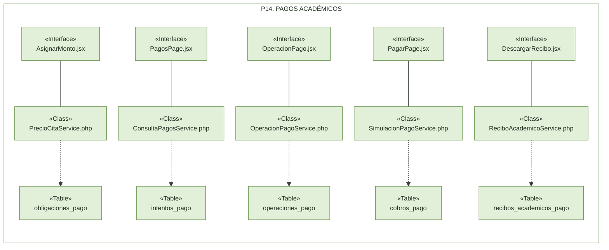

# Implementación de la Arquitectura de Subsistemas

Cada diagrama presenta tres filas: **«Interface»**, con las páginas React del frontend Vite; **«Class»**, con las clases PHP seleccionadas del backend Laravel; y **«Table»**, con las tablas PostgreSQL principales. Los recuadros muestran componentes existentes, no elementos futuros.

Las líneas continuas resumen la comunicación HTTP mediante los servicios del frontend y Axios. Las discontinuas resumen dependencias de persistencia mediante Services, Repositories y modelos Eloquent; no implican acceso SQL directo desde los controladores. Se seleccionan las relaciones más representativas, sin dibujar todas las dependencias compartidas.

### P1. Usuarios y autenticación

**Estado: Implementado localmente (CU-01–CU-06), con los límites funcionales documentados.**

Las ocho interfaces seleccionadas cubren acceso y cierre de sesión, administración de cuentas, registro/vinculación de Pacientes, alta y activación del personal, cambio de contraseña y restablecimiento. `RegisterPatientPage.jsx` atiende tanto registro como vinculación; `VerifyRegistrationPage.jsx` completa la verificación y `ForgotPasswordPage.jsx` solicita la recuperación, sin añadir más cajas a la muestra.

Las líneas continuas resumen llamadas mediante servicios frontend, Axios y controladores HTTP hacia las seis clases de negocio representadas; no son llamadas PHP directas desde React. Las dependencias discontinuas pasan por repositorios y Eloquent. No se añaden símbolos de interfaces provistas/requeridas: las páginas React no son contratos UML de servicios.

`usuarios` también es compartida por autenticación, registro, invitaciones, cambio y recuperación: se omiten esos enlaces repetidos. La dependencia de `ClaveService.php` hacia `tokens_acceso` indica la invalidación de recuperaciones anteriores; esa tabla almacena credenciales temporales de seguridad, no JWT de sesión.

El Administrador conserva acceso a 28 de los 30 casos de uso, excepto CU-04 y CU-08; representar el registro en este paquete no le concede esa operación personal.

**Fuentes contrastadas:** páginas, `LogoutButton.jsx` y servicios de `frontend/src/features/auth/` y `frontend/src/features/usuarios/`; controladores, servicios y repositorios del módulo `usuarios` en el backend; migraciones de `backend/src/data/database/migrations/`; estados de CU-01–CU-06 en `docs/ai/diagrama-clases.md`, §5. El SVG conserva texto vectorial y nombres completos en etiquetas accesibles, aunque algunos se distribuyan en dos líneas.

### P2. Pacientes y perfil personal

**Estado: Implementado en código (CU-07–CU-08), verificado por inspección estática.**

La selección cubre alta y edición administrativa, emisión del código de activación, perfil propio y cambio verificado del correo de acceso. Administrador y Recepción gestionan fichas y códigos; solo el Paciente actualiza su perfil y correo de acceso. La ficha admite CI ausente en el registro administrativo, sin ofrecer vinculación web sin CI.

Se omiten las páginas de listado/detalle y `PatientActivationPage.jsx`, que incorpora `ActivationCodePage.jsx`, además de formularios, hooks, servicios HTTP y controladores intermediarios. `PacienteService.php` también gestiona el contacto de emergencia; `MiPerfilService.php` reutiliza `pacientes`. El cambio de correo reutiliza el módulo `usuarios`, verificaciones, sesiones y tokens de seguridad de P1; se omiten sus enlaces secundarios, coordinación del registro pendiente y bitácora. Correo de contacto y correo de acceso siguen siendo distintos.

### P3. Médicos y especialidades

**Estado: Implementado en código (CU-09–CU-10), verificado por inspección estática.**

Las páginas administrativas permiten consultar, crear, editar y cambiar el estado profesional o de la especialidad, y gestionar las asociaciones habilitadas en `medico_especialidad`. Los dos Services se reutilizan entre páginas; no hay una clase por rol. Estas operaciones están restringidas al Administrador.

Se omiten `DoctorDetailPage.jsx`, `SpecialtyDetailPage.jsx`, formularios y capas HTTP/Repositories/Eloquent intermediarias. `MedicoService.php` también consulta especialidades, cuentas y citas para validar asociaciones, reactivaciones y retirada de especialidades; la coordinación administrativa y la bitácora son compartidas. El vínculo de cuenta y el estado profesional no son equivalentes; las referencias históricas no se eliminan al deshabilitar asociaciones.

### P4. Consultorios, horarios y disponibilidad

**Estado: Implementado en código (CU-11–CU-12 y consulta de disponibilidad compartida con CU-13), verificado por inspección estática.**

Se representan edición de consultorios, asignación fija al Médico, horarios, duración vigente y consulta de turnos. La administración corresponde al Administrador; la disponibilidad está autorizada para Administrador, Recepción y Paciente. `DisponibilidadTurnos.jsx` se integra en `ReservarCitaPage.jsx`: consultar o seleccionar un turno no registra ni garantiza una cita; aquí no se desarrolla la reserva.

Se omiten listados/detalles, servicios HTTP, controladores, repositorios y modelos. Los enlaces inferiores seleccionan una dependencia por Service, no todas: asignación también consulta consultorios, horarios y citas, y registra cambios de ubicación explícitamente confirmados en `cambios_cita`; horarios y duración verifican cobertura y conflictos. Disponibilidad lee además configuración, horarios, consultorio, Médico, especialidad, asociación habilitada y Paciente. Se comparten `PlanificacionRepository.php`, `IntervalosAtencion.php`, autenticación y auditoría; no existen tablas independientes de disponibilidad ni una base por paquete.

### P5. Registro y reserva de citas médicas

**Estado: Implementado en código (CU-13–CU-14), verificado por inspección estática.**

`ReservarCitaPage.jsx` coordina catálogos, selección y propuesta; `DisponibilidadTurnos.jsx` consulta turnos orientativos y `ReservaRegistro.jsx` presenta la revisión, confirmación y consulta del resultado incierto. Paciente reserva solo para sí; Administrador y Recepción usan la misma página para un Paciente seleccionado. El servidor revalida al guardar y crea la cita `Programada`, no `Confirmada`.

Se omiten `ReservaCatalogo.jsx`, hooks, servicios HTTP, controladores y repositorios intermediarios; el enlace de `ReservaRegistro.jsx` pasa por callbacks y `useReservaRegistro`. `ReservaService.php` reutiliza `DisponibilidadService.php` antes de persistir mediante `CitaRepository.php`; se omite ese enlace interno y la lectura de ocupación de `citas` desde disponibilidad. También se omiten recursos compartidos de P4 (horarios, consultorio, configuración y asociaciones), ficha de Paciente, autenticación, propuesta firmada y bitácora. Repetir clases/tablas compartidas en estos diagramas no duplica el software ni crea tablas de turnos o propuestas.

### P6. Reprogramación y cancelación

**Estado: Implementado en código (CU-15–CU-16), verificado por inspección estática.**

`ReprogramacionCita.jsx` y `CancelacionCita.jsx` se integran en `GestionCitaPage.jsx`, exclusiva de Administrador y Recepción; sus escrituras pasan por callbacks y `useGestionCita`, no por llamadas directas a PHP. Reprogramar consulta alternativas y conserva la misma cita, retornando a `Programada`; cancelar conserva el registro y libera el intervalo. Ambas operaciones verifican la revisión original y registran ejecutor y cambios en `cambios_cita`.

Se omiten la página contenedora, resumen, hooks y capas HTTP/Repositories/Eloquent. `GestionCitaService.php` reutiliza disponibilidad al revalidar el nuevo turno; los enlaces inferiores resumen lecturas/escrituras mediante `DisponibilidadRepository.php` y `CitaRepository.php`, sin dibujar cada recurso de P4. Se omiten consultas de identidad compartidas con agenda, comprobación de consulta clínica asociada, autenticación, coordinación de planificación, invalidación de avisos existentes y bitácora; cancelar no depende de consultar alternativas.

### P7. Estados de citas y control de asistencia

**Estado: Implementado en código (CU-17–CU-19), verificado por inspección estática.**

Una página y un componente de confirmación compartidos atienden llegada, inasistencia y atención mediante `AsistenciaService.php`. Administrador y Recepción registran llegada (`Confirmada`) o ausencia comprobada (`Inasistencia`); Administrador o Médico responsable marcan `Atendida`, conservando ejecutor y responsable separados. La elegibilidad se decide en el servidor; no hay inasistencia automática ni consulta clínica creada por marcar atención.

Los enlaces resumen `useAsistenciaCita`, servicio HTTP, controlador, `CitaRepository.php` y modelos `Cita`/`CambioCita`; la confirmación delega por callback de la página. Se omiten `AsistenciaResumen.jsx`, selección desde agenda/detalle, consulta de etiquetas de identidad y dependencias de autenticación, Médico, planificación, existencia de consulta clínica, avisos y bitácora. Las transiciones guardan estado e historial en la misma transacción; llegada conserva avisos existentes, mientras inasistencia/atención los invalidan.

### P8. Agenda e historial de citas

**Estado: Implementado en código (CU-20–CU-21), verificado por inspección estática.**

`AgendaPage.jsx` consulta la agenda propia del Médico o la del profesional seleccionado por Administrador/Recepción. `HistorialCitas.jsx`, reutilizado por `MisCitasPage.jsx` e `HistorialCitasPage.jsx`, consulta citas propias del Paciente o el historial administrativo de una ficha seleccionada. `CitaDetallePage.jsx` presenta el detalle autorizado; los tres Services leen `citas`, sin tablas independientes de agenda o historial.

Se omiten las páginas contenedoras del historial, selección de Paciente, filtros, tablas visuales, `AgendaWorkspace`, hooks, servicios HTTP y controladores. Los enlaces inferiores resumen `AgendaRepository.php`, compartido por los tres Services; se omiten sus lecturas de `medicos`, `pacientes` y `especialidades`, y la autenticación. Las consultas aplican ámbito, filtros y paginación en el servidor; no modifican estados ni acreditan disponibilidad para reservar. Reutilizar piezas de otros paquetes no duplica el software.

### P9. Historia clínica y consultas médicas

**Estado: Implementado en código (CU-22–CU-23), verificado por inspección estática.**

Historia, detalle y versiones internas comparten `HistoriaClinicaService.php`; el editor registra o corrige mediante `ConsultaMedicaService.php`, con una consulta por cita y versiones de contenido y antecedentes. Administrador y Médico responsable editan durante una atención real autorizada, conservando ejecutor y responsable; el Paciente solo consulta información vigente propia y Recepción no accede a clínica. Guardar no marca la cita `Atendida`.

Se omiten formularios, selección, hooks y capas HTTP/Repositories/Eloquent. Los enlaces seleccionan lectura de `consultas_medicas` y escritura de las dos tablas de versiones; también existen creación de consulta desde el Service de escritura y lectura de versiones desde el de historia. Se omiten la lectura de contexto del editor y su reconsulta tras guardar, ficha propia, citas, Médico, planificación, continuidad administrativa, autenticación, bitácora y metadatos de estudios. La historia se compone desde registros existentes: no hay una tabla `historia_clinica` independiente.

### P10. Laboratorio digital

**Estado: Implementado en código (CU-24–CU-27), verificado por inspección estática.**

La selección cubre solicitud de estudios sobre una consulta existente, carga/corrección administrativa, revisión/devolución/publicación y consulta/descarga protegida. `GestionDocumentoLaboratorio.jsx`, `GestionRevisionResultado.jsx` y `DescargarResultado.jsx` se integran en `SolicitudLaboratorioPage.jsx`. Administrador o Médico responsable solicitan y revisan, con ejecutor real separado; solo Administrador incorpora documentos. El Paciente solo descarga su versión vigente publicada; Administrador y Médico responsable acceden al documento vigente autorizado para su gestión. Recepción no accede.

Se omiten la página de detalle, formularios, versiones visuales, hooks y capas HTTP/Repositories/Eloquent. Se selecciona una dependencia de persistencia por Service: carga también crea `versiones_resultado` y actualiza solicitudes; revisión registra la decisión y actualiza la publicación; lectura combina las cuatro tablas. Los bytes PDF/imagen no están en PostgreSQL: `ArchivoLaboratorio.php` gestiona almacenamiento privado y apertura autorizada, sin URL pública. Se omiten sus enlaces, verificaciones de contexto clínico, autenticación, planificación, continuidad y bitácora; cargar no publica ni cambia la cita o la consulta.

### P11. Recordatorios automáticos

**Estado: Implementado en código (CU-28), incluidos avisos internos y Web Push opcional; operación y entrega real no verificadas en esta revisión.**

`RecordatoriosPage.jsx` consulta avisos propios del Paciente o del paciente seleccionado por Administrador; no los genera. `AltaPush.jsx` y `DispositivosPush.jsx` permiten consentimiento, alta y revocación exclusivamente del titular. El scheduler invoca cada minuto `RecordatorioService.php` para generar avisos internos y preparar el outbox, y `DespachoPushService.php` para transmitirlo; no existe llamada React al despacho. Los avisos internos no exigen cuenta web; el envío push revalida cuenta, consentimiento y cita antes de su inicio.

Se selecciona una dependencia de persistencia por Service; generación también lee suscripciones y crea envíos, y despacho consulta avisos/suscripciones y actualiza el outbox. Se omiten hooks, servicios HTTP, controladores, repositorios, modelos, citas, preferencias, autenticación, planificación y bitácora compartidas. El transporte existente `TransportePush.php` usa Web Push/VAPID; `pushBrowser.js` registra `public/push/sw.js`, que muestra texto genérico y abre `/recordatorios` sin caché clínica. No se dibujan como interfaces React ni se simula comunicación HTTP del frontend con el dispatcher. El canal está deshabilitado por defecto: configuración efectiva, claves, scheduler operativo y entrega a dispositivos no comprobados; aceptación no garantiza entrega, lectura ni sonido.

### P12. Consultas y reportes administrativos

**Estado: Implementado en código (CU-29), verificado por inspección estática; sin exportación CSV/PDF opcional en el alcance revisado.**

`ReportesPage.jsx` reúne las siete consultas: citas programadas por fecha, por Médico, especialidad y estado, pacientes registrados, cantidades de Atendidas/Canceladas/Inasistencia y agenda diaria. Solo Administrador accede; el servidor aplica filtros, períodos, paginación y agregaciones. Las dos tablas representadas son compartidas: no existe una tabla `reportes` ni se duplican datos para este paquete.

Se omiten filtros/tablas visuales, hook compartido de agenda, servicio HTTP, controlador y `ReporteRepository.php`/modelos. El repositorio también lee `medicos` y `especialidades`; para agenda diaria `ReporteService.php` delega en `AgendaService.php` y `AgendaRepository.php` de P8. Estos enlaces, autenticación y proyecciones administrativas se omiten para mantener legibilidad; las flechas inferiores no atribuyen la agenda diaria a ReporteRepository.

### P13. Bitácora del sistema

**Estado: Implementado en código (CU-30), verificado por inspección estática.**

Listado y detalle consultan `BitacoraService.php`, exclusivo del Administrador y de solo lectura. Se aplican filtros y paginación, con orden descendente por `registrado_en` e `id_evento`. No hay acciones HTTP para editar o borrar; la migración protege la tabla contra actualización, eliminación y truncado.

Se omiten `BitacoraWorkspace.jsx`, filtros, tabla visual, hooks, servicios HTTP, controlador, `BitacoraRepository.php` y modelo `Bitacora`. Los demás módulos registran eventos mediante el repositorio compartido, no mediante estas páginas lectoras; se omiten esos enlaces y la autenticación. La consulta presenta metadatos y referencias seguras, no documentos, credenciales ni contenido clínico.

### P14. Pagos académicos

**Estado: Implementado en código (CU-31–CU-34 y ampliaciones de precio/coordinación de citas, simulación persistente y recibo académico), verificado por inspección estática; configuración efectiva, esquema instalado y operación externa no verificados. Ampliación aprobada, no exigencia del examen.**

El documento existente utiliza SVG enlazados, no bloques Mermaid. Para incorporar únicamente este paquete sin crear otro archivo, su representación se incluye en Mermaid editable: conserva el recuadro del paquete, las tres filas, las cajas verdes y la selección de enlaces continuos de comunicación y discontinuos de persistencia. No se modifica el diseño de P1–P13.

La selección cubre asignación posterior del monto, obligaciones/detalle/historial compartidos, operaciones con proveedores de prueba, pago académico persistente y descarga de recibo. `PagosPage.jsx` incorpora `HistorialPagos.jsx`, `OperacionPago.jsx` y `DescargarRecibo.jsx`; `RetornoPagoPage.jsx` reutiliza las operaciones externas sin acreditar éxito por volver al portal. Solo el Paciente titular inicia, consulta resultados operativos, captura o cierra sus intentos. El Administrador consulta por Paciente seleccionado y descarga el recibo autorizado, sin pagar por él; Administrador y Recepción asignan precio, no cobran por el titular. Médico no recibe permisos financieros. Emisor del precio, iniciador del pago, ejecutor de la cancelación, Paciente afectado y Médico responsable conservan sus identidades; consultar o pagar no atribuye autoría asistencial.

Se selecciona una dependencia de persistencia por Service, no todas: precio crea `obligaciones_pago`; consulta lee `intentos_pago` y también obligaciones, cobros y devoluciones; operaciones externas preparan `operaciones_pago` mediante `StripePagoService.php`/`PayPalPagoService.php` y sus repositorios; simulación registra `cobros_pago`, además de intentos y operaciones; recibos consulta `recibos_academicos_pago` mediante su repositorio y reutiliza la autorización de la obligación. `SimulacionPagoService.php` invoca la emisión del recibo en la misma transacción del cobro simulado aplicado; se omite ese enlace interno para conservar las tres filas. Se reutiliza persistencia común, no un segundo libro financiero ni evidencia externa ficticia. Aprobar PayPal no liquida; tampoco lo hacen un retorno, un formulario o una descarga.

`AsignarMonto.jsx` y `DescargarRecibo.jsx` se integran también en el detalle de cita mediante `FinanzasCita.jsx`. La integración con P5 pasa por `ReservaService.php` y `PrecioCitaService.php`: al habilitar incorporación, la reserva administrativa emite obligación con precio histórico y la propia queda sin precio hasta asignación autorizada. Con P6, `GestionCitaService.php` invoca `CoordinacionFinancieraCitaService.php`: reprogramar conserva precio/cobro y ajusta vencimiento si exigible y no liquidada; cancelar retira exigibilidad y coordina devolución del cobro aplicado, simulada localmente si ese fue su origen. No se alteran P5/P6 para repetir esos enlaces. La proyección financiera autorizada de detalle/historial de citas se reutiliza con P8; no amplía la respuesta del Médico ni el acceso de Recepción al historial financiero general. Vencimiento financiero no es un sexto estado de cita y el impago no bloquea atención.

Se omiten filtros, formularios, hooks, servicios HTTP, controladores, DTOs, Repositories/Eloquent intermediarios, autenticación, bitácora y tablas compartidas de citas/identidades. También se omiten las cajas de gateways, recepción de eventos, recuperadores y devoluciones externas: existen implementaciones separadas Stripe test/PayPal Sandbox, y `pagos:conciliar` invoca cada minuto `ConciliacionPagosService.php` para los proveedores habilitados, sin llamada React al scheduler. La demostración visual `DemostracionPagosPage.jsx` no persiste pagos y no se conecta a tablas en este diagrama. El PDF se genera desde la instantánea mediante `ReciboAcademicoPdf.php`/Dompdf y se entrega con sesión y autorización del recurso; no es un archivo público ni una factura fiscal. Descargar no emite ni reescribe recibos; una cancelación conserva el original y muestra la devolución aparte.

**Fuentes contrastadas:**

- **Interfaces y comunicación:** `frontend/src/features/pagos/{pages,components,hooks}/`, `services/pago.service.js` (`consultarPagos`, `operarPago`, `operarSimulacion`, `proponerMonto`, `confirmarMonto`, `descargarRecibo`); `frontend/src/app/router.jsx`; rutas de `backend/src/presentation/routes/pagos.php` y controladores del módulo `pagos`. Estas cadenas sustentan los cinco enlaces superiores; no son llamadas PHP directas desde React.
- **Servicios y persistencia:** `backend/src/business/services/pagos/{PrecioCitaService,ConsultaPagosService,OperacionPagoService,StripePagoService,PayPalPagoService,SimulacionPagoService,ReciboAcademicoService}.php`; `backend/src/data/repositories/pagos/{ObligacionPagoRepository,StripePagoRepository,SimulacionPagoRepository,ReciboAcademicoRepository}.php` y modelos correspondientes. Los cinco enlaces inferiores resumen esas delegaciones, incluido el despacho de operaciones a los servicios concretos; no indican SQL directo.
- **Tablas y ampliaciones:** migraciones `2026_11_05_000040_create_pagos_persistence.php`, `2026_11_06_000041_add_simulacion_academica_to_pagos.php` y `2026_11_06_000042_create_recibos_academicos_pago.php`, en `backend/src/data/database/migrations/`. Definen las tablas seleccionadas, separación del origen simulado e instantánea histórica; su existencia en código no demuestra aplicación en una base habitual/remota.
- **Integración y límites:** `ReservaService.php`, `GestionCitaService.php`, `CoordinacionFinancieraCitaService.php`, `ResumenFinancieroCitaService.php`, `ConciliacionPagosService.php`, `backend/routes/console.php`, `backend/config/pagos.php`, `HabilitacionAcademicaService.php`, `ReciboAcademicoController.php` y `ReciboAcademicoPdf.php`. La simulación exige habilitación y esquema; permite local/testing o instalación dedicada `academic` bajo condiciones adicionales, nunca `production`. Los proveedores externos siguen separados de la simulación y apagados por defecto en la configuración versionada; no se inspeccionan secretos ni configuración efectiva.
- **Decisiones vigentes:** `pasarela-pagos.md`, `pagos-simulacion-persistente.md`, `pagos-academico-publicado-recibo.md` y CU-31–CU-34 de `casos-de-us.md`, §4.14; CU-33 es consulta del historial propio. Las notas antiguas de «no implementado» en AGENTS y estados históricos de esas fuentes no describen el código actual; las decisiones posteriores aprobadas y las cadenas inspeccionadas sustentan P14, no una certificación operativa.

## Resumen de los paquetes inspeccionados

- **Implementados en código:** P1–P14; P1 conserva su calificación local aprobada y P2–P13 se contrastaron estáticamente en sus respectivas revisiones. P14 se contrastó estáticamente con las decisiones posteriores de Pagos, incluida simulación persistente y recibos. No equivale a certificación funcional o de producción.
- **Parciales o pendientes de implementación:** ninguno identificado en las piezas principales representadas. P11 incluye transporte, dispatcher y frontend push existentes; su configuración efectiva, operación del scheduler y entrega real quedan sin verificar, no se confunden con piezas futuras. P12 no incluye la exportación opcional.
- **Cobertura y coherencia documental:** catorce paquetes en orden cubren CU-01–CU-34; disponibilidad se comparte entre P4/P5 y CU-13. Se conservan los trece SVG de las revisiones anteriores; P14 incorpora Mermaid en este archivo, sin añadir recursos externos. Componentes, servicios y tablas compartidos representan reutilización sobre una única PostgreSQL, no software duplicado. Se conservan los cinco estados de cita, `Confirmada` como llegada y estados de laboratorio separados; los estados del outbox y la situación financiera no son estados de cita.
- **Límite de la revisión:** P1–P13 permanecen intactos; la revisión actual se limita a P14 y su integración documental, no constituye auditoría funcional exhaustiva ni nueva validación de los paquetes anteriores. No se verifican esquema/configuración efectivos, scheduler operativo, proveedores externos ni despliegue de Pagos. Se conserva como antecedente la Fase 4 documental pendiente de aprobación; esta ampliación no declara aprobada la entrega completa.
